## Event Streams for Data Mesh

## 面向数据网格的事件流

An event is published to an event stream for use by any interested subscribers. But what are the properties of an event stream and are they any different than a queue? Or a messaging system? What makes up an event, and how do we ensure we correctly compose reusable event streams? In this chapter, we’ll take a good look at events and event streams, including requirements, differentiation from other similar architectures, and some of the modes of use that they unlock for our consumer services.

事件被发布到事件流中，供任何感兴趣的订阅者使用。但是事件流的属性是什么，它们与队列有什么不同吗？或者与消息系统有什么不同吗？事件由什么组成，我们如何确保正确地组合可重用的事件流？在本章中，我们将深入探讨事件和事件流，包括要求、与其他类似架构的区别，以及它们为我们的消费者服务解锁的一些使用模式。

First, let's start with the event. An *event* is a well-defined record of an occurrence containing all of the information about what happened. Events are commonly based on business entities or on relationships between entities. For a simple automotive example, we could expect to see entity events detailing information about *items*, *orders*, and *coupons*. In terms of relationships between entities, you may expect to see events such as *item_added_to_cart* and *coupon_applied_to_order*.

首先，让我们从事件开始。一个*事件*是对发生情况的定义明确的记录，包含关于发生了什么的所有信息。事件通常基于业务实体或实体之间的关系。以简单的汽车示例，我们可能会期望看到关于*项目*、订单和*优惠券*的实体事件详细信息。在实体关系方面，你可能会期望看到诸如*商品添加到购物车*和*优惠券应用于订单*这样的事件。

We’ll get more into precisely what events are, how they’re structured, and the supporting technologies we’ll need to use in a moment. First, it’s important to understand a few key concepts about the role that event streams play in an event-driven data mesh.

我们稍后将深入探讨事件究竟是什么、它们如何结构化，以及我们需要使用的支持技术。首先，了解事件流在事件驱动型数据网格中所扮演角色的几个关键概念非常重要。

Figure 3-1 shows an extension of the automotive domain bounded context from Figure 2-1. The internal implementation uses a relational database, with tables representing the components/entities required to compose an automobile. The anti-corruption layer provides the REST API for operational use cases, such as requesting the assembly of a new automobile and modifications to existing inventory.

图 3-1 展示了从图 2-1 扩展的汽车领域限定上下文。内部实现使用关系数据库，表格代表组成汽车所需的组件/实体。防腐层为操作用例提供 REST API，例如请求组装新汽车和对现有库存进行修改。

Additionally, the domain publishes two data products to event streams—one based on items and the other based on orders. Specialized business logic extracts and isolates the internal model from the data published to the event stream. Whatever you choose to expose via your anti-corruption layer becomes part of the public API, so be careful about what you add and how you add it.

此外，该领域向事件流发布两个数据产品——一个基于项目，另一个基于订单。专业化的业务逻辑从发布到事件流的数据中提取并隔离内部模型。您通过防腐层选择暴露的任何内容都将成为公共 API 的一部分，因此要小心添加什么以及如何添加。

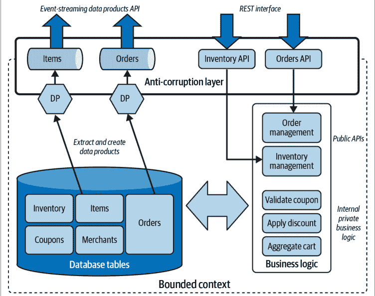

Figure 3-1. An ecommerce domain including an event-stream API for data products and a REST API for operational concerns

图 3-1. 包含用于数据产品的事件流 API 和用于操作问题的 REST API 的电子商务领域

Note that the internal implementation need not be event-driven to extract or use event-driven data products. Chapter 8 covers integrating nonevent-driven systems with event-driven ones and the options you have for bridging the gap. You may also note that we’re incorporating traditional request-response options alongside event streams. This is a very common pattern for systems of record that are not event-driven but need to provide well-formed data products for external consumers. We simply maintain the existing APIs and add on event-driven data products based on consumer needs and the existing data requirements.

请注意，内部实现不需要是事件驱动的才能提取或使用事件驱动型数据产品。第 8 章介绍了将非事件驱动系统与事件驱动系统集成以及弥合差距的可用选项。您还可能注意到，我们将传统的请求-响应选项与事件流结合使用。这是非事件驱动但需要为外部消费者提供格式良好的数据产品的记录系统的非常常见模式。我们只是维护现有 API，并根据消费者需求和现有数据要求添加事件驱动型数据产品。

Figure 3-2 shows an abstracted implementation of an event-driven automotive domain, complete with domain events specific to the internal operational of the system.

图 3-2 展示了事件驱动型汽车领域的抽象化实现，包含特定于系统内部操作的领域事件。

You may choose to expose certain domain events to the outside world, but you must be careful about which ones you select to expose. We’ll cover event design and selecting which events to expose (and which to conceal) more in Chapter 7. At this stage, just be aware that you don't need an event-driven system to produce event streams and that not all event types are suitable for production as a data product.

您可以选择向外部暴露某些领域事件，但必须小心选择暴露哪些事件。我们将在第 7 章中更详细地介绍事件设计以及选择暴露哪些事件（以及哪些事件隐藏）。此时，只需意识到您不需要事件驱动系统来生成事件流，并且并非所有事件类型都适合作为数据产品进行生产。

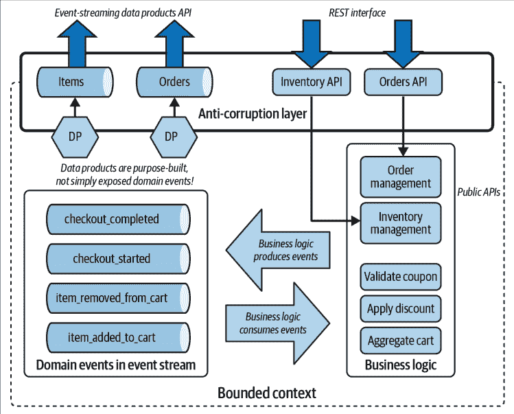

Figure 3-2. Data products are purpose-built for external usage and are meant to be coupled on. Domain events may not be suitable for data product purposes

图 3-2. 数据产品是为外部使用专门构建的，旨在被耦合。领域事件可能不适合用于数据产品目的

For now, let’s now take a closer look at events, records, and messages, as well as the relationship between an event stream and an event broker.

现在，让我们更深入地了解事件、记录和消息，以及事件流与事件代理之间的关系。

### Events, Messages, and Records

### 事件、消息和记录

An event is an occurrence in an application recorded into a record (the container holding the event data) and published to an event stream hosted by an event broker.

事件是应用程序中发生的情况，记录到记录（保存事件数据的容器）中，并发布到由事件代理托管的事件流中。

I generally avoid using the term message when discussing event streams and event-driven architectures because it’s a term that has adopted different meanings to different people over time. In common parlance, we send a message to a person or to a specific private group—an intended recipient and not a posting (like a message board) for public general-purpose use. In contrast, data products are meant to be broadcast and shared widely, with the intention of letting others subscribe to and use them however they choose (much like a public post on channel-based social media). For clarity's sake, I’ll use event or record instead of message for the remaining chapters of this book.

在讨论事件流和事件驱动架构时，我通常避免使用“消息”这个术语，因为它随着时间的推移被不同的人赋予了不同的含义。在日常用语中，我们向某个人或特定的私人群组发送消息——即预期的接收者，而不是像留言板那样面向公众的通用用途发布。相比之下，数据产品旨在广播和广泛共享，目的是让其他人根据自己的选择订阅和使用它们（很像基于频道的社交媒体上的公开帖子）。为了清晰起见，我在本书剩余章节中将使用事件或记录而不是消息。

Each logical record is made up of three components:

每个逻辑记录由三个组件组成：

#### The key

#### 键

The key is optional, but extremely useful. It contains a unique ID associated with the contents of the event, just like the primary key of a relational table. Data is almost always partitioned according to the key, such that all data of the same key goes to the same partition and consumer instance, allowing for vast amounts of data to be processed in parallel.

键是可选的，但非常有用。它包含与事件内容关联的唯一 ID，就像关系表的主键一样。数据几乎总是根据键进行分区，这样相同键的所有数据都会进入相同的分区和消费者实例，从而允许大量数据并行处理。

#### The value

#### 值

Contains the bulk of the data relating to the event. If the key can be thought of as the primary key of a row in a database table, then the value can be thought of as all of its column values. Every property and field recorded during the creation of the event should go in the value component. Values should always have a well-defined schema, whereas a key can contain a schema or a primitive.

包含与事件相关的大部分数据。如果可以将键视为数据库表中某行的主键，那么值可以被视为该行的所有列值。事件创建期间记录的每个属性和字段都应放入值组件中。值应始终具有定义良好的架构，而键可以包含架构或原始类型。

#### The header (also known as “record properties”)

#### 标题（也称为“记录属性”）

Contains metadata about the event itself, such as timestamps, tracking IDs, and other custom user-defined fields. Both the presence of a header and its format depend on what technologies you’re using to create and communicate events. Headers are commonly composed of a simple key-value map appended to the key-value pair.

包含关于事件本身的元数据，例如时间戳、跟踪 ID 和其他自定义用户定义的字段。标题是否存在及其格式取决于您用于创建和通信事件的技术。标题通常由附加到键值对的简单键值映射组成。

Figure 3-3 shows the structure of an event recording a sale of six items (in an array) purchased by user-id-6384291. The header contains both the timestamp that shows when the event was created as well as a custom_tracking_id specified by the event producer.

图 3-3 显示了记录用户 user-id-6384291 购买六个项目（数组中的）销售事件的结构。标题既包含显示事件创建时间的时间戳，也包含由事件生产者指定的 custom_tracking_id。

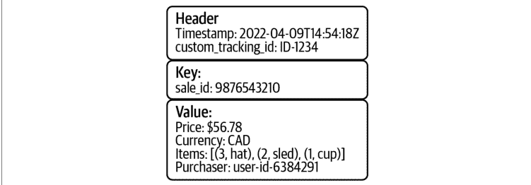

Figure 3-3. A sales event showing the purchase of six items

图 3-3. 显示购买六个项目的销售事件

One final thing to note: events are immutable. You can never modify an event once it is published to the event stream. Instead, you create and publish a new event containing the necessary correction or update. Immutability is essential for ensuring that every consumer has access to precisely the same data set and can reproduce the same results of a computation at a later point in time.

最后需要注意的是：事件是不可变的。一旦事件发布到事件流，您就永远无法修改它。相反，您创建并发布包含必要更正或更新的新事件。不可变性对于确保每个消费者都能访问完全相同的数据集，并且可以在稍后时间点重现相同计算的结果至关重要。

### What’s an Event Stream? What Is It Not?

### 什么是事件流？什么不是？

> The business facts are best presented as business Domain Events, can be stored and served as distributed logs of time-stamped events for any authorized consumer to access.
> 
> —Zhamak Dehghani

> 业务事实最好以业务领域事件的形式呈现，可以存储并作为时间戳事件的分布式日志提供，供任何授权消费者访问。
> 
> ——Zhamak Dehghani

Event streams are hosted on an event broker, with perhaps the most common option being Apache Kafka (a personal favorite of your author). The event broker, such as in the case of Kafka, provides a structure known as a topic that we can write our events to. It also handles everything from data replication and rebalancing to client connections and access controls. Publishers write events to the event stream hosted in the broker, while consumers subscribe to event streams and receive the events.

事件流托管在事件代理上，最常见的选项或许是 Apache Kafka（作者个人最爱）。事件代理（如 Kafka 的情况）提供一种称为主题的结构，我们可以将事件写入其中。它还处理从数据复制和再平衡到客户端连接和访问控制的一切。发布者将事件写入代理中托管的事件流，而消费者订阅事件流并接收事件。

In its most basic form, an event stream is a time-stamped sequence of business facts pertaining to a domain. Events form the basis for communicating important business data between domains in a reliable and repeatable way, leading us to the following requirements:

在最基本的形式中，事件流是关于某个领域的带时间戳的业务事实序列。事件构成了以可靠且可重复的方式在领域之间传达重要业务数据的基础，这引出了以下要求：

- **Immutable**
  Events cannot be modified once written to the log. Only new events may be added.

- **不可变**
  事件一旦写入日志就无法修改。只能添加新事件。

- **Durable and replayable**
  Events are durable, such that they can be consumed immediately or in the future.
  Events can be replayed by new and existing consumers alike, provided the event broker has sufficient storage to host the historical data.

- **持久且可重放**
  事件是持久的，因此可以立即消费或在未来消费。
  新旧消费者均可重放事件，前提是事件代理具有足够的存储空间来托管历史数据。

- **Scalability and indefinite storage**
  The event broker provides high availability, scalability, and indefinite retention, allowing the event stream to become the single source of truth for specific domain data.

- **可扩展性和无限存储**
  事件代理提供高可用性、可扩展性和无限保留，使事件流能够成为特定领域数据的单一真实来源。

Event streams rely on the durable append-only log, an immutable data structure that only permits appending of new data. Once written, data cannot be altered. The log is durable, such that consumers can consume the data as many times as they need. Events are not deleted once they are read, nor are they simply discarded in the case of an absence of consumers.

事件流依赖于持久的仅追加日志，这是一种仅允许追加新数据的不可变数据结构。一旦写入，数据就无法更改。日志是持久的，因此消费者可以按需多次消费数据。事件在读取后不会被删除，也不会在没有消费者的情况下被简单丢弃。


Figure 3-4 展示了一个带有两个分区的持久追加式日志。新数据会追加到两个分区中的某一个的末尾。每个独立的逻辑消费者由一个 _消费者组_ 表示，并负责消费事件并递增其组所属的偏移量指针。在拥有足够处理能力的情况下，逻辑消费者可以实时跟上数据流，而从较早偏移量开始的新消费者则需要处理所有事件才能赶上当前时间。

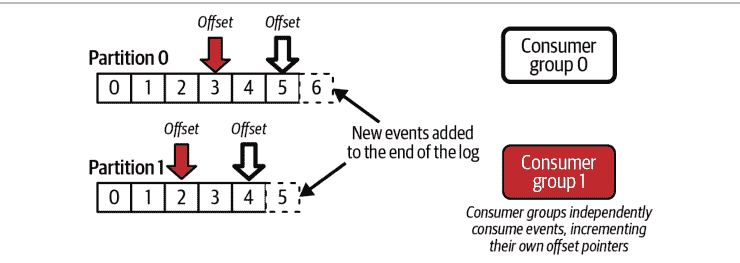

_图 3-4. 带有两个分区和两个独立消费者组的持久追加式日志_

不幸的是，由于悠久且常常混乱的历史，事件代理常常被与 _瞬态消息传递_ 和 _队列_ 混淆。这三种选项各不相同，无论是瞬态消息传递还是队列，都不适合用于构建事件驱动的数据网格。让我们快速看看原因。

## 瞬态消息传递

_通道_ 是用于在一个生产者和一个或多个订阅者之间传递消息的瞬态基底。消息不会存储任何显著的时间长度，也不会由代理写入持久存储。在系统故障或通道上缺少订阅者的情况下，消息会被简单地丢弃，提供至多一次交付。NATS.io 是这种实现形式的示例。

图 3-5 展示了一个单一生产者向事件代理中的瞬态通道发送消息。瞬态消息随后会传递给当前订阅的消费者。在此图中，Consumer `0` 获得消息 7 和 8，但 Consumer `1` 无法获得，因为它是新订阅的且无法访问历史数据。相反，Consumer `1` 只会收到消息 9 及任何后续消息。

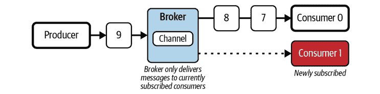

图 3-5. 转发消息的瞬态消息传递代理

瞬态通信非常适合简单性、低开销（无磁盘！）和易用性。它便于构建消息传递架构，尽管缺乏可靠性保证可能会限制其有用性。根据您的部署情况，它可能高可用，也可能不是高可用。

消息传递架构便于系统之间的点对点通信，这些系统不一定需要至少一次交付且可以容忍一定的数据丢失。例如，在线约会应用 Tinder 使用 NATS 来通知用户更新。如果消息未收到，也不是什么大事——错过给用户的推送通知对用户体验只有轻微（尽管是负面的）影响。

瞬态消息传递代理缺乏构建事件驱动数据产品所需的事件无限期保留、持久性和可重放性。消息传递架构对于当前操作目的的系统间事件驱动通信很有用，但完全不适合用于提供传递数据产品的手段。

## 排队

队列是等待处理的存储事件或消息的持久序列。更常见的用例之一是工作队列，生产者会发布“待办工作”事件。订阅者出队一个事件，对其进行处理，并向队列代理发出工作完成的信号，随后代理删除该事件。图 3-6 展示了两个订阅者从队列中消费事件。请注意，队列主要包含当前正在处理和尚未处理的事件。已经处理过的事件在被消费并由消费者标记为已处理后会被删除。

队列中不一定能保证处理顺序。虽然您可以通过每个分区（或队列）只允许一个消费者实例来强制执行处理顺序，但这可能会显著限制吞吐量。有多个订阅者按先到先得的方式异步（且竞争性地）选择、处理和确认事件，这相当常见。此外，延迟和网络分区可能导致竞争订阅者多次处理同一事件。

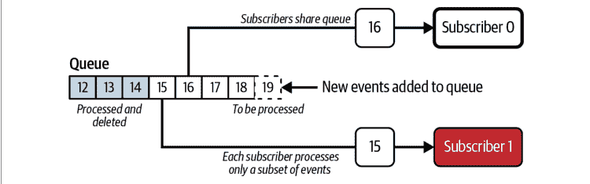

图 3-6. 两个订阅者各处理事件子集的队列

历史上，队列代理要求队列中存储的事件具有最大保留时间。如果事件在一定时间内未被处理，它们会被标记为死信，不再发送给订阅者，随后被删除。类似于瞬态通信，基于时间的保留和不可重放的数据影响了（错误的）观点，即代理不能用于无限期保留数据。

事件驱动的数据产品需要可重放性，且 _每个_ 消费者必须获得 _所有_ 事件，顺序必须与发布时 _完全相同_。


现代队列代理倾向于通过采用持久追加式日志来同时支持可重放性和事件无限期保留，我们将在下一节中更详细地介绍这一点。例如，Solace 和 RabbitMQ Streams 都允许单个消费者重放队列事件。然而，这些系统在支持现代数据网格所需的严格顺序语义、无限期重放性和可扩展性要求方面存在困难。

队列最好在单个应用程序级别使用，作为 _缓冲区_，用于输入事件或进程间通信。它们对于确保每个事件只由一个消费者处理非常有用，但不适合作为传递完整数据集以构成事件驱动数据产品的通道。

在下一节中，我们将了解消费者如何使用事件流提供的事件。

事件流支持事件驱动的业务逻辑。在消费事件后，消费者应用程序可以更新其状态、执行逻辑、联系其他系统并生成其自身事件，仅举几例。订阅多个事件流的消费者会执行特定于该流的业务逻辑，将数据集成到其应用空间中。

状态事件是构成大多数事件驱动数据产品的关键组件。让我们更仔细地看看这些。

## 状态事件和事件携带状态传递

状态事件包含事件创建时特定业务实体的整个公共状态。可以将状态事件视为数据库表中的一行——它包含与该实体相关的所有数据，即您作为数据产品所有者希望向外部公开的数据。它不包含源域私有的任何状态。

对行的任何更改都会简单地导致一个新事件，其中包含现在已更新数据的完整副本（包括未更改的内容），并追加到不可变事件流中。这种模型非常强大，并通过一种称为事件携带状态传递（ECST）的模式，构成了事件驱动数据网格的基础。

正如其名称所暗示的，事件携带关于实体的状态，并允许将异步的最终一致状态传输给数据的消费者。每个消费者都可以通过一种称为物料化（参见下一节）的过程来重新创建状态，其中状态的只读模型可以被任何需要它的消费者重新创建和处理。

您的事件定义可以随时间变化和演进，我们将在第 6 章中更详细地讨论这一点。在向事件添加新字段时，数据产品所有者需要决定是重新发布包含新字段的更新状态事件，还是仅将其包含在未来的新事件中。在关系型数据库表中，这类似于添加一个新列，然后运行迁移作业以将该列填充到表中的每一行。

第 7 章更详细地介绍了状态事件和动作事件两种类型，包括每种类型的变体、权衡以及每种类型最适合使用的场景。与此同时，让我们先继续使用状态模型，因为它构成了大多数事件驱动数据网格通信的基础。


## Materializing Events

Materialization is the process of consuming an event and merging it into your own local data store. If a record with the same primary key already exists in that store, it is usually simply overwritten, though you may choose to implement more complex merging logic if you choose.

物质化是消费事件并将其合并到本地数据存储中的过程。如果该存储中已存在具有相同主键的记录，通常会简单地覆盖它，尽管你可以选择实现更复杂的合并逻辑。

In practice, consumers don't usually need to store the entire event contents, but only the subset of data relevant to its domain. This substantially reduces the amount of data stored and processed, and helps keep the footprint of the consumer service small.

在实践中，消费者通常不需要存储整个事件内容，而只需存储与其领域相关的数据子集。这大大减少了存储和处理的数据量，并有助于保持消费者服务的足迹较小。

Figure 3-7 shows a consumer materializing the item event stream into its own state store. The consumer has decided to keep only the most recent record and to discard the older values for a given item. In this example, item key = 123 has been updated by the change of type from hat to helmet, as represented by the event at offset 2. Upon consumption, the consumer commonly evicts the previous materialized value for that key (offset 0) by overwriting the data in the database with the newest values. In some cases, you may want to keep a list of previous entries for a given key, a subject we'll cover more in “Slowly Changing Dimensions” on page 193.

图 3-7 展示了一个消费者将物品事件流物质化到其自身状态存储中的过程。该消费者决定仅保留最新记录，并丢弃给定物品的较旧值。在此示例中，物品键 = 123 已通过将类型从帽子更改为头盔来更新，如偏移量 2 处的事件所示。消费时，消费者通常会通过用最新值覆盖数据库中的数据来驱逐该键（偏移量 0）的先前物质化值。在某些情况下，你可能希望为给定键保留先前条目的列表，我们将在第 193 页的“慢速变化维度”中更多地讨论此主题。

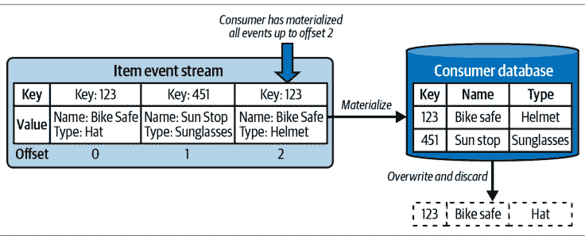

Figure 3-7. A consumer materializing the item event stream into its local database

图 3-7. 消费者将物品事件流物质化到其本地数据库中

Thanks to materialization, consumers can also execute logic based on changes from one event to another, since they retain the “current” state in memory and obtain the “new” state from the event stream. They can infer changes to any field within the event, which provides them with exceptional flexibility in how they use and process the event data.

归功于物质化，消费者还可以根据一个事件到另一个事件的变化执行逻辑，因为它们在内存中保留了“当前”状态，并从事件流中获取“新”状态。它们可以推断事件中任何字段的变化，这为它们使用和处理事件数据的方式提供了卓越的灵活性。

Up next: materialization's fancier and often more complex cousin, aggregation.

接下来：物质化更花哨且通常更复杂的表亲，聚合。

## Aggregating Events

An _aggregation_ is an entity composed by merging multiple state events together. An aggregation could be as simple as a running sum but could also entail using multiple event types to build a more complex result. Figure 3-8 shows two instances of a single consumer application processing two partitions from a single event stream.

一个 _聚合_ 是由合并多个状态事件而组成的实体。聚合可能像运行总和一样简单，也可能涉及使用多种事件类型来构建更复杂的结果。图 3-8 展示了单个消费者应用程序处理来自单个事件流的两个分区的两个实例。

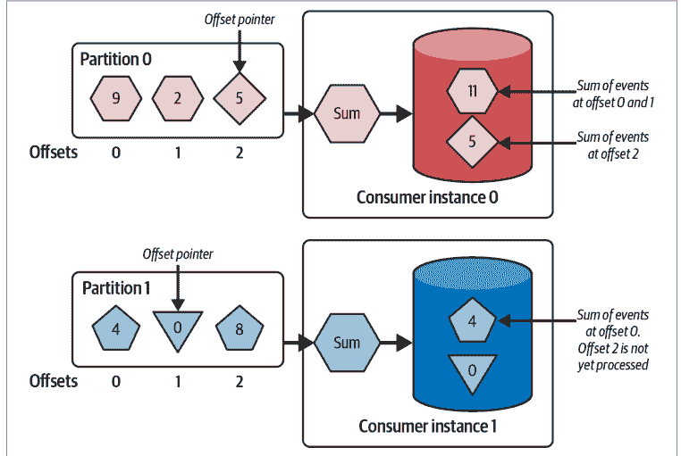

_Figure 3-8. Aggregating state local to each consumer instance. The key is represented by the shape of the event._

_图 3-8. 聚合每个消费者实例本地的状态。键由事件的形状表示。_

Consumer instance 0 has processed all of the events in its assigned partition 0 and is awaiting new incoming events. The database within its boundary shows the current SUM aggregations that it has computed. Meanwhile, Consumer instance 1 is still processing historical data from its assigned partition 1 and is catching up to the current head event.

消费者实例 0 已处理其分配的分区 0 中的所有事件，并正在等待新的传入事件。其边界内的数据库显示了它计算的当前 SUM 聚合。与此同时，消费者实例 1 仍在处理其分配的分区 1 中的历史数据，并正在赶上当前头事件。

One of the major advantages of event-driven data products is that they make it very easy for you, as a consumer, to build your own aggregates. Instead of relying on the data product owner to build your aggregates for you, you can simply ingest the data into your own domain and aggregate it according to your own needs. If your derived data product is “just” an aggregation, you could consider republishing it to the data mesh as an aggregate-aligned data product (recall “The Three Data Product Alignment Types” on page 33). Alternatively, you may choose to make a consumer-aligned data product if you end up building an aggregation with more complex business logic that joins and mixes multiple input streams.

事件驱动数据产品的主要优势之一是，它们使你作为消费者能够非常轻松地构建自己的聚合。不依赖数据产品所有者为你构建聚合，你可以简单地将数据摄取到自己的领域，并根据自己的需求进行聚合。如果你的派生数据产品“只是”一个聚合，你可以考虑将其重新发布到数据网格中作为聚合对齐的数据产品（回顾第 33 页的“三种数据产品对齐类型”）。或者，如果你最终构建了一个具有更复杂业务逻辑且连接和混合多个输入流的聚合，你可以选择制作消费者对齐的数据产品。

While this strategy does require extra work on your part, it also provides you with substantial _operational freedom_: you can simply change your computation and replay the event stream to rebuild the results instead of relying on the upstream data product owner to redefine and re-create the aggregate for you.

虽然此策略确实需要你额外的工作，但它也为你提供了大量的 _操作自由_：你可以简单地更改计算并重放事件流以重建结果，而不依赖上游数据产品所有者为你重新定义和重新创建聚合。

However, building your own aggregates brings the risk that a peer in another domain may be computing the same aggregate, with logic that doesn’t match yours. As your data mesh evolves, expect to see aggregations in consumer domains moved upstream to become formal aggregate data products, reducing the risk of similar-yet-different and duplicate aggregates.

但是，构建自己的聚合会带来风险：另一个领域中的同行可能正在计算相同的聚合，但其逻辑与你的不匹配。随着你的数据网格不断发展，预计会看到消费者领域中的聚合被上移，成为正式的聚合数据产品，从而降低相似但不同以及重复聚合的风险。

## Operations, Analytics, and Limited Resources

Renegotiating team responsibilities is part of implementing a data mesh. But one of the risks is that this renegotiation can become untenable for those holding new responsibilities, especially if they lack sufficient resources. For example, a very popular source domain may find itself responsible for creating a large number of different kinds of data products but be unable to dedicate sufficient resources to the efforts.

重新谈判团队职责是实施数据网格的一部分。但其中一个风险是，这种重新谈判可能对于承担新职责的人来说变得不可持续，尤其是当他们缺乏足够资源时。例如，一个非常受欢迎的源领域可能会发现自己负责创建大量不同类型的数据产品，但无法为此投入足够的资源。

The reality is that we live in a world with multiple competing requirements. While data mesh can prescribe clean and neat boundaries about who _should_ be responsible for creating, building, and maintaining a data product, the reality is often quite a bit messier. Operational concerns tend to take precedence over creating new data products _unless those data products also serve operational use cases_. For example, the sales data product of “Source-aligned data products” on page 33 illustrates operational concerns—a sale has occurred, the data is published in an event, and consumers will now react to it to fulfill it. At the same time, this data product can also be used to compute analytical results, such as the daily sales aggregate-aligned data product in “Aggregate-aligned data products” on page 33.

现实是，我们生活在一个有多个竞争性需求的世界里。虽然数据网格可以规定关于谁 _应该_ 负责创建、构建和维护数据产品的清晰整洁边界，但现实往往要混乱得多。运营问题往往优先于创建新的数据产品 _除非这些数据产品也服务于运营用例_。例如，第 33 页“源对齐数据产品”中的销售数据产品说明了运营问题——一次销售已发生，数据以事件形式发布，消费者现在将对此做出反应以完成履行。同时，此数据产品还可用于计算分析结果，例如第 33 页“聚合对齐数据产品”中的每日销售聚合对齐数据产品。

Building your own aggregates from source-aligned and other aggregate-aligned data products is an essential escape hatch to the problem of insufficient resources. Source-aligned data products are fairly easy to create in comparison to aggregates, and the fact that they can be tailored to support operational use cases tends to give them a much higher priority in the responsibility queue of the data domain owner. When resources are tight, focus on creating general-purpose source-aligned data products that can be used by many different teams.

从源对齐和其他聚合对齐数据产品构建自己的聚合是解决资源不足问题的重要退出通道。与聚合相比，源对齐数据产品相对容易创建，而且它们可以定制以支持运营用例的事实往往使它们在数据领域所有者的责任队列中拥有更高的优先级。当资源紧张时，应专注于创建可供多个不同团队使用的通用源对齐数据产品。

There remains a popular though incorrect notion that event streams are incapable of storing data indefinitely. And that even if you _could_ do it, you shouldn’t, because they’re not built for that purpose. This mentality is an extremely outdated viewpoint, often based on the historical limitations of messaging systems, queues, and nascent event brokers. In the next section, we'll evaluate the role of event streams from the lens of data through time, the Kappa and Lambda architectures, and the modern way to think about event streams.

仍然存在一种流行但错误的观念，即事件流无法无限期存储数据。而且，即使你 _能_ 做到，也不应该这样做，因为它们不是为此目的构建的。这种心态是一种极其过时的观点，通常基于消息系统、队列和初级事件代理的历史局限性。在下一节中，我们将从随时间推移的数据、Kappa 和 Lambda 架构以及思考事件流的现代方式的角度来评估事件流的作用。

## The Kappa Architecture

The Kappa architecture posits the use of an event stream as the source of both current and historical data. Consumers who want a complete picture of the data simply set their offset to the beginning of the stream and consume all of the data in sequence, eventually reaching the real-time head of the stream. This architecture is in contrast to the Lambda architecture, which posits two separate storage layers, one for historical data and one for near real-time data. We'll come back to Lambda in a bit.

Kappa 架构主张使用事件流作为当前和历史数据的来源。想要完整了解数据的消费者只需将偏移量设置为流的开头，并按顺序消费所有数据，最终到达流的实时头部。这种架构与 Lambda 架构形成对比，Lambda 架构主张两个独立的存储层，一个用于历史数据，一个用于近实时数据。我们稍后将回到 Lambda。

The Kappa architecture was first presented in 2014 by Jay Kreps, co-creator of Apache Kafka and cofounder of Confluent. The Kappa architecture has only relatively recently become feasible, in large part due to technical advances in modern event brokers.

Kappa 架构于 2014 年首次由 Jay Kreps（Apache Kafka 的共同创建者和 Confluent 的联合创始人）提出。Kappa 架构直到相对最近才变得可行，很大程度上归功于现代事件代理的技术进步。

Indefinite retention provided by tiered storage is now the norm for modern event brokers, making it easy and affordable to store as much data as you need in the stream. Deletion of old records through compaction keeps the size of streams built for ECST to a minimum, in line with the scope of the actual data domain. Figure 3-9 shows the end-to-end workflow in a Kappa architecture. The producer (1) writes events as they occur into the event stream (2), and each consumer is responsible for processing that data, including storing it in its own internal state store (3).

分层存储提供的无限期保留现在已成为现代事件代理的常态，使在流中存储所需的尽可能多的数据变得简单且负担得起。通过压缩删除旧记录可以将构建用于 ECST 的流的大小降至最小，与实际数据领域的范围保持一致。图 3-9 展示了 Kappa 架构中的端到端工作流。生产者（1）在事件发生时将其写入事件流（2），每个消费者负责处理该数据，包括将其存储在其自身内部状态存储中（3）。

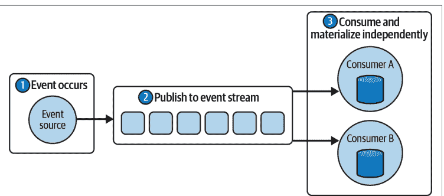

Figure 3-9. In the Kappa architecture, each consumer independently consumes events and builds its own state

图 3-9. 在 Kappa 架构中，每个消费者独立消费事件并构建其自身状态

Of course there are some trade-offs with the Kappa architecture. For example, you must build your service’s state by processing the entire history of events. For extremely large data sets, particularly if there is an insufficient partition count, you could be looking at many hours. New and existing applications that need to build or rebuild their state will need to account for that with historical data processing time.

当然，Kappa 架构存在一些权衡。例如，你必须通过处理整个事件历史来构建服务的状态。对于极大的数据集，特别是分区数量不足的情况下，这可能需要数小时。新的和现有的需要构建或重建其状态的应用程序需要将历史数据处理时间纳入考虑。

Consumer applications can rely on maintaining their own snapshots of materialized state to bootstrap loading their application. In the event of an outage or a failure, a restarted application can simply load its own personal snapshot, complete with offset tracking history, and resume processing from precisely where it left off. The application remains responsible for building and loading its own snapshots, though this functionality comes out of the box with leading stream-processing technologies such as Apache Kafka Streams, Apache Flink, and Apache Spark.

消费者应用程序可以依靠维护其自身物质化状态的快照来引导加载其应用程序。在发生中断或故障时，重新启动的应用程序可以简单地加载其自身快照，包括偏移量跟踪历史记录，并从中断处的精确位置恢复处理。应用程序仍负责构建和加载其自身快照，尽管此功能与领先的流处理技术（如 Apache Kafka Streams、Apache Flink 和 Apache Spark）一起开箱即用。

The Kappa architecture is key to building decoupled event-driven services (and microservices) and provides your applications’ builders with unparalleled flexibility for application development. The business logic for consuming, transforming, storing, and reacting to state changes is completely within the consumer’s control. Modern cloud service providers offer easy access for requisitioning storage space, memory, compute, network I/O, and durability to help build and use data products.

Kappa 架构是构建解耦的事件驱动服务（以及微服务）的关键，并为你的应用程序构建者提供了无与伦比的灵活性来进行应用程序开发。消费、转换、存储和响应状态变更的业务逻辑完全在消费者的控制之下。现代云服务提供商提供便捷的访问方式来申请存储空间、内存、计算、网络 I/O 和持久性，以帮助构建和使用数据产品。

Example 3-1 shows a Kafka Streams application with two KTables, which is just a stream materialized into a table using ECST. Next, the inventory KTable and the sales KTable are joined using a nonwindowed INNER join to create a KTable of denormalized and enriched item inventory. Stream-processing frameworks make it very easy to handle event streams, build up internal state using ECST, and merge and join data from various data products, in just a few lines of code.

示例 3-1 展示了带有两个 KTable 的 Kafka Streams 应用程序，它只是使用 ECST 将流物质化为表。接下来，库存 KTable 和销售 KTable 使用非窗口化 INNER join 连接，以创建非规范化和丰富的物品库存 KTable。流处理框架使处理事件流、使用 ECST 构建内部状态以及合并和连接来自各种数据产品的数据变得非常简单，只需几行代码。

## Example 3-1. Showcasing joins with Kafka Streams

示例 3-1. 使用 Kafka Streams 展示连接

```
StreamsBuilder builder = new StreamsBuilder();
//Materialized state of the "inventory" stream
KTable inventory = builder.table("inventory")
//Materialized state of the "items" stream
KTable sales = builder.table("items")

//Join events on primary key and apply custom business logic
//Note that inventory and items need to be keyed on the same itemId
KTable enrichedItemInventory = inventory.join(items, ...)
```

Something similar can be accomplished in SQL code using Apache Flink. In Example 3-2, Inventory and Items are materialized tables based on the associated Kafka topics. An Enriched_Item_Inventory table is created by INNER joining on the item_id (primary key) of the two tables.

使用 Apache Flink 的 SQL 代码可以完成类似的操作。在示例 3-2 中，Inventory 和 Items 是基于关联的 Kafka 主题的物质化表。Enriched_Item_Inventory 表是通过对两个表的 item_id（主键）进行 INNER join 创建的。


## Example 3-2. Showcasing joins with Flink SQL

```
CREATE TABLE Inventory (
 item_id VARCHAR,
 quantity BIGINT,
 timestamp TIMESTAMP(3),
 PRIMARY KEY (item_id) ENFORCED,
) WITH (
 'connector' = 'kafka',
 'topic' = 'inventory',
 'properties.bootstrap.servers' = 'localhost:9092',
 'properties.group.id' = 'my_app_group_id',
 'format' = 'avro',
 'scan.startup.mode' = 'earliest-offset'
);
```

```
CREATE TABLE Items (
 item_id VARCHAR PRIMARY KEY,
 name VARCHAR,
 description VARCHAR,
 brand VARCHAR,
 timestamp TIMESTAMP(3),
 PRIMARY KEY (item_id) ENFORCED,
) WITH (
 'connector' = 'kafka',
 'topic' = 'items',
 'properties.bootstrap.servers' = 'localhost:9092',
 'properties.group.id' = 'my_app_group_id',
 'format' = 'avro',
 'scan.startup.mode' = 'earliest-offset'
);
```

```
CREATE TABLE Enriched_Item_Inventory AS
SELECT *
FROM INVENTORY
INNER JOIN ITEMS
ON ITEMS.item_id = INVENTORY.item_id;
```

Flink SQL 代码简洁、整洁且强大。你可以快速且轻松地编写极其有用的数据转换，利用 Kappa 架构，几乎无需进行大量操作。Kafka Streams 和 Flink 是最流行的流处理框架之一；如果你在寻找功能齐全、事件驱动的框架，二者都是不错的选择。为了简洁起见，我不会逐一介绍每种可能的选项和框架，但我确实建议你在为自己的用例选择一种之前，先熟悉一下各种选项。

Kappa 架构是构建和使用事件流数据产品的最佳方式。它简单有效，允许使用者通过单个数据产品 API 获取历史数据和实时数据。尽管 Kappa 有明显的优势，但你可能会遇到建议使用 Lambda 架构的情况，这种建议基于一种如今已被证明是错误的假设，即事件流无法无限期保留数据。现在，让我们来看看 Lambda 架构究竟是什么，以及为什么它不如 Kappa。

## Lambda 架构及其为何不适用于数据网格

Lambda 架构是离线历史批处理数据与在线事件流数据的复合体。在这种架构中，使用者从这两个来源获取数据，并必须在自己的领域内将其重新组合成一致的模型。该架构有两个主要版本，我们将逐一介绍。

在第一个版本中，批处理数据层包含由域所有者进行的某种计算的结果，例如物化或聚合。在启动时，使用者将批处理层数据加载到其上下文中，然后切换到事件流层以读取和处理事件。

图 3-10 展示了 Lambda 架构的简化实现。生产者将新事件 (1) 写入事件流 (2) 和批处理数据层 (3)。请注意，批处理数据存储并非从事件流获取其数据，而是直接将新数据 (1) 合并到其数据库中。服务层 (4) 包含两个定期更新的批处理数据物化视图。在此例中，一个视图用于使用者 A，另一个视图用于使用者 B。

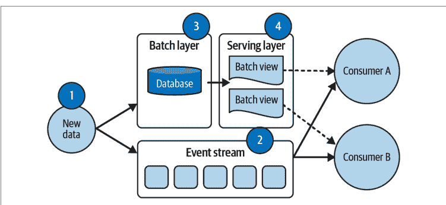

图 3-10. Lambda 架构，数据同时写入批处理和事件流

为什么需要两个物化视图？考虑两个需求不同但相似的使用者。一个使用者需要按销售区域拆分的每小时净销售额聚合，而另一个使用者需要不含季节性商品的每日总销售额。如果没有完整的事件历史记录，这两个使用者仍然依赖于 Lambda 批处理所有者来为他们维护、计算和提供历史结果。

你可能还会注意到这种方法的另一个问题——每个使用者都需要服务层的所有者来计算和维护他们自己的业务逻辑要求！这导致了一种共享责任模型，使用者无法完全拥有自己的业务逻辑。如果他们需要更改业务逻辑，则必须在生产者端在批处理数据组合期间进行更改，并在使用者端在合并事件流数据时进行更改。

在 Lambda 架构的第二个版本中，批处理数据层只是一个事件的长期存储，由事件代理之外维护，如图 3-11 所示。

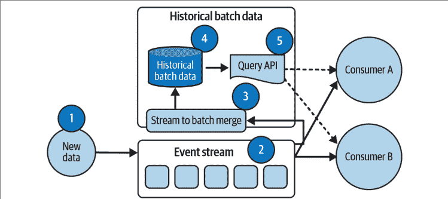

图 3-11. 从事件流构建的 Lambda 批处理存储

在此版本中，新数据 (1) 写入事件流 (2)，最终复制 (3) 到批处理数据存储 (4)。批处理存储不应用任何特殊业务逻辑，只是不可变、递增事件的次要存储，通过可查询 API (5) 供使用者 (6) 使用。每个使用者负责从批处理数据存储将所需的事件边加载/引导到其自身上下文中，在此过程中构建自己的状态。一旦构建好当前状态，他们就切换到实时事件流 (2)。

这将与事件解释和建模相关的业务逻辑直接置于每个使用者的领域内。生产者不再需要为使用者支持任何自定义的预计算视图，大大简化了运维问题。

现在，你可能会觉得这种 Lambda 变体有点奇怪——如果只是存储原始事件，为什么要使用第二个状态存储？还记得我提到过设计倾向于假设不可能在代理中无限期存储事件吗？Lambda 架构基于这样一个观念：不可能在事件代理中存储事件的完整历史记录。

然而，现代事件代理结合廉价磁盘和廉价云存储，使得无限期保留成为现实。尽管曾经很有前景，但 Lambda 架构已被证明比许多人最初认为的更复杂、更难以实现。让我们来看看导致 Lambda 架构在大规模使用中极其困难的一些主要问题：

### The producer must maintain two code paths

一条路径负责将数据插入批处理数据存储，另一条构建要发布到事件流的事件。对事件流和批处理数据存储进行原子提交并不容易实现，因此你面临重复数据或丢失数据的真实风险。从批处理读取的数据可能与从流中读取的数据结果不同。

### The consumer must maintain two code paths

正如生产者必须维护两条代码路径来发布数据一样，使用者也必须维护两条代码路径来解析数据。数据的流和批处理两种表示都需要保持一致，在实践中很难做到，尤其是在数据随时间变化和演变的长期内。

### A batch data-sourced consumer and a stream-sourced consumer may not converge on the same result

你有一个自第 0 天起就在运行的使用者。它从未从批处理数据存储加载过任何数据。其内部状态完全是通过消费和聚合事件流构建的。你启动了第二个使用者，它是第一个的完全副本，但它从批处理数据存储引导其状态。一旦它们都跟上了最新的偏移量，你暂停新数据的输入。它们的状态相同吗？答案应该是响亮的“是的！”，但不幸的是，在实践中，这通常是一个令人沮丧的“不。”从多个来源并通过多条代码路径解析一致状态在实践中往往非常复杂。

### The batch data store and stream data models must evolve in sync

随着源领域模型的演进，事件流中的数据表示通常也会发生变化，批处理存储的格式也是如此。生产者必须确保其写入事件流的内容与批处理服务层中的模型完全一致。在所有这些过程中，主要从批处理读取的历史使用者和仅从事件流读取的实时使用者最终都必须拥有相同数据的副本。如果这听起来很难做好，你是对的。我几乎没见过它被成功使用。

### Merging multiple Lambda-based data products is difficult

Lambda 架构的致命一击在于合并多个 Lambda 数据产品的困难。每个 Lambda 数据产品都维护着关于事件流保留的自身规则，即在何时将事件数据折叠


进入批处理，事件如何被折叠成批处理，以及批处理与流之间重复数据重叠的时间段。结果是批处理数据与流数据之间的一条接缝，每个数据产品都有其自己的接缝及其自身的细微差别，这些差别很少与另一个数据产品的接缝对齐。

调和接缝被证明是极其困难的。每个消费者应用程序不仅必须调和每个批处理到批处理的关系，还必须调和每个批处理到流和流到流的关系。两个 Lambda 数据产品会产生四个需要管理的唯一关系，而三个 Lambda 数据产品会产生八个(!)（2*2*2）个唯一关系，这些关系必须被解释和调和。每增加一个 Lambda 来源，复杂度都会呈指数级增加。

直言不讳地说，我从未见过基于 Lambda 的数据产品被广泛成功使用，仅仅是因为解决超过单个 Lambda 来源太困难了。虽然 Lambda 架构在某些情况下可用于有限的应用，但在实践中，它们对于数据网格的目的来说简单来说是不够的。相反，对于大多数数据产品的生产和使用，请坚持使用 Kappa 架构。

## 支持 Kappa 架构的要求

现代事件代理结合廉价高效的云存储，让我们可以在事件对业务仍然相关的时间内存储事件。例如，10 年前创建的用户账户实体事件将无限期地保留在流中，直到有一天用户被删除或账户因不活跃而被清除。否则，从账户流开头开始读取的新消费者将看到该账户，无论过去了多少时间。

管理流中保留的确切数据、保留时间以及删除时间取决于四件事：无限事件保留、无限存储、紧缩和删除。让我们逐一了解：

- 无限期事件保留
- 您的事件代理应该允许您无限期地保留流中的事件，就像您期望在关系数据库中存储数据并保持其对业务的相关性一样。许多事件代理不允许您这样做，强制执行基于时间的数据保留上限。那些事件代理对于我们构建事件驱动的数据网格的目的来说完全不合适。

- 无限存储
- 无限期保留事件还需要有足够的存储空间。分层存储是解决此问题的常见方法，其中事件代理将旧段卸载到较慢且更便宜的“冷”存储中，将最近的“热”数据保留在内存中以提供快速服务。底层数据存储的卸载和管理对客户端完全透明，使我们只能使用单个事件代理流协议。

## 紧缩

紧缩是删除给定键的较旧事件的操作，前提是同一键的较新事件存在于流分区中。紧缩对于保持事件流的大小与实体域的键空间成比例至关重要。事件代理会定期扫描事件流，识别要删除的事件，并将其从流中清除。


支持紧缩的事件代理通常允许您选择一个最小时间段（紧缩滞后时间），在此期间事件不会被紧缩。这为您的消费者提供了一个时间段，他们可以在其中消费和处理所有事件，以便所有状态转换都可用。Apache Kafka 使用 24 小时作为默认紧缩滞后时间，但在实践中，通常会根据每个用例调整紧缩滞后时间。

## 删除

ECST 还要求能够从流分区中删除特定键的数据。墓碑是包含要删除的实体键且主体为 null 值的记录。墓碑告诉消费者，该键的实体已被删除，与其关联的任何数据现在可以（并且通常应该）从其状态存储中删除。墓碑记录可以像任何其他记录一样被紧缩，尽管墓碑本身也会被删除。

图 3-12 显示了事件流紧缩的示例。事件代理遍历事件日志，保留其遇到的键列表。它会将任何具有同一键的较新记录的较旧记录标记为删除。由于偏移量 4 处有一个 K=20 的事件（较新），紧缩器可以删除所有较早的 K=20 事件，例如偏移量 1 处的事件。同时，偏移量 2 处的 K=10 是一个墓碑事件，因此它和偏移量 0 处的事件都被删除。所有剩余事件保留其偏移量。

紧缩滞后时间通常设置为几天（或几周），这意味着比滞后时间年轻的事件不会被紧缩。将其设置为比 24 小时默认值更长的一个常见原因是考虑到周末可能会崩溃的非关键服务。运维团队可以等到下一个工作日来修复崩溃的服务并使其重新启动，而无需担心错过未紧缩的事件。

紧缩发生的具体方式和时间取决于事件代理。

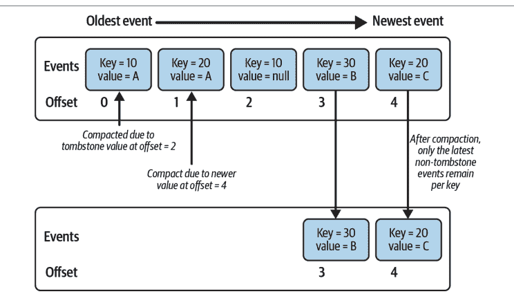

图 3-12. 由于更新值或墓碑而紧缩同一键的旧事件

## 选择事件代理

选择支持 Kappa 架构模式的合适事件代理对于创建自助服务数据网格至关重要。临时消息传递和队列都不足以支撑数据网格——您需要确保您的事件代理支持以持久仅追加日志形式的事件流。

要选择代理，您需要关注基本要求并自行做出明智的决定。这些包括：

### 无限持久数据容量

您必须能够在事件对业务仍然相关的时间内存储所有相关事件。对于大多数数据产品，您需要将它们无限期存储。数据产品消费者必须能够随时访问和重播事件。

### 可扩展性

虽然在云计算时代可扩展性大体上是理所当然的，但您需要确保您的事件代理可以扩展到极高的吞吐量和客户端数量。此外，事件代理必须能够高性能地提供存储的数据，因为数据产品遵循一次写入、多次读取的访问模式。

### 支持工具

模式注册表、访问控制、元数据目录系统以及治理和血缘系统在构建数据网格中都发挥着重要作用。我们将在第 5 章中更详细地介绍这些内容，但根据您的事件代理选择考虑可用选项很重要。

### 作为服务部署的代理

通过使用云服务，您可以绕过管理自己的事件代理部署及其带来的所有开销。如果您专注于构建数据网格，不必管理自己的基础设施可以大大节省时间和金钱。事件代理通常作为提供支持工具的较大平台的一部分出现，因此请确保您调查完整的平台产品。

### 保留期

最终但决定性的标准是保留期。您可以在事件流中保留事件多长时间？数据产品必须在任何消费者按需时完整可用，因此任何限制保留期的事件代理都不适合用于数据网格。表 3-1 比较了几种流行事件代理的保留期。您会注意到，只有 Kafka 和 Pulsar 提供无限期存储事件的能力。

表 3-1. 流行事件代理的最大事件保留期

| 代理名称 | 保留期 |
| :--- | :--- |
| Kafka | 无限 |
| Pulsar | 无限 |
| Amazon Kinesis | 365 天 |
| Microsoft Event Hubs Premium | 90 天 |
| Google Pub/Sub | 31 天 |

由于 Apache Kafka 在流处理行业的主导地位、出色的支持软件和工具以及广泛的用户知识基础，它是我目前首选的事件代理。在我的选择中，我也带有主观偏见，因为我从 2014 年起就一直在使用 Kafka，曾为其代码库做出过贡献，并且还与它的联合创始人在 Confluent 工作过。

最受欢迎的项目也往往拥有最多的社区构建的工具和贡献。模式注册表、代码生成器、处理框架、操作系统集成和数据目录集成只是需要考虑的必要依赖中的一些。Apache Kafka 的 KIP-405 提供了一个绝佳的例子，即社区中的一些大厂商聚集在一起合作，直接在 Kafka 中构建分层存储支持，使无限期主题保留和可扩展存储变得更便宜且更可靠。


## 摘要

技术将随时间不断变化，新的选项无疑会出现。因此需要注意的是，如果 AWS、Microsoft 或 Google 选择在其事件代理中支持无限保留，它们也可能成为支持事件驱动型数据网格的可行候选者。

你选择的事件代理是数据网格成功的关键组件。为构建数据网格的基础，请选择安全、可靠且经过大量测试的选项。

事件流是服务大多数数据产品的最佳选择，因为它们提供了一种实时、不可变、持久、可重播且可扩展的数据服务方式。其实时界面可以为运营和分析用例提供动力。队列和短暂消息系统常被误认为与事件流等价。事实并非如此，本章将对此进行阐述。

物料化和聚合是事件流消费者的两种常见操作。这些操作使消费者能够通过在其自身边界内存储事件驱动数据来生成自己的最终一致性状态。访问可重播的历史数据源是另一个重要的数据产品需求。事件流通常被认为不适合无限期维护数据，部分原因是技术的历史局限性，部分原因是人们预先认为事件只能是短暂或短暂存在的。本章解决了这些问题，并讨论了处理事件流的历史和现代选项。Kafka 架构使事件流能够成为当前和历史数据的单一来源，且在实践中比旧的且不那么有用的 Lambda 架构更易于使用。

最后，我还概述了选择事件代理的要求和注意事项。现实是，目前只有少数几个选项，尽管随着事件驱动架构日益流行，仍有改进空间。实施数据网格本身就具有挑战性，因此请确保选择流行且受支持良好的技术。你会发现更容易招聘人才来帮助构建你的数据网格，并利用 SaaS 解决方案和开源项目来提高生产力。

在下一章中，我们将探讨治理。如果我们计划发布数据供他人使用和消费，我们将需要一些标准、安全性以及一定程度的监督和控制。
