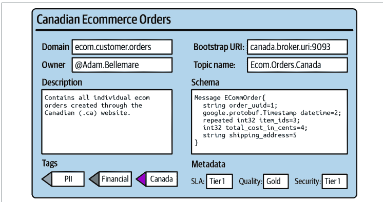
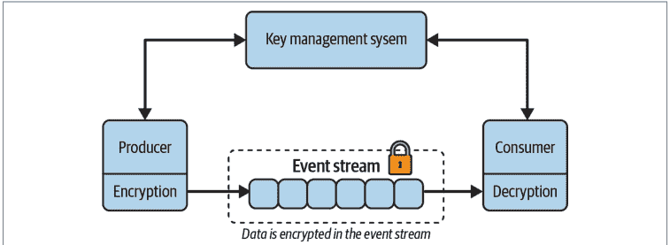

## 联邦治理

数据网格架构本质上是去中心化的，并且将重要职责下放给数据产品所有者。数据网格也从一定程度的集中化中受益，体现在数据产品兼容性和通用自助工具方面。不同的意见、偏好、业务需求、法律限制、技术和技术债务只是影响我们如何协同工作的众多因素中的几个。

联邦治理使我们能够区分哪些决策应保留在本地层面，哪些决策必须在所有领域范围内全局做出。引用 Dehghani 的话：“最终，全局决策有一个目的，即通过数据产品的发现与组合来创建互操作性和复合网络效应。” 我们需要找出、强制执行和支持共同的构建块和运作模式，以使数据网格对每个人都有效。

建立联邦治理团队是朝着发现共同点以达成互利解决方案迈出的第一步之一。你的治理团队将具体做什么将取决于你自己的业务需求，但本章将介绍几种常见的职责。

联邦治理旨在找到个人自主权与自上而下的集中控制之间、职责下放与为一致性和秩序创建总体规则和指南之间的适当平衡。像任何形式的有效政府一样，我们需要参与、代表、辩论和协作行动才能真正完成工作。

制定章程是建立联邦治理团队的重要第一步。这概述了该团队的职责和责任，例如建立数据产品格式、质量水平、互操作性、安全性和支持技术的标准。它还规定了生产者、消费者和经理的责任，以及任何其他社会和技术方面。

联邦治理主要关注以下几个主要领域：

### 数据问题

涉及数据在组织内如何创建和使用。具体而言，包括数据产品类型、元数据、架构、支持、可发现性、血缘、质量和互操作性。

### 技术问题

包括你希望纳入数据网格的编程语言、框架和流程。评估现有技术的适用性以及审核新选项，仍然是联邦治理的关键组成部分。

### 法律、业务和安全问题

涉及法规合规性和安全问题，例如处理财务数据、个人可识别数据和其他形式的敏感数据。业务级要求也可能起作用，例如内部数据安全性、访问策略和保留要求。

### 自助平台问题

使用户更容易做正确的事情。用户需要一个可靠的自助平台来构建和使用数据产品。简化工具、减少摩擦，并让每个人都能轻松完成工作是数据网格的基石。自助平台提供了一个在源头应用法规和安全政策的机会，让你了解数据如何在组织中流动。

这些领域相互关联，并为查看治理团队优先事项提供了一个有用的视角。在我们阅读本章剩余部分时，请牢记这四个领域，因为每个部分都会涉及其中一项或多项主要问题。

但是首先——谁来治理？

## 成立联邦治理团队

治理团队需要一个 *授权* 才能有效开展工作。授权包括两个主要组成部分。第一个是 *机构* 组成部分，即“高层”支持数据网格和治理团队，为成员提供一定程度的权威、所有权和责任。第二个组成部分是 *社会* 组成部分，即那些本应使用数据网格的人认识到其重要性并支持它。缺少其中任何一个组成部分，该举措可能会失败。

治理团队由组织各个部门的人员组成，他们充当与构建和支持明确定义的数据网格相关的团队、产品、技术和流程的代表。作为同事的代表，每个成员从其问题空间提出想法、需求和疑虑，并共同努力找出令人满意的解决方案。

寻找代表通常很简单，只需要求一名志愿者代表团队担任固定时期（例如三个月）即可，但他们必须精通团队所面临的挑战。高级技术人员常常被“志愿”（选中）担任此角色，因为他们通常最了解团队需求、问题空间和历史背景，例如过去的改革尝试。过去改革努力可能失败通常有相当重要的技术原因，而这种历史背景往往有助于指导讨论，找到通往新成功解决方案的道路。

联邦治理团队的规模将随组织的规模而变化，但应限制在能够进行有效的一小时会议的规模。如果群组太小，你可能会发现代表性不足，疏远队友并损害信任和支持。如果群组太大，你可能会发现人们开始觉得自己的意见并不重要，或者群组中的其他人会做出艰难的选择。找到联邦治理团队的最佳规模，或许具有讽刺意味，取决于联邦治理团队本身。从小规模开始，并在遇到代表性边界时随时吸纳更多成员。

收集匿名反馈，了解团队对自己的运作情况的看法，以及来自团队外部队友和利益相关者的反馈。这将帮助团队举行更有效的会议，为治理领域找到适当的边界，并确定有效的团队规模和章程。

一旦你有了初始团队，就可以开始实施标准来简化数据网格体验。

## 实施标准

联邦治理团队负责制定一套数据产品和技术标准。

将贵组织必须支持的技术想象为一个空间有限的物理工具箱。

如果要向工具箱添加新工具，需要确保有足够空间，且没有其他同样合适的工具可以胜任。

对工具箱施加合理的限制，可以确保技术蔓延得到控制，并且只添加提供重大改进的工具。

为新工具、语言、标准和技术设立进入壁垒，对减少蔓延、排除边缘选项以及防范时兴实现方式，*至关重要*。

保持工具箱精简小巧，可以让您在自助式数据网格平台上为每个工具提供一流支持，这要容易得多。

标准应通过*提案*引入，并详细解释新选项为何优于工具箱中已有的内容。

新选项可能涵盖工具箱中尚无对应方案的急需用例。

或者，新选项可能在绝对意义上优于已有使用的内容。

提案人必须讲述一个故事，并提供示例，说明其建议为何是良好的，以及会对工具和选项选择产生什么影响。

在将提议的标准或技术添加到一流认可的工具箱之前，*试用*它非常重要。

确保试用凸显技术的重要性、它比现有内容优在哪里，以及在现有工具和支持的背景下，它带来了什么权衡。

要注意，不要让试用系统以“临时”（但实际是永久）的基础被提升到生产环境。

在关键路径之外的系统中测试新技术和框架很重要，以便您可以重写或放弃它们而不会造成业务延迟。

让我们来看看贵治理团队需要建立的一些主要标准。

## 支持多模态数据产品类型

如第31页“数据产品是多模态的”中所述，您的联邦治理团队需要决定您_支持_和_不支持_哪些数据产品类型和端口。

事件流是本书涵盖的核心数据产品类型，但您也可以选择支持其他类型，例如云数据存储中的批量计算Parquet文件，我们将在第9章中进一步讨论。

支持多种数据产品类型为数据产品所有者提供了更多选项，但代价是治理和自助工具的复杂性大幅增加。

了解支持每种数据产品类型所需的机会成本和工作量非常重要。

例如，您需要确保已考虑信息安全、加密、访问控制、数据产品互操作性和自助式数据平台集成。

添加新的数据产品类型可能需要大量工作，如果投资回报率不高，那么使用现有（尽管略有次优）类型提供数据产品可能更合理。

如果您认为支持新的数据产品类型是有道理的，那么您应该创建一个提案，并在联邦治理会议上提出供审议。

我们将在第85页的“2. 起草提案”中进一步探讨提案。

这里的目标不是约束数据产品所有者，而是确保提供的工具受到支持、满足治理要求、易于使用，并涵盖必要的业务用例。

不要为了多样性或新鲜感而向工具箱添加新工具，尤其是在已有现成且受支持良好的方式可以提供足够访问和使用的情况下。

## 支持数据产品架构

架构框架实际上是数据的编程语言。

就像您用代码构建应用程序一样，您也用自己的代码构建数据产品架构。

该代码的确切外观以及为您选择哪些选项最佳，将在第6章中详细介绍。

目前，请考虑您可能支持多少种、哪些类型的架构和格式。

最常见的两个考虑因素包括：

- **事件架构**
  
  Apache Avro、Protocol Buffers（Protobuf）和 JSON Schema 往往是事件最常见的格式。每种格式都有其自身的权衡，特别是关于类型强制、架构演进能力、默认值、枚举和文档。

- **文件格式**
  
  写入云存储桶的批量文件传统上遵循大数据文件惯例，包括 CSV、JSON、Avro、Protocol Buffers、Parquet 和 ORC——仅举几例。此外，请考虑构建在这些基本文件格式之上的较新开源技术，例如 Apache Iceberg、Apache Hudi 和 Delta Lake。每种技术都提供更高级别的文件系统类型功能，例如隐藏分区、事务和压缩，并可以使使用批量托管的数据产品更加易于使用，代价是与技术的耦合更紧密。

最好为每种数据产品类型标准化为仅一个事件架构框架或文件格式。

例如，流使用 Avro，数据湖中批量计算的文件使用 Parquet。

只有在绝对必要时才扩展以支持其他格式。

单一格式大大简化了工具和消费者体验，同时保持复杂性和风险较低。

如果必须支持多种文件格式或事件架构，请确保数据产品所有者能找到易于遵循的说明，了解应使用哪种格式以及原因。

否则，当相邻团队最终使用完全不同的架构框架实现其数据产品时，会引入摩擦，使其共同消费者的消费和使用变得更加困难。

接下来，让我们看看一些编程语言问题和疑虑。

## 支持编程语言和框架

生成数据产品的一种常见方法是使用源领域中已在使用的语言。

团队已经精通该语言，这简化了数据产品的创建和支持。

另一种选择是选择组织其他部分正在使用的语言（或工具），也许是因为它更适合创建数据产品。

我们将在第8章中探讨将现有数据引导到事件驱动数据产品的具体细节。

有时开发者会利用创建数据产品的机会尝试一种新的冷门语言，无论是否正式支持。

这将使该开发者未来长期承担所有支持和维护责任，如果没有其他人学习该语言，产品将面临风险。

随着时间的推移，构建数据产品的开发者很可能会转向新项目或工作机会，进一步增加风险。

重要的是，仅在广泛使用或否则由贵组织正式支持的语言中实现数据产品。

如果您认为一种语言有更广泛使用的价值，那么最好创建一个提案（参见第85页的“2. 起草提案”）并与联邦治理团队讨论。

决定为构建数据产品支持哪些语言（和框架），主要基于与构建任何其他服务相同的标准。

这些因素包括：

### 社会因素

这是一种广为人知的技术吗？我们的开发者熟悉它吗？行业内是否有其他人在使用它，并且他们是否取得了成功？人们是否愿意使用它？对新雇员是否有吸引力，我们能否在市场上找到具备这些技能的人？

### 技术因素

它是以简单有效的方式解决我们的问题吗？它是一种经过验证的技术，未来多年将继续更新和改进吗？

### 集成因素

它是否易于支持？它是否与我们现有的开发、测试、构建和部署流水线集成良好？您是否可以获得与其集成的代码检查工具（linters）、调试器、内存分析器、测试工具和其他生产力增强工具？

### 事件代理客户端

您的事件代理是否有用您选择的语言编写的高性能客户端？您能否足够快地生成和消费事件？

### 支持性工具

您的语言和框架是否与您的事件架构（第6章）配合良好？它们是否支持代码生成器？您能否生成测试事件来测试您的数据产品输入和输出？

决定支持哪些语言以及支持程度如何，将由贵组织和治理团队决定。

选择贵组织熟悉且具有事件代理支持的语言。

## 元数据标准和要求

一个良好的数据网格需要为每个数据产品定义明确的元数据。

数据网格用户应该能够发现并识别其业务用例所需的数据产品。

数据产品所有者在注册数据产品时必须提供所有必需的元数据，才能获准将数据产品发布到网格中。

强制执行元数据要求对于确保只有定义明确且受支持良好的数据产品可供他人使用至关重要，以免我们重蹈第17页“坏数据：不作为的代价”中讨论的先前数据战略的覆辙。

对于健康的数据网格，有几个字段至关重要。在本节中，我们将逐一介绍它们，并为您提供一些基本示例，供您的治理团队考虑。

## 域和所有者

首先是所有权。谁拥有数据产品？它来自哪里？此元数据包括域命名空间和数据产品所有者的名称。数据产品所有者的名称是一个自然人，他代表该域的数据产品。

## 分级服务级别

数据产品需要支持和正常运行时间保证。但是保证到什么程度？如果数据产品遇到故障，应采取什么适当措施？许多公司已经将其应用程序组织成分级系统，最高级别拥有 24 小时轮值班次，最低级别提供简单的尽力而为支持。你应该将相同的分级系统应用于数据产品，并提供与同一级别的任何其他服务或产品相同的支持和保证。以下是四级系统示例：

### 一级

对业务运营至关重要的数据产品，其中停机或故障会对客户或业务财务造成重大影响。为实时运营应用提供支持的数据产品通常属于此类别。

### 二级

对业务很重要但不如一级关键的数据产品。此级别的故障可能导致客户体验下降，但不会完全阻止客户与您的系统交互。此级别的数据产品也通常为实时运营应用提供支持。

### 三级

可能影响业务后台任务和运营的数据产品，但通常对消费者不可见，也不会对他们造成重大影响。但是，如果此级别的数据产品支持时间敏感的用例，故障时可能仍需要进行干预。

### 四级

具有最大恢复时间窗口的数据产品。不必为这些数据产品设置轮值班次；它们可以等到下一个工作日再解决。

正常运行时间和可用性并不是数据产品服务级别的唯一考虑因素。您还需要监控数据产品，以确保它们满足 SLA，我们将在“监控和告警”第 122 页中更深入地介绍此内容。

## 数据质量分类

数据产品提供的数据质量也应进行分类，类似于 SLA 分级系统的方法。一种选择是利用数据湖架构中常用的铜、银、金奖章分类。让我们来看看每个分类：

### 铜

来自原始源格式的未结构化和原始数据，未经过转换。可能与源系统的内部数据模型强耦合，并且可能还包含需要清理或净化的字段。还可能包含结构良好且已定义的数据，但其质量是断断续续的，或者数据所有者根本无法提供更高的保证。

### 银

结构良好的数据，具有强类型，通常经过清理和标准化。通常经过反规范化，足以直接使用，最常见的外键关系已被连接和解决，以便消费者使用。已应用类型检查和约束，以确保最低数据质量（例如，99.99% 的事件通过质量检查）。事件上下文已明确定义和记录，类型检查和约束也是如此。如果消费者希望在数据上施加他们自己进一步、更严格的约束，他们最好与数据产品所有者沟通以评估选项。

### 金

最高级别的质量。通常被称为“权威”，金级质量的数据产品旨在毫无保留地依赖。数据产品经过严格测试和监控，其类型检查和约束超过了银质量级别（例如，99.9999% 的事件通过质量检查）。金数据产品通常更复杂，由重大聚合和转换构建而成，提供重大价值，消费者自己很难复制。

数据质量分类与数据产品对齐（源对齐、聚合对齐和消费者对齐）是分开的，仅关注数据质量。

您可以自由选择备选分类模型。重要的是，您的数据网格用户必须能够轻松理解并将建模应用到他们自己的数据产品上，以保留数据生产者和消费者之间的共同理解。

## 隐私、财务和自定义标记

在与安全和财务信息代表协作下，治理团队可以制定要应用于数据产品的标记，以帮助自动化特殊处理。例如，您可以选择包含类似于 SLA 的安全分类分级系统。您还可以选择使用与事件流中包含的数据类型相关的标记，例如财务、PII 或基于区域的标记。

支持数据产品上的标记可以更轻松地应用治理规则，因为它们可以按标记基础应用。例如，寻求使用带有财务标记的数据产品的消费者需要证明其符合组织的财务数据处理要求。标记还能更轻松地按消费者基础审计数据使用情况。

## 上游元数据依赖

上游服务和数据产品各自拥有自己的 SLA、数据质量级别和其他保证。任何依赖上游服务或数据产品的服务或数据产品在制定自身保证时都必须考虑这些依赖。例如，当服务依赖具有四级保证的数据产品时，无法提供一级支持。我们将在本章后面的“数据产品血缘”第 92 页中进一步介绍血缘。

作为治理要求的一部分，您可以选择为数据质量和 SLA 建立最低上游要求，以支持您的生产应用程序，无论它们是运营型、分析型、服务型还是数据产品。一种常见的约定是仅允许在生产中使用具有一级或二级 SLA 保证的服务。

上游数据质量要求不那么严格——完全可以用一级铜数据产品支持一级金数据产品。事实上，这通常是铜数据转换为高质量金层数据产品的方式。

您可以在创建数据产品时强制执行上游检查，我们将在第 5 章中更详细地探讨此内容。

## 元数据总结示例

图 4-1 显示了用户查找数据产品信息时可能看到的示例。虽然我们将在第 5 章中更详细地探讨元数据目录，但目前您可以将其视为一个只读数据库，您可以在其中查找可用数据产品及其属性。

数据产品名称、域和用户都是在发布时创建的强制元数据。还包含描述字段，用于描述上下文并将数据产品与其他类似数据产品区分开来。关于服务、质量和安全级别的元数据也存在，还有描述 PII、财务和区域信息的标记。

图 4-1. 数据网格用户可能期望看到的数据产品元数据示例

元数据中的架构字段来自架构注册表，该组件存储和管理事件流的架构，是自助服务数据平台的重要组成部分。我们将在第 99 页的“架构注册表”中更详细地介绍此内容。代理名称和主题名称也被提取，以提供数据产品的数字地址。

元数据帮助我们就哪些数据产品可用于我们的用例做出明智决策。数据产品之间的兼容性对于使我们能够合并来自不同来源的数据至关重要，这是下一节的主题。

## 确保跨域数据产品兼容性和互操作性

有许多因素构成了跨域聚合、合并和比较数据产品的过程。作为本章开头概述的数据关切的一部分，互操作性和易用性仍然是联邦治理的两个主要关注点。关于通用实体、时区、聚合边界以及事件映射、分区和流大小的技术细节的规则和指南均属于治理团队的职权范围。让我们现在来看看这些领域。

## 定义和使用常见实体

定义跨业务多个领域使用的最小实体是首要的重要步骤之一。让我们先看一个示例。

一家电商公司定义了一个包含两个字段的通用 Item 实体：long id 和 long upc_code。预期数据产品所有者在任何引用其电商项目的数据产品中都使用 Item 实体，无论是 Order、Inventory entry 还是 Return。这些相关实体各自使用通用且标准化的 Item 版本，从而消除了消费者对同一数据的类似但不同表示进行解释的需求。

通用实体并不妨碍你向数据产品添加更多关于该实体的信息。你可以自由扩展数据产品以包含关于 Item 的其他信息，例如服装项目的 size 和 color，或食品项目的 weight 和 serving_size。可以将通用实体视为不同领域数据产品之间的附着点，以及实体数据模型的可扩展基础。

## 事件流键控和分区

事件流式数据产品的互操作性受流分区数、事件键和分区分配算法的影响（参见第 3 章）。事件流包含一个或多个分区，每个事件根据分区分配算法、事件键和分区数量被分配到一个分区。以下是一些有用的互操作性提示：

### 分区数量

如果事件分区数量大小相同，从多个流连接和聚合数据产品的计算强度可以大大降低。虽然像 Kafka Streams 和 Flink 这样的事件流处理器可以根据需要自动重新分区事件流，但这需要更多的处理能力，并可能产生更高的成本。尝试使用 T恤尺寸方法来标准化分区数量，例如 x-small=1、small=4、medium=8、large=16、x-large=32、xx-large=64、jumbo=256。作为自助服务平台的一部分（我们将在下一章中介绍），你可以向数据网格用户提供基于键空间、事件数量和消费者重新处理需求的分区数量选择指南。

如果你正在构建基于通用实体键的数据产品，请检查其他也基于该实体键的数据产品的分区数量——如果它们都在使用相同的分区数量，你最好也使用该数量。

### 事件键

使用原始值（如 string、int 或 long）来处理事件键是最佳选择。通用实体的唯一 ID 是实现互操作性的最佳选择。

### 分区分配算法

该算法以事件键作为输入，并返回要写入事件的分区 ID。不同编程语言和框架的事件生产者客户端可能使用不兼容的算法，导致事件流无法互操作，尽管使用相同的事件键和相同的分区数量。虽然使用像 Kafka Streams 这样的单一框架可以确保分区分配一致，但你需要做一些研究，作为自助服务平台的一部分来评估其他框架。

要小心热分区，即不成比例的大量事件被分配到单个分区的情况。例如，99% 的所有事件可能被分配到单个分区，而其余分区仅获得 1% 的数据。这通常是由于键空间极窄造成的，但也可能是由于分区分配算法不合适造成的。

从一开始就要考虑兼容性的键和分区非常重要，因为你创建的许多数据产品都会长期存在。更改分区是可能的，但通常需要将数据重写到新的事件流并迁移消费者。坚持使用 T恤尺寸，根据消费者的需求（例如，重新处理、并行化）制定一些选择分区数量的建议，并根据可用的客户端框架定义通用分区分配算法。

## 时间和时区

数据产品可能与时间窗口或时间段相关联。例如，按聚合对齐的数据产品可能表示一段时间内的数据，例如每小时或每天的聚合。作为确保互操作性标准的一部分，为所有基于时间的数据产品建立主要时区，例如 UTC-0。如果消费者不必处理时区转换和夏令时问题，他们将获得更简单的体验来组合不同的基于时间的数据产品。

在适用的情况下，你应将聚合周期和时区相关信息作为数据产品元数据的一部分包含在内。这些信息将帮助你的消费者决定是否需要进行进一步处理，以将其与其他数据产品合并。

现在我们已经介绍了提供数据产品兼容性的方法，是时候深入探讨社会层面了。我们如何对数据网格标准和要求做出有效决策？

## 治理会议是什么样子？

全面介绍高效会议的内容超出了本书的范围，但以下几点指导应该能帮助你入门。首先，确保遵循所有技术会议共通的最佳实践。其次，提前很久发送邀请，并为会议提供议程。第三，确保有主持人和负责做笔记、记录行动事项的人，并确保每个人都知道下次会议需要完成什么。轮换职责和义务以确保平等代表是常见的做法。

让负责运营系统的人员与负责分析系统的人员坐在同一会议室里非常重要。你可能会惊讶，或者可能只是失望，这种情况发生得如此之少。“数据团队”与“工程团队”的隔离长期困扰着 IT 领域，正如我们在第 17 页的“糟糕数据：不作为的代价”中所提到的。

与任何会议一样，性格强势或嗓门大的人可能会试图主导谈话。确保有主持人主持会议，并确保每个人都有机会不受打断地发言。如果会议变得激烈并开始变得无效，请休息 5 分钟或当天休会。

在数据网格转型的初始阶段，你应该预期会频繁开会。你将有许多事情要讨论、解决、支持和标准化。随着时间的推移，你可以预期开会频率会降低。

但是，治理团队应该关注哪些主要任务呢？让我们来看看五个主要领域，并讨论它们与数据网格的关系。

### 1. 识别现有问题

治理团队的第一项任务是识别问题所在。你的团队应由组织各部门的个人组成，他们对技术和数据格局有很好的了解。自下而上的基层报告问题和困难的方法通常效果最好。请同事们识别他们遇到问题的领域、面临的障碍和阻碍，以及他们希望能做什么——无论是从业务需求还是简化运营复杂性的角度。

让每个人使用卡片或便利贴列出他们的主要问题和困难。然后你可以将相似的问题聚集在一起，从而找到可能产生最大影响的改进领域。

识别问题是改进所有人数据网格的第一步。常见问题可能包括缺乏自助服务工具、现有产品中数据不一致，以及关于重复数据、信息安全、PII 和财务信息缺乏政策。一旦问题被识别，你就可以确定哪些最重要，并投入资源来解决它们。

### 2. 起草提案

下一步是创建一份提案，阐明问题，解释为什么解决它很重要，阐述挑战和机遇，并识别可能的解决方案。提案很像许多民主制度的议院、参议院和议会中提出的法案。它提出变更，提供详细信息，并指定范围，全部打包成一个可讨论的单元。

不仅治理团队可以创建待审提案——组织中的任何人都可以创建一个。事实上，跟进那些识别出问题的人通常能取得最佳结果——他们通常对如何改善事情有一些想法，只是需要有人来组织和推动必要的工作。提案应专注于解决具体识别出的、对数据网格用户有实际影响的问题。

提案示例可能包括：

- 在数据产品中引入字段级加密以限制访问某些敏感信息
- 实施处理跨多个云部署的数据产品的法规
- 向数据产品元数据添加自定义标记以改进搜索功能
- 向数据产品添加命名空间以启用命名空间级别的安全访问
- 在自助服务平台中引入集中式身份验证和授权服务，以统一各云服务的身份管理

虽然提案可以涵盖广泛的关注领域，但大多数时候它们应该导致可供数据网格用户使用的自助服务工具和平台得到改进。强制实施新流程固然很好，但如果它没有融入数据网格用户每天使用的工具和服务中，那么它很可能不会被遵循或使用。

提案应该说明问题成功解决后的样子。制作原型来展示解决方案的具体运作方式，能让想法扎根于实际层面，而非理论层面。在推广到一般使用之前，请设计实验、运行测试、分配研究、调查选项并制作技术原型。

### 3. 审阅提案

联合治理团队审阅提案，以确定解决方案的可行性和所需的实施资源。你审阅这些提案的方式因团队而异，尤其是在考虑远程工作、时区和其他分布因素时。一个效果较好的选择是让联合治理团队的成员分别审阅提案，做出任何笔记或标记任何疑虑，然后再召开更大范围的小组会议。如果你能让所有人聚在一起（无论是数字会议室还是实体会议室），你可能会发现更容易提出问题、辩论选项并制定统一计划。你也可以异步会面，并决定只有在存在足够分歧或困惑时才聚在一起。

保持审阅的开放性和包容性。邀请你认为能够通过提供额外背景和信息来帮助的组织中的个人。你可能需要主动寻找并邀请他们，因为大多数人通常都很忙。确保不要依赖相同的人来审阅每个提案，以免给人一种除了这些人之外，其他人不受欢迎为联合治理做出贡献的印象。

审阅的主要目标应该是验证所提议的解决方案、审核任何原型、识别任何遗漏的考虑因素，并评估所涉工作的边界。审阅可能导致提案被拒绝——要么退回给创建者进行额外工作，要么由于其他无法克服的问题而直接被拒绝。通过审阅的提案将需要最后一步——规划和执行实施工作。

### 4. 实施提案

被接受的提案接下来必须转换为详细的工作项。将提案分解为增量步骤，以构建、测试、部署和验证你的数据网格更改。使用你现有的工单系统来详细说明每个工作项，包括要完成的工作描述、成功的样子是什么，以及完成所需的时间和精力估计。

实施提案与实施任何其他产品功能的过程相同。虽然你在数据网格之旅开始时可能可以避免配备自助数据平台产品经理，但你会发现，这是完成工作的必不可少角色。

你还需要找人来完成工作！取决于你的组织，你可能已经选择指派一人或多人来实施数据网格平台工单。或者，你可以要求提案创建者提供完成工作所需的人时，因为他们很可能是对该解决方案最熟悉的人。

无论你选择如何实施工作，都要专注于在合理的时间内将迭代改进投入使用。和其他任何产品一样，你的数据网格本身需要帮助你的同事解决数据访问、使用和发布问题。如果你未能建立对数据网格平台的信心，人们将根本不会使用它，而是诉诸于他们自己的临时数据访问机制。在这种情况下，你的数据网格将毫无用处，纯属浪费时间。

### 5. 存档提案

将所有已接受和已拒绝的提案，以及关于其讨论的笔记（或录制的视频），保存在一个常用的可访问位置，例如云端文件驱动器。人们应该能够查询提案以查看其状态，以及哪些已被接受或拒绝，以及原因。透明度至关重要，因为它提供了记录某项技术或决策被采用或未被采用的原因。

存档提案还可以消除一些运营复杂性。你可以搜索现有提案，看看是否之前已经提出过类似的内容，以及如果有，结果如何。最初不采用某事的理由可能不再适用，因此值得用新提案重新审视。

在下一节中，我们将探讨安全性和访问控制。这两者对于建立可靠的所有权和安全框架，以及防止未经授权的访问和意外修改彼此的数据产品，都是必不可少的。

## 数据安全性和访问策略

你的数据网格的安全性和访问实践在很大程度上取决于你业务的法律和业务要求。例如，银行的安全性和访问控制要求将远高于匿名留言板网站。由于这是一个庞大的研究领域，我们将假设你遵循“良好的安全实践”，而是专注于与制作和使用事件驱动数据产品相关的几个重要概念和技术。

纵深防御应该是你处理安全性和访问控制时的指导原则。没有单一的东西能保护你的数据免受未经授权的使用，无论是来自好意但未经授权的同事，还是来自外部入侵者。默认限制访问、强制对用户和服务进行身份验证，以及保护和加密私人、财务及其他敏感信息，每一项都有助于减少爆炸半径并减轻后果。

身份管理是数据安全性的基础组件，因为所有用户和服务权限都将与其关联。我们将在下一章中更详细地探讨这个主题，即第110页的“服务和用户身份”。目前，让我们调查一下你的治理团队可能选择在你的数据网格中实施和支持的几个最重要的安全原则。

### 默认禁用数据产品访问

数据产品应仅供注册的使用者使用。如果你未注册为数据产品的使用者，则无法读取它。虽然这一原则引入了一道门槛，但与允许任何想要的人以只读方式读取数据产品相比，它迫使用户和服务注册为明确的使用者。我们需要知道谁在读取什么，以便任何更改和请求都能有效地上下游传达。

### 考虑端到端加密

根据信息安全要求，你可能需要在将数据产品数据发布到事件代理之前对其进行加密。数据在事件代理中保持加密状态，防止对磁盘上的数据进行任何未经授权的后门访问。拥有分配的解密密钥的注册使用者可以本地消费和解密数据以供其自身使用。

简化数据加密和解密是自助平台的功能。但是，由治理团队来确定要求和支持的用例。

端到端加密通常是处理敏感数据所必需的。在生产者端加密数据可以在事件的网络通信和数据存储期间提供额外安全性，并确保事件代理的云提供商无法以任何方式读取（或泄露）未加密的数据。此外，端到端充当纵深防御——有人可能会获得读取你的事件数据的权限，但如果没有解密密钥，就无法解码和使用原始数据。

图4-2展示了一个使用端到端加密的生产者和使用者客户端。生产者在将数据写入事件流之前对其进行了加密，并将密钥发布到了密钥管理服务（KMS）。想要读取数据产品的使用者必须从KMS获取解密密钥的访问权限，然后将其应用于从流中读取的每个事件。

图4-2. 作为事件流提供的数据产品中端到端加密的实际运作

KMS为你提供了一个安全地创建、共享、存储和轮换密钥的机制。虽然你可以在没有正式自助数据平台支持的情况下开始，但如果最终使用大量加密，你很可能需要投资于简化此过程。

你可能并不总是需要加密整个事件——有时仅加密敏感字段就足够了。让我们来看看。

### 字段级加密

字段级加密为数据产品所有者提供了加密特定字段的能力，以便只有选定的使用者可以访问数据。可识别个人身份、账户和财务信息是字段级加密的常见用例。例如，在建模银行转账时，你可能会在用户和账户字段上使用字段级加密，但保持金额和日期时间字段未加密。拥有解密权限的使用者可以访问解密后的信息以结算账户余额，而没有解密权限的分析系统仍然可以跟踪一段时间内资金的流动情况，所有这些都来自同一个数据产品。表4-1显示了事件中电子邮件、用户和账户字段的加密情况。

## 表 4-1. 使用字段级加密部分加密事件

| 字段名 | 原始事件 | 部分加密事件 |
|---|---|---|
| email | adam@bellemare.com | n2Zl@p987NhB4.L0P |
| user | abellemare | 9ajkpZp2kH |
| account | VD8675309 | OP1wW81Mx |
| amount | $777.77 | $777.77 |
| datetime | 2022-02-22:22:22:22 | 2022-02-22:22:22:22 |

您也可以选择使用格式保留加密来维护事件数据的格式。在此示例中，我们对 email、user 和 account 字段使用了格式保留加密——保持与原始字段相同的字母数字字符、间距和字符数，但不向没有解密权限的用户泄露任何 PII。

使用字段级加密的一个优势是，它允许对消费者进行更精细的访问控制。您的消费者只需为所需数据请求解密密钥，而不是为整个负载请求，从而减少意外泄露信息的潜在风险。

格式保留加密特别适用于事后对数据进行加密，因为您不需要与下游消费者重新协商架构。相比之下，使用非格式保留加密通常会导致畸形，例如将长银行账户 ID 转换为 64 字符字符串，或将复杂嵌套对象加密为哈希字节数组。

无论是端到端还是字段级加密，对敏感数据进行加密还可以帮助我们满足另一项重要的治理要求：被遗忘权和数据删除权。

## 数据隐私、被遗忘权和加密碎片化

通用数据保护条例（GDPR）是（除其他事项外）一项要求谨慎处理、存储和删除数据的法律。它是您的组织可能需要遵守的法律约束的一个极好示例，以便守法经营。如果您打算创建有用数据产品的数据网格，那么您极有可能会涉及个人、账户和财务信息，这可能需要您采取额外步骤和预防措施来确保安全。

GDPR 第 17 条规定，个人有权要求删除其所有个人数据，且不得无故拖延。乍一看，这项规定似乎与数据网格的原则直接相悖：发布定义明确的数据产品，供其他团队和服务自行使用。事件驱动的数据产品似乎会进一步加剧这一问题，因为消费者会将数据读入其自身的本地数据存储和缓存中。

加密碎片化是一种您可以使用的技术，通过覆盖或删除加密密钥来确保数据变得不可用。简而言之，您允许最终用户完全控制何时删除其密钥，从而在密钥删除后使其数据在密码学上不可用。您可以将加密碎片化与任何形式的加密一起使用，包括端到端加密和字段级加密。

与此同时，加密数据产品的消费者只需联系中央 KMS 并请求访问解密密钥。只要消费者拥有正确的权限，解密密钥就会传回给他们，然后他们即可根据需要解密和处理数据。

为什么要这样做？我们难道不能只是在数据产品中筛选数据并直接删除它吗？那难道不是更安全吗？

删除数据产品数据仍然是一个合理的选择；然而，有几个复杂因素使得加密和加密碎片化成为重要的考虑因素：

### 大量数据

大量数据可能存储在备份、磁带驱动器、冷云存储以及其他昂贵且访问缓慢的介质中。读取所有历史数据、选择性删除记录，然后将其写回存储，可能非常昂贵且极其耗时。加密碎片化使您可以避免在组织中搜索每一段旧数据。

### 部分加密数据仍然有用

仅删除用户的 PII 通常就足以满足 GDPR 第 17 条的要求。事件中剩余的数据对某些消费者用例（例如构建分析聚合）仍然可能有用。我们可以保留剩余数据，并仍能从中获得有限的收益。

### 多系统中的数据

删除解密密钥会同时使所有消费者服务中的所有数据访问失效。我们无需担心数据何时被删除，尤其是对于数据删除速度较慢的系统。

### 进一步的纵深防御

加密碎片化为防止数据安全事件提供了额外的安全层。泄露加密数据的危害远小于泄露未加密数据，并有助于降低数据安全漏洞的风险和影响。

加密碎片化无法保护您免受那些疏忽地存储解密数据或解密密钥的消费者的威胁。您可以通过确保消费者遵循清晰简单的信息安全政策来应对这一问题，例如仅保留解密密钥 10 分钟，然后删除它们并需要从 KMS 再次请求。您还可以使用访问控制列表来跟踪哪些服务请求数据解密访问权限，以便您的信息安全团队可以审计其合规性。

保护和处理数据的规则和法规是治理团队职责的主要组成部分。这些问题对组织的可行性和生存至关重要，不能留给单个数据产品所有者临时实施。请确保您和您的联邦治理团队对处理数据的法律和业务要求有扎实的了解，以便您能够指导自助服务数据平台的安全要求。

下一个相关组件是数据产品血缘。虽然访问控制和加密有助于满足法律数据处理要求，但了解数据产品的所有上游和下游依赖关系很重要。让我们更深入地了解血缘，看看它如何改进我们的数据网格。

## 数据产品血缘

血缘允许我们跟踪哪些服务正在读取和写入数据产品，包括消费者客户端是否正在主动读取流。基本读/写权限，以及客户端身份，为我们提供了可用于跟踪依赖关系和血缘的相当清晰的图景。我们可以确定哪些系统和用户可以或不可以访问敏感数据，以及数据在从一个客户端和产品传输到下一个客户端和产品时所经过的路由和路径。

对于由开源 Apache Kafka 支持的事件驱动型数据网格，访问控制是在事件代理本身上建立的。许多 SaaS 提供商还以基于角色的访问控制（RBAC）的形式提供更高级别的功能，让您可以根据规则和角色构成角色。无论哪种情况，权限对于跟踪和构建血缘都是必不可少的。

在实现时需要考虑的数据血缘主要有两种类型。第一种是基于拓扑的血缘，它显示服务和数据产品之间在某个时间点的依赖关系。第二种是基于记录的血缘，它跟踪记录通过服务的传播。让我们逐一查看。

## 基于拓扑的血缘

基于拓扑的血缘以图形形式显示数据产品及其消费者之间的依赖关系，箭头从数据产品指向注册的消费者。新数据产品会显示为图上的节点，数据产品的消费者也是如此。图形可能会显示哪些客户端正在主动消费事件、消费速率、它们是否是最新的，或者它们是否正在重播历史数据。还可以将服务和数据产品信息及元数据添加到拓扑中，为潜在的数据网格用户提供另一种发现模式。

基于拓扑的血缘相对容易获得，因为权限和客户端身份对信息安全来说已经是必不可少的，并且坦率地说，到处都是良好的做法。您甚至可以通过将客户端身份和权限导出到文件中，然后使用所选的图形框架将其重建为图形来自行构建。

当今绝大多数血缘工具都专注于基于拓扑的血缘，通常提供一个吸引人且可交互的图形，您可以单击以查看其他信息，例如上游和下游依赖关系。虽然许多工具只能提供当前的拓扑，但其他工具已开始推出时间点血缘，让您可以查看和下载特定时间点的血缘。

基于拓扑的血缘有助于跟踪哪些消费者访问了哪些数据产品。如果产品中出现错误数据，您还可以检测哪些下游消费者可能受到影响，以便开始采取补救措施。最后，数据产品所有者可以简单查询血缘图，了解谁在消费其数据产品，以便与他们协调即将发生的更改。

## 基于记录的血缘

基于记录的血缘专注于跟踪单个记录的历史记录，记录它去过的所有地方、处理它的系统以及它可能相关的任何派生事件。基于记录的血缘应为审计员提供事件生命周期的全面历史记录，以便进行进一步调查。基于记录的血缘实现起来要复杂得多，因为需要考虑许多特殊情况。基于记录的血缘可以与基于拓扑的血缘结合使用，尽管它倾向于两者中实现较少的一种。

一种简单的实现选项是记录事件从数据产品到消费者的全过程进度。在其旅程的每个阶段，都会将唯一服务 ID、处理时间和任何其他必要元数据附加到记录，通常

在标题中。然而，基于记录的血缘在规模上实现往往要困难得多，因为存在几个主要的复杂因素：

### 同一事件的多个消费者

一条记录可以被许多不同的用户消费，导致同一事件的多个副本，每个副本都有自己的血缘。

### 并非所有消费者都会发出事件

一些消费者不发出事件，而可能通过 REST API 提供对数据的访问。他们需要采取额外步骤来创建他们已摄取的哪些记录的日志，并确保数据可供查询。

### 聚合和连接事件

聚合可能由大量事件组成，使得跟踪与其组成相关的所有记录不切实际。连接也是如此，尽管在实践中，连接通常只涉及少量事件。

### 复杂转换

消费者可能有相当复杂的用例，其中输入事件无法轻松映射到输出。

将记录血缘存储在记录中的一种替代方案是改用外部数据库。每个服务必须向端点报告其已消费、处理和发出的事件。当多个服务已消费和使用了数据产品时，此选项确实更容易跟踪记录使用情况，包括使用后不再发出新事件的情况。

然而，它并未解决与连接、聚合和复杂转换相关的问题，在记录级血缘中留下了潜在的缺口。此外，您还需要投资于客户端工具，以自动将每条记录的状态报告给中央服务，包括考虑缩放、宕机和客户端语言支持。

重要的是，您要考虑想要血缘的原因以及它旨在帮助解决的问题。血缘没有放之四海而皆准的解决方案。银行的血缘需求将远大于出售袜子的商店，因此您需要确保治理团队了解其自身组织的真实需求。存在可以概念性地解决本节讨论的问题的血缘解决方案，但它们需要时间和精力来实现——时间和精力可能最好花在别处。

如果您不清楚自己血缘解决方案旨在解决什么问题，就有构建完全无关之物的风险。您必须确定需要哪些审计以及系统面临哪些风险，然后提出详细建议，说明血缘解决方案如何帮助您满足需求。

## 摘要

联邦治理涵盖广阔领域。

数据网格需要一个治理团队来帮助为组织的各种技术、领域、数据模型和用例带来秩序。治理是一种高度社会化的承诺，需要与同事合作，为实施数据网格的障碍提出有效解决方案。作为治理团队的一部分，您将专注于识别共同的标准、框架、语言和工具，以帮助支持数据网格用例。

治理团队与技术领域专家合作，识别自助平台的改进领域。如果您希望组织中的每个人都遵守数据加密政策，那么将其默认集成到数据产品平台中，而不是留给每个团队自己实施，会容易得多。同样，治理团队确保数据网格的使用者的声音被听到，他们的投诉得到处理，并且成功故事被分享和典范化。

联邦治理还涉及跟踪数据使用情况，确保其符合法律要求和良好的信息安全实践。您需要强大的访问控制，以确定哪些系统和人员可以访问哪些数据，但您需要在确保团队在需要时能够访问大部分数据之间取得平衡。数据可能还需要加密（部分或全部），并且可能还需要无限期归档，这再次取决于您的数据处理要求。

最后，治理还涉及为自助平台的实施提供方向。治理团队及其技术专家应将自助平台功能编码化和简化，使用户容易做*正确的事*，难以做*错误的事*。我们将在下一章中更详细地探讨这一点。
