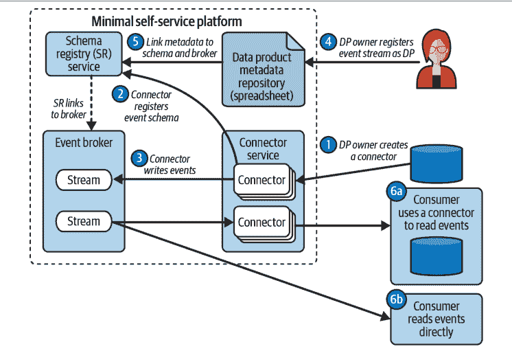
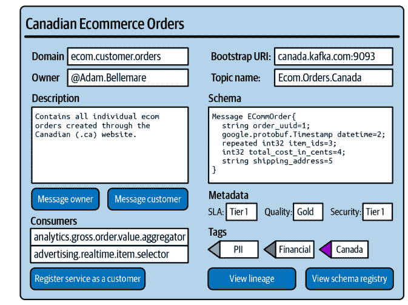
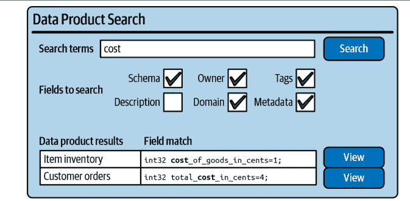
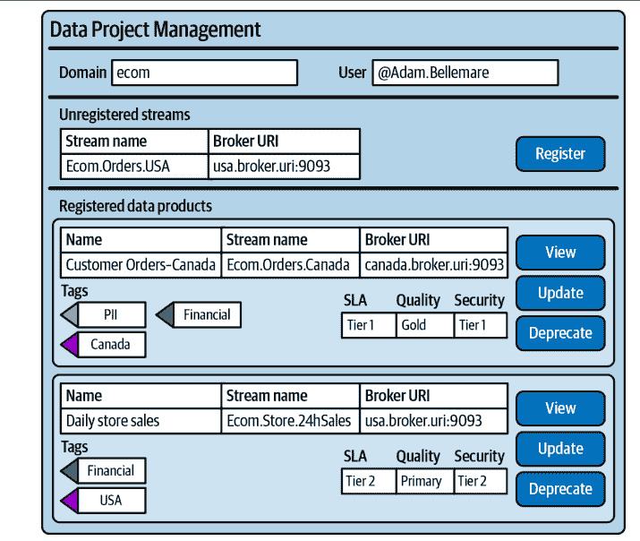
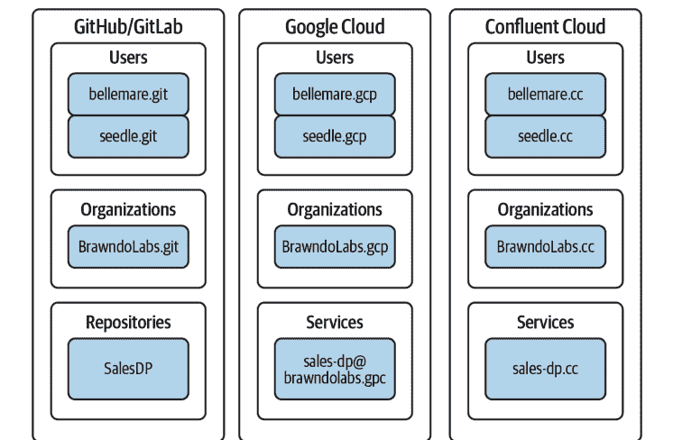
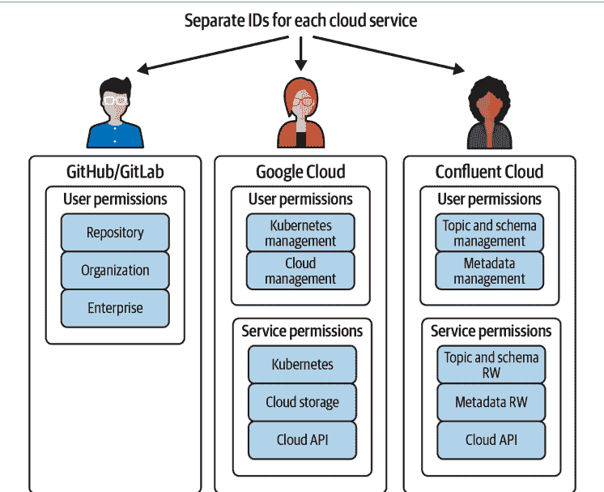
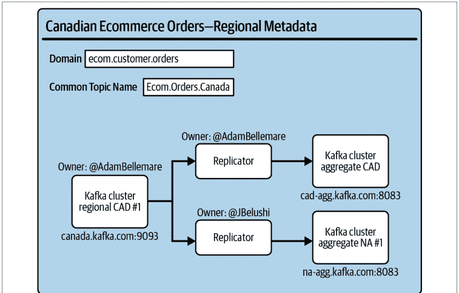

## 自助数据平台

自助数据平台使所有网格用户能够轻松发现、使用、发布、管理和保护数据及数据产品。我们已经介绍了构成该平台的一些组件：用于提供事件流的事件代理、用于跟踪基本元数据的元数据存储以及用于管理数据产品访问的访问控制。在本章中，我们将从极简主义到理想状态，介绍自助平台的功能。

还有几个重要的总体问题有待解决：潜在消费者如何发现可用的数据产品？发现后，如何将它们插入现有的应用程序和分析中？如何在数据产品之上构建新应用程序？同样，数据产品发布者的工作流程是什么样的？他们如何管理数据产品并与客户实际通信？自助平台必须为每个这些问题提供简化的解决方案。

自助数据平台部分由组织中已使用的组件组成，部分由需要构建或购买的组件组成。例如，您可能已经拥有一个元数据目录，用于跟踪重要数据集，也可以用于跟踪数据产品元数据。您可能正在使用 Docker 镜像部署应用程序，在 Kubernetes 上运行它们，并使用基于云的监控服务进行监控。但是，您可能缺乏流处理框架、连接器系统和工作流程标准化来启动和运行数据网格。您拥有什么和缺少什么将因组织而异，因此最好关注核心需求以确定着手处理什么。

从本质上讲，数据网格自助平台只是将组织使用的各个组件和子平台粘合在一起的胶水代码。它简化了团队、人员和服务用于使数据网格成为现实的流程。虽然我意识到此描述可能有些模糊，但现实是，每个组织的数据网格都受到现有系统、流程、治理、人员、团队和技术的强烈影响。您的自助平台将独特于您的组织，但将共享本章将介绍的一些共同主题：身份、发现、身份验证、授权、管理、通信和计算。

在本章中，我们将介绍数据网格自助平台应具备的所有重要功能——并且我们将非常务实地进行。构建数据网格最重要的是能够获得短期收益来测试、尝试并重复什么有效、什么无效。为此，我们将数据网格的方法划分为三级成熟度模型，专注于迭代构建和改进自助功能，同时仍能产生实际业务价值。

### 自助平台成熟度模型

自助平台有三个主要成熟度级别。

我的一位同事经常将构建自助平台称为“边飞边造飞机”，并且充分理由：与软件领域的大多数事物一样，我们希望将其作为最小项目启动并运行，以便开始从中获取价值：

- 级别 1：最小可行平台（MVP）
  定义了构建一个勉强可用平台所需的最小投资。此模型将帮助您从可用的数据产品中立即获取价值，同时提供获取反馈和规划迭代改进的机会。

- 级别 2：扩展平台（EP）
  定义了一个更强大且具备生产能力的自助平台，修复了 MVP 的许多缺陷。数据网格用户操作更加简化并集成到平台中，以至于手动出错的空间大大减少。

- 级别 3：成熟平台（MP）
  定义了完全开发并集成的平台。用户可以轻松发现、发布、管理、演进和删除数据产品。数据产品可以轻松为运营和分析应用程序提供动力。

这些成熟度级别并非金科玉律，您不需要在一个级别完成所有事情后再进入下一个级别。您自己的平台的构建和演化将类似于本章概述的内容，但将根据您的起始位置、业务需求和独特的治理要求而有所不同。


在以下各节中，我们将更详细地查看每个级别。我们将评估平台级别，识别优势和不足，并讨论如何逐步解决缺陷。

在您收集反馈并观察用例时，您会发现需要投入更多资源的领域，这将引导您从一个级别进入下一个级别。专注于获得增量价值，并确保您添加的功能确实在解决用户面临的用例问题。数据网格自助服务平台只需由您决定其复杂程度即可——那么您能够接受的最小程度是什么？让我们来找出答案。

## Level 1: 最小可行平台

MVP旨在成为您数据网格之旅的起点。MVP绝非理想实现——它仅包含实施核心数据网格原则所需的足够功能，并为用户提供一个快速粗糙但坚实的基础以获得实践经验。

MVP中的四个主要组件包括事件代理、模式注册表、元数据目录和连接器服务。事件代理的选择在第67页“选择事件代理”中已介绍，出于本章的目的，我们将考虑将Kafka作为首选代理。

让我们依次查看剩余的三个组件。

### 模式注册表

事件架构定义详细说明了事件的名称、类型、范围、必填字段、默认值和文档，类似于表架构详细说明关系型数据库表中的数据。第6章将更详细地介绍架构，但出于本章的目的，您可以将架构视为一种强类型数据定义，它为数据的生产者和消费者提供通用协议。示例5-1显示了一个简化的Person Protobuf架构，详细说明了发布到事件流的Person对象的id、name和height。

### 示例 5-1. 简化的Person Protobuf架构定义

```
message Person {
  int32 id = 1;
  string name = 2;
  int32 height = 3;
}
```

模式注册表是事件架构定义的存储库，它将每个架构映射到所属的事件流。它充当守门组件，防止不符合已注册架构的事件进入事件流，从而确保严格的数据质量。它还为用户提供API来查找事件流的架构，作为选择最适合其用途的数据产品过程的一部分。我们将在第143页“模式注册表的作用”中更详细地介绍模式注册表。目前，只需将模式注册表视为既是守门组件，又是提供轻松查找事件流数据产品架构的方式即可。

Confluent提供了一种常用且易于集成的针对Kafka的开源模式注册表，开箱即用即可提供所有这些功能。正如我们在第67页“选择事件代理”中讨论过的，轻松免费地访问社区构建的工具和服务，使实施和维护数据网格比在内部构建和维护自己的工具要容易得多。

接下来，让我们看看元数据目录。

### 一个极其基础的元数据目录

我们MVP平台的元数据目录是一个基于云的简单电子表格。注册数据产品只需填写事件流和架构的元数据即可。写入权限仅限于数据产品所有者，组织中的其他人均为只读。或者，仅允许团队负责人修改电子表格，以避免意外更改或删除。

表5-1展示了一个最小基础电子表格可能的样子。

| 名称 | 主题 | 引导 URI | 所有者 | SLA | 质量 | 架构 URI | 描述 |
| :--- | :--- | :--- | :--- | :--- | :--- | :--- | :--- |
| 销售 | gold_sales | k1.brk.kek:9093 | @bondolabs | 第1级 | 黄金 | ../gold_sales | 标准销售数据，包括已清洗的支付类型 |
| 订单 | gold_orders | k1.brk.kek:9093 | @smahmood | 第1级 | 黄金 | ../gold_orders | 标准订单数据，不含 PII |
| 页面浏览量 | page_views | x3.brk.wuu:9093 | @vsalamanca | 第3级 | 青铜 | ../page_views | 从 Google Analytics 导入的页面浏览量指标 |

名称表示数据产品名称，而主题和引导统一资源标识符（URI）的组合指示如何连接到由 Kafka 代理提供服务的事件流。所有者表示与数据产品所有者通信的 Slack 账号（或电子邮件地址）。SLA 和 Quality 只是治理团队强制要求的元数据类型的两个示例，如前面在第 77 页“元数据标准和要求”中所述。架构 URI 提供指向模式注册表 API 的链接，该 API 为该事件流的架构生成人类可读的页面。最后，描述提供一段描述数据产品的可读文本，并解释元数据中可能缺失的任何上下文。

电子表格是开始传达有哪些数据产品、它们位于何处、其格式以及归谁所有的一种非常简单易行的方式。您也可以选择使用关系型数据库之类的工具，但考虑到产品处于这一阶段不需要编程 API，共享电子表格通常是开始的最快方式。

接下来，让我们看看最后一个组件：连接器。

### 连接器

连接器允许您轻松地从数据库 *提取* 数据并将其写入事件流。它们还允许您 *写入* 数据，即从事件流读取并写入目标数据库。各个连接器通常运行在分布式连接器框架之上，提供可扩展性、冗余性和资源隔离。连接框架通常作为事件代理的附加组件提供，例如 Kafka 和 Kafka Connect。

连接器提供了一种构建数据产品的基本方法，使您能够从源数据库提取数据、对其进行转换，并将其沉入事件流。Kafka 提供了大量连接器，使您能够从 MySQL、Postgres、Oracle、MongoDB、Microsoft SQL Server 和 DynamoDB（仅举几例）提取数据。类似于源连接器，匹配的沉连接器提供了一种简便方法，可将事件流中的数据写入您选择的数据库。您还可以编写自定义连接器来连接不常见或没有现成连接器的旧系统。

转换是选择和建模数据产品的重要组成部分，在本章随后介绍的更成熟的平台中，我们将评估一些更强大的选项。但对于我们的 MVP，我们可以使用内置转换组件来重塑并仅选择我们想要从源中获取的数据。Kafka 的 *单消息转换* 允许您将开箱即用的转换串联起来，以最小的努力过滤、修改和转换数据。与自定义连接器代码一样，如果没有现有转换符合您的需求，您也可以实现自己的自定义转换。

我们将在第 8 章稍后详细介绍如何使用连接器从现有系统引导数据。目前，让我们总结一下这个 MVP。

### Level 1 总结：它是如何工作的？

图 5-1 说明了 MVP 的四个主要组件以及基本的注册和使用工作流。



图 5-1. 用于驱动事件驱动型数据网格的最小可行自助服务平台

数据产品所有者创建一个源连接器 (1)，并授予其对其团队数据库中特定表的读取权限。连接器启动，读取表架构，并自动创建一个架构 (2) 以注册到模式注册表。接下来，连接器增量读取源表行，并自动将其转换为与已注册架构匹配的事件。然后将事件写入与该表关联的事件流 (3)。

数据产品所有者随后可以选择将事件流注册为数据产品 (4)。使用其写入权限，他们将治理要求的元数据添加到电子表格中，将自己标记为该产品的所有者，并完成任何其他必填字段。他们还将电子表格中的元数据链接到事件代理中存储的架构的 URL (5)。模式注册表不仅用于序列化和反序列化事件，还用于人类用户的数据发现，以回答“此事件流中的数据格式是什么？”这一问题。


最后，潜在消费者可以发现元数据电子表格中有哪些数据产品可用，并选择其用例所需的产品。然后他们可以创建一个新的接收器连接器将数据写入自己的数据库（6a），或者仅使用 Kafka Streams 或 Flink 等流处理框架原生消费数据（6b）。

MVP 自助数据平台使您无需过度投资于可能不需要的工具、系统或流程，即可轻松开始实践数据网格。您可以开始实践发布数据产品，以及争论和协商角色和职责、元数据要求、服务级别、连接接口和架构类型。您将体会到数据网格带来的社会变革，并识别出哪些人和团队接受变革，哪些人和团队将面临更大困难。

在开始使用自助平台时，最重要的是内化并践行“你用不着它”原则。根据您和团队成员遇到的痛点，按需构建新功能。向联邦治理团队表达您遇到的问题，以便共同决定自助平台下一组功能和改进。


> 在构建数据网格 MVP 时，专注于解决一系列主要痛点。然后您可以将成功的痛点解决作为建立对数据网格平台信任的方式，并收集那些可能有自己相关痛点的其他人的反馈。

MVP 存在一些不足之处，我们将在下一节中探讨解决方法。首先，由于注册是自愿的，元数据电子表格可能无法准确反映可用内容。其次，没有权限控制——任何人都可以读取或写入任何事件流，这是不良做法。第三，您无法真正知道谁在使用您的数据产品。第四，没有强制执行安全或数据质量标准。我们将探讨通过将自助平台进一步演进到 Level 2 和 Level 3 来解决这些问题。

## Level 2：扩展平台

扩展平台 (EP) 解决了 MVP 的若干不足，例如缺乏用户和服务身份、缺乏权限，以及一个不一定能反映现实的低成本数据目录。

最好将 EP 视为专注于两个主要成果。第一是让数据产品所有者和潜在数据产品消费者更容易使用数据网格。对于数据产品所有者，这意味着使他们能够将其事件流发布为数据产品；而对于消费者，这意味着让他们轻松找到数据产品、注册为消费者，并设置所需的任何连接器以将数据传入其自身服务空间。

第二个主要成果是实现基本的服务身份和控制。至少，服务需要唯一身份以分配权限。虽然看似简单，但我们还必须考虑自助平台通常跨越许多子平台组件——代码仓库、事件代理和计算资源，仅举三个常见的包含内容。

扩展平台的组件和功能包括：

- 功能齐全的元数据目录
- 数据产品管理服务和 UI
- 服务和用户身份
- 基本访问控制
- 用于构建数据产品的流处理

首先与您的基础设施和平台工程人员交谈。您需要弄清楚如何利用现有系统和工具用于数据网格自助平台。您的工程团队可能已经有构建、容器化、测试、部署和监控应用程序的流程。不要重复造轮子——复制他们已有的内容来构建和部署数据产品，并根据需要进行调整。

首先，让我们看看如何用更强大、更有用的东西来改进这个共享电子表格“数据目录”。

## 功能齐全的元数据目录

首要任务是用合适的数据目录取代电子表格。

可供选择的选项很多。流行的开源软件 (OSS) 项目包括 Apache Atlas 和 Amundsen，仅举我在数据网格实现中成功使用过的两个例子。虽然您也可以使用关系数据库来建模和构建自己的数据目录，但这些现成的专用数据目录产品包含自己的发现 UI、格式良好的 API 以及发布、搜索和建模功能。

功能齐全的元数据目录的一些重要功能包括：

### 元数据建模

除数据产品元数据外，您还可以为人员、团队、应用程序、事件代理和连接器创建元数据。您还可以为这些元素之间的关系创建元数据模型，从而形成一个可遍历的关系图。

### 搜索功能

数据目录还可以提供搜索功能，以供您查询元数据条目。根据您选择的数据目录，除了基本字符串匹配外，您可能还可以使用 SQL 或类似 SQL 的查询功能。搜索功能是使平台自助化的必要组成部分，因此在投资之前请确保已评估目录的功能。

### 通过图遍历进行依赖项识别

通过图遍历识别上游和下游依赖项对于验证数据网格的完整性非常重要。例如，在添加新的依赖数据产品或消费者应用程序时，您可以验证所有上游数据产品和服务是否满足最低服务级别，从而不违反您自己的 SLA。同样，您可以使用相同的图形功能来识别数据的所有现有消费者，以便您可以通知他们即将发生的变化。


数据目录往往会长期过时，通常是因为它们被当作文档来对待——事后更新，如果有人记得做的话。数据目录成为创建、发现和使用数据产品的运营工作流一部分至关重要，随着新产品的创建、删除和订阅而自动更新。

一旦您选择了新的功能齐全的数据目录，下一步就是确保其正确集成到数据产品管理工作流中。您可以通过保持其最新所需的手动交互量来衡量数据目录集成的成功程度，零手动交互是成功的指标。您的数据目录应仅通过数据产品管理服务来填充和更改。我们将在下一节中更详细地探讨这一点。

## 数据产品管理服务和 UI

MVP 中的 UI 不存在。数据网格用户必须创建他们的数据产品，手动将其添加到电子表格中，并希望其他人遵循相同的规则。很可能有人会跳过填写强制性元数据，意外删除他人的条目，或者不正式注册数据产品。毕竟，即使数据不在电子表格中，您仍然可以使用它！

获得数据产品 UI 的最简单方法是使用已包含 UI 和搜索元素的数据目录。如果它还包含一种设置细粒度权限的方法，以便大多数用户仅具有只读权限，则更好（下一节将详细介绍）。但是，如果您决定自行设计 UI，您需要考虑消费者如何浏览和搜索可用数据产品以及管理自己的数据产品。它必须支持的基本操作包括：

### 浏览数据产品

用户需要浏览现有数据产品以查看可用内容。图 5-2 显示了 UI 的示例，包括名称、描述和一些元数据相关信息。单击数据产品将提供有关该产品的更多信息。

### 浏览流数据产品

| 名称 | 描述 | 领域 | |
| :--- | :--- | :--- | :--- |
| 客户订单-加拿大 | 来源于加拿大的订单 | ecom.customer.orders | 查看 |
| 客户订单 | 来源于美国的订单 | ecom.customer.orders | 查看 |
| 物品库存 | 全球物品库存 | ecom.inventory | 查看 |

图 5-2. 数据产品浏览 UI，包括域信息、已注册消费者列表和元数据

### 查看数据产品信息

每个数据产品都应有一个详细页面，展示完整的数据范围，包括所有者、描述、架构、数字位置以及治理团队认为相关的任何其他信息。图 5-3 显示查看数据产品时您可能会看到的信息。请注意，有一些按钮可启用自助操作，包括向现有消费者发送消息、向数据产品所有者发送消息以及请求注册为消费者。




图 5-3. 数据网格用户可查看的数据产品信息

## 搜索门户

搜索引擎支持对元数据、架构、描述和文档进行查询。图 5-4 显示了一个示例搜索界面，用户可以在其中指定关键字和要搜索的字段。您也可以选择直接暴露数据目录的搜索 API 作为低工作量的选项——只需提供一些查询示例，以确保您的消费者能够弄清楚如何使用它。



图 5-4. 用于搜索数据产品的搜索 UI


新消费者能够自行注册的能力是自助服务能力的一项良好检验，因为它需要用户身份、应用程序服务账户以及事件流读写访问控制之间的集成。

数据产品管理仍然是自助服务平台的第二大主要要求。用户必须能够识别可以发布的事件流，将其注册为数据产品，并弃用不再需要的任何数据产品：

### 识别候选数据产品

系统必须向用户提供可注册的事件流列表。从语义上讲，这些是属于用户所属域或用户对其拥有某种管辖权的流。一种简单的选项是仅允许创建事件流的用户将其注册为数据产品。更高级的选项包括与事件代理的用户和组织账户集成（将在下一部分“服务和用户身份”中介绍，第 123 页），这样只有属于拥有该流的团队或组的用户才能管理它。

### 注册数据产品

一旦数据产品所有者确定了想要作为数据产品发布的事件流，他们理想情况下可以点击一个大的“注册”按钮来启动注册流程。随后，他们应被提示输入联邦治理规定的强制性元数据，例如 Name、Owner、SLA、Quality 和 Description。其他属性应自动提取，例如底层流名称、事件代理地址、架构以及与权限和访问控制相关的元数据。

### 弃用和注销数据产品

最终，可能需要移除某个数据产品。弃用会锁定数据产品，使只有现有消费者能够继续使用它，同时将其标记为已弃用并将其从搜索结果中隐藏。随后，数据产品所有者需负责为其当前用户提供弃用计划，包括迁移计划以及必须完成工作的时间表。您应确保只有没有现有注册消费者的已弃用数据产品才能被删除，以防意外删除对系统至关重要的数据产品。

图 5-5 展示了管理 UI 可能的外观。从顶部开始，您可以看到登录控制台的域和用户。在“未注册的流”标题下是可作为数据产品发布的候选项——目前只有一个，即名为 Ecom.Orders.USA 的流。这些流仅显示给活跃用户，因为它们与该流的所有权相关联。最后，当前已注册的两个数据产品显示在“已注册的数据产品”标题下，包含所有强制性元数据以及用于查看、更新和弃用它们的多个控件。



图 5-5. 用于注册和注销数据产品的管理 UI

数据产品管理 UI 是数据网格中用于浏览、发现、管理、注册、弃用和移除数据产品的主要枢纽。构建数据管理服务时，有句话建议您牢记：首先专注于数据产品消费者的需求，例如发现功能，因为当前和潜在消费者将构成自助服务平台用户最大的群体。如果您注册数据产品的流程还稍显简陋，那也没关系，因为您使用和发现数据产品的频率将远高于发布新数据产品的频率。

在下一节中，我们将回答：如何知道谁拥有数据产品？或者哪些服务可能正在请求访问权限？

## 服务和用户身份

身份识别是管理和跟踪数据网格中数据访问的重要组成部分。对于数据产品，了解所有者是谁以及哪些服务正在使用它非常重要。同样，了解数据产品本身的上游依赖关系也很重要。身份构成了数据产品所有权的基础，并简化了发布控制、访问请求和依赖跟踪，如本节后面所述。但首先，以下是我们将在接下来的几个部分中回顾的几个概念：

### 主体

主体是标识用户或服务的唯一字符串。例如，Google 使用电子邮件地址作为服务账户主体，而遵循 RFC1779 的安全套接字层 (SSL) 证书主体格式类似于 CN=Common Name,O=Organization,L=Location,ST=State,C=Country。无论格式如何，唯一性及其与服务或用户的关联都是必不可少的。

### 用户账户

用户账户代表人类用户。这类账户通常用于登录系统并访问分配给用户的资源。

### 组织账户

代表组织的账户。例如，GitHub 提供组织账户，以便将项目、存储库和软件包的所有权分配给一个组，而不是单个用户。Confluent Cloud 和 Google Cloud 也有各自的组织账户版本，允许对用户、服务和其他资源进行更细致的组织。

### 服务账户

专门为代表服务而创建的账户。应用程序使用服务账户来访问资源、连接到 API 并访问事件流。每个数据产品都会分配一个服务账户，用于创建数据产品的应用程序以及存储数据的事件流。

创建自助服务平台需要面对统一下层子平台中多个服务账户和用户账户的挑战。

图 5-6 展示了构建数据网格时可选用的仅三个子平台示例：GitHub/GitLab、Google Cloud 和 Confluent Cloud。这些平台各自拥有一套用户账户和组织账户，以及适用于 Google 和 Confluent 的服务账户。结果是，每项服务（无论是云服务还是其他）最终都会拥有自己的用户和服务账户集，以及管理资源、权限和成员身份的相似但不同的方式。



图 5-6. 在数据网格中为每个子平台管理单独的账户和资源是一项具有挑战性的工作

Sales 数据产品位于 SalesDP 仓库中，属于 BrawnDO Labs 组织的一部分。随后，该项目会（例如）使用 Kubernetes 平台在 Google Cloud 中编译和部署。托管数据产品应用程序代码的 Kubernetes pod 在 sales-dp@brawnolabs.gcp Kubernetes 特定服务账户下运行。此外，Sales 数据产品中的代码需要拥有自己的凭据集以访问 sales-dp.cc Confluent Cloud 服务账户，从而能够成功将数据写入其事件流。


> 构建数据网格最具挑战性的部分之一，是将各种身份机制、用户账户、服务账户和组织集成到一个精简的自助服务解决方案中。您尝试支持的技术、平台和服务类型越多，您的体验就会越复杂、越具挑战性。

针对 EP 解决方案，请确保您已创建并正在使用用户账户、服务账户和组织。服务应与服务账户保持 1:1 映射。用户应映射到组织，这些组织允许他们仅访问其参与的数据产品和服务。让我们来看看基本访问控制包含哪些内容。


## 基本访问控制

访问控制建立在数据网格中服务和用户身份实现的基础上。正如每个子平台都有其自身身份的概念和边界一样，每个平台也都有其控制访问和授予权限的方式。图 5-7 展示了您需要考虑的用户和服务访问控制类型的一小部分示例，延续 GitHub/GitLab、Google Cloud（GCP）和 Confluent Cloud 的示例。



图 5-7. 每个子平台都有与其自身用户和服务身份相关的一组权限

访问密钥是向用户和服务帐户授予权限的常见方式。管理员生成访问密钥和密钥，它们实际上充当用户名和密码，满足身份需求。

接下来，管理员在各自平台内为每个访问密钥帐户授予权限。在 GitHub、GCP 和 Confluent Cloud 示例中，用户需要获得推送提交到 GitHub 并将其编译并部署到 GCP 中 Kubernetes 应用程序的访问权限。同时，与应用程序关联的服务帐户需要某些 Kubernetes 和 GCP API 权限来运行应用程序，以及 Confluent Cloud 权限来创建主题、写入事件、更新架构以及更新任何其他元数据。

虽然让人工参与分配和管理服务帐户及权限可能有点繁琐，但在数据网格演进的这个阶段，这仍然是您的最佳选择。您应该致力于保持流程灵活，开销低。例如，只需打开一个工单，将其分配给管理员，然后在公司的基于频道的即时通讯应用中友好地提醒他们。

> 嗨，Seedle！
> 您能否将以下 Kafka 权限添加到我们的微服务？
> 
> - 服务名称：ShippableOrdersResolver
>   - 主题名称：Shopping.Orders.v1
>     - 权限：read, describe
>   - 主题名称：Shopping.Payments.v2
>     - 权限：read, describe
>   - 主题名称：Sales.ShippableOrders.v1
>     - 权限：write, describe
> 
> 谢谢！

工单将为您提供最少量的审计，明确谁请求了权限、谁授予了权限以及何时发生。您还可以避免在自助服务平台内所有子平台之间完全自动化权限管理编排的问题。这可以留到以后，等您更好地理解数据网格技术栈和用户需求时再处理。

但现在，让我们回到谈论这些密钥的话题。虽然*您*可以将它们本地保存到自己的系统中用于个人使用（安全风险不谈），但对于容器化应用来说，不幸的是事情并不那么简单。相反，我们可以将密钥存储在专门构建的密钥存储中——例如 AWS KMS、Google KMS 或任何其他符合您云提供商要求的密钥管理存储。

一旦您的密钥生成并安全地存储在 KMS 中，下一步就是将它们与容器化应用程序集成。一种常见的方式是在运行时将密钥注入容器中，这样任何其他系统都无法查看它们。但是，这需要仔细的设置和配置，并且存在意外泄露密钥的风险。


将密钥作为身份验证和访问控制的主要方式存在许多安全风险，尤其是在存储密钥和正确限制访问方面。我建议您读一本现代服务安全方面的书来了解新的最佳实践，因为这些内容都远远超出了本书的范围。

访问密钥只是管理权限的一种方式；我们将在第 3 级探讨一种更强大的选项。由于权限与身份紧密相关，在跨越多个子平台和服务时，很难获得端到端权限的简单视图。我不会对此步骤描绘一幅美好的图景——将多个平台的权限和身份编排和简化为一个统一的身份系统是困难的。


您可以允许用户自由地将其服务注册为事件流消费者，而无需安全检查，除非流中包含 PII、财务或其他敏感数据。如果需要权限，您可以让消费者提交工单（人工介入），或者让他们在授予访问权限之前经过明确的条款和条件确认。请与您的治理团队商讨应如何继续。

## 构建数据产品的流处理

对于 MVP，我们依赖连接器来完成简单流转换的大部分处理工作——例如屏蔽敏感信息或将数据从一种格式转换为另一种格式。但现实是，您将需要更强大的流处理器来构建功能齐全的事件驱动数据产品。例如，您需要能够维护状态并聚合事件来构建聚合对齐的数据产品（参见第 33 页的“三种数据产品对齐类型”）。您还需要将流连接在一起以构成消费者对齐的数据产品，因为数据通常来自业务的不同部分，并且在许多用例中需要进行协调。

流行的流处理框架包括 Kafka Streams、Apache Flink 和 Apache Spark Structured Streaming 等。每个框架都提供广泛的高阶流处理功能，用于构建、使用和消费事件驱动的数据产品，并将完全适合您自己的数据网格需求。除了确定要使用的技术外，您还需要确定如何运行它并将其与您自己的应用程序运营集成。您的选择实际上归结为“我是自己管理它？”还是“我依赖云服务提供商来为我管理它？”最重要的是，无论您选择何种技术，都要让团队成员轻松地创建、运行和管理代码，以构建和使用数据产品。


构建事件驱动数据产品不一定需要使用流处理框架——一个基本的事件生产应用程序也可以正常工作。但是，如果没有事件驱动处理框架，您可能会发现使用事件流数据产品更加困难，例如将流连接在一起和构建复杂的事件驱动状态机等任务。

在内部（或在您自己的云中）运行自己的技术相当不言而喻。关于这个主题有大量信息，因此我将留给您自己去弄清楚如何自行托管流处理框架。但是，您应该认真研究云服务提供商，了解他们提供什么以及他们如何减少您构建和运行数据网格的工作量。云服务提供商在现代架构中扮演着越来越重要的角色，其最重要的贡献在于减少完成工作所需的繁琐劳动和开销。

流处理器既功能强大又复杂，运行起来也不容易。例如，Apache Spark Notebook 多年来一直是进行大数据分析工作的常见方式；分析人员只需将代码写入笔记本并原样部署——就像容器化应用程序一样。Databricks（由 Apache Spark 的创建者创立）最早承担的价值主张之一是减少管理 Spark 集群和部署数据处理应用程序的繁琐工作。相反，重点是让用户轻松地编写、测试、部署和监控笔记本——这正是我们希望在自己的事件驱动数据网格中具备的特性。

在事件驱动的世界中，我们会遇到许多其他问题：我们不仅需要流处理框架，还需要运行托管和提供所有流的事件代理。像 Confluent 这样的云服务提供商不仅消除了所有流处理开销，还负责所有事件代理和数据存储的扩展，并提供数据目录、托管连接器、身份管理和访问控制。

托管流处理让您创建持久的流式查询来重构、连接、聚合和重塑事件，从而让您从其他流中创建新的数据产品。您只需编写代码、启动作业，云服务就会处理其余部分——随着负载变化进行上下扩展，并在发生故障或异常时恢复。

当然，还有许多其他云服务提供商提供广泛的替代技术和功能。您需要根据自己组织的需求，确定哪些最适合您。

云计算为您的数据网格之旅奠定了基础。您无需专注于托管、监控和调优常用技术，只需将其外包


专注于从数据本身中获取价值，构建数据产品，并学习使用云平台。您将更早地获得关于什么有效、什么无效的反馈，如果发现初始选择不合适，可以更换技术选型，而无需在基础设施和运维上投入过多。您的主要目标应该是在过度投资之前 _尝试不同方案_ 以找出什么有效。之后随时可以优化；目前，您正在尝试找出什么有效、什么无效。云计算使这项任务变得容易得多。

第 2 级就讲到这里了。让我们回顾一下所学内容，并了解它们如何协同工作。

## 第 2 级总结：它是如何协同工作的？

EP 旨在解决 MVP 在服务和用户身份方面的不足。它还基于功能齐全的数据目录，提供了改进数据产品管理和发现的手段。

集中式数据产品管理服务和 UI 构成了面向用户控件的基础。用户可以发现已发布的数据产品，查看元数据，并决定哪些数据产品满足其自身服务的用例。管理服务将事件代理、元数据目录、架构注册表和子平台整合为一体，打造自助式体验。自助式 UI 体现了构建数据网格的以消费者为中心的特点：使用户能够轻松查找和使用数据产品。

然而，创建数据产品所需的代码和计算能力仍不在迄今为止所涵盖的范围内。我们提到过可以使用 GitHub、Confluent Cloud 和 Kubernetes 等服务分别存储代码、托管事件流以及提供通用计算，但尚未将这些服务集成到我们功能完备的自助式平台中。

自助式平台也远未实现完全自动化。仍需人工参与平台请求的日常服务工作。管理员需要手动为服务和用户管理角色、账户和权限。

进入第 3 级相当困难，如同所有数据网格相关工作一样，只有在第 2 级的痛点超过了自助式平台的投资成本时才应尝试。在下一节中，我们将探讨完全成熟平台的功能。

## 第 3 级：成熟平台

成熟平台（MP）是将身份、服务、流程和数据产品整合为一套精简操作的最终形态。它高度依赖于跨多种服务、平台和技术实施身份、访问控制和工作流。MP 致力于减少早期自助式平台中遇到的手动步骤和重复性开销，并为日常操作强化和精简一组选定的数据网格操作。

例如，使用 Kafka Streams 创建数据产品消费者应用可能是您业务的主要用例。因此，您可以从自助式 UI 的单个按钮中精简 Git 仓库、Docker 容器和仓库存储、Kubernetes 任务、测试、编译和部署流水线，以及监控、权限分配和服务所有权等所有内容的创建。如果听起来工作量很大，没错，确实如此！但随着您的数据网格需求增长，您对通过投资新功能来精简其使用的需求也会随之增长。

MP 更多是一个目标，而非实际终点。如果您发现功能较少、自动化和精简程度较低的简单平台运行良好，那很好！继续使用它，直到发现它无法满足您的需求。将多种服务、跨平台身份管理、团队、人员和系统整合到一个集中式控制面板中相当困难。请记住，有些云服务提供商花费了大量时间才使其运作正常。如果您觉得具有挑战性，那是有充分理由的。


> 您很可能需要使用像 Terraform 这样的基础设施即代码解决方案来帮助管理数据网格的基础设施组件。Terraform 是领先的基础设施管理解决方案之一，可以在许多云提供商、SaaS 解决方案和平台之间集成“整合”操作。

实施成熟平台功能所带来的最大收益是效率。普通用户将更轻松地创建、发布、管理和使用数据产品。您将遇到更少的事件和停机、数据质量问题以及影响最终用户的数据不一致。您可以预期查找和使用数据的开销将大幅降低，正如前面在第 17 页“糟糕的数据：不行动的代价”中讨论的那样。

成熟平台的组件和功能包括：

- 身份验证、识别和访问管理
- 与现有应用交付流程集成
- 以编程方式管理数据产品的 API
- 监控和告警
- 多区域和多云数据产品

首先，让我们看看如何在自助式平台上标准化身份和访问管理。

## 身份验证、识别和访问管理

身份验证、识别和访问管理（IAM）本身是一个广泛的领域，本章无法对其进行全面阐述。与身份验证和 IAM 相关的大量工作涉及将平台中各主要基础设施组件的各种身份、角色和权限整合在一起。例如，Kubernetes、Apache Kafka 和 GitHub/GitLab 各自提供自己的身份管理系统，但仅限于其自身服务范围内。鉴于我们的数据产品由代码、数据和基础设施组成，我们需要找到一种方法（例如使用 Terraform）来弥补差距，并整合出统一的身份体验。

但什么是身份验证，什么是授权？想象一下入住酒店时的情形。前台工作人员会通过要求您提供身份证或预订代码来 _验证身份_，以确保您是您所说的那个人。接着，他们会发给您一张房卡来 _授权_ 您进入房间——该房卡仅对该房间有效，并在退房时到期。授权和身份验证对于构建数据网格都至关重要，这些要求最好使用 OAuth2 及其配套的 OpenID Connect（OIDC）等标准框架来实现。

幸运的是，这一问题的根源在很大程度上已随时间得到解决。我们可以遵循一些最佳实践，并利用现有技术作为构建自助式平台的起点。

OAuth2 是授权领域的领先行业协议之一。正如原始互联网工程任务组（IETF）规范中所述，“OAuth 2.0 授权框架使第三方应用程序能够获取对 HTTP 服务的有限访问权限，无论是代表资源所有者协调资源所有者与 HTTP 服务之间的审批交互，还是允许第三方应用程序以自己的名义获取访问权限。”

Kubernetes、GitHub、GitLab 和 Apache Kafka 均集成并支持 OAuth2，因此您可以很大程度上统一身份验证和授权控制。OAuth2 是一种相当常见的标准，因此您很可能发现将其扩展到您已在使用的其他云服务和平台很容易。

OAuth2 服务通过使用访问令牌提供授权。当一个应用程序想要与另一个应用程序通信时，它首先向 OAuth2 服务器请求访问令牌。请求应用程序向 OAuth2 服务器标识自身，并根据业务规则和权限可能获得持有者令牌。然后，请求应用程序可以使用该持有者令牌，将其提交给最初想要连接的应用程序。

OIDC 与 OAuth2 协同工作，使得在不直接共享用户和服务凭据的情况下实现应用程序之间的数据共享成为可能。OIDC 通过主要关注身份验证而非授权来扩展 OAuth2。使用 OIDC 对账户进行身份验证后，便会使用 OAuth2 规范进行授权。OAuth2 有助于缓解在数据网格中处理多个不同服务和框架时固有的主要问题，并允许您整合出一致的体验。

在 OAuth2 统一下，您的自助式用户将能够：

- 在单一位置声明和管理用户及服务账户
- 依赖 OAuth2 标准和工具与云服务提供商平台及应用集成
- 从单一位置管理大多数权限和访问控制
- 将身份验证和授权作为构建和使用数据产品的强制步骤

您还可以使用其他技术来实现类似目的；这只是一种选择。例如，安全断言标记语言（SAML）1.0 于 2002 年发布，至今仍是一种常用的替代方案。无论如何，最终目标是一致的：统一并精简人员、系统和数据产品之间的身份管理和访问控制。

接下来，让我们看看如何交付和部署数据产品。

## 与现有应用交付流程集成

您很可能已经拥有某种现有的应用程序开发和部署流水线。有用且可持续的自助式数据平台应尽可能复用现有流水线。数据产品与其他任何应用程序非常相似，尤其与微服务、特别是事件驱动型微服务相似。事实上，如果将两者并排比较，您可能很难定义事件驱动型数据产品与事件驱动型微服务之间的区别：两者都使用代码、计算资源和内存，并将结果打包为通过事件流提供的数据。

由于您可能会构建多个数据产品，因此会遇到使用微服务时所面临的同样的开销——即微服务税。每个新的数据产品都需要一个 Git 仓库和一个构建流水线，


此外，还需提供一种方式来容器化编译后的应用程序，将其部署到计算资源（例如通过 Kubernetes），并对其进行扩缩容、监控和更新。

无论您之前如何构建现有的应用交付流程，都需要评估如何利用它来部署数据产品。如果您拥有一个单体技术栈，且只有少量自定义构建和部署的服务，那么这很可能会相当具有挑战性。不过，如果您已经在运行多个服务，并拥有相对成熟的部署和管理流程，那么这可能会容易得多。

在第 114 页的“用于构建数据产品的流处理”中，我们探讨了一些使用流处理框架构建和使用数据产品的选项，特别是探讨了使用云服务而非自托管解决方案。如果您选择遵循云端路线，很可能能够利用其推荐的最佳实践来将数据产品应用交付到生产环境。您会发现，许多云服务商都简化了其首选“代码容器”的管理和部署，无论是 Docker 镜像、Notebooks 还是持续查询。无论您身处何地，我给您的建议始终如一：尝试寻找一家能为您提供轻松构建、测试、存储、部署和运行数据产品代码方式的云服务商。

## 以编程方式管理数据产品的 API

数据产品管理 UI 已扩展，以提供一个与您的身份验证和授权服务集成的编程式 API。此功能的目的是提供一个用于自动化管理数据产品的 API，包括发布、更新、弃用和删除。该 API 很可能只是为支持自助服务 UI 的 API 的扩展，并扩展为向选择与其集成的任何工具和服务提供 API 访问权限。除了面向最终用户的直接用例之外，API 的其他使用候选对象还包括部署流水线、监控系统和审计用例。

让我们避免深入 API 规范的繁琐细节，专注于需要使用此 API 支持的领域：

- **身份管理**
  简化人类用户和服务帐户身份的创建与管理，对于协调所有候选数据产品的资源和权限分配至关重要。

- **资源创建**
  创建候选数据产品所需的所有资源都可以以应用程序的形式创建。资源包括服务身份、代码仓库、构建和部署流水线、Kubernetes 资源、Kafka 主题、注册表主题和监控资源。需要为候选数据产品指定拥有相关访问权限的数据产品所有者。

## 权限管理

在创建候选数据产品时，需要指定一个人类所有者（或所有者团队）作为所有者。所有者将对数据产品操作拥有完全控制权，包括发布、授予读取权限、更新、弃用和删除数据产品。权限管理还可能需要与信息安全审查和控制集成，以确保遵循数据策略。

## 发布、弃用和删除数据产品

数据产品生命周期的三个主要阶段包括：作为正式数据产品发布供他人使用、弃用以防止新用户使用它，以及删除以移除数据的所有可能用途。联邦治理团队需要指定在这些状态之间移动的要求，包括是否允许步骤回退（删除 → 弃用）以及弃用和删除之间的最小过渡时间。

## 更新数据产品

数据产品在其生命周期内可能会被更新。架构演进以适应消费者需求，仍然是事件驱动型数据产品中最常见的变更之一。其他更新包括对元数据的更改，例如降低 SLA 或在人员离职时更改数据产品所有者。可能会添加新标签，移除现有标签，并且基于法律要求的新信息安全法规可能会生效，从而更改对数据产品的权限访问模型。更新可能影响当前和潜在消费者，因此最好设置通知和消息传递系统以实现沟通。

## 破坏性变更流程

传达即将发生的破坏性变更（例如对数据产品进行重大重构）需要建立明确的参与规则。数据产品所有者需要向消费者提供足够的预警，以便他们有时间了解影响、制定计划并做出反应。我们将在第 140 页的“协商破坏性架构变更”中广泛介绍破坏性变更流程。

## 消息传递

自助服务平台用户应能够订阅关于数据产品的细粒度通知。当数据产品更新时，注册为数据产品消费者的服务帐户所属人员或团队应接收通知。理想情况下，数据产品所有者应向所有消费者发送即将发生的变更的通知，以便他们可以调查是否需要在其端采取行动。其他用户可能希望在新数据产品发布、弃用或删除时，或当现有数据产品的所有权变更为新人员或团队时接收通知。您很可能需要将消息传递 API 与企业即时通讯服务（例如 Slack 或 Microsoft Teams）或企业电子邮件服务器集成。请勿创建您自己的消息传递系统。

## 搜索与发现

用户必须能够搜索可用的数据产品、人员、团队和服务，以了解数据网格中的情况。搜索功能通常可以由数据目录本身提供，但您需要向 API 用户传递足够的信息，以确保他们知道如何构建查询。发现很大程度上是简化搜索的一种功能——只需返回符合我条件的所有数据产品、人员、团队或服务。

关于 API 的决策应基于用户的需求，但最初将完全由 UI 的要求（“数据产品管理服务和 UI”，第 106 页）驱动。您可能会发现可以为 UI 和其他自动化用例复用同一 API，但可能需要进化部分功能并标准化接口。同样，应根据用户需求对其进行进化，且不要投资超出您即时需求的内容。

## 监控与告警

监控数据产品并针对异常行为发出告警，是构建可靠数据网格的必不可少的一环。在第 77 页的“元数据标准和要求”中，我们使用分级系统为数据产品分配了 SLA：第 1 级意味着“立即起床修复”，而第 4 级意味着“可以等到我们有空闲时间再处理。”同样，我们分配了从青铜到黄金的分级质量评级。评级的具体定义并不像确保我们可以衡量质量和 SLA 以确保其满足要求那样重要。

满足 SLA 的两个主要组成部分是更新频率以及自上一次事件写入数据产品以来的时间。写入频率越高，如果更新突然停止，就越可能存在问题。了解数据产品的更新频率非常重要，因为数据产品可能会快速更新，然后在数小时或数天内保持不变。智能告警服务可以基于历史模式进行训练，从而得出一个考虑周期性更新模式的自定义告警。

满足数据质量要求始于定义明确的架构，第 6 章将对此进行介绍。架构为数据产品的数据模型提供强类型和明确要求，并防止畸形数据进入事件流。然而，数据质量度量可以超出简单的类型检查，还可以包括验证字段内容（例如，验证数值 val-）等操作。


值落在某个范围内、字符串格式正确，或数据落在预期分布中）。某些数据产品，例如涉及财务交易的数据产品，可能需要完美的数据质量——任何异常都是问题，且必须触发警报。其他数据产品，例如分析聚合，可能可以容忍一定范围内的意外值。可以通过创建专门构建的数据产品消费者来测量数据质量指标，该消费者读取流、将每个事件与预期值进行比较，并将任何异常值报告给监控系统。

像监控任何其他应用程序一样监控您的数据产品。您应确保构成数据产品的应用程序代码健康且拥有足够资源，事件流包含预期数据，并通过严格测试和直接数据分析来防范质量问题。

## 多区域和多云数据产品

数据网格可能由多个区域中的多个云服务组成。例如，您可能拥有多个 Kafka 集群、多个 Kubernetes 部署和多个云存储桶。可扩展性要求通常在采用多个基础设施部署方面起重要作用，尽管数据本地性和区域法规也是重要考虑因素。在其他国家可能违法的业务活动（例如，大麻和酒精销售）相关的数据应保留在原始国家。同样，GDPR 和数据隐私法律倾向于要求关于公民的数据也保留在原始国家。

在自助服务平台级别应用治理控制，可以为允许和不允许的内容提供主要控制点。在构建您自己的多云部署时，需要考虑多个因素：

### 区域权限要求

联合治理在确定数据产品可以访问和复制到的边界方面起着重要作用。例如，在美国运行的应用程序可能因法律限制而无法访问数据产品。同样，基于数据驻留限制，您可能无法将数据产品从一个区域复制到另一个区域。

### 简化的数据产品复制

设置跨云或跨区域的数据产品复制可能具有挑战性。您不仅需要复制数据本身，还需要更新元数据以反映新的依赖项、新的云信息以及所有权权限（例如，谁拥有复制过程本身）。对于 Kafka 支持的事件流，您可以选择使用开源的 MirrorMaker 2.0。如果您需要精确的逐字节复制，包括偏移量、消费者组、权限和架构，则可能需要研究更强大的工具，例如 Confluent Replicator。

### 增强的数据产品元数据

您可以增强元数据以包含区域和云服务提供商限制及权限。例如，您可以限制将包含加密 PII 的数据产品复制到欧元区以外，以确保遵守 GDPR。同样，数据产品处理也需要保持在精选的允许云环境列表中的部署内（例如，可以使用 Azure 或 GCP，但不能使用 AWS）。


云服务提供商可以让您轻松启动一个与生产环境镜像的完整专用环境。然后，您可以将生产级别的数据产品复制到新环境中，并在真实的生产数据产品上进行开发、QA 或测试。完成后，只需删除环境即可。

图 5-8 说明了数据产品源、专用复制器应用程序和目标集群的可视化拓扑。



图 5-8. 展示多区域数据产品复制拓扑的元数据

您选择复制的内容和方式将取决于您组织的需求。然而，一个保持不变的关键方面是需要跟踪正在复制的内容、复制的所有者以及复制的目标。将此信息和这些依赖项作为自助服务平台元数据条目的一部分进行跟踪。

## 第 3 级总结：它是如何工作的？

第 3 级平台的主要主题包括统一身份管理和简化的数据产品运营。要达到这一点需要投入大量工作，投资应仅由需求驱动，而不仅仅是为了挑战。与信息安全和限制对敏感信息的访问相关的治理要求，仍然是推动统一身份管理、身份验证和授权的最大动力。数据产品和事件驱动应用程序的广泛采用，推动了与仅仅创建数据产品并将其投入使用相关的所有开销的简化。

## 摘要

您自助服务数据平台的确切演变将因组织而异，但将涉及本章中列出的所有功能。您可能会发现，在实现第 2 级的某个功能之前先实现了第 3 级的一个功能——这完全没问题。本章中提出的级别仅仅是平台随时间演变的粗略指南。

在创建自助服务平台时，您应遵循的指导原则是关注平台用户的用例：数据产品所有者和数据产品消费者，无论他们是数据分析师、数据科学家、应用程序开发人员还是任何其他职位。您希望专注于使同事能够满足自己的需求，而不让他们做不应该做的事情（例如删除他人的数据产品）。

如在第 1 级中所介绍，最小自助服务平台实际上非常小且精简，没有太多关于您可以或不可以做什么的护栏。但是，它是启动关于平台应如何变化的真实讨论的绝佳起点，区分其_必须_拥有的功能与锦上添花的功能，并将讨论集中在有用的迭代改进上。在构建平台的过程中，您会犯错。错误会发生。但弄清楚您独特的旧系统、技术选择、业务需求和队友技能组合如何与业务用例相关联，是开发过程的一部分。

尽可能专注于使用现成组件，不要重复造轮子。尽可能利用云服务，除非绝对必要，否则避免编写自定义内部工具。例如，使用 Kubernetes 而不是编写自己的云规模容器管理系统。使用 Apache Kafka 而不是编写自己的事件代理。使用 OAuth2 而不是编写自己的身份管理服务。使用 Terraform 来简化各种平台组件之间基础设施和服务资源的协调。自助服务平台的全部意义在于使访问和使用重要业务数据变得容易，这一点必须始终是您集中精力的指导原则。

过去几章深入探讨了数据网格的原因和方法以及事件流的关键作用。在下一章中，我们将关注事件架构，以及它们如何对定义数据产品生产者与其每个消费者之间的通用数据合同至关重要。
