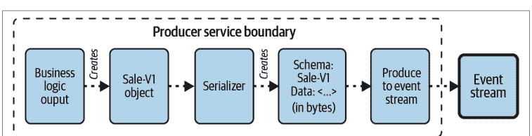
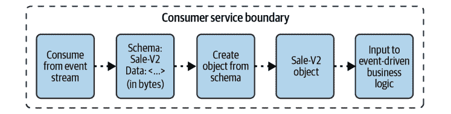
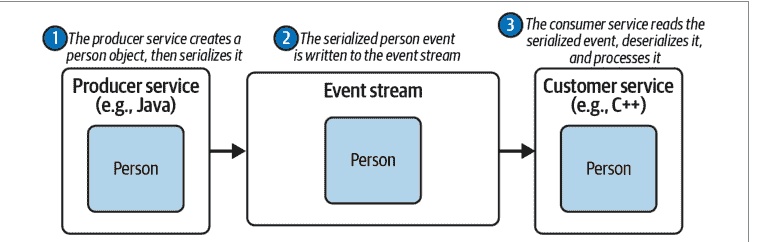
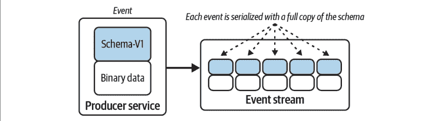
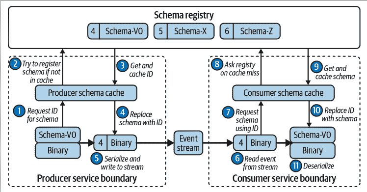

## 事件架构

定义良好的架构对于任何数据产品都至关重要。对于事件，架构由字段名称、类型、默认值和边界的显式声明组成，为人类和机器都提供了对数据内容的清晰认识。架构为数据产品生产者和消费者提供了对数据的清晰、共同理解。架构消除了歧义，支持发现和自助服务，并减少了使用数据的人误解数据的风险。

架构简化了数据发现和自助服务。您可以将文档嵌入架构本身，使数据定义和文档紧密耦合。代码生成器配合架构，可以生成适合消费者选择的编程语言的类和对象。同样，事件生成器可以使用架构生成与定义匹配的事件，为生成各种边界条件的测试数据提供了一种机制。

架构为随时间演变数据提供了框架，尽管您的架构演化选项取决于技术选择。使用架构演化的主要目的是在添加新业务需求以及领域转移和扩展时更新和更改数据，而不会不当地影响数据产品的消费者。

本章对事件驱动数据网格的架构进行了*规定性和主观性*的审视。有许多不同的架构技术和通过事件在系统之间传递数据的许多不同方式。然而，有些方法和技术比其他方法更好——它们更常见、更灵活，并且也反映了大多数企业使用和传递事件的方式。


## 序列化与反序列化简介

在深入探讨架构之前，让我们退一步，更好地了解架构如何与通过数据产品提供重要业务数据相关联。为此，我们需要查看事件是如何创建、序列化并通过网络发送以存储在事件流中的。我们还将查看这一过程的逆过程，即事件从事件流中被消费、反序列化并由消费者处理。

序列化是将带有明确定义架构的事件对象转换为字节序列的操作。生产者内存中的表示被序列化（转换）为字节序列，以便可以轻松地通过网络发送并写入事件流。架构提供了确保数据可以转换为字节序列的约束。例如，一个指定名为 length 的字段必须是 Integer 的架构，在尝试将 length 设置为字符串值 "six feet" 时进行序列化会抛出异常。

图 6-1 显示了生产者将生产者语言对象转换为字节序列并将其写入事件流的工作流程。请注意，架构附加到序列化的事件上，这样消费者就可以获得一份用于反序列化的副本。我们有一些技巧可以消除随每个事件发送架构的需求，我们将在本章后面介绍。



图 6-1. 生产者将事件对象序列化为字节并将其写入事件流

在事件流的另一端，消费者执行逆过程并将字节序列反序列化为对象。图 6-2 说明了消费、反序列化并将数据转换为可由消费者业务逻辑代码处理的事件表示的过程。

架构技术是事件驱动数据网格的重要组成部分，因为它们支撑着数据产品与其消费者之间的契约。



图 6-2. 消费者从事件流中读取并将字节反序列化回事件表示

## 什么是架构？

事件架构等同于数据库表的定义：至少，它指定名称、类型、限制和默认值。架构确保事件数据生产者及其所有消费者对数据有共同的理解。架构与事件流 API 共同构成了事件流 API 的一部分。您可以将其视为等效于提供 JSON 编码数据的 REST API——两者都有通信协议，并且都返回格式良好的信息负载：

> 事件流 API + 事件架构 == REST API + JSON 架构

数据产品所有者负责创建和管理事件架构定义，包括遵守任何联邦治理标准，例如标准时间格式和 PII 要求。潜在消费者和利益相关者对架构提案提供反馈，在远程工作时代，这通常以代码评审的形式出现。

本节将以一个简单的 Protobuf 驱动示例开头，以说明使用架构的一些更有说服力的理由。让我们从示例 6-1 开始，该示例展示了 Person 的架构。

### 示例 6-1. 带 Protobuf 的 Person 架构

```
message Person {
//The person's unique ID
int32 id = 1;
//The person's full legal name
string name = 2;
//Measured in centimeters, rounded to the nearest centimeter
int32 height = 3;

enum CountryCode {
ABW = 0;
AFG = 1;
...
ZWE = 248;
}
//ISO3166-1-alpha-3 standard. AAA=OTHER
CountryCode country = 4;
}
```

事件架构详细说明了人员的 id、name 和 height，以及其 ISO 3166 三字母拉丁脚本国家代码。此架构构成了数据生产者和消费者之间_数据契约_的一部分。它是一方写入数据和另一方读取数据的共同理解。

图 6-3 显示了两个客户端：一个写入事件流的 Java 生产者和一个从事件流中读取事件并将其读入自身内存空间的 C++ 消费者。生产者可以使用 Java 的 Protobuf 代码生成器自动为 Person 架构创建类和客户端代码。消费者可以使用 C++ 代码生成器类似地生成其自己的结构体和客户端代码。



图 6-3. 带架构序列化事件的生产者到事件流到消费者工作流


Avro 和 Protobuf 都有许多代码生成器，支持多种语言。您可以找到 C++、C#、Dart、Go、Java、Kotlin 和 Python 等语言的支持和代码生成器。

示例 6-2 展示了一个生产者 Java 客户端，我们使用它创建一个名为“麦肯齐·贝尔马尔”的人及其相关属性。接下来，我们将对象序列化并写入名为 ProtoPerson.data 的文件（我们使用文件作为事件代理客户端的占位符，只是为了避免用正确的事件代理客户端生产、重试和错误处理代码使本示例变得臃肿）。

### 示例 6-2. 使用 Java 填充从 Protobuf 架构生成的 Person 对象

```java
Person mack = Person.newBuilder()
    .setId(4291)
    .setName("Mackenzie Bellemare")
    .setHeight(45)
    .setCountryCode("CAD")
    .build();
output = new FileOutputStream("ProtoPerson.data");
mack.writeTo(output);
```

消费者从文件（即事件）中读取 Person 数据，使用架构对其进行反序列化，最后将其转换为消费者语言原生的对象或结构体。示例 6-3 展示了一个 C++ 消费者，它使用 ParseFromIstream 函数将序列化字节转换为结构良好的 Person 类对象。

### 示例 6-3. 使用 C++ 解析序列化的 Protobuf Person 对象

```cpp
Person mack;
fstream input(argv[1],
    ios::in | ios::binary);
mack.ParseFromIstream(&input);

// mack is now populated with the id, name, and height received in the event
id = mack.id();
name = mack.name();
height = mack.height();
cc = mack.countryCode();
```

那么，这种方法的主要好处是什么？

### 标准化的数据契约

架构构成了数据生产者及其所有消费者（现在和未来）之间理解的基础。负责根据架构生产数据的生产者，如果数据不符合要求，将被阻止序列化对象。消费者则可以依赖架构来提供强定义的类型、名称、文档以及关于数据的其他信息。从数据创建之初就保持高质量标准对于健康的数据网格至关重要。

### 为讨论奠定基础

架构为我们就数据的内容和形式进行切实讨论提供了基础。明确的架构与拉取请求评审相结合，使我们能够就事件中应包含和不应包含的内容，以及数据产品是否能解决其旨在解决的问题进行富有成效的讨论。

### 代码生成

代码生成让应用程序以其原生语言中的对象形式操作事件，为您处理解析、转换和对象创建。它通过让您针对编程语言中明确定义的类而非通用对象类型的映射编写代码，大大简化了业务逻辑。

### 架构演进

您的数据契约会随时间而变化。最好的架构选项为架构演进提供了安全路径，包括规则、限制和保障措施，防止您无意中与消费者违反数据契约。架构演进将在本章后面更详细地介绍。

### 测试事件生成器

事件生成器让您创建与架构匹配的数据，包括外键和主键关系等特定参数约束。您可以使用这些事件来测试事件驱动服务代码，并用它们为消费者生成示例事件以在其服务中尝试。Kafka Connect Datagen 就是这样一个生成器的示例，您可以在其中指定正在生成的数据的约束和范围。示例 6-4 显示了一个包含 userid 的架构片段，其中有效数据输出的范围将从 User_1 变化到 User_9。

### 示例 6-4. Kafka Connect Datagen 规范

```
{
"name": "userid",
"type": {
    "type": "string",
    "arg.properties": {
        "regex": "User_[1-9]{0,1}"
    }
}
},
```

由此可见，架构有很多显著好处，那么下一个问题是：您应该使用哪种架构技术？

## 我们有哪些架构技术选项？

有许多可用于构建事件驱动数据产品的架构技术。然而，在功能、普遍性、社区开发、易用性和支持性工具方面，有几种技术脱颖而出。Google 的 Protobuf 和 Apache Avro 都符合这一标准。JSON Schema 对偏好 JSON 的人来说有些流行，但请不要将其与无架构 JSON 的一团混乱混淆（稍后会详细介绍）。


> Martin Kleppman 在 _设计数据密集型应用_（O’Reilly）第 4 章中对 JSON、XML、Protobuf、Thrift 和 Avro 撰写了出色的拆解与分析。如果你想了解这些模式技术的底层工作原理，建议阅读此书。

我们不会涉及其他序列化技术（包括 Thrift），因为它们不常用于事件驱动的数据网格。这并不表示它们从未被使用，或不能被使用，而只是它们并非首选。最常见的三种选择包括 Protobuf、Avro 和 JSON Schema。让我们逐一查看。

## Google 的 Protocol Buffers，即 Protobuf

Protobuf 于 2008 年开源，长期以来因其 gRPC 格式而广受欢迎。近来，它已被证明是与 Avro 竞争顶级模式格式的有力竞争者。以下是关于 Protobuf 数据类型和模式管理的几个要点：

- 支持标量（例如，string、integer、boolean 等）和复杂数据类型。
- 模式不作为事件的一部分存储，而是在单独的文件中维护。Protobuf 文件通常通过 _模式注册表_ 共享，本章后面将在第 143 页的“模式注册表的作用”中介绍。
- 你可以通过引用存储在其他文件中的模式声明来组合复杂模式。
- 不支持动态类型。不过，考虑到数据产品需要强类型和定义明确的模式，这并非重大缺陷。

以下是使用 Protobuf Proto3 版本定义的 Person 对象示例：

```
message Person {
  //The person's unique ID
  int32 id = 1;
  //The person's full legal name
  string name = 2;
  //Measured in centimeters, rounded to the nearest centimeter
  int32 height = 3;

  enum CountryCode {
    ABW = 0;
    AFG = 1;
    ...
    ZWE = 248;
  }
  //ISO3166-1-alpha-3 standard. AAA=OTHER
  CountryCode country = 4;
}
```

Protobuf 有两个主要版本，在默认值和缺失数据处理方面功能不同。Protobuf v2 允许将字段标记为 required 或 optional，支持设置自定义默认值，并能够确定字段是包含在消息中还是缺失。这些功能都使模式演进更易于管理，因为它们为生产者提供了更严格的边界，为消费者提供了更强的保证。

Protobuf v3 引入了对 JSON 编码的支持，以及许多其他功能，但代价是移除了 required/optional 和自定义默认值。与任何开源社区一样，这一决定在两个阵营中都有支持者和反对者。许多组织选择继续使用 Protobuf v2 标准，而其他组织则已转向 Protobuf v3。

## Apache Avro

Apache Avro 是另一种极其常见的模式和序列化格式，由 Apache 软件基金会创建。Avro 最初于 2009 年发布，多年来常与 Apache Kafka 关联，同时也是一种基于行的大数据存储格式。以下是关于 Avro 数据类型和模式管理的几个要点：

- 支持原始类型（例如，string、integer、boolean 等）和复杂数据类型。
- 默认情况下，模式作为数据的一部分存储。模式也可以与数据解耦并独立存储。
- 通过随事件包含模式，Avro 提供动态反序列化。消费者可以将事件反序列化为 GenericRecord 对象，该对象根据模式和数据动态构建和填充。当消费客户端没有代码生成器时，通常使用此功能。
- 你可以通过引用存储在其他文件中的模式声明来组合复杂模式。
- 虽然模式演进是可能的，但它未被明确定义为标准的一部分。

以下是前一个代码片段中同一 Person 对象的 Avro 模式示例：

```
{
  "type": "record",
  "name": "Person",
  "namespace": "com.event.driven.datamesh",
  "doc": "Example of a Person record",
  "fields": [
    {
      "name": "id",
      "type": "integer",
      "doc": "The person's unique ID"
    },
    {
      "name": "name",
      "type": "string",
      "doc": "The person's full legal name"
    },
    {
      "name": "height",
      "type": "integer",
      "doc": "Measured in centimeters, rounded to the nearest centimeter"
    },
    {
      "name": "countryCode",
      "type": "enum",
      "symbols": ["AAA", "ABW", ... "ZWE"],
      "doc": "ISO3166-1-alpha-3 standard. AAA=OTHER"
    }
  ]
}
```

你可能注意到，Avro 模式比 Protobuf 略显冗长。在 Avro 中，type 和 doc 等所有属性都完全包含在字段定义中。相比之下，Protobuf 中的注释只是使用 C/C++ 风格语法添加。从语义上讲，两者非常相似。

本章将要介绍的下一个也是最后一种模式技术是 JSON Schema。

## JSON Schema

JSON Schema 格式允许你对 JSON 文档进行注释和验证。与 Avro 和 Protobuf 不同，你可以使用 *无模式* 的 JSON 文档。无模式 JSON 意味着模式中并未真正定义什么 *应该* 和 *不应该* 包含在内，也没有任何类型或默认值。无模式 JSON 不适合用于数据产品，因为它为错误、误解和缺失数据留下了太多空间。

以下是关于 JSON Schema 数据类型和模式管理的几个要点：

- 支持六种原始类型（null、boolean、object、array、number、string）以及一些更复杂的类型。
- 你可以通过引用存储在其他文件或位置中的模式来组合复杂模式。
- 数据验证与 Protobuf 和 Avro 类似。生产者在将数据写入事件流之前，会先针对其模式进行验证。
- 支持向数字、字符串、数组和对象添加验证关键字，以实施数据质量。

以下是前一个代码片段中同一 Person 对象的 JSON Schema 表示：

```
{
  "$id": "https://example.com/person.schema.json",
  "$schema": "https://json-schema.org/draft/2020-12/schema",
  "title": "Person",
  "type": "object",
  "properties": {
    "id": {
      "type": "number",
      "description": "The person's unique ID"
    },
    "name": {
      "type": "string",
      "description": "The person's full legal name"
    },
    "height": {
      "type": "number",
      "description": "Measured in centimeters, rounded to the nearest centimeter",
      "minimum": 1,
      "maximum": 300
    },
    "countryCode": {
      "type": "string",
      "enum": ["AAA", "ABW", ... "ZWE"],
      "description": "ISO3166-1-alpha-3 standard. AAA=OTHER"
    }
  }
}
```

JSON Schema 是迄今为止讨论的唯一一种既包含用于指定模式的语言，又包含用于限制某些属性范围的验证参数的技术。如 height 属性所示，人的身高被限制在 1 到 300 厘米之间，描述中还包含关于四舍五入到最近整数的更多信息。这些约束将防止系统意外将身高以毫米输入，但不幸的是，它们仍无法防止系统以英寸写入身高。

## 模式演进：随时间变更你的模式

即使你在第一次尝试中创建了完美的数据模型，它也不可避免地需要随时间而改变。新的业务职责可能导致领域扩展，从而为数据产品创造新的需求。虽然新系统可能需要访问最新的数据格式，但无需新数据的现有系统需要保证其数据契约不会发生变化。模式演进允许我们变更模式，以便在不破坏现有消费者兼容性的情况下满足新消费者的用例。

Avro、Protobuf 和 JSON Schema 之间共有的模式演进属性有几种。第一种是兼容模式，事件可以根据模式版本之间的更改进行前向或后向转换。兼容模式对于变更管理、防止（非故意的）破坏性更改，以及免除消费者为每个模式版本编写自定义代码（例如，如果 schema.version==1 则执行此操作，如果 schema.version==2 则执行那项操作，等等）至关重要。

主要兼容模式如下：

- 向后兼容

使用新模式的消费者可以读取使用旧模式生成的数据。这种兼容模式对于确保使用最新模式的消费者仍能读取和处理早期版本编码的旧数据非常重要。

例如，删除字段是向后兼容的。假设我们有如下所示的记录：

```
{
"type": "record",
"name": "Example",
"doc": "This is Version 1",
"fields": [
{ "name": "id", "type": "integer" },
{ "name": "foobar", "type": "string" }
]
}
```

我们可以为版本 2 移除 foobar 字段，如下所示：

```
{
"type": "record",
"name": "Example",
"doc": "This is Version 2",
"fields": [
```


{ "name": "id", "type": "integer" }
]
}
```

请注意，架构转换器（作为架构框架的一部分）可以采用版本 1 数据，仅通过删除 foobar 字段将其转换为版本 2。因此，版本 2 与使用版本 1 编写的事件向后兼容。

## 向前兼容

使用旧架构（版本 1）的消费者仍然可以读取使用较新架构（版本 2）编写的新事件。它们只能访问与其版本匹配的数据。这种兼容模式非常重要，因为当针对当前架构版本编写代码的现有消费者回退其消费者偏移量以读取事件流中的历史数据时，需要用到它。

从前面的示例中，您会注意到我们无法将版本 2 转换为版本 1，因此它不是向前兼容的。为什么？版本 1 缺少字段 foobar 的默认值，而消费者在转换期间需要该默认值来填充缺失的值。

我们需要在发布之前修改我们的版本 1 架构以添加默认值（幸好我们始终在拉取请求中创建兼容性测试用例，对吧？）。在 Avro 中，指定默认值就像下面这样简单：

```
{
"type": "record",
"name": "Example",
"doc": "This is Version 1, but with a default value for foobar",
"fields": [
{
"name": "id",
"type": "integer"
},{
"name": "foobar",
"type": "string",
"default": "DEFAULT_VALUE_STRING"
}
]
}
```

“默认值”这个术语可能有点误导。与关系型数据库表不同，关系型数据库表的默认值在写入时填充，这些默认值是在读取时使用的。此外，默认值仅在记录本身不包含该字段时才应用。结合我们之前的示例：如果您尝试将使用架构版本 2 写入的记录转换为架构版本 1，转换器会注意到原始事件中不存在字段 foobar。因此，在创建转换后的版本 1 记录时，它将设置 foobar="DEFAULT_VALUE_STRING"，而不是抛出异常。


Avro、JSON Schema 和 Protobuf v2 均支持自定义默认值。这对于确保记录在多次更改后仍保持兼容性是一个强大的选项。开发人员经常使用默认值来标记数据因兼容性转换而缺失（例如 DEFAULT_VALUE_STRING），而不是因为有效负载实际接收到的 foobar 为 null。

Google 的 Protobuf v3 作为一种故意的设计决策，移除了自定义默认值，因此您可能会发现 Protobuf v3 用于演进目的稍微困难一些。

与所有架构相关的事物一样，请确保查看所选架构的具体细节以了解更多详情。这四个标准中的每一个都有比本章能够舒适容纳的更多内容。

## 完全兼容

当事件可以立即向前和立即向后转换时。

## 完全传递兼容

当事件可以与事件流中任何其他版本进行前向和后向转换时。这是最强的保证，这意味着每一次架构演进都与之前的架构完全兼容。版本 3 架构可以转换为版本 2 和版本 1，反之亦然。


事件驱动的数据产品应尽可能遵循完全传递兼容。它为消费者提供了最强的保证，并确保它们仅在业务用例发生变化时才需要更新代码，而不是因为架构损坏。虽然您可以根据需要放宽数据产品的兼容性级别，但需要确保这不会对消费者产生不利影响。

尽管架构演进非常有帮助，但总会有这样一个时刻，即您的领域发生重大变化以至于架构演进不再足够。必须进行破坏性变更，并且必须谨慎处理。

## 协商破坏性架构变更

破坏性变更最常见的原因是源领域模型的边界发生转移，这通常源于业务模式的扩展。添加新产品线或服务可能需要重新思考和重新定义数据所有权，从而导致与现有数据产品不能一对一映射的新边界。举个简单的例子，User 数据模型以前可能使用简单字符串对 address 进行建模，如下所示：

示例 6-5。

```
{
"type": "record",
"name": "User",
"namespace": "user.namespace",
"fields": [
{ "name": "first_name", "type": "string" },
{ "name": "last_name", "type": "string" },
{ "name": "address", "type": "string" }
]
}
```

但是，新的本地性功能需要创建一个包含 home_address、work_address 和 phone_number 的 Address 对象。以下是新标准化 User_v2 对象的 Avro 架构。请注意，home_address 和 work_address 均为 Address 对象，且 Address 对象允许可选包含 phone_number：

示例 6-6。

```
{
"type": "record",
"name": "User_v2",
"namespace": "user.namespace",
"fields": [
{ "name": "first_name", "type": "string" },
{ "name": "last_name", "type": "string" },
{ "name": "home_address",
"type": {
"type" : "record",
"name" : "Address",
"namespace" : "user.namespace.inner",
"fields" : [
{"name": "phone_number", "type": ["null", "string"]},
{"name": "address", "type": "string"},
{"name": "city", "type": "string"},
{"name": "country", "type": "string"}
]
}
],
{ "name": "work_address",
"type": "user.namespace.inner.Address"
}
]
}
```

下游消费者将不再可用旧的单字符串 address 字段。但是，它们都了解这一变更吗？仍然依赖字符串 address 字段的系统会怎样？

协调涉及多个团队的变更可能具有挑战性，重新谈判已发布数据产品的边界也是如此。不过，我们无需重复造轮子，可以借鉴现有先例来规范这一过程。

对于维护良好的 API（无论是库、框架还是 REST API），保持与旧客户端的一定程度的向后兼容性是常见政策。新客户端可以使用最新的 API 调用来驱动其业务逻辑，而旧客户端可以继续使用较旧的 API 调用。最终，API 调用将被弃用并随后删除，这给应用程序的维护人员留出时间以迁移到较新的 API。我们可以采用同样的流程来处理数据产品架构中的破坏性变更，如一系列步骤中所述。

### 步骤 1：设计新数据模型

数据产品所有者必须与其团队一起为数据产品提出一个新的候选模型。在整个源领域需要重大变更的情况下（例如单个领域拆分为两个或两个领域变为三个），最大的挑战可能是重新定义新领域的边界以及对现有数据产品的新约束。需要根据对源领域所做的更改来审查现有数据产品，以便将新的候选数据产品提交给现有消费者进行审查。

### 步骤 2：与现有消费者和联合治理团队进行迭代

一旦您的候选数据产品准备就绪，就该与您的现有客户（或至少为获取最早反馈而选定的最重要客户子集）预约会议了。讨论领域模型的变更、对现有数据产品提出的变更，以及您计划创建以应对模型转移的任何新数据产品。同样，某些现有数据产品在新模型中可能没有直接等价物，随后将被删除。

这些讨论通常会产生丰富的反馈，供数据产品所有者带回团队并应用到其数据产品中。这是一个审查和修订的迭代过程，但能提供最佳的整体结果，因为它保持了数据网格的消费者驱动特性，同时减少了浪费的工作量。

在您的组织经历的前几次破坏性架构变更中，让联合治理团队参与进来是个好主意，因为这可以为完善流程提供宝贵的经验和反馈。例如，数据产品所有者可能难以识别所有利益相关者和消费者（由于数据发现和自助服务工具不佳），或者缺乏将旧数据产品标记为弃用的能力。就像我们不太可能第一次就将数据产品架构设计正确一样，我们第一次进行破坏性架构变更时也可能会遇到一些问题。识别和解决常见问题对于改善数据网格的自助服务特性至关重要。

### 步骤 3. 制定发布计划、数据迁移计划和弃用计划

在新架构和数据产品获准继续推进后，下一步涉及制定发布指南和弃用计划。将受影响的消费者与所需变更的影响相结合，可以让我们了解他们进行必要迁移所需的时间和精力。同样，这也表明数据产品所有者在迁移期间需要提供多少支持。发布计划应反映迁移所有消费者预计所需的时间，并预留一些安全余量。

数据迁移是破坏性数据产品变更的重要因素。在事件流中保留完整历史记录需要将之前的事件数据模型迁移到新模型，或者从源数据重新创建事件。当破坏性变更仅仅是对现有字段的重新建模时，前者可行，但在创建新数据时往往会力不从心。在我们的示例中，我们重新定义了 Address，添加了 work_address 和 home_address。我们缺乏关于当前 address 是工作地址还是家庭地址的信息，即使能够找出，我们也只有一个 address，需要收集信息来填充另一个字段。

数据产品所有者可以通过创建与新架构匹配的新记录来回填 User_v2 事件流。但是，这些新记录仅代表当前时间点的 User。原始 User 流中的历史事件在没有额外工作的情况下不会被迁移。

最后，数据产品所有者必须在一段时间内（例如 8 到 12 周）同时支持 User 和 User_v2 数据产品，以便消费者可以从旧产品迁移到新产品。数据产品所有者的团队将协助他们进行他们的


migration needs, including clarifying details about the new domain, any changes to semantics, and assisting in rebuilding internal state stores.

### 步骤 4. 执行发布

The new data products are released alongside the existing ones, such that consumers have time to migrate over. Mark the original User data product as *deprecated* to block new consumers from registering as readers, and instead redirect them to use the latest version, User_v2. The User data product with the old `string address` value will co-exist with the new User_v2 data product for a predetermined period of time.

新数据产品与现有数据产品一起发布，以便消费者有时间进行迁移。将原始 User 数据产品标记为 *废弃*，以阻止新消费者注册为读者，并改为将它们重定向到使用最新版本 User_v2。带有旧 `string address` 值的 User 数据产品将与新的 User_v2 数据产品在预定时间段内共存。

While most consumers will work in a timely manner to migrate their applications to the new data product, there will be those who lag behind due to lack of resources and competing priorities. While you can certainly send them ever-more-frequent reminder messages, at some point the integrity of the data mesh will become at risk: it is unreasonable for the producer service to maintain two versions of the data product indefinitely, especially since the business domain model has permanently shifted. Noncompliance is not abnormal in a data mesh, and at this point it would be best to consult your federated governance team on how to proceed: migrate the code of non-complying consumers, escalate up the business chain, or simply proceed with the deprecation plan and halt production of new events to that event stream. Usually the threat of a production outage is sufficient to finish the migrations.

虽然大多数消费者会及时将其应用程序迁移到新数据产品，但也会有因资源不足和优先级冲突而落后的消费者。虽然你当然可以向他们发送越来越频繁的提醒消息，但到了某个时候，数据网格的完整性将面临风险：生产者服务无限期地维护两个版本的数据产品是不合理的，尤其是业务领域模型已经永久性转移。在数据网格中，不合规并非异常，此时最好咨询联邦治理团队如何进行：迁移不合规消费者的代码、升级业务链条，或直接继续弃用计划并停止向该事件流生成新事件。通常，生产中断的威胁足以完成迁移。

Navigating a breaking schema change is a fairly involved process that requires explicit communication between the data product owner and all of its consumers. The precise steps in your process will depend on your own implementation details, but should look similar to what we just covered.

应对破坏性架构变更是一个相当复杂的过程，需要数据产品所有者与所有消费者之间进行明确沟通。你流程中的精确步骤将取决于你自己的实现细节，但应该与我们刚才介绍的类似。

Managing schemas well requires keeping track of previous versions and ensuring compatibility rules are followed. Consumers additionally need the ability to discover which schemas belong to which event streams as part of self-service tooling requirements. A *schema registry* provides a solution for these needs, among others, and is an essential part of an event-driven data mesh, as we shall see in the next section.

良好管理架构需要跟踪先前版本并确保遵循兼容性规则。消费者还需要能够发现哪些架构属于哪些事件流，作为自助服务工具要求的一部分。*架构注册表*为这些需求（以及其他需求）提供了解决方案，是事件驱动型数据网格的重要组成部分，我们将在下一节中看到这一点。

## The Role of the Schema Registry

A schema registry is a service that allows us to register schemas in association with their event streams. One of the main roles of the schema registry is to reduce the number of bytes sent over the network. Back in “A Brief Introduction to Serialization and Deserialization” on page 128, we saw that the basic serialization process appends a full copy of the schema to each event record, which results in a significant amount of duplicated data sent over the network. Figure 6-4 shows a producer writing events with a full copy of each schema, reducing throughput, increasing data replication costs, and increasing the load on consumers.

## 架构注册表的角色

架构注册表是一种服务，允许我们将架构与其事件流关联注册。架构注册表的主要角色之一是减少通过网络发送的字节数。正如在“序列化和反序列化简介”第 128 页中所见，基本序列化过程会将架构的完整副本附加到每个事件记录，导致通过网络发送大量重复数据。图 6-4 显示生产者携带每个架构的完整副本写入事件，降低吞吐量，增加数据复制成本，并增加消费者的负载。



Figure 6-4. Each serialized event published to the event stream with the entire schema, resulting in excessive network utilization and storage overhead

图 6-4. 将带有完整架构的每个序列化事件发布到事件流，导致过度的网络利用率和存储开销

A schema registry can absolve us of the need to write the schema with each event. Instead, we can store the schema external to the event and just use a unique ID in its place to track the associated schema. Thus, whenever a consumer reads an event, it can simply reference the schema registry to obtain the schema associated with that ID.

架构注册表可以让我们不需要在每个事件中写入架构。相反，我们可以将架构存储在事件之外，并使用唯一 ID 来跟踪关联的架构。因此，每当消费者读取事件时，它可以简单地引用架构注册表来获取与该 ID 关联的架构。

Figure 6-5 shows the entire end-to-end process. Instead of serializing the schema along with the event, the producer service queries the schema registry (1), registers the schema (2), then replaces the schema with a short unique ID (3 and 4). This event is then produced to the event stream (5). The process is performed in reverse on the consumer side: the event is read from the stream (6), the schema registry is queried using the unique ID (7 and 8). Once the schema is obtained (9), the record can then be deserialized (10 and 11) for processing by the consumer’s business logic.

图 6-5 展示了完整的端到端过程。生产者服务不再将架构与事件一起序列化，而是查询架构注册表（1）、注册架构（2），然后用短唯一 ID 替换架构（3 和 4）。然后将该事件生成到事件流（5）。消费者端执行相反的过程：从流中读取事件（6），使用唯一 ID 查询架构注册表（7 和 8）。一旦获得架构（9），记录即可被反序列化（10 和 11），供消费者的业务逻辑处理。



Figure 6-5. Leveraging a schema registry in an event-driven producer/consumer workflow

图 6-5. 在事件驱动型生产者/消费者工作流中利用架构注册表

Precisely how the schema is replaced by the unique ID depends on both the producer’s serialization logic and any limitations in the format of events in the schema registry. For example, Confluent’s Kafka Schema Registry replaces the schema with a 5-byte prefix.

架构被唯一 ID 替换的确切方式取决于生产者的序列化逻辑以及架构注册表中事件格式的任何限制。例如，Confluent 的 Kafka Schema Registry 会将架构替换为 5 字节前缀。

Using a schema registry requires serializers and deserializers to adhere to the proprietary format. And while Confluent’s schema registry is fairly widely used with Kafka, it’s not the only schema registry, and not all schema registries will use the same format. As part of building self-service tools, your governance team will need to negotiate which schema to support for building your data mesh.

使用架构注册表要求序列化程序和反序列化程序遵循专有格式。虽然 Confluent 的架构注册表与 Kafka 一起被广泛使用，但它不是唯一的架构注册表，也不是所有架构注册表都会使用相同的格式。作为构建自助服务工具的一部分，您的治理团队需要协商为构建数据网格支持哪种架构。

A schema registry provides other benefits in addition to network and disk I/O savings. Here are a few other significant benefits provided by a schema registry:

架构注册表除了节省网络和磁盘 I/O 之外，还提供其他好处。以下是架构注册表提供的几个其他重要好处：

### Data discovery

### 数据发现

The schema registry provides a mapping of event streams to its registered schemas. Prospective consumers can examine the schemas to see if the stream contains the data they’re interested in. Self-service tooling can provide search functionality on top of the schema registry API to search for specific fields, documentation, or metadata tags.

架构注册表提供事件流与其注册架构的映射。潜在消费者可以检查架构，以查看流是否包含他们感兴趣的数据。自助服务工具可以在架构注册表 API 上提供搜索功能，以搜索特定字段、文档或元数据标签。

### Schema evolution validation

### 架构演进验证

Registering a schema with the schema registry is a mandatory part of the write path of an event to a stream. This action provides a hook for validating the producer’s current schema against that stored in the registry. Did the user evolve the schema in a way that is unauthorized by the schema registry (e.g., the new schema does not support backward compatibility)? Throw an exception. Is the schema completely invalid compared to what was registered under that ID before? Throw an exception. Is the event malformed? Throw an exception. The schema registry provides a safeguard against unintentional and unauthorized changes, protecting the data integrity so that the data product can meet its quality and reliability SLAs.

向架构注册表注册架构是将事件写入流时的强制性步骤。此操作提供了一个挂钩，用于验证生产者的当前架构与注册表中存储的架构。用户是否以架构注册表未授权的方式演进了架构（例如，新架构不支持向后兼容性）？抛出异常。架构与之前在该 ID 下注册的架构相比是否完全无效？抛出异常。事件是否格式错误？抛出异常。架构注册表提供了一种防护措施，防止意外和未经授权的更改，保护数据完整性，以便数据产品可以满足其质量和可靠性服务级别协议（SLA）。

### Automatically updated documentation

### 自动更新的文档

The schema registry provides a minimal form of automatically updated documentation for each event stream. Users can view all the registered schemas, including the names, types, and doc fields. Embedded schema docs are very useful for highlighting any idiosyncrasies or corner cases in the data. They are also far more likely to be up to date because they are embedded, as opposed to documentation maintained independently by an outside party.

架构注册表为每个事件流提供一种自动更新的文档的简化形式。用户可以查看所有注册的架构，包括名称、类型和文档字段。嵌入式架构文档非常有助于突出显示数据中的任何特性或边缘情况。它们也更有可能保持最新，因为它们是嵌入式的，而不是由外部方独立维护的文档。

### Downloadable schemas to generate code

### 可下载的架构用于生成代码

A consumer can download schemas to generate class definitions and test events for their unit tests.

消费者可以下载架构以生成类定义和测试事件，用于其单元测试。

You can write a custom registration script to evaluate the schema during the registration process. A simple and common check is to verify that every value in a schema has a “doc” string of nonzero length to ensure that there is _some_ documentation for each field. Another option is to scan for PII patterns and request an additional verification step if something suspicious is found. Similarly, you can automatically generate class definitions and run validation tests prior to deployment.

您可以编写自定义注册脚本，在注册过程中评估架构。一个简单而常见的检查是验证架构中的每个值都具有非零长度的 "doc" 字符串，以确保每个字段都有 _一些_ 文档。另一个选项是扫描 PII 模式，如果发现可疑内容，请求额外验证步骤。同样，您可以在部署前自动生成类定义并运行验证测试。

Schema registries provide many benefits for a low overhead and are an essential component of an event-driven data mesh. The savings on network and storage costs alone make them a valuable choice, with the remaining functionality providing the icing on the cake.

架构注册表以较低的开销提供许多好处，是事件驱动型数据网格的重要组成部分。仅节省网络和存储成本就使它们成为有价值的选择，其余功能则锦上添花。

So now that we’ve covered schemas, schema registries, and the benefits of using both, we have one last schema-related question before winding up the chapter. How do we manage schemas in relation to our data product producer and consumer applications?

既然我们已经介绍了架构、架构注册表以及使用两者的好处，在结束本章之前，我们还有一个最后的架构相关问题。我们如何在数据产品生产者和消费者应用程序的关系中管理架构？

## Best Practices for Managing Schemas in Your Codebase

## 在代码库中管理架构的最佳实践

There are several schools of thought for storing event schemas in your codebase. One is to centralize all of your data product schemas in one big repository, using references to tie them to the codebase that actually owns the schema. Another is to decentralize and store schemas in the code repository of the producers and rely on the self-service data platform to tie them all together.

在代码库中存储事件架构有几种思路。一种是将所有数据产品架构集中在一个大型仓库中，使用引用将它们与实际拥有架构的代码库绑定。另一种是去中心化，将架构存储在生产者的代码仓库中，并依赖自助服务数据平台将它们全部连接起来。

However, the best practice is a combination of the two: a centralized code repository for shared-use schemas with data product owners retaining their own schemas internal to their projects. Let’s take a deeper look at how this works in practice by first examining *schema composition* and its role in a data mesh.

然而，最佳实践是两者的结合：用于共享架构的集中式代码仓库，数据产品所有者在其项目内保留自己的架构。让我们先检查 *架构组合* 及其在数据网格中的作用，以更深入地了解这在实践中如何运作。

Apache Avro, Protobuf, and JSON Schema each provide the ability to import schemas from other files just as you would import a class or a library into your code. This is a powerful feature that enables us to compose a schema from simple common building blocks.

Apache Avro、Protobuf 和 JSON Schema 都提供从其他文件导入架构的能力，就像将类或库导入代码一样。这是一个强大的功能，使我们能够从简单的公共构建块中组合架构。

First, you’ll need to consult with your federated governance team to come up with standardizations of common cross-domain entities. In this case, previous meetings, discussions, and arguments have led to the standardization of two simple (but useful!) entities within the organization—base_user, representing the unique ID of a user:

首先，您需要与联邦治理团队协商，制定常见跨域实体的标准化方案。在此情况下，之前的会议、讨论和争论已导致组织内两个简单（但有用！）实体的标准化——base_user，表示用户的唯一 ID：


```
package myorg.common;

message base_user {
  String uuid = 1;
}
```

和 base_item，包含特定电子商务产品的唯一 ID：

```
package myorg.common;

message base_item {
  int64 id = 1;
}
```

数据产品所有者可以将这两个基础定义都导入到 user_clicked_on_item 架构定义中，并加上一个通用时间戳字段，以组合他们的事件定义：

```
import "common_schemas/base_user.proto"
import "common_schemas/base_item.proto"
import "google/protobuf/timestamp.proto";

message user_clicked_on_item {
  myorg.common.base_user user = 1;
  myorg.common.base_item item = 2;
  google.protobuf.Timestamp timestamp = 3;
  String websiteURI = 4;
}
```

使用标准形式组合架构，可以大大简化跨组织合并数据产品的工作。例如，此事件可以按 base_user、base_item 或 Timestamp 与其他事件进行聚合，甚至可以按这三者的组合进行聚合。此外，遵循通用定义意味着您还可以利用通用单元测试和验证插件，显著降低出错机会，保持数据质量和可靠性处于高位。

通用架构组件应保持相当精简，仅包含数据产品所有者必须填充的字段。请记住，您始终可以创建包含更广泛字段列表的其他组件。例如，您可以选择创建一个通用的 item_details 组件，包含扩展 base_item 所需的所有标准信息，并将其作为额外组件包含在数据产品的架构中。


将通用架构组件存储在集中式仓库中，并在编译时将其拉入本地系统。将应用程序的架构与代码一起存储在其自身仓库中。然后，您可以在将架构提升为数据产品时，选择将事件架构发布到数据产品发现平台。

将数据产品的架构与创建事件流的代码一起存储，可以简化整个审查流程。您只需创建代码审查，确定现有消费者，并将其添加为审查者。严格的方法要求每个消费者批准更改，确保每个人都了解可能影响其应用程序的更改。

在本章的下一节也是最后一节中，我们将探讨如何选择要使用的架构技术。

## 选择架构技术

选择要采用的架构格式时，有几个主要因素。第一个是优先级：您是否已经在使用某种架构格式？如果是，这将是首先要考虑的最佳候选方案。您的联邦治理团队将负责调查其在贵组织中的适用性，并发现是否存在任何需要解决的重大障碍或痛点，以防止进一步采用。管理单一架构格式比管理多种格式要容易得多。

第二个主要因素是支持性工具的可用性及其如何集成到您的自助服务环境中。代码生成器、用于测试目的的事件生成器、架构注册表支持和数据发现支持都是重要的子因素。虽然 Avro 和 Protobuf 通常都有大量支持，但其他架构框架可能没有那么多支持、采用度和可用工具，尤其是在事件流媒体的上下文中。使用架构技术的整个目标是改善自助服务功能，确保高质量的数据产品，并消除出错的余地。请使用可靠、广泛且支持良好的工具。

第三个主要因素涉及架构特定特性及其是否适合您的用例。例如，您可能需要 JSON Schema、Protobuf v2 和 Avro 提供的非空和非零默认值。您可能也更偏好 JSON Schema 的内置数据质量检查（例如，最小值、最大值），或者更偏好 Avro 和 Protobuf 的更快速序列化和反序列化。

作为现实世界的示例，我们可以参考 Saxo Bank 的 Paul Makkar。在他的演讲“Kafka 和数据网格”中，他概述了他和他的团队在选择 Protobuf 而非 Avro 时所做的决定。我在以下侧边栏中总结了评估。

### 为什么 Saxo Bank 选择 Protobuf 而非 Avro

Saxo Bank 的工程组织主要是一个 .NET 商店，最初尝试将 Apache Avro 用作生成代码、验证架构和集成到其工作流的主要架构技术。然而，该组织发现这并不像期望的那样有效。Avro 与 .NET 的集成实在太困难了。Avro 的 C# 和 Python 客户端落后于 Java 实现，需要更多手动步骤，并引入了许多摩擦点。您可以在 Confluent 的博客上阅读有关具体问题和评估的更多信息。

Saxo Bank 随后试用了 Protobuf 作为首选架构，并遇到了更少的问题。代码生成器完全按照数据格式规范所需的方式工作，序列化和反序列化没有问题，并且公司总体上对开发人员和数据产品所有者的体验更加满意。

基于构建自助服务工具的原则，Saxo Bank 还选择投资于使用 Buf，这是一种用于管理和使用 Protobuf 架构的主观工具，为他们提供了 lint 工具、样式指南、命名约定和枚举用法工具。

Protobuf 注释功能允许 Saxo Bank 的工程师直接将元数据（例如 PII 标记和有关加密数据的规范）嵌入到架构中。不关心该字段（例如加密的 PII）的消费者可以忽略这些注释，但需要访问更多有关如何解锁数据信息的消费者（例如对身份验证和解密组件的引用）可以启用这些注释。

转向 Protobuf 的决定是基于识别使用 Avro 的痛点、调查替代方案以及评估常见用例。对 Protobuf 的进一步测试表明，它远比其他方案更适合 Saxo Bank 的需求，因此联邦治理团队选择统一并支持所有人使用的单一标准。

对于 Saxo Bank 来说，正在使用的技术（.NET）和与支持性工具（例如 Buf）的重要集成在 Protobuf 的采用中发挥了重要作用。

### 摘要

架构是事件驱动型数据产品的重要组成部分。它们为事件流的生产者和消费者提供结构和清晰度，并构成对数据产品内容的可靠且明确的定义。

代码生成器在架构本身和业务逻辑之间架起了一座桥梁，对生产者和消费者都有好处。前者受益于严格的类型定义以及可选字段和必填字段的区分，确保不会意外产生格式错误或遗漏数据。随后，后者也受益于相同的明确类型系统，无需解释和标准化数据。架构提供了一种在尽可能靠近数据源的地方实施质量控制的手段。

架构演进提供了随时间推移演变和更改架构的能力，并有明确的预先规则，规定在兼容性要求下允许哪些更改。尽管仍可能发生破坏性更改，但架构提供了确定新数据产品可能是什么样子的通用框架。而且由于它们通常作为代码库的一部分集成，架构更改可以遵循与标准业务应用程序代码更改相同的审查流程。

虽然有许多选择可供您选择，但 Apache Avro 和 Google 的 Protobuf 仍然是您的最佳选择，JSON Schema 作为合理的第三选择。您对其中一种的投资将取决于您现有的技术选择，但最好仍由您的联邦治理团队集中讨论和决定。

在下一章中，我们将探讨如何利用所学的架构知识，将其应用于事件设计问题。有许多不同的方法来建模和设计事件。我们将探讨最佳实践，以及最好避免的陷阱和注意事项。


