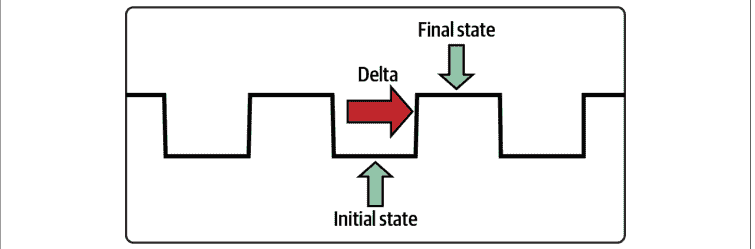
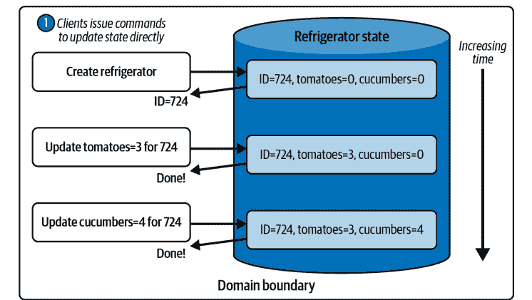
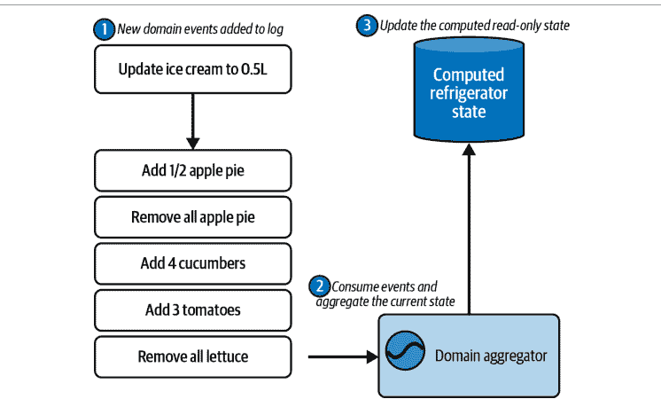
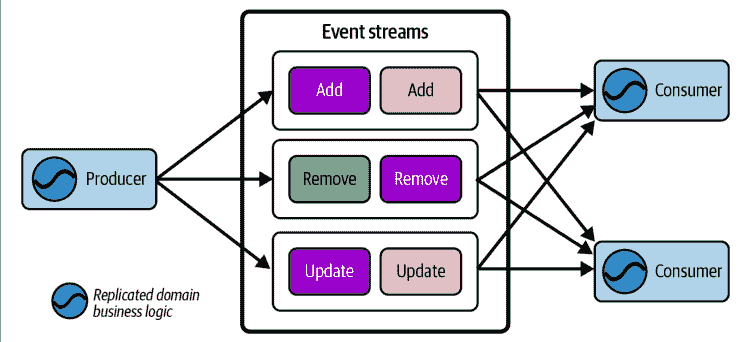
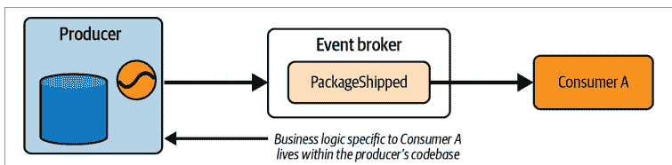
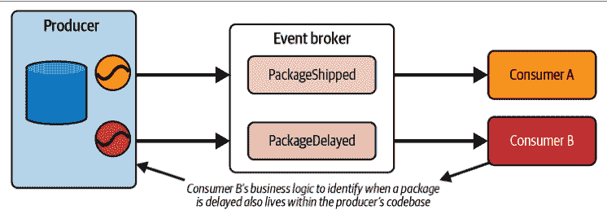
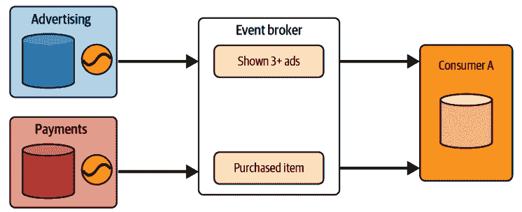
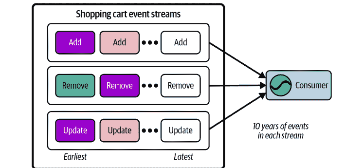
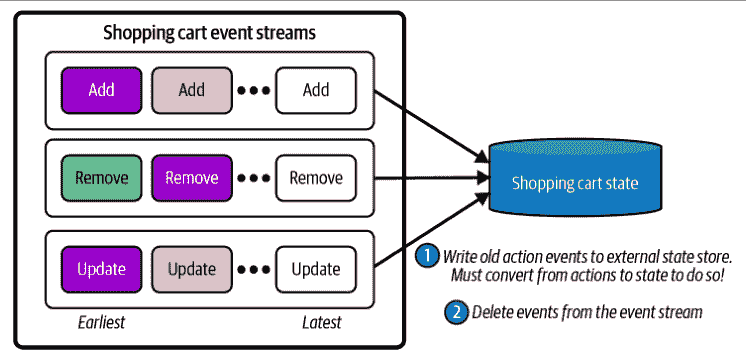
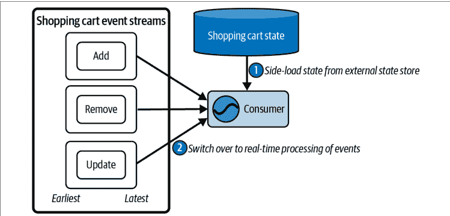

## 事件类型简介

设计事件驱动架构事件的方式有很多种。但是，有些方式比其他方式更适合在事件驱动数据网格中使用。本章介绍为事件驱动数据产品设计事件的最佳策略，包括如何避免在此过程中遇到的众多陷阱。

支撑所有事件设计的主要事件类型有两种：*状态* 事件，如我们在第 55 页的“状态事件和承载状态的状态传输”中首次介绍，以及 *增量* 事件，我们将在本章中更详细地介绍。

图 7-1 显示了一个稳态下的简单方波，根据增量定期在一个状态和另一个状态之间切换。类似于这个方波，我们将事件建模为要么捕获状态本身，要么捕获从一个状态过渡到另一个状态的边缘。



图 7-1. 变化过程中的状态与增量

系统中任何事件都有三个阶段：

- 1. 初始状态
- 2. 改变初始状态以产生最终状态的增量
- 3. 最终状态（也是下一个变更周期的初始状态）

我们遇到的大多数事件都可以完全归类为状态或增量。以这种方式看待事件有助于分离关注点并集中设计精力：

## 状态事件

状态事件充分描述了实体在特定时间点的状态，是跨领域传递数据产品的最佳选择。状态事件通常是事件驱动数据网格中最灵活、最有用的事件类型。

## 增量事件

这些事件描述状态之间的过渡，通常仅包含关于更改了什么的信息。增量事件之所以与众不同，是许多事件驱动应用程序开发者遇到的第一类事件类型。然而，正如我们稍后将讨论的，这些事件通常不太适合事件驱动数据网格。

虽然可能存在兼具各自特征的混合事件，但这类事件较少见，因为它们可能导致不希望的强耦合。我们将在本章后面详细讨论这些问题。

让我们先来看看状态事件。

## 扩展状态事件和承载状态的状态传输

第 55 页的“状态事件和承载状态的状态传输”同时介绍了状态事件和 ECST。作为回顾，状态事件展示了实体在特定时刻的当前状态，很像关系数据库中的一行。ECST 允许事件流的任何消费者将其所需的任何数据选择物化、聚合并存储在其自己的领域边界内，以供自行使用。在本节中，我们将探讨扩展状态事件的一些有用选项。

状态事件可以仅包含“现在”状态，或者可能包含“前/后”状态（我们将在下一章的第 179 页“变更数据捕获”中介绍这种模式）。这两种选项各有优劣，我们将逐一审查。首先，让我们看看这些选项中的每一种如何影响事件流的压缩。

定义 ECST 事件结构和内容有两种主要设计策略：

## 当前状态

包含创建事件时的完整公共状态。

## 前/后状态

包含事件发生 _前_ 的完整公共状态和事件发生 _后_ 的完整公共状态。

让我们详细研究每一种，以便更好地了解其权衡。

## 当前状态事件

该事件仅包含实体的当前状态，需要与之前的状态事件进行比较才能确定更改了什么。例如，给定 `item_id` 的 _库存_ 事件将仅包含该时间点库存数量的最新值。这种设计策略有几个主要优点：

### 精简

状态事件在事件流中占用的空间最小。网络流量也被最小化。

### 简单

事件代理为该实体存储任何先前的状态事件，因此如果您需要历史状态，只需回滚并重播消费者偏移量即可。您可以根据消费者对历史数据的需求，为每个事件流设置独立的压缩策略。

### 可压缩

您可以使流中的事件数量与领域的键空间成正比。

它还有几个细微差别，并非完全是缺点，而是需要考虑的事项：

### 对状态更改原因不敏感

下游消费者不会得知数据更改的 _原因_，只能得到新的公共状态。原因很简单：这消除了消费者对源领域 _内部状态转换_ 进行耦合的能力。考虑关系数据库表中的数据——我们通常不会在数据本身中传达数据更改的原因，状态事件也是如此（注：我们稍后将研究如何通过混合事件稍微放宽这一规则）。

### 消费者必须维护状态以检测转换

无论业务逻辑多么简单或复杂，消费者都必须维护自己的状态来检测某些字段的特定变化。例如，客户将地址更改为另一个国家可能需要您向其发送新的法律文件，这取决于他们离开的国家和移入的国家。通过让消费者负责为跟踪转换物化状态，计算这些边缘的责任完全落在消费者的领域内。

使用 _当前状态事件_ 构建的数据产品灵活且相当易于使用，应该构成您大多数数据产品的基础。如果您也希望将状态转换打包到事件中，那么前/后状态是不二之选。

## 前/后状态事件

该策略依赖于提供过渡发生前的状态和过渡发生后的状态。如第 179 页的“变更数据捕获”中所述，变更数据捕获（CDC）系统经常使用前/后策略。下面展示了两个具有简单双字段架构的前/后用户事件：

```
Key: 26
Value: {
 before: { name: "Adam", country: "Atlantis" },
 after: { name: "Adam", country: "Canada" }
}
```

显示 Key = 26 删除的后续前/后状态事件。请注意，旧数据仍保留在 before 字段中：

```
Key: 26
Value: {
 before: { name: "Adam", country: "Canada" },
 after: null
}
```

这种设计有一些好处：

### 单事件中的简单状态转换

前/后事件在单个事务中展示了每个更改的字段，以及所有未更改的字段。但是，更改原因不包括在内。

### 消费者无需维护状态即可检测简单更改

某些消费者如果只关心检测简单的状态转换，可以不必维护状态。例如，如果我们想向从马达加斯加搬到加拿大的用户发送文件，那么我们的消费者只需检查事件的前和后字段是否符合其标准。但是，如果 Adam 先从马达加斯加搬到埃塞俄比亚，然后很快又搬到加拿大，导致发生两个事件，这就行不通了。消费者业务逻辑将无法对这一事件序列触发，因为它不维护任何状态。在实践中，理论上的无状态消费者很少实现，因为任何合理复杂度的服务绝大多数都需要维护状态。

这种设计也有一些缺点：

### 压缩困难

使用前/后逻辑删除事件会导致后字段设置为 null，但整个值本身并非 null。默认情况下，像 Apache Kafka 这样的事件代理不会将其识别为墓碑（tombstone），因此不会将其删除。虽然从技术上讲可能可以重写压缩逻辑，但通常不可行，尤其是当您大量依赖 SaaS 解决方案时。

但是，有一些选项，具体取决于您使用的工具。Debezium 已通过允许您在前/后事件后生成一个墓碑来绕过这一限制，生成两个事件而不是仅一个。

根据 Debezium 的文档：

> 数据库 DELETE 操作会导致 Debezium 生成两条 Kafka 记录：
> 
> * 一条包含 "op": "d"、之前行数据和某些其他字段的记录。
> 
> * 一条与被删除行具有相同键且值为 null 的墓碑记录。此记录是 Apache Kafka 的标记。它表示日志压缩可以移除所有具有此键的记录。

### 剩余信息的风险

如前所述，除非您发出一系列删除操作，否则之前的数据可能会无意中无限期地保留在前字段中。

### 数据存储和网络使用量翻倍

前/后事件平均会使通过网络传输和存储在磁盘上的数据量翻倍。生产者、消费者和事件代理各自承担部分负载。在某些情况下这可能微不足道。更新频率低或数据量小的事件或许无需担心，但极高数据量的事件流成本可能会迅速增加。这可能特别昂贵，具体取决于与高可用性生产者、消费者和事件代理部署相关的跨区域数据传输费用。

我在设计事件流数据产品时建议使用当前状态事件而不是前/后。消费者将需要为其业务流程关心的记录维护状态，但磁盘空间相对便宜，他们只需选择自己需要的领域子集。这也简化了


与 before/after 相比，事件代理的操作具有更低的跨区域流量成本、更少的代理磁盘使用量和更少的代理网络复制开销。此外，消除了因不当压缩删除而导致数据泄露的风险。

在下一节中，我们将了解增量事件，其中事件是根据变化而非状态本身来建模的。

## 增量事件

增量事件表示特定领域中发生的变化，在图 7-1 中表示为转换的边。增量事件*仅*包含有关状态变化的信息，而不包含过去或当前状态。增量事件通常以过去时态的动词形式表述，表示某事已发生。例如：

- itemAddedToCart
- itemRemovedFromCart
- orderPaid
- orderShipped
- orderReturned
- userMoved
- userDeleted

您可能会发现，您对这些事件类型的熟悉程度超过对 ECST 中使用的状态类型的熟悉程度。增量事件在历史上一直相当常见，特别是在 Lambda 架构的背景下（参见第 62 页的“Lambda 架构及其为何不适用于数据网格”）。增量事件也通常在领域*内部*用于*事件溯源*，这是我们在回到数据产品之前将要探讨的主题。

## 使用增量事件的事件溯源

事件溯源是一种基于记录领域内*所发生的事情*作为不可变的仅追加事件序列的架构模式。这些事件被*聚合*以按其发生顺序应用领域特定逻辑，一个接一个地构建当前状态。

此架构常被推广为传统关系型数据库框架中常见的创建、读取、更新、删除（CRUD）模型的替代方案。在 CRUD 模型中，实体的完全可变状态会被直接修改，因此仅保留最终状态。尽管支撑 CRUD 的数据库可以生成已发生更改的审计日志，但该日志主要用于审计目的，而非用于驱动业务逻辑。

CRUD 模型存在一些限制，可能使事件溯源成为一个有吸引力的替代方案。首先，操作必须在调用时直接针对数据存储进行处理。在高负载下，这会显著减慢操作速度并导致超时和失败。其次，对同一实体的高并发操作可能导致数据冲突和事务失败，进一步增加系统负载。

但 CRUD 模型也具有若干明显优势。虽然这很大程度上取决于数据库，但大多数 CRUD 实现都提供强读后写一致性。它也相当直观且易于使用，有大量工具和框架支持。对于许多软件开发人员来说，这是他们遇到的第一种状态维护模型。图 7-2 展示了一系列 CRUD 事件（一个创建、两个更新）对冰箱状态应用更改。状态是完全可变的，并且在应用创建或更新命令后，仅保留更新后的状态。



图 7-2. 使用 CRUD 命令更新冰箱内容，反映在数据库中

在事件溯源架构下，这些创建、更新和销毁操作被建模为写入持久性仅追加日志（该日志会无限期保留它们）的事件。使用单个数据库表作为仅追加日志并不少见。也可以使用 Apache Kafka 之类的事件代理来托管仅追加日志，尽管这会引入额外的延迟。在任何一种情况下，当前状态都是通过按日志中写入的顺序消费事件，并一次应用一个事件来生成最终状态的。

图 7-3 展示了相同的冰箱示例，但 CRUD 操作改为建模为领域事件。虽然这些示例事件类似于 CRUD，但领域所有者拥有设计增量以适应其自身业务用例的完全自由权。例如，他们可以扩展正在创建的事件集，以还包含诸如下述增量：

- turn_lights_on/turn_lights_off
- turn_cooling_on/turn_cooling_off
- open_door/close_door



图 7-3. 使用事件溯源构建冰箱内容

领域聚合器（2）与将新领域事件写入日志的进程（1）是分离的，并允许写入和聚合过程独立扩展。一个领域还可以包含多个领域聚合器，并可根据领域需求将同一日志聚合到两个不同的内部状态存储中。

事件溯源的主要缺点之一是它是最终一致的，这对于某些用例来说可能是一个重大障碍。将事件写入日志与在状态中看到物化结果之间总会存在一定的延迟。并且，由于多个并发客户端都可以针对同一实体写入事件，因此很难将最终状态中的任何特定修改归因于您的客户端刚刚追加的增量。这可能使其不适用于需要强一致性的应用程序。

事件溯源是构建内部状态的 CRUD 模型的合理替代方案。事件溯源的问题在于，当它被*用作跨领域通信的手段时*，将内部领域增量暴露给外部世界，供他人耦合（并误解）。这些特定于领域的事件及其与聚合和彼此之间的关系会随时间变化，因此，在领域内为事件溯源定义的事件*不适合作为数据产品用于跨领域通信*！正如我们不允许域外的服务直接耦合我们的数据模型一样，我们也不应允许服务耦合我们私有的领域事件数据模型。

这并不是说您不能在域边界之外公开任何事件。但是，*您在域边界之外公开的任何事件*都会成为公共数据合约的一部分，并要求您的域数据产品所有者予以支持。这意味着确保其语义含义不会随时间漂移，数据不会演变，并且其他人不会尝试使用它来在外部使用您的逻辑副本重建您的私有内部域。未能维护“此处的事件”和“那里的事件”的边界，可能导致极其复杂的耦合、重构困难，以及外部消费者对事件的误解所引起的微妙错误。

## 为什么增量事件不适用于事件驱动的数据产品

接下来的几节将说明将增量事件用于事件驱动数据产品的问题。将增量事件用作领域间通信数据的手段存在几个问题。让我们逐个查看每个问题。

### 可能事件类型集是无限的

首先，在任何非平凡领域中都可能发生无限数量的增量事件。仅这一点本应阻止大多数人尝试使用增量模型创建事件流数据产品，但不幸的是事实并非如此。但是，真的会有*无限数量*的增量事件吗？

实际上，您的领域所需的增量事件实际集无疑是有限的。真正的问题是，每个增量事件的消费者都需要知道如何将其正确集成到聚合中——如果没有这种能力，您就无法通过数据产品有效地传达状态。

让我们看一个示例。图 7-4 显示了一组用于构建购物车内容的简单电子商务事件。


图 7-4. 购物车增量事件，用于构建购物车的当前状态

添加和删除相当简单：可以添加项目，也可以删除项目。消费者需要按正确顺序解释和应用每个这些事件，以构建其聚合。但是，假设领域中的一项新功能允许用户更新购物车中的项目数量：以前，域所有者可能会先发出删除事件，然后发出带有新数量的添加事件，而现在他们可能只需发出一个更新事件即可。

图 7-5 显示了发布到世界上的新“更新项目数量”事件流。现在，如果消费者需要购物车模型，他们还必须在聚合代码中考虑这些更新事件。随着领域范围的变化，事件的含义及其与聚合的关系也会发生变化。


图 7-5. 新的更新事件改变了购物车增量事件的解释方式

人们（错误地）选择将增量事件用于跨领域通信的常见原因之一是，他们认为不应要求其他消费者维护状态以触发特定更改。但是，可能的增量范围使这变得行不通。将购物车领域简单扩展以包含优惠券、运费估算和订阅等功能，会增加消费者必须考虑的信息量，如图 7-6 所示。


## 购物车事件流

| 添加商品 | 添加优惠券 | 添加订阅 |
| --- | --- | --- |
| 移除商品 | 移除优惠券 | 移除订阅 |
| 更新商品数量 | 应用运费估算 | 修改订阅日期 |

图 7-6. 定义购物车的增量事件随着新增业务功能而扩散

将此扩展后的购物车领域暴露给消费者，要求消费者能够识别、使用这些事件并从中构建出正确的聚合。这引出了跨领域使用增量事件的下一个重大问题。

## 解释事件的逻辑必须复制到每个消费者

消费者如何知道自己是否正确解读了增量事件？当引入新的领域事件时，消费者又如何保持最新状态？关键在于让消费者能够正确运行，而无需不断更新其逻辑以应对新增和多样的增量事件。

在状态模型中，消费者只需物化状态事件即可知道自己获得了完整的公共领域。他们可能不知道转换发生的原因（本章后面会稍微再讨论这一点），但可以确信整个公共领域都已存在，并且作为消费者，他们不必担心正确构建聚合。

图 7-7 展示了两个消费者，它们各自复制了生产者用于构建聚合状态的逻辑。消费者负责识别、理解并正确应用添加、移除和更新领域事件，以生成聚合的适当最终状态。领域的复杂性至关重要；非常简单的领域可能能够应对这一点，但任何具有有意义复杂性的领域都会发现此解决方案行不通。

间歇性问题可能会引起进一步的复杂性——托管在延迟代理上的事件流在提供某些事件时可能会出现延迟，导致消费者接收到的事件与其他流中的事件顺序不一致。错误顺序应用的增量通常会导致错误的状态转换，并可能触发错误的业务操作。



图 7-7. 构建状态时解释增量事件的逻辑被复制到多个位置

此外，每个消费者可能会以略有不同的方式实现自己的聚合逻辑——通常是因为消费者未能随领域演进更新聚合逻辑。一个消费者可能会最多等待 30 秒以接收迟到的事件，而另一个消费者可能根本不等待，直接丢弃任何迟到事件，从而生成相似但不同的聚合。

生产者聚合其内部领域的任何变化（包括新事件或更改的增量语义）都必须传播到消费者逻辑中——如果你之前使用过分布式服务（或微服务），可能会对此想法感到不安。使用增量事件在领域之间进行通信会将生产者、事件定义和消费者紧密耦合在一起，试图管理这一点是徒劳的。

## 这些事件与事件流的映射效果不佳

迄今讨论的问题中，我们一直基于这样一个假设：任何新的增量事件都会立即被消费者识别和理解，尽管他们可能尚不明白如何将这些事件应用于领域。现实要混乱得多。增量事件消费者需要在新增量创建时收到通知，以便他们可以更新代码，将事件集成到其数据模型中。协调可能非常困难，尤其是当有许多不同的消费者时。本小节的主要问题在于：消费者如何了解其模型中必须考虑的新领域事件？

一个常见的建议（遗憾的是，这错过了要点）是简单地“将所有内容放在同一个事件流中，以便消费者可以访问并选择是否需要使用它”。尽管现有消费者最终会接收到这些新事件类型，但此提议无法解决消费者使用这些数据所需的代码更改和集成问题。

此外，这更有可能导致消费者抛出异常，被丢弃为“坏数据”，或者更糟糕的是，在消费者的业务逻辑中导致静默处理错误。这也违反了每个事件流使用单一可演进模式的惯例，这是许多处理事件流的框架和技术的事实标准。

这里的关键问题是，新的事件定义需要与将事件聚合为模型的人员协作。如果将新增量事件放入新的独立事件流中，可以更容易发现并遵循每个事件流一个模式的惯例，但消费者仍然需要手动收到通知，告知这个新流的存在！无论哪种情况，都需要代码更新才能理解这些数据，而未能集成它则会导致错误聚合的风险。

我喜欢将此与状态模型进行对比，在状态模型中，状态领域可以根据需要更改，数据产品的组合完全封装在生产者服务内部。对业务领域所做的任何修改都在一处进行，并反映在发布到事件流的更新数据模型中。

## 所有权反转：消费者将业务逻辑放入生产者

增量的第四个问题围绕业务逻辑的所有权和位置展开。例如，消费者可能需要知道包裹何时已发货，以便向预期收件人发送一封通知其包裹正在送达的电子邮件。确定包裹已发货的业务逻辑必然必须位于生产者中，如图 7-8 所示。



图 7-8. 消费者业务需求被推入生产者的业务逻辑；在此示例中，消费者 A 只想了解包裹何时发货，而不想了解包裹的任何其他状态

然而，随着业务用例范围的扩大，这很快变得不可行。每个依赖状态转换的新业务需求也需要将其业务逻辑放置在生产者服务中（参见图 7-9），以便在该“边缘”发生时生成事件。这很难扩展和管理，更不用说跟踪所有权和依赖关系了。



图 7-9. 消费者需求的范围可能会变得相当大，因为对于任何复杂度的大多数领域都有许多可能的增量

增量事件的全部目的是避免在消费者服务中维护状态，但它们要求生产者完全具备并愿意仅为消费者履行业务逻辑。例如，考虑这些相当合理的用例：

- 我要追踪用户之前打电话投诉后的退货情况：一个 user ReturnedItemAfterTelephoneComplaint 事件。
- 我想知道用户是否至少看到过三次该商品的广告，随后购买了它：一个 userSawAtLeastThreeAdsThenPurchasedIt 事件。

这些示例事件可能有点过分，但现实是，这些正是企业所关心的条件类型。在每种情况下，消费者都应该维护自己的状态并构建这些事件的自身计算，但相反，它通过将检测边缘的责任推回给生产者来避免这样做。产生的高度特定的事件不是数据产品，而是一个紧密耦合的、不可行的复杂系统。

最后一个因素是，单个系统很少能够提供这些高度专用事件所需的所有信息。考虑图 7-10 的示例。在此示例中，消费者需要在广告服务和支付服务（均在其各自的领域内）的状态满足特定标准时采取行动：用户必须看到广告三次，并最终购买该商品。


即使我们说服了广告团队生成 userSawAdvertisementThreeTimes 和 userReturnedItemAfterTelephoneComplaint 事件，消费者仍然需要将其存储在自己的状态存储中，并等待来自支付服务的匹配购买。即使是最复杂、最繁琐的事件定义也无法解释处理完全位于另一个领域的数据。消费者仍然必须能够维护状态，尽管我们竭尽全力想要避免这一点。



图 7-10. 特定于消费者的增量事件触发逻辑被上推到广告服务和支付服务两端

如果我们的消费者想要将业务逻辑从三条广告更改为四条广告，该怎么办？需要协商一套全新的事件定义，并将其置于生产者的边界内，这应该能让你了解这个想法在实践中效果有多差。生产者输出一组通用状态，让消费者自己决定如何处理这些数据集，要合理得多。

## 无法在不引入过度复杂性的情况下维护历史数据

反对将增量事件用于事件驱动型数据产品的第五个也是最后一个观点，基于维护可用历史数据的困难。旧的状态事件可以简单地进行压缩，但增量事件不行。将不断增长的事件日志作为历史信息来源进行管理变得困难得多。

每个增量事件对于聚合最终状态都是必不可少的。而且可能不仅要处理单个事件流，还可能有多个与领域中不同增量相关的增量流。图 7-11 显示了三个简单购物车增量事件的示例，过去 10 年来这些事件已经变得非常庞大——庞大到新消费者可能需要连续处理三周左右才能处理完数据量，以便赶上当前状态。



图 7-11. 这个流中的增量事件实在太多，新消费者无法合理地消费

清理旧数据当然是一种解决方案，但我看到的另一种尝试是将较旧的事件卸载到大型侧边状态存储中，该存储可以边加载到新消费器中。这里的想法是，消费者可以并行加载所有这些事件，从而快得多地启动。问题是，应用这些事件的顺序可能很重要，而仅仅将事件移动到非流式系统，然后再将其流回新消费者，这有点荒谬。因此，下一个解决方案是根据所有增量事件在该时间点构建状态的*快照*。如图 7-12 所示。



图 7-12. 将旧事件加载到引导侧边存储中需要聚合到状态模型

这里有一点讽刺意味。在试图避免创建可公开使用的状态定义时，我们发现自己正在做同样的事情，即将数据存储在侧边存储中。新消费者当然可以使用它快得多地启动，但现在他们既要从快照状态存储读取，然后又要完美地切换到事件流。



图 7-13. 这让我们回到了 Lambda 架构，涉及增量事件、聚合状态，以及同时处理批处理和流处理的需求

图 7-13 表明，我们现在已经走了一圈，回到了我们一直试图避免的 Lambda 架构本身，以及所有的运营复杂性和固有问题。

以下是用于跨域通信的增量事件的不幸常见但不充分的论点：

- 维护重复状态是浪费的，它将占用太多磁盘空间。
- 消费者会知道事件的含义。他们怎么可能误解它呢？
- 得了吧，我真的只关心这一个转换，如果我将其与之耦合，也不是什么大不了的事。
- 就为我发布一个自定义事件吧。
- 那个不想使用状态事件的人

增量事件在私有域的内部边界内是完全可以的，在那里，事件定义与解释和应用它们所需逻辑之间的紧密耦合可以得到一致应用。但是，在域边界之间使用相同的增量事件是危险的，将它们作为在其他应用程序中构建状态的手段更是绝对不可行。专注于为数据产品使用状态事件，并将增量事件留在封闭系统内部通信。

尽管如此，有时从不同的角度审视事件设计是合理且有用的。让我们来看看测量事件及其有用之处。

## 测量事件

测量事件在许多领域中很常见，由在特定时间点发生的事件的完整记录组成。在我们的日常世界中，有常见的示例：网站分析，也许最典型的是由 Google Analytics 体现，就是其一。每个网站、社交媒体体验和移动应用程序上发生的用户行为跟踪是另一个。每次你点击按钮、查看广告或在 Instagram 帖子上停留时，都会将其记录为测量事件。

测量事件长什么样子？以下是一个记录用户在网页上查看广告事件的用户行为事件示例：

```
Key: "USERID-8271949472726174"
Value: {
 utc_timestamp: "2022-01-22T15:39:19Z"
 ad_id: 1739487875123
 page_id: 364198769786
 url: https://www.somewebsite.com/welcome.html
 }
```

测量是在特定时间点的状态快照。但是，测量具有一些使其与我们之前讨论的状态事件不同的特征。

### 测量事件通常形成聚合对齐的数据产品

测量通常用于创建聚合对齐的数据产品。例如，userViewedAd 测量可用于计算大量数据集，回答诸如“哪个 page_id 最受欢迎？”、“用户何时看到的广告最多？”以及“每个用户在会话中平均看到多少条广告？”等问题。相比之下，基本状态事件通常用作源对齐的数据产品。

### 测量事件源可能会丢失数据

在测量事件的创建和摄入到事件流之间，丢失某些测量事件并不罕见。例如，广告拦截程序非常擅长阻止网站分析事件，因此你的报告和仪表板不太可能完全准确。但是，它们对于许多分析目的来说，通常已经足够好，尤其是用于构建聚合。

### 测量事件可能支持对时间敏感的应用程序

考虑一个在其装配线上测量温度、湿度和其他空气质量指标的工厂。这些测量的一个*分析*用例可能是跟踪和识别工厂环境的长期趋势。但一个*运营*用例可能是在传感器值出现偏差时快速反应，改变装配线吞吐量，或者如果环境条件未达到规格要求，则完全关闭它。

在发生网络连接问题的情况下，传感器可能正在等待发布现在已有 30 到 60 秒历史的数据，而新数据在后面堆积。根据测量流的*目的*及其预先协商的服务级别目标（SLO），它可能会选择丢弃旧事件并简单地发布最新事件。这很大程度上取决于这些数据是用于实时目的，还是用于构建能够容忍中断和延迟的全面历史图景，就像网站分析中那样。

### 收集和使用测量值的实践

职业生涯初期，我曾在 RIM（现 BlackBerry）工作，从内部开发者的 BlackBerry 设备收集测量数据。基本上，每当设备上发生“坏事”时，我们就会生成测量数据转储，将其打包，然后发送到后端服务器进行进一步处理。“坏事”包括掉线、掉短信、BlackBerry 信使无法发送消息、蜂窝调制解调器芯片重置，以及关键业务应用程序生成的自定义触发器。其目的是收集所有这些测量数据，用于自动生成问题报告以及帮助开发人员进行调试。

关于收集测量值，有几个关键点是我当时学到的，并一直沿用至今。首先，对受控负载拥有定义明确的架构至关重要，因为这使自动化后处理变得容易得多（谁不讨厌空指针呢？），并减少了为处理格式错误数据而添加特殊逻辑所花费的时间。其次，测量的完整性比实时性能更重要。我们接收到几个小时、几天甚至几周前的测量事件并不罕见——这可能是由于测试设备暂时断开连接所致，例如一位从北美飞往亚洲的高管，或者仅仅是我们的一位开发人员在通勤上班途中被困在隧道里。但我们向依赖消费者发布的 SLO 反映了这一情况，只有在错过每日报告时才会有人催要数据。


## 混合事件——带有一点增量的状态

混合事件是状态和增量的混合物。最好将这些视为可能包含关于 _为什么_ 或 _如何_ 某事发生的少量信息的状态事件。为清晰起见，让我们看一个示例。

考虑以下场景。一家公司提供一项在线服务，要求用户在使用前注册。用户可以通过多种方式注册：

- 通过主页上的主注册按钮
- 通过电子邮件广告链接
- 使用第三方帐户（例如 Google 帐户）
- 由管理员为他们手动创建帐户

混合数据产品的消费者想知道用户是_如何_注册的。对于运营用例，我们想知道下次他们登录时应为其提供哪个引导工作流。出于分析目的，我们想知道哪种注册方式最常见，以便分配开发资源。

对此注册建模的一种方法是使用用户状态事件，并使用单个枚举指示注册机制（毕竟，你只能注册一次！）。记录示例如下：

```
Key: "USERID-9283716596927463"
Value: {
  name: "Randolf T. Bandit"
  signup_time: "2022-02-22T22:22:22Z"
  birthday: "2000-01-01T00:00:00Z"
  // An enum of (MAIN, VIA_AD_EMAIL, THIRD_PARTY, or ADMIN)
  method_of_signup: "VIA_AD_EMAIL"
}
```

创建混合事件时，我们将原本会是增量事件的内容合并到单个状态事件中。我们没有使用 `signed_up_via_email`、`signed_up_via_homepage`、`signed_up_via_third_party` 和 `signed_up_via_admin` 事件，而是将它们压平为单个枚举并附加到用户实体上。用户状态事件中的值域需要考虑每种可能的枚举设置：例如，我们可能还想包含有关使用了哪个第三方登录提供商或哪个电子邮件活动促使用户注册的信息。

问题的关键就在这里：混合事件的主要问题。领域中某事物_如何_产生的确切机制在很大程度上是私有细节，但通过公开此信息，我们也向下游消费者暴露了内部业务逻辑过程以供耦合。

此信息对消费者的主要风险在于，用户注册的*如何*会随时间而变化。这既可能是语义上的意义变化（与五年前和五年后相比，现在“主”注册方式究竟是什么？），也可能是枚举值的扩展或收缩。这些语义通常只是源领域的关注点，但通过暴露这些以增量为中心的接缝，它们变成了消费者的关注点。

还有一种可能（或可能性）是，生产者必须更新混合事件以考虑新的注册方式：通过公司新发布的移动应用程序（将 `VIA_MOBILE_APP` 添加到 `method_of_signup` 枚举中）。此事件的消费者必须被告知此事件的即将发生的更改，并且必须在更新事件定义之前确认它们可以处理此新 `method_of_signup` 的处理。否则，消费者在处理过程中可能会遇到致命错误，因为它们的业务逻辑不会考虑新类型。这只是我们在第 161 页看到的“解释事件的逻辑必须复制到每个消费者”这一问题的另一个方面。

但是，在此示例中，对消费者的风险较低，但不为零，原因如下：

- 消费者的注册方式是不可变的。真正的风险在于 `method_of_signup` 的含义随时间推移而漂移。事件所有者可以通过提供非常清晰的枚举含义文档（例如，在事件架构本身中）并严格遵守其自身定义来防止这种情况。
- 填充 `method_of_signup` 的逻辑总体上相当简单，因此不太可能随时间推移而漂移。通过电子邮件链接注册是一个二进制增量——要么你通过电子邮件链接注册了，要么没有。相比之下，基于本章前面提到的 `userReturnedItemAfterTelephoneComplaint` 增量事件的枚举有更多的顺序依赖性和误解方式，并且随时间推移含义漂移的可能性要大得多。

混合事件是一种权衡。使用混合事件所承担的风险与您试图跟踪的增量的复杂性及其随时间（无论是否有意）改变的可能性成正比。我建议您尝试进一步解耦生产者和消费者系统，以避免传达数据更改的*为什么*或*如何*的细节。如果您选择在事件中包含增量类型字段，请注意它成为数据契约的一部分，并仔细考虑它与源系统引入的耦合。

## 通知事件

在结束本章之前，还要讨论最后一种事件类型。通知包含最小的一组信息，指示某事已发生，并包含指向包含更多信息的资源的链接或 URI。移动电话可能是最熟悉的通知来源——您有新消息，有人喜欢您的帖子，或者您有足够的心来恢复免费游戏——单击此处前往。

您在手机上可能收到的简单后台通知示例如下。您的即时通讯应用程序会发出“NEW_MESSAGE”通知，包括状态（用于图标显示）、应用程序名称以及指向应用程序本身的点击式 URI：

```
Value: {
status: "NEW_MESSAGE"
source: "messaging_app"
application_uri: "/user/chat/192873163812392"
}
```

通知事件经常被滥用，试图在不发送状态本身的情况下传达状态。相反，通知中发送的是指向状态的指针，期望收件人登录到源服务器并获取数据。以下就是这种示例，其中通知包含状态已更改的信息，并且存在用于查找完整当前状态的访问 URI：

```
Key: 12309131238218
Value: {
status: "PARTIAL_RETURN"
utc_timestamp: "2021-21-13T13:11:42Z"
access_uri: "serverURI:8080/orders/values/12309131238218"
}
```

乍一看，这似乎是一个整洁简洁的解决方案：它允许消费者在接收到事件时简单地查询完整的公共状态，而无需在其他地方复制或暴露该数据。主要问题之一是，该事件实际上并不提供该时间点的状态记录——除非 access_uri 中包含的数据完全不可变（通常不是）。由于这种反模式通常构建在可变状态存储之上，当您收到 PARTIAL_RETURN 通知时，access_uri 中关联的状态可能已经再次更新为新状态。

这种竞争条件使得通知成为传达状态的不可靠机制。例如，带有 SOLD -> PARTIAL_RETURN -> FULL_RETURN 状态更新的销售将发出三个不同的事件，每个状态对应一个。处理滞后的消费者可能无法在 PARTIAL_RETURN 状态最终变为 FULL_RETURN 之前访问它，从而完全错过该完整状态转换。更糟糕的是，处理积压的新消费者将看不到任何之前的状态——只能看到当前时钟时间存储在 access_uri 中的内容。

对此设计的最后一击（进一步证实其不适合用于数据产品）是它增加了远大的复杂性。通知的域所有者不仅必须发布事件，还必须为涉及该状态的同步请求提供服务。这包括管理事件流生产者和同步查询 API 的访问控制、授权和性能扩展。

相反，将事件所需的状态作为该时间点的不可变记录来生成要好得多。这需要很少的努力，并大大简化了领域之间的数据通信。

## 总结

本章内容涉及面很广，在继续之前，让我们花点时间回顾一下。

事件主要可以定义为状态或增量。状态事件支持事件携带的状态传输，是跨领域传达数据的最佳选择。状态事件依赖于事件代理功能，例如无限保留、持久状态和压缩，以帮助我们管理事件量。状态设计允许我们将事件代理作为数据产品的主要来源，从而使用 Kappa 架构，同时巧妙地避免其前身 Lambda 架构相关的陷阱。

增量事件是思考事件驱动架构的常见方式，但对于跨领域通信来说不足。增量牢牢属于事件溯源阵营，在单个有界上下文内的通信中可能非常宝贵。当允许外部方耦合时，就会滥用增量事件。这会导致暴露应保持私有的内部业务逻辑、流程和事件。简而言之，不要将增量事件用于跨领域耦合。

测量事件记录发生的情况，例如来自人类用户、分布式系统和物联网（IoT）设备的情况。测量事件源于数据分析领域，由精确时刻的本地化状态快照组成。这些事件经常用于组成详细的聚合或对快速测量变化做出反应。

混合事件和通知事件应谨慎使用，如果使用的话。混合事件主要是状态事件，但可以暴露有关某事为何发生的信息，类似于增量事件。这形成了一个引入紧密耦合的接缝，特别是当为何随时间变化时。通知事件相当


对数据产品领域而言无关紧要，除非它们被滥用为传递外部可变数据指针的手段。务必避免这种情况。

在下一章中，我们将探讨如何将此处讨论的内容与现有数据系统集成，以及如何为消费者制作有用的数据产品。
