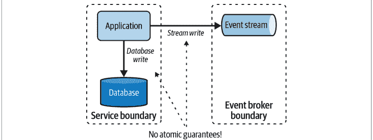
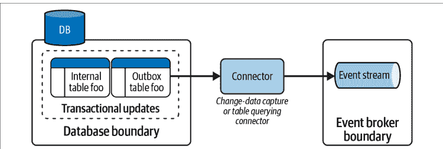
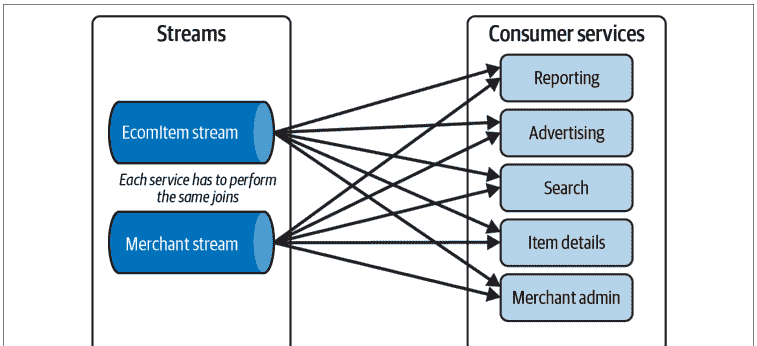
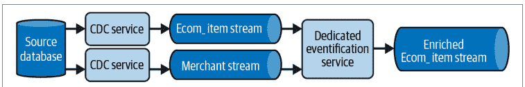

## 引导数据产品

创建事件驱动数据产品主要有两种场景。第一种涉及从尚未以事件形式存在的现有数据源创建数据产品。正如本书前文所提及的，这些数据源包括常规数据库（关系型、文档型、键值型等）、云文件系统，甚至 FTP 文件转储。本章将探讨如何将这些现有数据源引导至事件驱动的数据网格。

第二种场景涉及已处于事件流中的数据源，例如由原生事件驱动服务生成的数据。由于数据源已经是事件驱动的，创建数据产品更多地是将需要发出的数据和应保留在内部的数据形式化的过程。

不要过度担心首个数据产品是否完全正确。事实上，最好先积累一些经验，找出哪些有效、哪些不够理想，然后在此基础上进行迭代。你可以将构建数据产品与构建自助服务平台类比起来。第 99 页的“第 1 级：最小可行平台”是一个基本但有用的平台，可用于开始使用数据网格，你可根据需要对其进行增量改进。以同样的方式考虑你的首个数据产品——即 MVP 数据产品，它们将让你踏上实时、事件驱动处理之路，并让数据可供其他人按需使用。

本章将探讨多种技术，包括 CDC 和事务性外出箱，它们能帮助你将数据从当前所处位置引导至有用的数据产品。我们还将查看可能出现的陷阱和问题，以及解决这些问题的一些可能性。让我们开始吧。

### 入门：使用连接器进行引导

连接器使你能够轻松地将现有数据引导至事件流，而无需彻底重构源应用程序。现实是，大多数创建数据的系统（如业务实体和操作事实）也是其唯一数据来源。同样，这些系统也投入了数千（或数百万？）个开发工时——我们不会仅仅为了提取数据而对系统进行大规模改造。相反，我们需要顺应系统当前的状态。正如我们在第 101 页的“连接器”中所讨论的，连接器就是为此而来。

数据引发了关于谁拥有数据、连接器以及内部和外部数据模型之间转换的讨论。对内部数据域的修改可能会损坏连接器，进而破坏下游数据产品的 SLA。中断和故障往往会推动补救需求，从而实现更清晰的职责分工。


在引导数据时，请务必明确谁负责流程的哪些部分，并确保各方了解各自的职责。重新谈判支撑数据网格的社会契约与技术考量同样重要。

引导现有数据不仅仅是从可靠的单体架构中获取数据——数据可以存储在任何类型的数据库中，包括关系型、文档型、键值型、时序型、流式数据库以及云存储中的大型文件。尽管每种存储方式都不同，但获取数据通常分为两大类：定期查询数据库或追踪变更日志。最终，我们希望提取重要的业务数据，将其建模为对预期消费者有用的形式，并将其作为格式良好的数据产品发出。但在深入查询和变更日志之前，让我们先看看一种常见的反模式。

#### 双写

如图 8-1 所示，双写是人们在开始使用事件驱动系统时最常见的做法之一。简而言之，应用程序所有者试图同时向数据库记录*和*事件流写入更新。然而，由于应用程序数据库和事件流是完全独立的数据存储引擎，两者之间没有原子写保证。

双写棘手的地方在于它们大多数时候都能正常工作。只要没有间歇性故障，你就不会遇到问题。但时不时会遇到问题——网络可能会超时，应用程序代码中可能存在 bug，事件代理或数据库可能会间歇性不可用，等等。如果你不针对这些特定故障模式进行测试和监控，通常会发现几周或几个月后某些关键数据从数据产品中丢失。而追溯到源头很可能会发现，短暂的间歇性中断导致事件丢失。



*图 8-1. 数据库与事件流之间的双写*

虽然可以创建协调系统并引入两阶段提交来跨异构系统编排原子写保证，但这通常较为复杂，并且通常可以避免。本章剩余部分将探讨一些其他选项，帮助你找到更好的方法将数据写入事件流。

如果你不介意某些数据丢失，双写是可以接受的——例如，当你将测量值或其他形式的容错数据写入数据产品时。但在所有需要事件流中数据完整表示的其他场景下，你将希望使用基于查询的轮询、CDC 或事务性外出箱表。让我们现在逐一查看这些方法。

#### 通过轮询数据库创建数据产品

数据库天生用于查询，我们可以简单地定期查询数据库，将结果转换为事件，并将其发布到事件流中。像 Kafka Connect 这样的工具就是专门为此目的构建的，既提供现成连接器套件，也提供编码和部署自有连接器的手段。

当你能轻松识别自上次轮询以来哪些记录发生了变化时，基于查询的轮询效果最好。例如，updated_at 或 modified_at 时间戳是常见选择，如 Kafka Connect JDBC 连接器所示。每次轮询循环启动时，它会使用上次循环中看到的最高 updated_at 时间戳，并将其作为当前循环的最小时间戳输入。返回的行将转换为事件，连接器会更新其存储的 updated_at 时间戳以供下次循环使用。

事件架构会根据查询结果的格式自动推断。如果上游数据库定义发生更改，并且该更改包含在查询结果中，则事件架构也可能随之更改。


请确保连接器平台、连接器执行、连接器代码以及生成事件的所有者的所有权和职责明确。你和你的同事应该能够轻松识别在出现问题时应找谁沟通。

使用基于查询的轮询有几大优点：

##### 查询灵活性

数据库专门用于高效处理查询，因此查询数据库是将静态数据移入事件驱动数据产品的一种简便且低成本的入门方式。

##### 周期灵活性

你可以根据需要以任意频率进行查询，以确保满足 SLA。

##### 数据模型隔离

你在内部数据模型和发布到事件流的数据产品模型之间获得了隔离。你可以创建视图和物化视图来反规范化数据模型，仅选择需要向外部发出的数据。

使用基于查询的轮询也有几大缺点：

##### 数据库资源使用

数据库查询在复杂性和性能使用方面可能非常庞大。你可能会发现，由于查询复杂性、结果量或常规操作负载，无法获得足够的性能来满足 SLA。虽然你可以在一定程度上通过只读副本来缓解此问题，但这会引入额外的成本和复杂性，并且并非所有数据库系统都提供此选项。

##### 将错过硬删除

从数据库中硬删除的记录不会在查询中返回（毕竟它们已被删除）。你可能需要将数据库转换为使用软删除来跟踪删除操作。然后，你将不得不将软删除事件转换为墓碑，否则你的消费者将需要自行处理软删除。使用 CDC 可以克服这种复杂性。

##### 将错过间歇性变更

由于我们按特定间隔进行轮询，一个轮询与下一个轮询之间发生的多个变更在查询中只会显示为单个结果。如果你正在尝试


要捕获所有变更，您需要查看 CDC，如下一节所述。

还有一点——当您将数据从数据库引导至事件流时，您可能需要通过称为“快照”的过程来摄入整个现有数据集。拍摄快照可能是一项资源密集型活动，因为您需要在进入迭代轮询循环之前，将待捕获数据中的整个数据集加载到事件流中。虽然对几千条记录进行快照很快，但对几十亿条记录进行快照必然需要花费更长时间。

由于操作要求，对数据库进行快照处理更加复杂。数据库通常在处理实时流量，不能中断或进入性能降级状态。但是，快照处理通常要求锁定相关表（或数据集），以防止在快照过程中发生任何新写入。根据数据库实现和数据大小，表可能只需锁定片刻，或者可能需要在整个快照过程中保持锁定。即使锁定时间很短，相关数据库的流量率可能非常高，以至于任何锁定都是完全不可接受的。

只读副本是避免在对数据库进行快照处理时出现操作障碍的常见解决方案。快照针对副本执行，副本的表在快照完成前均锁定写入（和复制）。接下来，副本表被解锁，排队的更新被应用到数据库表中。然后，快照连接器切换到基于 updated_at 时间的迭代更新模式。一旦赶上当前时间（或尽可能接近），连接器即可切换到指向主数据库，并拆除只读副本。

基于查询的轮询和表锁定是将数据从数据库中导出的过时过程。虽然它仍然完全 *有效*，但使用 CDC 技术进行引导变得越来越普遍。此外，一些最近的创新使得无需锁定数据源即可获得最终一致的快照成为可能——但这依赖于访问数据库的变更日志。让我们来看看使用 CDC 以及这种解决方案如何为引导提供更好的解决方案。

## 变更数据捕获

CDC 是从数据库底层日志中捕获变更并将其转换为事件的过程。您可能会问，什么是日志？PostgreSQL 具有预写日志（WAL），作为保持数据完整性过程的一部分——对数据库所做的更改首先写入持久的 WAL，然后再应用到底层数据模型。在发生数据库故障时，WAL 与已保存到磁盘的数据配合使用，确保不会丢失任何信息。

许多数据库提供对这些日志的编程只读访问——例如，MySQL 提供二进制日志，而像 MongoDB 这样的其他数据库则以更直接的方式提供 CDC 事件，而不是跟踪日志。CDC 为构建您的数据产品提供了许多选项。

首先，CDC 为您提供关于数据库中所做更改的*一切*信息。您的事件流将收到给定行或文档的每个更新，因此您不会错过任何状态转换。其次，CDC 为您提供选项，以决定在事件中包含哪些字段以及特定元数据（例如有关连接器或数据库特定信息的元数据）。此外，您可以选择同时包含 before 和 after 字段，详细说明更改前的行或文档的完整状态以及更改后的完整状态。我们之前在第 154 页的“Before/After State Events”中提及过这一点。

有关您可以和不能做什么的更多信息，您需要查阅 CDC 或数据库的文档。例如，Debezium 的 PostgreSQL 文档包含有关可用数据的完整描述以及如何配置连接器以仅选择所需内容的说明。

一些 CDC 框架还提供了一种更高效地对特定数据库进行快照且无需锁定表的方法。正常的操作读取和写入可以继续不受中断，而生成的快照与当前表的状态最终一致。一篇 Debezium 博客文章解释了这一创新。它基于 Netflix 的一篇论文，该论文指出：

> DBLog 利用基于水印的方法，使我们能够将事务日志事件与直接从表中选择的行交错，以捕获完整状态。我们的解决方案允许日志事件在处理选择时继续进展而不会停滞。选择可以随时在所有表、特定表或表的特定主键上触发。DBLog 分块执行选择并跟踪进度，允许暂停和恢复。基于水印的方法不使用锁，对源的影响最小。
>
> ——Andreas Andreakis 和 Ioannis Papapanagiotou，Netflix

不阻塞操作用例的实时表快照对于引导事件驱动型数据产品是一大利好。快照机制可以配置为尽量减少资源使用，为活动激增留出足够空间，尽管这可能会导致快照完成时间更长。与此同时，在幕后，CDC 系统将增量快照查询的结果与日志事件交错在一起，将其转换为事件并写入流中。

快照完成后，CDC 进程将继续跟踪数据库的事件日志并将变更转换为事件。


近年来，CDC 越来越流行。许多数据库现在与流行的 CDC 工具提供原生集成，而一些云服务提供商拥有自己的完全托管连接器，这些连接器可直接将您的数据库与事件流挂钩，几乎不需要您进行任何操作。

CDC 提供多项优势：

- **非阻塞快照**
  CDC 可以在不干扰源数据库正常操作的情况下创建快照。

- **性能损耗极小**
  从数据库日志中捕获事件不会影响正常的操作性能。CDC 服务在其专用资源上运行，仅需主机以跟踪输出日志的形式提供少量性能。

- **延迟极低**
  通过 CDC 创建事件非常快。对数据库表所做的更改通常会在一两秒内反映在关联的事件流中。

- **兼容硬删除**
  硬删除会出现在数据库日志中，并随后转换为删除事件。删除还可以建模为墓碑事件，这样不再相关的实体可以从事件流和下游消费者的物化视图中完全删除（图 3-12）。

使用 CDC 也有几个缺点：

- **内部数据模型暴露**
  内部数据模型直接反映在数据库日志中，因此也反映在提取的事件中。与基于查询的更新不同，后者可以使用视图提供隔离，底层数据模型的隔离必须经过精心选择地管理。对内部数据库模型所做的完全有效的架构更改会反映到下游的事件架构中，并可能导致消费者出现故障。

- **高度规范化的事件流**
  内部模型耦合导致镜像源关系的事件流。规范化的数据库表会产生规范化的事件流，并且通常要求消费者在使用前对数据进行反规范化。虽然跨数据流连接事件是可能的，但这仍然比在专为该目的构建的关系数据库内部解决连接更复杂、效率更低。我们将在第 186 页的“Denormalization and Eventification”中更详细地讨论这一点。


CDC 连接器相较于仅查询的连接器有了显著改进。它们降低了构建数据产品的门槛，并使开始使用事件流变得更加容易。然而，仍有改进空间，特别是关于进一步隔离内部数据模型与发布到外部世界的内容。接下来，让我们看看事务性外出箱模式。

## 使用事务性外出箱的变更数据捕获

一个 *事务性外出箱* 是一个专用的数据库表，它充当要写入事件流的事件的临时输出缓冲区。当你更新 *内部领域模型* 时，你只选择想要暴露给外部世界的数据并将其写入外出箱。然后，一个独立的异步进程（例如专用 CDC 连接器）会从外出箱中消费数据并将其写入事件流。图 8-2 展示了端到端过程。



*图 8-2. 使用事务性外出箱和专用连接器从数据库获取事件*

事务性外出箱模式是一种比仅捕获现有内部模型表更具侵入性的替代方案，因为它需要修改数据库和现有代码。首先，我们需要为要转换为事件的数据创建一个外出箱。最常见的选项是为每个领域实体创建一张表，并根据表的架构强制执行数据类型。

其次，我们需要修改应用程序代码，将相关内部实体更新封装在 *事务* 中。你的数据库必须支持事务，此模式才能正常工作。在事务中，你需要选择要暴露的数据并将其写入外出箱。最后，你可以关闭并提交事务。内部领域模型的更新要么原子性发生，要么完全不发生。

示例 8-1 的 Python 代码演示了在 MySQL 数据库中对 `EcomItem` 进行原子更新。内部模型更新在事务性外出箱更新之前执行，但两者均包含在单个事务中以保持一致性。

### 示例 8-1. 内部模型和事务性外出箱的原子更新

```
try:
    conn = mysql.connector.connect(host='localhost',
                                    database='python_db',
                                    user='abellemare',
                                    password='definitelynotpassword')
    conn.autocommit = False
    cursor = conn.cursor()

    # Perform the internal domain model update
    internal_model_update = """
        Update EcomItem
        set price = 1299.99
        where id = 4291"""
    cursor.execute(internal_model_update)

    # Select the subdomain of the internal model we want to write to
    # the transactional outbox
    internal_sub_model_query = """
        Select name, price
        from EcomItem
        where id = 4291"""
    cursor.execute(internal_sub_model_query)
    name_and_price = cursor.fetchone()

    if (name_and_price == None):
        raise Exception("Unexpected missing record. Can't get name_and_price")

    # Insert the selected data into the outbox
    outbox_insert = """INSERT INTO EcomItem_Outbox (id, name, price)
        VALUES (4291, %s, %s)"""

    # Pass the name and price in to replace the query wildcards
    cursor.execute(outbox_insert, name_and_price)

    # Commit the internal and outbox updates atomically
    conn.commit()

except mysql.connector.Error as error:
    # reverting changes because of exception
    conn.rollback()

finally:
    # Close the database connection
    if conn.is_connected():
        cursor.close()
        conn.close()
```

在此示例中，我们首先将 EcomItem 价格更新为 $1299.99。接着，我们从刚刚更新的表中选择名称和价格——我们至少必须查询名称，因为我们想要生成一个基于状态的事件，该事件包含我们刚刚更新的项目的所有当前状态。最后，我们将事件编写并以表 8-1 所示的 EcomItem_Outbox 格式写入，就像处理任何其他关系型数据库表一样。

### 表 8-1. EcomItem_Outbox 表定义

| ID | 名称 | 价格 | 日期时间 |
|---|---|---|---|
| 4291 | "花哨笔记本电脑" | 1299.99 | 2022-06-22 11:33:12 |

关于我们的 SQL 表定义，有两点需要注意。其一，我们对事件中预期的每个强制字段都使用了 NOT NULL。除非满足所有约束，否则向外出箱插入新事件将会失败。其二，如果应用程序代码未提供 Datetime 字段，我们将默认使用 CURRENT_TIMESTAMP 填充该字段。你可以将此时间戳作为事件架构的一部分，或者使用它来填充事件的元数据，以指示事件创建时间。

确保内部模型、事务性外出箱表模型和事件架构兼容。使用预部署来确保内部模型更新能正确转录到外出箱表模型和事件架构，以避免易于预防的运行时错误。

从外出箱获取数据可以使用本章前面讨论过的完全相同的技术来完成：要么通过轮询连接器直接查询外出箱，要么使用 CDC 连接器。

你还需要不定期清理外出箱表。如果你使用基于查询的轮询机制，清理就像在将外出箱中的每一行写入事件流时将其删除一样简单。

Debezium 提供了一种名为外出箱事件路由器的全功能外出箱到 Kafka 主题机制。它防止从外出箱表传播 DELETE 事件，但可以通过将 route.tombstone.on.empty.payload 设置为 true 来发送墓碑。此外，它会自动清理外出箱表，以防止其无限增长。

尽可能使用开箱即用、免费可用的产品（如 Debezium）来简化你的数据网格之旅。大量的开发时间和测试时间已投入到其强化中，它将为你提供比大多数自建方案更加强大的解决方案。你最好将精力花在构建数据产品和建立自服务平台上，而不是试图重新发明 CDC 解决方案。

某些数据库存储引擎允许你创建一张不将数据保存到数据库而改为将其写入数据库日志的表。MySQL 的 BLACKHOLE 存储引擎会简单地丢弃所有写入，但会将所有 INSERT、UPDATE 和 DELETE 操作保留到日志中。BLACKHOLE 存储引擎所需的磁盘 IO 很少，并且让你无需清理表，因为没有任何数据被写入其中。

使用事务性外出箱有许多优点：

- 内部数据模型隔离：外出箱提供了内部数据模型与外部数据模型之间的隔离，允许两者独立演进。
- 外出箱恰好一次语义：事务确保内部模型和外出箱数据要么一起创建，要么完全不创建。内部模型更新失败将阻止事件写入外出箱，反之亦然。测试你的代码并覆盖每条代码路径。
- 早期架构强制执行：外出箱表架构决定了事件架构。写入外出箱的所有事件都将符合事件流架构要求，从而显著降低出错的可能性。
- 非规范化数据：你可以在事务期间选择对数据进行非规范化处理，以便下游消费者不必自己关联数据。我们将在“非规范化和事件化”第 186 页中详细介绍这一点。

通过事务性外出箱生成事件也有几个缺点：

- 数据库必须支持事务：值得再次强调的是，你的数据库必须支持事务。如果不支持，你将不得不选择不同的数据访问模式。
- 应用程序代码更新：必须更新应用程序代码以启用此模式，这需要开发和测试资源。
- 外出箱写入可能导致事务失败：由于向外出箱写入问题导致的事务失败也会导致向内部模型写入失败。这对你的用例可能无法接受，但可以通过在部署代码之前全面测试代码并验证事务性更新来轻松防止。


## 数据库性能影响

对数据存储的性能影响可能非常显著，特别是当大量记录被写入、读取和从外发箱中删除时。这可能会对响应时间和客户体验产生负面影响。

外发箱在内部领域模型和外部事件模型之间提供了一个抽象层。我们可以利用这一层进一步对数据进行反规范化和重构，以满足数据产品消费者的需求。让我们更深入地探讨这一点。

## 反规范化和事件化

规范化数据的主要目标之一是最小化冗余。然而，当存储的数据附加到一个可以根据需要轻松解析和反规范化它的处理引擎时，规范化效果通常最好。

一些消费者只需要一个信息量极少的、非常简单的事件驱动数据产品。另一些消费者可能希望包含大量关于实体的额外信息，并请求进行广泛的反规范化以获得扁平化结果。在一组事件流中处理反规范化比在一组表格中处理更具挑战性，因此我们非常有必要仔细考虑哪些内容应该进入反规范化事件流，哪些不应该。

例如，考虑以下关系型电子商务、商家和库存数据模型。表 8-2 中所示的 EcomItem 与表 8-3 中的 Merchant 表存在外键关系（merchant_id）。EcomItem 还与表 8-4 中的 Inventory 表存在主键关系（inventory_id），后者包含当前库存中的商品数量。

### 表 8-2. EcomItem 表定义

| id | name | price | merchant_id | inventory_id | updated_at |
|---|---|---|---|---|---|
| 4291 | "Mirage Block Set" | 1299.99 | 4 | 44291 | 2021-03-22 13:05:00 |

### 表 8-3. Merchant 表定义

| id | name | premium_partner | updated_at |
|---|---|---|---|
| 4 | "Devin's Trading Cards" | true | 2019-08-12 19:00:37 |

### 表 8-4. Inventory 表定义

| id | quantity_in_stock | updated_at |
|---|---|---|
| 44291 | 3 | 2021-01-09 07:33:13 |

虽然这个模型是简化的，但你在许多在线电子商务市场平台上通常会发现类似的模型——例如 Amazon、eBay、Alibaba、Etsy 和 Shopify 等企业。

Merchant.premium_partner 指定商家是否已注册并支付了高级商务体验费用：更好的广告交易、首选广告投放位置和首选搜索结果位置。其他运营功能包括每个 EcomItem 上传视频和更多图片的能力、创建商品捆绑包，以及提供 AI 生成的自定义交易，以便为注重成本的客户找到令人满意的价格点。这些服务中的大部分都需要 EcomItem 信息来面向最终客户提供服务——但它们也都需要商家信息用于品牌和展示目的，以及确定商家是否需要 premium_partner 待遇。

由于这些流具有高度关系性，每个消费者服务都需要对 EcomItem 和 Merchant 执行相同的外键连接，以便将数据格式化为其业务用例所需的格式。图 8-3 显示了一个小的消费者子集，每个消费者都需要消费并连接每个事件流。



图 8-3. 每个消费者都必须连接相同的数据来确定高级合作伙伴状态

这种安排存在一些显著的缺点：

- **重复处理** 每个消费者都需要自行执行这些连接。每个客户端都会有重复代码，并在连接上使用大致相同数量的资源。对于小型数据集，这可能无关紧要，但对于大规模数据处理（包括处理分区事件流），在处理资源方面可能变得非常昂贵。

## 客户端代码限制

每个消费者客户端都需要能够自行解析连接。大多数可扩展流式连接解决方案（例如 Apache Kafka Streams、Flink 和 Spark）基于 Java 虚拟机 (JVM)，但某些解决方案也支持 Python 和 SQL。然而，对于 Go、JavaScript、Ruby、Rust 等其他流行编程语言，没有一流支持。你也可以使用专用关系数据库来解析连接，但你的客户端可能需要文档、键值、地理或时序数据库。

事件化是一种实现模式，用于将高度关系性的流转换、反规范化和重塑为更适合事件驱动消费者的格式。在 DDD 术语中，我们正在将聚合根作为事件来创建。我们早先对使用 EcomItem 的评估表明，我们还需要包含关于商家的信息，尤其是其 premium_partner 状态。同样，我们可以将库存信息视为聚合根范围之外，因为它很少被消费者在一两个特定用例之外使用。

执行事件化时需要考虑几个因素：

### 消费者需求和用例

提高易用性是事件化的主要目标，需要了解消费者的需求。聚合根以易于访问且随时可用的格式提供必要的核心信息，因此消费者无需自己单独、重复地完成这项工作。

### 反规范化程度

反规范化数据的多少取决于消费者用例以及数据的大小和变更频率。我们将在第 192 页“事件中应该包含什么？以及哪些应该保留？”中更详细地介绍此问题。

### 用于关联流连接的键

正如我们在第 82 页“事件流键控和分区”中讨论的那样，事件化期间选择的事件键应便于对其他事件流进行连接。请确保你的事件键以一种方式进行设置，使其与大多数消费者不需要的关联流进行连接时兼容。库存就是这样一个流的示例。

### 构建外部数据模型

事件化为你提供了转换和标准化数据的机会，并可以隐藏内部数据模型的部分内容，避免其与下游系统耦合。生成的反规范化和重塑架构将成为数据产品 API 的一部分。

可以在两个主要领域实现事件化模式：写入外发箱表时，以及使用专用服务连接规范化流时。让我们逐一探讨这些方法。

## 事务性外发箱中的事件化

一种选择是在将数据写入外发箱之前，先选择内部模型数据并对其进行反规范化。如果我们采用第 182 页“使用事务性外发箱的变更数据捕获”中的示例代码，可以对其进行调整，添加一个查询来选择和连接 EcomItem 和 Merchant 数据，然后将其重塑为外发箱表的外部模型。示例 8-2 展示了将关系型数据重塑为更合适的反规范化事件格式的代码示例。

### 示例 8-2. 写入外发箱前的事件化

```
...
#### Assume that we have just updated the internal model
#### Next, we select fields from the internal model and denormalize it
#### by joining against the Merchant table.
internal_model_query = """
select e.name, e.price, m.name as merchant_name, m.premium_partner
from EcomItem as e, Merchant as m,
join on e.merchant_id = Merchant.id
where e.id = 4291"""

cursor.execute(internal_model_query)
result = cursor.fetchone()

#### Create the insert statement for the outbox table
outbox_insert = """
INSERT INTO
Enriched_EcomItem_Outbox (id, name, price, merchant_name, premium_partner)
VALUES (4291, %s, %s, %s, %s)"""

cursor.execute(outbox_insert, result)
#### Commit the internal and outbox updates atomically
conn.commit()
...

```

在此代码片段中，我们在应用程序创建或更新 EcomItem.id=4291 的数据时，为 Enriched_EcomItem_Outbox 创建一个条目。内部关系模型仍然在数据库中封装，而外发箱提供了一个更适合事件驱动消费者的数据模型。但是，当商家数据发生变化时该怎么办呢？考虑一位决定支付高级合作伙伴状态的商家。


之前创建的所有 Enriched_EcomItem 事件都必须 *也* 更新，以反映当前的高级状态。如果不这样做，意味着事件流将永久不准确，不再反映现实，这可能会导致下游消费者在响应和处理该商户数据时出现问题。简单来说，如果您打算反规范化数据，那么每当 *任何* 字段发生更改时，您都需要更新事件。无论您以何种 *方式* 反规范化数据，无论是使用内部 outbox 表还是专用事件化服务，这一点都适用，正如我们将在下一节中看到的那样。

事务性 outbox 表作为一种低开销的方式来隔离内部和外部数据模型，效果非常好。如果您的源数据位于关系数据库中，依靠数据库引擎快速高效地将数据反规范化为事件友好格式，而不是让每个消费者自行处理，这非常容易。通过使事件流易于使用，您可以改善消费者的数据产品用户体验，帮助他们专注于使用数据，而不是与数据作斗争。

然而，并不总是可以将 outbox 表构建到数据库中，更不用说在事务中反规范化数据了。除了根本不支持事务的数据库之外，没有积极开发的旧系统以及对性能有严格要求的系统可能不合适。当事务性 outbox 不可行时，最好考虑在源域之外的专用服务中进行事件化。现在让我们来看看这一点。

## 专用服务中的事件化

在源数据库 *之外* 进行事件化需要一个专门构建的微服务或流 SQL 应用程序。例如，图 8-4 展示了一个专用事件化服务的高级概览，它将 `EcomItem` 和 `Merchant` 数据合并在一起，形成一个用于下游使用的单一丰富流。像 Apache Kafka Streams 和 Flink 这样的事件驱动处理技术为合并数据提供了简单的高级框架。



*图 8-4. 在专用服务中使用 CDC 事件流进行事件化*

以 Kafka Streams 为例——如果我们使用上一节中相同的 `Merchant` 和 `EcomItem` 模型，我们可以创建一个简单的 Java 应用程序，将两者合并为一个基于状态的事件。代码大致如示例 8-3 所示，不过您也可能希望查看一个功能齐全的示例：

### 示例 8-3. 将 EcomItem 与 Merchant 数据合并并丰富的 Kafka Streams 微服务

```
public Topology buildTopology(Properties envProps) {
    //Configuration code not shown for brevity
    //Create the Serdes
    MerchantSerde merchantSerde = new MerchantSerde(...);
    EcomItemSerde ecomItemSerde = new EcomItemSerde(...);
    EnrichedEcomItemSerde enrichedEcomItemSerde = new EnrichedEcomItemSerde(...);

    //Create the application builder and create two tables.
    KStreamBuilder builder = new KStreamBuilder();

    //A KTable is the materialization of a state-modeled event stream
    KTable<Long, Merchant> merchantTable =
        builder.table(Serdes.Long(), merchantSerde, merchantTopic);
    KTable<Long, EcomItem> ecomItemTable =
        builder.table(Serdes.Long(), ecomItemSerde, ecomItemTopic);

    ecomItemTable
        .join( merchantTable,
            EcomItem::getMerchantId,
            new EcomToMerchantJoiner() )
        .toStream()
        .to(enrichedEcomItemTopic, Produced.with(Serdes.Long(), enrichedEcomItemSerde));

    return builder.build();
}
```

示例 8-4 中展示了 EcomToMerchantJoiner 类。它通过扩展 ValueJoiner 类指定如何将两个实体合并在一起。

### 示例 8-4. 连接器服务用于填充 EnrichedEcomItem 的 EcomToMerchantJoiner 定义

```
public class EcomToMerchantJoiner implements
    ValueJoiner<EcomItem, Merchant, EnrichedEcomItem> {
    public EnrichedEcomItem apply(EcomItem e, Merchant m) {
        return EnrichedEcomItem.newBuilder()
            .setId(e.getId())
            .setName(e.getName())
            .setPrice(e.getPrice())
            .setMerchantName(m.getMerchantName())
            .setPremiumPartner(m.getPremiumPartner())
            .build();
    }
}
```

或者，如果您想进一步简化，可以依赖类似 Flink SQL 的东西，使用非常简单的类 SQL 查询来完成相同的操作。示例 8-5 展示了使用 Flink SQL 将相同实体合并在一起的更简单方法。

### 示例 8-5. 事件化服务的 Flink SQL 版本

```
SELECT *
FROM EcomItem
INNER JOIN Merchant
ON EcomItem.merchantId = Merchant.id
```

SQL 层使解决流式连接和反规范化实体变得更加容易，并将自助服务平台功能开放给非 JVM 开发人员。简单的 SQL 层非常适合事件化的目的，因为我们并未执行任何复杂的业务逻辑，只是解决连接并发出丰富的实体。

使用外部事件化微服务有几个显著优势，包括：

- 减少对数据库资源的需求
- 简化源域的应用程序逻辑

但是，也有一些挑战需要处理：

- 同步数据库表、连接器和事件化微服务的更改
- 寻找一个强大的流连接器框架；只有几种选择，而且它们都是基于 JVM 的
- 争论微服务的所有权（提示：域所有者负责构建有用的数据产品）

无论您选择在源数据库内部、在数据库外部使用专门构建的微服务，还是在消费者本身反规范化业务实体，考虑对消费者的影响都很重要。专注于为您的消费者使域数据尽可能易于使用，并共同努力制定一个各方都能接受的解决方案。

## 事件中应该包含什么？以及什么应该保留在外？

确定事件中应包含哪些数据和应排除哪些数据需要进行微妙的权衡。有几个因素会影响这一决定。消费者需求、更新频率、数据大小以及由此产生的总负载都是需要考虑的因素。

让我们考虑一下我们电子商务示例的扩展。EcomItem.inventory_id 指定了与 Inventory 数据（表 8-4）的关系，指明库存中有多少件该商品。

每当库存发生变化时，例如由于销售、退货或收到货物，库存域可以发出带有更新库存的新状态事件。对于变化极其频繁的产品（想想黑色星期五“门槛破产”销售），您可能会面临大量的库存事件。虽然只发布事件样本仍然是一个有效的选择，但您会失去对确切发生情况的准确性，同时增加事件发生和消费者响应事件的能力之间的延迟。

如果将 EcomItem 与 Inventory 连接（EcomItem.inventory_id = Inventory.id），那么每次 Inventory 更新都会触发对物化 EcomItem 表的相应连接。这可能会产生大量事件，而不关心库存数量的消费者将被无关紧要的更新所淹没。

同样，请考虑一个包含给定 EcomItem 前 100 条评论的 Reviews 聚合数据产品。虽然这些数据可能不会频繁更改，但将其与 EcomItem 连接意味着，每当我们更新 Reviews 或 EcomItem 中的任何一个时，我们也会重新发出包含前 100 条评论的整个负载。就像频繁更新一样，许多消费者可能根本不关心内容，但仍然需要处理流中传输的非常大的数据大小。

最后，您可能会发现，您既有一个流中变化率非常高的数据，又有另一个流中负载大小非常大的数据。将两者连接在一起意味着您现在将拥有变化率很高的 _大量_ 数据。这可能会对您的事件代理、事件化流程和消费者产生叠加的高负载。

您需要通过与消费者交谈并与联邦治理团队合作，为您的数据产品找到适当的平衡点，以制定一些准则，帮助您的同行做出类似决策。

作为一般规则，避免连接频繁变化或大小非常大的数据。您最好将这些组件留在丰富事件之外，并让消费者选择将其集成到自己的服务中。当然，您始终可以创建一个将 Inventory 作为 EcomItem 一部分的新数据产品。

## 缓慢变化维度

让我们继续我们的电子商务示例。我们看到，对于给定的 Merchant 有许多 EcomItems，如果我们想要反规范化 EcomItem.merchantId 数据，我们就必须与 Merchant 进行连接。然而，Merchant 数据可能很长一段时间都不会更改，尽管它当然 _可能_ 随时更改。


这种类型的数据被称为缓慢变化维（SCD），通常是静态的，但可能会不可预测地变化。SCDs 长期以来一直是数据仓库和数据湖模型的领域，被有意建模用于处理跨越广泛时间范围的大型分析查询。但是，我们如何对它们进行建模？它们对我们的数据产品会有什么影响？

虽然存在众多 SCD 子类型分类，但与数据产品最相关的是 Type 1 和 Type 2 数据模型方法。让我们仔细看看每一种，了解它们如何影响我们构建数据产品的方式。

## Type 1: 使用新值覆盖

使用 Type 1 建模时，仅保留最近的值。假设我们有一个没有高级状态的商家，如表 8-5 中的账户所示。如果该商家决定支付高级状态费用，我们需要生成一个新的实体事件来覆盖先前的事件。

Table 8-5. Type 1: The first state event of Devin’s Trading Cards

| id | name | premium_partner | updated_at |
|---|---|---|---|
| 4 | "Devin's Trading Cards" | false | 2010-04-22 23:15:01 |

Table 8-6 显示了将 premium_partner 设置为 true 的更新商家实体事件的结果。

Table 8-6. Type 1: Updated premium status for Devin’s Trading Cards

| id | name | premium_partner | updated_at |
|---|---|---|---|
| 4 | "Devin's Trading Cards" | true | 2019-08-12 19:00:37 |

先前的记录不再需要，事件代理可以在稍后的时间压缩掉旧事件。虽然您可以选择保留数据更长一段时间，但 Type 1 维度建模不考虑变更历史记录——这时 Type 2 就派上用场了。让我们来看看。

## Type 2: 追加新值

使用 Type 2 维度建模时，Merchant.premium_partner 的变更值会被追加并与一个新的状态事件集成。事件消费者可以访问该字段的先前版本，并可用于确定实体在特定时间点的状态。例如，根据商家的 premium_partner 状态，构建一段时间内的参与度分析。同样，同一事件还提供用于运营目的的最新 premium_partner 值，确保服务其内容的端点为商家提供适当的高级待遇。

Table 8-7. Type 2: Updated Merchant data is appended to the event, complete with version IDs for previous updates

| id | name | premium_partner | updated_at | version |
|---|---|---|---|---|
| 4 | "Devin's Trading Cards" | false | 2010-04-22 23:15:01 | 0 |
| 4 | "Devin's Trading Cards" | true | 2019-08-12 19:00:37 | 1 |

Type 1 和 Type 2 SCD 建模策略都可以支持运营和分析用例。运营用例通常只关心最新值——当发生变更时，运营系统可以对新状态事件做出反应并相应采取行动。分析系统往往需要数据历史记录，包括字段变更的时间，以便根据这些属性构建准确的聚合。

状态事件的默认选择通常是 Type 1 建模——您的应用程序仅发布最新数据，由事件流提供先前值的历史记录。您的消费者模型需要选择在其自身域数据存储中保留先前的值。

Type 2 模型迫使消费者考虑 SCD 的影响，因为状态事件数据模型包含先前值的完整历史记录。如果消费者只想要最新值，它仍然需要显式地从历史记录中选择。因此，尽管 Type 2 模型更加冗长，并且对消费者来说需要多一些开销，但它们降低了消费者忽略变更历史记录的可能性。

在结束本章之前，让我们再看一个必要事项：将云存储（HDFS、S3 等）中存储的文件中的数据提取出来，加载到事件流中。

## 将云存储文件引导至事件流

连接器允许我们从事件流中获取数据，将其重新组合为文件，并将其写入云存储，以便与现有的批处理管道连接。但是，如果我们想要做相反的操作，即获取存储在云存储中的数据并将其加载到事件流中，该怎么办呢？迁移到事件驱动的数据网格不会一蹴而就，将现有静态数据引导至事件流是一个重要的选项。

批次计算数据长期以来一直是许多数据分析平台的主流。数据通常结构化为一组大型文件，采用 Parquet 等列式格式。这些数据由定时作业定期计算，该作业读取输入数据批次，对其进行处理，并将结果数据批次写回云存储。批次计算数据通常也基于时间进行分区，通常与小时、天、周和年等自然周期对齐。

我们可以将静态数据载入事件驱动数据产品的主要方式有几种。这些选项包括：

- Refactoring the job to produce events

此选项要求您的作业语言中可用事件生产者客户端。您只需在作业中包含事件代理生产者代码，使其同时写入云存储 *和* 事件代理即可。此方法确实引入了双重写入风险，如前所述，在第 176 页“双重写入”中所述。

- Writing to broker after job completes

由于您已经在使用定时批处理作业，可以简单地添加一个步骤来读取新数据、将其转换为事件，并将其写入事件代理。此方法的一大好处是，您可以使用任何想要的技术或语言。您的初始作业可能是一个您不愿碰触的旧 Apache Pig 工作流，而您的事件代理作业可以是另一种语言中非常简单且精简的应用程序。缺点是，您需要再次将数据读入内存，这会增加成本和延迟。

- Using a connector

您还可以使用连接器来简单地监听新文件和文件夹的创建。例如，*此 Kafka 连接器* 可以从 S3 存储桶中读取采用 Avro、Parquet、CSV、文本、JSON 或二进制/字节信息格式的文件，并将数据写入 Kafka 主题。此选项允许您依赖现有的批处理作业来创建数据，并依赖自助服务连接器将这些数据带入事件流。从这里开始，您可以开始将数据重新建模为格式良好的数据产品。

将数据引导至事件流是迈向事件驱动数据网格的一大步。这些引导的流通常对于运营用例来说太慢，但通常足以将基于批处理的分析作业过渡到流式应用程序。您的消费者将能够为所有数据源使用单个流式协议，而不是混合使用各种云和流式协议。

一旦将批处理数据引导至事件驱动数据产品，就开始向消费者征求反馈。一旦他们习惯了使用流，可能会要求您将数据产品提升到实时速度。通过遵循数据即产品原则，您可以规划工作、确定优先级，并构建数据管道路线图以迁移至实时流。

## 摘要

数据网格建立在现有系统和数据存储的基础之上。将来自现有来源的数据引导至初步数据产品是构建成功数据网格的重要步骤。许多现有系统和数据源将保持原样，没有真正的机会进行大规模重构并重新创建为新事物。至关重要的是，我们能够满足这些系统的现状，以最小的麻烦提取数据。

连接器在自助服务引导过程中发挥着关键作用。它们实现了将数据提取为流形式的基本目标，在此基础上，您可以开始协商数据产品的更精细要点：延迟、事件大小、反规范化和更新频率。确切放入什么和省略什么因消费者的需求而异。与他们交谈，与他们合作，并对您的产品进行迭代。

但是，如果您不希望通过事件流提供所有数据产品，该怎么办？如果您由于第三方 API 和现有批处理数据的巨大惯性而无法做到，该怎么办？下一章将探讨这些问题，并讨论如何将非事件驱动的数据产品集成到您的数据网格中。


