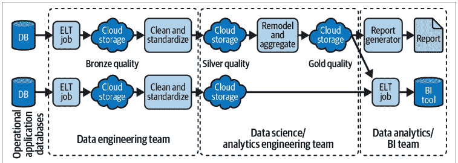
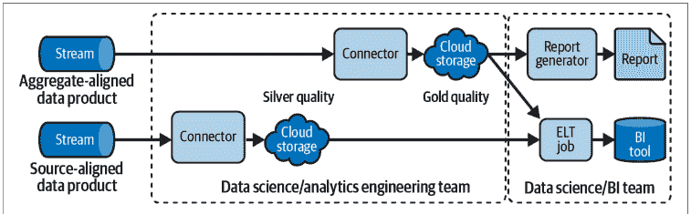
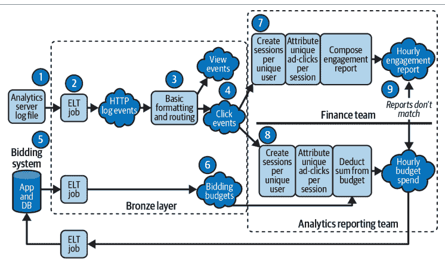
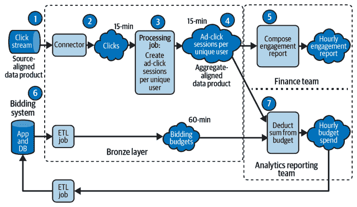
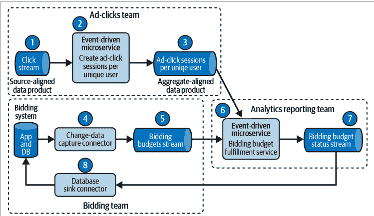
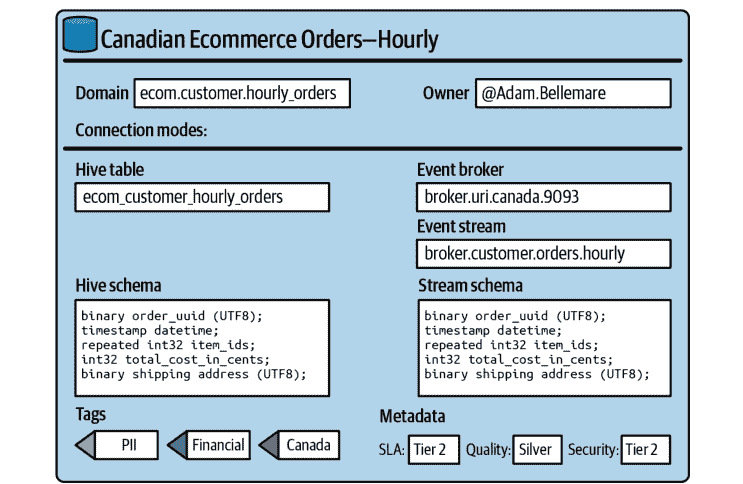

## 将事件驱动数据集成到静态数据中

事件驱动的数据产品为消费者提供了卓越的灵活性，但它们可能并不适合每个用例。现有系统和依赖关系在任何架构中都扮演着重要角色，转向数据网格取决于在支持现有用例的同时推动渐进式变革。许多系统、处理作业和计算高度依赖静态数据，尤其是分析领域中的系统。

在本章中，我们将重点介绍将事件驱动数据集成到静态数据中。我们将探讨奖牌架构及其在现代数据分析工作流中的作用。我们将探索策略和权衡，以确定何时将事件流转换为静态文件批次。最后，我们将查看一个现实世界示例，将理论与实践相结合。让我们开始吧。

### 分析与奖牌架构

变革最好的方式是首先站在用户的角度去满足他们。基于批次的数据分析管道和工作流在大多数行业中非常常见，许多组织在基于批次的数据工程、数据科学、数据分析和报告工作流上投入了大量资源。“数据产品是多模态的”在第 31 页介绍了多模态数据产品的概念，但迄今为止我们主要使用事件流。虽然事件流通常是驱动运营和实时分析用例的最佳选择，但我们仍需要与基于批次的工作流集成。

图 9-1 展示了使用在第 79 页“数据质量分类”中引入的奖牌术语的典型端到端数据分析管道分布。

一般而言，数据工程师从源中提取（E）数据，将其加载（L）到暂存区，并执行任何必要的初始转换（T）——这是一个 ELT 过程。这个 *铜层数据* 然后供给管道的下一步，进一步清理和标准化数据，并将其组合成更高质量的 *银层数据* 格式。



图 9-1. 跨多个团队的典型批次数据处理工作流

银层数据随后可能会进一步处理和聚合成金层数据集，代表最高质量级别，通常构建用于服务单一业务功能。它也可以按原样用于构建业务特定的聚合，这些聚合不属于可供他人使用的奖牌分级数据集。

数据分析师依赖于建模良好的银层和金层数据（以及 SLA 和支持），将其摄入商业智能（BI）和分析工具。在此，他们执行分析、编写报告，并影响数据驱动的决策。

将事件驱动的数据产品集成到现有批次数据工作流中，是一场酸性测试，用来检验你的数据网格是否真正是一种新数据沟通方式的基础，还是仅仅服务于有限子集的另一种临时机制。图 9-2 说明了如何将事件流作为批次数据工作流的源进行集成，而不是使用现有的专用构建代码。



图 9-2. 使用事件流和连接器为现有工作流提供动力

你可能首先会注意到，数据工程团队不再可见——他们现在正在构建数据网格的自助服务平台并支持其采用。此外，确保数据质量和标准化的工作已上游推送给数据产品所有者。数据科学家或分析工程师可能仍参与构建数据产品，尽管他们的参与并非强制性的。

图 9-2 中数据产品用户的其余职责涉及创建和配置将事件驱动数据沉入云存储的连接器。自助服务平台应该为他们提供所需的一切，以满足他们自己的连接器用例，如第 101 页“连接器”中所述。

事件驱动的数据产品让我们移除自定义构建的点对点数据管道作业，这些作业通常连接一个系统到另一个系统。但这要求我们以消费者基于现有作业已经期望的格式和频率提供数据。让我们在下一节中看看这个问题。

### 将事件流连接到现有批次数据流

数据流很少简单干净——它们通常是层层堆叠的不令人满意的妥协、“临时”解决方案变成永久方案，以及黑客式的变通方法，最终支持关键业务用例。代码库中散布着 "TODO–临时黑客！修复这个！"，古老的积压工单详细说明需要实施的必要更改，通常由已经离开组织的人编写。简而言之，数据流看起来很像任何其他应用程序的代码——但它们也分布在多个作业中，涉及多样化的框架、语言和数据库。

正如构建数据网格的自助服务平台是一个渐进式过程一样，将数据产品连接到现有基于批次的数据流也是如此。首先，而且最重要的是，你不会在不久的将来重构和替换多年精心打造的业务逻辑。在许多情况下，你甚至不应该尝试。没必要仅仅为了变革而尝试更改那些已经足够好用的东西。相反，你应该将精力集中在要么对坏数据敏感，要么需要比现有数据流支持的速度快得多的结果的关键业务用例上。

集成事件流数据产品需要消费事件，将它们转换为合适的格式（例如 Parquet），并将它们沉入云文件系统。我们的集成策略是用来自专用构建数据产品的新数据集来替换批次创建的数据集。但这不是我们需要做的唯一事情。事实上，最好看一个示例来了解这个策略在实践中如何运作。

考虑一家电子商务和广告平台公司，它为其业务合作伙伴提供付费推广广告服务。业务合作伙伴创建广告活动、分配预算，并相互竞标以获得向最终用户展示其广告的权利。广告平台公司必须为其业务合作伙伴提供计费结果和洞察报告。毕竟，他们想知道他们的广告效果如何、谁在点击广告，以及他们欠多少钱。

然而，存在一个问题。业务合作伙伴经常收到财务团队的账单，这些账单与分析团队报告的互动不匹配。例如，合作伙伴可能被账单为 1,200 次独特互动，但他们的分析报告仅显示 1,154 次独特互动。这是怎么回事？让我们看看多年来积累的数据流，以了解复杂性以及错误可能在哪里混入。

图 9-3 展示了端到端流程，从摄入和解析分析服务器日志中的原始数据（1）开始。数据每 15 分钟从服务器日志中提取（2），转换为粗糙的非结构化批次文件，并加载（3）到云文件系统中作为基本 HTTP 日志事件。接下来，一个每 15 分钟启动一次的定期作业处理之前 15 分钟的数据，清理它，标准化字段，并根据用户操作（例如点击、查看、滚动）将其发出到不同的数据集（4）。



图 9-3. 批次计算的互动和预算报告不一致

因此，我们想要获取如下形式的服务器日志事件批次：

```
42.241.222.101 - - [22/Jan/2021:23:27:13 +0000] "GET /ad/1312412323?a=click&b=29&id=A675E098&device=iPhone12 HTTP/2.0" 200 5316 "https://sample.domain.com/" "Mozilla/5.0 (Windows NT 6.1) AppleWebKit/537.36 (KHTML, like Gecko) Chrome/72.0.3626.119 Safari/537.36" "2.75"
```

并将它们转换为具有如下表格模式的良好结构数据批次：

| long | string | datetime | int | string | enum |
|---|---|---|---|---|---|
| adId | userId | datetime | bidInCents | url | device |
| 131241232 | A675E09 | 22/Jan/2021:23:27:13 +0000 | 29 | sample.domain.com/ | iPhone12 |

接下来，我们从广告和预算数据库（5）获取数据，并将其 ELT 到云文件系统上可用的数据集（6）。这个作业每 60 分钟启动一次，创建预算数据的完整快照，包括自上次运行以来未更改的任何行。

财务团队（7）和分析报告团队（8）都从同一组点击事件开始工作——这是一个好做法，我们将在本章后面再次提及。但每个团队独立于另一个团队行动，报告差异（9）就可能在此处混入，导致困惑，不知道哪个报告（如果有的话）是正确的。

首先：用户会话定义。每个团队以自己的方式计算用户会话。虽然两个团队都知道广告仅在会话内是唯一的，但每个团队用于计算会话的精确业务逻辑各不相同。一种常见定义依赖于 30 分钟超时——只要用户在该 30 分钟内执行某种活动，会话将保持打开。但另一种常见做法是在午夜截止点切断会话，在午夜关闭会话，并在之后立即打开另一个会话。

财务团队遵守午夜截止点——毕竟，这是获取另一个可计费事件的好方法，也是一种相当标准（尽管过时）的做法。与此同时，分析报告团队仅使用 30 分钟超时。这是差异之一。

第二：独特用户归因。分析团队很早就开始了，并且多年来一直在努力识别独特用户。账户 ID、电话号码、设备 ID，以及最近的 iOS 和 Android 广告 ID，使识别和标记独特用户的合法性和逻辑变得复杂。相比之下，按推广付费广告的计费相对较新——但他们认为独特识别仅仅是使用设备广告 ID 的问题。毕竟，“每个人都知道”这就是你应该做的。


最终结果是，两个团队都拥有经过单元测试验证的明确定义的业务逻辑，能够根据其测试用例识别唯一用户，并输出相当准确的结果。当然，它们的结果可能不一致，但误差仅几个百分点。这就是第二个差异。

难怪会出现一些问题，而且还有许多其他更微妙的领域可能会出现问题，但这两点足以供我们分析。虽然我相信你可能已经在构思解决方案，但让我们退后一步，透过数据网格的视角来看看问题出在哪里。

## 透过数据网格的视角：发生了什么？

首先，这些原始数据集不是数据产品。它们不是专门构建的，也没有使用明确定义的结构创建，也没有要求满足下游消费者的特定需求。日志只是尽力而为地提取并解析成一批数据。结构是事后由既不拥有数据也不拥有发出数据的应用程序的人员添加的。

其次，缺乏领域所有权。用户应该如何询问数据的含义？虽然你可能能够与拥有广告和预算数据库的团队交谈并从他们那里得到答案，但你很难从编写前端服务的应用程序开发人员那里获得关于引导式nginx日志的清晰解释。没有数据产品负责人。没有官方联系点。向下游用户的沟通几乎完全基于部落知识和对当前已注册数据管道的手动调查。上游数据的变更只有在下游消费者的作业中断时才会被发现。

第三，缺乏领域负责人和数据产品负责人已经培养了一种保护主义和孤岛化的文化。既然上游数据集容易出现突然和意外的破坏性变更，为什么还要依赖它们呢？最好从尽可能接近源头的地方获取数据，这样别人就无法破坏你的数据。只依赖自己团队的工作，并尽量减少对他人的依赖。虽然你公司的同事肯定都是出于好意，但你了解你的直接队友，并与他们紧密合作，以确保你的数据流正常运行。

最终结果是一种被动、保护和孤立主义的文化，这并非源于恶意或疏忽，而是由于完全缺乏成文的职责和角色。

## 透过数据网格的视角：如何解决？

让我们回头看看图9-3。我猜你首先想到的可能是，我们应该将(7)和(8)中的重复逻辑推回上游，在一个共同位置执行会话构建和唯一用户识别。如果是这样，你的直觉是正确的。让我们看看图9-4，看看当这个工作流由事件驱动的数据网格驱动时可能是什么样子。



图9-4. 与事件驱动的数据产品集成并将公共计算逻辑推回上游

首先需要注意的是，点击事件(1)已被提升为源对齐数据产品，并通过事件流提供。这次转换相当简单，只需要在点击事件发生时从分析服务器原生生成它们即可。当数据已经完全可用时，无需解析nginx日志。领域所有者接受了数据产品负责人的职责，并承诺创建一个点击事件数据产品。一旦数据开始流动，它就会保持流动，当我们将其连接(2)到云存储时，可以简单地将其减速为15分钟批处理格式文件。

源对齐点击流数据产品的架构指定如下：

```
Key: String, //user_account
Value: {
    user_account: String,
    utc_timestamp: Datetime,
    ad_id: long,
    page_id: String,
    bid_in_cents: int
}
```

接下来，我们召集了财务团队和分析报告团队的代表共同制定通用的唯一用户和会话创建逻辑。我们从他们的领域中提取了现有的业务逻辑，将其统一，并为两者制定了共同定义。由于他们的用例都需要会话和唯一性，这两个步骤都在单个进程(3)中发生，数据每15分钟以批处理方式发出(4)。请注意，如果我们决定将(4)中的数据视为聚合对齐数据产品，我们需要指定一名数据产品负责人，并确保遵循所有通用的数据产品管理和元数据要求。

每小时参与度报告(5)已更新，以从(4)中的共同数据获取数据。虽然每小时参与度报告仍会根据自身要求重塑数据，但它不会对唯一用户或会话分类做出决策。竞价系统(6)暂时保持不变。它继续从分析报告团队接收每小时预算支出输入。

预算报告(7)继续依赖于与广告和预算数据库关联的ETL作业批处理创建的每小时数据快照。为什么不升级到事件驱动的数据产品？因为在我们示例的约束下，根本没有业务需求进行此更改——基于批处理的预算文件创建工作已经足够好，且没有引起任何问题。

实施数据网格是一个渐进的过程，识别哪些问题领域最能从数据即产品中受益非常重要。在理想世界中，我们希望每个数据源都是一个形成良好的数据产品，且没有任何重复的业务逻辑，但现实是，我们需要在哪里投入时间和精力方面进行选择。

## 平衡文件大小、SLA和延迟

在将事件流中的事件驱动数据产品集成到批处理中时（特别是写入云文件系统时），需要解决一些技术问题。以下是你需要考虑的主要因素：

### 执行数据格式转换

事件架构通常不适合现代大数据处理，因此你需要将事件转换为具有合适架构格式的文件块。虽然Avro和Protobuf仍然是事件流的常见选择，但列式格式（如Parquet）对于云文件系统来说通常是最常见的，因为它们对于批处理工作负载提供的性能处理远高于以事件为中心的Avro和Protobuf格式。

### 处理架构演进

架构演进会给情况增加一些复杂性。通常，每个事件演进都需要自己的文件，因为列式格式架构是基于每个文件确定的。因此，版本1事件进入版本1文件，而版本2事件进入版本2文件。事件流中的架构越多，你最终在云文件系统中会得到的文件就越多。

### 平衡文件大小与延迟

你的下游消费者在文件写入云文件系统之前无法使用数据。如果你想尽量减少事件发生到其在云文件系统中出现之间的延迟，你最终会频繁写入大量小文件。延迟会相当低，但想要加载和处理这些数据的应用程序会又慢又低效。云文件系统的一个主要问题是，它们需要为正在加载的所有数据协调架构——而拥有大量小文件会导致处理时产生大量开销。或者，你可以选择仅在文件达到一定大小（例如100 MB）或一定时间边界（例如每小时）时才写入文件，其代价是数据可用的延迟更长。

### 实现连接后文件合并

一种常见的技术是频繁写入许多小文件（例如每分钟一次），以确保特定批处理消费者具有非常低的延迟。然后，在时间边界结束时（例如每小时一次），你启动一个新的批处理作业，将许多小文件重新合并为少数几个大文件。作为最后一步，你更新云文件系统的元数据条目（例如Apache Hive），将未来的批处理作业重定向到合并后的文件，从而大幅提升其性能。

将事件流中的事件集成到静态数据中需要仔细考虑数据产品的用例。如果你的组织已有批处理计算的数据，你通常可以重复使用现有的约定和SLA作为你自己的。如果人们习惯每30分钟更新一次数据，那么以30分钟的更新频率作为你的SLA开始是可以的。数据格式转换和架构演进同样并非事件流特有的问题，你可能会发现可以从现有的数据管道和工作流中汲取灵感来处理这些问题。

## 预算忧郁：过度支出的故事

迁移到通用的“每唯一用户广告点击会话”数据产品已取得良好效果——差异已消失，不再有业务合作伙伴投诉。但是，我们至今一直选择忽略的问题仍然存在。

目前，广告通过竞价过程投放给最终用户。业务合作伙伴会看到关于最终用户的信息，例如年龄、位置和兴趣，并可以根据相关性提交竞价，以获得向最终用户投放广告的权利。获胜竞价者的广告随后会被推送到最终用户的UI上。但是，业务合作伙伴仅在最终用户点击广告时才会被收费。仅仅查看是不够的。

广告在各种属性和多个系统上投放，直到广告已投放并页面已加载之后，我们才知道广告是否被点击。到那时，我们只能等待看最终用户是否会点击它。


目前，预算支出报告是按小时批次计算的。每小时我们都会从投标系统导出数据，以获取新的和更新的投标预算事实。按小时频率的后果是，我们最早能在一小时后计算预算完成情况——实际上，这将花费更长时间，因为我们还需要考虑处理时间以及将其 ETL 回投标系统的时间。我们的目标是缩短聚合点击、计算剩余预算以及通知投标系统哪些预算应该或不再允许投标之间的时间。

目前，我们经常会遇到这样的商业伙伴：他们的预算在技术上已经用完，但投标系统尚未收到包含更新的每小时报告。在此期间，算法继续使用该商业伙伴的预算条目来激进地投放广告位，出价高于其他 _确实_ 有剩余预算但出价较低的商业伙伴。

最终结果是收入损失，因为我们无法向商业伙伴收取超过其明确说明的预算限制的额外广告点击费用。相反，我们需要一个更紧密的循环，以缩短预算用尽与投标系统停用相关投标之间的时间。

图 9-5 说明了我们架构的演进，以帮助我们实现这些目标。



图 9-5. 预算完成系统的进一步演进，以使用事件驱动的数据产品

源对齐点击事件 (1) 由专门构建的微服务 (2) 聚合为会话，从而生成聚合对齐的数据产品 (3)。此流已由广告点击团队域所有者有意提升为数据产品状态，因为它不仅支持图 9-5 中的工作流，还支持其他应用程序和流程（未显示）。聚合数据产品具有以下架构：

```
Key: String, //user_account
Value: {
  user_account: String,
  session_start: Datetime,
  session_end: Datetime,
  //Map of unique ad_id clicked and the corresponding bid amount
  unique_ad_id_to_bid_price_in_cents: Map[Long, int]
}
```

unique_ad_id_to_bid_price_in_cents 只是一个包含映射到出价金额的唯一 ad_id 集合的映射。例如，请考虑以下代码片段：

```
unique_ad_id_to_bid_price_in_cents: Map[Long, int] =
  [ [77883344, 29],
    [12937163, 14],
    [01845672, 0]
  ]
```

此会话中的用户点击了三个广告。每个广告的中标出价分别为 29 美分、14 美分和 0 美分。最后一个值表示没有人愿意为了展示该广告的权利支付任何金额。

除图 9-5 所述内容外，投标团队已设置 CDC 连接器 (4) 以发出详细描述投标预算 (5) 的事实流。这使得投标预算完成服务 (6) 能够在更新发生时立即容纳新的、修改的和取消的预算。

请注意，投标团队并未将投标预算的 CDC 流建立为数据产品。它仍然是团队域内的私有事件流，仅对分析报告团队拥有的服务 (6) 可见且可用。如果投标预算变得更加广泛需要，投标团队可以重新审视将其提升为数据产品（包含所有治理和支持要求）的决定。

投标预算实体具有以下架构：

```
Key: long, //budget_id
Value: {
  budget_id: long,
  ad_id: long,
  amount_in_cents: long,
  remaining_amount_in_cents: long,
  maximum_bid_in_cents: int,
  start: Datetime,
  end: Datetime
}
```

为简化本示例，每个 budget_id 均按 1:1 归属于特定的 ad_id。每个预算包含完整预算金额、可用剩余金额以及最高出价，均以美分表示。由于大多数广告系列都基于日期范围运行，因此还有开始和结束日期，用于进一步区分投标资格。

投标预算完成服务 (6) 将投标预算物化到其自身状态存储中。它还将每个按唯一用户划分的广告点击会话物化，并将唯一会话点击分配给每个预算。该服务检查每个新事实的变化（无论是另一次归因点击、会话结束，还是预算修改），并相应更新分配的预算支出。

为降低投标预算状态流事件 (7) 可能产生的极高频率，除非事件表示预算已用尽，否则每 60 秒仅每个 budget_id 发出一次更新。在这种情况下，它会立即发出，以缩短从预算用尽到其从付费推广中移除之间的端到端延迟。

最后，投标预算状态流事件 (7) 通过数据库下沉连接器 (8) 集成回投标系统，该连接器将事件转换为数据库 UPSERT 命令。这完成了预算计算循环，为投标系统提供其预算完成情况的近乎实时数据，与基于旧版的一小时以上反馈循环相比，大幅削减了不可收回的投标成本。

投标预算完成服务 (6) 仍由分析报告团队所有，原因是历史遗留。毕竟，他们之前计算过批量报告，因此目前仍对其负责。社会变化可能会缓慢到来，也许有一天，投标系统将能够在其自身域内计算自己的结果。接受并专注于渐进式变化是采用数据网格的关键部分。

技术变革也可能缓慢到来。尽管本示例中有两个事件驱动的微服务，但投标系统仍坚定地是一个非事件驱动的应用程序，只需要访问一个数据流。第 101 页的“连接器”是弥合现有非流式系统与事件驱动数据产品之间差距的重要工具，并真正使渐进式变化既可行又实际。

如果您决定支持非流式数据产品，您需要考虑它们如何与您的事件流并行工作。让我们现在看一下。

## 将自助服务平台扩展到非流式数据产品

您需要根据独特的用例，选择要纳入平台的非流式数据产品。第 31 页的“数据产品是多模式的”介绍了数据产品可能具有的多种模式，包括批量计算的文件、请求-响应 API 和事件流。但什么算作独立的数据产品，什么算作单个数据产品的 _模式_？您如何在自助服务平台中表示它？让我们看看影响我们选项的几个因素：

### 所有权

担任数据产品所有者角色的人是唯一可以拥有数据产品的个人。不能有多个所有者。如果单个数据产品要通过多种模式提供，则必须有一个共同所有者，能够保证每种模式的支持和一致性。

### 技术边界

第 179 页的“变更数据捕获”对于从数据库中提取事件非常有用，特别是当数据库所有者不愿或无法将业务数据作为原生生成的事件流提供时。在此情况下，CDC 流是一个独立的数据产品，其所有权与源数据库所有者提供的任何请求-响应数据产品分离。请记住，如果事务系统的所有者不愿或无法与 CDC 流所有者合作，您最多只能得到一个易于导致 SLA 失效和数据模型损坏的“创可贴”解决方案。尽可能共同努力以维护数据产品的连续性和架构兼容性至关重要。

### 对齐和组合逻辑

尽管都是对同一数据的聚合，但源自 1 分钟销售聚合流的一批 60 分钟销售聚合是两个独立的数据产品。

多模式数据网格应识别数据产品之间的关系，这些关系表现为同一产品的模式，或通过与其他产品的关系来体现。例如，您可以选择将 SQL 可查询和事件流作为单个数据产品的两种模式。通过自助服务发现工具找到的元数据条目，将类似于图 9-6。

无论您如何展示批量创建的数据产品，都需要确保对发现、计算和发布提供一流支持。在集成多种数据产品模式时，没有捷径或轻松的退出途径，因此，始终最好是先从尽可能少的模式开始，仅在必要时才扩展选择范围。




图 9-6. 一个自助式 UI，同时显示单个数据产品的 Hive 表和 Kafka 主题模式

## 摘要

数据网格本质上是多模式的，数据产品可以通过多种方式提供。事件流仍然是大多数数据产品的最佳选择，因为通过流为操作性和分析性用例提供动力，远比使用静止的文件批次更容易。

自大数据诞生以来，基于批处理的计算一直是构建数据管道并提供分析结果的主流方式。将批处理计算的文件替换为事件流源是最常见的首个集成步骤之一。沉降连接器将事件流重新组合成一批文件，以匹配格式和聚合要求。最终结果是一组事件流，既可以为实时操作性和分析性系统提供动力，同时也可以为现有基于批处理的数据管道提供动力的源系统。

你如何分类由沉降连接器创建的文件批次由你决定。你可以选择将其视为同一数据产品的两种模式，但必须确保单一的所有权和责任。你也可以选择将它们视为不同的数据产品。事件流可能与源对齐，而沉降到云存储的数据可能是按小时聚合对齐的数据产品。血缘和依赖跟踪对于发现紧密相关的数据产品仍然很重要。

对多模式数据产品的自助式平台支持仍然是关键要求。除了发现之外，你还需要确保你的数据网格用户可以将其服务注册为消费者，并管理其非流式数据产品的发布。元数据要求会因产品模式而异，安全访问、信息处理、扩展和演变的方式也会如此。请确保联邦治理团队的代表已仔细评估并优先排序了支持你的数据产品模式所需的功能。

在接近本书结尾之际，还有一个主题需要处理。分布式系统通常必须处理最终一致性，分布式异步事件驱动架构也不例外，我们将在下一章中看到。
