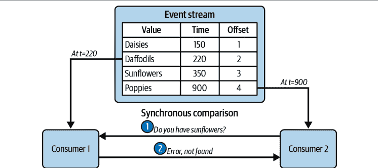
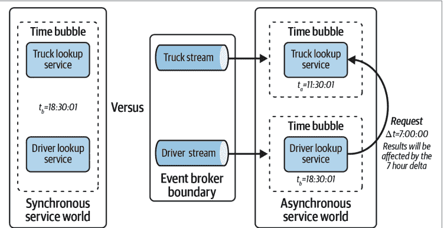
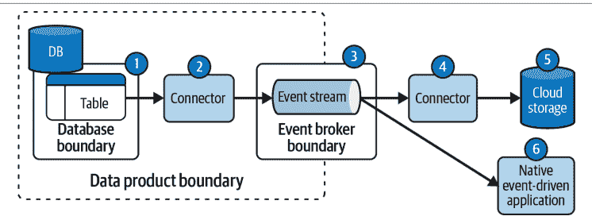
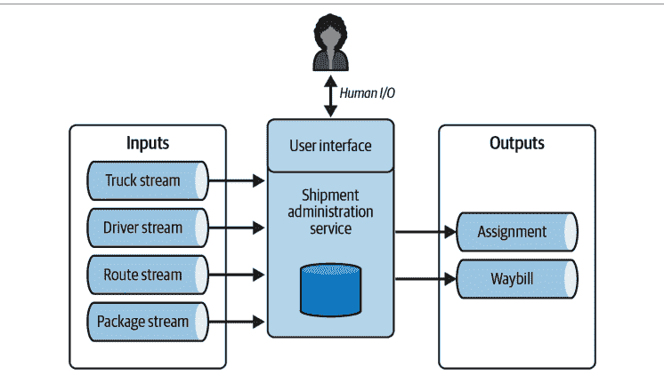
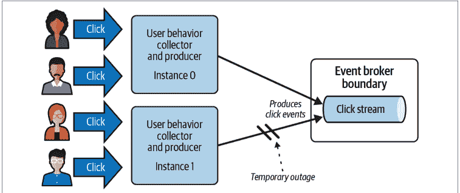

## 最终一致性

最终一致性是人们对分布式系统和事件驱动数据产品的主要关注点之一。但最终一致性对不同的人可能意味着不同的事情。例如，应用程序开发人员可能正在使用不提供一致读后写的数据库，例如大型分布式数据库的情况，或使用事件溯源来构建状态时。在事件驱动的数据网格中，我们更关心多个消费系统订阅事件驱动数据产品的影响，以及如何与各自按自己的速率读取数据的单个消费者一起工作。

有些人一直在研究、从事并思考最终一致性，时间相当长了。Pat Helland 就是这样一个人，他撰写了一篇出色的文章，汇集了众多思想领袖在该主题上的见解和观点。

> 1995 年，Doug [Terry] 在 Bayou 论文中创造了“最终一致性”这一短语，
> 我对他的观点很感兴趣。当他定义最终一致性时，其意思是：
> 对象集合中的每个对象，该对象的所有副本最终都将具有相同的值。随后，他问道：“是啊，我本应该称之为最终收敛。”
> 
> ——Pat Helland

Helland 接着讨论了 Peter Alvaro 的一个定义，该定义出自他的 2015 年博士论文《面向分布式系统的数据中心编程》：

> 当所有消息都已送达时，如果所有副本对存储值的集合达成一致，则该系统是收敛的，或者说是“最终一致的”。
> 
> ——Peter Alvaro

Terry 和 Alvaro（哈！）都趋同于最终一致性的同一定义，将重点放在独立副本最终收敛于同一组存储值上。我们将继续使用“最终一致性”术语，但请记住，我们实际上是在讨论数据的收敛。

持续物化事件流的消费者可以轻松地告诉你它在数据存储中拥有哪些数据，但无法告诉你它没有哪些数据。因为数据存储最终会收敛，所以在被查询时它可能会告诉你没有某个数据，但随后可能会在下一个时钟周期立即接收并处理该数据。然而，消费者确实有能力告诉你它是否已追上某个给定偏移量，我们可以在解决关于收敛的问题时利用这一知识。

在事件驱动世界中，关于最终一致性的许多问题和担忧都源于对“因其而发生不好的事情”的担忧。它经常被用作一种威胁性术语，列在架构概览论述的缺点部分。但它不一定是缺点，因为只需注意几件大事。有两个主要原因，导致两个独立的消费者服务可能尚未收敛：

### *服务滞后*

数据产品中的所有数据都是一致的，但有一个服务只是在数据的消费、处理和存储方面滞后。

### *数据产品滞后*

数据产品中的数据并不*一致*，但每个服务都已完全同步到最新数据。对于事件驱动的数据产品，要么生产者未能写入数据，要么事件流可能不可用。在最坏的情况下，数据产品可能严重滞后，以至于违反其 SLA。

请注意，这两个选项并非互斥。一个或多个消费者服务 *和* 一个或多个流同时缺少数据是完全可能的。尽管收敛最终会带来一致性，但这只会是短暂的，直到我们的服务和数据产品再次暂时缺少数据并需要处理以追上进度。

问题是，最终一致性并没有你想象中那么大的影响，我们将在本章后面探讨一些处理它的好方法。绝大多数时间，你的事件驱动服务都会跟上最新事件，并实际处于同一个时间气泡中，就像普通的旧式同步服务一样。这就是我认为它会引起大量担忧的原因之一——你永远不知道*何时*你的服务会开始滞后并转入其自己的时间气泡，如果发生这种情况，如何检测以及该怎么办。

问题的关键在于，只有当一个独立上下文向另一个独立上下文提出同步问题，且无法保证其内部数据集已同步时，最终一致性才真正开始成为一个问题。

## 逐步趋于一致，一次一个事件

每个事件驱动处理实例实际上都存在于其自己的时间气泡中，其内部时间完全基于其已消费并集成到状态中的事件时间戳。绝大多数事件流都按递增偏移量和时间戳顺序提供数据，尽管事件也可能乱序（本章后面将详细讨论）。因此，尽管消费服务可以自由查看墙钟时间，但其自身的内部时间完全基于其已消费事件的时间戳。

请参看图 10-1，它显示两个独立消费者正在从单个事件流中读取数据。每个服务都完全独立，正在处理事件、应用业务逻辑并将数据保存到状态中。

图 10-1. 最终一致性问题的关键

每个服务向外部世界提供的结果，无论是通过请求-响应 API、输出事件流还是其他方式，都极不可能与另一项服务中类似物化的数据精确同步。差异和令人困惑的结果正是由此引入的。在 t=900 时，消费者 2 向 t=220 时的消费者 1 询问其 Sunflowers 数据的副本。由于消费者 1 甚至从未听说过 Sunflowers，它所能做的全部就是回复“未找到”。

与事件驱动数据产品的消费者形成对比的是，设想两个通过请求-响应 API 通信的同步服务，并且它们在各自的服务中拥有并存储所有数据。当其中一项服务向另一项服务发出 API 调用时，它并不在想：“那边现在是什么时间呢？”

除了使用偏移量或递增事件 ID，您还可以选择使用事件时间，即事件发生的时间，来处理收敛问题。在通过 CDC 创建事件的情况下，事件时间通常定义为数据被 upserted 到源数据库的时间。

假设这两个服务处于同一个时间气泡中，并且具有相同的墙钟时间或足够接近，以至于我们不关心。这一假设在很大程度上是正确的，因为同步服务不会像事件驱动系统那样将工作缓冲在大型队列中以待以后处理。相反，它会立即处理或失败请求，并返回其可用的最新数据，代表当前的墙钟时间。

让我们来看一家简单的运输和送货公司。在此模型中，司机是可以驾驶卡车的员工。对于我们想要派出进行送货的每辆卡车，都需要一名司机，否则该车辆将无法前往。在同步和异步系统中，将司机分配给卡车会受到什么影响？

图 10-2. 服务的内部时间由其输入偏移量的并集决定

与此同时，右侧的服务源自事件流。在此示例中，请注意卡车查找服务有 7 小时的时间滞后，因为它在物化其传入事件方面落后了。如果驱动程序服务请求卡车服务提供一辆新卡车以供分配，则可能没有可用卡车，尽管新卡车已发布到事件流中。该服务必须赶上进度；否则，它将产生非确定性结果。

虽然要求所有司机和卡车在单个原子事件中一起注册似乎很诱人，但这对于我们的业务用例不幸的是行不通。许多专业司机不拥有自己的卡车，有些公司出租卡车但不提供司机。每个都必须独立注册。

系统时间在很大程度上已同步到毫秒级，这在很大部分归功于与网络时间协议（NTP）服务器的频繁同步。如果您要求两个事件之间具有完美的时间对齐，则应重构您的领域以将关键的时间敏感数据放入同一单个事件中。否则，您将不得不计划处理最终一致性。

虽然滞后的服务是收敛问题的一个来源，但第二个来源是：尽管所有消费者都已完全赶上进度，事件流仍未更新。当一个流中的事件与另一个流中的数据相关时（例如通过外键或主键），这尤其成问题。让我们暂时抛开滞后、延迟和处理时间，假设您拥有一个服务，可以即时消费和物化任何数量的事件，来自任何数量的流。在图 10-3 的情况中，我们有一个花盆构建器服务，正在从两个流中消费和连接数据，以确定每种花卉类型花盆中应放入的最佳土壤。

| 键 | 值 | 时间 | 偏移量 |
|---|---|---|---|
| 10 | Daisies, SoilType=BLL | 150 | 1 |
| 20 | Daffodils, SoilType=BRL | 220 | 2 |
| 30 | Sunflowers, SoilType=UKR | 350 | 3 |
| 40 | Poppies, SoilType=BLG | 900 | 4 |

| 键 | 值 | 时间 | 偏移量 |
|---|---|---|---|
| BLL | Black loam | 160 | 1 |
| BRL | Brown loam | 230 | 2 |

图 10-3. 源事件流中的数据尚未收敛

尽管该服务与每个事件流完全同步，但在 Preferred Soil 流中没有向日葵和罂粟的匹配记录。花盆构建器服务需要等待，直到它能够为这些花卉获取匹配的 Preferred Soil 事件。这两个流可能不同步的原因有很多：它们可能来自不同的领域，它们可能有不同的 SLA，Preferred Soil 的生产者可能宕机，网络可能分区，或者事件代理可能不可用，仅举几例。

尽管数据可能根本不存在 _任何地方_，但在许多情况下，我们根据某些业务规则和属性期望数据存在。例如，Preferred Soil 与 Flowers 具有外键关系，因此我们可以期望任何填充了土壤类型字段的 Flowers 记录都有对应的 Preferred Soil 记录。然而，向日葵和罂粟的记录都缺失。此数据可能仍会出现，但正如本示例所示，即使是现有事件流的完全最新消费者，也可能由于非自身原因与上游系统不一致。

我们面临的最终一致性问题基本上归结为尚未收敛的消费者和尚未收敛的事件流。接下来，让我们看看一些更详细的实用场景和处理最终一致性的一些策略。

## 处理最终一致性的策略

在处理最终一致性时，无论是在服务之间还是在单个服务内，您都有两个主要选项。第一个选项是简单地等待状态变为一致，例如等待完成连接、结束会话或最终完成聚合的事件。在查询给出不一致答案的外部服务时，此选项同样适用——您可以简单地等待并在稍后重试查询。您也可以选择输出一个指示缺乏一致性的不完整结果，但您需要在收到适当数据以采取行动时使用最终结果更新它。

第二个选项是在一定时间后放弃。_放弃是最终的_。如果您等待的缺失事件在您放弃后的一瞬间出现，也为时已晚，无法对其做任何处理。如果您查询的服务器最终拥有您需要的结果，也无关紧要，因为您不会收到通知或后续请求。超时表明您的数据产品 SLA 存在需要解决的失败。

让我们来看看几种处理最终一致性的策略。

### 防止故障以避免不一致

数据网格是分布式的，因此我们必须应对分布式系统的所有问题。系统会崩溃。网络会分区。事件流将不可用。云存储将无法访问。Amazon S3 会宕机，导致一大群无聊的软件开发人员创建模因。图 10-4 展示了基本数据产品创建和使用工作流中主要关注的领域。

图 10-4. 间歇性问题可能导致收敛到一致状态的延迟

每个编号组件都可能遭受其自身范围的故障，导致事件到达最终目的地的延迟。数据库 (1) 可能会遭受崩溃、网络不可用甚至磁盘故障。连接器 (2 和 4) 同样可能崩溃、抛出异常，或无法连接到代理 (3)、云数据存储 (5) 或本机事件驱动消费者 (6)。

您可以通过良好的 DevOps 实践、监控、资源扩展和测试来降低故障概率。同样重要的是，确保您的消费者服务有足够的资源进行扩展并及时了解最新事件，并且您的生产者方面的任何中断或故障都能按照商定的 SLA 尽快识别和修复（“分层服务级别”第 78 页）。

### 使用事件驱动的数据产品，而非请求-响应服务器 API 调用

考虑一种业务用例，我们需要将卡车和司机分配给配送路线。与其将卡车数据存储在一个服务中，司机数据存储在另一个服务中，路线存储在第三个服务中，不如简单地将数据发布到流中，并让每个消费者自行决定如何使用它。我们不会跨多个系统进行 API 调用，而是将其摄入到单个服务中，该服务具有一个单一的时间气泡，专门用于编排驱动程序路由分配。

以事件流形式添加数据源是对服务的简单扩展。图 10-5 展示了添加 `package` 流的过程，该流有助于改进分配给路线的卡车和司机的选择，并发出运单以指示包裹的分布。

图 10-5. 仅从事件流获取数据可为商业决策提供最终一致性数据

消费者服务能够完全查看每个事件的时间戳，并可以询问代理其是否已赶上任何给定输入流的最新状态。因此，消费者服务可以自行判断自身是否处于收敛状态，并相应地采取行动。

图 10-5 中的人类用户可以作为分配卡车和司机到路线的业务逻辑的一部分发挥作用。货运管理系统可以提出分配建议，人类用户可以接受或拒绝这些分配，也可以根据情况自行覆盖。

必须确保消费者服务逻辑能够正确处理流和分区之间以任何时间顺序到达的数据。例如，假设一名司机拥有自己的卡车，是该卡车的唯一司机，且不会开任何其他卡车。您的消费者服务可能会先收到卡车注册事件，然后收到司机注册事件，或者反过来，两者皆有可能。您的业务逻辑必须考虑数据以任何顺序到达的情况，因为这两种都是完全有效的用例，且发生的可能性可能相同。

如 Kafka Streams、Flink 和 Spark 等流处理框架默认支持异步性，因此非常适合用于处理更复杂用途的事件驱动型数据产品。简单的事件流消费者客户端很少具备处理异步时间到达的能力，因此会将管理异步性的复杂性转嫁给消费者。请确保清楚了解消费者客户端提供和不提供的功能。

## 在服务器响应中暴露最终一致性

您可能之前见过采用这种策略。曾经在线预订过航班、酒店或租车，并看到小小的旋转图标，上面写着“请等待确认，不要刷新”吗？在 UI 领域，暴露系统的最终一致性是常见做法，我们可以采用此策略用于服务器之间的通信。

这种策略有几种选择：

- *当滞后超过阈值时停止提供服务*
  查询服务会监控其自身对输入事件流偏移量的消费者滞后，且仅在滞后低于阈值时提供数据。与返回数据不同，您的服务会返回一条消息，指示尚未准备就绪，例如 HTTP 503（服务不可用）。您也可以选择返回 `Retry-After` 响应，指示基于典型吞吐量处理，服务何时应准备就绪。如果消费者滞后低于阈值，服务会正常处理查询并提供响应。

- *向请求者提供过时数据*
  您的服务可以无论数据有多过时，都向请求者提供响应。您可以在负载中包含一个指示数据已过时的响应，并清楚表明由请求客户端自行决定如何继续。在某些情况下，客户端并不太在意过时数据；而在其他情况下，这至关重要，客户端可以选择推迟进一步处理，直到能够使用最新数据提供请求为止。

- *提供回调 API*
  客户端可以注册，以便在您的服务不再滞后时处理其请求，并随请求数据接收回调。此策略的实现更为复杂，因为客户端必须阻塞并等待回调，或者需要实现上下文切换逻辑来处理其他任务，直到回调发生。此外，您的服务还需要缓冲和处理回调，并为用户提供服务等级协议 (SLA)。

但事件时间呢？您能否使用自上一个新事件以来的时间来检测自己是否滞后？在某些情况下可以，但在许多其他情况下不行。让我们来看一个示例。

用户点击事件源对齐型数据产品每秒可提供数百或数千个事件。根据历史趋势，如果几分钟内没有新的点击事件，您的服务可以相当安全地推断自己正在滞后，或者源数据产品已违反其 SLA。

但是，请考虑用户实体状态的源对齐型压缩数据产品，其中每个事件表示用户的当前状态。仅在用户更新字段、注册新用户或删除现有用户时，才会发布新事件。尽管事件之间可能相隔数小时（或数天），流中的数据仍然有效，任何已消费该流的服务都保持收敛和最新状态。它只是没有收到任何新事件（因为没有新事件！），因此无法提供比上一个事件的事件时间更多的信息。

仅使用最后处理的事件的事件时间来推断滞后很容易导致误判。尽管在高频更新的情况下，您 *可以* 使用事件时间来推断滞后，但这对于许多其他用例仍然不适用。只要有可能，您最好依赖偏移量来检测和暴露滞后。

## 为新服务和数据重新处理做计划

当启动新的消费者服务时，您需要决定它是处理历史数据，还是仅从当前墙钟时间开始。对于新服务，处理历史数据非常简单：只需将消费者偏移量指向输入流的开头并让它运行！该服务会尽可能快速地消费和处理事件，物化状态、计算结果，并在必要时写入生成的输出事件。新服务的好处在于，尚无现有服务正在查询它们或依赖其输出，因此您不必担心意外破坏任何东西。

但是，为现有服务重新处理历史数据可能更加微妙。请参考您的业务用例来确定需要多少历史数据。对于某些流和应用程序用例，您可以重新启动消费者，以基于时间的偏移量（例如，最近 30 天的数据）来读取。其他流和用例（例如，上一节中创建所有用户的完整物化状态）需要消费压缩的 User 事件流的完整历史记录。

重新处理历史数据的一个常见原因是您的消费者系统存在错误，并做了一些不好的事情。这些不好的具体内容因服务而异，但主要分为两类：要么是您通过同步请求-响应向他人提供了错误数据，要么是您将错误记录写入了输出事件流。对于前者，您无能为力——无法回头撤销已提供的数据。对于事件流输出，您确实有几种选择，但这完全取决于输出对您的消费者的影响。

修复由错误数据引起的问题不仅仅限于事件驱动型数据产品。错误数据也可以通过请求-响应 API、云存储中的批量计算文件和直接数据库查询来传播。修复错误数据对用户影响的科学在很大程度上取决于适当的工作流设计、故障模式的识别，以及预先实施恢复选项。

## 修复错误事件数据的选项包括：

- *向数据产品发布更正数据*
  生成包含更正数据的新事件，并将其发布到现有的输出事件流中。如果您的服务本身由事件流驱动，则在此过程中可能需要将输入偏移量回退。您的消费者将获得更正的事件，由它们自行决定如何处理对账。当修复后的事件流不驱动无法逆转的消费者用例时，此选项合适。例如，适合的用例涉及发布电子商务网站上显示的产品评论的更正翻译。

  数据产品中的错误可能需要正式声明事件。根据错误的严重程度、数据产品内容和数据的重要性，您可能需要通知所有消费者并启动事件解决流程。无论数据是通过直接请求还是通过事件流提供，此情况均适用。

- *清除并重新创建数据产品*
  在某些情况下，您需要一个更复杂的解决方案来处理之前的错误数据。并非所有工作流都容易逆转，您可能需要创建全新的流、弃用旧流，并将所有消费者迁移到更正后的数据上。这是一个重量级选项，需要停止全局协调，但在无法接受进一步传播错误数据时，这可能是唯一的选择。

最后，如果您发现需要从时间起点重新处理事件流（那是一个非常严重的错误！），请考虑对下游消费者的影响。他们将不得不消费您的服务写入输出主题的每个事件。如果您发现自己将要这样做，请务必提前警告他们并相应协调。您可能需要限制输出速率，他们可能需要水平扩展其消费者以应对这种情况。

## 在时间边界上同步数据产品

事件流数据产品服务于广泛的消费者用例，当然，包括通过连接器将数据沉降到云存储中。Apache Spark、Flink、Presto 或 BigQuery 等大数据分析处理依赖于格式良好、批量创建的数据，通常以 Parquet、ORC、Avro 或其他大数据格式的形式存在。许多组织开发了高度依赖批量数据的数据工程、科学和分析管道。构建良好的数据网格应该满足这些人的需求，在其当前所处位置提供支持，而不强迫他们转向事件流。

事件流是连续的数据流，而你可以将云存储数据视为静态数据。这意味着我们需要对如何将数据写入磁盘保持高度警惕，并应遵循大数据专业人士已有的分区标准。根据时间戳对数据进行分区（无论是 1 分钟、5 分钟、30 分钟还是 1 小时分区）是非常普遍的做法。分区使上述大数据处理引擎只能加载其关心的数据范围，而无需加载其他内容。当然，你也可以根据许多其他属性对数据进行分区，例如事件类型、位置、信息安全法规和 PII 详细信息，但这些都是你需要与治理团队以及理想情况下了解和使用数据的人讨论的政策。

时间边界在大数据领域的批量处理中非常重要，原因有以下几点。首先，仅加载和处理计算管道结果所需的数据，要比将大量数据集从云存储读入内存然后丢弃大部分数据高效且经济得多。其次，批量处理作业要求在开始处理之前，某个时间槽中的所有数据都必须存在。如果数据以 30 分钟为一个块收集，这意味着我们可以每 30 分钟启动一个处理作业来计算下一批结果。许多大数据分析计算都涉及时间分析，拥有精确的时间范围对于准确性至关重要。

第三，同样重要的是，大数据作业通常需要与其他数据集进行关联。通过以相同的方式、在相同的日期和时间边界上对所有云存储数据集进行分区，我们使用户能够选择适合其用例的时间范围。如果他们只需要最近半个小时，没问题。如果他们需要最近 30 天，也都可用。

入门最简单的方法是查看你的事件代理提供了哪些沉降器选项。例如，Confluent 提供了一个免费与 Kafka Connect 一起使用的 AWS S3 沉降器。它具有一个易于配置的格式选项（Avro, Parquet, JSON, Raw Bytes），以及多种数据分区器选项，包括自定义时间基、每日和每小时选项。沉降器解决方案选项的灵活性使你能够轻松地将事件流数据转换为支持现有批量数据管道所需的格式。

在结束本章之前，还有一个重要主题需要探讨。尽管我们付出了最大努力，事件仍可能以乱序方式发布到事件流中，并需要由下游消费者进行解决。让我们来看看处理这些事件的选项。

## 乱序事件

想象一个流分区中每个事件都按完美递增的时间戳顺序排列的世界并不难，但要实现这一点却要困难得多。考虑图 10-6 中的一对生产者，它们获取网站上的用户行为点击事件并将其转换为事件。

图 10-6. 间歇性故障可能导致事件以乱序的时间顺序写入

实例 1 暂时无法连接到事件代理，但会在连接恢复前在内部缓冲点击事件。当连接恢复时，实例 1 可以将其事件积压写入事件流，且不会丢失数据。但是，事件流中的事件（以实例 1 接收它们的时间戳标记）现在与实例 0 的事件在时间顺序上不一致。

临时中断不是你会遇到这种问题的唯一场景。事实上，乱序数据最常见的来源是无法完美同步分布式时钟。尽管 NTP 服务器和原子钟可以让我们非常接近完美的事件时间同步，但事实是，我们总会存在一些偏差——这里几毫秒，那里几百毫秒。配置错误、bug 和人为错误也不可避免地会带来他们自身的偏差和漂移源。

你可以选择在接收事件代理接收到事件并将其发布到流时，用代理的时钟时间为事件打上时间戳。使用代理接收到的事件时间只是掩盖了时钟偏差问题，因为真正的事件时间是事件实际发生的时间，而不是记录到代理的时间。是否使用它由你决定，但最好是保留原始事件时间戳，并承诺在消费者端处理乱序数据。

乱序事件很重要，因为它们会影响消费者收敛到的状态。两个对乱序事件处理方式不同的独立消费者可能会达到永久不同的状态，并且永远不会收敛。在某些情况下这可能无关紧要，但在其他情况下可能至关重要。

我在《构建事件驱动微服务》一书的第 6 章中介绍了流处理框架用于处理事件、推进时间以及识别乱序数据的主要技术。如果你有兴趣了解内部细节，请参考该章节。

由于事件可能会以乱序方式写入，并且不能保证具有单调递增的时间戳——我们该如何处理它们呢？让我们来看看。

## 解决延迟到达事件

事件只能从消费者的角度被视为延迟，每个消费者都可以自由定义什么是延迟，什么不是。例如，一个消费者维护一个有时间边界的聚合数据窗口，比如每小时的广告点击数，该数据源自源对齐的广告点击流。窗口操作是处理延迟到达数据的绝佳强制函数，因为它们只要求你回答一个简单的问题：“这个特定事件是否属于你的时间窗口，还是不属于？”

图 10-7 显示了用户点击的广告、递增的偏移量以及用户点击时的事件时间。

| 值 | 时间 | 偏移量 |
| :--- | :--- | :--- |
| 广告:"CoffeeKing-3", 用户ID:"Adam" | 100 | 1 |
| 广告:"TeaQueen-7", 用户ID:"Justin" | 500 | 2 |
| 广告:"Diet Cola-0", 用户ID:"Renata" | 200 | 3 |
| 广告:"CoffeeKing-4", 用户ID:"Adam" | 600 | 4 |
| 广告:"KhlavKalash-0", 用户ID:"Homer" | 300 | 5 |
| 广告:"TeaQueen-3", 用户ID:"Lisa" | 700 | 6 |
| 广告:"MountainDont-0", 用户ID:"Bonko" | 800 | 7 |

图 10-7. 基于事件时间的乱序事件，代表广告点击

一个时间窗口与另一个时间窗口之间并不总是有明确的界限。请注意，从偏移量 2 到 5，事件时间来回摆动，表明存在非常接近的竞争条件，可能是在两个*几乎*同步的生产者实例之间。这种重叠的摆动事件时间在由多个生产者实例创建的事件流中相对常见，你需要相应地制定计划来处理它们。

功能齐全的事件处理框架，如 Kafka Streams、Apache Spark 和 Apache Flink，都具有以可预测且确定的顺序选择和处理事件的功能。每个处理线程从下一批可能的事件中选择时间戳最低（最早）且偏移量最低（最早）的事件，然后通过其业务逻辑分派它。这些框架各自都有自己的方式来跟踪处理实例所看到的时间——Spark 和 Flink 使用水位线，而 Kafka Streams 使用流时间。我会在我的书《构建事件驱动微服务》第 6 章中更详细地讨论这个问题。

当你的流处理器窗口操作看到事件时间大于窗口截止值的事件时，它会启动一个新窗口并关闭旧窗口，将其发送到下游输出。由于输入事件流可能在时间上乱序，那么下一个本应进入初始窗口的事件会怎样呢？嗯，你有几个选项：

- *丢弃它*

你可以直接丢弃该事件，因为窗口已关闭，任何基于时间的聚合都可能已完成。但是，这个选项很像当你看到人们正在奔跑以赶上航班时猛地关上飞机舱门——也许多等几秒钟也无妨。

- *保持窗口打开并延迟输出*

你也可以推迟关闭窗口，直到过去一定时间。你将获得更高的完整性可能性，但这要求你的下游消费者能够容忍更高的延迟。

- *保持窗口打开并输出多个更新*

你可以在达到事件时间阈值后立即输出窗口结果，但然后并行维护旧窗口和新窗口。旧窗口将在宽限期内保留，你可以在宽限期到期前合并延迟到达的事件。到那时，你最终关闭旧窗口，如果在宽限期内结果已更新，则再次输出结果。之后，任何延迟到达的事件都会被直接丢弃。

你的消费者应该如何处理乱序事件并没有一成不变的规则——这完全取决于每个消费者。由于每个消费者都是独立的，你可能会发现这会引入非收敛行为，*尤其是在直接*

比较跨同步边界的数据，例如通过同步请求-响应 API 进行的查询。如果无法承担不收敛的风险，则应确保您的应用程序或服务直接从源数据产品中消费并自行计算其结果。

上游数据产品的 SLA 至关重要。请确保您的消费服务可以容忍输入数据产品在 SLA 指定的时间段内中断。例如，如果您的源数据产品可能会在某一时间段内（例如 5 分钟）不可用（或不产生数据），则应确保您的消费服务至少可以处理 *至少* 5 分钟的中断（不过 15 到 20 分钟会安全得多）。

在事件驱动的数据产品中，迟到数据并非严格意义上的问题。批量计算的数据集也可能迟到——处理作业可能仅仅因为资源不足、故障或输入数据量异常大而耗时过长。依赖上游数据集的下游批量作业要么本身会延迟，要么会产生不完整的结果并需要在以后重新运行。事件流只是将时间顺序的考量提到了更重要的位置。

## 摘要

最终一致性管理起来有点棘手，但总的来说，关键在于意识到它是如何被引入的，并判断是否需要对其进行缓解。事件流为每个消费者提供了收敛到相同最终状态的手段。虽然每个消费者都必须通过正确处理和将数据集成到自己的领域来履行自己的义务，但无论数据是通过事件流、静态数据批量还是请求-响应 API 来源，这一责任都保持不变。

在事件驱动领域，滞后的消费服务通常会与另一个完全最新的服务或数据集不一致。在它们之间比较数据可能会显示出不一致，这是可以预料的，因为两者都在各自的相对时间框架内运行。有很多方法可以处理这个问题。一种方法是简单地通过其他上下文各自的事件流来获取数据。如果不可能，则应计划应对不一致，并制定重试和缓解策略来处理它们。

当一个数据产品中的数据引用另一个可能尚未生成的数据产品中的数据时（例如任何事件通过主键或外键连接的数据产品），也会出现最终一致性问题。虽然消费者可能都已跟上最新写入的事件，但它们尚未与数据的上游生产者收敛到相同状态。

最后，乱序数据可能会带来额外的复杂性，尤其是当许多并行生产者向同一流写入带有略有偏移的时间戳的事件时。消费者可以使用迟到逻辑独立处理乱序事件，但他们必须意识到，他们最终可能会以与邻居不同的方式解释数据。最佳实践是将迟到逻辑的实现与数据产品的 SLA 关联起来，以便您的消费者在 SLA 保证范围内对任何可用性或一致性问题具有韧性。

在我们的下一章也是最后一章中，我们将回顾本书中涵盖的内容，并总结在未来数据网格中需要注意的事项。
