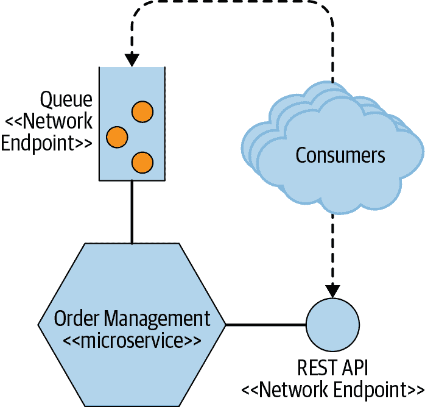
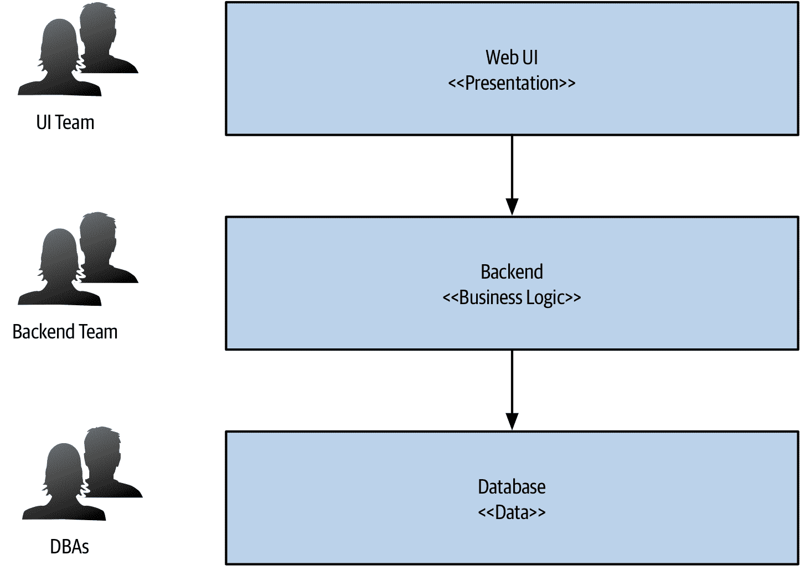
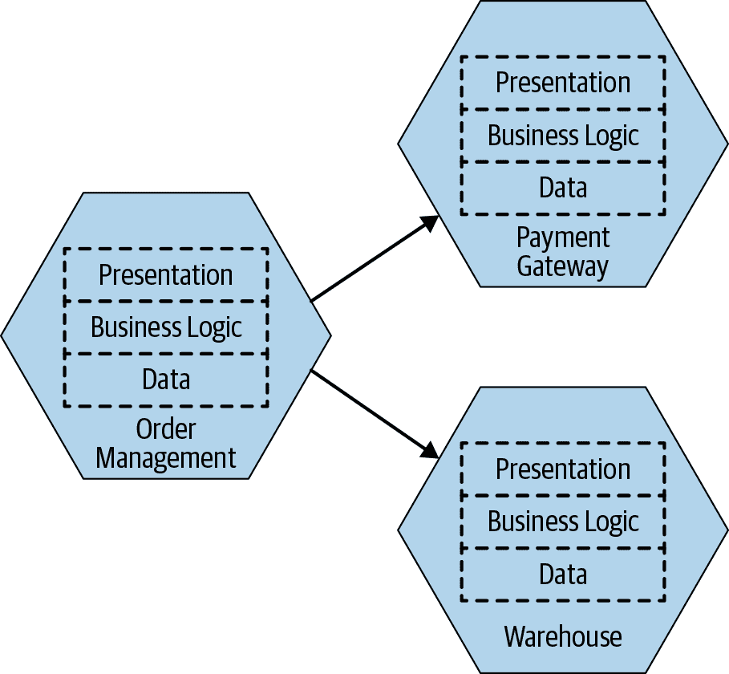
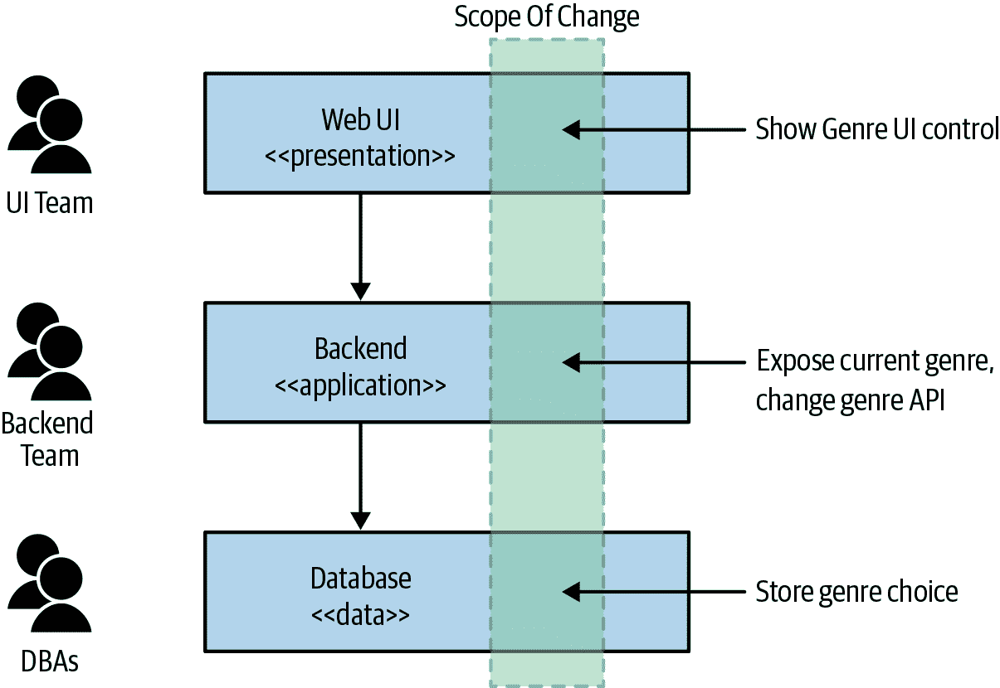
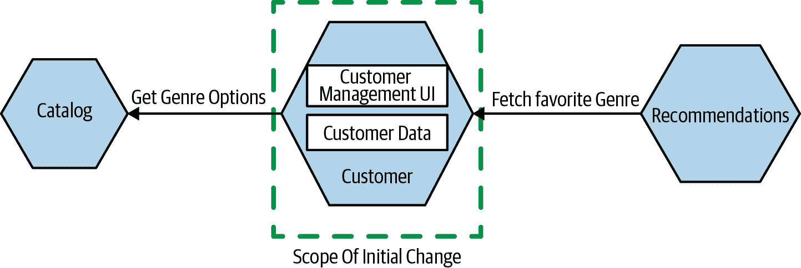
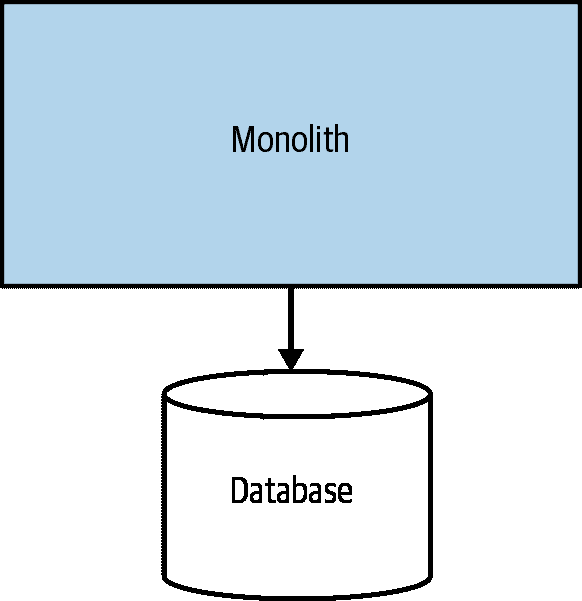
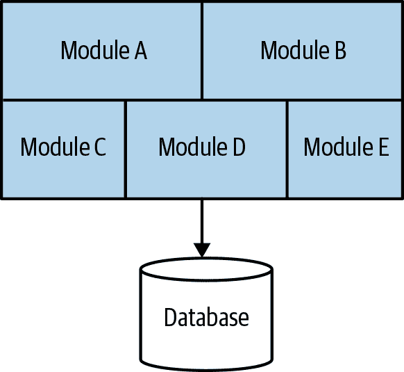
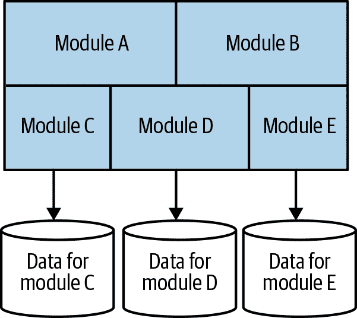
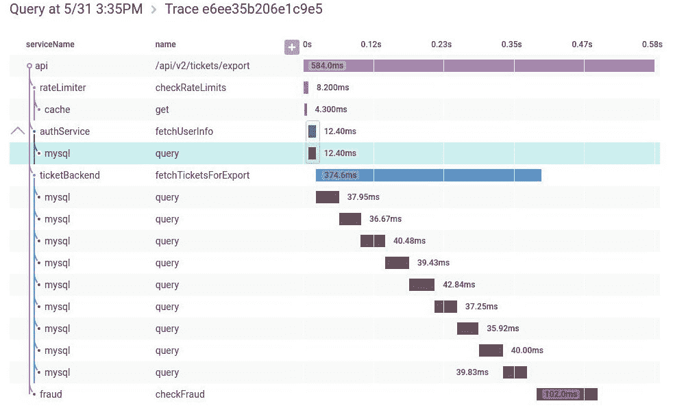
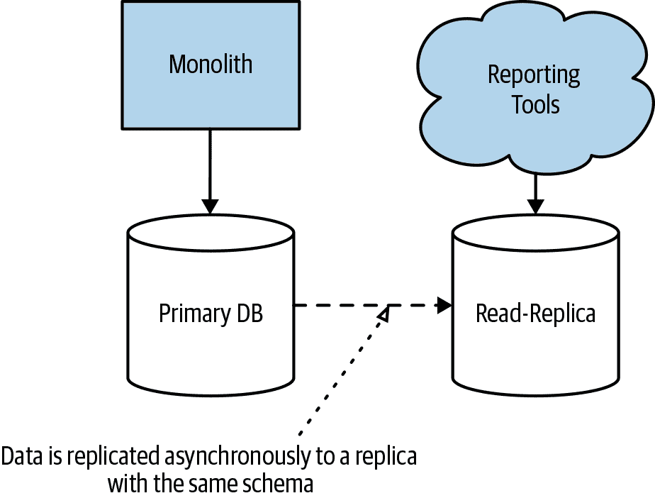

# 第一章. 什么是微服务？
微服务在过去的五年里，即自撰写本书第一版以来，已成为一种日益流行的架构选择。我不能为随后的人气爆炸式增长邀功，但人们纷纷采用微服务架构的热潮意味着，虽然我之前记录的许多想法现在已被验证和测试，但新的想法也加入其中，同时一些早期的实践已不再流行。因此，我们再次需要提炼微服务架构的精髓，突出使其发挥作用的核心概念。

本书整体旨在全面概述微服务对软件交付各个方面的影响。为开启这一主题，本章将介绍微服务背后的核心思想、带我们走到今天的先前实践，并探讨这些架构被如此广泛使用的原因。

## 微服务概览

*微服务* 是围绕业务域建模的、可以独立发布的服务。服务封装功能并通过网络使其可供其他服务访问——你可由此构建更复杂的系统。一个服务可能代表库存，另一个代表订单管理，还有一个代表发货，但合在一起可能构成一个完整的电子商务系统。微服务是一种架构选择，专注于为你解决可能遇到的各种问题提供多种方案。

它们是一种*类型*的面向服务架构，尽管它对服务边界的划分有明确的观点，并且独立部署能力是关键。它们技术无关，这也是其优势之一。

从外部来看，单个微服务被视为黑盒。它在一个或多个网络端点上托管业务功能（例如队列或 REST API，如图 1-1 所示），使用最合适的协议。消费者，无论是其他微服务还是其他类型的程序，都通过这些网络端点访问该功能。内部实现细节（例如服务所用技术或数据存储方式）完全对外部世界隐藏。这意味着微服务架构在大多数情况下避免使用共享数据库；相反，每个微服务在需要时封装自己的数据库。

微服务拥抱信息隐藏的概念。^(1) *信息隐藏* 描述的是尽可能将信息隐藏在组件内部，并通过外部接口暴露尽可能少的信息。这使得易于更改的内容与更难更改的内容之间能够清晰分离。只要微服务暴露的网络接口不以不向后兼容的方式更改，隐藏在外部方之外的实现就可以自由更改。微服务边界内部的更改（如图 1-1 所示）不应影响上游消费者，从而实现功能的独立发布。这对于使我们的微服务能够独立工作并按需发布至关重要。拥有清晰、稳定的服务边界，即使内部实现发生变化也不会改变，从而产生耦合更松散、内聚更强的系统。

## 微服务关键概念

在探索微服务时，有几个核心思想很重要。鉴于其中一些方面经常被忽视，我认为进一步探讨这些概念至关重要，以帮助你更好地理解是什么让微服务发挥作用。

### 独立部署能力

*独立部署能力* 的概念是指我们可以对微服务进行更改、部署它并将该更改发布给用户，而无需部署任何其他服务。更重要的是，不仅仅是我们能够做到这一点，更重要的是这*实际上*就是你在系统中管理部署的方式。这是一种你作为默认发布方法所采用的纪律。这是一个简单但执行起来却复杂的想法。

#### 提示

如果你只从本书和微服务的概念中带走一件事，那就是：确保你拥抱微服务独立部署能力的概念。养成在无需部署任何其他内容的情况下，将单个微服务的更改部署并发布到生产环境的习惯。由此，许多好事将随之而来。

为了确保独立部署能力，我们需要确保我们的服务是*松耦合*的：我们需要能够更改一个服务而无需更改任何其他内容。这意味着我们需要在服务之间建立明确、定义良好且稳定的契约。某些实现选择会使此变得困难——例如共享数据库尤其成问题。

独立部署能力本身显然极其宝贵。但要实现独立部署能力，你必须正确处理许多其他事情，而这些事情本身也有其好处。因此，你也可以将对独立部署能力的关注视为一种强制函数——通过将此作为结果来关注，你还将实现许多附带收益。

对具有稳定接口的松耦合服务的需求指导了我们最初如何寻找服务边界的思考。

### 围绕业务域建模

像领域驱动设计这样的技术可以让你更好地组织代码，以更好地代表软件运行的现实世界域。^(2) 在微服务架构中，我们使用同样的思想来定义我们的服务边界。通过围绕业务域建模服务，我们可以更轻松地推出新功能，并更轻松地以不同方式重新组合微服务，为用户提供新功能。

推出需要更改一个或多个微服务的功能成本很高。你需要在每个服务（以及可能的不同团队）之间协调工作，并仔细管理这些服务新版本的部署顺序。这比在单个服务（或就此而言，单体）内部进行同样的更改要花费更多的工作。因此，我们希望找到使跨服务更改尽可能不频繁的方法。

我经常看到分层架构，如图 1-2 所示的三层架构所典型体现。在这里，该架构中的每一层代表不同的服务边界，每个服务边界基于相关的技术功能。如果我需要在本例中仅对表示层进行更改，那会相当高效。然而，经验表明，在这类架构中，功能更改通常跨越多个层——需要对表示、应用和数据层进行更改。如果架构比图 1-2 中的简单示例分层更多，则此问题会加剧；通常每个层可能被进一步拆分为更多层。

通过使我们的服务成为业务功能的端到端切片，如图 1-3 所示，我们确保架构安排得尽可能高效地更改业务功能。每个服务如果需要，可以封装表示、业务逻辑和数据存储。可以说，通过微服务，我们做出了优先考虑业务功能高内聚而非技术功能高内聚的决定。

我们将在本章后面再次讨论领域驱动设计与组织设计之间的相互作用。

### 拥有自己的状态

我看到人们最难以接受的事情之一就是微服务不应共享数据库的想法。如果一个服务想要访问另一个服务持有的数据，它应该去向该服务请求所需的数据。这使服务能够决定什么可以共享，什么需要隐藏。这使我们能够清晰地区分可以自由更改的功能（我们的内部实现）和我们希望不频繁更改的功能（消费者使用的外部契约）。

如果我们想让独立部署成为现实，就需要确保我们限制对微服务的向后不兼容更改。如果我们破坏了与上游消费者的兼容性，就会迫使它们也进行更改。为微服务在内部实现细节和外部契约之间保持清晰的划分，有助于减少对向后不兼容更改的需求。

隐藏微服务中的内部状态的做法与面向对象（OO）编程中的封装实践类似。OO 系统中数据的封装是信息隐藏的一个实例。

#### 提示
除非你真的需要，否则不要共享数据库。即使如此，也要尽一切可能避免它。在我看来，如果你试图实现独立部署，共享数据库是你能做的最糟糕的事情之一。

正如前一节所讨论的，我们希望将服务视为业务功能的端到端切片，在适当的情况下封装用户界面（UI）、业务逻辑和数据。这是因为我们希望减少更改业务相关功能所需的工作量。以这种方式封装数据和行为使我们获得了业务功能的高内聚。通过隐藏支持我们服务的数据库，我们也确保减少耦合。我们将在第 2 章中再次讨论耦合和内聚。

### 规模
“微服务应该有多大？”是我经常听到的问题之一。考虑到名字里就有“微”这个词，这并不奇怪。然而，当你深入了解是什么让微服务作为一种架构发挥作用时，规模的概念实际上是最不有趣的事情之一。

如何衡量规模？代码行数？在我看来这没什么意义。用 Java 可能需要 25 行代码的东西可以用 10 行 Clojure 写出来。这并不是说 Clojure 比 Java 更好或更差；只是有些语言比其他语言更具表达力。

ThoughtWorks 的技术总监 James Lewis 曾说过“微服务应该和我的脑袋一样大”。乍一看，这似乎没什么帮助。毕竟，James 的脑袋到底有多大呢？这句话背后的理由是，微服务应保持在易于理解的大小。挑战当然在于，人们理解事物的能力并不相同，因此你需要自行判断什么规模适合你。经验丰富的团队可能比其他团队更能管理更大的代码库。所以或许可以把 James 的引述在这里读作“微服务应该和*你的*脑袋一样大”。

我认为“规模”在微服务方面有任何意义的最接近说法是 *Microservice Patterns* 作者 Chris Richardson 曾经说过——微服务的目标是拥有“尽可能小的接口”。这再次与信息隐藏的概念一致，但它确实代表了试图为最初不存在的“微服务”一词寻找意义的尝试。当该术语首次被用来定义这些架构时，关注点至少最初并不是专门针对接口的大小。

最终，规模的概念高度依赖上下文。与一个在系统上工作了 15 年的人交谈，他们会觉得自己的 10 万行代码的系统非常容易理解。询问一个刚加入项目的人的意见，他们会觉得它大得离谱。同样，询问一家刚刚开始微服务转型、可能只有 10 个或更少微服务的公司，你得到的答案会与一家类似规模但微服务已成为多年的常态、现在拥有数百个微服务的公司不同。

我敦促人们不要担心规模。当你刚开始时，更重要的是关注两件关键的事情。首先，你能处理多少个微服务？随着服务的增多，系统的复杂性会增加，你需要学习新技能（也许采用新技术）来应对。这就是我强烈主张逐步迁移到微服务架构的原因。其次，如何定义微服务边界以最大化其价值，同时避免一切变成一个糟糕耦合的混乱？这些是在你开始旅程时更重要的关注点。

### 灵活性
James Lewis 曾说过“微服务为你*买来* *选择*”。Lewis 在用词上是有意为之的——它们*买来*给你*选择*。它们有成本，你必须决定成本是否值得你想要行使的选择。由此产生的多方面灵活性——组织、技术、规模、健壮性——可能极具吸引力。

我们不知道未来会怎样，所以我们希望拥有一种理论上可以帮助我们解决今后可能面临的任何问题的架构。在保持选择开放和承担此类架构成本之间找到平衡，确实是一门真正的艺术。

把采用微服务想象成不像拨动开关，更像转动旋钮。随着你调高旋钮，微服务越多，你的灵活性就越高。但你也可能加剧痛点。这是我强烈主张逐步采用微服务的又一个原因。通过逐渐调高旋钮，你能更好地在过程中评估影响，并在需要时停止。

### 架构与组织的对齐
Music Corp 是一家在线销售 CD 的电子商务公司，使用前面展示并再次在图 1-4 中描绘的简单三层架构。我们决定把 Music Corp 拖进 21 世纪，作为其中的一部分，我们正在评估现有的系统架构。我们有一个基于 Web 的 UI、一个以单体后端形式存在的业务逻辑层，以及传统数据库中的数据存储。这些层，如同常见情况一样，由不同的团队拥有。我们将在整本书中反复提到 Music Corp 的种种磨难。

我们想要对功能做一个简单的更改：我们希望允许客户指定他们最喜欢的音乐类型。此更改需要我们更改 UI 以显示流派选择界面，后端服务以允许将流派展示给 UI 并更改其值，以及数据库以接受此更改。这些更改需要由每个团队管理并按正确顺序部署，如图 1-5 所述。

现在这个架构并不糟糕。所有架构最终都会围绕一组目标进行优化。三层架构如此常见，部分原因在于它具有普遍性——每个人都听说过它。因此，选择一个你可能在别处见过的通用架构，往往是我们不断看到这种模式的原因之一。但我认为我们一次又一次看到这种架构的最大原因是它基于我们如何组织团队。

现在著名的康威定律指出如下：

> 任何设计系统的组织……最终都会产生一个设计，其结构是组织沟通结构的复制品

>
> Melvin Conway，《委员会如何发明？》

三层架构是这一点的良好体现。过去，IT 组织将人员分组的主要方式是基于其核心能力：数据库管理员与其它数据库管理员组成一个团队；Java 开发者与其它 Java 开发者组成一个团队；而前端开发者（如今他们掌握像 JavaScript 和原生移动应用开发这样时髦的技术）则在另一个团队。我们基于核心能力对人员进行分组，因此我们创建可以与这些团队对应起来的 IT 资产。

这就解释了为什么这种架构如此常见。它并不糟糕；它只是围绕一组力量进行优化——我们传统上如何按熟悉程度对人员进行分组。但力量已经改变。我们对软件的期望也发生了改变。我们现在将人员分组为多技能团队，以减少交接和信息孤岛。我们希望比以往任何时候都更快地交付软件。这促使我们在团队组织方式上做出不同的选择，因此也在系统拆分方式上进行组织。

大多数我们被要求对系统进行的更改都与业务功能的变化有关。但在 图 1-5 中，我们的业务功能实际上分散在所有三层中，增加了功能变更跨越层级的可能性。这是一种具有高度相关技术内聚性但业务功能内聚性低的架构。如果我们想让更改更容易进行，那么我们需要改变代码的分组方式——我们选择业务功能的内聚性而非技术。每个服务最终可能包含这三层的混合，也可能不包含，但这是一个本地服务实现问题。

让我们将其与一种潜在的替代架构进行比较，该架构在 图 1-6 中进行了说明。我们有一个专用的 Customer 服务，它公开了一个 UI 以允许客户更新其信息，并且客户的状态也存储在此服务中。喜爱的类型选择与特定客户相关联，因此这种更改更加本地化。在 图 1-6 中，我们还展示了从 Catalog 服务获取的可用类型列表，这很可能已经存在。我们还看到一个新的 Recommendations 服务访问我们的喜爱的类型信息，这在后续版本中很容易实现。

在这种情况下，我们的 Customer 服务封装了三层中的每一层的一小部分——它有一点 UI，一点应用逻辑和一点数据存储——但这些层都封装在单个服务中。我们的业务领域成为驱动系统架构的主要力量，希望这能使更改更容易进行，同时也使我们更容易将团队与组织内的业务线保持一致。

## 单体

我们已经讨论过微服务，但微服务最常被讨论为一种替代单体架构的架构方法。为了更好地区分微服务架构，并帮助你更好地理解是否值得考虑微服务，我还应该讨论我所说的 *单体* 到底是什么意思。

当我在整本书中谈论单体时，我主要指的是部署单元。当系统的所有功能必须一起部署时，我们认为它是一个单体。坦率地说，有多种架构符合这一定义，但我将讨论我最常看到的几种：单进程单体、模块化单体和分布式单体。

### 单进程单体

讨论单体时最常见的例子是所有代码都作为 *单进程* 部署的系统，如 图 1-7 所示。你可能出于健壮性或扩展原因拥有该进程的多个实例，但从根本上说所有代码都打包在一个进程中。实际上，这些单进程系统本身可以是简单的分布式系统，因为它们几乎总是最终从数据库读取数据或将数据存储到数据库中，或向 Web 或移动应用呈现信息。

虽然这符合大多数人对经典单体的理解，但我遇到的大多数系统比这更复杂一些。你可能有两个或多个紧密耦合的单体，可能还混杂了一些厂商软件。

### 模块化单体

作为单进程单体的子集，*模块化单体* 是一种变体，其中单个进程由独立的模块组成。每个模块可以独立工作，但所有模块仍需要在部署时组合在一起，如 图 1-8 所示。将软件分解为模块的概念并非新事物；模块化软件的根源可追溯到 1970 年代围绕结构化编程所做的工作，甚至更早。尽管如此，这仍然不是我看到足够多的组织正确采用的方法。

对于许多组织而言，模块化单体可能是一个极佳的选择。如果模块边界定义良好，它可以实现高度的并行工作，同时通过更简单的部署拓扑避免更分布式微服务架构的挑战。Shopify 就是一个很好的例子，该组织使用这种技术作为微服务分解的替代方案，并且似乎对该公司非常有效。^(3)

模块化单体面临的一个挑战是，数据库往往缺乏我们在代码层面找到的分解，这导致如果未来想拆分单体时会带来重大挑战。我见过一些团队尝试进一步推进模块化单体的想法，将数据库沿着与模块相同的思路进行分解，如 图 1-9 所示。

### 分布式单体

> 一个分布式系统是指你甚至不知道存在的计算机的故障会使你自己的计算机无法使用。^(4)
>
> Leslie Lamport

一个 *分布式单体* 是一个由多个服务组成的系统，但由于某种原因，整个系统必须一起部署。分布式单体完全可能符合 SOA 的定义，但太多的情况下，它未能兑现 SOA 的承诺。在我的经验中，分布式单体具有分布式系统的所有缺点，*和* 单进程单体的所有缺点，而没有任一方的足够优势。在工作中遇到许多分布式单体在很大程度上影响了我对微服务架构的兴趣。

分布式单体通常出现在对信息隐藏和业务功能内聚等概念关注不足的环境中。相反，高度耦合的架构会导致更改在服务边界之间扩散，而看似无害且范围局限的更改会破坏系统的其他部分。

### 单体与交付竞争

随着越来越多的人在同一个地方工作，他们会互相妨碍。例如，不同的开发者想要更改同一段代码；不同的团队想要在不同时间将功能上线（或延迟部署）；对谁拥有什么以及谁做决策感到困惑。大量研究表明了所有权界限混乱带来的挑战。^(5) 我将此问题称为 *交付* *竞争*。

拥有单体架构并不意味着你一定会面临交付竞争的挑战，就像拥有微服务架构意味着你永远不会遇到这个问题一样。但微服务架构确实为系统中可以划定所有权边界提供了更具体的界限，从而在如何减少这一问题方面给予你更大的灵活性。

## 单体架构的优势
某些单体架构，例如单进程或模块化单体架构，也具有诸多优势。其部署拓扑结构要简单得多，可以避免与分布式系统相关的许多陷阱。这可以带来更简单的开发者工作流程，并且监控、故障排除以及端到端测试等活动也能得到极大的简化。

单体架构还可以简化单体内部的代码复用。如果我们想在分布式系统中复用代码，就需要决定是复制代码、拆分出库，还是将共享功能推送到服务中。对于单体架构而言，我们的选择要简单得多，而且很多人喜欢这种简单——所有代码都在这里；直接使用即可！

不幸的是，人们已经开始将单体视为需要避免的东西——视为本质上存在问题。我遇到过多个将 *monolith* 与 *legacy* 同义的人。这是个问题。单体架构是一种选择，而且是有效的一种。我还要进一步说，在我看来，它是作为架构风格的明智默认选择。换句话说，我是在寻找被说服使用微服务的理由，而不是寻找不使用它们的理由。

如果我们陷入系统性贬低单体作为交付软件可行选项的陷阱，我们就有风险对自己或软件用户不负责。

## 启用技术
正如我前面提到的，我认为你开始使用微服务时不需要采用大量新技术。事实上，这可能适得其反。相反，随着你逐步构建微服务架构，你应该不断留意由日益分布式的系统引起的问题，然后寻找可能有帮助的技术。

话虽如此，技术在微服务概念的采用中发挥了很大作用。了解可帮助你充分利用这种架构的工具，将是使任何微服务实现取得成功的关键部分。事实上，我可以说，微服务需要对支持技术有如此程度的理解，以至于逻辑架构和物理架构之间的先前区分可能存在问题——如果你参与塑造微服务架构，你需要对这两个世界有广度的理解。

我们将在后续章节中详细探讨这些技术，但在那之前，让我们先简要介绍一些可能有助于你在决定使用微服务时使用的使能技术。

### 日志聚合与分布式追踪
随着你管理的进程数量增加，很难理解系统在生产环境中的行为。这反过来会使故障排除变得更加困难。我们将在 \[链接待定\] 中更深入地探讨这些想法，但至少，我强烈主张将日志聚合系统的实施作为采用微服务架构的前提条件。

#### 提示
在开始使用微服务时要谨慎采用太多新技术。话虽如此，日志聚合工具如此重要，以至于你应该将其视为采用微服务的先决条件。

这些系统允许你从所有服务中收集和聚合日志，为你提供一个集中位置，可以在此分析日志，甚至将其作为主动告警机制的一部分。此领域的许多选项可以满足众多情况。我非常喜欢 [Humio](https://www.humio.com) 的几个原因，但主要公共云厂商提供的简单日志服务可能足以让你入门。

通过实现关联 ID，这些日志聚合工具可以变得更有用，其中单个 ID 用于一组相关的服务调用——例如，由于用户交互可能触发的调用链。通过将此 ID 记录为每个日志条目的部分，将与给定调用流程相关的日志隔离变得容易得多，从而使故障排除变得更容易。

随着系统复杂性的增长，考虑能够更好地探索系统正在做什么的工具变得至关重要，提供跨多个服务分析跟踪、检测瓶颈并提出你起初甚至不知道会想问的问题的能力。开源工具可以提供其中一些功能。一个例子是 [Jaeger](https://www.jaegertracing.io)，它专注于分布式追踪方面的问题。

但像 [LightStep](https://lightstep.com) 和 [Honeycomb](https://honeycomb.io)（在 图 1-10 中显示）这样的产品将这些想法更进一步。它们代表了新一代工具，超越了传统监控方法，使探索正在运行系统的状态变得更加容易。你可能已经有更传统的工具在运行，但你真的应该查看这些产品提供的功能。它们是从头开始构建的，专门解决微服务架构运营者需要处理的问题。

### 容器与 Kubernetes
理想情况下，你希望在隔离环境中运行每个微服务实例。这确保了一个微服务中的问题不会影响另一个微服务——例如，耗尽所有 CPU。虚拟化是在现有硬件上创建隔离执行环境的一种方式，但就我们的微服务规模而言，常规虚拟化技术可能相当沉重。*Containers* 另一方面，为服务实例提供隔离执行提供了一种更轻量级的方式，从而使新容器实例的启动时间更快，并且对许多架构来说成本效益更高。

在你开始尝试容器后，你还会意识到你需要一些东西来在大量底层机器上管理这些容器。像 *Kubernetes* 这样的容器编排平台正是这样做的，允许你以提供服务所需的健壮性和吞吐量的方式分发容器实例，同时让你能够高效利用底层机器。在 第 7 章 中，我们将重新探讨操作隔离、容器和 kubernetes 的概念。

不要急于采用 Kubernetes，甚至容器。它们绝对比更传统的部署技术提供显著优势，但如果你只有少数几个服务，很难证明其合理性。在管理部署的开销开始成为重大头痛之后，再考虑对服务进行容器化以及使用 Kubernetes。但如果你最终这样做，请尽力确保有人为你运行 Kubernetes 集群，也许可以通过在公共云提供商上使用托管服务来实现。自行运行 Kubernetes 集群可能是一项大量工作！

### 流处理

虽然在微服务中我们正在远离单体数据库，但我们仍然需要找到在服务之间共享数据的方法。这与组织希望远离批处理报告操作、转向更实时反馈以便更快做出反应同时发生。因此，能够轻松流式传输和处理通常是大量数据的产品在采用微服务架构的人群中变得流行。

Apache [卡夫卡](https://kafka.apache.org) 已成为许多人在微服务环境中流式传输数据的事实标准选择，原因显而易见。诸如消息持久性、压缩以及能够扩展以处理大量消息之类的功能都非常有用。Kafka 还开始以 KSQL 的形式添加流处理能力，但你也可以将其与专用的流处理解决方案如 Apache [弗林克](https://flink.apache.org) 一起使用。[德贝齐姆](https://debezium.io) 是一款开源工具，旨在帮助通过 Kafka 从现有数据源流式传输数据，从而确保传统数据源可以成为基于流的架构的一部分。在 第 3 章 中我们将探讨流技术如何在微服务集成中发挥作用。

### 公共云和无服务器

公共云提供商，或更具体地说三大主要提供商——Google Cloud、Microsoft Azure 和 Amazon Web Services (AWS)——提供了用于管理应用程序的庞大托管服务和部署选项。随着微服务架构的增长，越来越多的工作将被推向运营领域。公共云提供商提供大量托管服务，从托管数据库实例或 Kubernetes 集群，到消息代理或分布式文件系统。通过使用这些托管服务，您将大量工作外包给据认为更能处理这些任务的第三方。

在公共云产品中，特别引起兴趣的是[content]
虽然在微服务中我们正在远离单体数据库，但我们仍然需要找到在服务之间共享数据的方法。这与组织希望远离批处理报告操作、转向更实时反馈以便更快做出反应同时发生。因此，能够轻松流式传输和处理通常是大量数据的产品在采用微服务架构的人群中变得流行。

Apache [卡夫卡](https://kafka.apache.org) 已成为许多人在微服务环境中流式传输数据的事实标准选择，原因显而易见。诸如消息持久性、压缩以及能够扩展以处理大量消息之类的功能都非常有用。Kafka 还开始以 KSQL 的形式添加流处理能力，但你也可以将其与专用的流处理解决方案如 Apache [弗林克](https://flink.apache.org) 一起使用。[德贝齐姆](https://debezium.io) 是一款开源工具，旨在帮助通过 Kafka 从现有数据源流式传输数据，从而确保传统数据源可以成为基于流的架构的一部分。在 第 3 章 中我们将探讨流技术如何在微服务集成中发挥作用。

### 公共云和无服务器

公共云提供商，或更具体地说三大主要提供商——Google Cloud、Microsoft Azure 和 Amazon Web Services (AWS)——提供了用于管理应用程序的庞大托管服务和部署选项。随着微服务架构的增长，越来越多的工作将被推向运营领域。公共云提供商提供大量托管服务，从托管数据库实例或 Kubernetes 集群，到消息代理或分布式文件系统。通过使用这些托管服务，您将大量工作外包给据认为更能处理这些任务的第三方。

在公共云产品中，特别引起兴趣的是[content]
虽然在微服务中我们正在远离单体数据库，但我们仍然需要找到在服务之间共享数据的方法。这与组织希望远离批处理报告操作、转向更实时反馈以便更快做出反应同时发生。因此，能够轻松流式传输和处理通常是大量数据的产品在采用微服务架构的人群中变得流行。

Apache [卡夫卡](https://kafka.apache.org) 已成为许多人在微服务环境中流式传输数据的事实标准选择，原因显而易见。诸如消息持久性、压缩以及能够扩展以处理大量消息之类的功能都非常有用。Kafka 还开始以 KSQL 的形式添加流处理能力，但你也可以将其与专用的流处理解决方案如 Apache [弗林克](https://flink.apache.org) 一起使用。[德贝齐姆](https://debezium.io) 是一款开源工具，旨在帮助通过 Kafka 从现有数据源流式传输数据，从而确保传统数据源可以成为基于流的架构的一部分。在 第 3 章 中我们将探讨流技术如何在微服务集成中发挥作用。

### 公共云和无服务器

公共云提供商，或更具体地说三大主要提供商——Google Cloud、Microsoft Azure 和 Amazon Web Services (AWS)——提供了用于管理应用程序的庞大托管服务和部署选项。随着微服务架构的增长，越来越多的工作将被推向运营领域。公共云提供商提供大量托管服务，从托管数据库实例或 Kubernetes 集群，到消息代理或分布式文件系统。通过使用这些托管服务，您将大量工作外包给据认为更能处理这些任务的第三方。

在公共云产品中，特别引起兴趣的是[content]
虽然在微服务中我们正在远离单体数据库，但我们仍然需要找到在服务之间共享数据的方法。这与组织希望远离批处理报告操作、转向更实时反馈以便更快做出反应同时发生。因此，能够轻松流式传输和处理通常是大量数据的产品在采用微服务架构的人群中变得流行。

Apache [卡夫卡](https://kafka.apache.org) 已成为许多人在微服务环境中流式传输数据的事实标准选择，原因显而易见。诸如消息持久性、压缩以及能够扩展以处理大量消息之类的功能都非常有用。Kafka 还开始以 KSQL 的形式添加流处理能力，但你也可以将其与专用的流处理解决方案如 Apache [弗林克](https://flink.apache.org) 一起使用。[德贝齐姆](https://debezium.io) 是一款开源工具，旨在帮助通过 Kafka 从现有数据源流式传输数据，从而确保传统数据源可以成为基于流的架构的一部分。在 第 3 章 中我们将探讨流技术如何在微服务集成中发挥作用。

### 公共云和无服务器

公共云提供商，或更具体地说三大主要提供商——Google Cloud、Microsoft Azure 和 Amazon Web Services (AWS)——提供了用于管理应用程序的庞大托管服务和部署选项。随着微服务架构的增长，越来越多的工作将被推向运营领域。公共云提供商提供大量托管服务，从托管数据库实例或 Kubernetes 集群，到消息代理或分布式文件系统。通过使用这些托管服务，您将大量工作外包给据认为更能处理这些任务的第三方。

在公共云产品中，特别引起兴趣的是[content]
虽然在微服务中我们正在远离单体数据库，但我们仍然需要找到在服务之间共享数据的方法。这与组织希望远离批处理报告操作、转向更实时反馈以便更快做出反应同时发生。因此，能够轻松流式传输和处理通常是大量数据的产品在采用微服务架构的人群中变得流行。

Apache [卡夫卡](https://kafka.apache.org) 已成为许多人在微服务环境中流式传输数据的事实标准选择，原因显而易见。诸如消息持久性、压缩以及能够扩展以处理大量消息之类的功能都非常有用。Kafka 还开始以 KSQL 的形式添加流处理能力，但你也可以将其与专用的流处理解决方案如 Apache [弗林克](https://flink.apache.org) 一起使用。[德贝齐姆](https://debezium.io) 是一款开源工具，旨在帮助通过 Kafka 从现有数据源流式传输数据，从而确保传统数据源可以成为基于流的架构的一部分。在 第 3 章 中我们将探讨流技术如何在微服务集成中发挥作用。

### 公共云和无服务器

公共云提供商，或更具体地说三大主要提供商——Google Cloud、Microsoft Azure 和 Amazon Web Services (AWS)——提供了用于管理应用程序的庞大托管服务和部署选项。随着微服务架构的增长，越来越多的工作将被推向运营领域。公共云提供商提供大量托管服务，从托管数据库实例或 Kubernetes 集群，到消息代理或分布式文件系统。通过使用这些托管服务，您将大量工作外包给据认为更能处理这些任务的第三方。

在公共云产品中，特别引起兴趣的是[content]
虽然在微服务中我们正在远离单体数据库，但我们仍然需要找到在服务之间共享数据的方法。这与组织希望远离批处理报告操作、转向更实时反馈以便更快做出反应同时发生。因此，能够轻松流式传输和处理通常是大量数据的产品在采用微服务架构的人群中变得流行。

Apache [卡夫卡](https://kafka.apache.org) 已成为许多人在微服务环境中流式传输数据的事实标准选择，原因显而易见。诸如消息持久性、压缩以及能够扩展以处理大量消息之类的功能都非常有用。Kafka 还开始以 KSQL 的形式添加流处理能力，但你也可以将其与专用的流处理解决方案如 Apache [弗林克](https://flink.apache.org) 一起使用。[德贝齐姆](https://debezium.io) 是一款开源工具，旨在帮助通过 Kafka 从现有数据源流式传输数据，从而确保传统数据源可以成为基于流的架构的一部分。在 第 3 章 中我们将探讨流技术如何在微服务集成中发挥作用。

### 公共云和无服务器

公共云提供商，或更具体地说三大主要提供商——Google Cloud、Microsoft Azure 和 Amazon Web Services (AWS)——提供了用于管理应用程序的庞大托管服务和部署选项。随着微服务架构的增长，越来越多的工作将被推向运营领域。公共云提供商提供大量托管服务，从托管数据库实例或 Kubernetes 集群，到消息代理或分布式文件系统。通过使用这些托管服务，您将大量工作外包给据认为更能处理这些任务的第三方。

在公共云产品中，特别引起兴趣的是[content]
虽然在微服务中我们正在远离单体数据库，但我们仍然需要找到在服务之间共享数据的方法。这与组织希望远离批处理报告操作、转向更实时反馈以便更快做出反应同时发生。因此，能够轻松流式传输和处理通常是大量数据的产品在采用微服务架构的人群中变得流行。

Apache [卡夫卡](https://kafka.apache.org) 已成为许多人在微服务环境中流式传输数据的事实标准选择，原因显而易见。诸如消息持久性、压缩以及能够扩展以处理大量消息之类的功能都非常有用。Kafka 还开始以 KSQL 的形式添加流处理能力，但你也可以将其与专用的流处理解决方案如 Apache [弗林克](https://flink.apache.org) 一起使用。[德贝齐姆](https://debezium.io) 是一款开源工具，旨在帮助通过 Kafka 从现有数据源流式传输数据，从而确保传统数据源可以成为基于流的架构的一部分。在 第 3 章 中我们将探讨流技术如何在微服务集成中发挥作用。

### 公共云和无服务器

公共云提供商，或更具体地说三大主要提供商 Google Cloud、Microsoft Azure 和 Amazon Web Services (AWS)，提供了用于管理应用程序的庞大托管服务和部署选项。随着微服务架构的增长，越来越多的工作将被推向运营领域。公共云提供商提供大量托管服务，从托管数据库实例或 Kubernetes 集群，到消息代理或分布式文件系统。通过使用这些托管服务，您将大量工作外包给据认为更能处理这些任务的第三方。

在公共云产品中，特别引起兴趣的是[content]
虽然在微服务中我们正在远离单体数据库，但我们仍然需要找到在服务之间共享数据的方法。这与组织希望远离批处理报告操作、转向更实时反馈以便更快做出反应同时发生。因此，能够轻松流式传输和处理通常是大量数据的产品在采用微服务架构的人群中变得流行。

Apache [卡夫卡](https://kafka.apache.org) 已成为许多人在微服务环境中流式传输数据的事实标准选择，原因显而易见。诸如消息持久性、压缩以及能够扩展以处理大量消息之类的功能都非常有用。Kafka 还开始以 KSQL 的形式添加流处理能力，但你也可以将其与专用的流处理解决方案如 Apache [弗林克](https://flink.apache.org) 一起使用。[德贝齐姆](https://debezium.io) 是一款开源工具，旨在帮助通过 Kafka 从现有数据源流式传输数据，从而确保传统数据源可以成为基于流的架构的一部分。在 第 3 章 中我们将探讨流技术如何在微服务集成中发挥作用。

## 微服务的好处

对一个百万行单体应用的一行修改，需要部署整个应用才能发布该变更。这可能是一次影响大、风险高的部署。实际上，由于可以理解的恐惧，这类部署最终会很少发生。不幸的是，这意味着我们的变更会在各次发布之间不断累积，直到进入生产环境的应用新版本包含大量变更。而发布之间的差异越大，我们出错的风险就越高！

借助微服务，我们可以对单个服务进行变更并独立于系统其余部分进行部署。这让我们能够更快地部署代码。如果出现问题，可以迅速将其隔离到单个服务中，从而轻松实现快速回滚。这也意味着我们可以更快地将新功能交付给客户。这是像 Amazon 和 Netflix 这样的组织使用这些架构的主要原因之一——以确保尽可能消除将软件推向市场的所有障碍。

### 组织对齐

我们中的许多人都经历过与大型团队和大型代码库相关的问题。当团队分布在不同地点时，这些问题会更加严重。我们也知道，规模较小的团队在较小的代码库上工作往往更具生产力。

微服务使我们能够更好地将架构与组织对齐，帮助我们将任何一个代码库上工作的员工人数降至最低，从而达到团队规模和生产力的最佳平衡。微服务还允许我们在组织发生变化时更改服务的归属——从而使我们能够在未来保持架构与组织之间的一致性。

### 可组合性

分布式系统和面向服务架构的关键承诺之一是，我们为功能复用提供了机会。借助微服务，我们允许我们的功能以不同的方式被消费以满足不同目的。当我们思考消费者如何使用我们的软件时，这尤其重要。

仅狭隘地考虑桌面网站或移动应用的时代已经过去。现在我们需要思考将能力整合到网络、原生应用、移动网页、平板应用或可穿戴设备中的各种方式。随着组织从狭窄的渠道思维转向更整体的客户参与概念，我们需要能够跟上的架构。

借助微服务，可以认为我们在系统中打开了可由外部方访问的缝隙。随着情况的变化，我们可以以不同的方式构建应用。对于单体应用，我通常只有一个粗粒度的缝隙可以从外部使用。如果我想将其拆分以获得更有用的东西，我就需要一把锤子！

## 微服务痛点

正如我们已经看到的，微服务架构带来了诸多好处。但它们也带来了诸多复杂性。如果你正在考虑采用微服务架构，重要的是在做出决定时能够权衡利弊。实际上，大多数这些痛点都源于分布式系统，因此在分布式单体架构中也同样可能出现，而不仅仅是微服务架构。

我们将在本书的其余部分深入探讨其中许多问题——事实上，我认为本书的大部分内容都是关于应对拥有微服务架构所带来的痛苦、折磨和恐怖。

### 开发者体验

随着服务的增多，开发者体验可能会开始受损。像 JVM 这样资源密集型的运行时会限制单台开发者机器上可以运行的微服务数量。我大概可以在我的笔记本上作为独立进程运行四五个基于 JVM 的微服务，但能运行 10 个或 20 个吗？可能不行。即使使用负担较小的运行时，本地可以运行的东西数量也有限，这不可避免地会引发关于当无法在一台机器上运行整个系统时该怎么办的讨论。如果使用无法在本地运行的云服务，情况会变得更加复杂。

极端的解决方案可能涉及“云端开发”，即开发者不再能够在本地开发。我不喜欢这种做法，因为反馈周期可能会严重受损。相反，我认为限制开发者需要工作的系统部分的范围可能是一种更直接的方法。然而，如果你希望采用更多“集体所有权”模式，即任何开发者都应能处理系统的任何部分，这可能会有问题。

### 技术过载

为实现微服务架构的采用而涌现的新技术 sheer weight 可能令人难以承受。我坦率地说，其中很多技术只是被重新包装为“微服务友好”，但一些进步确实有助于处理这类架构的复杂性。然而，危险在于，这么多新工具可能导致一种技术迷恋。我见过许多公司在采用微服务架构的同时，也决定现在是引入大量新颖且常常陌生的技术的最佳时机。

微服务确实可以让你为每个微服务选择不同的编程语言、不同的运行时或不同的数据库——但这些是 *选项*，而非要求。你必须仔细权衡所用技术的广度和复杂性与多样化技术可能带来的成本之间的平衡。

当你开始采用微服务时，一些根本性的挑战是不可避免的：你需要花费大量时间理解数据一致性、延迟、服务建模等方面的问题。如果你试图在拥抱大量新技术的同时理解这些思想如何改变你对软件开发的思考方式，你会很难做到。还值得指出的是，试图理解所有这些新技术所占用的带宽也会减少你为用户交付功能的时间。

随着你（逐步）增加微服务架构的复杂性，请在需要时引入新技术。当你只有三个服务时，你不需要一个 Kubernetes 集群！除了确保你不会被这些新工具的复杂性压垮之外，这种逐步增加还有一个额外的好处，即让你能够获得随着时间推移必然会出现的新、更好的做法。

### 报表

在单体系统中，你通常有一个单体数据库。这意味着希望一起分析所有数据的利益相关者，通常涉及跨数据的大型连接操作，拥有一个现成的模式来运行他们的报表。他们可以直接在单体数据库上运行报表，也许是在一个只读副本上运行，如 图 1-13 所示。

借助微服务架构，我们已经拆分了这个单体模式。这并不意味着跨所有数据的报表需求消失了；我们只是让它变得更加困难，因为现在我们的数据分散在多个逻辑隔离的模式中。

更现代的报表方法，例如使用流处理来实现对大量数据的实时报表，可以很好地与微服务架构配合使用，但通常需要采用新的理念和相关技术。或者，你可能只需将微服务中的数据发布到中央报表数据库（或可能是不太结构化的数据湖）中以支持报表用例。

### 监控与故障排除
对于标准的单体应用，我们可以采用相对简单的方法进行监控。我们只需担心少量机器，应用程序的故障模式也比较二元——应用程序通常要么全部正常，要么全部宕机。在微服务架构下，我们是否了解单个服务实例宕机的冲击？
在单体系统中，如果 CPU 长时间卡在 100%，我们知道这是一个大问题。在拥有数十甚至数百个进程的微服务架构中，我们还能说同样的话吗？当只有一个进程 CPU 卡在 100% 时，我们是否需要把人叫醒到凌晨 3 点？
幸运的是，这一领域有一系列思路可以帮助。如果您想更深入地探索这一概念，我推荐 Cindy Sridharan 所著的 *分布式系统可观测性*（O’Reilly），它是一个极佳的起点，尽管我们也在 [链接待定] 中进行自己的探讨。

### 安全
在单进程单体系统中，我们的大量信息都在该进程内部流动。现在，更多信息需要在服务之间通过网络流动。这会使数据在传输过程中更容易被观察，也可能在中间人攻击中被篡改。这意味着您可能需要更加重视传输中数据的保护，并确保微服务端点得到保护，以使只有授权方才能使用它们。[链接待定] 完全致力于探讨这一领域的挑战。

### 测试
对于任何类型的自动化功能测试，您都面临着微妙的平衡。测试执行的职能越多——测试范围越广——您对应用程序的信心就越强。另一方面，测试范围越大，设置测试数据和支持夹具就越困难，运行时间可能越长，并且在测试失败时判断出了什么问题也越困难。在 [链接待定] 中，我将分享一些使测试在这种更具挑战性的环境中发挥作用的技巧。
对于任何类型的系统而言，端到端测试在所覆盖的功能方面处于极端位置，我们习惯于它们比范围更小的单元测试更难编写和维护。通常这是值得的，因为我们希望获得端到端测试以用户可能的方式使用我们的系统所带来的信心。
但在微服务架构下，我们的端到端测试范围变得 *非常* 大。我们现在需要在多个服务上运行测试，所有这些服务都需要为测试场景进行部署和适当配置。我们还需要为因环境问题导致的假阴性做好准备，例如服务实例死亡或失败部署的网络超时导致测试失败。
这些因素意味着，随着微服务架构的增长，您在端到端测试方面的投资回报会递减。测试成本更高，但无法提供与过去相同的信心水平。这将促使您转向新的测试形式，例如契约驱动测试，以及探索发布修复技术和诸如生产中测试之类的想法。

### 延迟
在微服务架构下，以前可能在单个处理器上本地完成的处理现在可能分散到多个独立的微服务中。以前仅在单个进程内部流动的信息现在需要在网络上传输，可能比以往任何时候都更频繁地进行序列化、传输和反序列化。所有这些都可能导致系统延迟恶化。
尽管在设计或编码阶段很难衡量操作对延迟的确切影响，但这也是以增量方式进行任何微服务迁移很重要的另一个原因。先做一个小改动，然后衡量其影响。这假设您有某种方法来衡量您关心的操作的端到端延迟——分布式追踪工具如 [Jaeger](http://jaegertracing.io) 在这里可以提供帮助。但您也需要了解这些操作的 acceptable latency 是什么。有时让操作变慢是完全可以接受的，只要它仍然足够快！

### 数据一致性
从单体系统——数据存储在单个数据库中并由其管理——转向更分布式的系统——多个进程在不同数据库中管理状态——会带来数据一致性方面的潜在挑战。过去您可能依赖数据库事务来管理状态变更，您需要明白类似的安全性在分布式系统中很难提供。在大多数情况下，使用分布式事务来协调状态变更被证明是高度有问题的。
相反，您可能需要开始使用诸如 *sagas*（我将在 第 3 章 中详细阐述）之类的概念以及最终一致性来管理和推理系统中的状态。这些想法可能需要在您思考系统数据的方式上进行根本性改变，在迁移现有系统时这可能相当令人望而生畏。再一次，这也是在分解应用程序的速度上保持谨慎的另一个好理由。采用增量分解方法，以便能够在生产环境中评估架构变更的影响，真的很重要。

## 是否应该使用微服务？
尽管在某些领域推动将微服务架构作为软件的默认方法，我认为由于我所概述的众多挑战，采用它们仍然需要仔细思考。您需要在决定微服务是否适合您之前，评估自己的问题空间、技能和技术环境，并了解您想要实现什么。它们是 *一种* 架构方法，而不是 *唯一* 的架构方法。您自己的上下文在决定是否走这条路时应发挥巨大作用。
话虽如此，我还是想概述一些通常会让我远离——或倾向于——选择微服务的几种情况。

### 它们可能不适合谁
鉴于定义稳定服务边界的重要性，我认为微服务架构对于全新产品或初创公司来说通常是不好的选择。在任何一种情况下，您正在处理的领域通常都在发生重大变化，因为您在迭代构建的基础之上进行迭代。这种领域模型的转变反过来会导致对服务边界进行更多更改，而在服务边界之间协调更改是一项昂贵的任务。总的来说，我认为在领域模型足够稳定之前再考虑定义服务边界更为合适。
我确实看到初创公司先使用微服务的诱惑。理由是：“如果我们真的成功了，我们就需要扩展！” 问题是，您不一定知道是否有人甚至会想要使用您的新产品。即使您确实成功到需要高度可扩展的架构，您最终交付给用户的东西可能与您最初开始构建的东西非常不同。Uber 最初专注于豪华轿车，而 Flickr 则源于创建多人在线游戏的尝试。寻找产品市场契合的过程意味着，您最终的产品可能与您开始时认为要构建的产品非常不同。

初创公司通常可用于构建系统的可用人员更少，这在微服务方面带来了更多挑战。微服务带来了新的工作和复杂性的来源，这会占用宝贵的带宽。团队越小，这种成本就越明显。当与只有少数几名开发人员的较小团队合作时，出于这个原因，我总是非常犹豫是否建议使用微服务。

微服务对初创公司的挑战因通常你的最大限制是人力而加剧。对于小型团队来说，微服务架构很难证明其合理性，因为仅处理微服务的部署和管理本身就需要工作。有些人将此描述为“微服务税”。当这种投资惠及大量人员时，就更容易证明其合理性。但如果你的五人团队中有一人花费时间处理这些问题，那么就有很多宝贵的时间没有用于构建你的产品。等到你了解架构中的限制所在以及痛点是什么之后，再转向微服务要容易得多——然后你就可以专注于在最合理的地方使用微服务。

最后，我遇到了令人惊讶的众多组织，他们创建的软件将由客户部署和管理。正如我们已经讨论过的，微服务架构可以将大量复杂性推向部署和运维领域。如果你自己运行软件，你可以通过采用新技术、培养新技能和改变工作方式来抵消这种新复杂性。你不能指望客户这样做。如果他们习惯于以 Windows 安装程序的形式接收你的软件，当你发布软件的下一个版本并说，“只需把这 20 个 pod 放在你的 Kubernetes 集群上！”时，他们会感到非常震惊。很可能，他们甚至不知道 pod、Kubernetes 或集群是什么。

### 它们表现良好的地方

我看到组织采用微服务的最大原因，可能是为了让更多开发人员能够在同一系统上工作而不会互相干扰。架构和组织边界设置正确，就能让更多人独立工作，减少交付冲突。五人初创公司可能会觉得微服务架构是一种拖累。而一个快速增长的百人规模化公司，很可能会发现其增长更容易通过围绕产品开发工作而正确对齐的微服务架构来适应。

软件即服务（SaaS）应用总体上也是微服务架构的良好契合。这些产品通常期望 24-7 运行，这在推出更改时带来了挑战。微服务架构的独立可发布性在这一领域是巨大的优势。此外，微服务可以根据需要进行扩展或缩减。这意味着在你为系统的负载特征建立合理的基线时，你能更好地控制确保以最具成本效益的方式扩展系统。

微服务的与技术无关的特性确保你能最大限度地利用云平台。公共云厂商为你的代码提供各种服务和部署机制。你可以更轻松地将特定服务的要求与最有助于你实现的云服务相匹配。例如，你可能会决定将一个服务部署为一组函数，另一个作为托管虚拟机（VM），另一个则部署在托管平台即服务（PaaS）平台上。

尽管值得注意的是，采用广泛的技术范围往往会成为一个问题，但能够轻松尝试新技术是快速识别可能带来益处的新方法的好方法。FaaS 平台的日益普及就是一个例子。对于合适的负载，它可以大幅减少运维开销，但目前，它并不是在所有情况下都合适的部署机制。

微服务还为希望通过各种新渠道向客户提供服务的组织带来了明确的益处。许多数字化转型工作似乎都涉及尝试解锁隐藏在现有系统中的功能。目标是创建新的客户体验，能够通过最合适的交互机制来满足用户的需求。

总之，微服务架构可以在你持续演进系统时为你提供大量灵活性。当然，这种灵活性是有成本的，但如果你想在未来可能进行的更改方面保持选择开放，这可能是值得支付的价格。

## 摘要

微服务架构可以在选择技术、处理健壮性和扩展、组织团队等方面为你提供巨大的灵活性。这部分灵活性正是许多人拥抱微服务架构的原因。但微服务带来了显著的复杂性，你需要确保这种复杂性是合理的。对许多人来说，它们已成为默认的系统架构，可用于几乎所有情况。相反，我仍然认为它们是一种架构选择，其使用必须由你试图解决的问题来证明；通常，更简单的方法可以更容易地交付。

尽管如此，许多组织，尤其是大型组织，已经展示了微服务可以有多有效。当微服务的核心概念得到正确理解和实施时，它们可以帮助创建赋能、高效的架构，使系统成为整体大于部分之和。

我希望本章能成为这些主题的良好介绍。接下来，我们将研究如何定义微服务边界，并在过程中探讨结构化编程和领域驱动设计等主题。

^(1) 这个概念最早由 David Parnas 于 1971 年提出，载于“[信息分布方面的设计方法论](https://oreil.ly/rDPWA)”，*IFIP 大会 ’71 论文集*。

^(2) 有关领域驱动设计的深入介绍，请参阅 Eric Evans 所著的 *领域驱动设计*（Addison-Wesley Professional），或有关更简洁概述，请参阅 Vaughn Vernon 所著的 *领域驱动设计精要*（Addison-Wesley Professional）。

^(3) 有关 Shopify 在使用模块化单体而非微服务背后的思考，Kirsten Westeinde 所著的 “[解构单体](https://oreil.ly/Rpi1e)” 提供了一些有用的见解。

^(4) [电子邮件消息](https://oreil.ly/2nHF1) 于 1987 年 5 月 28 日 12:23:29 PDT 发送至 DEC SRC 公告板。

^(5) Microsoft Research 在这一领域开展了研究，我推荐所有这些研究，但作为起点，我建议阅读 Christian Bird 等人所著的 [“别碰我的代码！所有权对软件质量的影响研究”](https://oreil.ly/0ahXX)。
