# 第2章 如何建模微服务

> *我的对手的推理让我想起异教徒，有人问世界立于何物之上，他回答，“立于一只乌龟之上。”但乌龟又立于何物之上？“立于另一只乌龟之上。”*
>
> Joseph Barker (1854)

所以你知道微服務是什麼，並且希望對它們的關鍵優勢有所了解。你現在可能迫不及待想要開始構建它們，對吧？但從何開始呢？在本章中，我們將探討一些基礎概念，例如信息隱藏、耦合和內聚，並了解它們如何改變我們對微服務邊界劃分的思考方式。我們還將探討你可能使用的不同分解形式，以及更深入地聚焦於領域驅動設計作為一種極其有用的技術。

我們將探討如何思考你的微服務邊界，以便最大化優勢並避免一些潛在的劣勢。但首先，我們需要一些可操作的內容。

## 介绍 MusicCorp

關於想法的書籍配合示例會更好說明。盡可能地，我會分享來自真實世界的故事，但我發現擁有一個虛構的情境來工作也很實用。在整本書中，我們將不斷回顧這個情境，看看微服務的概念在這個世界中如何運作。

那麼讓我們把注意力轉向領先的線上零售商 MusicCorp。MusicCorp 近期曾是實體零售商，但在留聲機唱片業務一落千丈後，它將越來越多的精力集中在線上。公司擁有一個網站，但覺得現在是加倍押注線上世界的時機。畢竟，那些用於音樂的智能手機只是曇花一現的潮流（Zunes 顯然好得多），音樂迷們也很樂意等待 CD 送到家門口。品質重於便利，對吧？而且雖然他們可能剛剛得知 Spotify 實際上是一種數位音樂服務，而不是某種針對青少年的護膚療法，MusicCorp 對自己的專注方向相當滿意，並確信所有這些串流業務很快就會消退。

儘管有點落後於時代，MusicCorp 仍有宏大的抱負。幸運的是，它決定自己征服世界的最佳機會是確保能夠盡可能輕鬆地進行變更。微服務萬歲！

## 什么构成良好的微服务边界？

在 MusicCorp 的團隊一股腦衝出去，創建一個又一個服務試圖向所有人提供八軌錄音帶之前，讓我們踩下煞車，談談我們需要牢記的最重要的基本思想。我們希望我們的微服務能夠以獨立的方式被變更、部署，並將其功能發布給用戶。能夠獨立於另一個微服務之外變更一個微服務的能力至關重要。那麼在思考如何劃定它們的邊界時，我們需要考慮哪些事項呢？

本質上，微服務只是另一種模組化分解的形式，儘管它在模型之間具有基於網路的交互以及由此帶來的所有相關挑戰。幸運的是，這意味著我們可以依賴模組化軟體和結構化程式設計領域中大量的既有成果，來幫助我們確定如何定義邊界。有鑑於此，讓我們更深入地探討三個關鍵概念，我們在第 1 章中曾簡要提及，這些概念對於理解什麼構成良好的微服務邊界至關重要——信息隱藏、內聚性和耦合。

### 信息隐藏

我們在第 1 章中介紹了信息隱藏——這是由 David Parnas 提出的概念，用於探討定義模組邊界的最有效方式。信息隱藏描述了將盡可能多的細節隱藏在模組（或在我們的情況下面向微服務）邊界後面的願望。Parnas 探討了模組理論上應給我們帶來的益處^(1)，具體如下：

開發時間改善

: 

透過允許模組獨立開發，我們可以讓更多工作並行進行，並減少向項目添加更多開發人員的影響。

可理解性

: 

每個模組都可以獨立檢視並獨立理解。這反過來使得理解整個系統的功能變得更容易。

靈活性

: 

模組可以彼此獨立變更，允許對系統功能進行變更而無需其他模組變更。此外，模組可以以不同的方式組合以提供新功能。

這份期望的特徵清單很好地補充了我們試圖透過微服務架構實現的目標——事實上我現在將微服務視為另一種形式的模組化架構。Adrian Colyer 實際上回顧了 David Parnas 這個時期的多篇論文並以微服務為對象進行了審視，他的總結非常值得閱讀^(2)。

正如 Parnas 在其大部分工作中所探討的那樣，現實是擁有模組並不意味著你實際上能實現這些成果。很多取決於 *如何* 模組邊界是如何形成的。根據他自己的研究，信息隱藏是充分發揮我們模組化架構潛力的關鍵技術，以現代的眼光來看，同樣適用於微服務。

在 Parnas 的另一篇論文^(3)中，我們有這句精闢之言：

> 模組之間的連接是模組彼此之間所做的假設。
>
> David Parnas

透過減少一個模組（或微服務）對另一個模組所做的假設數量，我們直接影響它們之間的連接。保持假設數量較少，更容易確保我們可以變更一個模組而不影響其他模組。如果變更模組的開發人員清楚了解該模組如何被他人使用，他們將更容易安全地進行變更，而無需上游調用方也必須變更。

對於微服務而言，這同樣適用，只是我們還有機會在無需部署任何其他東西的情況下部署該變更的微服務，arguably 放大了 Parnas 所描述的三個期望特徵：開發時間改善、可理解性和靈活性。

信息隱藏的影響以多種方式體現，我將在整本書中持續探討這一主題。

### 内聚性

我聽過描述內聚性最簡潔的定義是這個：“一起變更的代碼，待在一起。”對於我們的用途來說，這是一個相當不錯的定義。正如我們已經討論過的，我們圍繞業務功能變更的便利性來優化微服務架構——因此我們希望功能以這樣的方式分組，以便我們可以在盡可能少的地方進行變更。

我們希望相關行為放在一起，無關行為放在別處。為什麼呢？好吧，如果我們想變更行為，我們希望能夠在一個地方進行變更，並盡快發布該變更。如果我們必須在許多不同的地方變更該行為，我們就必須發布許多不同的服務（也許同時）來交付該變更。在許多不同的地方進行變更速度較慢，同時部署大量服務則有風險——這兩者我們都希望避免。

因此我們希望在問題域內找到邊界，以確保相關行為位於一處，並且盡可能鬆散地與其他邊界通信。如果相關功能分散在系統各處，我們說內聚性較弱——而對於我們的微服務架構，我們的目標是強內聚性。

### 耦合

當服務鬆散耦合時，對一個服務的變更不應要求對另一個服務進行變更。微服務的全部目的就是能夠對一個服務進行變更並部署它，而無需變更系統的任何其他部分。這真的非常重要。

什么样的因素会导致紧密耦合？一个典型的错误是选择一种将一个服务紧密绑定到另一个服务的集成方式，导致服务内部的变更需要消费者也进行变更。

松耦合的服务只了解与之协作的服务所需的最低限度信息。这也意味着我们可能希望限制一个服务到另一个服务的不同类型的调用数量，因为除了潜在的性能问题之外，频繁的通信可能导致紧密耦合。

不过耦合有多种形式，我见过不少关于耦合本质的误解，尤其是在服务化架构的背景下。考虑到这一点，我认为深入探讨这一主题很重要，我们稍后会这样做。

### 耦合与内聚的相互作用

我们已经提到过，耦合和内聚的概念显然相关。逻辑上，如果相关功能分散在系统各处，对这些功能的变更会在这些边界间产生连锁反应，意味着耦合更紧密。由结构化设计先驱 Larry Constantine 命名的康斯坦丁定律^(4) 精辟地概括了这一点：

> 结构稳定如果内聚性强且耦合度低。

> 康斯坦丁定律，Albert Endres 和 Dieter Rombach

这里提到的稳定性对我们很重要。为了让我们的微服务边界实现独立部署的承诺，使我们能够并行工作于微服务并减少在这些服务上工作的团队之间的协调量，我们需要在边界本身保持一定的稳定性。如果微服务暴露的契约不断以不向后兼容的方式发生变化，那么上游消费者也将不得不不断变更。

基于这一思路，如果我们能保持内聚性强、耦合松散，那么稳定性就应该随之而来。这里的一个变数是，有时系统的某些部分可能经历如此多的变更，以至于稳定性可能无法实现。我们将在本章后面探讨一个这样的例子，当时我会分享 SnapCI 背后产品开发团队的经验。

### 耦合的类型

从上面的概述中，你可能会推断出所有耦合都是坏的。这并不完全正确。最终，系统中的一些耦合是不可避免的。我们想要做的是减少耦合的数量。

在结构化编程的背景下，人们已做了大量工作来研究耦合的不同形式，而结构化编程主要考虑的是模块化（非分布式、单体）软件。这些不同的评估耦合模型中有许多重叠或冲突，而且在任何情况下它们主要谈论的是代码层面的事物，而非考虑基于服务的交互。由于微服务是一种模块化架构风格（尽管增加了分布式系统的复杂性），我们可以利用许多这些原始概念并将其应用于微服务系统的背景下。

并非所有想法都能干净地映射，因此我尽力为微服务的不同耦合类型综合出一个可行的模型。在这些想法能干净地映射到先前定义的地方，我保留了那些术语。在其他地方，我不得不创造新术语或融合其他地方的想法。因此请将以下内容视为建立在该领域大量先前研究成果之上，我试图在微服务的背景下赋予其更多意义。

在 图 2-1 中，我们看到不同耦合类型的简要概述，它们按从低（理想）到高（不理想）的顺序组织。

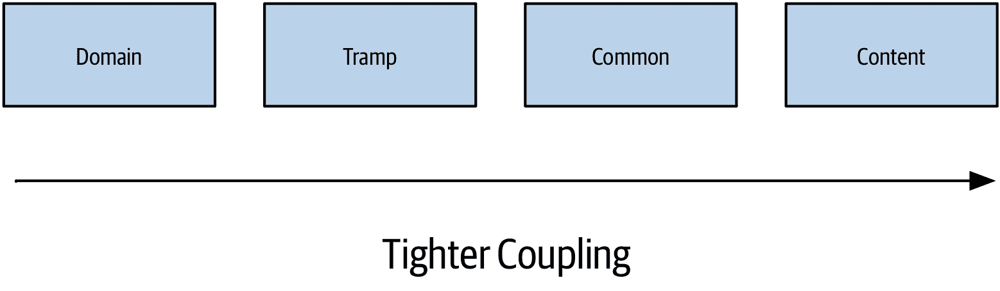

接下来，我们将逐一查看每种耦合形式，并查看示例以展示它们如何在我们的微服务架构中体现。

#### 领域耦合

领域耦合描述了一种情况，即一个微服务需要与另一个微服务交互，因为它需要使用另一个微服务提供的功能^(7)。

在 图 2-2 中，我们看到 MusicCorp 内部 CD 订单管理的部分情况。在此示例中，`Order Processor` 调用 `Warehouse` 微服务来预留库存，并调用 `Payment` 微服务来收取付款。因此，`Order Processor` 对于此操作依赖于并与 `Warehouse` 和 `Payment` 微服务耦合。我们看不到 `Warehouse` 和 `Payment` 之间存在此类耦合，因为它们不交互。

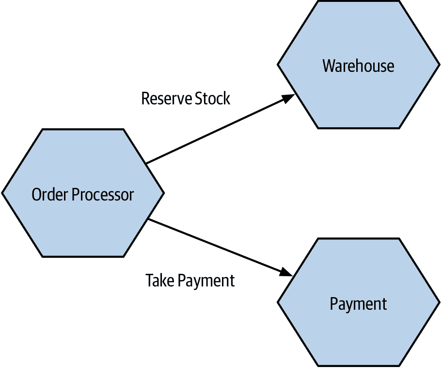

在微服务架构中，这种类型的交互在很大程度上是不可避免的。基于微服务的系统依赖多个微服务协作才能完成工作。我们仍然希望将其保持在最低限度——每当你看到单个微服务以这种方式依赖多个下游服务时，这可能是一个令人担忧的迹象——它可能意味着该微服务承担了太多职责。

作为一般规则，领域耦合被认为是一种松散的耦合形式，尽管即使在这里我们也可能遇到问题。需要与大量下游微服务通信的微服务可能指向逻辑过度集中的情况。随着服务之间传输更复杂的数据集，领域耦合也可能变得有问题——这通常指向我们稍后将探讨的更成问题的耦合形式。

请记住信息隐藏的重要性。只分享你绝对必须分享的内容，并且只发送你绝对需要的最少数据。

#### 透传耦合

透传耦合^(8) 描述了一种情况，即一个微服务将数据传递给另一个微服务，纯粹是因为该数据被某个更下游的微服务所需要。从许多方面来看，它是实现耦合中最成问题的形式之一，因为它意味着调用方不仅知道它所调用的微服务又调用了另一个微服务，而且可能还需要知道那个隔了一层的微服务的工作方式。

作为透传耦合的示例，让我们深入了解 MusicCorp 订单处理的部分工作方式，见 图 2-4。在这里，我们有一个 `Order Processor`，它向 `Warehouse` 发送请求以准备订单发货。作为请求负载的一部分，我们发送了 `Shipping Manifest`。此 `Shipping Manifest` 不仅包含客户地址，还包含运输类型。`Warehouse` 只是将此清单传递给下游的 `Shipping` 微服务。

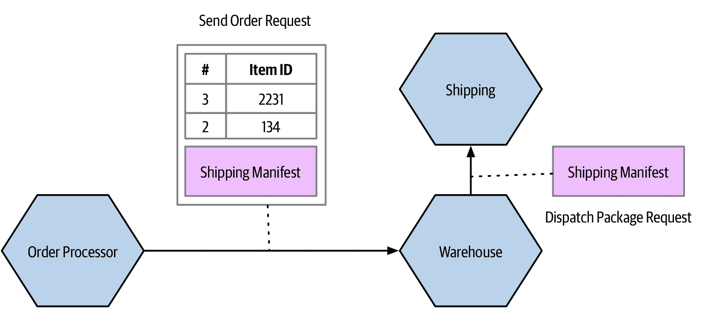

透传耦合的主要问题是下游所需数据的变更可能导致更显著的上游变更。在我们的示例中，如果 `Shipping` 现在需要更改数据的格式或内容，那么 `Warehouse` 和 `Order Processor` 很可能都需要变更。

这种情况有几种修复方法。第一种是考虑调用微服务是否可以直接绕过中间方。在我们的示例中，这可能意味着 `Order Processor` 直接与 `Shipping` 通信。现在，在这种特定情况下，这会带来其他一些问题。我们的 `Order Processor` 的领域耦合增加，因为 `Shipping` 是它需要了解的又一个微服务——如果这只是唯一的问题，这可能仍然可以接受，因为领域耦合当然是一种更松散的耦合形式。不过在此解决方案变得更复杂，因为必须先在 `Warehouse` 预留库存，然后才能使用 `Shipping` 发货，货物发出后我们还需要相应更新库存。这将更多复杂性和逻辑推入 `Order Processor`，而这些逻辑之前是隐藏在 `Warehouse` 内部的。

## 微服务耦合模式

### 跳板耦合

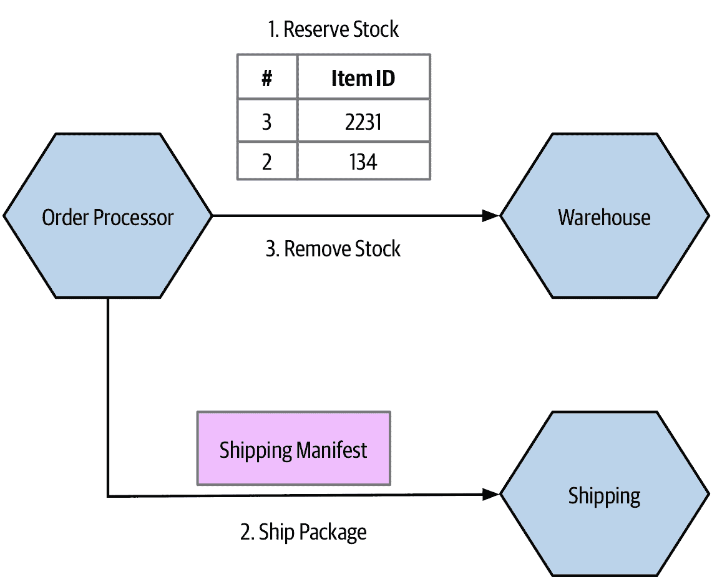

对于这个具体示例，我可能会考虑一个更简单（尽管更细微）的变更，即完全隐藏 `Order Processor` 对 `Shipping Manifest` 的需求。将管理库存和安排包裹派送的工作都委托给我们的 `Warehouse` 服务的想法是有意义的，但我们不喜欢的是我们泄露了一些低层实现，即 `Shipping` 微服务需要一个 `Shipping Manifest`。隐藏这一细节的一种方法是让 `Warehouse` 在其契约中接收所需的信息，然后在本地构建 `Shipping Manifest`。现在，这意味着如果 `Shipping` 服务更改其服务契约，只要所需数据由 `Warehouse` 收集，那么从 `Order Processor` 的角度来看，这一变更将是不可见的。

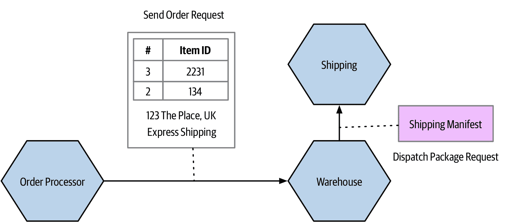

虽然这有助于保护 `Warehouse` 微服务免受 `Shipping` 的某些变更影响，但仍有一些情况需要所有各方进行变更。让我们考虑我们想要开始国际运输的想法。作为其中的一部分，`Shipping` 服务需要在 `Shipping Manifest` 中包含一个 `Customs Declaration`。如果这是一个可选参数，那么我们可以毫无问题地部署 `Shipping` 微服务的新版本。但如果这是一个必需参数，则 `Warehouse` 需要创建它。它可能能够利用其已有的（或被提供的）信息来完成此操作，但如果需要额外信息，则可能需要 `Order Processor` 向其传递额外信息。

尽管在这种情况下我们并未消除需要在全部三个微服务中进行变更的需求，但我们获得了关于何时以及如何进行这些变更的更大控制权。如果我们采用初始示例中那种紧密的（直通）耦合，添加这个新的必需 `Customs Declaration` 可能需要对全部三个微服务进行同步发布。至少通过隐藏这一细节，我们可以更轻松地分阶段部署。

一种最终的方法可以帮助减少直通耦合，即让 `Order Processor` 仍然通过 `Warehouse` 将 `Shipping Manifest` 发送给 `Shipping` 微服务，但让 `Warehouse` 完全不知道 `Shipping Manifest` 本身的结构。`Order Processor` 将清单作为订单请求的一部分发送，但 `Warehouse` 并不会尝试查看或处理该字段——它只是将其视为数据块而不关心其内容。它只是原样转发。`Shipping Manifest` 格式的变更仍然需要对 `Order Processor` 和 `Shipping` 微服务进行变更，但由于 `Warehouse` 不关心清单本身实际包含的内容，因此无需变更。

### 共同耦合

共同耦合发生在两个或多个微服务使用同一组数据时。这种耦合形式的一个简单且常见的例子是多个微服务使用同一个共享数据库，但这也可能表现为使用共享内存或共享文件系统。

共同耦合的主要问题是数据结构的变更可能同时影响多个微服务。请考虑 图 2-7 中 MusicCorp 的一些服务的示例。正如我们之前讨论的，MusicCorp 在全球运营，因此需要有关其运营所在国家的各种信息。在这里，多个服务都在从共享数据库读取静态参考数据。如果该数据库的模式以向后不兼容的方式更改，则需要对数据库的每个消费者进行更改。实际上，由于这个原因，像这样的共享数据往往很难更改。

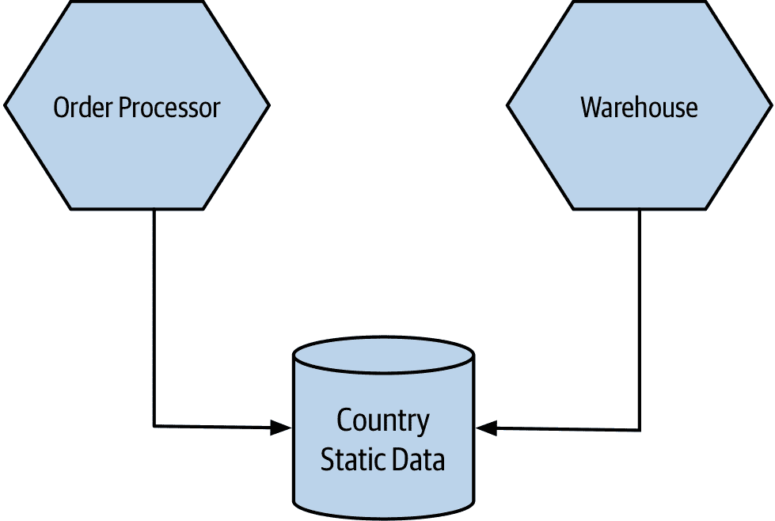

图 2-7 中的示例相对来说相当温和。这是由于静态参考数据本质上并不经常更改，而且该数据也是只读的——因此我倾向于对这种方式共享静态参考数据感到宽松。然而，如果公共数据的结构更改得更频繁，或者多个微服务对同一数据进行读写，则共同耦合会变得更成问题。

图 2-8 向我们展示了一种情况，其中 `Order Processor` 和 `Warehouse` 服务都在从共享的 `Order` 表中读写，以帮助管理向 MusicCorp 客户派送 CD 的流程。两个微服务都在更新 `STATUS` 列。`Order Processor` 可以设置 `PLACED`、`PAID` 和 `COMPLETED` 状态，而 `Warehouse` 将应用 `PICKING` 或 `SHIPPED` 状态。

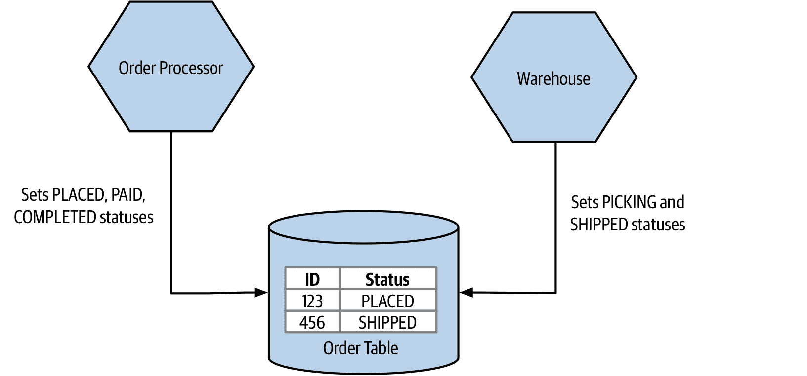

尽管你可能会认为 图 2-8 是一个有些人为的例子，但这个简单直接的共同耦合示例有助于说明一个核心问题。从概念上讲，我们有 `Order Processor` 和 `Warehouse` 微服务管理订单生命周期的不同方面。在对 `Order Processor` 进行更改时，我能否确定我不会以破坏 `Warehouse` 对世界的看法的方式更改订单数据，反之亦然？

确保某物的状态以正确方式更改的一种方法是创建有限状态机。状态机可用于管理某个实体从一个状态到另一个状态的转换，确保禁止无效的状态转换。在 图 2-9 中，可查看 MusicCorp 中订单的状态允许转换。订单可以从 `PLACED` 转到 `PAID`，但不能直接从 `PLACED` 转到 `PICKING`（这个状态机可能不足以满足完整端到端购买和货物运输所涉及的现实业务流程，但我想给出一个简单的示例来说明这个概念）。

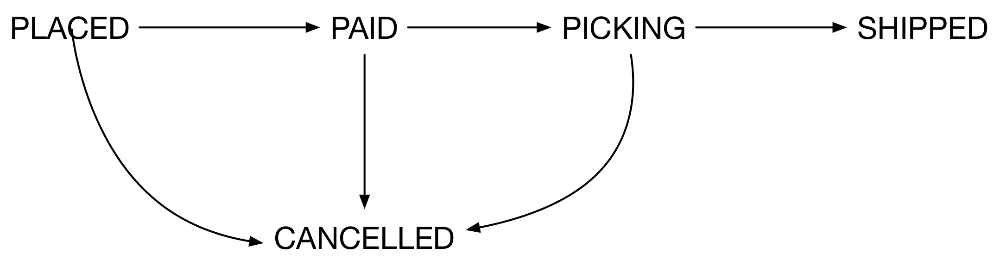

在这个特定示例中的问题是 `Warehouse` 和 `Order Processor` 都共享管理此状态机的责任。我们如何确保它们对允许的转换达成一致？有方法可以在微服务边界之间管理此类流程，我们将在讨论 Sagas 时在 [链接待定] 中再次回到这个话题。

这里的一个潜在解决方案是确保单个微服务管理订单状态。在 图 2-10 中，`Warehouse` 或 `Order Processor` 都可以向 `Order` 服务发送状态更新请求。在这里，`Order` 微服务是任何给定订单的事实来源。在这种情况下，真正重要的是我们将来自 `Warehouse` 和 `Order Processor` 的请求视为请求——*请求*。在这种情况下，`Order` 服务的工作是管理与订单聚合相关的可接受状态转换。因此，如果它收到来自 `Order Processor` 的将状态从 `PLACED` 直接更改为 `COMPLETED` 的请求，如果该更改无效，它可以自由拒绝该请求。

#### 提示

确保你将发送到微服务的请求视为下游微服务在无效时可以拒绝的东西。

我在这种情况下看到的一种替代方法是，将 `Order` 服务实现为基本上只是数据库 CRUD 操作的包装器，请求直接映射到数据库更新。这类似于一个对象拥有私有字段但提供公共的 getter 和 setter —— 行为已从微服务泄漏到上游消费者（降低了内聚性），我们又回到了在多个不同服务之间管理可接受状态转换的世界。

### 警告
如果你看到一个微服务看起来只是数据库 CRUD 操作的薄包装层，那说明你可能存在弱内聚和更紧密的耦合，因为本应存在于该服务中以管理数据的逻辑反而分散在系统的其他地方。

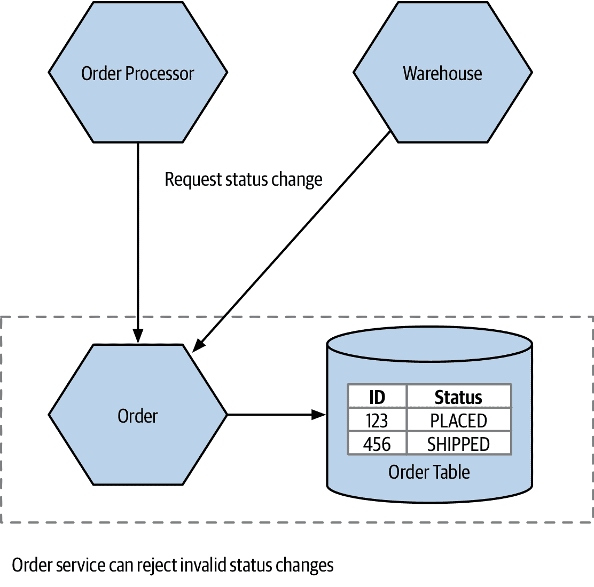

共同耦合的来源也是资源竞争的潜在来源。多个微服务使用同一个文件系统或数据库可能会使该共享资源过载，如果共享资源变慢甚至完全不可用，可能会导致严重问题。共享数据库尤其容易出现此问题，因为多个消费者可以对数据库本身运行任意查询，而这些查询的性能特征可能差异巨大。我见过不止一个数据库被昂贵的 SQL 查询拖垮 —— 我可能也曾一两次是罪魁祸首^(9)。

所以共同耦合 **有时** 可以接受，但通常不行。即使它无害，也意味着我们对共享数据可以做出的更改受到限制，但它通常也反映出代码缺乏内聚性。它还可能在操作竞争方面给我们带来问题。正因如此，我们认为共同耦合是耦合形式中最不理想的一种，但它会变得更糟。

### 内容耦合
内容耦合描述的是上游服务深入下游服务的内部并更改其内部状态的情况。这种情况最常见的表现是外部服务直接访问另一个微服务的数据库并直接更改它。内容耦合与共同耦合之间的区别很微妙。表面上看，在这两种情况下，两个或多个微服务都在读写同一组数据。在共同耦合中，你明白自己在使用一个共享的外部依赖。你知道它不在你的控制之下。而在内容耦合中，所有权界限变得不清晰，开发者更改系统也变得更加困难。

让我们回顾一下来自 MusicCorp 的早期示例。在 图 2-11 中，我们有一个 `Order` 服务，它本应管理系统中订单的允许状态变更。`Order Processor` 向 `Order` 服务发送请求，不仅委托了将要进行的确切状态变更，还将决定哪些状态转换是允许的责任委托给了 `Order` 服务。另一方面，`Warehouse` 服务直接更新存储订单数据的表，绕过了 `Order` 服务中可能用于检查允许更改的任何功能。我们只能希望 `Warehouse` 服务有一套一致的逻辑来确保只进行有效更改。最好的情况，这代表了逻辑的重复。最坏的情况，`Warehouse` 中关于允许更改的检查与 `Order` 服务中的不同，结果我们可能会得到处于非常奇怪、令人困惑状态的订单。

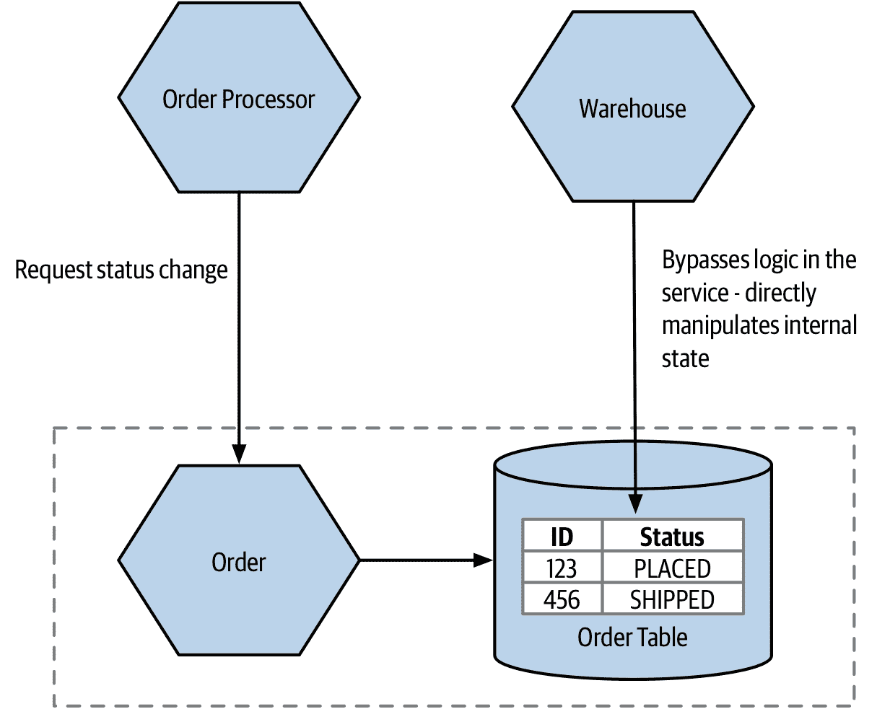

在这种情况下，我们还面临订单表内部数据结构暴露给外部方的 issue。当更改 `Order` 服务时，我们现在必须非常小心地对该特定表进行更改 —— 这甚至假设我们很清楚该表正被外部方直接访问。这里的简单修复方法是让 `Warehouse` 向 `Order` 服务本身发送请求，在那里我们可以审核请求，同时隐藏内部细节，从而使对 `Order` 服务的后续更改变得容易得多。

如果你正在开发一个微服务，明确区分可以自由更改的内容和不可以更改的内容至关重要。明确地说，作为开发者，你需要知道何时正在更改服务向外部世界公开的契约的一部分功能。你需要确保在此处进行更改不会破坏上游消费者。不会影响微服务公开的契约的功能可以放心更改。

毫无疑问，共同耦合出现的所有问题在内容耦合中也同样适用，但内容耦合有一些额外的麻烦，使其如此成问题 —— 问题大到足以让一些人将这种耦合形式称为 *病理耦合*。

当你允许外部方直接访问 *你的* 数据库时，你的数据库实际上就成为该外部契约的一部分，尽管你无法轻易推断什么可以更改，什么不可以。你已失去定义什么是共享的（因此不易更改）和什么是隐藏的能力。信息隐藏已经荡然无存。

简而言之，避免内容耦合。

## 领域导向分解的替代方案
到目前为止，我们已经研究了内聚性和耦合性在预先形成的微服务上的相互作用。正如我在 第 1 章 中介绍的那样，我们用来寻找微服务边界的主要机制围绕着领域本身。领域导向的边界在使我们更容易与组织结构保持一致、更容易以不同方式组合功能以向用户提供不同体验方面带来好处，并且经验表明，这些边界往往比其他分解形式更稳定。

虽然我认为总体上使用领域作为识别微服务边界的主要机制是最合理的，但偶尔也有其他方法可能有用，要么作为领域导向分解的替代方案，要么作为额外的工具。

### 易变性
我越来越多地听到对领域导向分解的抵制，经常是由倡导者推动的，他们主张易变性应成为分解的主要驱动因素。基于易变性的分解要求你识别系统中变化更频繁的部分，并将该功能提取到自己的服务中，以便更有效地进行开发。从概念上讲，我对此没有问题，但将其作为唯一做法来推广并无帮助，尤其是在我们考虑推动我们走向微服务的不同驱动因素时。例如，如果我的最大问题与扩展应用程序的需求有关，基于易变性的分解可能不会带来太多好处。

### 基于波动性的分解

基于波动性的分解背后的思维方式在诸如双模 IT 之类的方案中也很明显。由 Gartner 提出的概念，双模 IT 将世界划分为名字很顺口的“Mode 1”（又名记录系统）和“Mode 2”（又名创新系统）类别，具体取决于不同系统需要运行的快慢。据我们所知，Mode 1 系统变化不大，也不需要太多业务参与。Mode 2 才是行动所在，系统需要快速变化，并且需要业务的高度参与。暂且不论这种分类方案固有的极端过度简化，它还暗示了一种非常固定的世界观，并且掩盖了随着企业寻求“数字化转型”而在各行业中显而易见的那种变革。过去不需要太多变化的系统部分突然需要变化，以便开拓新的市场机会，并以他们以前从未设想过的方式为客户提供服务。

让我们回到 MusicCorp。他们涉足我们现在所称的数字化的第一次尝试只是拥有一个网页。在 90 年代中期，它所提供的只是待售物品的清单，但你只能打电话下单。它不过是报纸广告的翻版。然后，在线订购成为可能——现在整个仓库此前一直以纸质方式处理，必须进行数字化。谁知道呢，也许 MusicCorp 某个阶段不得不考虑将音乐以数字形式提供？虽然你可能会认为 MusicCorp 落伍了，但你仍然可以体会到公司在认识到不断变化的技术和客户行为可能需要在难以预见的业务部分进行重大改变时所经历的动荡程度。

我也讨厌双模 IT 这一概念，因为它成为人们把难以改变的东西扔进一个整洁的小盒子并说“我们不需要处理里面的问题——它是 Mode 1”的方式。这又是公司可以采用的另一种模型，以确保实际上什么都不必改变。它也回避了这样一个事实：经常功能上的变化也需要“记录系统”（Mode 1）的变化，以允许“创新系统”（Mode 2）的变化。在我的经验中，采用双模 IT 的组织最终确实拥有两种速度——慢和更慢。

公平地说，对于基于波动性分解的支持者来说，他们中许多人并不一定推荐像双模 IT 这样简化的模型。事实上，我发现如果主要驱动因素是快速上市，那么这种技术对于帮助确定边界非常有用——在这种情况下，提取经常变化（或需要经常变化）的功能是完全合理的。但归根结底，目标决定了最合适的机制。

### 数据

你持有和管理的数据的性质可能会促使你采用不同的分解形式。例如，你可能希望限制处理个人身份信息（PII）的服务，以降低数据泄露风险，同时简化对 GDPR 等事物的监督和实施。

对于我最近的一位客户，一家我们称之为 PaymentCo 的支付公司，某些类型数据的使用直接影响了我们关于系统分解所做的决策。PaymentCo 处理信用卡数据，因此其系统需要遵守支付卡行业（PCI）制定的关于如何管理此数据的各种要求。作为其中的一部分，他们的系统和流程需要接受审计。他们需要处理完整的信用卡数据，且数据量之大意味着其系统必须符合 PCI 1 级，这是最严格的级别，要求对与数据管理相关的系统和实践进行季度外部评估。

许多 PCI 要求都是常识，但确保整个系统符合这些要求的要求，尤其是系统需要由外部机构审计的需求，证明相当繁重。因此，他们希望将处理完整信用卡数据的系统部分分离出来——意味着只有系统的一个子集需要这种额外的监督级别。在 图 2-12 中，我们可以看到我们设计的简化形式。在绿色区域（此处以虚线包围）运行的服务永远看不到完整的信用卡信息——这仅限于红色区域（以破折号包围）的流程（和网络）。网关将调用重定向到适当的服务（和适当的区域）——信用卡信息通过此网关时，实际上也在红色区域。

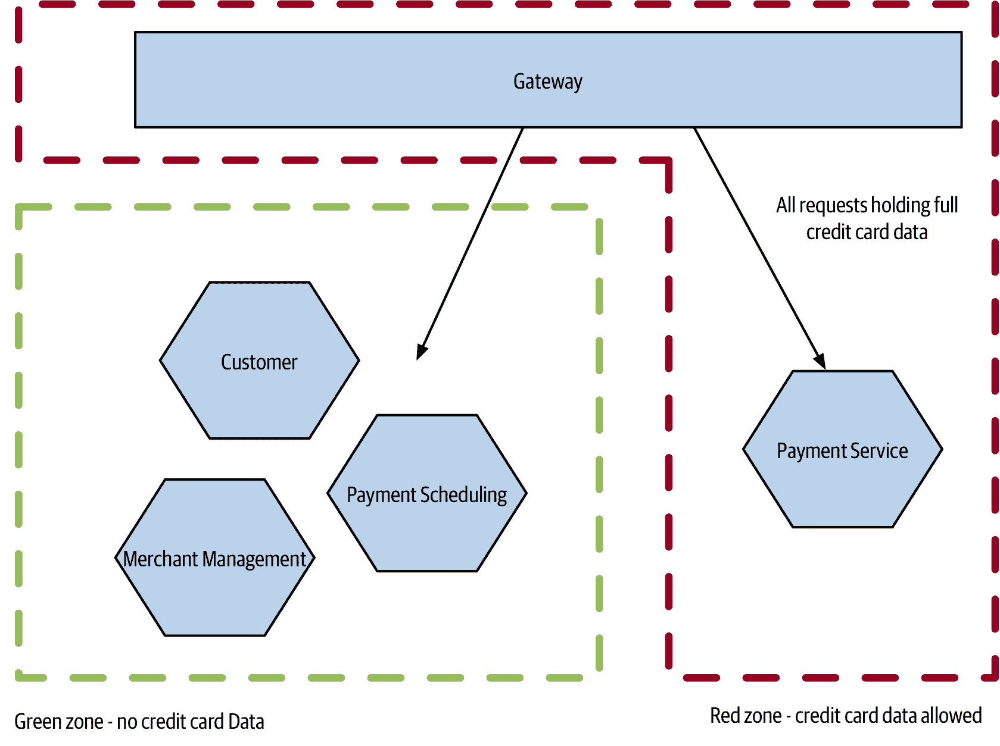

由于信用卡信息从未流入绿色区域，该区域内的所有服务都可以免于完整的 PCI 审计。红色区域内的服务在这种监督范围内。在设计过程中，我们尽一切努力限制必须进入该红色区域的内容。需要注意的关键是，我们必须确保信用卡信息绝对不会流向绿色区域——如果绿色区域中的微服务可以请求此信息，或者红色区域中的微服务将此信息发送回绿色区域，那么清晰的分离界限就会被破坏。

数据隔离通常由各种隐私和安全问题驱动——我们将在 \[待定链接\] 中稍后回到这个话题和 PaymentCo 的例子。

### 技术

使用不同技术的需求也可以成为寻找边界的一个因素。你可以在单个运行的微服务中容纳不同的数据库，但如果你想混合不同的运行时模型，你可能会面临挑战。如果你确定你的功能的一部分需要在像 rust 这样的运行时中实现，以获得额外的性能提升，这最终会成为一个主要的推动因素。

当然，如果将其作为分解的通用手段采用，我们必须意识到它可能把我们带向何方。我们在开篇章节中讨论过的经典三层架构，并在 图 2-13 中再次展示，是相关技术被分组在一起的例子。正如我们已经探索过的，这通常是一种不太理想的架构。

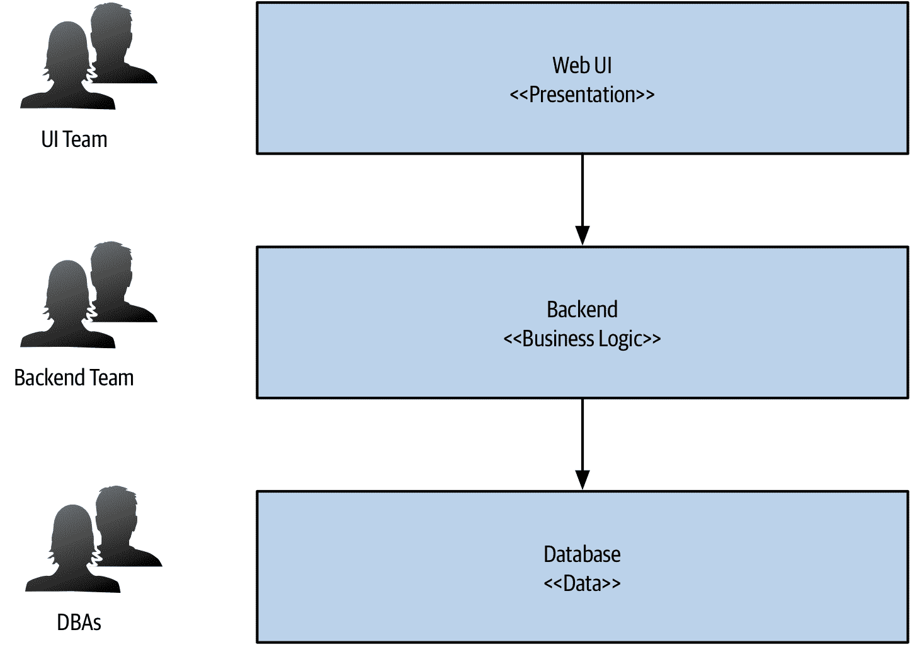

### 组织

正如我们在 第 1 章 中介绍康威定律时所建立的那样，组织结构和最终得到的系统架构之间存在固有的相互作用。撇开已显示出这种联系的研究不谈，在我自己的轶事经验中，我一次又一次地看到这种情况发生。你如何组织自己最终会推动你的系统架构，无论好坏。在帮助我们定义服务边界时，我们必须将其视为决策的关键部分。

定义一个所有权会跨越多个不同团队的服务边界不太可能产生我们期望的结果——正如我们在 \[待定链接\] 中进一步探讨的那样，微服务的共享所有权是一件棘手的事情。因此，在考虑何时何地定义边界时，我们必须考虑现有的组织结构，并且在某些情况下甚至可能考虑改变组织结构以支持我们想要的架构。

即使我们在现有的组织结构内开展工作，也存在边界划分不当的危险。 多年前，我和几位同事曾与一家加州的客户合作，帮助公司采用一些更清洁的代码实践并更[content]
即使我们在现有的组织结构内开展工作，也存在我们无法将边界放在正确位置的危险。 多年前，我和几位同事曾与一家加州的客户合作，帮助公司采用一些更清洁的代码实践并向自动化测试迈进。 我们从一些易于取得的成果开始，例如服务分解，这时我们注意到一个更令人担忧的问题。 我无法详细说明该应用程序的功能，但它是一个面向公众的应用程序，拥有庞大的全球客户群。

团队和系统都已成长。 最初是某一个人的设想，系统不断增加更多功能，也拥有更多用户。 最终，组织决定通过让一支驻巴西的新开发团队承担部分工作来提升团队产能。 系统被拆分，前半部分应用程序本质上是无状态的，实现了面向公众的网站，如 图 2-14 所示。 系统的后半部分只是一个位于数据存储之上的远程过程调用（RPC）接口。 本质上，可以想象你把代码库中的一个存储库层抽取出来做成一个独立的服务。

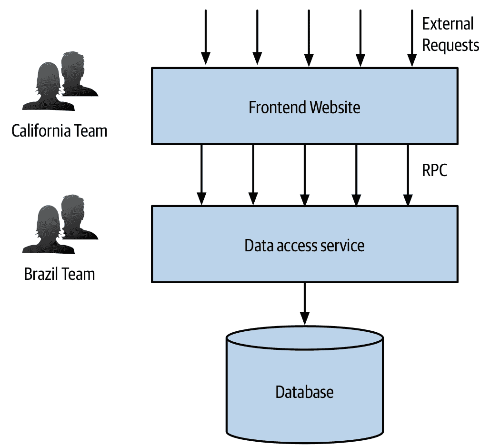

更改经常需要对两个服务同时进行。 两个服务都使用低级、RPC 风格的方法调用进行通信，这些调用过于脆弱（我们将在 第 3 章 中进一步讨论）。 服务接口也非常啰嗦，导致性能问题。 这导致需要复杂的 RPC 批处理机制。 我称之为 *onion architecture*，因为它有很多层，而且当我们需要切开它时让我哭泣。

乍一看，沿着地理/组织线拆分之前单体系统的想法完全合理，我们将在 \[待定链接\] 中进一步展开。 然而，这里团队并没有沿着堆栈做一个纵向的、业务导向的切片，而是选取了之前进程内的 API 并做了一个横向切片。 更好的模式应该是加州团队拥有一个端到端的纵向切片，由前端和数据访问功能的相关部分组成，而巴西团队则负责另一个切片。

## 不同目标，不同驱动

微服务不是目标。 拥有微服务并不会让你“获胜”。 采用微服务架构应该是一个有意识的决定，是基于理性决策的决定。 你应该考虑采用微服务架构，以便实现你当前系统架构无法实现的目标。

如果你不清楚自己想要实现什么，又如何为决策过程提供信息以决定应该采取哪些选项呢？ 你通过采用微服务想要实现的目标将极大地改变你投入时间的重点，以及你在创建微服务时的积极程度。 它也有助于指导你哪种方法在寻找微服务边界时最有意义。 PaymentCo 例如就以其对数据的主导关注为指导。

换句话说，虽然我可以分享我自己的观点，即我们应该如何定义微服务边界，并且我认为围绕业务域对其建模是一个合理的起点，但其他因素也可能在决定你想要选择何种分解方式时发挥作用。

### 混合模型与例外

正如我希望到目前为止已经很清楚，我在寻找这些边界方面并不教条。 如果你遵循信息隐藏的指导原则并理解耦合与内聚之间的相互作用，那么你很可能会避免所选机制中最糟糕的一些陷阱。 我认为通过关注这些思想，你是 *more* 可能会最终得到一个面向领域的架构，但这只是顺带一提。 事实是，即使你决定将“domain-oriented”作为定义微服务边界的主要机制，混合模型也常常有其理由。

我们迄今为止概述的不同机制之间也存在很多潜在的相互作用。 在这里选择过于狭隘会导致你遵循教条，而非做正确的事情。 基于波动性的分解如果你的重点是提高交付速度会很有意义，但如果这导致你抽取一个跨越组织边界的服务，那么请预期你的变更速度会因交付冲突而受损。

我可能会基于对业务域的理解定义一个不错的 `Warehouse` 服务，但如果该系统的某部分需要在 C++ 中实现，而另一部分需要在 Kotlin 中实现，那么你就需要沿着这些技术线进一步分解。

对我而言，组织和领域驱动的服务边界是我起点的选择。 这是我通常会采用的工具，因为作为一条经验法则，它往往是最有效的方法。 但它只是一个通用模型。 领域是唯一驱动这种决策的因素的情况也极为罕见。 通常，我们上面概述的许多因素都会发挥作用，而哪些因素影响你的决策将取决于你试图解决的问题。 你需要查看自己的具体情况来确定什么最适合你——希望我在这里为你提供了一些不同的选项供考虑。 只要记住，如果有人说“The only way to do this is `X`!” 他们很可能只是在兜售更多的教条。 你可以做得更好。

话虽如此，让我们通过更详细地探讨领域驱动设计，更深入地研究领域建模的话题。

## 足够的领域驱动设计

正如我们所见，将我们的服务围绕业务域进行建模对我们的微服务架构具有显著优势。 问题是如何提出该模型——而这正是领域驱动设计（DDD）发挥作用的地方。

让我们的程序更好地代表程序本身运行的现实世界的需求并不是一个新想法。 如 Simula 之类的面向对象编程语言被开发出来是为了让我们能够建模真实的域。 但要让这个想法真正成形，仅靠编程语言的能力是不够的。

Eric Evans’ 领域驱动设计^(10) 提出了一系列重要思想，帮助我们在程序中更好地表示问题域。 这些思想的全面探讨超出了本书的范围，但我将提供在微服务架构背景下最重要的思想的简要概述。

### 通用语言

通用语言指的是我们应该努力在代码中使用与用户相同的术语的想法。 这种想法的核心是，通过在交付团队和实际使用系统的人之间拥有共同的语言，将更容易对现实世界域进行建模，并且也应改善沟通。

作为一个反例，我回忆起在大型全球银行工作时的一件事。 我们在企业流动性领域工作，这是一个花哨的术语，基本上指的是在同一企业实体持有的不同账户之间转移现金的能力。 产品负责人非常好合作，她对自己想要推向市场的各种产品有着极其深刻的理解。 与她合作时，我们会讨论诸如 haircuts 和 end-of-day sweeps 之类的事情，这些在她的世界里很有意义，并且对她的客户也有意义。

另一方面，代码中完全没有这种语言。先前曾做出决定，使用标准的数据模型来构建数据库。它被广泛称为“The IBM banking model”，但我从未弄清楚这究竟是 IBM 的标准产品，还是只是 IBM 顾问的创作。通过定义松散的概念“arrangement”，理论上任何银行操作都可以被建模。贷款？那就是一个 arrangement。买股票？那也是一个 arrangement！申请信用卡？猜猜看——那也是一个 arrangement！

数据模型污染了代码的程度，以至于代码库完全失去了对我们正在构建的系统的真实理解。我们并不是在构建一个通用的银行应用程序。我们正在构建一个专门用于管理企业流动性的系统。问题在于我们必须将产品负责人的丰富领域语言映射到通用的代码概念——这意味着需要大量工作来帮助翻译。因此，我们的业务分析师经常花费时间反复解释同样的概念。

将真实世界的语言融入代码后，一切变得容易得多。使用直接来自产品负责人的术语编写的用户故事，开发者更有可能理解其含义并弄清楚需要做什么。

### 聚合

在 DDD 中，`aggregate` 是一个有些令人困惑的概念，存在许多不同的定义。它只是一个任意的对象集合吗？我应该从数据库中取出最小的单元吗？我一直使用的方法是首先将聚合视为真实领域概念的表示——比如 `Order`、`Invoice`、`Stock Item` 等。聚合通常围绕着生命周期，这使得它们可以作为状态机来实现。

以 MusicCorp 领域为例，`Order` 聚合可能包含多个代表订单中商品的明细项。这些明细项只有作为整体 `Order` 聚合的一部分才有意义。

我们希望将聚合视为自包含的单元；我们希望确保处理聚合状态转换的代码与状态本身一起分组。因此，一个聚合应该由一个微服务管理，尽管单个微服务可能负责管理多个聚合。

总体而言，将聚合视为具有状态、具有身份，并且其生命周期将在系统中管理的实体。它们通常指现实世界中的概念。

在考虑聚合和微服务时，单个微服务将处理一种或多种不同类型聚合的生命周期和数据存储。如果另一个服务中的功能想要更改其中一个聚合，它需要直接请求对该聚合的更改，或者让聚合本身对系统中的其他事物做出反应以启动自己的状态转换，也许通过订阅其他微服务发出的事件。

这里的关键在于，如果外部方请求聚合的状态转换，聚合可以说不。理想情况下，你希望以这样的方式实现聚合，使得非法状态转换是不可能的。

聚合可以与其他聚合存在关系。在 图 2-15 中，我们有一个 `Customer` 聚合，它与一个或多个 `Orders` 以及一个或多个 `Wishlists` 相关联。这些聚合中的每一个都可以由同一个微服务管理，也可以由不同的微服务管理。

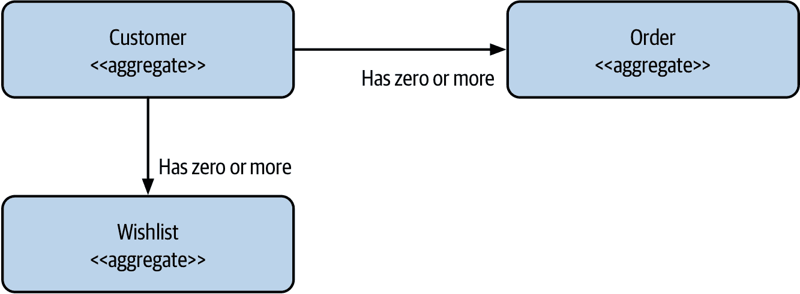

如果聚合之间的关系存在于单个微服务的范围内，如果使用关系数据库，这些关系可以很容易地使用类似外键关系的方式存储。如果这些聚合之间的关系跨越微服务边界，我们需要某种方式来建模这种关系。在 图 2-16 中，我们在财务账簿中针对客户做了一笔分录——这可能代表一个 `Payment` 聚合。在账簿表中，我们存储客户的引用，这里以 URI 的形式，我们在构建基于 REST 的系统时可能会使用它^11)。我们将在 第三章 中重新讨论此类跨服务关系的主题，以更详细地探讨这些引用的性质和用途。

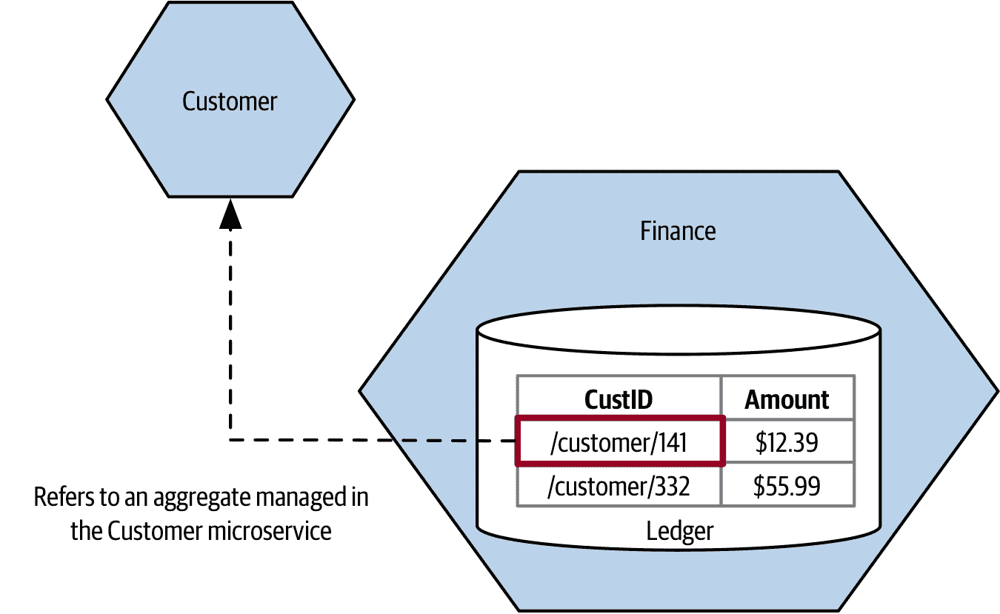

将系统拆分为聚合的方式有很多，其中一些选择高度主观。出于性能原因或实现便利性，你可能会决定随着时间的推移重新塑造聚合。不过起初，我认为实现方面的考虑是次要的，最初让系统用户的心理模型成为我初始设计的指导，直到其他因素发挥作用。

### 有界上下文

`bounded context` 通常代表组织内部更大的组织边界。在该边界范围内，需要履行明确的职责。这有点模糊，所以让我们看另一个具体例子。

在 Music Corp，我们的仓库热闹非凡——管理发出的订单（以及偶尔的退货）、接收新库存、进行叉车比赛等等。其他地方，财务部门可能没那么好玩，但仍在组织内部发挥重要作用，处理工资单、支付运费等。

有界上下文隐藏实现细节。存在内部关注点——例如，所使用的叉车类型对仓库以外的人来说几乎没有兴趣。这些内部关注点应隐藏于外部世界——他们不需要知道，也不应该关心。

从实现角度来看，有界上下文包含一个或多个聚合。一些聚合可能在有界上下文之外暴露；其他聚合可能在内部隐藏。与聚合一样，有界上下文可能与其他有界上下文存在关系——当映射到服务时，这些依赖关系成为服务间的依赖关系。

让我们暂时回到 MusicCorp 业务。我们的领域是我们运营的整个业务。它涵盖从仓库到接待台，从财务到订购的一切。我们可能在软件中建模所有这些，也可能不建模，但那确实是我们运营的领域。让我们思考一下该领域中看起来像 Evans 所指的有界上下文的部分。

#### 隐藏模型

对于 MusicCorp，我们可以将财务部门和仓库视为两个独立的有界上下文。它们都对外部世界有明确的接口（以库存报告、工资单等形式），并且它们有只有它们自己需要知道的细节（叉车、计算器）。

现在财务部门不需要知道仓库详细的内部运作。不过它确实需要知道一些事情——例如它需要知道库存水平以保持账目最新。图 2-17 显示了一个示例上下文图。我们看到仓库内部的概念，如 `Picker`（拣货人员）、代表库存位置的货架等等。同样，总账中的分录对财务至关重要，但在此并未外部共享。

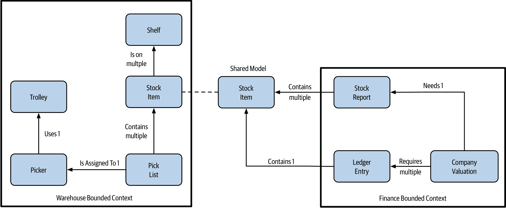

不过，要计算公司的估值，财务员工需要我们持有的股票信息。此时，库存项就成为两个上下文之间的共享模型。然而，请注意，我们不需要盲目地从仓库上下文中暴露有关库存项的所有信息。在 图 2-18 中，我们可以看到仓库有界上下文内的 `Stock Item` 包含对货架位置的引用，但共享表示仅包含一个计数。因此，存在仅限内部的表示，以及我们公开的外部表示。通常，当你有不同的内部和外部表示时，为避免混淆，将它们命名为不同名称可能有益——在这种情况下，一种方法可以是将共享的 `Stock Item` 称为 `Stock Count`。

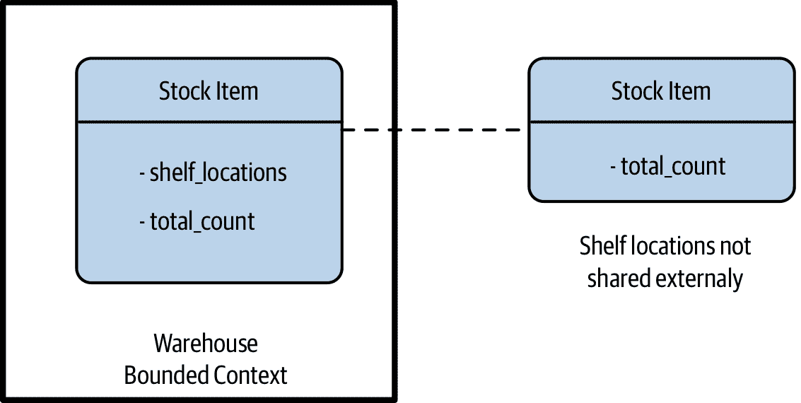

### 共享模型

我们还可以拥有出现在多个有界上下文中的概念。在 图 2-17 中我们看到 `customer` 同时存在于两个位置。这意味着什么？`customer` 被复制了吗？思考这个问题的方式是，从概念上讲，`finance` 和 `warehouse` 都需要了解一些关于我们的 `customer` 的信息。`Finance` 需要了解对 `customer` 支付的财务款项，而 `Warehouse` 需要了解 `customer` 的程度在于它知道已发送了哪些包裹，以便追踪交付。

在这种情况下，像 `customer` 这样的共享模型在不同的有界上下文中可能具有不同的含义，因此可能被称为不同的名称。我们可能很乐意在 `Finance` 中保留名称“`customer`”，但在 `Warehouse` 中我们可能称他们为“`recipient`”，因为那是他们在该上下文中扮演的角色。我们在两个位置都存储有关 `customer` 的信息，但信息是不同的。`Finance` 存储有关 `customer` 的财务付款（或退款）的信息，`warehouse` 存储与已发货商品相关的信息。我们仍可能需要将这两个本地概念链接到全局 `customer`，并且可能希望查找有关该 `customer` 的通用共享信息，如其姓名或电子邮件地址——我们可以使用 图 2-16 中所示的技术来实现这一点。

### 将聚合和有界上下文映射到微服务

`aggregate` 和 `bounded context` 都为我们提供了具有明确界面的内聚单元，与更广泛的系统交互。`aggregate` 是一个自包含的状态机，专注于我们系统中单一的领域概念，而 `bounded context` 则代表一组相关的聚合，同样具有对外部世界的明确接口。

因此两者都可以作为服务边界良好地工作。在起步阶段，正如我已经提到的，你希望减少处理的服务数量。因此，你可能应该以涵盖整个 `bounded contexts` 的服务为目标。随着你逐渐熟悉，并决定将这些服务拆分为更小的服务，请围绕 `aggregate` 边界进行拆分。

### 一直到底都是乌龟

起初，你可能会识别出若干粗粒度的有界上下文。但这些有界上下文本身又可以包含进一步的有界上下文。例如，你可以将 `warehouse` 分解为与订单履行、库存管理或货物接收相关的能力。在考虑微服务的边界时，首先以更大、更粗粒度的上下文为出发点，然后在希望获得拆分这些缝隙带来的好处时，沿着这些嵌套上下文进行细分。

这里的一个技巧是，即使你后来决定将建模整个有界上下文的服务拆分为更小的服务，你仍然可以将其决策隐藏在外部世界之外——也许是通过向消费者提供更粗粒度的 API。将服务分解为更小部分的决定可以说是实现层面的决策，因此如果可以的话，我们不妨将其隐藏。在 图 2-19 中我们看到了一个例子。我们已将 `Warehouse` 拆分为 `Inventory` 和 `Shipping`。就外部世界而言，仍然只有 `Warehouse` 微服务。不过在内部，我们进一步分解了事物，以便让 `Inventory` 管理 `Stock Items`，并让 `Shipping` 管理 `Shipments`。记住，我们希望将单个 `aggregate` 的所有权保留在单个微服务内部。

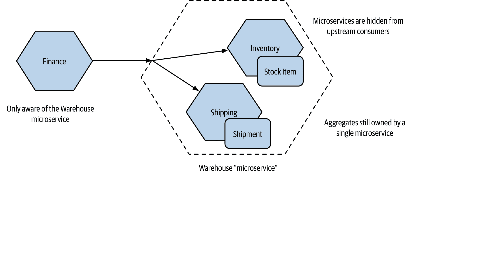

这又是另一种信息隐藏形式——我们以这样的方式隐藏了关于内部实现的决策，以至于如果未来此实现细节再次发生变化，我们的消费者将不会察觉。

偏好嵌套方法另一个原因可能是将架构分块以简化测试。例如，在测试消费仓库的服务时，我不必为仓库上下文内的每个服务创建存根，只需为更粗粒度的 API 创建存根即可。这也可以在考虑更大范围的测试时为你提供一个隔离单元。例如，我可能会决定进行端到端测试，在其中启动仓库上下文内的所有服务，但对于所有其他协作方，我可能会为其创建存根。我们将在 \[Link to Come\] 中进一步探讨测试和隔离。

### 过早分解的危险

基于对领域理解不清而分解微服务存在危险。一个这样的例子来自我之前的公司 `ThoughtWorks`。他们的一款产品名为 `SnapCI`，这是一款托管的持续集成和持续交付工具（我们将在 \[Link to Come\] 中稍后讨论这些概念）。该团队之前曾在另一款类似工具 `Go-CD` 上工作过，这是一款现在开源的持续交付工具，可以在本地部署而不是托管在云中。

尽管 `SnapCI` 和 `Go-CD` 项目在早期有一些代码复用，但最终 `SnapCI` 证明是一个完全新的代码库。尽管如此，团队在 CD 工具领域之前的经验使他们更有信心更快地识别边界，并将系统构建为一组微服务。

不过几个月后，很明显 `SnapCI` 的用例有细微的不同，以至于最初对服务边界的把握并不完全正确。这导致在各服务之间进行了大量更改，并伴随着较高的变更成本。最终团队将服务合并回一个单体系统中，给了他们更多时间来更好地理解边界应该存在于何处。一年后，团队随后能够将单体系统拆分为微服务，其边界被证明更加稳定。这远非我见过的唯一一个这种情况的例子。过早地将系统分解为微服务可能代价高昂，尤其是在你对该领域不熟悉的情况下。在许多方面，拥有一个你想要分解为微服务的现有代码库，比从一开始就尝试转向微服务要容易得多，正是出于这个原因。

### 以业务概念进行沟通

我们对系统实施的更改通常是关于业务希望对系统行为做出的更改。我们正在更改向客户公开的功能——能力。如果我们的系统沿着代表我们领域的边界上下文进行分解，我们想要做出的更改更有可能被隔离到单个微服务边界。这减少了我们需要进行更改的地方数量，并允许我们快速部署该更改。

也非常重要将这些微服务之间的通信视为相同的业务概念。软件对业务领域的建模不应止步于有界上下文的概念。组织各部分之间共享的相同术语和思想应在接口中得到体现。将表单在这些微服务之间传递的想法视为组织内部表单传递的方式可能会很有用。

## 事件风暴

*事件风暴* 是由 Alberto Brandolini 开发的一种技术，是一种协作头脑风暴练习，旨在帮助揭示领域模型。与让架构师坐在角落里自行构想领域模型是什么的表示相比^(12)，事件风暴将技术和非技术利益相关者聚集在一起进行联合练习。其理念是通过将领域模型的发展作为一项联合活动，最终形成对世界的共享、连贯的视图。

值得在此提及的是，虽然使用事件风暴定义出的领域模型可用于实现事件驱动系统，而且映射非常直接，你也可以用这样的领域模型构建更偏向请求/响应式的系统。

### 后勤安排

Alberto 对事件风暴的运行方式有一些非常具体的看法，而在其中一些观点上我非常赞同。首先，让所有人聚到一个房间里。这通常是最困难的一步——让人们的日程对齐可能是一个问题，找到足够大的房间也可能是一个问题。在新冠疫情前的世界里这些问题都存在，但我在英国因病毒而封锁期间撰写此文时，我意识到未来这可能更成问题。不过关键在于同时让所有利益相关者到场。你希望为计划建模的领域各部分都有代表——用户、领域专家、产品负责人，或任何最适合帮助代表该领域部分的人。

一旦大家在同一个房间里，Alberto 建议移除所有椅子，以确保每个人都起身参与。作为一名腰不好的人，虽然我理解这一点，但这可能并不适合所有人。我同意 Alberto 的一点是需要有足够大的空间进行建模。这里常见的解决方案是将大卷的牛皮纸钉在房间的墙上，以便利用所有墙面来记录信息。

主要的建模工具是便利贴，用来捕捉不同的概念，不同颜色的便利贴代表不同的概念。

### 流程

练习从参与者识别 *领域事件* 开始。这些代表系统中发生的事情——它们是你关心的事实。“Order Placed” 在 MusicCorp 的上下文中将是一个我们关心的良好事件，“Payment Received” 也是如此。这些被记录在橙色便利贴上。就在这一点上，我对 Alberto 的结构又有一点不同意见，因为事件是你将捕捉到的数量最庞大的东西，而橙色便利贴出人意料地难以获得^(13)。

接下来，参与者识别导致这些事件发生的命令。命令是由人类做出的决定去做某事（软件的用户）。在这里，你试图理解系统的边界，并识别系统中的关键人类参与者。命令被记录在蓝色便利贴上。

对于事件风暴会议中的技术人员来说，在这个阶段他们应该倾听非技术同事在此提出的想法。这项练习的关键部分是不让任何当前实现扭曲对领域是什么的认知（那是后来的事）。在这个阶段，你希望创造一个空间，可以将关键利益相关者头脑中的概念提炼出来，并将这些想法公开。

在记录了事件和命令后，接下来是聚合体。你在此阶段拥有的事件不仅有助于分享系统中发生的事情，而且开始突出潜在的聚合体可能是什么。想想前面提到的领域事件“Order Placed”。这里的名词——Order——很可能是一个潜在的聚合体。而“Placed”是可能发生在订单上的事情，因此这很可能是聚合体生命周期的一部分。聚合体用黄色便利贴表示，与该聚合体相关的命令和事件会被移动并聚集在聚合体周围。这也有助于你理解聚合体之间的关系——一个聚合体的事件可能会触发另一个聚合体的行为。

在识别出聚合体后，它们随后被分组到有界上下文中。有界上下文最常见的是遵循公司的组织结构，而练习的参与者非常适合理解哪些聚合体被组织的哪些部分使用。

事件风暴远不止于此——这只是简要概述。要更详细地了解事件风暴的工作方式，我建议你阅读 Alberto 所著的（目前正在进行中）书籍“事件风暴^(14)”。

## 总结

在本章中，你已经了解了一些构成良好微服务边界的内容，以及如何在问题空间中找到缝隙，从而获得低耦合和强内聚的双重好处。对领域有详细的理解可以成为帮助我们找到这些缝隙的重要工具，通过将微服务与这些边界对齐，我们确保所得系统有很大机会保持这些优点。我们还得到了关于如何进一步细分微服务的提示，这将在后面更深入地探讨。我们还介绍了 MusicCorp，这是我们将在整本书中使用的示例领域。

Eric Evans 的 *领域驱动设计* 中提出的思想对我们找到服务的合理边界非常有用，而我在这里只是浅尝辄止。我推荐 Vaughn Vernon 的书籍 *实现领域驱动设计*（Addison-Wesley），以帮助你理解这种方法在实践中的具体操作。

尽管本章大部分内容都是高层次的，但在下一章我们需要更技术化。服务之间接口的实现存在许多陷阱，可能导致各种麻烦，如果我们要防止系统变成一个庞大、纠缠不堪的混乱，我们必须深入探讨这一主题。

^(1) Parnas, David, “On the criteria to be used in decomposing systems into modules”, 1971 [*https://kilthub.cmu.edu/articles/On\_the\_criteria\_to\_be\_used\_in\_decomposing\_systems\_into\_modules/6607958*](https://kilthub.cmu.edu/articles/On_the_criteria_to_be_used_in_decomposing_systems_into_modules/6607958)

^(2) 明显的起点是 Adrian 对“On the criteria…”的总结 [*https://blog.acolyer.org/2016/09/05/on-the-criteria-to-be-used-in-decomposing-systems-into-modules/*](https://blog.acolyer.org/2016/09/05/on-the-criteria-to-be-used-in-decomposing-systems-into-modules/)，但对 Parnas 早期著作“Information Distribution Aspects of Design Methodology”的介绍包含了一些很棒的见解以及 Parnas 本人的评论： [*https://blog.acolyer.org/2016/10/17/information-distribution-aspects-of-design-methodology/*](https://blog.acolyer.org/2016/10/17/information-distribution-aspects-of-design-methodology/)

^(3) Parnas, David, “Information distribution aspects of design methodology”, 1971

^(4) 在我所著的《Monolith To Microservices》一书中，我将此归因于 Larry Constantine 本人。虽然该陈述简洁地概括了 Constantine 在这一领域的大部分工作，但这段引文实际上应归于 Albert Endres 和 Dieter Rombach 来自他们所著的书“A Handbook of Software and Systems Engineering”。

^(5) Constantine, Larry and Edward Yourdon, Structured Design, Yourdon Press

^(6) Page-Jones, Meilir, Practical Guide to Structured Systems Design (Yourdon Press Computing)

^(7) 这个概念与 Domain Application Protocol 类似，后者定义了组件在基于 REST 的系统中交互的规则。

^(8) Pass through coupling 是我为 M. Page-Jones 在《The Practical Guide to Structured Systems Design》中最初描述为 Tramp coupling 的概念所取的名称。我在这里选择使用不同的术语，是因为我发现原术语有些问题，并且对更广泛的受众来说意义不大

^(9) 好吧，不止一次两次。**很多**次不止一次两次…

^(10) Eric Evans, *领域驱动设计：应对软件核心复杂性* (Boston: Addison-Wesley, 2004)。

^(11) 我知道有些人反对在 REST 系统中使用模板化 URI，我理解原因——我只是想让这个示例保持简单

^(12) 如果这是你，我并无冒犯之意——我自己也做过不止一次

^(13) 我的意思是，为什么不选黄色呢？它是常见颜色！

^(14) Event Storming, Alberto Brandolini, Leanpub (work in progress) [*https://leanpub.com/introducing\_eventstorming*](https://leanpub.com/introducing_eventstorming)
