# 第3章 微服务通信风格
让微服务之间的通信做到正确对很多人来说是个难题，很大程度上是因为我感觉人们倾向于在没有先考虑你可能想要的不同类型的通信之前就选择一种技术方法。在本章中，我将尝试拆解不同的通信风格，以帮助你理解每种风格的优缺点，并帮助你理解哪种方法最适合你的问题域。
我们将研究同步阻塞和异步非阻塞通信机制，并比较请求-响应协作与事件驱动协作。
到本章结束时，你应该能更好地理解可供选择的各种选项，并将具备基础知识，这将在后续章节开始探讨更详细的实现问题时提供帮助。

## 从进程内到进程间
好吧，让我们先把容易的部分排除掉——至少我*希望*是容易的部分。也就是说，跨网络在不同进程*之间*进行的调用（进程间）与在单个进程*内部*进行的调用（进程内）**非常**不同。在一个层面上，我们可以忽略这种区别。例如，很容易认为一个对象对另一个对象进行方法调用，然后就将这种交互映射到两个微服务通过网络通信。撇开微服务不仅仅是对象这一事实不谈，这种思维会给我们带来很多麻烦。
让我们现在来看一下这些差异中的一些，以及它们如何改变你对微服务之间交互的思考方式。

### 性能
进程内调用和进程间调用的性能存在根本差异。当我进行进程内调用时，底层的编译器和运行时可以执行大量优化来减少调用的影响，包括内联调用，使其就像根本没有调用一样。进程间调用则不可能进行此类优化。数据包必须被发送。应预期进程间调用的开销相比进程内调用的开销是显著的。前者是可以非常精确测量的——仅在数据中心往返一个数据包就需要毫秒级时间——而进行方法调用的开销是你无需担心的。
这通常会让你想要重新思考 API。进程内有意义的 API 在进程间情况下可能就不合适了。我可以在进程内无顾虑地跨 API 边界进行 1000 次调用。我是否想在两个微服务之间进行 1000 次网络调用？也许不。
当我将参数传递给方法时，我传递的数据结构通常不会移动——更可能的是我传递的是内存位置的指针。将对象或数据结构传递给另一个方法并不需要分配更多内存来复制数据。
而在网络上通过微服务进行调用时，数据实际上必须序列化为可在网络上传输的形式。然后数据需要被发送，并在另一端反序列化。因此，我们可能需要更关注进程之间传输的有效载荷大小。最近一次你在进程内传递数据结构时意识到它的大小是什么时候？现实是，你可能不需要知道——现在，你需要了。这可能会让你减少发送或接收的数据量（如果我们考虑到信息隐藏，这也许不是坏事），选择更高效的序列化机制，甚至将数据卸载到文件系统并仅传递指向该数据的指针。
这些差异可能不会立即给你带来问题，但你确实需要意识到它们。我见过很多试图让开发者忽略网络调用正在发生的尝试。我们创造抽象来隐藏细节的愿望是我们能够更高效地做更多事情的重要部分，但有时我们创造的抽象隐藏得太多。开发者需要意识到如果他们做某事会导致网络调用，否则不要对日后出现一些糟糕的性能瓶颈感到惊讶。

### 更改接口
当我们考虑进程内接口的更改时，推出更改的过程很直接。实现接口的代码和调用接口的代码都打包在同一个进程中。事实上，如果我使用具有重构能力的 IDE 更改方法签名，通常 IDE 本身会自动重构对该更改方法的调用。推出此类更改可以以原子方式完成——接口的两侧都打包在单个进程中。
然而，在微服务之间进行通信时，公开接口的微服务和使用该接口的消费微服务是可单独部署的微服务。当对微服务接口进行向后不兼容的更改时，我们要么需要与消费者进行锁定式部署，确保它们更新为使用新接口，要么找到某种方式分阶段推出新的微服务契约。我们将在本章后面更详细地探讨这个概念。

### 错误处理
在进程内，如果我调用一个方法，错误的性质往往相当直接。简而言之，错误要么是预期且易于处理的，要么是灾难性的，以至于我们只是将错误沿调用栈向上传播。总的来说，错误是确定的。

在分布式系统中，错误的性质可能有所不同。你容易受到各种超出控制范围的错误的影响。网络会超时。下游微服务可能暂时不可用。网络会断开连接，由于消耗过多内存而导致容器被杀死，在极端情况下，你的数据中心的部分区域甚至可能起火^(1)。

其中许多错误往往是暂时的——它们是短暂的问题，可能自行消失，因此是你可能想要重试的事情——比如简单的网络超时。其他问题则难以轻易处理。因此，拥有更丰富的错误返回语义变得很重要，以便客户端能够采取适当的行动。

HTTP 就是一个理解这一重要性的协议示例。每个 HTTP 响应都有一个状态码，其中 400 和 500 系列代码保留用于错误。400 系列错误代码是请求错误——本质上，下游服务是在告诉客户端原始请求存在问题。因此，你可能应该放弃——例如重试 `404 Not Found` 有什么意义呢？500 系列响应代码与下游问题相关，其中一部分会提示客户端问题可能是暂时的。例如 `503 Service Unavailable` 表示下游服务器无法处理请求，但这可能是临时状态。在这种情况下，上游客户端可能会决定重试该请求。另一方面，如果客户端收到 `501 Not Implemented` 响应，重试可能帮助不大。

无论你是否选择基于 HTTP 的协议来进行微服务之间的通信，如果你对错误性质有丰富的语义，就能让客户端更容易执行补偿操作，进而帮助你构建更健壮的系统。

## 进程间通信技术：选择太多

> “在一个选择太多而时间太少 的世界里，显而易见的做法就是直接忽略一些东西。”
>
> Seth Godin

我们可用于进程间通信的技术范围非常广。因此，我们常常会被选择所困扰。经常，我发现人们只是倾向于使用他们熟悉的技术，或者只是他们在会议上了解到最新的热门技术。这样做的问题在于，当你选择了特定的技术时，你往往也在接受随之而来的思想和限制。这些限制可能并不适合你——而且技术背后的思维方式可能与你试图解决的问题并不一致。

如果你试图构建一个网站，像 Angular 或 React 这样的单页应用技术就是一个糟糕的选择。同样，尝试将 Kafka 用于请求-响应真的不是一个好主意，因为它是为了更基于事件的交互而设计的（我们稍后会谈到这些主题）。然而我一次又一次地看到技术被用在错误的地方。人们选择新的闪亮技术（如微服务！）而不考虑它是否适合他们的问题。

就微服务之间通信可用的令人眼花缭乱的技术阵列而言，我认为首先谈论你想要的通信风格，然后再寻找实现这些风格的合适技术是很重要的。基于这一点，让我们来看一下我使用了几年的模型，它可以帮助区分微服务到微服务通信的不同方法，进而帮助你筛选想要查看的技术选项。

## 微服务通信风格

在 图 3-1 中，我们可以看到我使用的模型的概述。

异步非阻塞：
发出调用的微服务能够在调用是否被接收的情况下继续处理。

请求-响应：
一个微服务向另一个微服务发送请求，要求执行某项操作。它期望收到对请求的响应以告知结果。

事件驱动：
微服务发出事件，其他微服务消费这些事件并据此做出反应。发出事件的微服务不知道是否有任何微服务消费它发出的事件。

通用数据：
不常被视为通信风格，微服务通过某些共享数据源进行协作。

在使用此模型帮助团队决定合适方法时，我花费大量时间了解他们所处的环境。他们在可靠通信、可接受的延迟和通信量方面的需求都会影响技术选择。但总的来说，我倾向于先决定在给定情况下同步还是异步通信更合适。如果同步通信是一个选项，那么我坚定地处于请求-响应通信的世界中。如果异步通信更有意义，那么我需要做第二个选择，即事件驱动、基于请求-响应的还是基于通用数据的通信是否更合适。正如我们将要探讨的，事件驱动通信本质上是异步的，但请求-响应调用可以同步或异步实现。

## 模式：同步阻塞

在同步阻塞调用中，微服务向下游进程（很可能是另一个微服务）发送某种调用，并在调用完成并且可能在收到响应之前被阻塞。在 图 3-2 中，`Order Processor` 向 `Loyalty` 微服务发送调用，以通知它应向客户账户添加一些积分。

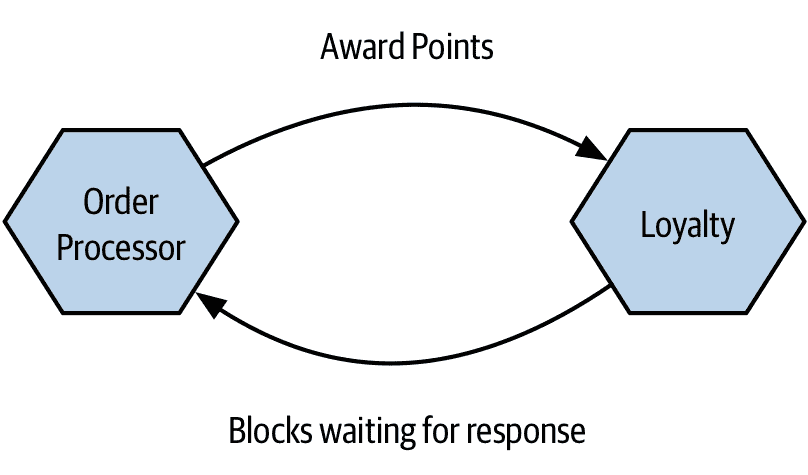

通常，同步阻塞调用是在等待下游进程的响应。这可能是因为调用的结果需要用于某些后续操作，或者只是为了确保调用成功，如果不成功则执行某种重试。因此，我看到的几乎所有同步阻塞调用也都构成请求-响应调用，我们稍后会讨论这一点。

### 优点

阻塞的同步调用有一种简单而熟悉的感觉。我们中的许多人以根本上同步的风格学习编程，像阅读脚本一样阅读代码，每一行依次执行，下一个代码行等待轮到它做某事。你在其中使用进程间调用的大多数情况可能都是以同步、阻塞的方式完成的。例如在数据库上运行 SQL 查询，或向下游 API 发出 HTTP 请求。

从较少分布的架构（如单进程单体）迁移过来时，在还有很多其他全新的事物发生时，坚持这些熟悉的思想是有意义的。

### 缺点

## 同步调用

同步调用的主要挑战在于发生的固有时间耦合，我们在第 2 章中简要探讨过这一主题。当上面的示例中 `Order Processor` 向 `Loyalty` 发出调用时，`Loyalty` 微服务需要可达，调用才能工作。如果 `Loyalty` 微服务不可用，则调用将失败，`Order Processor` 需要弄清楚要执行何种补偿操作——这可能涉及立即重试，将调用缓冲以便稍后重试，或者干脆放弃。

由于调用发送方处于阻塞状态并等待下游微服务响应，因此如果下游微服务响应缓慢，或者网络延迟存在问题，则调用发送方将被阻塞很长时间等待响应。如果 `Loyalty` 微服务处于显著负载下，对请求响应缓慢，这反过来会导致 `Order Processor` 响应缓慢。

因此，与异步调用相比，使用同步调用会使系统更容易受到下游中断引发的级联问题的影响。

### 何时使用

对于简单的微服务架构，我对使用同步阻塞调用并没有太大的问题。对许多人来说，它们的熟悉性是在掌握分布式系统时的一大优势。

对我而言，这类调用开始变得有问题的地方在于当你开始出现更多调用链时——例如在图 3-3 中，我们有一个来自 MusicCorp 的示例流程，其中我们正在检查可能存在欺诈活动的付款。`Order Processor` 调用 `Payment` 服务以完成付款。`Payment` 服务随后希望与 `Fraud Detection` 微服务核实是否应允许此操作。`Fraud Detection` 微服务随后需要从 `Customer` 微服务获取信息。

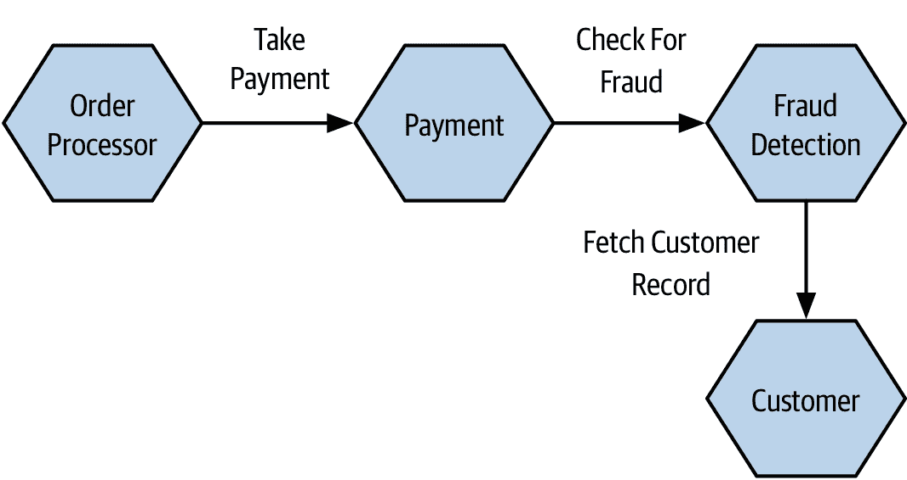

如果所有这些调用都是同步且阻塞的，我们可能会面临许多问题。任意四个相关微服务中的一个出现问题，或它们之间的网络调用出现问题，都可能导致整个操作失败——我们可说故障面更大。这还不包括这类长链可能导致显著的 *资源竞争* 这一事实。在幕后，`Order Processor` 很可能有一个网络连接处于打开状态，等待 `Payment` 的回复。`Payment` 随后也有一个网络连接处于打开状态，等待 `Fraud Detection` 的响应，以此类推。需要保持打开的大量连接会对运行中的系统产生影响——你更有可能遇到可用连接耗尽的问题，或因此遭受网络拥塞增加。

为了改善这种情况，我们可以首先重新审视微服务之间的交互。例如，也许我们可以将 `Fraud Detection` 的使用从主要购买流程中移除，如图 3-4 所示，而让它在后台运行。如果它发现某个特定客户存在问题，其记录会相应更新，并且这可以在付款流程的更早阶段进行检查。实际上，这意味着我们将部分工作并行化。通过缩短调用链的长度，我们会看到操作整体延迟改善，并将我们的一个微服务（`Fraud Detection`）从购买流程的关键路径中移除，对于关键操作而言，这减少了一个需要担心的依赖。

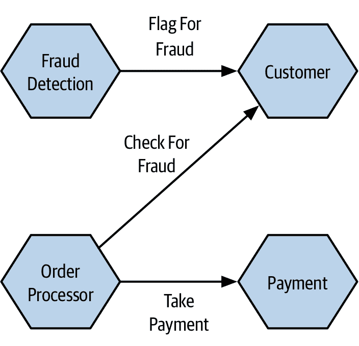

我们当然也可以在不改变此处工作流程的情况下，用某种非阻塞交互方式替换阻塞调用的使用，我们接下来会探讨这一点。

## 模式：异步非阻塞

在异步通信中，将调用发送到网络上的行为不会阻塞发出调用的微服务。它能够继续进行其他处理，而无需等待响应。如果需要响应，它可以在响应返回时处理该响应。非阻塞异步通信有多种形式，但我们将更详细地研究我在微服务架构中看到的三种最常见的风格。它们是：

通过共享数据通信

: 

上游微服务更改某些共享数据，随后一个或多个微服务会使用这些数据。

请求-响应

: 

一个微服务向另一个微服务发送请求，要求其执行某项操作。当请求的<|message|>

最终，在考虑异步通信是否适合你的情况下，你还需要考虑想要选择哪种 *type* 的异步通信，因为每种都有其自身的权衡。总体而言，确实存在一些特定的用例会让我倾向于使用某种形式的异步通信。长时间运行的进程是一个明显的候选者，正如我们在上文 图 3-5 中探讨的那样。此外，存在长调用链且难以重构的情况也可能是一个不错的候选。我们将在后面深入探讨这一点，当我们查看三种最常见的异步通信形式时——请求-响应调用、事件驱动通信以及通过共享数据进行通信。

## 模式：通过共享数据进行通信

一种涵盖多种实现方式的通信风格是通过共享数据进行通信。这种模式用于一种情况，即一个微服务将数据放入定义的位置，然后另一个微服务（或可能多个）使用这些数据。它可以简单到一个微服务将文件丢在某个位置，而稍后另一个微服务拾取该文件并对其进行处理。这种集成风格本质上是异步的。

An example of this is shown in 图 3-6, where the `New Product Importer` creates a file that is then read by the downstream `Inventory` and `Catalog` microservices.

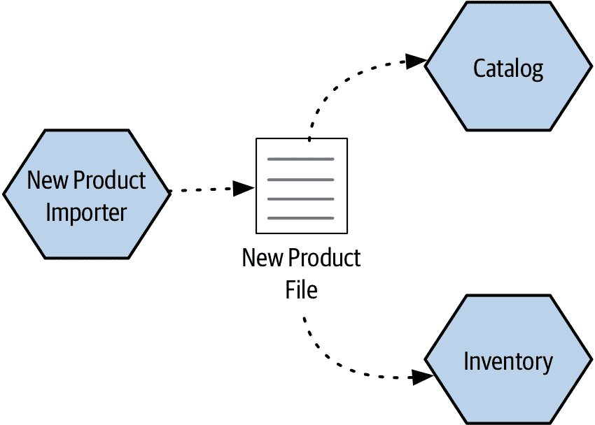

这种模式在某种程度上是你会看到的最常见的通用进程间通信模式，然而我们有时却完全没有将其视为一种通信模式——很大程度上我认为是因为进程之间的通信往往间接到难以察觉。

### 实现

要实现此模式，你需要某种用于数据持久存储。文件系统在许多情况下已经足够。我构建过许多系统，它们只是定期扫描文件系统，注意到新文件的存在并据此做出反应。当然你也可以使用某种健壮的分布式内存存储。值得注意的是，任何将要对该数据采取行动的下游微服务都需要自己的机制来识别新数据是否可用——轮询是解决此问题的常见方案。

此模式的两个常见示例是数据湖和数据仓库。在这两种情况下，这些解决方案通常旨在帮助处理大量数据，但可以说它们在耦合方面处于光谱的相反两端。对于数据湖，源系统以其认为合适的任何格式上传原始数据，而这些原始数据的下游消费者预计知道如何处理该信息。对于数据仓库，仓库本身是一个结构化数据存储。向数据仓库推送数据的微服务需要了解数据仓库的结构——如果结构以向后兼容的方式发生变化，则这些生产者将需要更新。

对于数据仓库或数据湖，假设信息流是单向的。一个微服务将数据发布到公共数据存储，下游消费者读取该数据并执行适当的操作。这种单向流可以使信息流的推理变得更容易。更成问题的一种实现是使用共享数据库，其中多个微服务同时对同一数据存储进行读写，我们在探讨公共耦合时在 第 2 章 中讨论过其示例——图 3-7 显示了 `Order Processor` 和 `Warehouse` 都在更新同一记录。

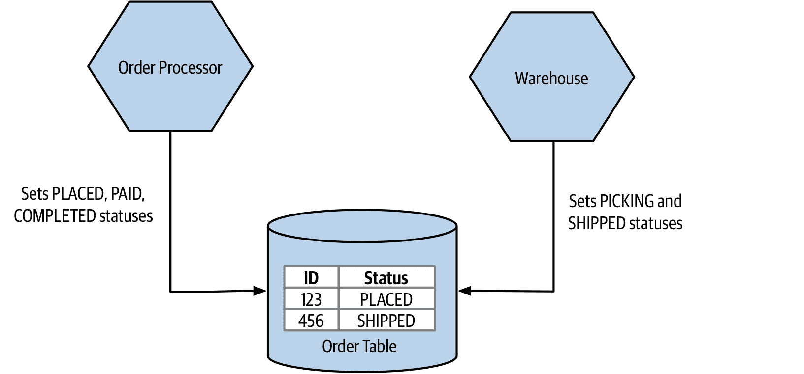

### 优点

此模式可以非常简单地实现，使用大家普遍理解的技术。如果你可以读取或写入文件，或读取和写入数据库，你就可以使用此模式。使用普遍且易于理解的技术也能够在不同类型的系统之间实现互操作性，包括旧的 mainframe 应用或可定制的现成软件（COTS）产品。这里数据量也较少令人担忧——如果你一次性发送大量数据，此模式可以很好地工作。

### 缺点

下游消费微服务通常会通过某种轮询机制，或许是通过定期触发的定时任务来意识到有新数据需要处理。这意味着该机制在低延迟情况下不太可能有用。当然你可以将此模式与其他类型的调用结合起来，通知下游微服务有新数据可用。例如，我可以将文件写入共享文件系统，然后向感兴趣的微服务发送调用，通知它有新数据可能需要处理。这可以缩小数据发布与数据处理之间的差距。总体而言，如果你使用此模式处理非常大的数据量，低延迟不太可能成为你的需求重点。如果你有兴趣发送更大量的数据并希望以更“实时”的方式处理它们，那么使用某种流技术如 Kafka 会更合适。

另一个很大的缺点，如果你记得我们对 图 3-7 中公共耦合的探讨，就会相当明显，那就是公共数据存储成为潜在的耦合源。如果该数据存储的结构以某种方式发生变化，它可能会破坏微服务之间的通信。

通信的健壮性也将取决于底层数据存储的健壮性。这严格来说不是一个缺点，但需要注意的是。如果你将文件丢在文件系统上，你可能希望确保文件系统本身不会以有趣的方式失败。

### 何时使用

此模式真正闪光的地方在于实现进程之间的互操作性，而这些进程可能对可使用的技术有限制。让现有系统与你的微服务的 GRPC 接口通信或订阅其 Kafka 主题，从微服务的角度来看可能更方便，但从消费者的角度来看则不然。旧系统可能对可支持的技术有限制，并且变更成本高。另一方面，即使是旧的 mainframe 系统也应该能够从文件中读取数据。当然，这一切都取决于使用广泛支持的数据存储技术——我也可以使用类似 redis 缓存的东西来实现此模式。但你的旧 mainframe 系统能与 redis 通信吗？

此模式的另一个主要优势在于共享大量数据时。如果你需要在文件系统上发送多 GB 的文件，或将数百万行加载到数据库中，那么此模式就是最佳选择。

## 模式：请求-响应通信

使用请求-响应时，微服务向下游服务发送请求，要求其执行某项操作，并期望收到包含请求结果的响应。这种交互可以通过同步阻塞调用进行，也可以在异步非阻塞方式下实现。这种交互的一个简单示例显示在 图 3-8 中，其中 `Chart` 微服务，该服务汇总不同流派的畅销 CD，向 `Inventory` 服务发送请求，要求获取某些 CD 的当前库存水平。

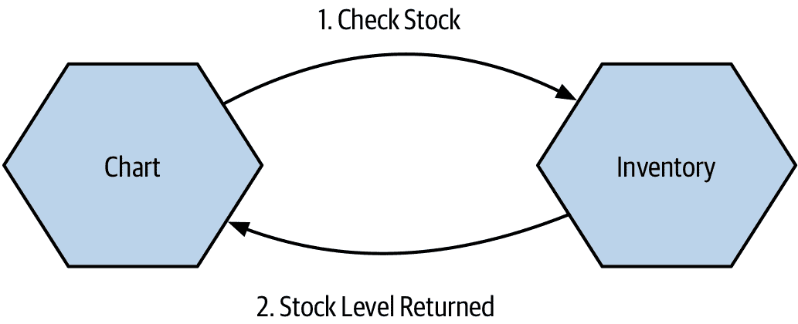

# 模式：请求-响应通信

像这样从其他微服务检索数据是请求-响应调用的常见用例。有时，你只需要确保某件事得到执行。在图 3-9 中，`Warehouse`微服务收到了来自`Order Processor`的请求，要求其预留库存。`Order Processor`只有在确认库存已成功预留时才继续进行付款。如果库存无法预留——也许是因为商品不再可用——则可以取消付款。在这种需要按特定顺序完成调用的情况下使用请求-响应调用是很常见的。

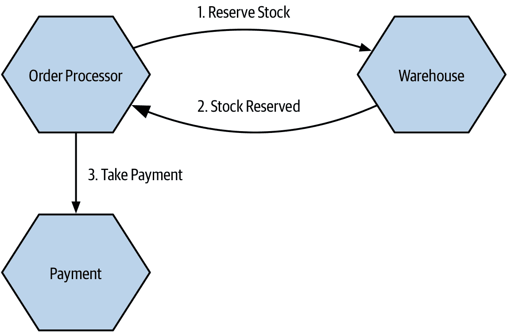

## 实现：同步与异步

像这样的请求-响应调用可以以阻塞的同步方式或非阻塞的异步方式实现。在同步调用中，你通常会看到与下游微服务建立网络连接，并通过该连接发送请求。连接保持打开，等待下游微服务响应。在这种情况下，发送响应的微服务实际上不需要知道发送请求的微服务的任何信息——它只是通过入站连接将内容返回。

使用异步请求响应，情况就不那么直接了。让我们重新审视与预留库存相关的流程。在图 3-10 中，预留库存的请求作为消息通过某种消息代理发送出去，我们将在本章后面探讨消息代理。与消息直接从`Order Processor`发送到`Inventory`微服务不同，它会先进入队列。`Inventory`在有能力时从该队列消费消息。它读取请求，执行预留库存的相关工作，现在需要将响应发送回`Order Processor`正在读取的队列。`Inventory`微服务需要知道将响应路由到哪里。在我们的示例中，它通过另一个队列发送此响应，而该队列随后被`Order Processor`消费。

因此，在非阻塞的异步交互中，接收请求的微服务要么需要隐式地知道将响应路由到哪里，要么需要被告知响应应发送到哪里。使用队列时，我们还获得了额外的好处，即多个请求可以缓冲在队列中等待处理。这在请求无法快速处理时很有帮助。微服务可以在准备好时消费下一个请求，而不是被太多调用压垮。当然，这在很大程度上取决于队列吸收这些请求的能力。

当微服务以这种方式接收响应时，它可能需要将响应与原始请求关联起来。这具有挑战性，因为可能已经过去了很长时间，并且根据所用协议的性质，响应可能不会返回到发送请求的微服务的同一实例。在将预留库存作为下单一部分的示例中，我们需要知道如何将库存已预留的响应与特定订单关联起来，以便继续处理该订单。一种简单的方法是将与原始请求相关联的任何状态存储到数据库中，这样当响应到来时，接收实例可以重新加载相关状态并据此行动。

## 何时使用

请求-响应调用对于在继续进一步处理之前需要请求结果的任何情况都非常合理。它也非常适合微服务需要知道调用是否失败，以便执行某种补偿操作，例如重试的情况。如果符合你的情况，请求-响应是一个明智的方法——然后唯一剩下的问题就是决定采用同步还是异步实现，其权衡与我们之前讨论的相同。

## 模式：事件驱动通信

与请求-响应调用相比，事件驱动通信看起来相当奇怪。与微服务要求其他微服务执行某事不同，微服务会发出事件，而这些事件可能被其他微服务接收也可能不被接收。这是一种固有的异步交互，因为事件监听器将在自己的执行线程上运行。

事件是对某事已发生的一种陈述，几乎总是发生在发出事件的微服务的世界内部发生的某事。发出事件的微服务对其他微服务使用该事件的意图一无所知，事实上甚至可能不知道其他微服务的存在。它在需要时发出事件，这就是它的全部责任。

在图 3-11 中，我们看到`Warehouse`发出与订单打包过程相关的事件。这些事件被两个微服务`Notifications`和`Inventory`接收，并据此做出反应。`Notifications`微服务发送电子邮件以通知客户订单状态的变化，而`Inventory`微服务则可以在商品被打包进客户订单时更新库存水平。

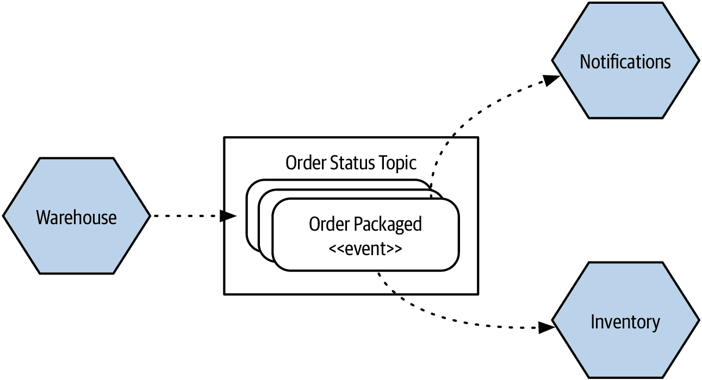

与请求-响应模型相比，这是一种职责的倒置。有了事件，`Warehouse`只是广播事件，假定感兴趣方会据此做出反应。它不知道事件的接收者是谁，使得事件驱动交互通常耦合更松散。与请求-响应调用相比，这是一种职责的倒置，可能需要一段时间才能理解。与请求-响应相比，我可能会期望`Warehouse`在适当时告诉`Notifications`微服务发送电子邮件。在这种模型中，`Warehouse`需要知道哪些事件需要通知客户。采用事件驱动交互时，我们反而将这种责任推入`Notifications`微服务。

我们在此看到的事件驱动交互中的职责分配，可以映射到组织试图创建更自主团队时所看到的相同职责分配。与将所有责任集中控制不同，我们希望将其推入团队本身，以便它们能够更自主地运作——我们将在\[链接待定\]中重访这一概念。在这里，我们将职责从`Warehouse`推向`Notifications`和`Payment`——这可以帮助我们减少像`Warehouse`这样的微服务的复杂性，并在系统中实现更均衡的“智能”分布。我们将在比较编排和编舞时更详细地探讨这一想法。

### 实现

这里我们需要考虑两个主要部分：一种让微服务发出事件的方式，以及一种让消费者获知事件已发生的方式。

传统上，像`RabbitMQ`这样的消息代理试图处理这两个问题。生产者使用 API 将事件发布到代理。代理处理订阅，允许消费者在事件到达时收到通知。这些代理甚至可以处理消费者的状态，例如帮助跟踪他们之前看到哪些消息。这些系统通常设计为可扩展且具有弹性，但这并非免费。它会增加开发过程的复杂性，因为你可能需要运行另一个系统来开发和测试你的服务。可能还需要额外的机器和专业知识来保持此基础设施的运行。但一旦运行，它可以成为实现松耦合事件驱动架构的非常有效的方式。总的来说，我很喜欢这种方式。

然而，仍需警惕中间件的世界，其中消息代理只是其中很小的一部分。队列本身是完全合理、有用的东西。然而，厂商倾向于与其捆绑大量软件，这可能导致越来越多的智能被推入中间件，正如 `Enterprise Service Bus` 之类的东西所证明的那样。确保你知道自己得到的是什么：让中间件保持愚蠢，将智能保留在端点中。

另一种方法是尝试使用 `HTTP` 作为传播事件的方式。`ATOM` 是一种符合 `REST` 的规范，定义了（其中包括）发布资源订阅源的语义。存在许多客户端库允许我们创建和消费这些订阅源。因此，当我们的客户服务发生变化时，我们的客户服务就可以将事件发布到这样的订阅源。我们的消费者只需轮询订阅源，查找更改。一方面，我们可以重用现有的 `ATOM` 规范和任何相关库，这很有用，而且我们知道 `HTTP` 处理扩展非常好。然而，`HTTP` 在低延迟方面表现不佳（某些消息代理在该方面表现出色），而且我们仍需处理消费者需要跟踪已看到的消息并管理自身轮询计划这一事实。

我见过人们花费大量时间实现更多开箱即用的行为，这些行为在合适的消息代理中已经提供，以便让 `ATOM` 适用于某些用例。例如，`Competing Consumer pattern` 描述了一种方法，即启动多个工作器实例来竞争消息，这对于扩展工作器数量以处理一系列独立作业非常有效（我们将在 \[Link to Come\] 中稍后讨论）。然而，我们希望避免两个或更多工作器看到同一条消息的情况，因为我们最终会做比需要更多的工作任务。有了消息代理，标准队列会处理这个问题。有了 `ATOM`，我们现在需要在所有工作器之间管理自己的共享状态，以尽量减少重复劳动的可能性。

如果你已经拥有一个良好、健壮的消息代理可用，请考虑使用它来处理事件的发布和订阅。但如果你还没有，请看看 `ATOM`，但要意识到沉没成本谬误。如果你发现自己想要消息代理提供的越来越多支持，到了一定程度，你可能想要改变你的方法。

就我们实际通过这些异步协议发送的内容而言，与同步通信相同的考虑也适用。如果你目前对使用 `JSON` 编码请求和响应感到满意，就坚持使用它。

### 事件中有什么？

在 图 3-12 中，我们看到一个事件从 `Customer` 微服务广播出去，通知感兴趣的各方有新客户在系统中注册。两个下游微服务 `Loyalty` 和 `Notifications` 关心此事件。`Loyalty` 微服务通过为新客户设置账户来响应接收事件，以便他们开始赚取积分，而 `Notifications` 微服务则向新注册的客户发送电子邮件，欢迎他们体验 `MusicCorp` 的奇妙乐趣。

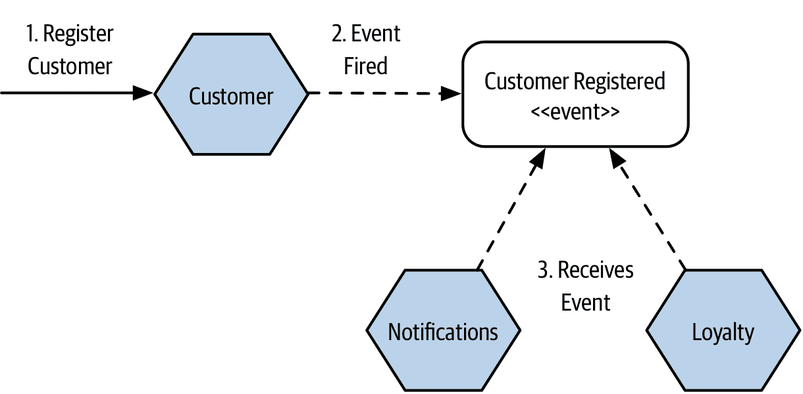

对于请求，我们是在要求一个微服务执行某事，并提供执行请求操作所需的信息。对于事件，我们是在广播一个其他各方**可能**感兴趣的事实，但由于发出事件的微服务无法也不应该知道谁接收该事件，我们如何知道其他各方可能需要从事件中获得什么信息？那么，到底应该在事件中包含什么？

#### 仅一个 ID

一个选项是事件仅包含新注册客户的标识符，如 图 3-13 所示。`Loyalty` 微服务只需要此标识符来创建匹配的忠诚度账户，因此它拥有所需的所有信息。然而，虽然 `Notifications` 微服务知道在接收到此类事件时需要发送欢迎电子邮件，但它需要额外信息来完成工作——至少是电子邮件地址，可能还有客户姓名以便给电子邮件增添个人色彩。由于这些信息不在 `Notifications` 微服务接收到的事件中，因此它别无选择，只能从 `Customer` 微服务获取这些信息，我们在 图 3-13 中可以看到这一点。

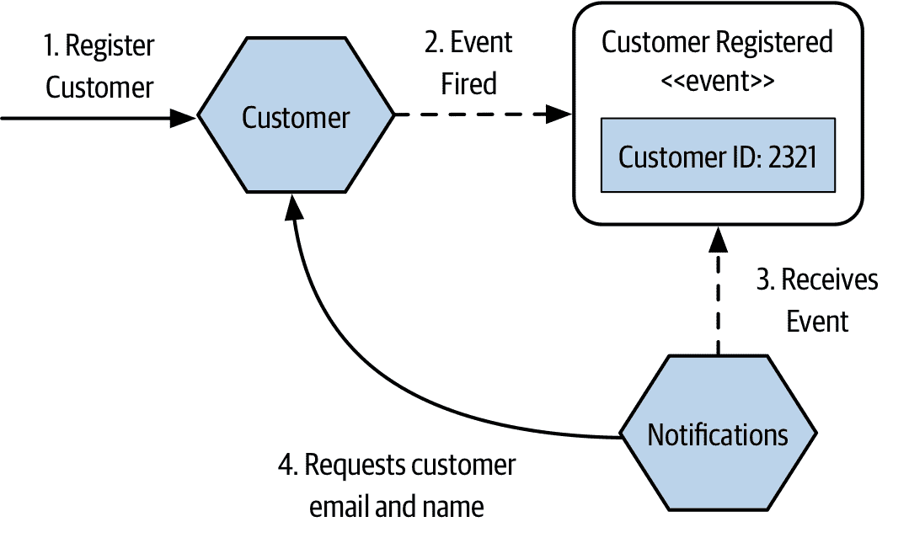

这种方法有一些缺点。首先，`Notification` 微服务现在必须知道 `Customer` 微服务，增加了额外的领域耦合。虽然领域耦合，如我们在 第 2 章 中讨论的那样，在耦合谱系中属于较松散的一端，但我们仍希望在可能的情况下避免它。如果 `Notification` 接收到的事件包含其所需的所有信息，则不需要此回调。接收微服务的此回调还可能导致另一个主要缺点——即在接收微服务数量很大的情况下，发出事件的微服务可能会因此受到大量请求的冲击。想象一下，如果五个不同的微服务都接收到相同的客户创建事件，并且都需要请求额外信息——它们都需要立即向 `Customer` 微服务发送请求以获取所需内容。随着对特定事件感兴趣的微服务数量增加，这些调用的影响可能会变得显著。

#### 完全详细的事件

我更喜欢的替代方案是，将所有内容放入事件中，而你本可以否则通过 `API` 共享这些内容。如果你允许 `Notifications` 微服务请求给定客户的电子邮件地址和姓名，为什么不一开始就将其放入事件中呢？在 图 3-14 中，我们看到这种方法——`Notification` 现在更具自足性，能够在无需与 `Customer` 微服务通信的情况下完成工作。事实上，它可能永远不需要知道 `Customer` 微服务甚至存在。

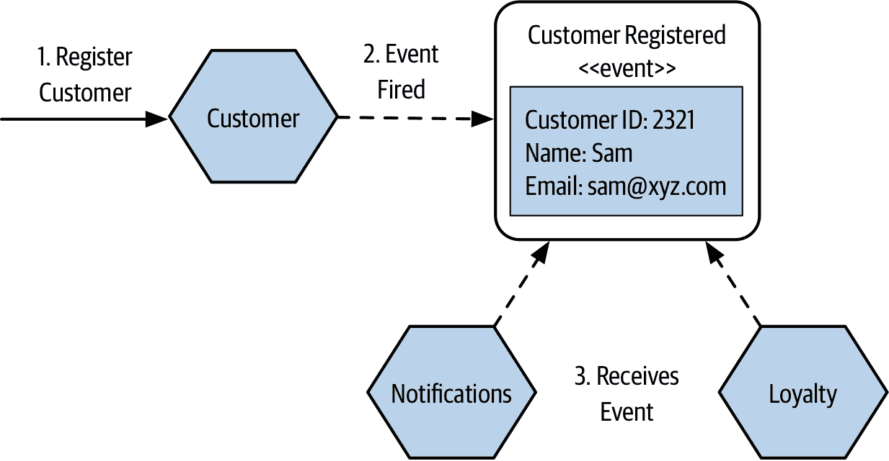

除了信息更丰富的事件可以实现更松散的耦合之外，信息更丰富的事件还可以充当给定实体发生了什么的历史记录。这可以帮助你在实施审计系统时，或许甚至提供在特定时间点重构实体的能力——这意味着这些事件可以用作 `event sourcing` 的一部分，我们稍后会简要探讨这一概念。

虽然这种方法绝对是我的首选，但它并非没有一些缺点。首先，如果事件相关的数据很大，我们可能会担心事件的大小。现在，现代消息代理（假设你使用它来实现事件广播机制）对消息大小有相当宽松的限制。`Kafka` 中消息的默认最大大小为 1MB，而 `RabbitMQ` 的最新版本对单条消息的理论上限为 512MB（从之前的 2GB 限制下降！），尽管对于这种大消息可能会出现一些有趣的性能问题。但即使是 `Kafka` 上消息最大大小提供的 1MB，也给了我们发送大量数据的很大空间。最终，如果你进入了一个开始担心事件大小的领域，那么一种混合方法可能是部分信息在事件中，而其他（较大）数据可以根据需要查找。

在 图 3-14 中，`Loyalty` 不需要知道客户的电子邮件地址或姓名，然而由于该信息通过事件被发送，它仍然会收到这些信息。这可能会引起担忧，如果我们试图限制哪些微服务可以看到何种类型的数据——例如，我可能希望限制哪些微服务可以看到个人身份信息（或 PII）、支付卡详细信息或类似的敏感数据。解决此问题的一种方法可能是实现类似 Split Horizon Communication 的机制，我们将在 [链接待定] 中稍后探讨。

另一个需要考虑的是，一旦我们将数据放入事件中，它就成为我们与外部世界契约的一部分。我们必须意识到，如果我们从事件中移除一个字段，可能会破坏外部方。信息隐藏在事件驱动协作中仍然是一个重要概念——我们放入事件中的数据越多，外部方对该事件的假设就越多。我的一般原则是，如果我愿意通过请求-响应 API 共享相同的数据，那么我就乐意将信息放入事件中。

### 是否有效？

TODO: 移至工作流讨论？

其中一些异步的东西看起来很有趣，对吧？事件驱动架构似乎能带来更解耦、可扩展的系统。而且确实可以。但这些编程风格确实会导致复杂性增加。这不仅仅是我们刚才讨论的管理发布和订阅消息所需的复杂性，还包括我们可能面临的其他问题。例如，在考虑长时间运行的异步请求-响应时，我们必须思考响应回来时该怎么办。它是否返回到发起请求的同一个节点？如果是，如果该节点宕机了怎么办？如果不是，我是否需要在某个地方存储信息以便相应地做出反应？如果有合适的 API，短暂的异步可能更容易管理，但即便如此，对于习惯于进程内同步消息调用的程序员来说，这也是一种不同的思维方式。

是时候讲一个警示故事了。2006 年，我正在为一家银行构建定价系统。我们会查看市场事件，并确定投资组合中需要重新定价的项目。一旦确定了需要处理的项目列表，我们就会把它们全部放到消息队列中。我们利用网格创建了一个定价工作进程池，可以根据需要扩展和缩减定价集群。这些工作进程使用竞争消费者模式，每一个都尽可能快地吞噬消息，直到没有剩余可处理的消息为止。

系统已经运行起来，我们感到相当自满。然而，就在我们发布新版本后不久，我们遇到了一个棘手的问题。我们的 worker 不断死亡。并且死亡。并且死亡。

最终，我们追踪到了问题。出现了一个 bug，导致某种类型的定价请求会使 worker 崩溃。我们使用的是事务队列：当 worker 死亡时，其对请求的锁定超时，定价请求会被放回队列——然后另一个 worker 拾取它并死亡。这是 Martin Fowler 所称的 [灾难性故障转移](http://bit.ly/1EmZMss) 的一个经典例子。

除了 bug 本身之外，我们还未能为队列中的作业指定最大重试限制。我们修复了 bug 本身，并配置了最大重试次数。但我们也意识到需要一种查看并可能重放这些错误消息的方法。我们最终不得不实现一个消息医院（或死信队列），如果消息失败则会被发送到那里。我们还创建了一个 UI 来查看这些消息，并在需要时重试它们。这些问题对于只熟悉同步点对点通信的人来说并不 immediately 显而易见。

事件驱动架构以及一般异步编程所带来的相关复杂性让我相信，你在开始采用这些想法时应保持谨慎。确保已具备良好的监控，并强烈考虑使用 correlation IDs，它允许你在进程边界之间追踪请求，我们将在 \[链接待定\] 中深入介绍。

我还强烈建议查看 *企业集成模式*（Addison-Wesley），其中包含有关该领域可能需要考虑的不同消息模式的更多详细信息。

## 摘要

在本章中，我们拆解了一些微服务通信的关键风格，并讨论了各种权衡。并非总有一个唯一的 **正确** 选项，但希望我已提供足够的信息，关于同步和异步调用、事件驱动和请求-响应风格的通信，以帮助你在特定上下文中做出正确的选择。

本章主要关注一个微服务如何与另一个微服务通信，在下一章中我们将超越这一点，探讨如何让多个微服务协作以实现工作流。

^(1) 真实故事

^(2) 请注意，这非常简化——例如，我完全省略了错误处理代码。如果你想了解更多关于 `async/await` 的内容，特别是 JavaScript，The Modern JavaScript Tutorial 是一个很好的起点：[*https://javascript.info/*](https://javascript.info/)
