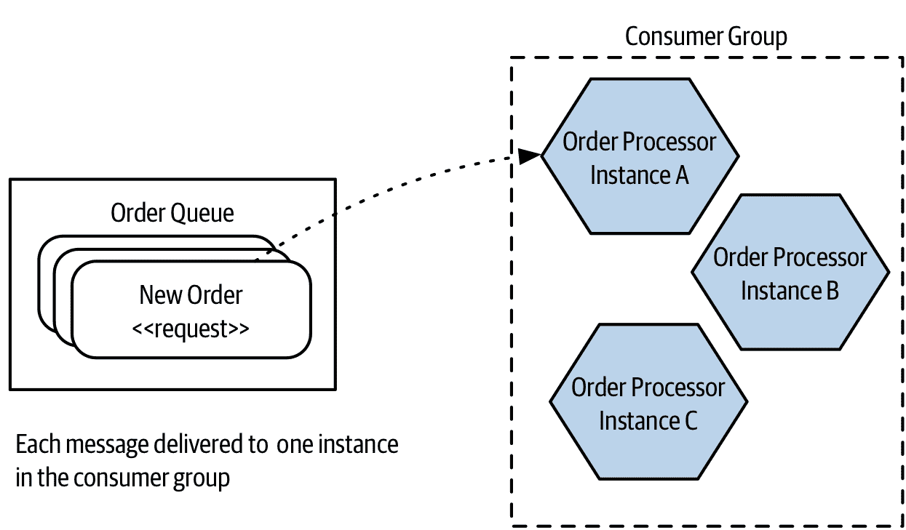
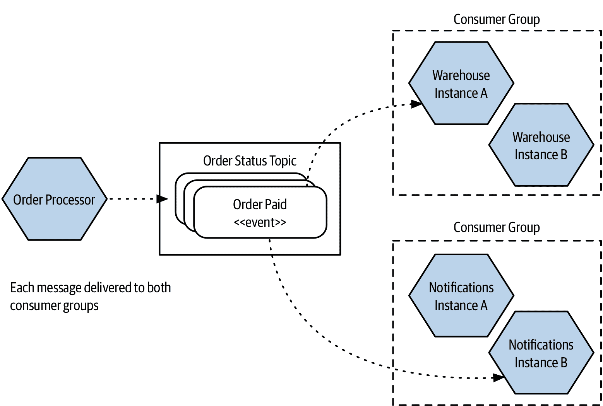
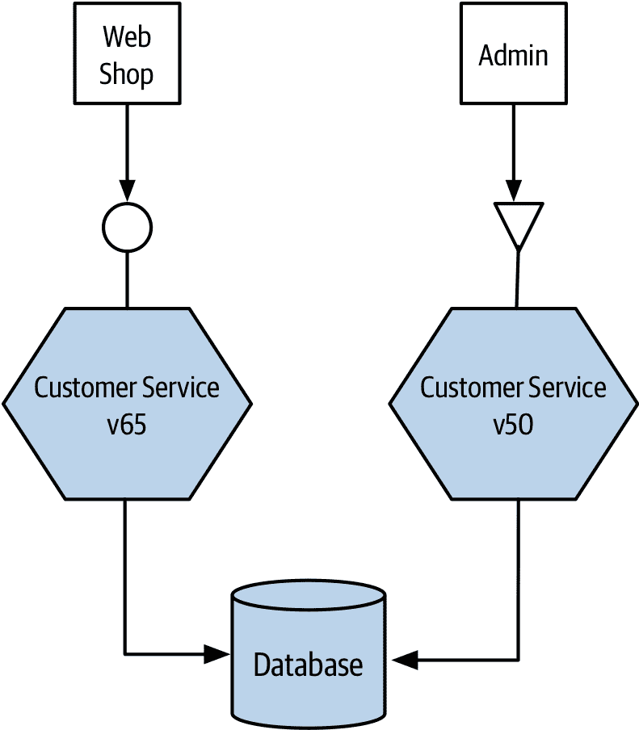
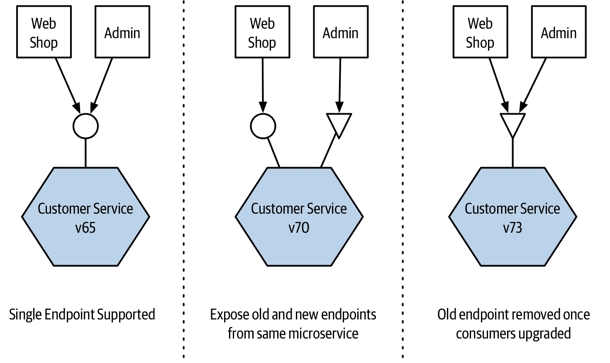
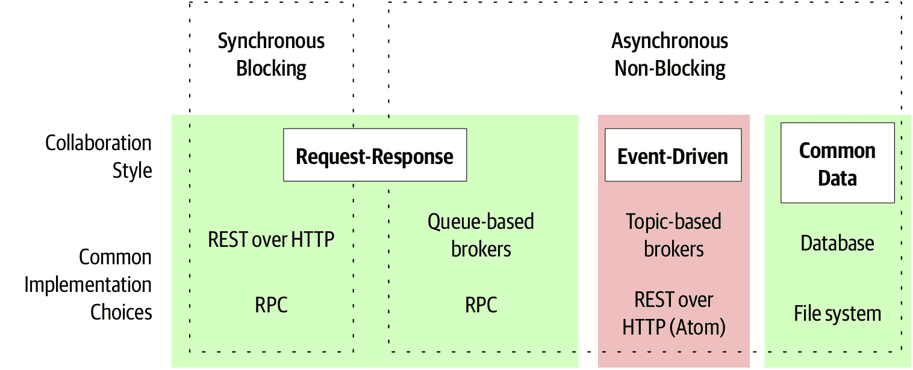

# 第4章 实现微服务通信

在微服务之间通信的方式上，有令人眼花缭乱的各种选择。但哪一个是正确的：SOAP？XML-RPC？REST？GRPC？

正如我们在上一章讨论的那样，你的技术选择在很大程度上应基于你想要的通信风格。决定是使用阻塞同步还是非阻塞异步调用，请求-响应还是事件驱动协作，将有助于你从原本可能很长的技术列表中筛选出合适的选项。

在本章中，我们将现在来看一些用于微服务通信的常见技术。但新的选项总是在出现，所以在讨论具体技术之前，让我们先思考一下我们希望从所选技术中获得什么。

## 使向后兼容变得容易

在对微服务进行更改时，我们需要确保不会破坏任何消费微服务的兼容性。因此，我们希望确保所选技术能让进行向后兼容的更改变得容易。像添加新字段这样简单的操作不应破坏客户端。我们理想情况下还希望能够验证所做的更改是否向后兼容——并在将微服务部署到生产环境之前获得该反馈的方式。

## 使接口明确

微服务向外部世界公开的接口明确非常重要。这意味着微服务的消费者能够清楚地知道该微服务公开了哪些功能。但这也意味着在微服务上工作的开发者能够清楚地知道哪些功能需要保持完整以供外部方使用——我们希望避免微服务的更改导致兼容性意外破坏的情况。

模式可以在确保微服务公开的接口明确方面发挥很大作用。我们可以考虑的一些技术需要使用模式，而另一些则使用模式是可选的。无论如何，我强烈建议使用模式，以及足够的支持文档，以明确消费者可以期望微服务提供的功能。

## 保持 API 技术无关


如果你在 IT 行业待了超过 15 分钟，你就不需要我告诉你我们工作在一个变化迅速的领域。唯一确定的 *是* 变化。新的工具、框架和语言不断涌现，实现了可以帮助我们更快、更有效地工作的新想法。现在，你可能是一家 `.NET` 店。但一年后，或五年后呢？如果想尝试可能让你更高效的替代技术栈怎么办？

我非常喜欢保持选择开放，这也是我如此推崇微服务的原因。我也认为确保微服务之间通信所使用的 API 保持技术无关非常重要。这意味着要避免规定我们可以用哪些技术栈来实现微服务的集成技术。

## 让服务对消费者更简单

我们希望让消费者轻松使用我们的微服务。如果作为消费者的使用成本高得离谱，那么拥有一个结构优美的微服务也没什么意义！所以让我们思考一下是什么让消费者能够轻松使用我们美妙的新服务。理想情况下，我们希望客户端在技术选择上拥有完全自由，但另一方面，提供客户端库可以简化采用。然而，这样的库往往与我们想要实现的其他目标不兼容。例如，我们可能会使用客户端库来让消费者更方便，但这可能会以增加耦合为代价。

## 隐藏内部实现细节

我们不希望消费者受制于我们的内部实现。这会导致耦合增加。这意味着如果我们想在微服务内部更改某些东西，就可能破坏消费者，因为需要他们也进行更改。这增加了变更成本——而这正是我们试图避免的。它还意味着我们不太可能想要做出更改，因为担心需要升级消费者，这可能导致服务内部技术债务增加。因此，任何推动我们暴露内部表示细节的技术都应避免。

我们可以考察的技术种类繁多，但与其广泛查看这个领域的长长选项列表，我将重点介绍一些最受欢迎和有趣的选择。我们将考察的选项如下：

远程过程调用 (`RPC`)

允许在远程进程上调用本地方法调用的框架。常见选项包括 `SOAP` 和 `GRPC`。

`REST`

一种架构风格，其中你公开资源（`Customer`、`Order` 等），这些资源可使用一组通用动词（`GET`、`POST`）访问。`REST` 不止于此，但我们稍后会讲到。

`GraphQL`

一种相对较新的协议，允许消费者定义自定义查询，从多个下游微服务获取信息，并过滤结果仅返回所需内容。

消息代理

允许通过队列或主题进行异步通信的中间件。

待办：展示此技术与我们之前概述的风格的对比？

## 远程过程调用

*远程过程调用* 指的是进行本地调用并使其在某处远程服务上执行的技术。市面上有多种不同类型的 `RPC` 技术。大多数该领域的技术需要显式模式，例如 `SOAP` 或 `GRPC`。使用单独的模式使得为不同技术栈生成客户端和服务器存根变得更容易，因此例如，我可以有一个公开 `SOAP` 接口的 `Java` 服务器，以及从接口的 Web 服务定义语言（`WSDL`）定义生成的 `.NET` 客户端。其他技术，如 `Java RMI`，要求客户端和服务器之间更紧密的耦合，要求两者使用相同的底层技术，但避免了共享接口定义的需求。然而，所有这些技术都有相同的核心特征，即让远程调用看起来像本地调用。

通常，使用 `RPC` 技术意味着你采用了一种序列化协议。`RPC` 框架定义了数据的序列化和反序列化方式。例如 `GRPC` 使用 `protocol buffer` 序列化格式来实现此目的。某些实现绑定到特定的网络协议（如 `SOAP`，它名义上使用 `HTTP`），而其他实现可能允许你使用不同类型的网络协议，这些协议本身可以提供额外功能。例如，`TCP` 提供交付保证，而 `UDP` 不提供但开销更低。这可以让你为不同的用例使用不同的网络技术。

具有显式模式的 `RPC` 框架使得生成客户端代码变得非常容易。这可以避免对客户端库的需求，因为任何客户端都可以根据此服务规范自行生成代码。然而，要使客户端代码生成工作，客户端需要某种方式在带外获取模式——换句话说，消费者需要在计划调用之前访问模式。`AVRO RPC` 在这里是一个有趣的例外，因为它可以选择将完整模式与负载一起发送，从而允许客户端动态解释模式。

客户端代码生成的便捷性是 `RPC` 的主要卖点之一：其易用性。我只需进行一次普通的 方法调用并理论上忽略其余部分这一事实是巨大的优势。

### 挑战

正如我们所见，`RPC` 提供了一些很好的优势，但它并非没有缺点——而且某些 `RPC` 实现可能比其他实现更成问题。许多这些问题可以得到解决，但值得进一步探讨。

#### 技术耦合

一些 `RPC` 机制，如 `Java RMI`，与特定平台紧密绑定，这可能限制客户端和服务器可使用的技术。`Thrift` 和 `protocol buffers` 对替代语言有令人印象深刻的支持，这可以在一定程度上减少这一缺点，但请注意，有时 `RPC` 技术会带来互操作性限制。

在某种程度上，这种技术耦合可以是一种暴露内部技术实现细节的形式。例如，使用 `RMI` 不仅将客户端绑定到 `JVM`，服务器也是如此。

公平地说，有一些 `RPC` 实现没有此限制——`GRPC`、`SOAP` 和 `Thrift` 都是允许不同技术栈之间互操作性的例子。

#### 本地调用不等于远程调用

`RPC` 的核心思想是隐藏远程调用的复杂性。但这可能导致隐藏过多。某些形式的 `RPC` 试图让远程方法调用看起来像本地方法调用，这掩盖了这两者非常不同的事实。我可以进行大量本地、进程内调用而无需过度担心性能。然而，使用 `RPC` 时，编组和解组负载的成本可能很显著，更不用说在网络上传输所需的时间。这意味着你需要以不同方式思考远程接口与本地接口的 API 设计。只是拿一个本地 API 试图使其成为服务边界而没有进一步思考，很可能会惹上麻烦。在最糟糕的例子中，如果抽象过于不透明，开发人员可能在不知情的情况下使用远程调用。


你需要考虑网络本身。众所周知，分布式计算谬误之首是[“网络是可靠的”](http://bit.ly/1LbdCzY)。网络不可靠。即使你的客户端和你正在通信的服务器都正常，它们也可能而且会失败。它们可能快速失败，也可能缓慢失败，甚至可能损坏你的数据包。你应该假设你的网络充斥着随时可能发泄怒火的恶意实体。因此，你可以预期的故障模式是不同的。故障可能是由远程服务器返回错误引起的，也可能是你调用不当造成的。你能区分这两者吗？如果能，你能做些什么？当远程服务器开始缓慢响应时，你又该怎么办？我们将在讨论弹性时在\[链接待定\]中涵盖这个话题。

### 脆弱性

一些最流行的 RPC 实现会导致一些糟糕的脆弱性形式，Java 的 RMI 就是一个很好的例子。让我们考虑一个非常简单的 Java 接口，我们决定将其作为客户服务的远程 API。示例 4-1 声明了我们将远程公开的方法。Java RMI 然后为我们的方法生成客户端和服务器存根。

#### 示例 4-1. 使用 Java RMI 定义服务端点

```
import java.rmi.Remote;
import java.rmi.RemoteException;

public interface CustomerRemote extends Remote {
  public Customer findCustomer(String id) throws RemoteException;

  public Customer createCustomer(String firstname, String surname, String emailAddress)
      throws RemoteException;
}
```

在此接口中，`createCustomer` 接受名字、姓氏和电子邮件地址。如果我们决定允许 `Customer` 对象仅使用电子邮件地址创建会怎样？我们可以在此时相当容易地添加一个新方法，如下所示：

```
...
public Customer createCustomer(String emailAddress) throws RemoteException;
...
```

问题是现在我们也需要重新生成客户端存根。想要使用新方法的客户端需要新的存根，并且根据规范更改的性质，即使不需要新方法的消费者也可能需要升级他们的存根。当然，这在一定程度上是可以管理的。现实是，像这样的更改相当常见。RPC 端点通常最终会有大量的方法，用于以不同的方式创建或与对象交互。这部分是由于我们仍然将这些远程调用视为本地调用。

不过还有另一种脆弱性。让我们看看我们的 `Customer` 对象是什么样的：

```
public class Customer implements Serializable {
  private String firstName;
  private String surname;
  private String emailAddress;
  private String age;
}
```

现在，如果事实证明，尽管我们在 `Customer` 对象中公开了 `age` 字段，但我们的消费者从未使用它会怎样？我们决定要删除这个字段。但是如果服务器实现从该类型的定义中删除了 `age`，而我们没有对所有消费者做同样的操作，那么即使他们从未使用过该字段，消费者端反序列化 `Customer` 对象的相关代码也会中断。要推出此更改，我必须同时部署新的服务器和客户端。这对于任何推广使用二进制存根生成的 RPC 机制来说都是一个关键挑战：你无法将客户端和服务器部署分开。如果你使用这项技术，同步发布可能会成为你的未来。

如果我想重构 `Customer` 对象，即使没有删除字段，也会出现类似问题——例如，如果我想将 `firstName` 和 `surname` 封装到新的 `naming` 类型中以便于管理。当然，我可以通过将字典类型作为调用的参数传递来解决这个问题，但那样的话，我会失去生成的存根的许多好处，因为我仍然需要手动匹配和提取我想要的字段。

实际上，作为有线二进制序列化一部分使用的对象可以被视为 `expand-only` 类型。这种脆弱性导致类型通过线路暴露并成为大量字段的集合，其中一些字段不再使用但无法安全删除。

### 何时使用

尽管存在缺点，我实际上非常喜欢 RPC，而更现代的实现，例如 GRPC，[content]
你需要考虑网络本身。众所周知，分布式计算谬误之首是[“网络是可靠的”](http://bit.ly/1LbdCzY)。网络不可靠。即使你的客户端和你正在通信的服务器都正常，它们也可能而且会失败。它们可能快速失败，也可能缓慢失败，甚至可能损坏你的数据包。你应该假设你的网络充斥着随时可能发泄怒火的恶意实体。因此，你可以预期的故障模式是不同的。故障可能是由远程服务器返回错误引起的，也可能是你调用不当造成的。你能区分这两者吗？如果能，你能做些什么？当远程服务器开始缓慢响应时，你又该怎么办？我们将在讨论弹性时在\[链接待定\]中涵盖这个话题。

### 脆弱性

一些最流行的 RPC 实现会导致一些糟糕的脆弱性形式，Java 的 RMI 就是一个很好的例子。让我们考虑一个非常简单的 Java 接口，我们决定将其作为客户服务的远程 API。示例 4-1 声明了我们将远程公开的方法。Java RMI 然后为我们的方法生成客户端和服务器存根。

#### 示例 4-1. 使用 Java RMI 定义服务端点

```
import java.rmi.Remote;
import java.rmi.RemoteException;

public interface CustomerRemote extends Remote {
  public Customer findCustomer(String id) throws RemoteException;

  public Customer createCustomer(String firstname, String surname, String emailAddress)
      throws RemoteException;
}
```

在此接口中，`createCustomer` 接受名字、姓氏和电子邮件地址。如果我们决定允许 `Customer` 对象仅使用电子邮件地址创建会怎样？我们可以在此时相当容易地添加一个新方法，如下所示：

```
...
public Customer createCustomer(String emailAddress) throws RemoteException;
...
```

问题是现在我们也需要重新生成客户端存根。想要使用新方法的客户端需要新的存根，并且根据规范更改的性质，即使不需要新方法的消费者也可能需要升级他们的存根。当然，这在一定程度上是可以管理的。现实是，像这样的更改相当常见。RPC 端点通常最终会有大量的方法，用于以不同的方式创建或与对象交互。这部分是由于我们仍然将这些远程调用视为本地调用。

不过还有另一种脆弱性。让我们看看我们的 `Customer` 对象是什么样的：

```
public class Customer implements Serializable {
  private String firstName;
  private String surname;
  private String emailAddress;
  private String age;
}
```

现在，如果事实证明，尽管我们在 `Customer` 对象中公开了 `age` 字段，但我们的消费者从未使用它会怎样？我们决定要删除这个字段。但是如果服务器实现从该类型的定义中删除了 `age`，而我们没有对所有消费者做同样的操作，那么即使他们从未使用过该字段，消费者端反序列化 `Customer` 对象的相关代码也会中断。要推出此更改，我必须同时部署新的服务器和客户端。这对于任何推广使用二进制存根生成的 RPC 机制来说都是一个关键挑战：你无法将客户端和服务器部署分开。如果你使用这项技术，同步发布可能会成为你的未来。

如果我想重构 `Customer` 对象，即使没有删除字段，也会出现类似问题——例如，如果我想将 `firstName` 和 `surname` 封装到新的 `naming` 类型中以便于管理。当然，我可以通过将字典类型作为调用的参数传递来解决这个问题，但那样的话，我会失去生成的存根的许多好处，因为我仍然需要手动匹配和提取我想要的字段。

实际上，作为有线二进制序列化一部分使用的对象可以被视为 `expand-only` 类型。这种脆弱性导致类型通过线路暴露并成为大量字段的集合，其中一些字段不再使用但无法安全删除。

### 何时使用

尽管存在缺点，我实际上非常喜欢 RPC，而更现代的实现，例如 GRPC，优秀，而其他实现存在重大问题，会让我敬而远之。例如 Java RMI 在脆弱性和技术选择有限方面存在诸多问题，而 SOAP 从开发人员角度来看相当笨重，尤其与更现代的选择相比。

如果你打算选择这种模型，请注意与 RPC 相关的一些潜在陷阱。不要将远程调用抽象到网络完全被隐藏的程度，并确保可以在不要求客户端进行同步升级的情况下演进服务器接口。例如，找到客户端代码的正确平衡很重要。确保你的客户端不会对即将进行网络调用一无所知。客户端库在 RPC 的上下文中经常被使用，如果结构不当可能会有问题。我们稍后会更详细地讨论它们。

如果我在该领域寻找选项，GRPC 将是我的首选清单之首。利用 HTTP/2 构建，它具有令人印象深刻的性能特征和良好的通用易用性。我也欣赏 GRPC 周围的生态系统，包括像 Protolock^(1) 这样的工具，我们将在本章讨论模式时稍后讨论。

GRPC 很好地适合同步请求-响应模型，但也可以与响应式扩展结合使用。每当我在对客户端和服务器端都有相当控制权的情况下，我都会将其列为首选。如果你必须支持各种可能需要与你的微服务通信的其他应用程序，客户端代码需要根据服务器端模式编译可能会有问题。在这种情况下，采用某种形式的 REST over HTTP API 可能更合适。

## REST

Representational State Transfer（REST）是一种受 Web 启发的架构风格。REST 风格背后有许多原则和约束，但我们将重点关注那些在微服务世界中面对集成挑战时真正帮助我们，以及在为服务接口寻找 RPC 的替代风格时真正帮助我们的原则。

在思考 REST 时，最重要的是资源的概念。你可以将资源视为服务本身所了解的事物，比如 `Customer`。服务器根据请求创建该 `Customer` 的不同表示。资源在外部的显示方式与其在内部的存储方式完全解耦。例如，客户端可能会请求 `Customer` 的 JSON 表示，即使它以完全不同的格式存储。一旦客户端拥有了该 `Customer` 的表示，它就可以提出更改请求的请求，而服务器可能会或可能不会遵守它们。

REST 有许多不同的风格，我在这里只简要涉及。我强烈建议你查看 [Richardson 成熟度模型](http://bit.ly/1fh2AGt)，其中比较了 REST 的不同风格。

REST 本身并不真正谈论底层协议，尽管它最常用在 HTTP 上。我以前见过使用非常不同的协议实现 REST，例如串行或 USB，尽管这可能需要大量工作。HTTP 作为规范的一部分提供的一些功能，例如动词，使得在 HTTP 上实现 REST 更容易，而对于其他协议，你将不得不自己处理这些功能。

### REST 与 HTTP


HTTP 本身定义了一些有用的功能，与 REST 风格配合得非常好。例如，HTTP 动词（例如 `GET`、`POST` 和 `PUT`）在 HTTP 规范中已有明确的含义，说明它们应如何与资源协同工作。REST 架构风格实际上告诉我们，方法应在所有资源上以相同的方式表现，而 HTTP 规范恰好定义了一组我们可以使用的 方法。`GET` 以幂等的方式检索资源，而 `POST` 创建新资源。这意味着我们可以避免许多不同的 `createCustomer` 或 `editCustomer` 方法。相反，我们只需 `POST` 一个客户表示以请求服务器创建新资源，并发起 `GET` 请求来检索资源的表示。从概念上讲，在这些情况下只有一个以 `Customer` 资源形式存在的 *endpoint*，而我们可以对其执行的操作已内置于 HTTP 协议中。

HTTP 还带来了一个庞大的支持工具和技术生态系统。我们可以使用像 Varnish 这样的 HTTP 缓存代理和像 `mod_proxy` 这样的负载均衡器，许多监控工具开箱即对 HTTP 有大量支持。这些构建块使我们能够处理大量 HTTP 流量并以相当透明的方式智能路由。我们还可以使用 HTTP 的所有可用安全控制来保护通信。从基本认证到客户端证书，HTTP 生态系统为我们提供了许多工具来简化安全流程，我们将在 \[待定链接\] 中更深入地探讨该主题。话虽如此，要获得这些好处，你必须很好地使用 HTTP。使用不当，它可能和任何其他技术一样不安全且难以扩展。但如果使用得当，你会得到很多帮助。

请注意 HTTP 也可以用于实现 RPC。`SOAP` 例如通过 HTTP 路由，但不幸的是几乎没有使用规范。动词被忽略，诸如 HTTP 错误代码之类的简单事物也被忽略。`GRPC` 另一方面被设计为利用 `HTTP/2` 的功能，例如能够在单个连接上发送多个请求-响应流。

## 超媒体作为应用状态的引擎

REST 中引入的另一个原则可以帮助我们避免客户端和服务器之间的耦合，是 *hypermedia as the engine of application state* 的概念（通常缩写为 `HATEOAS`，而且确实需要一个缩写）。这是一个相当晦涩的表述和一个相当有趣的概念，所以让我们稍微拆解一下。

超媒体是一个概念，即一段内容包含指向各种格式（例如文本、图像、声音）的其他内容的链接。这应该很熟悉，因为这就是普通网页所做的：你会跟随链接，这些链接是一种超媒体控件，以查看相关内容。`HATEOAS` 背后的想法是客户端应通过这些指向其他资源的链接与服务器进行交互（可能导致状态转换）。它不需要通过知道要访问哪个 URI 来知道客户在服务器上的确切位置；相反，客户端会查找并导航链接以找到所需内容。

这是一个有点奇怪的概念，所以让我们先退一步，考虑人们如何与网页交互，我们已经确定网页富含超媒体控件。

想想 Amazon.com 购物网站。购物车的位置随时间发生了变化。图形发生了变化。链接发生了变化。但作为人类，我们足够聪明，仍然能看到购物车，知道它是什么，并与之交互。我们对购物车的含义有理解，即使表示它的确切形式和底层控件已经改变。我们知道如果想查看购物车，这就是我们想要交互的控件。这就是网页能够随时间逐步变化的方式。只要客户与网站之间的这些隐式契约仍然得到满足，变更就不需要是破坏性变更。

使用超媒体控件，我们试图为我们的电子消费者实现同样的 *smarts* 水平。让我们看看我们可能为 MusicCorp 拥有的一个超媒体控件。我们在 示例 4-2 中访问了一个代表特定专辑目录条目的资源。除了专辑信息外，我们还看到一些超媒体控件。

### 示例 4-2. 用于专辑列表的超媒体控件

```
<album>
  <name>Give Blood</name>
  <link rel="/artist" href="/artist/theBrakes" /> 
  <description>
    Awesome, short, brutish, funny and loud. Must buy!
  </description>
  <link rel="/instantpurchase" href="/instantPurchase/1234" /> 
</album>
```


: 

此超媒体控件向我们展示了在哪里找到有关艺术家的信息。


: 

如果我们想购买专辑，我们现在就知道去哪里了。

在此文档中，我们有两个超媒体控件。读取此类文档的客户端需要知道，关系为 `artist` 的控件是获取艺术家信息需要导航到的位置，而 `instantpurchase` 是用于购买专辑的协议的一部分。客户端必须以与人类需要理解购物网站上购物车是待购买商品所在位置的方式，同样理解 API 的语义。

作为客户端，我不需要知道要访问哪个 URI 方案来 *buy* 专辑，我只需要访问资源，找到购买控件，然后导航到那里。购买控件的位置可能会改变，URI 可能会改变，或者网站甚至可能将我发送到另一个服务，而作为客户端我不会在意。这为我们提供了客户端和服务器之间大量的解耦。

在这里我们从底层细节中得到了极大的抽象。只要客户端仍能找到与协议理解相匹配的控件，我们就可以完全改变控件呈现方式的实现，就像购物车控件可能从简单的链接变为更复杂的 JavaScript 控件一样。我们也可以自由地向文档添加新控件，也许代表我们可以对相关资源执行的新状态转换。我们只有在从根本上改变了某个控件的语义使其行为大不相同，或者完全删除某个控件时，才会破坏我们的消费者。

理论上，通过使用这些控件来解耦客户端和服务器，我们随着时间的推移获得显著的好处，希望能抵消启动这些协议所需的时间增加。不幸的是，虽然这些想法在理论上看起来都很合理，但我发现这种形式的 REST 很少被实践，原因我尚未完全弄清楚。这使得 `HATEOS` 特别成为我向已致力于使用 REST 的人推广的一个更难的概念。从根本上讲，REST 中的许多想法都以创建分布式超媒体系统为前提，而这并不是大多数人最终构建的东西。

## 挑战

就易用性而言，历史上你无法像使用 RPC 实现那样为你的基于 HTTP 的 REST 应用协议生成客户端代码。这经常导致人们创建提供客户端库供消费者使用的 REST API。这些客户端库为你提供了 API 绑定，使客户端集成更简单。问题是客户端库可能导致客户端和服务器之间耦合方面的一些挑战，我们将在 “DRY 与微服务世界中代码重用的弊端” 中讨论这个问题。


## 通过 HTTP 的 REST

近年来，这一问题在某种程度上得到了缓解。源自 `Swagger` 文档格式的 `OpenAPI` 规范^(2)，现已能够让你在 `REST` 端点上定义足够的信息，以便在多种语言中生成客户端代码。在我的经验中，即使团队已在使用 `Swagger` 进行文档，我也很少看到他们实际使用这一功能。我怀疑这可能是由于将其使用改造到现有 API 中的困难所致。我也担心之前仅用于文档的规范现在被用来定义更明确的契约。这可能导致规范变得更加复杂——例如，将 `OpenAPI` 模式与 `protocol buffer` 模式进行比较，差异相当明显。尽管我有所保留，但这一选项现在存在是件好事。

性能也可能是一个问题。`REST` over `HTTP` 的负载实际上可能比 `SOAP` 更紧凑，因为它支持 `JSON` 等替代格式甚至二进制格式，但它仍然远不如 `Thrift` 可能实现的二进制协议那样精简。对于低延迟需求而言，每次请求 `HTTP` 的开销也可能是一个问题。当前使用的所有主流 `HTTP` 协议在底层都需要使用传输控制协议（`TCP`），与替代网络协议相比存在效率低下的问题，而某些 `RPC` 实现则允许你使用替代 `TCP` 的网络协议，例如用户数据报协议（`UDP`）。

由于需要使用 `TCP` 而对 `HTTP` 设定的限制正在得到解决。目前正在定稿的 `HTTP/3` 正在转向使用更新的 `QUIC` 协议。`QUIC` 提供了与 `TCP` 类似的能力（如在 `UDP` 之上的改进保证），但在 `TCP` 之上具有一些显著改进，已被证明可提高延迟并减少带宽。很可能 `HTTP/3` 在公共互联网上产生广泛影响前需要数年时间，但可以合理假设组织在其内部网络中可以更早受益。

具体来说，关于 `HATEOS`，你可能会遇到额外的性能问题。由于客户端需要导航多个控件才能找到给定操作的正确端点，这可能导致非常啰嗦的协议——每个操作可能需要多次往返。最终，这是一个权衡。如果你决定采用 `HATEOS` 风格的 `REST`，我建议你先让客户端导航这些控件，然后在必要时再进行优化。请记住，通过使用 `HTTP`，我们开箱即用获得了大量帮助，正如我们之前讨论的那样。过早优化的弊端早已被充分记录，因此我在这里无需赘述。还请注意，其中许多方法都是为创建分布式超文本系统而开发的，并非全部适用！有时你会发现自己只是想要老式的 `RPC`。

尽管存在这些缺点，`REST` over `HTTP` 对于服务间交互仍是一个明智的默认选择。如果你想了解更多，我推荐 `REST in Practice`（O’Reilly）^(3)，它深入涵盖了 `REST` over `HTTP` 的主题。

### 使用场景

由于其在行业中的广泛使用，如果你希望允许尽可能多的各种客户端访问，基于 `REST` over `HTTP` 的 API 对于同步请求-响应接口来说是一个显而易见的选择。把 `REST` over `HTTP` 仅仅看作“对大多数事情来说足够好”的选择是错误的，但其中确实有一定道理。这是一种被广泛理解的接口风格，大多数人都熟悉，并且保证了来自各种技术的互操作性。

很大程度上得益于 `HTTP` 的能力，以及 `REST` 在多大程度上建立在这些能力之上（而不是隐藏它们），这些 API 在需要大规模和有效请求缓存的情况下表现出色。正因如此，它们是向外部方或客户端接口公开 API 的显而易见选择。与更高效的通信协议相比，它们可能会表现不佳，虽然你可以在 `REST` 基于的 API 之上构建异步交互协议，但与通用微服务到微服务通信的替代方案相比，这并不是一个很好的契合。

尽管在智力上欣赏 `HATEOS` 背后的目标，但在我的经验中，我从未见过实现这种 `REST` 风格的额外工作在长期内带来有价值的收益，也回想不起在过去几年里与任何实施微服务架构的团队交谈过他们能谈及使用 `HATEOS` 的价值。我自己的经验显然只是数据点之一，我不怀疑对某些人来说它可能运作良好。但这个概念似乎并没有像我想象的那样流行起来。可能是 `HATEOS` 背后的概念对我们来说太陌生了，也可能是该领域缺乏工具或标准，或者也许该模型根本不适用于我们最终构建的系统类型。

因此，在边界使用时，它工作得非常出色，而对于微服务之间基于同步请求-响应的通信，它也很棒。

## GraphQL

近年来，`GraphQL`^(4) 变得更受欢迎，很大程度上是因为它在某一特定领域表现出色。具体来说，它使客户端设备能够定义查询，从而避免为检索相同信息而发出多次请求。这可以显著提高受限客户端设备的性能，并避免实现定制的服务器端聚合的需求。

TODO：我需要一张图片？

以一个简单例子来说，想象一下移动设备想要显示一个页面，展示客户最新订单的概览。该页面需要包含有关客户的一些信息。以及客户最近 5 个订单的信息。屏幕只需要客户记录中的几个字段，并且只需要每个订单的日期、价值和发货状态。移动设备可以向两个下游微服务发出调用以检索所需信息，但这将涉及多次调用，包括拉回实际上不需要的信息。尤其是对于移动设备来说，这可能很浪费——它会消耗比所需更多的移动设备数据套餐，并且可能需要更长时间。

`GraphQL` 允许移动设备发出单个查询来拉回所有所需信息。要实现这一点，你需要一个微服务向客户端设备公开 `GraphQL` 端点。此 `GraphQL` 端点是所有客户端查询的入口，并公开客户端设备使用的模式。该模式公开客户端可用的类型，并且还提供了一个不错的图形化查询构建器，使创建这些查询变得更容易。通过减少客户端设备发出的调用次数和检索的数据量，你可以很好地处理在微服务架构中构建用户界面时出现的一些挑战。

### 挑战

起初，一个挑战是 `GraphQL` 规范缺乏语言支持，最初 `JavaScript` 是你唯一的选择。这已得到极大改善，所有主要技术现在都支持该规范。事实上，`GraphQL` 及其各种实现在整体上都有显著改进，使其比几年前可能的情况风险小得多。尽管如此，该技术仍存在一些挑战，你可能需要了解。


## GraphQL

由于客户端设备可以发出动态变化的查询，这可能会导致服务器端负载问题。我听说过一些团队因此遇到问题，`GraphQL` 查询导致服务器端出现显著负载。将 `GraphQL` 与类似 `SQL` 的技术相比，我们在那里也有同样的问题。一个昂贵的 `SQL` 语句可能会给数据库带来重大问题，可能对更广泛的系统产生较大影响。同样的问题也适用于 `GraphQL`。不同之处在于，至少对于 `SQL`，我们有数据库查询规划器等工具，可以帮助我们诊断有问题的查询，而 `GraphQL` 的类似问题则更难追踪。请求的服务器端限流是一个潜在问题，但由于调用的执行可能分布在多个微服务中，这远非简单直接。

与普通的基于 `REST` 的 `HTTP` `APIs` 相比，缓存也更复杂。使用基于 `REST` 的 `API`，我可以设置多个响应头之一，帮助客户端设备或中间缓存（如内容分发网络）缓存响应，以便无需再次请求。这在 `GraphQL` 中无法以相同的方式实现。我看到的关于此问题的建议似乎围绕着为每个返回的资源关联一个 `ID`（请记住，`GraphQL` 查询可能包含多个资源），然后让客户端设备根据该 `ID` 缓存请求。据我所知，这使得在没有额外工作或额外工具的情况下使用内容分发网络（`CDNs`）或缓存反向代理变得异常困难。

尽管我见过一些针对此问题的特定实现解决方案（如 `JavaScript` `Apollo` 实现中发现的），缓存感觉在 `GraphQL` 的初始开发中要么是有意要么是无意地被忽略了。如果你发出的查询在性质上高度特定于某个特定用户，那么这种缺乏请求级缓存当然可能不是致命问题，因为你的缓存命中率可能很低。不过我确实在想，这种限制是否意味着你最终仍会为客户端设备采用混合解决方案，其中一些（更通用的）请求通过普通的基于 `REST` 的 `HTTP` `APIs`，而其他请求通过 `GraphQL`。

另一个问题是，虽然 `GraphQL` 理论上可以处理写入，但似乎并不像读取那样合适。这确实导致团队使用 `GraphQL` 进行读取，而使用 `REST` 进行写入的情况。

最后一个问题可能完全是主观的，但我仍然认为值得提出。`GraphQL` 给人一种你只是在处理数据的感觉，这可能会强化这样一种想法：你所通信的微服务实际上只是数据库的包装器。我实际上见过很多人将 `GraphQL` 与 `OData` 相比较，后者是一种设计用于从数据库访问数据的通用 `API` 技术。正如我们已经详细讨论过的，仅仅将微服务视为数据库包装器的想法可能非常成问题。微服务通过网络接口公开功能。其中一些功能可能需要或导致数据暴露，但它们仍应具有自己的内部逻辑和行为。只是因为你在使用 `GraphQL`，不要陷入，或一个事件。 而不是一个微服务直接与另一个微服务通信，而是它将一条消息发送给消息代理，并附带有关消息应如何发送的信息。

### Topics and Queues

代理通常提供队列、主题或两者。队列通常是点对点的。发送者将消息放入队列，消费者从该队列读取。在基于主题的系统中，多个消费者能够订阅主题，每个已订阅的消费者都会收到该消息的副本。

消费者可以代表一个或多个微服务——通常建模为 `consumer group`。当你有多个微服务实例，并且希望其中任何一个都能接收消息时，这很有用。在 图 4-1 中，我们看到一个示例，其中 `Order Processor` 有三个部署的实例，都属于同一个 `consumer group`。当消息放入队列时，`consumer group` 中的只有一个成员会收到该消息——这意味着队列充当负载分发机制——这是我们在 第 3 章 中简要提及的 `Competing Consumers` 模式的一个例子。



使用主题时，你可以拥有多个 `consumer groups`。在 图 4-2 中，表示订单已付款的事件被放到 `Order Status` 主题上。该事件的副本被 `Warehouse` 微服务和 `Notifications` 微服务接收，两者都位于单独的 `consumer groups` 中。每个 `consumer group` 只有一个实例会看到该事件。



初看之下，队列看起来就像只有一个 `consumer group` 的主题。两者之间区别的很大一部分在于，通过队列发送消息时，会知道消息发送给谁。对于主题而言，此信息对消息发送者是隐藏的——他们不知道谁（如果有的话）最终会收到消息。

主题非常适合基于事件的协作，而队列更适合请求/响应通信。这应被视为一般指导而非严格规则。

### Guaranteed Delivery

那么为什么使用代理呢？从根本上说，它们提供了一些对异步通信非常有用的功能。它们提供的属性各不相同，但最有趣的功能是保证交付，这是所有广泛使用的代理以某种方式支持的功能。保证交付描述了代理确保消息被交付的承诺。


## 消息代理基础

从发送消息的微服务的角度来看，这非常有用。如果下游目标不可用，这就不是问题——代理会保留消息直到能够投递。这可以减少上游微服务需要担心的事情。与同步直接调用相比，例如 `HTTP` 请求，如果下游目标无法到达，上游微服务需要决定如何处理请求——是否重试调用，还是放弃？

要实现保证投递，代理需要确保尚未投递的任何消息都会以持久的方式保存，直到能够投递为止。为了兑现这一承诺，代理通常会作为某种集群系统运行，确保单台机器的丢失不会导致消息丢失。正确运行代理通常涉及很多工作，部分原因是管理集群软件的挑战。经常情况下，如果代理未正确设置，保证投递的承诺会被削弱。例如，`RabbitMQ` 要求集群中的实例通过相对低延迟的网络通信，否则实例可能会对正在处理的当前消息状态产生混淆，导致数据丢失。我并不是强调这一特定限制来说明 `RabbitMQ` 有任何不好，所有代理在运行方式上都有限制，以兑现保证投递的承诺。如果你计划自行运行代理，请务必仔细阅读文档。

也值得注意的是，特定代理对保证投递的含义可能有所不同。再次强调，阅读文档是一个很好的起点。

## 信任

代理的一大吸引力是保证投递的属性。但要实现这一点，你不仅需要信任创建代理的人，还需要信任代理的运行方式。如果你构建的系统基于投递有保证的假设，而由于底层代理的问题事实并非如此，这可能会导致严重问题。当然希望的是，你将这项工作外包给了由能比你做得更好的人创建的软件。最终，你必须决定你愿意多大程度上信任你所使用的代理。

## 其他特性

除了保证投递之外，代理还可以提供其他你可能觉得有用的特性。

大多数代理可以保证消息投递的顺序，但这并非普遍适用，即使如此，这一保证的范围也可能有限。例如在 `Kafka` 中，排序仅在单个 `partition` 内得到保证。如果你无法确定消息会按顺序接收，你的消费者可能需要对此进行补偿，也许可以通过延迟处理乱序接收的消息，直到缺失的消息到达为止。

一些代理在写入时提供事务——例如 `Kafka` 允许你在单个事务中写入多个 `topics`。一些代理还可以提供读取事务性，这是在通过 Java 消息服务（`JMS`）API 使用多个代理时我曾使用过的功能。这在你希望确保消息被消费者处理后再从代理中移除时很有用。

一些代理承诺的另一个、颇具争议的功能是精确一次投递。提供保证投递的一种较简单的方式是允许消息被重新发送。这可能导致消费者多次看到同一条消息（即使这种情况很少见）。大多数代理会尽力减少这种情况发生的可能性，或将其对消费者隐藏，但一些代理更进一步，保证精确一次投递。这是一个复杂的话题，因为我曾与一些专家交谈，他们表示在所有情况下保证这一点是不可能的，而其他专家则说你基本上可以用一些简单的变通方法做到这一点。无论如何，如果你选择的代理声称实现了这一点，那么请对其实实现方式给予 **really** 小心的关注。更好的做法是构建你的消费者，使其做好可能多次接收同一条消息的准备，并能处理这种情况。一个非常简单的例子是让每条消息都有一个 `ID`，消费者在接收消息时可以检查它。如果已处理过具有该 `ID` 的消息，则可以忽略该消息。

## 选择

存在各种消息代理。流行示例包括 `RabbitMQ`、`ActiveMQ` 和 `Kafka`（我们稍后会进一步探讨）。主要公共云厂商也提供各种产品来扮演这一角色，从你可以在自己的基础设施上安装的托管版本，到特定于某个平台的定制实现。例如 AWS 拥有 Simple Queue Service（`SQS`）、Simple Notification Service（`SNS`）和 `Kinesis`，它们都提供不同类型的完全托管代理。事实上 `SQS` 是 AWS 发布的首个产品，于 2006 年推出。

## Kafka

`Kafka` is worth highlighting as a specific broker, due in large part to its popularity in recent years. Part of this popularity is due to its use in helping moving large volumes of data around as part of implementing stream processing pipelines. This can help move from batch-oriented processing to more real-time processing.

由于近年来其流行度，`Kafka` 作为特定代理值得重点介绍。其流行的一部分原因是它在实现流处理管道时帮助移动大量数据。这可以帮助从批处理转向更实时的处理。

`kafka` 有几个值得强调的特性。首先，它是为超大规模设计的——它在 LinkedIn 构建时用于用单一平台取代多个现有消息集群。`Kafka` 构建时允许多个消费者和生产者——我曾与一家大型科技公司的专家交谈过，该公司在同一集群上有超过 50K 个生产者和消费者在工作。公平地说，很少有组织会在这种规模上遇到问题，但对于某些组织而言，能够轻松（相对而言）扩展 `kafka` 的能力非常有用。

`kafka` 的另一个相当独特的功能是消息持久性。对于普通消息代理，一旦最后一个消费者接收到消息，代理就不再需要保留该消息。而在 `Kafka` 中，消息可以存储一段可配置的时间。这意味着消息可以永久存储。这可以让消费者重新摄取已处理过的消息，或让新部署的消费者处理之前发送的消息。

最后，`Kafka` 正在推出内置的流处理支持。与其使用 `Kafka` 将消息发送到 `Apache Flink` 等专用流处理工具，不如在 `Kafka` 本身内部完成一些任务。使用 `KSQL`，你可以定义类似 SQL 的语句，即时处理一个或多个 `topics`。这可以提供类似动态更新的物化数据库视图的东西，其数据源是 `Kafka` 主题而不是数据库。这些功能为分布式系统中数据的管理方式打开了一些非常有趣的可能性。如果你想更详细地探索这些想法，我可以推荐“Designing Event-Driven Systems” by Ben Stopford^(5)（我必须推荐 Ben 的书，因为我为它写了前言！）。对于对 `Kafka` 的更深入了解，我建议“Kafka: The Definitive Guide”^(6)。

### TODO: 挑战

### TODO: 何时使用它

## 序列化格式


我们之前考察的一些技术选型——具体来说是一些 RPC 实现——会在数据序列化和反序列化方面为你做出选择。例如选择 GRPC 时，发送的任何数据都会被转换为 protocol buffer 格式。然而，许多技术选项在网络调用的数据转换方式上给了我们很大的自由度。选择 Kafka 作为你的消息代理，你就可以以多种格式发送消息。那么应该选择哪种格式呢？

## 文本格式

使用标准文本格式可以让客户端在消费资源时拥有很大的灵活性。REST API 通常主要使用文本格式作为请求和响应体，即使理论上你完全可以愉快地通过 HTTP 发送二进制数据。事实上，这就是 GRPC 的工作方式——底层使用 HTTP，但发送的是二进制 protocol buffers。

JSON 已取代 XML 成为首选的文本序列化格式。你可以列出许多导致这种情况的原因，但主要原因是 API 的主要消费者之一通常是浏览器，而 JSON 在浏览器中非常契合。JSON 变得流行部分是由于对 XML 的反弹，部分原因是支持者认为与 XML 相比，它相对更紧凑、更简单。现实是，JSON 与 XML 负载的大小差异很少非常巨大，尤其是这些负载通常会被压缩。还值得指出的是，JSON 的部分简洁性是有代价的——在我们急于采用更简单协议的过程中，模式被抛到了一边（稍后会详细介绍）。

AVRO 是一种有趣的序列化格式。它以 JSON 作为底层结构，并用它来定义基于模式的格式。AVRO 在消息负载格式中获得了很大流行，部分原因是能够将模式作为负载的一部分发送，这可以使支持多种不同的消息格式变得容易得多。

不过就个人而言，我仍然是 XML 的粉丝。某些工具支持更好。例如，如果我想仅提取负载的某些部分（我们将在 “微服务之间的变更处理” 中更详细地讨论这一技术），我可以使用 XPATH，这是一个广为人知的标准，拥有大量工具支持，甚至可以使用 CSS 选择器，许多人觉得这样更简单。对于 JSON，我有 JSONPATH，但这并没有得到广泛支持。我觉得很奇怪，人们因为 JSON 轻量而选择它，然后又试图将像超媒体控制这样的概念强加进去，而这些概念在 XML 中早已存在。我承认，不过，我可能在这里属于少数派，而 JSON 是大多数人的首选格式！

## 二进制格式

文本格式的优点在于便于人类阅读，并提供与不同工具和技术的大量互操作性，而二进制序列化协议的世界则是当你开始担心负载大小或读写负载的效率时应该去的地方。Protocol buffers 已经存在一段时间了，并且经常在 GRPC 范围之外使用——它们可能代表了微服务通信中最流行的二进制序列化格式。

不过这个领域很大，还有许多其他格式是在各种需求的考虑下开发的。Simple Binary Encoding^(7)、Cap’n Proto^(8) 和 FlatBuffers^(9) 都值得一提。虽然每个格式都有大量基准测试，突出它们相对于 protocol buffers、JSON 或其他格式的相关优势，但基准测试存在一个根本问题，即它们不一定代表你将如何使用它们。如果你想从序列化格式中挤出最后几个字节，或将读写这些负载所需的时间削减到微秒级，我强烈建议你自行比较这些各种格式。在我的经验中，绝大多数系统很少需要担心此类优化，因为它们通常可以通过发送更少的数据或根本不进行调用来实现所需的改进。不过，如果你正在构建超低延迟的分布式系统，请确保你准备好一头扎进二进制序列化格式的世界。

## 模式

反复出现的一个讨论是，我们是否应该使用模式来定义我们的端点公开的内容以及它们接受的内容？模式可以有许多不同的类型，通常选择序列化格式会决定你可以使用哪种模式技术。如果你使用的是原始 XML，你会使用 XML Schema Definition（XSD），原始 json，你会使用 JSON-Schema。我们之前提到的一些技术选型（具体来说是相当一部分 RPC 选项）需要使用显式模式，因此如果你选择了这些技术，你就必须使用模式。SOAP 通过使用名为 Web Service Definition Language（WSDL）的模式规范工作，而 GRPC 需要使用 protocol buffer 规范。我们探索的其他技术选型使模式的使用成为可选的，这就是事情变得更有趣的地方。

就我个人而言，我支持为微服务端点拥有显式模式。这有两个关键原因。首先，它在很大程度上是对微服务端点公开的内容以及它可以接受的内容的明确表示。这让微服务开发者以及他们的使用者都更容易。模式可能无法取代良好的文档需求，但它们确实可以帮助减少所需的文档量。

我喜欢显式模式的另一个原因在于它们有助于捕获微服务端点的意外破坏。我们稍后会探讨如何处理微服务之间的变更，但在那之前，先探讨不同类型的破坏以及模式可以发挥的作用是值得的。

### 结构性与语义性契约破坏

总体而言，我们可以将契约破坏分为两类——*structural* 破坏和 *semantic* 破坏。结构性破坏指的是端点的结构发生改变，导致消费者不再兼容的情况——这可能表示字段或方法被移除，或新增了必需字段。语义性破坏指的是微服务端点的结构保持不变，但行为发生了变化，从而破坏了消费者的期望。

让我们举一个简单的例子。你有一个高度复杂的 `Hard Calculations` 微服务，它在端点上公开了一个 `calculate` 方法。这个 `calculate` 方法接受两个整数，两者都是必需字段。如果你修改 `Hard Calculations` 使 `calculate` 方法现在只接受一个整数，那么消费者就会中断——他们会发送包含两个整数的请求，而 `Hard Calculations` 微服务会拒绝这些请求。这是一个结构性变更的例子，通常这类变更更容易被发现。

语义变更更成问题。这是指端点的结构没有改变，但端点的行为发生了改变。回到我们的 `calculate` 方法，假设在第一个版本中，提供的两个整数被相加并返回结果。到目前为止一切正常。现在，我们修改 `Hard Calculations` 使 `calculate` 方法现在将整数相乘并返回结果。`calculate` 方法的语义发生了变化，可能破坏消费者的期望。

### 是否应该使用模式？


通过使用模式并比较不同版本的模式，我们可以捕获结构性破坏。捕获语义性破坏需要使用测试。如果您没有模式，或者有模式但决定不比较模式更改以确保兼容性，那么在进入生产环境之前捕获结构性破坏的负担也落在测试上。可以说，这种情况在某种程度上类似于编程语言中的静态与动态类型。与静态类型语言相比，类型在编译时固定——如果您的代码对类型的实例执行不允许的操作（例如调用不存在的方法），则编译器可以捕获该错误。这可以让您将测试工作重点放在其他类型的问题上。然而，对于动态类型语言，您的一些测试需要捕获静态类型语言中编译器会发现的错误。

现在，我对静态与动态类型语言都比较宽松，我发现自己在两者中都非常高效（相对而言）。当然，动态类型语言为您提供了一些显著的优势，这对许多人来说足以证明放弃编译时安全性的合理性。然而就个人而言，如果我们把讨论拉回到微服务交互上，我并没有发现模式与无模式通信之间存在类似的平衡权衡。简单来说，我认为拥有显式模式所带来的好处远远超过了基于无模式通信所带来的任何感知收益。

无模式端点的主要论点似乎是模式需要更多工作且价值不足。我认为这在很大程度上是想象力的失败，部分是良好工具的失败，这些工具本可以帮助模式在用于捕获结构性破坏时发挥更大价值。

实际上，问题并不是你是否有模式——而是该模式是否*显式*。如果你正在从无模式 API 消费数据，你仍然对其中应该包含什么数据以及数据应如何结构化有期望。处理数据的代码将带着对数据结构如何的假设集来编写。在这种情况下，模式可以说完全是隐式的，而非显式^(10)。我对显式模式的许多渴望源于我认为尽可能明确微服务所做（或不做）的暴露是很重要的。

最终，模式提供的许多内容是对客户端与服务器之间结构契约的一部分的显式表示。它们有助于使事情明确化，并且可以极大地帮助团队之间的沟通，同时也作为安全网。在变更成本降低的情况下，例如客户端和服务器由同一团队拥有时，我对你没有模式会更宽松一些。

## 微服务之间的变更处理

我关于微服务收到的最常见问题，在“它们应该有多大？”之后就是“如何处理版本控制？”。当这个问题被提出时，它很少是关于应该使用何种编号方案的查询，而更多是关于如何处理微服务之间契约的变更。

如何处理变更实际上可以分解为两个主题。稍后，我们将讨论如果需要进行破坏性变更会发生什么。但在此之前，我们将讨论如何避免首先进行破坏性变更。

## 避免破坏性变更

如果您想避免破坏性变更，有一些关键思想值得探索——其中许多我们在本章开头已经涉及过。如果您能将这些思想付诸实践，您会发现让微服务彼此独立变更变得容易得多。

**扩展变更**：向微服务接口添加新事物，不要删除旧事物

**宽容读取器**：在消费微服务接口时，对你期望的内容保持灵活。

**合适的技术**：选择使接口向后兼容变更更容易的技术。

**显式接口**：明确微服务暴露的内容。这对客户端更友好，也让微服务的维护者更容易理解什么可以自由更改。

**及早捕获意外的破坏性变更**：建立机制，在这些变更部署之前捕获会破坏生产环境中消费者的接口变更。

这些思想确实相互强化，并且许多都建立在我们迄今为止经常讨论的信息隐藏这一关键概念之上。让我们逐一查看。

### 扩展变更

最容易开始的地方可能是只向微服务契约添加新事物，不要删除任何其他内容。考虑向负载添加新字段的示例——假设客户端在某种程度上容忍此类变更，这不应产生实质性影响。例如，向客户记录添加新的 `dob` 字段应该没问题。

### 宽容读取器

微服务的消费者如何实现，在使向后兼容变更变得容易方面可以起到很大作用。具体来说，我们希望避免客户端代码过于紧密地绑定到微服务的接口。让我们考虑一个电子邮件微服务，其工作是偶尔向我们的客户发送电子邮件。它被要求向 ID 为 1234 的客户发送订单已发货邮件。它会去检索该 ID 的客户，并得到类似 示例 4-3 中所示的响应。

#### 示例 4-3. 来自客户服务的示例响应

```
<customer>
  <firstname>Sam</firstname>
  <lastname>Newman</lastname>
  <email>sam@magpiebrain.com</email>
  <telephoneNumber>555-1234-5678</telephoneNumber>
</customer>
```

现在要发送电子邮件，电子邮件微服务只需要 `firstname`、`lastname` 和 `email` 字段。我们不需要知道 `telephoneNumber`。我们希望简单地提取我们关心的那些字段，并忽略其余部分。一些绑定技术，尤其是强类型语言使用的技术，可能会尝试绑定*所有*字段，无论消费者是否想要它们。如果我们意识到没有人使用 `telephoneNumber` 并决定将其删除会怎样？这可能导致消费者不必要地中断。

同样，如果我们想重构我们的 `Customer` 对象以支持更多细节，也许添加一些进一步的结构，如 示例 4-4 所示会怎样？电子邮件服务想要的数据仍然在那里，并且名称也相同，但如果我们的代码对 `firstname` 和 `lastname` 字段的存储位置做出非常明确的假设，则它可能会再次中断。在这种情况下，我们可以改用 XPath 来提取我们关心的字段，从而让我们对字段的位置漠不关心，只要我们能找到它们即可。这种实现能够忽略我们不关心的变更的读取器模式——是 Martin Fowler 所称的 [宽容读取器](http://bit.ly/1yISOdQ)。

#### 示例 4-4. 重构的客户资源：数据仍然都在，但我们的消费者能找到吗？

```
<customer>
  <naming>
    <firstname>Sam</firstname>
    <lastname>Newman</lastname>
    <nickname>Magpiebrain</nickname>
    <fullname>Sam "Magpiebrain" Newman</fullname>
  </naming>
  <email>sam@magpiebrain.com</email>
</customer>
```


客户端尽可能灵活地消费服务的例子展示了 [Postel 定律](http://bit.ly/1Cs7dfR)（又称为 *健壮性原则*），其表述为：“在你所做的事情上保守，在你接受他人所提供的内容上宽容。” 这条智慧的原始上下文是网络中设备的交互，在那里你应该预期各种奇怪的事情会发生。在基于微服务的交互的上下文中，这促使我们尝试构建客户端代码以容忍负载的变化。

## 合适的技术
正如我们已经探讨过的，某些技术在允许更改接口方面可能更脆弱——我已经强调过我对 `Java RMI` 的个人挫败感。另一方面，一些集成实现会不遗余力地使其尽可能容易地进行更改而不破坏客户端。在光谱的简单端，`protocol buffers`，作为 `GRPC` 组成部分使用的序列化格式，具有字段编号的概念。`protocol buffer` 中的每个条目都必须定义一个字段编号，客户端代码期望找到它。如果添加了新字段，客户端并不关心。`AVRO` 允许将模式与负载一起发送，从而使客户端能够像动态类型一样潜在地解释负载。

在光谱的更极端端，`REST` 概念中的 `HATEOS` 在很大程度上都是关于通过使用前面讨论过的超媒体链接，使客户端即使在端点发生变化时也能使用 `REST` 端点。这当然要求你接受整个 `HATEOS` 思维方式。

## 显式接口
我是一个 **大** 粉丝，喜欢微服务公开显式模式来说明其端点的作用。拥有显式模式可以让消费者清楚地知道他们可以期待什么，但它也让正在开发微服务的开发者更加清楚哪些东西应该保持不变以确保不会破坏消费者。换句话说，显式模式在使信息隐藏的边界更加明确方面大有帮助——模式中公开的内容按定义就不是隐藏的。

对于 `RPC` 来说，拥有显式模式已久，而且事实上是许多 `RPC` 实现的要求。另一方面，`REST` 通常将模式的概念视为可选，以至于我发现 `REST` 端点的显式模式几乎绝迹。这种情况正在改变，随着前面提到的 `OpenAPI` 规范获得关注，以及 `JSON Schema` 规范也在成熟。

异步消息协议在这一领域面临更大的困难。你可以很容易地为消息的负载提供模式，事实上这正是 `AVRO` 经常被使用的领域。然而拥有显式接口需要比这更进一步。如果我们考虑一个触发事件的微服务，它公开了哪些事件？目前正在进行一些为基于事件的端点创建显式模式的尝试。其中之一是 `AsyncAPI`^(11)，它已吸引了不少知名用户，但获得最多关注的似乎是得到 Cloud Native Computing Foundation 支持的 `CloudEvents` 规范^(12)。Azure 的事件网格产品支持 `CloudEvents` 格式，这是不同厂商支持该格式的迹象，有助于互操作性。这仍然是一个相当新的领域，未来几年会如何发展很有趣。

## 尽早捕获意外破坏性变更
确保我们尽快发现会破坏消费者的变更至关重要，因为即使我们选择了最佳的技术，微服务的无害更改也可能导致消费者中断。正如我们已经提到的，使用模式可以帮助我们发现结构性变更，前提是我们使用某种工具来帮助比较模式版本。针对不同模式类型，有大量工具可供选择。我们有用于 `protocol buffers` 的 `ProtoLock`^(13)，用于 `JSON-Schema` 的 `json-schema-diff-validator`^(14)，或用于 `openAPI` 规范的 `openapi-diff`^(15)。这一领域的工具似乎不断涌现——你所寻找的并不是仅仅报告两个模式之间的差异，而是能够基于兼容性通过或失败的东西——这将允许你在发现不兼容的模式时使 `CI` 构建失败，确保你的微服务不会被部署。

开源的 `Confluent` 模式注册表^(16) 支持 `JSON-schema`、`AVRO` 和 `protocol buffers`，并且能够比较新上传的版本以实现向后兼容。虽然它是在 `Kafka` 被使用的生态系统的一部分下构建的，但该注册表与 `kafka` 毫无关联，你可以在其他情况下利用它来确保基于模式比较的向后兼容性。

模式比较工具可以帮助我们捕获结构性破坏，但语义性破坏呢？或者如果你根本没有使用模式呢？那么我们就需要测试。这是一个我们将在 \[待定链接\] 中更详细探讨的话题，但我想强调消费者驱动的契约测试，它明确有助于这一领域。只要记住，如果你没有模式，就要期望你的测试需要做更多工作来捕获破坏性变更。

如果你支持多个不同的客户端库，使用你支持的每个库对最新服务运行测试是另一种有帮助的技术。一旦你意识到自己将破坏某个消费者，你可以选择完全避免破坏，或者接受它并开始与负责消费服务的团队进行正确的对话。

## 管理破坏性变更
你已经尽最大努力确保对微服务接口所做的更改向后兼容，但你意识到你必须进行一个会构成破坏性变更的更改。在这种情况下你可以做什么？你有三个主要选择：

Lock-step Deployment
:
要求公开接口的微服务及其所有消费者同时更改

Coexist Incompatible Microservice Versions
:
并行运行微服务的旧版本和新版本

Emulate The Old Interface
:
让你的微服务公开新接口，同时也模拟旧接口

### Lock-Step Deployment
当然，锁步部署违背了独立部署性。如果我们希望能够部署具有接口破坏性变更的微服务新版本，同时仍以独立的方式进行，我们需要给消费者时间升级到新接口。这就引出了我接下来要考虑的另外两个选项。

### Coexist Incompatible Microservice Versions


## 多个服务版本

另一种经常被引用的版本化方案是让服务的不同版本同时运行，并让旧的消费者将流量路由到旧版本，而新版本则使用新版本，如 图 4-3 所示。Netflix 在更改旧消费者成本过高的情况下会谨慎使用这种方法，尤其是在遗留设备仍绑定到 API 旧版本这种罕见情况下。个人而言，我并不喜欢这个想法，也理解 Netflix 为何很少使用它。首先，如果我需要在服务中修复内部 bug，我现在必须修复并部署两套不同的服务。这很可能意味着我必须为服务分支代码库，而这总是存在问题。其次，这意味着我需要智能逻辑来将消费者导向正确的微服务。这种行为不可避免地会出现在某个中间件中或一堆 `nginx` 脚本里，使得系统行为更难推理。最后，考虑服务可能管理的任何持久状态。由任一版本服务创建的客户都需要被存储并对所有服务可见，无论数据最初是由哪个版本创建的。这可能成为复杂性的额外来源。



在短时间内共存并发服务版本可能是完全合理的，尤其是在进行蓝绿部署或金丝雀发布等操作时（我们将在 [待补充链接] 中更详细讨论这些模式）。在这些情况下，我们可能只共存几个分钟或几个小时的版本，并且通常同时只存在两种不同的服务版本。升级消费者并发布新版本所需的时间越长，你就越应该考虑在同一个微服务中共存不同的端点，而不是共存完全不同的版本。我仍然不相信这项工作对普通项目来说是值得的。

## 模拟旧接口

如果我们已尽一切努力避免引入破坏性接口变更，下一步工作就是限制影响范围。我们想要避免的是强迫消费者与我们同步升级，因为我们始终希望保持独立发布微服务的能力。我成功使用过的一种方法是在同一个运行中的服务中共存旧接口和新接口。因此，如果我们想要发布破坏性变更，我们部署的新服务版本会同时暴露端点的旧版本和新版本。

这使我们能够尽快发布新的微服务以及新接口，同时给消费者迁移时间。一旦所有消费者不再使用旧端点，你就可以将其连同相关代码一起移除，如 图 4-4 所示。



我上次使用这种方法时，由于消费者数量和我们所做的破坏性变更数量，我们陷入了一点混乱。这意味着我们实际上共存了端点的三个不同版本。我不推荐这样做！保留所有代码以及确保它们都能正常工作的相关测试绝对是额外的负担。为了使其更易管理，我们内部将所有对 V1 端点的请求转换为 V2 请求，然后将 V2 请求转换为 V3 端点。这意味着我们可以清楚地划分当旧端点(们)被淘汰时将退役哪些代码。

这实际上是扩展与收缩模式的一个例子，它允许我们分阶段引入破坏性变更。我们 *expand* 所提供的能力，同时支持旧的和新的做法。一旦旧消费者以新的方式操作，我们就 *contract* 我们的 API，移除旧功能。

如果你要共存端点，就需要一种让调用方相应路由请求的方式。对于使用 HTTP 的系统，我见过通过请求头中的版本号以及 URI 本身来实现——例如 `/v1/customer/` 或 `/v2/customer/`。我对哪种方法更有意义感到犹豫。一方面，我喜欢 URI 保持不透明以阻止客户端硬编码 URI 模板，但另一方面，这种方法确实更明显，可以简化请求路由。

对于 RPC，事情可能会有点棘手。我曾通过在 protocol buffers 中将方法放在不同的命名空间来处理这个问题——例如 `v1.createCustomer` 和 `v2.createCustomer`——但当你试图支持在网络上传输的相同类型的不同版本时，这可能会变得非常痛苦。

## 我更倾向于哪种方法？

对于同一团队管理微服务和所有消费者的情况，我在有限情况下对同步发布持相对宽松态度。假设这确实是一次性情况，那么在影响仅限于单个团队的情况下这样做是可以证明的。我对此非常谨慎，因为一次性活动可能变成常规业务，而独立部署能力也就此丧失。过度使用同步部署，很快你就会得到一个分布式单体。

如我们所讨论，共存同一微服务的不同版本可能存在问题。我只会在计划让微服务版本并行运行很短时间的情况下考虑这样做。现实是，当你需要给消费者升级时间时，可能需要数周甚至更久。在其他可能共存微服务版本的情况下，比如蓝绿部署或金丝雀发布，所涉及的持续时间要短得多，从而抵消了这种方法的缺点。

在我看来，我的总体偏好是在可能的情况下使用旧端点的模拟。实现模拟的挑战在我看来比共存微服务版本更容易处理。

## 社会契约

你选择哪种方法在很大程度上取决于消费者对这些变更如何进行的期望。保留旧接口会产生成本，理想情况下你希望尽快关闭它并移除相关代码和基础设施。另一方面，你希望给消费者尽可能多的时间进行变更。并且请记住，在许多情况下，你所做的向后不兼容变更往往是消费者要求的，或者实际上最终会使他们受益。当然，微服务维护者的需求与消费者之间存在平衡——这需要讨论。

我发现，在许多情况下，这些变更将如何处理从未被讨论过，导致各种挑战。就像模式一样，对如何进行向后不兼容变更有一定程度的明确性可以大大简化事情。

你不需要大量的文件和巨大的会议来就这些事情达成一致。但微服务的拥有者和消费者需要在几件事上达成明确共识。假设你不走同步发布的路线，我建议明确以下几点：

*   你将如何提出接口需要变更的问题？
*   消费者和微服务团队将如何协作以就变更的外观达成一致？
*   谁被期望执行更新消费者的工作？
*   变更达成一致后，消费者在新接口被移除前有多长时间迁移到新接口？


## 以消费者为先的微服务架构

请记住，有效微服务架构的秘诀之一是采用以消费者为先的方法。你的微服务存在的意义就是被其他消费者调用。他们的需求至关重要，如果你对微服务进行的更改会给上游消费者带来问题，就必须将此考虑在内。

当然在某些情况下可能无法更改消费者。我听说 Netflix 曾遇到（至少在历史上）问题，老式机顶盒使用旧版本的 Netflix API。这些机顶盒无法轻松升级，因此旧端点必须保持可用，直到旧机顶盒的数量下降到可以停用其支持的水平为止。停止旧消费者访问你的端点的决定有时会变成财务问题——维护旧接口要花费你多少钱，与你从这些消费者那里赚取的钱相权衡。

## 追踪使用情况

即使你同意消费者应在某个时间停止使用旧接口，你能知道他们是否真的停止使用了吗？确保为微服务公开的每个端点都设置日志记录会有帮助，确保拥有某种客户端标识符也很有帮助，这样如果需要与他们合作让他们迁移 away from 旧接口，你就可以联系相关团队。这可能像要求消费者在进行 HTTP 请求时将其标识符放在用户代理头中一样简单，或者你可以要求所有调用都通过某种 API 网关进行，客户端需要密钥来识别自己。

## 极端措施

因此，假设你知道某个消费者仍在使用你想移除的旧接口，并且他们在迁移到新版本方面拖拖拉拉，你能怎么办？嗯，首先要做的就是与他们交谈。也许你可以伸出援手帮助他们完成更改。如果一切都失败了，即使他们已经同意，他们仍然不升级，那么我见过一些极端技术被使用。

在一家大型科技公司，我与他们讨论过他们如何处理这个问题。内部规定，在旧接口被淘汰前有一个非常宽裕的一年期限。我问他们如何知道消费者是否仍在使用旧接口，他们回复说他们其实并不在意追踪这些信息。一年后他们就直接关闭旧接口。内部认可的是，如果这导致某个消费者出现故障，那么在该公司看来这是消费微服务团队的责任——他们有一年的时间进行更改，却没有做到。当然，这种方法对很多人来说行不通（我说是极端的！）。它还导致了很大程度的低效。通过不知道旧接口是否被使用，他们失去了在一年期满前将其移除的机会。个人而言，即使我要建议在一定时间后直接关闭端点，我仍然肯定希望追踪会受到影响的是谁。

我看到的另一个极端措施实际上是在弃用库的背景下，但理论上也可以用于微服务端点。给出的例子是一个旧库，人们正试图在组织内部将其淘汰，改用更新更好的库。尽管做了大量工作，其他团队仍在拖延。解决方案是在旧库中插入 sleep，使其对调用的响应变慢（并记录日志以显示发生了什么）。随着时间的推移，团队只是不断增加 sleep 的持续时间，直到最终其他团队收到信息。你显然必须非常确定自己已经用尽了让消费者升级的其他合理努力，才考虑这样做！

## DRY 与微服务世界中代码重用的风险

我们开发者经常听到的一个缩写是 DRY：don’t repeat yourself。虽然其定义有时被简化为尝试避免代码重复，但 DRY 更准确的意思是我们希望避免重复系统的 *行为和知识*。总体而言这是非常明智的建议。拥有大量做相同事情的代码行会使你的代码库比所需更大，因此更难推理。当你想要更改行为，而该行为在系统的许多部分中重复时，很容易忘记需要更改的所有地方，这可能导致错误。因此，一般来说，将 DRY 作为座右铭是有意义的。

DRY 促使我们创建可重用的代码。我们将重复的代码提取到抽象中，然后可以从多个地方调用。也许我们甚至会进一步创建一个可以在任何地方使用的共享库！不过事实证明，在微服务环境中共享代码比这更复杂。正如 always，我们有不止一个选项需要考虑。

## 通过库共享代码

我们不惜一切代价想要避免的是过度耦合微服务和消费者，以至于微服务本身的任何微小更改都会导致消费者不必要的更改。然而，有时使用共享代码会产生这种耦合。例如，在一家客户处我们有一个通用领域对象的库，代表了系统中使用的核心实体。这个库被我们所有的服务使用。但当其中一个对象被更改时，所有服务都必须更新。我们的系统通过消息队列通信，队列中现在 *无效* 的内容也必须被清空，如果你忘记了，后果不堪设想。

如果你的共享代码的使用 ever 泄漏到服务边界之外，你就引入了一种潜在的耦合形式。使用像日志库这样的通用代码是可以的，因为它们是对外界不可见的内部概念。RealEstate.com.au 使用定制的服务模板来帮助启动新服务的创建。该公司没有让这段代码共享，而是为每个新服务复制它，以确保耦合不会渗入。

通过库共享代码的真正重要一点是，你无法一次性更新库的所有使用。虽然多个微服务可能都使用同一个库，但它们通常是通过将该库打包到微服务部署中来实现的。因此，要升级所使用的库版本，你就需要重新部署微服务。如果你想在完全相同的时间在所有地方更新同一个库，这可能导致多个不同的微服务同时进行大规模部署，并带来所有相关的头痛问题。

因此，如果在微服务边界之间使用库进行代码重用，你必须接受同一库的多个不同版本可能同时存在。当然，你可以随着时间的推移尝试将它们全部更新到最新版本，但只要你能接受这一事实，那么尽情通过库重用代码吧。如果你确实需要在完全相同的时间为该代码的所有用户更新它，那么你实际上需要考虑通过专门的微服务来重用代码。

不过，与通过库重用相关的一个特定用例值得进一步探讨。

### 客户端库

我曾与不止一个团队交谈过，他们坚持认为为你的服务创建客户端库是创建服务之初必不可少的一部分。理由是这使得使用你的服务变得容易，并避免了消费服务本身所需代码的重复。


当然，问题在于如果同一批人同时创建服务器 API 和客户端 API，就存在本应存在于服务器上的逻辑开始泄漏到客户端的危险。我应该知道：我自己也做过这种事。客户端库中渗入的逻辑越多，内聚性就开始瓦解，你会发现自己必须更改多个客户端才能将服务器的修复部署出去。你还限制了技术选择，尤其是当你强制要求必须使用客户端库时。

我喜欢的客户端库模式是 Amazon Web Services (AWS) 的模式。底层的 SOAP 或 REST Web 服务调用可以直接进行，但每个人最终都会使用其中一种现有的各种软件开发工具包（SDK），它们为底层 API 提供了抽象。这些 SDK 虽然是由社区或除 API 本身工作人员之外的 AWS 人员编写的。这种程度的分离似乎有效，并避免了一些客户端库的陷阱。这之所以能如此有效，部分原因是客户端控制升级发生的时间。如果你自己走客户端库这条路，请确保情况就是这样。

Netflix 特别强调客户端库，但我担心人们纯粹将其视为避免代码重复的手段。事实上，Netflix 使用的客户端库在很大程度上（如果不是更多的话）是为了确保其系统的可靠性和可扩展性。Netflix 的客户端库处理服务发现、故障模式、日志记录以及其他与服务本身性质无关的方面。如果没有这些共享客户端，就很难确保 Netflix 所运营的庞大规模下每一段客户端/服务器通信都能表现良好。它们在 Netflix 的使用确实使快速启动和提高生产率变得容易，同时也确保系统表现良好。然而，据 Netflix 至少一位人士称，随着时间的推移，这导致了客户端和服务器之间存在一定程度的耦合，这是有问题的。

如果你正在考虑客户端库方法，将客户端代码分离出来以处理底层传输协议（可以处理诸如服务发现和故障之类的事情）与与目标服务本身相关的事情可能是很重要的。决定是否要坚持使用客户端库，或是否允许使用不同技术栈的人调用底层 API。最后，请确保客户端控制何时升级其客户端库：我们需要确保保持独立于彼此发布服务的能力！

## 服务网格和 API 网关

服务网格和 API 网关确实提供了一种在微服务之间共享代码的潜在方式，而无需创建新的客户端库或新的微服务。非常简单地说，服务网格和 API 网关可以作为微服务之间的代理。这意味着它们可用于实现一些微服务无关的行为，否则这些行为必须在代码中完成，例如服务发现或日志记录。

如果你使用 API 网关或服务网格为微服务实现共享的通用行为，那么这种行为必须是完全通用的——换句话说，代理中的行为与单个微服务的任何特定行为无关。

API 网关和服务网格是需要更深入探讨的话题——我们将在 \[链接待定\] 中再次讨论它们。

## 摘要

所以，我们在这里涵盖了很多内容——让我们分解一下我们所涵盖的一些内容。

* 首先，确保你试图解决的问题指导你的技术选择。基于你的上下文和你偏好的通信风格，使用它来选择最适合你的技术——不要陷入先选技术这个陷阱。再次分享的 图 4-5 模型可以帮助指导你的决策，但仅仅遵循这个模型并不能替代坐下来思考你自己的情况。



* 无论你做出什么选择，都应考虑使用模式作为使你的契约更明确的一部分，同时也有助于捕获意外的破坏性变更。

* 在可能的情况下，力求做出向后兼容的更改，以确保独立部署仍然成为可能。

* 如果你确实必须进行向后不兼容的更改，请找到一种方法让消费者有时间升级，以避免同步部署。

接下来，我们需要解决大多数人并非从微服务架构开始的事实，并探讨如何将现有的单体系统迁移到微服务架构。

^(1) [*https://protolock.dev/*](https://protolock.dev/)

^(2) [*https://github.com/OAI/OpenAPI-Specification/*](https://github.com/OAI/OpenAPI-Specification/)

^(3) Robinson, Ian, Jim Webber, and Savas Parastatidis, “REST 实战：超媒体与系统架构”。 O’Reilly 2010

^(4) [*https://graphql.org/*](https://graphql.org/)

^(5) Stopford, Ben. *设计事件驱动系统*. O’Reilly 2017.

^(6) Narkhede, Neha, Gwen Shapira and Todd Palino. *Kafka：权威指南*. O’Reilly 2017

^(7) [*https://github.com/real-logic/simple-binary-encoding*](https://github.com/real-logic/simple-binary-encoding)

^(8) [*https://capnproto.org/*](https://capnproto.org/)

^(9) [*https://google.github.io/flatbuffers/*](https://google.github.io/flatbuffers/)

^(10) Martin Fowler 在无模式数据存储的背景下更详细地探讨了这一点： [*https://martinfowler.com/articles/schemaless/*](https://martinfowler.com/articles/schemaless/)

^(11) [*https://www.asyncapi.com/*](https://www.asyncapi.com/)

^(12) [*https://cloudevents.io/*](https://cloudevents.io/)

^(13) [*https://github.com/nilslice/protolock*](https://github.com/nilslice/protolock)

^(14) [*https://www.npmjs.com/package/json-schema-diff-validator*](https://www.npmjs.com/package/json-schema-diff-validator)

^(15) 请注意，这个领域实际上有三个同名工具！ [*https://github.com/Azure/openapi-diff*](https://github.com/Azure/openapi-diff) 似乎最接近一个真正通过或失败兼容性检查的工具

^(16) [*https://github.com/confluentinc/schema-registry#documentation*](https://github.com/confluentinc/schema-registry#documentation)
