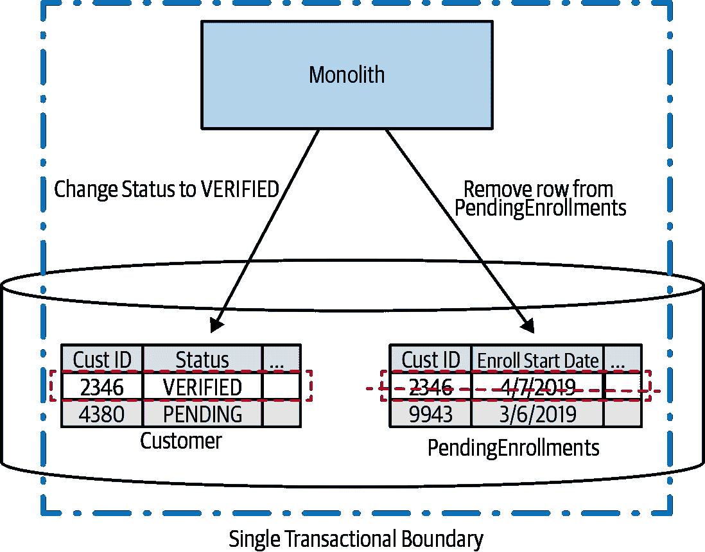
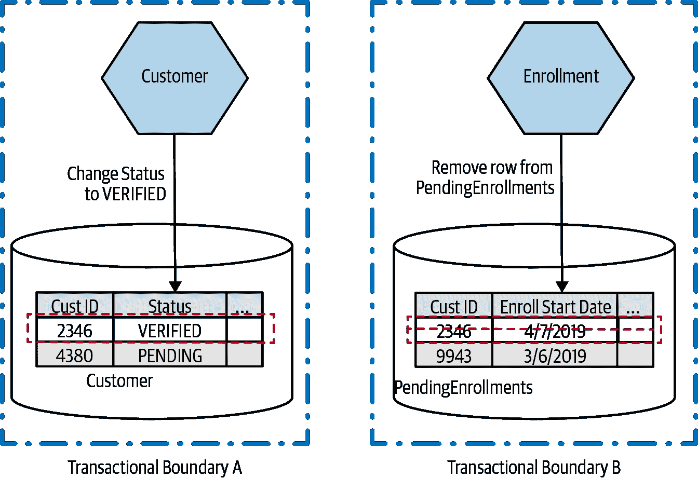
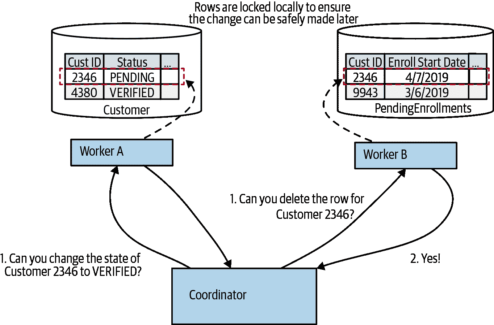
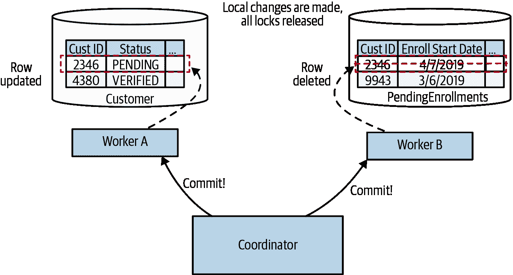
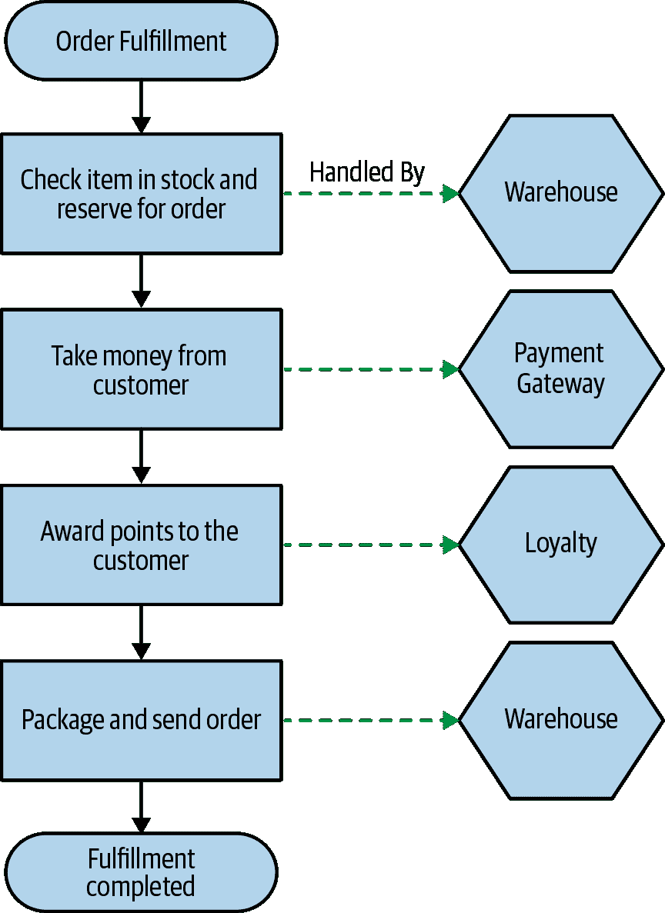
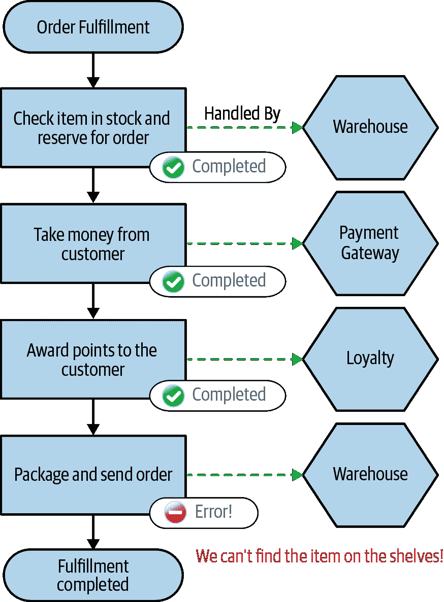
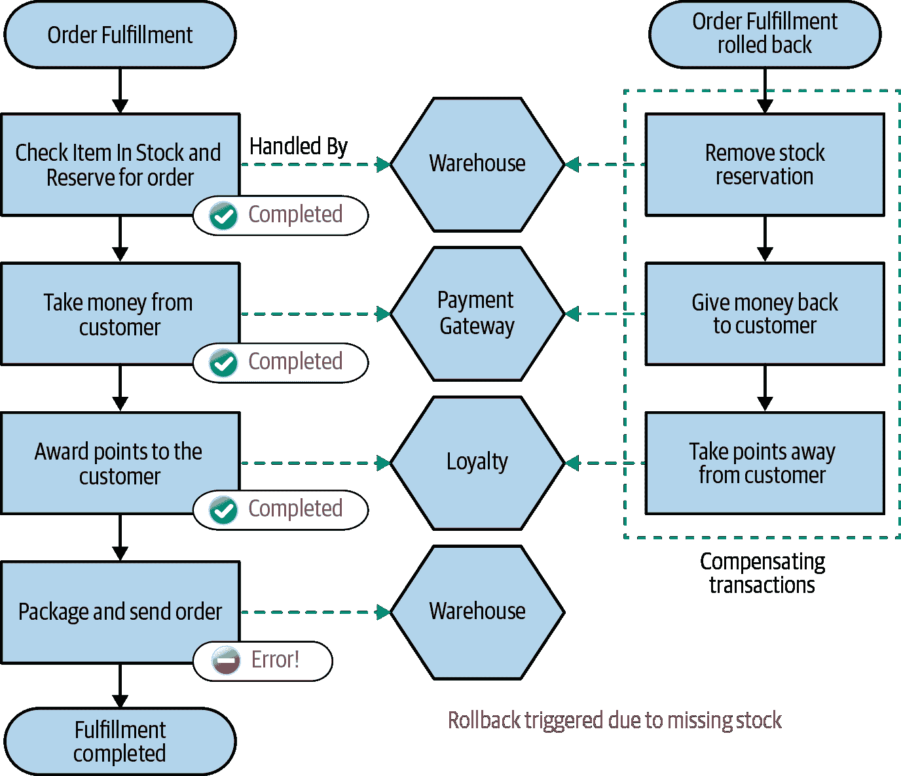
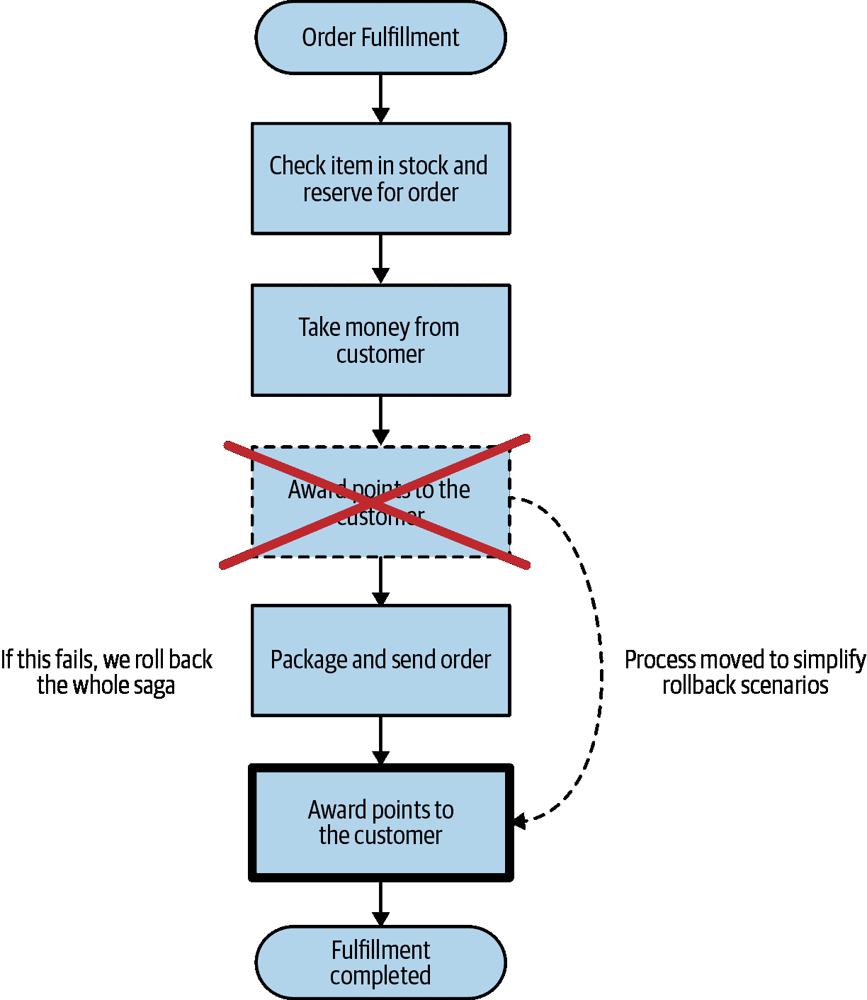
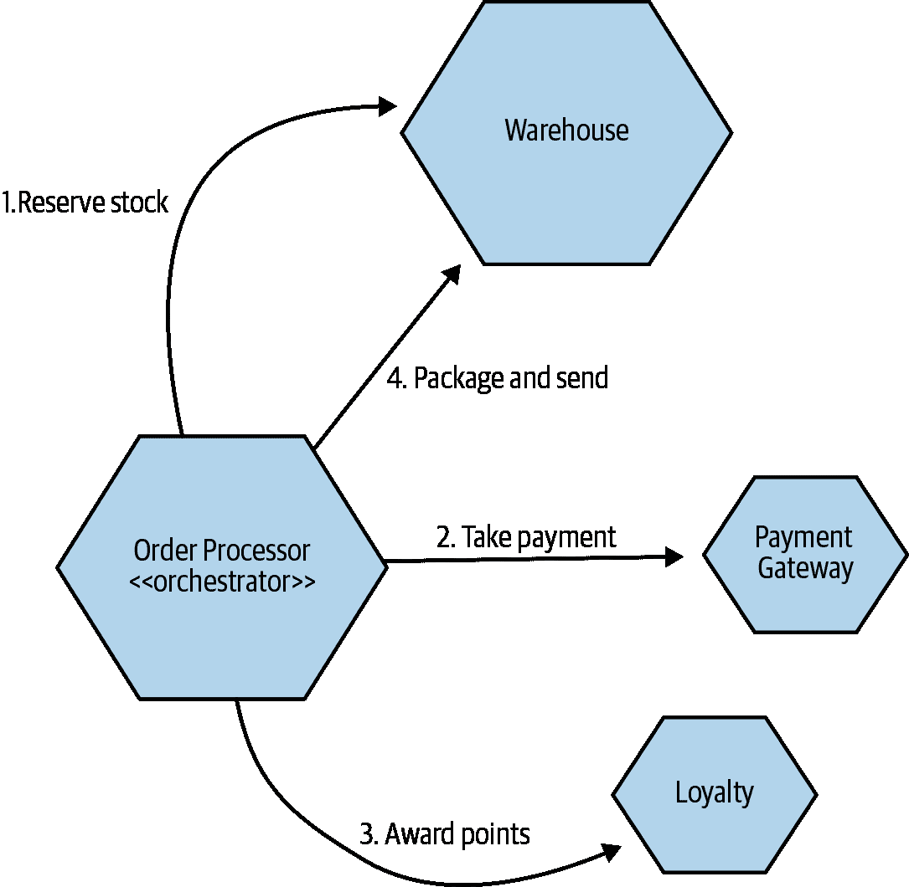
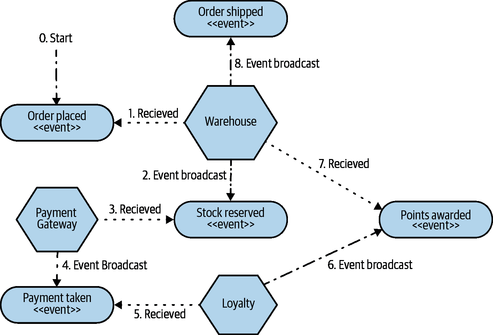

# 第5章 工作流

在之前的两章中，我们研究了与一个微服务如何与另一个微服务通信相关的方面。但当我们希望多个微服务协同工作时，也许是为了实现一个业务流程，会发生什么？如何在分布式系统中建模和实现这类工作流可能是一个难以做对的问题。

在本章中，我们将研究使用分布式事务解决此问题相关的陷阱，并研究 Saga——一个概念，它可以帮助我们以更令人满意的方式建模微服务工作流。

## 事务

在作为同一整体操作的一部分进行多项更改时，我们希望了解这些更改是否全部已完成。我们也希望在这些更改发生过程中出现错误时能够清理自身。通常，这导致我们使用类似数据库事务的东西。

泛指来说，当我们在计算的上下文中思考事务时，我们会想到一个或多个即将发生的操作，我们希望将其视为一个单一单元。我们希望知道事务是否已完成，或未完成——但无论如何，作为事务一部分发生的所有操作要么全部完成，要么全部不完成，作为一个整体。

你日常最常处理的事务形式是在使用数据库时。在这里，我们使用事务来确保一个或多个数据项成功存储——在关系数据库中，这可能涉及在单个事务内更新多个表。

## ACID Transactions

通常，当我们谈论数据库事务时，我们说的是 `ACID` 事务。`ACID` 是一个缩写，概述了数据库事务的关键属性，这些属性使我们能够依赖系统来确保数据存储的持久性和一致性。`ACID` 代表 `atomicity`、`consistency`、`isolation` 和 `durability`，以下是这些属性为我们提供的：

### Atomicity
确保事务内的所有操作要么全部完成，要么全部失败。如果我们尝试进行的任何更改因某种原因失败，则整个操作将被中止，就好像从未进行过任何更改一样。

### Consistency
当对数据库进行更改时，我们确保其处于有效且一致的状态。

### Isolation
允许多个事务同时运行而互不干扰。这是通过确保一个事务期间所做的任何中间状态更改对其他事务不可见来实现的。

### Durability
确保一旦事务完成，我们确信在系统故障的情况下数据不会丢失。

值得注意的是，并非所有数据库都提供 `ACID` 事务。我使用过的所有关系数据库系统都提供，诸如 `Neo4j` 等许多较新的 NoSQL 数据库也是如此。`MongoDB` 多年来仅在对单个文档进行的更改上支持 `ACID` 事务，这可能会导致问题，如果你想对多个文档进行原子更新的话。^(1)

本书并非对这些概念进行详细深入探讨的书籍；为了简洁起见，我确实简化了一些描述。对于那些希望进一步探索这些概念的人，我推荐 *设计数据密集型应用*。^(2) 在接下来的内容中，我们主要关注 `atomicity`。这并不意味着其他属性不重要，而是当我们开始将功能拆分为微服务时，`atomicity` 通常是我们首先遇到的问题。

## Still ACID, but Lacking Atomicity?

我明确指出，使用微服务时我们仍然可以使用 `ACID` 风格的事务。例如，微服务可以自由地对其自己的数据库操作使用 `ACID` 事务。只是这些事务的范围缩小了，其有用性也随之降低。请考虑 图 5-1。我们正在跟踪将新客户 onboarding 到 `MusicCorp` 的流程。我们已到达流程的末尾，其中涉及将客户的 `Status` 从 `PENDING` 更改为 `VERIFIED`。由于注册现已完成，我们还希望从 `PendingEnrollments` 表中删除匹配的行。在单个数据库中，这是在单个 `ACID` 数据库事务的范围内完成的——要么两个新行都被写入，要么都不写入。

将其与 图 5-2 进行比较。我们正在进行完全相同的更改，但现在每个更改都在不同的数据库中进行。这意味着有两种事务需要考虑，每种事务都可能独立于另一个而成功或失败。

当然，我们可以决定对这两个事务进行排序，仅在能够更改 `Customer` 表中的行时才从 `PendingEnrollments` 表中删除一行。但我们仍然需要考虑如果随后从 `PendingEnrollments` 表的删除失败该怎么办——所有这些逻辑都需要我们自己实现。尽管如此，能够重新排序步骤以处理这些用例是一个非常有用的想法（当我们探索 `sagas` 时我们会再次回到这一点）。但从根本上说，通过将此操作分解为两个单独的数据库事务，我们必须接受整个操作已失去保证的 `atomicity`。

这种 `atomicity` 的缺乏可能会开始导致重大问题，特别是如果我们正在迁移以前依赖此属性的系统。在这一点上，人们开始寻找其他解决方案，以便能够对同时对多个微服务进行的更改进行推理。通常，人们首先考虑的第一个选项是分布式事务。让我们看一下实现分布式事务最常见的算法之一 `two-phase commit`，以便探索与分布式事务整体相关的挑战。

## Two-Phase Commits

`two-phase commit algorithm`（有时缩写为 `2PC`）经常被用来尝试赋予我们在分布式系统中进行事务性更改的能力，在该系统中，整体操作的一部分可能需要更新多个独立进程。分布式事务，特别是两阶段提交，经常被转向微服务架构的团队提出作为解决他们面临挑战的一种方式。但正如我们将看到的，它们可能无法解决你的问题，甚至可能给你的系统带来更多混乱。

`2PC` 被分为两个阶段（因此得名 `two-phase commit`）：投票阶段和提交阶段。在投票阶段，中央协调器联系将参与事务的所有工作者，并询问是否可以进行某些状态更改的确认。在 图 5-3 中，我们看到两个请求，一个是将客户状态更改为 `VERIFIED`，另一个是从我们的 `PendingEnrollments` 表中删除一行。如果所有工作者都同意他们被要求的状态更改可以进行，则算法进入下一阶段。如果任何工作者表示更改无法进行，也许是因为请求的状态更改违反了某些本地条件，则整个操作中止。

重要的是要强调，更改并不会在工作者表示可以进行更改后立即生效。相反，工作者保证它将在未来的某个时间点能够进行该更改。工作者如何做出这样的保证？例如，在 图 5-3 中，Worker A 表示它将能够更改 `Customer` 表中行的状态，以将该特定客户的状态更新为 `VERIFIED`。如果在稍后某个时间点不同的操作删除了该行，或进行了另一个较小的更改，尽管如此意味着稍后更改为 `VERIFIED` 无效怎么办？为了保证稍后可以进行此更改，Worker A 很可能必须锁定该记录，以确保此类更改无法发生。

如果有任何工作节点没有投票赞成提交，则需要向所有各方发送回滚消息，以确保它们能够本地清理，从而允许工作节点释放它们可能持有的任何锁。如果所有工作节点都同意进行更改，我们就进入提交阶段，如图 5-4 所示。在这里，实际进行更改，并释放相关的锁。

需要注意的是，在这种系统中，我们无法以任何方式保证这些提交会在完全相同的时间发生。协调器需要向所有参与者发送提交请求，而该消息可能会在不同时间到达并被处理。这意味着，如果我们允许在事务协调器之外查看这些工作节点的状态，那么我们可能会看到对 `Worker A` 所做的更改，但尚未看到对 `Worker B` 的更改。协调器之间的延迟越大，以及工作节点处理响应的速度越慢，这种不一致的窗口可能就越宽。回到我们对 `ACID` 的定义，隔离确保我们在事务期间看不到中间状态。但使用这种 `two-phase commit`，我们就失去了这一点。

`two-phase commit` 在其核心工作时，经常只是协调分布式锁。工作节点需要锁定本地资源，以确保提交可以在第二阶段进行。在单进程系统中管理锁并避免死锁并不有趣。现在想象一下在多个参与者之间协调锁的挑战。这并不好看。

与 `two-phase commit` 相关的一系列故障模式我们没有时间深入探讨。考虑这样一个问题：工作节点投票同意继续进行事务，但在被要求提交时却没有响应。那时我们该怎么办？其中一些故障模式可以自动处理，但有些可能会使系统处于需要手动拆解的状态。

参与者越多，系统中的延迟越大，`two-phase commit` 就会出现越多的问题。它们可以快速地为系统注入大量延迟，尤其是在锁定的范围很大或事务持续时间很长的情况下。正因如此，`two-phase commit` 通常仅用于非常短暂的操作。操作时间越长，资源被锁定的时间就越长！

# 分布式事务——坚决说不

出于迄今为止列出的所有原因，我强烈建议你避免使用像 `two-phase commit` 这样的分布式事务来协调微服务之间状态的变更。那还能做什么呢？

好吧，第一个选项可以是首先根本不拆分数据。如果你有一些状态想要以真正原子且一致的方式管理，并且你无法在没有 `ACID` 风格事务的情况下合理地获得这些特性，那么就将该状态保留在单个数据库中，并将管理该状态的功能保留在单个服务（或你的单体应用）中。如果你正在研究将单体应用拆分的位置，以及哪些分解可能容易（或困难），那么你很可能会决定，现在拆分当前在事务中管理的数据太难处理了。先在系统的其他区域工作，以后再回来处理这个问题。

但如果确实需要拆分这些数据，但又不想承受管理分布式事务的所有痛苦会怎样？如何在多个服务中执行操作同时避免锁定呢？如果操作需要花费几分钟、几天，甚至几个月怎么办？在这种情况下，我们可以考虑一种替代方法：`sagas`。

# Saga

与 `two-phase commit` 不同，`saga` 在设计上是一种算法，可以协调多个状态变更，但避免了长时间锁定资源的需求。我们通过将涉及的步骤建模为可独立执行的离散活动来实现这一点。它还带来额外好处，即迫使我们明确建模业务流程，这可能带来显著益处。

核心思想首次在 Hector Garcia-Molina 和 Kenneth Salem 的“Sagas”中概述，^(3) 反映了他们所称的 `long lived transactions` (`LLTs`) 操作的最佳处理方式的挑战。这些事务可能需要很长时间（几分钟、几小时，甚至几天），并且作为该过程的一部分需要对数据库进行更改。

如果你直接将 `LLT` 映射到普通的数据库事务，单个数据库事务将跨越 `LLT` 的整个生命周期。这可能导致在 `LLT` 进行期间，多行甚至整个表被长时间锁定，如果其他进程尝试读取或修改这些被锁定的资源，就会造成严重问题。

相反，论文的作者建议我们应该将这些 `LLTs` 拆分为一系列事务，每个事务都可以独立处理。其思路是，这些“子”事务的持续时间会更短，并且只会修改整个 `LLT` 影响的数据的一部分。因此，由于锁的范围和持续时间大大减少，底层数据库的争用会少得多。

虽然 `sagas` 最初被设想为帮助针对单个数据库的 `LLTs` 的机制，但该模型同样适用于协调跨多个服务的变更。我们可以将单个业务流程分解为一组调用，作为单个 `saga` 的一部分向协作服务发出。

### 注意

在继续之前，你需要明白，`saga` 并不会在我们习惯于普通数据库事务的 `ACID` 术语中给予我们原子性。当我们将 `LLT` 拆分为单独的事务时，我们在 `saga` 本身的级别上没有原子性。我们确实对 `LLT` 内部的每个子事务具有原子性，因为每个子事务如果需要都可以关联到一个 `ACID` 事务性变更。`saga` 给予我们的只是足够的信息来推理它所处的状态；处理其影响是我们的责任。

让我们看一下 MusicCorp 的一个简单的订单履行流程，概述在 图 5-5 中，我们可以用它在微服务架构的上下文中进一步探索 `sagas`。

在这里，订单履行流程被表示为单个 `saga`，流程中的每个步骤代表可由不同服务执行的某个操作。在每个服务内部，任何状态变更都可以在本地 `ACID` 事务中处理。例如，当我们使用 `Warehouse` 服务检查和预留库存时，内部 `Warehouse` 服务可能会在其本地 `Reservation` 表中创建一个记录预留的行；此更改将在普通事务中处理。

## Saga 失败模式

由于 `saga` 被拆分为单独的事务，我们需要考虑如何处理失败——更具体地说，如何在发生故障时恢复。原始的 `saga` 论文描述了两种恢复类型：`Backward recovery` 和 `Forward recovery`。

`Backward recovery` 涉及回滚失败并在之后进行清理——回滚。为此工作，我们需要定义补偿操作以允许我们撤销先前已提交的事务。`Forward recovery` 允许我们从故障发生点继续，并保持处理。为此工作，我们需要能够重试事务，这反过来意味着我们的系统需要持久化足够的信息以允许此重试发生。

根据所建模业务流程的性质，你可能会考虑任何故障模式都会触发向后恢复、向前恢复，或是两者的混合。

## Saga 回滚

使用 ACID 事务，如果遇到问题，我们会在提交发生前触发回滚。回滚后，就像什么都没发生过一样：我们试图进行的更改并未发生。而在我们的 Saga 中，却涉及多个事务，其中一些可能在我们决定回滚整个操作之前就已经提交了。那么，在事务已经提交之后，我们如何回滚它们呢？

让我们回到订单处理的示例，如 图 5-5 所概述。考虑一种潜在的故障模式。我们已经进行到尝试打包商品，却发现商品在仓库中找不到，如 图 5-6 所示。我们的系统认为商品存在，但它根本不在货架上！

现在，假设我们决定只回滚整个订单，而不是给客户将商品放入缺货待补选项。问题是我们已经收取了款项并为该订单授予了忠诚度积分。

如果所有这些步骤都在单个数据库事务中完成，简单的回滚就会清理所有问题。然而，订单履行过程中的每个步骤都由不同的服务调用处理，每个调用都在不同的事务范围内运行。整个操作并没有简单的“回滚”。

相反，如果你想实现回滚，就需要实现补偿事务。*补偿事务*是一种撤销先前已提交事务的操作。要回滚我们的订单履行流程，我们将为 Saga 中已提交的每个步骤触发补偿事务，如 图 5-7 所示。

值得指出的是，这些补偿事务可能无法完全具有与正常数据库回滚相同的行为。数据库回滚发生在提交之前；回滚后，就好像事务从未发生过。在这种情况下，当然这些事务*确实*发生了。我们正在创建一个新的事务来撤销原始事务所做的更改，但我们无法回滚时间，使其好像原始事务从未发生过一样。

因为我们不能总是干净地撤销一个事务，所以我们说这些补偿事务是*语义回滚*。我们不能总是清理一切，但在 Saga 的上下文中我们做了足够的事情。例如，我们的一个步骤可能涉及向客户发送电子邮件告知订单正在途中。如果我们决定回滚它，你就无法撤回电子邮件！^(4) 相反，你的补偿事务可以导致向客户发送第二封电子邮件，告知订单出现问题且已被取消。

让与回滚相关的信息保留在系统中是完全合适的。事实上，这可能是非常重要的信息。你可能希望在 `Order` 服务中为此中止的订单保留记录，并附带发生了什么的信息，原因有很多。

## 重新排序步骤以减少回滚

在 图 5-7 中，我们可以通过重新排序步骤使可能的回滚场景变得稍微简单一些。一个简单的更改就是仅在订单实际发出时才授予积分，如 图 5-8 所见。

这样，如果在尝试打包和发送订单时出现问题，我们就无需担心该阶段被回滚。有时只需调整流程的执行方式即可简化回滚操作。通过提前那些最可能失败的步骤并更早地使流程失败，你可以避免触发后期的补偿事务，因为那些步骤根本就未被触发。

如果能够容纳这些更改，它们可以让你的生活变得轻松许多，避免为某些步骤甚至创建补偿事务的需要。如果实现补偿事务很困难，这尤其重要。你可能可以将步骤移至流程的后期阶段，在该阶段它永远不需要被回滚。

## 混合失败回退和失败前行情况

拥有混合的故障恢复模式是完全合适的。某些故障可能需要回滚；其他故障可能是向前失败。例如，对于订单处理，一旦我们从客户处收取了款项，商品也被打包，剩下的唯一步骤就是派送包裹。如果由于某种原因我们无法派送包裹（也许我们使用的配送公司今天货车没有空间装载订单），回滚整个订单似乎非常奇怪。相反，我们很可能会重试派送（也许将其排队到次日），如果失败，则需要人工干预来解决情况。

## 实现 Saga

到目前为止，我们已经研究了 Saga 工作方式的逻辑模型，但我们需要更深入地研究实现 Saga 本身的方法。我们可以查看两种 Saga 实现风格。*编排式 Saga* 更接近原始解决方案空间，主要依赖于集中式协调和跟踪。它们可以与 *编舞式 Saga* 相比较，后者避免了集中式协调的需求，转而采用更松散耦合的模型，但这会使跟踪 Saga 的进展变得更加复杂。

### 编排式 Saga

编排式 Saga 使用中央协调器（从现在起我们称之为 *编排器*）来定义执行顺序并触发任何所需的补偿操作。你可以将编排式 Saga 视为一种命令和控制方法：中央编排器控制何时发生什么，并且由此带来对任何给定 Saga 正在发生情况的良好可见性。

以 图 5-5 所示的订单履行流程为例，让我们看看这种中央协调流程如何作为一组协作服务工作，如 图 5-9 所示。

在这里，我们的中央 `Order Processor` 扮演编排器的角色，协调我们的履行流程。它知道执行操作所需的服务，并决定何时调用这些服务。如果调用失败，它可以决定因此采取什么行动。这些编排式处理器倾向于在服务之间大量使用请求-响应调用：`Order Processor` 向服务（例如 `Payment Gateway`）发送请求，并期望收到响应，告知请求是否成功并提供请求结果。

将业务流程明确建模在 `Order Processor` 内部是非常有益的。它允许我们在系统的某一个地方查看并了解该流程 supposed to work 的方式。这可以使新员工的入职变得更容易，并有助于更好地理解系统的核心部分。

不过，也有几个缺点需要考虑。首先，从其本质上讲，这是一种某种程度上耦合的方法。我们的 `Order Processor` 需要了解所有相关服务，导致我们之前在 [待定链接] 中讨论的领域耦合程度更高。虽然这本身并不坏，但我们仍希望尽可能将领域耦合保持在最低限度。在这里，我们的 `Order Processor` 需要了解并控制太多事情，以至于这种耦合形式很难避免。

另一个更微妙的问题是，本应下推到服务中的逻辑可能会开始被编排器吸收。如果这种情况开始发生，你可能会发现你的服务变得贫血，几乎没有自己的行为，只是像 `Order Processor` 这样的编排器下达指令一样接受命令。重要的是，你仍然应将构成这些编排流程的服务视为具有自身本地状态和行为的实体。它们负责自己的本地状态机。

#### 警告
如果逻辑有可以被集中的地方，它就会被集中！

避免编排流程过度集中的一种方法可以是确保为不同的流程配备不同的服务担任编排器的角色。你可能有一个处理下单的 `Order Processor` 微服务，一个处理退货和退款流程的 `Returns` 微服务，一个处理新库存到货并上架的 `Goods Receiving` 微服务，等等。像我们的 `Warehouse` 微服务这样的服务可能会被所有这些编排器使用；这种模型使你更容易将功能保留在 `Warehouse` 微服务本身，以便在所有这些流程中重用功能。

### 协作式 Saga
协作式 Saga 旨在将 Saga 运行的责任分摊给多个协作服务。如果编排是命令与控制，那么协作式 Saga 则代表一种信任但验证的架构。正如我们在 图 5-10 中的示例中所看到的，协作式 Saga 通常会大量使用事件来进行服务之间的协作。

这里有很多内容，所以值得更详细地探讨。首先，这些微服务正在对收到的事件做出反应。从概念上讲，事件在系统中被广播，感兴趣的各方能够接收它们。记住，正如我们在 第 3 章 中讨论的那样，你不会将事件发送 *向* 微服务；你只是将其发出，而对这些事件感兴趣的微服务能够接收它们并据此采取行动。在我们的示例中，当 `Warehouse` 服务收到第一个 `Order Placed` 事件时，它知道自己的工作是预留适当的库存，并在完成后发出事件。如果无法收到库存，`Warehouse` 需要引发适当的事件（也许是 `Insufficient Stock` 事件），这可能会导致订单被中止。

通常，你会使用某种消息代理来管理事件的可靠广播和传递。可能有多个微服务对同一事件做出反应，这时你就会使用主题。对某类事件感兴趣的各方会订阅特定主题，而无需担心这些事件来自何处，代理确保主题的持久性以及其上的事件成功传递给订阅者。例如，我们可能有一个 `Recommendation` 服务也监听 `Order Placed` 事件，并利用它构建你可能喜欢的音乐选择数据库。

在前述架构中，没有任何一个服务知道其他微服务。它们只需要知道在收到某个事件时该做什么——我们大幅减少了领域耦合的程度。本质上，这使得架构耦合度大大降低。随着流程的实现被分解并分发到这里的四个微服务中，我们也避免了逻辑集中的问题（如果你没有可以集中逻辑的地方，那么它就不会被集中！）。

其反面是，现在弄清楚发生了什么可能会更困难。有了编排，我们的流程在编排器中被明确建模。现在，以这种方式呈现的架构，你将如何建立对流程应如何进行的心理模型？你必须单独查看每个服务的行为，并在自己的脑海中重新构建这幅图景——即使对于像这样简单的业务流程来说，也远非直接的过程。

缺乏对业务流程的显式表示已经够糟糕了，但我们也缺乏了解 Saga 处于何种状态的方法，这也可能剥夺我们在需要时附加补偿操作的机会。我们可以将部分责任推给各个服务以执行补偿操作，但从根本上说，我们需要一种了解 Saga 状态的方式来进行某些类型的恢复。缺乏一个可以查询 Saga 状态的中心位置是一个大问题。编排提供了这一点，那么在这里我们如何解决这个问题呢？

实现此目的最简单的方法之一是，通过消费发出的事件，从现有系统中投影出关于 Saga 状态的视图。如果我们为 Saga 生成一个唯一 ID，我们就可以将其放入作为该 Saga 部分发出的所有事件中——这就是所谓的 `correlation ID`。然后我们可以有一个服务，其工作只是吸取所有这些事件并呈现每个订单处于何种状态的视图，并且如果其他服务无法自行完成，可以以编程方式执行操作来解决履行过程中的问题。我认为某种形式的 `correlation ID` 对于这种协作式 Saga 来说是必不可少的，但它们在更广泛的范围内也有很多价值，我们在 \[链接待定\] 中更深入地探讨了这一点。

### 混合风格
虽然编排式 Saga 和协作式 Saga 看起来像是关于 Saga 如何实现的两极对立观点，但你可以很容易地考虑混合搭配模型。你的系统中可能有一些业务流程更自然地适合其中一种模型。你的 Saga 也可能同时包含多种风格。例如，在订单履行用例中，在 `Warehouse` 服务的边界内，管理包裹的包装和派送时，我们可能会使用编排流程，即使原始请求是作为更大协作式 Saga 的一部分发出的。^(5)

如果你决定混合风格，重要的是你仍然有一种清晰的方式来理解 Saga 的一部分发生了什么。没有这一点，了解故障模式会变得复杂，故障恢复也会变得困难。

### 我应该使用协作还是编排？
实现协作式 Saga 可能会带来你和你的团队不熟悉的想法。它们通常假设大量使用事件驱动的协作，而这并不被广泛理解。然而，根据我的经验，与跟踪 Saga 进度相关的额外复杂性几乎总是被更松散耦合架构带来的好处所抵消。

撇开我个人的喜好不谈，我关于编排与协作的一般建议是，当一个团队拥有整个 Saga 的实现时，我对使用编排式 Saga 非常宽松。在这种情况下，更内在耦合的架构在团队边界内更容易管理。如果涉及多个团队，我更倾向于更分解的协作式 Saga，因为它更容易将实现 Saga 的责任分配给团队，而更松散耦合的架构允许这些团队更独立地工作。

## Saga 与分布式事务
正如我希望到现在已经解释清楚的那样，分布式事务带来了一些重大挑战，除了某些非常特定的情况外，我倾向于避免。分布式系统先驱 Pat Helland 总结了为我们今天构建的这类应用程序实现分布式事务的根本挑战：^(6)

> 在大多数分布式事务系统中，单个节点的故障会导致事务提交停滞。这反过来会导致应用程序卡住。在这种系统中，系统越大，系统宕机的可能性就越大。当飞行一架需要所有发动机都工作的飞机时，增加一台发动机反而会降低飞机的可用性。
>
> Pat Helland，超越分布式事务

在我的经验中，将业务流程显式建模为 Saga 可以避免许多分布式事务的挑战，同时还有额外的好处，即原本可能被隐式建模的流程也能变得更加明确和显而易见，让你的开发者更容易理解。将系统的核心业务流程作为一等概念会带来诸多好处。

关于编排和编舞实现的更全面讨论，以及各种实现细节，已超出本书范围。它在第 4 章的 *构建微服务* 中有介绍，但我也推荐 *企业集成模式* 来深入了解该主题的许多方面。^(7)

## Summary

因此，正如我们所见，在微服务架构中实现工作流的路径归结为显式建模我们试图实现的过程。这让我们回到了在微服务架构中对业务域各方面进行建模的想法——如果我们的微服务边界也是主要以业务域为定义，那么显式建模业务流程是有意义的。

无论你更倾向于编排还是编舞，希望你现在能更好地判断哪种模型更适合你的问题空间。

本章重点关注我们在已将功能拆分为独立微服务之后会发生什么。但如果您已经有一个现有的单体系统怎么办？在下一章中，我们将探讨如何拆分您的单体应用程序并迁移到微服务。

^(1) 这现在已经改变，Mongo 4.0 作为一部分发布了多文档 ACID 事务支持。我本人没有使用过 Mongo 的这个功能；我只是知道它存在！

^(2) 参见 Martin Kleppmann，*设计数据密集型应用*（Sebastopol，O’Reilly Media, Inc.，2017）。

^(3) 参见 Hector Garcia-Molina 和 Kenneth Salem，“Sagas”，载于 *ACM Sigmod Record* 16 卷第 3 期（1987）：249–259。

^(4) 你真的做不到。我试过！

^(5) 这超出了本书范围，但 Hector Garcia-Molina 和 Kenneth Salem 进一步探讨了如何将多个 Saga “嵌套”以实现更复杂流程。欲了解更多信息，请参阅 Hector Garcia-Molina 等人，“Modeling Long-Running Activities as Nested Sagas”，*Data Engineering* 14 卷第 1 期（1991 年 3 月：14–18）。

^(6) 参见 Pat Helland，“Life Beyond Distributed Transactions”，*acmqueue* 14 卷第 5 期。

^(7) Saga 在这两本书中都没有明确提及，但编排和编舞都涵盖了。虽然我无法评价 *企业集成模式* 作者的经验，但我在撰写 *构建微服务* 时本人并不了解 Saga。
