# 第6章 构建

我们花了很多时间介绍微服务的设计方面，但现在需要更深入地了解你的开发流程可能需要如何改变以适应这种新的架构风格。在接下来的章节中，我们将讨论如何部署和测试微服务，但在那之前，我们需要先了解先发生什么——当开发者准备提交更改时会发生什么？

我们将从回顾一些基础概念开始探索——持续集成和持续交付。无论使用何种系统架构，这些都是重要概念，但微服务带来了许多独特的问题。从那里开始，我们将讨论管道，以及管理服务源代码的不同方式。

## A Brief Introduction to Continuous Integration

*持续集成 (CI)* 已经存在多年了，然而花点时间回顾一下基础知识是值得的，尤其是在我们考虑微服务、构建和版本控制仓库之间的映射时——有不同的选项需要考虑。

在 CI 中，核心目标是以频繁的方式让每个人保持同步，我们通过确保新签入的代码能正确地与现有代码集成来实现这一点。为此，CI 服务器检测到代码已提交，检出代码，并执行一些验证，例如确保代码能够编译并且测试通过。最低限度，我们期望这种集成每天进行一次，尽管在实践中我曾在多个团队工作过，开发者实际上每天会多次集成他们的更改。

作为此过程的一部分，我们通常会创建用于进一步验证的构件（artifact），例如部署正在运行的服务以对其运行测试（我们将在本章后面再次讨论构件创建）。理想情况下，我们希望只构建一次这些构件，并将其用于该版本代码的所有部署。这样做是为了避免重复做同样的事情，并且能够确认我们部署的构件就是我们测试过的构件。为了使这些构件能够被重用，我们将它们放在某种仓库中，由 CI 工具本身提供或在单独的系统上。

我们很快会更深入地探讨构件的作用，并且将在 \[Link to Come\] 中深入探讨测试。

CI 有许多好处。我们可以快速获得代码质量的反馈。它还可以自动化二进制构件的创建。构建构件所需的所有代码本身都是版本控制的，因此如果需要我们可以重新创建构件。我们还可以从已部署的构件追溯到代码，并且根据 CI 工具本身的功能，还可以看到对代码和构件运行了哪些测试。正因如此，CI 才如此成功。

### Are You Really Doing CI?

CI 是一项关键实践，使我们能够快速轻松地进行更改，没有它，迈向微服务的旅程将是痛苦的。我怀疑你所在组织可能正在使用 CI 工具，但这可能并不等于真正实践 CI。我见过很多人将采用 CI 工具与真正拥抱 CI 混为一谈——一个使用良好的 CI 工具会帮助你实践 CI。但使用 Jenkins、CircleCI、Travis 或其他众多选项中的任何一个，并不保证你实际上做对了 CI。

那么你如何知道自己是否真正实践 CI？我非常喜欢 Jez Humble 提出的三个问题，他用这些问题来测试人们是否真正理解 CI 的含义——也许问问自己同样的问题会很有趣：

Do you check in to mainline once per day?

: 

你需要确保你的代码能够集成。如果不经常将你的代码与其他人的更改一起检查，你最终会使未来的集成变得更困难。即使你使用短期分支来管理更改，也应尽可能频繁地将其集成到单个主干分支中，至少每天一次。

Do you have a suite of tests to validate your changes?

: 

没有测试，我们只知道语法上集成成功了，但不知道是否破坏了系统的行为。没有验证代码按预期行为的 CI 并不是 CI。

When the build is broken, is it the #1 priority of the team to fix it?

: 


通过的绿色构建意味着我们的更改已安全集成。红色构建意味着最近的更改可能未成功集成。你需要停止所有不参与修复构建的进一步签入，以使其再次通过。如果你让更多更改堆积起来，修复构建所需的时间将急剧增加。我曾与一些团队合作过，他们的构建已损坏数天，最终花费大量精力才获得通过的构建。

# 分支模型

在构建和部署相关的诸多话题中，似乎没有哪个比使用源代码分支进行功能开发更具争议性。源代码中的分支允许在隔离环境中进行开发，而不会干扰他人的工作。表面上看，为每个正在进行的功能创建源代码分支——也称为功能分支——似乎是一个有用的概念。

问题在于，当你在功能分支上工作时，你并不会定期将更改与其他人集成。从根本上说，你是在*延迟*集成。当你最终决定将更改与其他人集成时，你将面临一个更复杂的合并。

另一种方法是让每个人都签入到同一个源代码“主干”。为了防止更改影响他人，会使用诸如功能标志等技术来“隐藏”未完成的工作。每个人都基于同一主干工作的做法称为*基于主干的开发*。

关于这个话题的讨论很微妙，但我自己的看法是，频繁集成——以及对该集成的验证——带来的好处足以使基于主干的开发成为我偏好的开发方式。此外，实现功能标志的工作在渐进式交付方面通常是有益的，我们将在第 7 章中探讨这一概念。

## 谨慎使用分支

尽早集成，经常集成。避免为功能开发使用长期存在的分支，而应考虑基于主干的开发。如果确实必须使用分支，请保持它们简短！

撇开我自己的轶事经验不谈，越来越多的研究表明减少分支数量并采用基于主干的开发的有效性。DORA 和 Puppet 于 2016 年发布的《DevOps 现状报告》^(1)对全球各组织的交付实践进行了严格研究，并探讨了高绩效团队常用的实践：

> 我们发现，在合并到主干之前具有非常短生命周期（少于一天）的分支或分支，以及总共少于三个活跃分支，是持续交付的重要方面，并且都有助于提高性能。每天将代码合并到主干或 master 中也是如此。
> 
> DevOps 现状报告 2016

在随后的几年中，《DevOps 现状报告》继续更深入地探讨这一主题，并继续发现该方法有效性的证据。

分支繁重的方法在开源开发中仍然很常见，通常通过采用“GitFlow”开发模型来实现。值得注意的是，开源开发与正常的日常开发不同。开源开发的特点是大量来自时间有限的“不受信任”提交者的临时贡献，其更改需要由较少数量的“受信任”贡献者进行审查。典型的日常闭源开发通常由一个紧密团结的团队完成，他们都拥有提交权限，即使他们决定采用某种形式的代码审查流程。因此，适用于开源开发的方法可能不适用于你的日常工作。即使如此，2019 年的《DevOps 现状报告》^(2)进一步探讨了这一主题，发现了一些关于开源开发以及“长期存在”分支影响的有趣见解：

> 我们的研究发现扩展到开源开发的某些领域：
> 
> *   更早提交代码更好：在开源项目中，许多人观察到更快地合并补丁以防止重新基线有助于开发人员更快地移动。
> 
> *   小批量工作更好：大型“补丁炸弹”比更小、更易读的补丁集更难、更慢地合并到项目中，因为维护者需要更多时间来审查更改。
> 
> 无论你是在闭源代码库还是开源项目上工作，短生命周期分支；小而可读的补丁；以及对更改的自动测试都能让每个人更高效。
> 
> DevOps 现状报告 2019

# 构建流水线和持续交付

在进行 CI 的早期，我当时的 ThoughtWorks 同事和我意识到在构建中有时具有多个阶段的价值。测试是这种情况非常常见的案例。我可能有很多快速、小范围的测试，以及少量大范围、慢速的测试。如果我们一起运行所有测试，并且我们在等待长范围慢速测试完成时，可能无法在快速测试失败时获得快速反馈。而且如果快速测试失败，运行较慢的测试可能也没有什么意义！解决这个问题的方案是在我们的构建中设置不同的阶段，创建所谓的*构建流水线*。一个阶段用于更快的测试，如果它通过则触发用于较慢测试的单独阶段。

这种构建流水线概念为我们提供了一种跟踪软件在清除每个阶段时进展的良好方式，有助于我们了解软件的质量。我们创建可部署的构件，即最终将部署到生产环境的东西，并在整个流水线中使用该构件。在我们的上下文中，该构件将与我们想要部署的微服务相关。在图 6-1 中我们看到了这种情况——相同的构件在流水线的每个阶段中使用，使我们更有信心软件将在生产中工作。

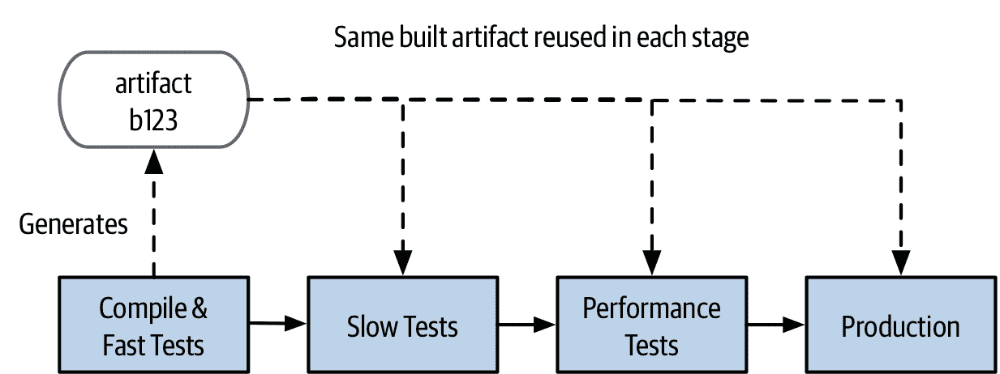

*持续交付 (CD)* 在此概念的基础上更进一步。正如 Jez Humble 和 Dave Farley 同名书籍中所述^(3)，CD 是我们对每次签入的生产就绪度获得持续反馈的方法，并且将每次签入都视为发布候选。

要充分拥抱这一概念，我们需要对将软件从签入到生产所涉及的所有流程进行建模，并了解给定版本的软件在发布许可方面的进展情况。在 CD 中，我们通过对软件必须经历的每个阶段进行建模来实现这一点，无论是手动还是自动化的，我们刚刚在图 6-1 中为我们的 `Catalog` 服务分享了一个示例。大多数 CI 工具如今都为定义和可视化此类构建流水线状态提供了一定支持

如果新的 `Catalog` 服务通过流水线某阶段执行的任何检查，它就可以进入下一步。如果它未通过某个阶段，我们的 CI 工具可以告知我们该构建已通过哪些阶段，并提供有关失败内容的可见性。如果我们需要做些什么来修复它，我们会做出更改并签入，允许我们微服务的新的版本尝试通过所有阶段，然后才能用于部署。在图 6-2 中，我们看到了一个示例。`build-120` 在快速测试阶段失败，`build-121` 在性能测试阶段失败，但 `build-122` 一直成功到达生产环境。

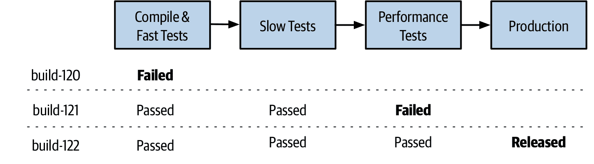

## 工具


理想情况下，你希望使用一个将 CD 作为一等概念拥抱的工具。我见过很多人尝试 hack 并扩展 CI 工具使其执行 CD，往往导致复杂的系统，其易用性远不及从一开始就内置 CD 的工具。完全支持 CD 的工具允许你定义和可视化这些流水线，对软件的整个生产路径进行建模。随着代码的一个版本在流水线中移动，如果它通过了其中一个自动化验证阶段，就会进入下一个阶段。

一些阶段可能是手动的。例如，如果我们有一个手动的用户验收测试（UAT）流程，我应该能够使用 CD 工具对其进行建模。我可以看到下一个可用的构建已准备好部署到我们的 UAT 环境中，部署它，如果它通过了我们的手动检查，就将该阶段标记为成功，以便它可以进入下一步。如果后续阶段是自动化的，那么它将被自动触发。

## Tradeoffs and Environments
随着我们将微服务构件通过此流水线移动，我们的微服务会被部署到不同的环境中。不同的环境服务于不同的目的，并且可能具有不同的特征——我们将在第 7 章中更详细地讨论这一点。

构建流水线，因此确定你需要的环境本身就是一种平衡行为。流水线早期，我们希望快速反馈软件的生产就绪情况。我们希望尽快让开发人员知道是否存在问题——越早获得问题发生的反馈，修复起来就越快。随着我们的软件越来越接近生产环境，我们希望对软件能够正常工作有更大的确定性，因此我们会部署到越来越像生产的环境中——我们可以在图 6-3 中看到这种权衡。

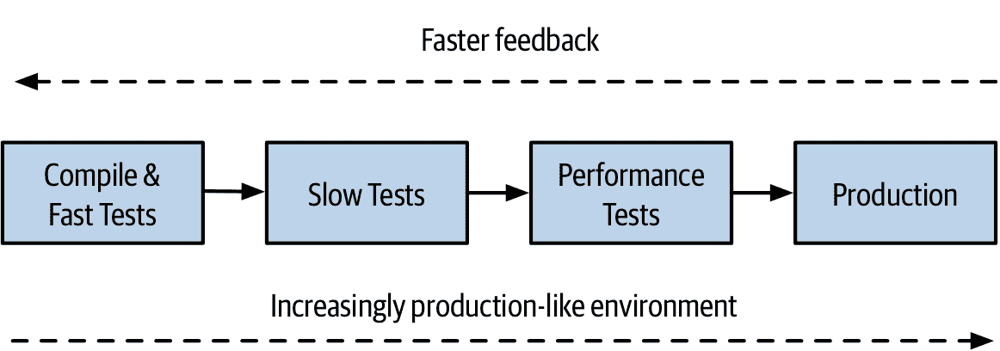

你在开发笔记本上获得最快的反馈——但这与生产环境相差甚远。你可以将每个提交都部署到是对实际生产环境忠实再现的环境中，但这可能会花费更长时间并成本更高。因此找到平衡至关重要，并且持续审查快速反馈与对生产环境的需求之间的权衡可以是一项极其重要的持续活动。

## Artifact Creation
随着我们将微服务移动到不同的环境中，我们必须有实际可部署的东西。事实证明，关于可以使用哪种类型的部署构件，有多种不同的选择。一般来说，你创建哪种构件在很大程度上取决于你为部署而选择采用的技术。我们将在下一章深入探讨这个问题，但我想给你一些非常重要的提示，说明构件创建应如何融入你的 CI/CD 构建流程中。

为了保持简单，我们将回避我们正在创建的确切构件类型——暂时将其视为一个可部署的 blob。现在，我们需要考虑两条重要规则。首先，正如我之前提到的，我们应该只构建一次构件。一次又一次地构建同样的东西是浪费时间，对地球有害，并且如果构建配置不完全相同，理论上可能会引入问题。在某些编程语言中，不同的构建标志可能会使软件的行为大不相同。其次，你验证的构件应该是你部署的构件！如果你构建一个微服务，对其进行测试，说“是的，它正在工作”，然后再次构建以部署到生产环境，你如何知道你验证的软件与你部署的软件是相同的？

将这两个想法结合起来，我们有一个相当简单的方法。只构建一次你的可部署构件，并且理想情况下在流水线中尽早完成。我通常会在编译代码（如果需要）并运行快速测试后执行此操作。一旦创建，该构件将被存储在适当的存储库中——这可能是像 Artifactory 或 Nexus 这样的东西，或者是一个容器注册表。你选择的部署构件可能决定了构件存储的性质。然后，这个相同的构件可以用于流水线中后续的所有阶段，直到包括部署到生产环境。所以回到我们之前的流水线，我们可以在图 6-4 中看到，我们在流水线的第一阶段为我们的 `Catalog` 服务创建了一个构件，然后相同的 `build-123` 构件作为慢速测试、性能测试和生产阶段的一部分被部署。

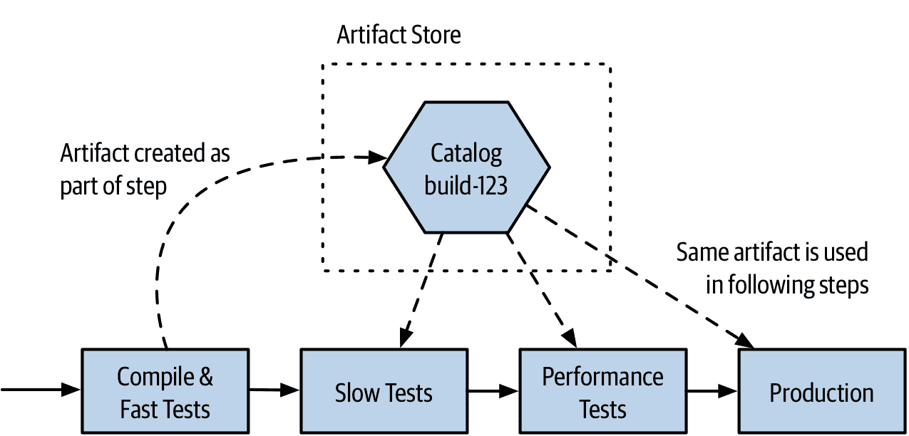

如果同一个构件将在多个环境中使用，任何因环境而异的配置方面都需要保留在构件本身之外。作为一个简单的例子，我可能希望配置应用程序日志，以便在运行慢速测试阶段时，`DEBUG` 级别及以上的所有内容都被记录下来，以便我有更多信息来诊断测试失败的原因。不过，我可能会决定将其更改为 `INFO` 以减少性能测试和生产部署的日志量。

### Artifact Creation Tips
构建你的微服务的部署构件一次。在你想部署该版本微服务的所有地方重复使用相同的构件。保持你的部署构件与环境无关——将环境特定的配置存储在其他地方。

## Mapping Source Code and Builds to Microservices
我们已经研究过一个可能激起对立阵营的话题——功能分支 vs 主干分支开发——但事实证明，本章的争议并未结束。另一个可能引发相当多不同意见的话题是我们微服务的代码组织。现在，我有自己的偏好，但在进入那之前，让我们先探讨一下组织微服务代码的主要选项。

### One Giant Repo, One Giant Build
如果从最简单的选项开始，我们可以将所有东西放在一起。我们有一个单一的、巨大的存储库存储所有代码，并有一个单一的构建，如图 6-5 所示。对此源代码存储库的任何签入都会触发我们的构建，在其中我们将运行与所有微服务相关的所有验证步骤，并生成多个构件，所有这些都与同一个构建相关联。

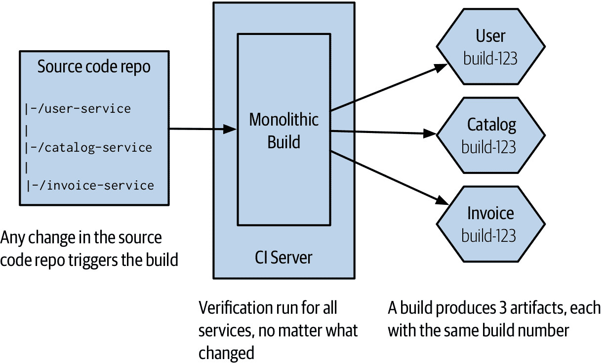

与其他方法相比，这在表面上似乎简单得多：需要担心的存储库更少，并且概念上构建更简单。从开发人员的角度来看，事情也相当直接。我只需签入代码。如果我必须同时处理多个服务，我只需要担心一次提交。

这种模式如果接受锁步发布（lock-step releases）的理念，即不介意同时部署多个服务，那么可以很好地工作。一般来说，这绝对是一种需要避免的模式，但在项目的早期阶段，尤其是如果只有一个团队在处理所有事情时，这在短时间内可能是有意义的。


让我解释一下这种方法的一些显著缺点。如果我对单个服务进行一行修改——例如在图 6-5 中更改 `User` 服务的行为——*全部*其他服务都会被验证和构建。这可能比所需花费更多时间——我在等待那些可能不需要测试的东西。这会影响我们的周期时间，即将单个更改从开发推进到生产的速度。更令人担忧的是，知道应该部署哪些构件或不应该部署哪些构件。我现在是否需要部署所有构建服务才能将我的小更改推送到生产环境？这很难判断；仅通过阅读提交信息来猜测哪些服务*真正*发生了变化是困难的。使用这种方法的组织通常会退回到一起部署所有内容，而我们真的想避免这种情况。

此外，如果我对 `user` 服务的一行更改破坏了构建，在该问题修复之前就无法对其他服务进行其他更改。再想想这样一个场景：多个团队都在共享这个庞大的构建。谁负责？实际上，我几乎从未见过这种方法被使用，除了在项目的最早阶段。说实话，接下来的两种方法都明显更可取，所以我们将重点关注它们。

## 模式：每个微服务一个仓库（又称多仓库）

采用每个微服务一个仓库模式（在与单仓库模式比较时更常被称为多仓库模式），每个微服务的代码都存储在其自己的源代码仓库中，如图 6-6 所示。这种方法在源代码更改和 CI 构建之间建立了直接的映射关系。

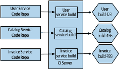

对 `User` 源代码仓库的任何更改都会触发匹配的构建，如果构建通过，我将拥有可用于部署的 `User` 微服务的新版本。为每个微服务拥有单独的仓库也允许你按仓库为基础更改所有权，如果你希望为微服务考虑强所有权模型，这是有意义的（稍后会详细介绍）。

这种模式的直接性虽然带来了某些挑战。具体来说，开发人员可能会同时处理多个仓库，特别是在尝试同时对多个仓库进行更改时，这尤其痛苦。此外，无法以原子方式在单独的仓库之间进行更改，至少使用 `Git` 时不行。

### 跨仓库复用代码

使用这种模式时，没有任何东西可以阻止微服务依赖于在不同仓库中管理的其他代码。一个简单的实现机制是将想要复用的代码打包成库，然后使其成为下游微服务的显式依赖。我们可以在图 6-7 中看到一个例子，其中 `Invoice` 和 `Payroll` 服务都使用了 `Connection` 库。

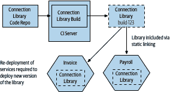

如果你想推出对 `Connection` 库的更改，你必须在匹配的源代码仓库中进行更改，并等待其构建完成以获得新的版本化构件。要实际部署使用此新版本库的 `Invoice` 或 `Payroll` 服务的新版本，你需要更改它们使用的 `Connection` 库的版本。这可能需要手动更改（如果你依赖特定版本），也可以根据你使用的 CI 工具的性质配置为动态发生。这些概念在 Jez Humble 和 Dave Farley 所著的书籍《Continuous Delivery》中得到了更详细的阐述^(4)。

当然需要记住的重要一点是，如果你想推出 `Connection` 库的新版本，那么我们也需要部署新构建的 `Invoice` 和 `Payroll` 服务。请记住，我们在“DRY 与微服务世界中代码复用的风险”中探讨的关于复用和微服务的所有注意事项仍然适用——如果你选择通过库复用代码，那么你必须接受这些更改无法以原子方式推出的事实，否则我们就会破坏独立部署的目标。你还必须意识到，可能更难知道某些微服务是否使用库的特定版本，如果你试图弃用旧版本库的使用，这可能会有问题。

### 跨多个仓库工作

那么，除了通过库复用代码之外，我们还能如何对一个以上的仓库进行更改？让我们看另一个例子。在图 6-8 中，我想更改 `Inventory` 服务公开的 API，并且我还需要更新 `Shipping` 服务以便它可以使用新的更改。如果 `Inventory` 和 `Shipping` 的代码在同一个仓库中，我可以一次性提交代码。现在，我必须将更改拆分为两部分——一个提交用于 `Inventory`，另一个提交用于 `Shipping`。

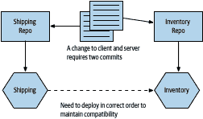

如果一个提交失败而另一个成功，这种拆分更改可能会导致问题——例如，我可能需要进行两次更改来回滚更改，如果在此期间其他人已签入，这可能会变得复杂。实际上，在这种特定情况下，我无论如何都可能希望对提交进行一定程度的分阶段处理。我希望在更改 `Shipping` 服务中的任何客户端代码之前，确保更改 `Inventory` 服务的提交有效——如果 API 中没有新的功能，就没有必要拥有使用它的客户端代码。

我与多个人交谈过，他们认为这种缺乏原子部署的情况是一个重大问题。我当然可以理解这带来的复杂性，但我认为在大多数情况下，这指向了一个更大的潜在问题。如果你不断在多个微服务之间进行更改，这表明你的服务边界可能不在正确的位置，并且可能意味着服务之间耦合过多。正如我们已经讨论过的，我们试图优化我们的架构和微服务边界，以便更改更有可能在微服务边界内应用。跨切更改应该是例外，而不是常态。

#### 提示

如果你不断在多个微服务之间进行更改，这很可能表明你的微服务边界位置错误。如果发现这种情况发生，考虑将微服务重新合并可能值得一试。

然后还有在正常工作流程中必须从多个仓库拉取并推送到多个仓库的麻烦。根据我的经验，这可以通过使用支持多个仓库的 IDE 来简化（这是我在过去 5 年中使用过的所有 IDE 都能处理的事情），你也可以编写简单的包装脚本来简化命令行工作。

### 何时使用此模式

使用每个微服务一个仓库的方法对于小型团队和大型团队同样有效，但如果你发现自己在微服务边界之间进行大量更改，那么它可能不适合你，我们接下来讨论的单仓库模式可能更合适——尽管在服务边界之间进行大量更改可以被视为某种不正常情况的警告信号，正如我们之前讨论过的。它还可能使代码复用比使用单仓库方法更复杂，因为你需要依赖代码被打包成版本构件。

## 模式：单仓库


采用单仓库（monorepo）方法时，多个微服务（或其他类型项目）的代码存储在同一个源代码仓库中。我见过单仓库仅由一个团队使用来管理其所有服务的源代码控制的情况，尽管这一概念是由一些非常大的科技公司推广的，在这些公司中，多个团队以及数百甚至数千名开发人员都可以在同一个源代码仓库上工作。

将所有源代码放在同一个仓库中，可以以原子方式跨多个项目进行源代码更改，并且还能实现从一个项目到下一个项目的更细粒度的代码复用。Google 可能是采用单仓库方法的公司中最为人熟知的例子，尽管它远非唯一一家。虽然这种方法还有其他一些好处——例如提高对他人代码的可见性——但能够轻松复用代码并对多个不同项目产生影响的更改，通常被认为是采用这种模式的主要原因。

如果我们以上面的例子为例，我们想要对 `Inventory` 进行更改以使其暴露一些新行为，并同时更新 `Shipping` 服务以使用我们所暴露的这一新功能，那么这些更改可以在一次提交中完成，如 图 6-9 所示。

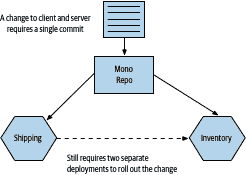

当然，就像上面讨论的多仓库模式一样，我们仍然需要处理部署方面的问题。如果我们想避免同步部署，就需要仔细考虑部署的顺序。

# 原子提交 vs 原子部署

能够跨多个服务进行原子提交并不意味着原子发布。如果你发现自己想要同时更改多个服务的代码并在同一时间将其全部发布到生产环境，这就违反了独立部署的核心原则。有关更多信息，请参阅 “DRY 与微服务世界中代码复用的风险”。

## 映射到构建

对于每个微服务使用单个源代码仓库，将源代码映射到构建过程是直接的。该源代码仓库中的任何更改都可以触发相应的 CI 构建。对于单仓库来说，情况会变得稍微复杂一些。

一个简单的起点是将单仓库内部的目录映射到构建，如 图 6-10 所示。例如，对 `user-service` 目录所做的更改会触发 `User service build`。如果你签入的代码同时更改了 `user-service` 目录和 `catalog-service` 目录中的文件，那么 `User service build` 和 `Catalog service build` 都将被触发。

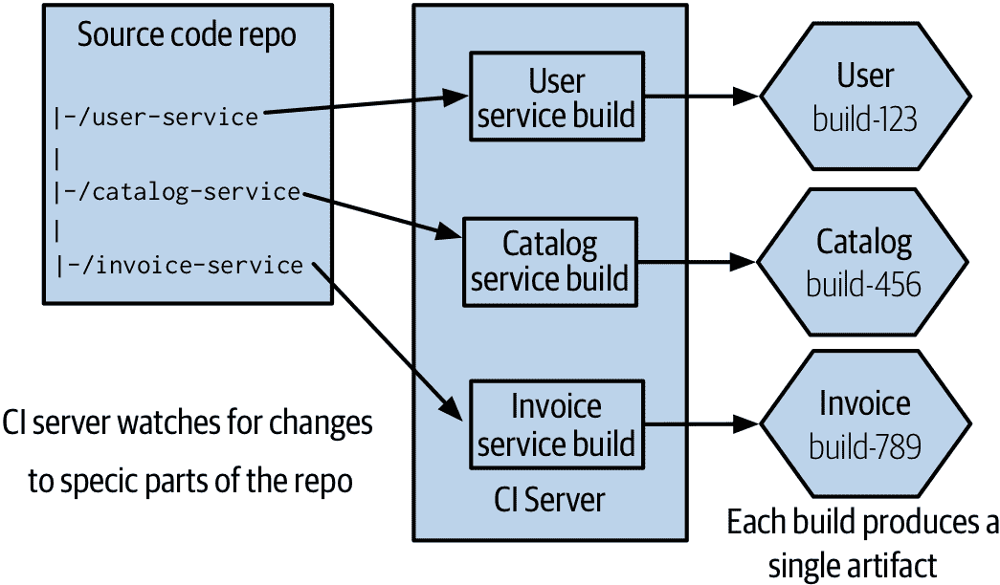

随着目录结构的变得更复杂，情况会变得更加复杂。在大型项目中，你可能会出现多个不同的目录想要触发同一个构建，而某些目录会触发多个构建。在最简单的情况下，你可能有一个 `common` 目录被所有微服务使用，对其的更改会导致所有微服务都被重新构建。在更复杂的情况下，团队最终需要采用更基于图的构建工具，如开源的 `Bazel` 工具，以更有效地管理这些依赖关系（`Bazel` 是 Google 自有内部构建工具的开源版本）。实施新的构建系统可能是一项重要的工作，因此不能轻率行事——但没有像这样的工具，Google 自己的单仓库是不可能实现的。

单仓库方法的好处之一是，你可以在项目之间实践更细粒度的复用。在多仓库模型中，如果我想复用他人的代码，它很可能需要被打包为一个版本化的构件，然后我可以在构建中将其包含进来（例如 nuget 包、JAR 文件或 NPM）。由于我们的复用单元是一个库，我们可能会引入比实际需要更多的代码。从理论上讲，在单仓库中我可以直接依赖另一个项目中的单个源文件——尽管这当然会使你的构建映射变得更复杂。

## 定义所有权

对于团队规模较小、代码库规模较小的项目，单仓库很可能能很好地与你习惯的传统构建和源代码管理工具配合使用。然而，随着单仓库变得更大，你可能需要开始寻找不同类型的工具。我们将在 [稍后提供链接] 中更详细地探讨所有权模型，但在此期间，值得简要探讨一下当我们思考源代码控制时这是如何发挥作用的。

Martin Fowler 之前曾撰写过关于不同所有权模型的内容^(6)，概述了从 `Strong Ownership` 到 `Weak Ownership` 再到 `Collective Ownership` 的所有权滑动尺度。自 Martin 提出这些术语以来，开发实践已经发生了变化，因此或许值得重新审视并重新定义这些术语。

在 `Strong Ownership` 下，某些代码由特定人群专门拥有。如果该群体之外的人想要进行更改，他们必须请求所有者为他们进行更改。`Weak Ownership` 仍然具有定义所有者的概念，但所有权群体之外的人被允许进行更改，尽管任何这些更改都必须由所有权群体中的某人进行审查和接受。这涵盖了在合并拉取请求之前，将拉取请求发送给核心所有权团队进行审查的做法。在 `Collective Ownership` 下，任何开发人员都可以更改任何代码片段。

对于开发人员数量较少的情况（一般指导原则为 20 人或更少），你可以采用 `Collective Ownership`——即任何开发人员都可以更改任何其他微服务。随着人员增多，你更有可能希望转向 `Strong` 或 `Weak` 所有权模型，以创建更明确的责任边界。如果其源代码控制工具不支持更细粒度的所有权控制，这可能会给使用单仓库的团队带来挑战。

一些源代码工具允许你在单个仓库内指定特定目录甚至特定文件路径的所有权。Google 最初在其单仓库上基于 Perforce 实现了该系统，然后才开发了自己的源代码控制系统，GitHub 自 2016 年起也支持此功能^(7)。在 GitHub 中，你可以创建一个 `CODEOWNERS` 文件，它允许你将所有者映射到目录或文件路径。你可以在 示例 6-1 中看到一些示例，这些示例取自 GitHub 自己的文档，展示了这些系统可以带来的灵活性类型。

### 示例 6-1. 如何在 GitHub CODEOWNERS 文件中指定特定目录所有权的示例

```
# In this example, @doctocat owns any files in the build/logs
# directory at the root of the repository and any of its
# subdirectories.
/build/logs/ @doctocat

# In this example, @octocat owns any file in an apps directory
# anywhere in your repository.
apps/ @octocat

# In this example, @doctocat owns any file in the `/docs`
# directory in the root of your repository.
/docs/ @doctocat
```

GitHub 自身的代码所有权概念确保当针对相关文件提出任何拉取请求时，会请求源文件代码所有者进行审查。对于较大的拉取请求，这可能成为一个问题，因为你最终可能需要多个审查者的批准，但无论如何，力求更小的拉取请求有很多很好的理由。

## 工具


Google 自己的单仓库规模庞大，且需要大量工程投入才能在规模上正常运行。考虑诸如经历了多代演进的基于图的构建系统、用于加快构建时间的分布式对象链接器，以及可动态保持依赖文件受控的 IDE 和文本编辑器插件——这是一项庞大的工作。随着 Google 的成长，他们在使用 Perforce 时越来越遇到限制，最终不得不创建自己的专有源代码控制工具 Piper。我在 2007-2008 年在 Google 的这一部分工作时，有超过一百人在维护各种开发者工具，其中很大一部分工作用于处理单仓库方法带来的影响。当然，如果你有成千上万名工程师，这是可以证明其合理性的。

为了更详细地了解 Google 使用单仓库背后的 rationale，我可以推荐 Rachel Potvin、Josh Levenbeg 的文章“为什么 Google 将数十亿行代码存储在单个仓库中”^(8)。事实上，我建议任何认为“我们应该使用单仓库，因为 Google 这样做！”的人都必须阅读它。你的组织可能不是 Google，也可能没有 Google 类型的问题、限制或资源。换句话说，你最终得到的任何单仓库可能都不会是 Google 的。

Microsoft 在规模上也遇到了类似的问题。他们采用了 Git 来帮助管理 Windows 的主要源代码仓库。该代码库的完整工作目录约为 270GB 的源文件^(9)。下载所有内容需要很长时间，而且也不需要——开发者最终只会在这个整体系统的很小一部分上工作。因此 Microsoft 必须创建一个专用的虚拟文件系统 VFS For Git（以前称为 GVFS），确保只有开发者需要的源文件才会被实际下载。

VFS For Git 是一个令人印象深刻的成就，Google 自身的工具链也是如此，尽管对于这类公司来说，很容易证明在这种技术上的投资是合理的。另外也值得指出的是，虽然 VFS For Git 是开源的，但我尚未遇到 Microsoft 之外的团队在使用它，而且 Google 支持其单仓库的庞大工具链大部分是闭源的（Bazel 是一个显著的例外，但开源的 Bazel 在多大程度上反映了 Google 内部实际使用的情况尚不明确）。

Markus Oberlehner 的文章“Monorepos in the wild”^(10)向我介绍了 Lerna^(11)，这是一个由 Babel Javascript 编译器团队创建的工具。Lerna 的设计目的是使从同一个源代码仓库生成多个版本化产物变得更容易。我无法直接谈论 Lerna 在此任务上的有效性（除了一系列显著的缺陷外，我也不是有经验的 Javascript 开发者），但从表面上看，它似乎在某种程度上简化了这种方法。

## “mono” 有多“单”？

Google 并非将**全部**代码存储在单仓库中。有些项目，尤其是那些在公开环境中开发的项目，被保存在其他地方。然而，至少根据之前提到的 ACM 文章，截至 2016 年，Google 的 95% 代码都存储在单仓库中。在其他组织中，单仓库可能仅限定于一个系统或少数几个系统。这意味着一家公司可以为组织的各个部分拥有少量单仓库。

我也曾与实践按团队划分单仓库的团队交谈过。从技术上讲，这可能与该模式的原始定义不完全一致（该定义通常以多个团队共享同一个仓库来讨论），但我仍然认为它更像是“单仓库”。在这种情况下，每个团队都有自己的单仓库，完全由其控制。该团队拥有的所有微服务的代码都存储在该团队的单仓库中，如图 6-11 所示。

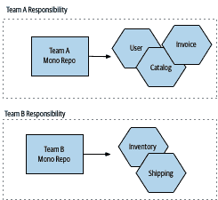

对于实践集体所有权的团队来说，这种模式有很多好处，可以说在规避大规模出现的一些挑战的同时获得了单仓库方法的大部分好处。这种折中方案在遵循现有组织所有权边界的工作方式方面很有意义，并且可以在一定程度上缓解对该模式在大规模使用时的担忧。

## 在何处使用此模式

一些在非常大规模下工作的组织发现单仓库方法对他们非常有效。我们迄今为止已经提到了 Google 和 Microsoft，但我们可以将 Facebook、Twitter 和 Uber 添加到列表中。这些组织有一个共同点——它们都是大型、技术导向的公司，能够投入大量资源来充分利用这种模式。我认为单仓库在光谱的另一端效果很好，即开发者和团队数量较少的情况下。在 10-20 名开发者的情况下，使用单仓库方法更容易管理所有权边界并保持构建过程简单。痛点似乎出现在中间的组织中——那些规模足以开始遇到需要新工具或工作方式的问题，但又没有额外带宽来投资这些想法的组织。

## 我会使用哪种方法？

根据我的经验，单仓库方法的主要优势——更细粒度的复用和原子提交——似乎抵不过在规模上出现的问题。对于小型团队来说，任何方法都可以，但随着规模扩大，我认为每个微服务一个仓库（多仓库）的方法更直接。从根本上说，我担心单仓库可能带来的跨服务更改的鼓励、更混乱的所有权界限以及对新工具的需求。

所有权方面的担忧可以通过细粒度的所有权控制来缓解，但这通常需要工具和/或更高的谨慎程度。随着单仓库周边工具的成熟度提高，我对此的看法可能会改变，但尽管在基于图的构建工具的开源开发方面做了大量工作，我仍然看到这些工具链的采用率非常低。所以对我来说是多仓库。

# 摘要

本章我们涵盖了一些重要思想，无论你是否最终使用微服务，这些思想都应该对你有所帮助。在这些思想周围还有许多需要探索的方面，从持续交付到基于主干的开发，从单仓库到多仓库。我为你提供了大量资源和进一步阅读的材料，但现在是时候转向一个需要深入探索的重要主题——部署。

^(1) 2016 年 DevOps 状况报告 - [*https://puppet.com/resources/report/2016-state-devops-report/*](https://puppet.com/resources/report/2016-state-devops-report/)

^(2) Accelerate State Of Devops 2019 [*https://services.google.com/fh/files/misc/state-of-devops-2019.pdf*](https://services.google.com/fh/files/misc/state-of-devops-2019.pdf)

^(3) Jez Humble 和 David Farley，*持续交付：通过构建、测试和部署自动化实现可靠的软件发布* (Upper Saddle River: Addison Wesley, 2010) 了解更多细节。

^(4) 请参阅 Jez Humble 和 Dave Farley 所著 *Continuous Delivery* 中的“管理依赖图”，第 363-373 页

^(5) [*https://bazel.build*](https://bazel.build)

^(6) [*https://martinfowler.com/bliki/CodeOwnership.html*](https://martinfowler.com/bliki/CodeOwnership.html)


^(7) [*https://help.github.com/en/github/creating-cloning-and-archiving-repositories/about-code-owners*](https://help.github.com/en/github/creating-cloning-and-archiving-repositories/about-code-owners)

^(8) [*https://cacm.acm.org/magazines/2016/7/204032-why-google-stores-billions-of-lines-of-code-in-a-single-repository/fulltext*](https://cacm.acm.org/magazines/2016/7/204032-why-google-stores-billions-of-lines-of-code-in-a-single-repository/fulltext)

^(9) 参见 Git 虚拟文件系统设计历史 [*https://docs.microsoft.com/en-us/azure/devops/learn/git/gvfs-design-history*](https://docs.microsoft.com/en-us/azure/devops/learn/git/gvfs-design-history)

^(10) [*https://medium.com/@maoberlehner/monorepos-in-the-wild-33c6eb246cb9*](https://medium.com/@maoberlehner/monorepos-in-the-wild-33c6eb246cb9)

^(11) [*https://lerna.js.org/*](https://lerna.js.org/)
