# 第7章 部署

部署单体应用程序是一个相当直接的过程。微服务由于其相互依赖性以及丰富的技术选项，完全是另一回事。当我撰写本书第一版时，本章已有很多内容可谈论你可用的各种选择。自那以后，Kubernetes 逐渐成为主流，而 Function As A Service 平台（FAAS）为我们提供了更多思考如何真正交付软件的方式。

尽管过去十年技术可能已经改变，但我认为与构建软件相关的许多核心原则并未改变。事实上，我认为确保我们彻底理解这些基础思想更为重要，因为它们可以帮助我们理解如何在这种新技术的混乱环境中导航。考虑到这一点，本章将确保突出一些与部署相关的核心原则，这些原则值得牢记，同时也展示你可用的不同工具在将这些原则付诸实践方面可能如何提供帮助（或造成阻碍）。

不过首先，让我们稍微掀开幕布，看看当我们从系统架构的逻辑视图转向真实的物理部署拓扑时会发生什么。

## 从逻辑到物理

到目前为止，当我们谈论微服务时，我们是以逻辑意义而非物理意义谈论它们的。我们可以谈论我们的 `Invoice` 微服务如何与 `Order` 微服务通信，如 图 7-1 所示，而无需实际查看这些服务部署的物理拓扑。架构的逻辑视图通常会抽象掉底层物理部署问题——在本章范围内，这一概念需要改变。

这种对微服务的逻辑视图在实际在真实基础设施上运行它们时可能会隐藏大量复杂性。让我们看看此类图表可能会隐藏哪些细节。

### 多个实例

当我们思考这两个微服务的部署拓扑时，其并不像一件事与另一件事通信那样简单。首先，似乎很可能我们会有每个服务的多个实例。

拥有服务的多个实例可以让你处理更多负载，并且可以提高系统的健壮性，因为你可以更容易地容忍单个实例的故障。因此，我们可能有 `Invoice` 的一个或多个实例与 `Order` 的一个或多个实例通信。这些实例之间通信的确切处理方式将取决于通信机制的性质，但如果我们假设在这种情况下使用某种基于 HTTP 的 API，负载均衡器就足以处理将请求路由到不同实例，如 图 7-2 所示。

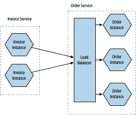

你想要的实例数量将取决于应用程序的性质——你需要评估所需的冗余度、预期负载水平等，以得出可行的数量。你可能还需要考虑这些实例将在何处运行。如果出于健壮性原因拥有服务的多个实例，你可能希望确保这些实例不会全部位于同一底层硬件上。进一步说，这可能要求你将不同的实例不仅分布在多台机器上，而且分布在不同的数据中心，以防止整个数据中心变得不可用。这可能导致像 图 7-3 中那样的部署拓扑。

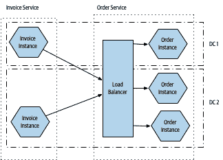

这可能看起来过于谨慎——整个数据中心不可用的几率有多大？好吧，我无法对每种情况回答这个问题，但至少在处理主要云服务提供商时，这绝对是你必须考虑的事情。对于托管虚拟机之类的东西，AWS、Azure 或 Google 都不会为单台机器提供 SLA，也不会为单个可用区（对于这些提供商而言，这是数据中心的最接近等价物）提供 SLA。实际上，这意味着你部署的任何解决方案都应分布在多个可用区中。

### 数据库

进一步说，还有一个我们到目前为止忽略的重要组件——数据库。正如我已经讨论过的，我们希望微服务隐藏其内部状态管理，因此微服务用于管理其状态的任何数据库都被认为隐藏在微服务内部。

这导致了经常提到的格言“不要共享数据库”，我希望到现在为止其理由已经足够充分。

但当我们考虑到我有多个微服务实例这一事实时，这如何运作？每个微服务实例是否应该有自己的数据库？一句话，不。在大多数情况下，如果我访问我的 `Order` 服务的任何实例，我希望能够获取有关同一订单的信息。因此，我们需要在同一逻辑服务的不同实例之间实现一定程度的共享状态。这在 图 7-4 中显示。

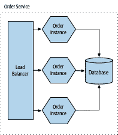

但这是否违反了我们的“不要共享数据库”规则？并不真的。我们主要担心之一是，当在多个不同的微服务之间共享数据库时，与访问和操作该状态相关的逻辑现在分散在不同的微服务中。但在这里，数据是由不同实例的 **same** 微服务共享的。访问和操作状态的逻辑仍然保留在单个逻辑微服务内。

#### 数据库部署与扩展

与我们的微服务一样，到目前为止我们主要以逻辑意义谈论数据库。在上面的 图 7-3 中，我们忽略了底层数据库的冗余或扩展需求的任何问题。我们还回避了你将使用的大多数数据库的一个重要概念——你可以在同一数据库基础设施上管理多个逻辑隔离的数据库。

## 物理数据库部署

这里使用的确切术语在不同数据库厂商之间有所差异，但总体而言，物理数据库部署可能托管在多台机器上，原因有很多。一个常见的例子是将读写负载在主节点和一个或多个指定用于只读目的的节点之间进行拆分（这些节点通常被称为只读副本）。如果我们为 `Order` 服务实现这一想法，可能会出现类似 图 7-5 中的情况

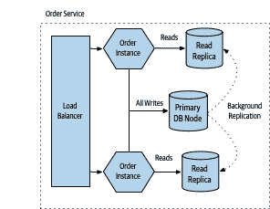

所有只读流量都进入其中一个只读副本节点，并且可以通过添加额外的只读节点来进一步扩展读流量。由于关系数据库的工作方式，通过添加额外机器来扩展写操作更困难（通常需要分片模型，这会增加额外复杂性），因此将只读流量转移到这些只读副本通常可以释放写节点上的更多容量以允许进一步扩展。

在此复杂图景中还需考虑的是，同一个数据库基础设施可以支持多个逻辑隔离的数据库。因此，`Invoice` 和 `Order` 的数据库可能都由同一个底层数据库引擎和硬件提供服务，如 图 7-6 所示。这可以带来显著的好处，因为它允许你将硬件集中起来为多个微服务服务，可以降低许可成本，并且还可以帮助减少数据库本身管理的相关工作。

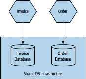

这里需要认识到的重要一点是，尽管这两个数据库可能运行在相同的硬件和数据库引擎上，但它们仍然是逻辑隔离的数据库。它们不会相互干扰（除非你允许这种情况）。需要考虑的一个主要因素是，如果这个共享的数据库基础设施出现故障，你可能会影响多个微服务，这可能造成灾难性影响。

在我看来，以“on-prem”方式管理自身基础设施并运行的组织更有可能出于我之前概述的成本原因，将多个不同的数据库托管在共享的数据库基础设施上。配置和管理硬件很痛苦（而且历史上数据库至少不太可能运行在虚拟化基础设施上），因此你希望它更少。

另一方面，运行在公共云提供商上的团队更有可能按每个微服务的基础来配置专用的数据库基础设施，如 图 7-7 所示。配置和管理此基础设施的成本要低得多。例如，AWS 的关系数据库服务（RDS）可以自动处理备份、升级、多可用区故障转移等相关问题，其他公共云提供商也有类似的产品。这使得为你的微服务拥有更隔离的基础设施在成本上更加有效，让每个微服务所有者拥有更多控制权，而不必依赖共享服务。

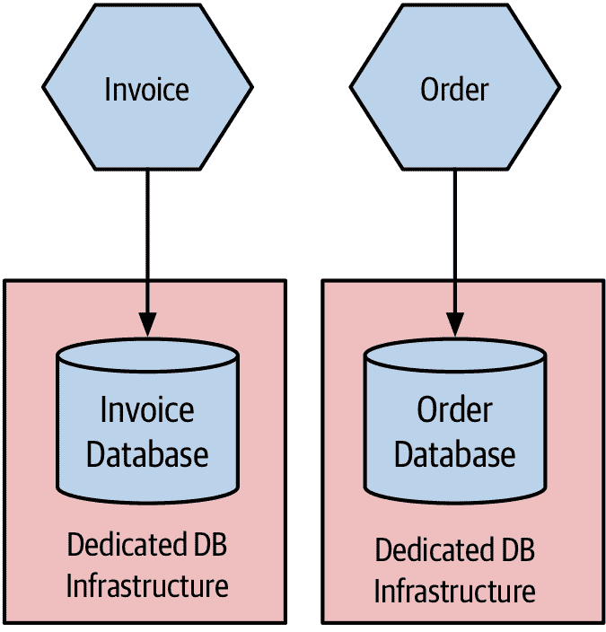

## 环境

当你部署软件时，它运行在某个环境中。每个环境通常会服务于不同的目的，而你可能拥有的环境的确切数量会因软件开发方式以及软件部署到最终用户的方式而大不相同。有些环境会有生产数据，有些则不会。有些环境可能包含所有服务，而其他环境可能只有少量服务，缺失的服务在测试目的下会被假服务替代。

通常，我们认为我们的软件会经过多个预生产环境，每个环境都有其目的，以允许软件开发并测试其准备投入生产的情况——我们之前在 “权衡与环境” 中探讨过这一点。从开发人员笔记本电脑，到持续集成服务器，再到集成测试环境及以后——环境的确切性质和数量取决于多种因素，但主要由你选择如何开发软件驱动。在 图 7-8 中，我们看到 MusicCorp 的 `Catalog` 微服务的流水线。微服务会经过不同的环境，然后最终进入生产环境，在那里我们的用户将使用新软件。

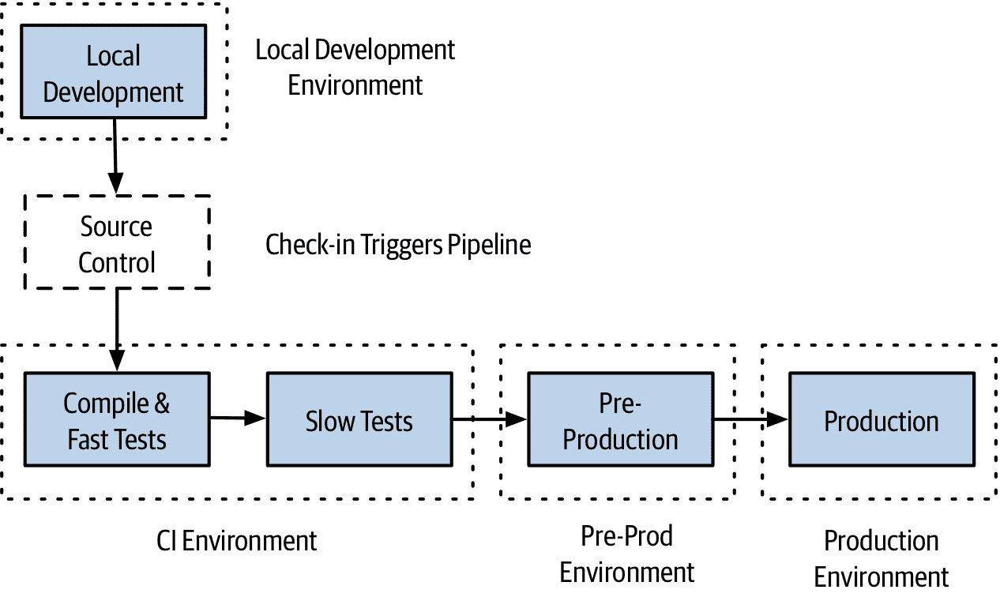

我们的微服务运行的第一个环境将是开发人员在提交代码之前工作的任何地方，很可能是他们的本地笔记本电脑。提交代码后，CI 流程会启动快速测试。快速和慢速测试阶段都部署到我们的 CI 环境中。如果慢速测试通过，微服务将被部署到预生产环境以允许手动验证（这完全是可选的，但对很多人来说仍然很重要）。如果此手动验证通过，微服务随后将被部署到生产环境。

理想情况下，此过程中的每个环境都应是生产环境的精确副本。这将让我们更有信心软件在到达生产环境时能够正常工作。然而，实际上，我们通常负担不起运行整个生产环境的多个副本，因为这太昂贵了。

我们还希望在流程早期调整环境以实现快速反馈。至关重要的是，我们尽早知道我们的软件是否工作或不工作，以便我们能快速修复问题。我们越早知道软件的问题，修复起来就越快，故障的影响也越小。在本地笔记本电脑上发现问题要比在预生产测试中发现好得多，但同样，在预生产测试中发现问题可能比在生产环境中发现要好得多（尽管我们将在 \[待定链接\] 中探讨围绕此的一些重要权衡）。

这意味着更接近开发者的环境将被调整以提供快速反馈，因此可能会损害它们“生产环境般”的程度。但随着环境越来越接近生产，我们希望它们越来越像最终的生产环境，以确保我们能发现问题。

作为一个简单的实际例子，让我们重新审视之前 `Catalog` 服务的例子，并查看 图 7-9 中的不同环境。本地开发人员笔记本电脑上，我们的服务以在本地运行的单个实例部署。软件构建速度快，但部署为单个节点，运行的硬件与我们在生产环境中预期的非常不同。在 CI 环境中，我们部署服务的两个副本进行测试，确保我们的负载均衡逻辑正常工作。我们将两个实例都部署到同一台机器上——这降低了成本，使事情更快，并且在流程的这个阶段仍然能提供足够的反馈。

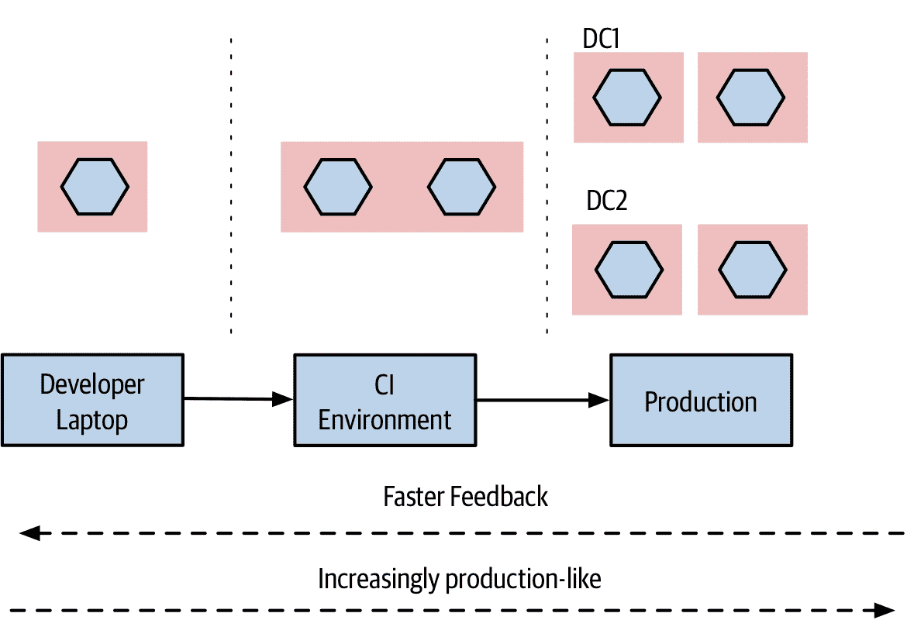

最后，在生产环境中，我们的微服务作为实例部署在四个 Pod 中，分布在四台机器上，而这些机器又分布在两个不同的数据中心。

这只是你如何使用环境的示例，你需要的确切设置会因你构建的内容以及部署方式而大不相同。例如，如果你需要为每个客户部署一份软件副本，你可能拥有多个生产环境。

然而关键在于，从一个环境到另一个环境，你的微服务的确切拓扑结构会发生变化。因此你需要找到方法来改变从一个环境到另一个环境的实例数量，以及任何特定于环境的配置。我们还希望只构建一次服务实例，因此可以推断任何特定于环境的信息需要与已部署的服务构件分离。

你如何在一个环境到另一个环境之间改变微服务的拓扑结构，将在很大程度上取决于你用于部署的机制，以及拓扑结构变化的程度。如果从一个环境到另一个环境唯一发生变化的是微服务实例的数量，这可能就像参数化该值一样简单，以便在部署活动的一部分中传入不同的数字。我们稍后会涉及 Kubernetes 主题，看看实现特定于环境更改的一些选项。

因此，总结一下，单个逻辑微服务可以部署到多个环境中。从一个环境到下一个环境，每个微服务的实例数量可以根据每个环境的需求而变化。

# 微服务部署原则

面对如此多的微服务部署选项，我认为在此领域建立一些核心原则很重要。对这些原则的扎实理解无论你最终做出什么选择都将对你有所帮助。我们很快会详细讨论每个原则，但为了开始，这里是我们将要涵盖的核心思想。

Isolated Execution:
以隔离的方式运行微服务实例，使其拥有自己的计算资源，并且其执行不会影响附近运行的其他微服务实例。

Focus On Automation:
随着微服务数量的增加，自动化变得越来越重要。专注于选择允许高度自动化的技术，并将自动化作为文化核心的一部分来采用。

Infrastructure As Code:
表示基础设施的配置以简化自动化并促进信息共享。将此代码存储在源代码控制中以允许重建环境。

Zero-downtime Deployment:
进一步推进独立部署能力，并确保部署微服务的新版本可以在不影响服务用户（无论是人类还是其他微服务）的情况下完成。

Desired State Management:
使用一个维护微服务处于定义状态的平台，在发生故障或流量增加时根据需要启动新实例。考虑使用 GitOps 将其与基础设施即代码结合使用，以推动更多运维任务从代码驱动。

## 隔离执行

你可能很想，特别是在微服务之旅的早期，就把所有的微服务实例都放在一台机器上（这可能是一台物理机器或单台虚拟机），如 图 7-10 所示。纯粹从主机管理角度来看，这更简单。在一个团队管理基础设施而另一个团队管理软件的世界里，基础设施团队的工作量通常是其需要管理的主机数量的函数。如果更多服务被打包到单个主机上，随着服务数量的增加，主机管理工作量并不会增加。

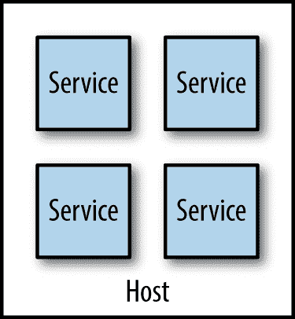

然而，这个模型存在一些挑战。首先，它可能使监控变得更加困难。例如，在跟踪 CPU 时，我是否需要独立于其他服务跟踪一个服务的 CPU？还是我关心的是整个主机的 CPU？副作用也很难避免。如果一个服务承受了巨大的负载，它最终可能会减少系统其他部分可用的资源。这是一个在线时尚零售商 [Gilt](http://bit.ly/1z1WR3T) 遇到的问题。从 Ruby on Rails 单体应用开始，他们决定转向微服务以使应用程序更容易扩展，同时更好地适应日益增长的开发人员数量。最初 Gilt 在一台机器上共存了许多微服务，但其中一个微服务的负载不均会对该主机上运行的其他所有内容产生不利影响。这也使主机故障的影响分析变得更加复杂——停用一台主机可能会产生很大的连锁反应。

服务的部署也可能更复杂一些，因为确保一次部署不会影响另一次部署会导致额外的麻烦。例如，如果每个微服务都有不同的（并且可能相互矛盾的）依赖项，我该如何使其工作？

这种模式也可能抑制团队的自主性。如果不同团队的服务安装在同一主机上，谁来为其服务配置主机？很可能这最终会由一个中央团队处理，这意味着部署服务需要更多的协调。

从根本上说，在同一台机器（虚拟或物理）上运行大量微服务实例最终会严重削弱微服务整体的关键原则之一——独立部署能力。因此，我们确实希望以隔离的方式运行微服务实例，如 图 7-11 所见。

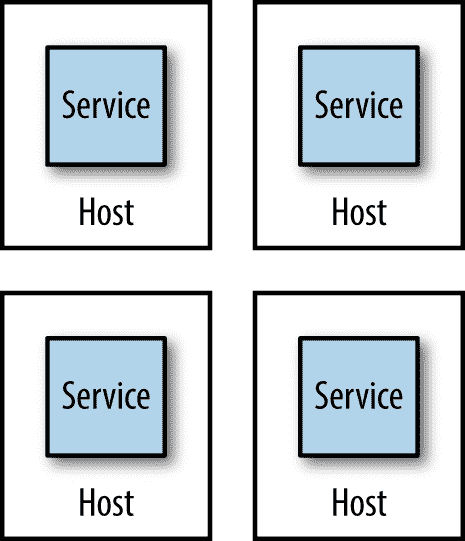

每个微服务实例都有自己的、隔离的执行环境。它可以安装自己的依赖项，拥有自己的一套隔离资源。

正如我的老同事 Neal Ford 所说，我们围绕部署和主机管理的许多工作实践都是为了优化资源稀缺性而进行的尝试。过去，如果我们想要另一台机器来实现隔离，唯一的选择就是购买或租用另一台物理机器。这通常需要很长的提前期并导致长期的财务承诺。在我的经验中，客户每两到三年才配置一次新服务器并不少见，而在这些时间表之外尝试获取额外机器是困难的。但按需计算平台大幅降低了计算资源的成本，而虚拟化技术的改进意味着即使对于内部托管的基础设施也具有更大的灵活性。

随着容器化加入其中，我们在配置隔离执行环境方面拥有前所未有的更多选择。如 图 7-12 所示，大致而言，我们从为服务提供专用物理机器的极端情况开始，这提供了最好的隔离但可能成本最高，到另一端的容器，提供较弱的隔离但往往更具成本效益且配置速度快得多。我们将在本章后面再讨论容器化等技术的具体细节。

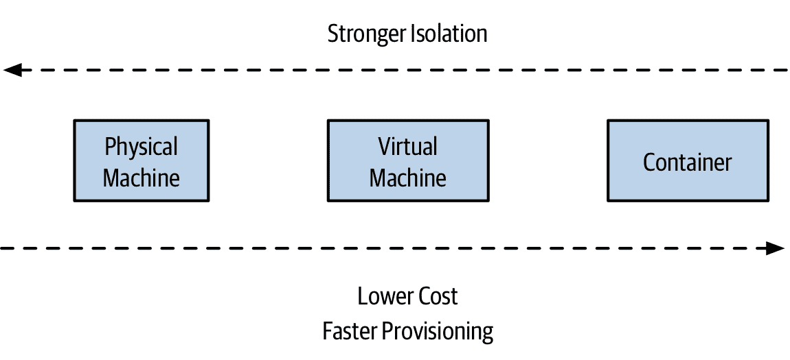

如果你将服务部署到类似 PAAS 的工具上，例如 AWS Lambda、Heroku 或类似工具，这种隔离会为你提供。取决于平台本身的性质，你很可能期望你的微服务实例在幕后运行在容器或专用 VM 中。

总体而言，容器周围的隔离已经得到足够改进，使其成为微服务工作负载更自然的选择。容器和 VM 之间隔离的差异已减少到对于绝大多数工作负载而言“足够好”的程度，这在很大程度上就是它们如此受欢迎的原因，并且在大多数情况下往往是我的默认选择。

## 专注于自动化

随着你添加更多的微服务，你需要处理的活动部件也会增多。更多的进程、更多需要配置的事项、更多需要监控的实例。转向微服务会将大量复杂性推向运维领域，如果你以纯手动方式管理运维流程，这意味着服务越多，就需要越多的人来处理。

相反，你需要对自动化保持不懈的关注。选择能够让事情以自动方式完成的工具和技术，最好是以基础设施即代码为目标，我们稍后会介绍。

随着微服务数量的增加，自动化变得愈发重要。认真考虑能够实现高度自动化的技术，并将自动化作为文化核心的一部分来采纳。

自动化也是我们确保开发人员仍保持生产力的方式。赋予他们自助式 provision 单个服务或服务组的能力，是让开发人员生活更轻松的关键。理想情况下，开发人员应能够访问与我们生产服务部署所使用的完全相同的工具链，以便我们能及早发现问题。本章我们将探讨大量[content]
随着你添加更多的微服务，你需要处理的活动部件也会增多。更多的进程、更多需要配置的事项、更多需要监控的实例。转向微服务会将大量复杂性推向运维领域，如果你以纯手动方式管理运维流程，这意味着服务越多，就需要越多的人来处理。

相反，你需要对自动化保持不懈的关注。选择能够让事情以自动方式完成的工具和技术，最好是以基础设施即代码为目标，我们稍后会介绍。

随着微服务数量的增加，自动化变得愈发重要。认真考虑能够实现高度自动化的技术，并将自动化作为文化核心的一部分来采纳。

自动化也是我们确保开发人员仍保持生产力的方式。赋予他们自助式 provision 单个服务或服务组的能力，是让开发人员生活更轻松的关键。理想情况下，开发人员应能够访问与我们生产服务部署所使用的完全相同的工具链，以便我们能及早发现问题。本章我们将探讨大量[content]
随着你添加更多的微服务，你需要处理的活动部件也会增多。更多的进程、更多需要配置的事项、更多需要监控的实例。转向微服务会将大量复杂性推向运维领域，如果你以纯手动方式管理运维流程，这意味着服务越多，就需要越多的人来处理。

相反，你需要对自动化保持不懈的关注。选择能够让事情以自动方式完成的工具和技术，最好是以基础设施即代码为目标，我们稍后会介绍。

随着微服务数量的增加，自动化变得愈发重要。认真考虑能够实现高度自动化的技术，并将自动化作为文化核心的一部分来采纳。

自动化也是我们确保开发人员仍保持生产力的方式。赋予他们自助式 provision 单个服务或服务组的能力，是让开发人员生活更轻松的关键。理想情况下，开发人员应能够访问与我们生产服务部署所使用的完全相同的工具链，以便我们能及早发现问题。本章我们将探讨大量[content]
随着你添加更多的微服务，你需要处理的活动部件也会增多。更多的进程、更多需要配置的事项、更多需要监控的实例。转向微服务会将大量复杂性推向运维领域，如果你以纯手动方式管理运维流程，这意味着服务越多，就需要越多的人来处理。

相反，你需要对自动化保持不懈的关注。选择能够让事情以自动方式完成的工具和技术，最好是以基础设施即代码为目标，我们稍后会介绍。

随着微服务数量的增加，自动化变得愈发重要。认真考虑能够实现高度自动化的技术，并将自动化作为文化核心的一部分来采纳。

自动化也是我们确保开发人员仍保持生产力的方式。赋予他们自助式 provision 单个服务或服务组的能力，是让开发人员生活更轻松的关键。理想情况下，开发人员应能够访问与我们生产服务部署所使用的完全相同的工具链，以便我们能及早发现问题。本章我们将探讨大量[content]
随着你添加更多的微服务，你需要处理的活动部件也会增多。更多的进程、更多需要配置的事项、更多需要监控的实例。转向微服务会将大量复杂性推向运维领域，如果你以纯手动方式管理运维流程，这意味着服务越多，就需要越多的人来处理。

相反，你需要对自动化保持不懈的关注。选择能够让事情以自动方式完成的工具和技术，最好是以基础设施即代码为目标，我们稍后会介绍。

随着微服务数量的增加，自动化变得愈发重要。认真考虑能够实现高度自动化的技术，并将自动化作为文化核心的一部分来采纳。

自动化也是我们确保开发人员仍保持生产力的方式。赋予他们自助式 provision 单个服务或服务组的能力，是让开发人员生活更轻松的关键。理想情况下，开发人员应能够访问与我们生产服务部署所使用的完全相同的工具链，以便我们能及早发现问题。本章我们将探讨大量[content]
随着你添加更多的微服务，你需要处理的活动部件也会增多。更多的进程、更多需要配置的事项、更多需要监控的实例。转向微服务会将大量复杂性推向运维领域，如果你以纯手动方式管理运维流程，这意味着服务越多，就需要越多的人来处理。

相反，你需要对自动化保持不懈的关注。选择能够让事情以自动方式完成的工具和技术，最好是以基础设施即代码为目标，我们稍后会介绍。

随着微服务数量的增加，自动化变得愈发重要。认真考虑能够实现高度自动化的技术，并将自动化作为文化核心的一部分来采纳。

自动化也是我们确保开发人员仍保持生产力的方式。赋予他们自助式 provision 单个服务或服务组的能力，是让开发人员生活更轻松的关键。理想情况下，开发人员应能够访问与我们生产服务部署所使用的完全相同的工具链，以便我们能及早发现问题。本章我们将探讨大量[content]
随着你添加更多的微服务，你需要处理的活动部件也会增多。更多的进程、更多需要配置的事项、更多需要监控的实例。转向微服务会将大量复杂性推向运维领域，如果你以纯手动方式管理运维流程，这意味着服务越多，就需要越多的人来处理。

相反，你需要对自动化保持不懈的关注。选择能够让事情以自动方式完成的工具和技术，最好是以基础设施即代码为目标，我们稍后会介绍。

随着微服务数量的增加，自动化变得愈发重要。认真考虑能够实现高度自动化的技术，并将自动化作为文化核心的一部分来采纳。

自动化也是我们确保开发人员仍保持生产力的方式。赋予他们自助式 provision 单个服务或服务组的能力，是让开发人员生活更轻松的关键。理想情况下，开发人员应能够访问与我们生产服务部署所使用的完全相同的工具链，以便我们能及早发现问题。本章我们将探讨大量[content]
随着你添加更多的微服务，你需要处理的活动部件也会增多。更多的进程、更多需要配置的事项、更多需要监控的实例。转向微服务会将大量复杂性推向运维领域，如果你以纯手动方式管理运维流程，这意味着服务越多，就需要越多的人来处理。

相反，你需要对自动化保持不懈的关注。选择能够让事情以自动方式完成的工具和技术，最好是以基础设施即代码为目标，我们稍后会介绍。

随着微服务数量的增加，自动化变得愈发重要。认真考虑能够实现高度自动化的技术，并将自动化作为文化核心的一部分来采纳。

自动化也是我们确保开发人员仍保持生产力的方式。赋予他们自助式 provision 单个服务或服务组的能力，是让开发人员生活更轻松的关键。理想情况下，开发人员应能够访问与我们生产服务部署所使用的完全相同的工具链，以便我们能及早发现问题。本章我们将探讨大量[content]
随着你添加更多的微服务，你需要处理的活动部件也会增多。更多的进程、更多需要配置的事项、更多需要监控的实例。转向微服务会将大量复杂性推向运维领域，如果你以纯手动方式管理运维流程，这意味着服务越多，就需要越多的人来处理。

相反，你需要对自动化保持不懈的关注。选择能够让事情以自动方式完成的工具和技术，最好是以基础设施即代码为目标，我们稍后会介绍。

随着微服务数量的增加，自动化变得愈发重要。认真考虑能够实现高度自动化的技术，并将自动化作为文化核心的一部分来采纳。

自动化也是我们确保开发人员仍保持生产力的方式。赋予他们自助式 provision 单个服务或服务组的能力，是让开发人员生活更轻松的关键。理想情况下，开发人员应能够访问与我们生产服务部署所使用的完全相同的工具链，以便我们能及早发现问题。本章我们将探讨大量[content]
随着你添加更多的微服务，你需要处理的活动部件也会增多。更多的进程、更多需要配置的事项、更多需要监控的实例。转向微服务会将大量复杂性推向运维领域，如果你以纯手动方式管理运维流程，这意味着服务越多，就需要越多的人来处理。

相反，你需要对自动化保持不懈的关注。选择能够让事情以自动方式完成的工具和技术，最好是以基础设施即代码为目标，我们稍后会介绍。

随着微服务数量的增加，自动化变得愈发重要。认真考虑能够实现高度自动化的技术，并将自动化作为文化核心的一部分来采纳。

自动化也是我们确保开发人员仍保持生产力的方式。赋予他们自助式 provision 单个服务或服务组的能力，是让开发人员生活更轻松的关键。理想情况下，开发人员应能够访问与我们生产服务部署所使用的完全相同的工具链，以便我们能及早发现问题。本章我们将探讨大量[content]
随着你添加更多的微服务，你需要处理的活动部件也会增多。更多的进程、更多需要配置的事项、更多需要监控的实例。转向微服务会将大量复杂性推向运维领域，如果你以纯手动方式管理运维流程，这意味着服务越多，就需要越多的人来处理。

相反，你需要对自动化保持不懈的关注。选择能够让事情以自动方式完成的工具和技术，最好是以基础设施即代码为目标，我们稍后会介绍。

随着微服务数量的增加，自动化变得愈发重要。认真考虑能够实现高度自动化的技术，并将自动化作为文化核心的一部分来采纳。

自动化也是我们确保开发人员仍保持生产力的方式。赋予他们自助式 provision 单个服务或服务组的能力，是让开发人员生活更轻松的关键。理想情况下，开发人员应能够访问与我们生产服务部署所使用的完全相同的工具链，以便我们能及早发现问题。本章我们将探讨大量[content]
随着你添加更多的微服务，你需要处理的活动部件也会增多。更多的进程、更多需要配置的事项、更多需要监控的实例。转向微服务会将大量复杂性推向运维领域，如果你以纯手动方式管理运维流程，这意味着服务越多，就需要越多的人来处理。

相反，你需要对自动化保持不懈的关注。选择能够让事情以自动方式完成的工具和技术，最好是以基础设施即代码为目标，我们稍后会介绍。

随着微服务数量的增加，自动化变得愈发重要。认真考虑能够实现高度自动化的技术，并将自动化作为文化核心的一部分来采纳。

自动化也是我们确保开发人员仍保持生产力的方式。赋予他们自助式 provision 单个服务或服务组的能力，是让开发人员生活更轻松的关键。理想情况下，开发人员应能够访问与我们生产服务部署所使用的完全相同的工具链，以便我们能及早发现问题。本章我们将探讨大量[content]
随着你添加更多的微服务，你需要处理的活动部件也会增多。更多的进程、更多需要配置的事项、更多需要监控的实例。转向微服务会将大量复杂性推向运维领域，如果你以纯手动方式管理运维流程，这意味着服务越多，就需要越多的人来处理。

相反，你需要对自动化保持不懈的关注。选择能够让事情以自动方式完成的工具和技术，最好是以基础设施即代码为目标，我们稍后会介绍。

随着微服务数量的增加，自动化变得愈发重要。认真考虑能够实现高度自动化的技术，并将自动化作为文化核心的一部分来采纳。

自动化也是我们确保开发人员仍保持生产力的方式。赋予他们自助式 provision 单个服务或服务组的能力，是让开发人员生活更轻松的关键。理想情况下，开发人员应能够访问与我们生产服务部署所使用的完全相同的工具链，以便我们能及早发现问题。本章我们将探讨大量[content]
随着你添加更多的微服务，你需要处理的活动部件也会增多。更多的进程、更多需要配置的事项、更多需要监控的实例。转向微服务会将大量复杂性推向运维领域，如果你以纯手动方式管理运维流程，这意味着服务越多，就需要越多的人来处理。

相反，你需要对自动化保持不懈的关注。选择能够让事情以自动方式完成的工具和技术，最好是以基础设施即代码为目标，我们稍后会介绍。

随着微服务数量的增加，自动化变得愈发重要。认真考虑能够实现高度自动化的技术，并将自动化作为文化核心的一部分来采纳。

自动化也是我们确保开发人员仍保持生产力的方式。赋予他们自助式 provision 单个服务或服务组的能力，是让开发人员生活更轻松的关键。理想情况下，开发人员应能够访问与我们生产服务部署所使用的完全相同的工具链，以便我们能及早发现问题。本章我们将探讨大量[content]
## 自动化

随着你添加更多的微服务，你需要处理的活动部件也会增多。更多的进程、更多需要配置的事项、更多需要监控的实例。转向微服务会将大量复杂性推向运维领域，如果你以纯手动方式管理运维流程，这意味着服务越多，就需要越多的人来处理。

相反，你需要对自动化保持不懈的关注。选择能够让事情以自动方式完成的工具和技术，最好是以基础设施即代码为目标，我们稍后会介绍。

随着微服务数量的增加，自动化变得愈发重要。认真考虑能够实现高度自动化的技术，并将自动化作为文化核心的一部分来采纳。

自动化也是我们确保开发人员仍保持生产力的方式。赋予他们自助式 provision 单个服务或服务组的能力，是让开发人员生活更轻松的关键。理想情况下，开发人员应能够访问与我们生产服务部署所使用的完全相同的工具链，以便我们能及早发现问题。本章我们将探讨大量[content]
随着你添加更多的微服务，你需要处理的活动部件也会增多。更多的进程、更多需要配置的事项、更多需要监控的实例。转向微服务会将大量复杂性推向运维领域，如果你以纯手动方式管理运维流程，这意味着服务越多，就需要越多的人来处理。

相反，你需要对自动化保持不懈的关注。选择能够让事情以自动方式完成的工具和技术，最好是以基础设施即代码为目标，我们稍后会介绍。

随着微服务数量的增加，自动化变得愈发重要。认真考虑能够实现高度自动化的技术，并将自动化作为文化核心的一部分来采纳。

自动化也是我们确保开发人员仍保持生产力的方式。赋予他们自助式 provision 单个服务或服务组的能力，是让开发人员生活更轻松的关键。理想情况下，开发人员应能够访问与我们生产服务部署所使用的完全相同的工具链，以便我们能及早发现问题。本章我们将探讨大量[content]
随着你添加更多的微服务，你需要处理的活动部件也会增多。更多的进程、更多需要配置的事项、更多需要监控的实例。转向微服务会将大量复杂性推向运维领域，如果你以纯手动方式管理运维流程，这意味着服务越多，就需要越多的人来处理。

相反，你需要对自动化保持不懈的关注。选择能够让事情以自动方式完成的工具和技术，最好是以基础设施即代码为目标，我们稍后会介绍。

随着微服务数量的增加，自动化变得愈发重要。认真考虑能够实现高度自动化的技术，并将自动化作为文化核心的一部分来采纳。

自动化也是我们确保开发人员仍保持生产力的方式。赋予他们自助式 provision 单个服务或服务组的能力，是让开发人员生活更轻松的关键。理想情况下，开发人员应能够访问与我们生产服务部署所使用的完全相同的工具链，以便我们能及早发现问题。本章我们将探讨大量随着你添加更多的微服务，你需要处理的活动部件也会增多。更多的进程、更多需要配置的事项、更多需要监控的实例。转向微服务会将大量复杂性推向运维领域，如果你以纯手动方式管理运维流程，这意味着服务越多，就需要越多的人来处理。

相反，你需要对自动化保持不懈的关注。选择能够让事情以自动方式完成的工具和技术，最好是以基础设施即代码为目标，我们稍后会介绍。

随着微服务数量的增加，自动化变得愈发重要。认真考虑能够实现高度自动化的技术，并将自动化作为文化核心的一部分来采纳。

自动化也是我们确保开发人员仍保持生产力的方式。赋予他们自助式 provision 单个服务或服务组的能力，是让开发人员生活更轻松的关键。理想情况下，开发人员应能够访问与我们生产服务部署所使用的完全相同的工具链，以便我们能及早发现问题。本章我们将探讨大量## 自动化

随着微服务数量增加，你需要处理的活动部件也会增多。更多的进程、更多配置项、更多需要监控的实例。转向微服务会把大量复杂性推向运维层面，如果你仍以纯手动方式管理运维流程，那么服务越多，就需要越多的人来操作。

相反，你需要对自动化保持不懈的关注。选择能够让事情以自动方式完成的工具和技术，最好是以基础设施即代码为目标，我们稍后会介绍。

随着微服务数量的增加，自动化变得愈发重要。认真考虑能够实现高度自动化的技术，并将自动化作为文化核心的一部分来采纳。

自动化也是我们确保开发人员仍保持生产力的方式。赋予他们自助式 provision 单个服务或服务组的能力，是让开发人员生活更轻松的关键。理想情况下，开发人员应能够访问与我们生产服务部署所使用的完全相同的工具链，以便我们能及早发现问题。本章我们将探讨大量[content]
随着你添加更多微服务，活动部件会增多。更多进程、更多配置、更多实例需监控。转向微服务会把复杂性推向运维，若仍手动管理，则服务越多越需人手。

相反，需对自动化保持不懈关注。选择能自动完成事务的工具和技术，最好以基础设施即代码为目标，稍后介绍。

微服务越多，自动化越重要。应认真考虑高度自动化技术，并将自动化作为文化核心。

自动化也是保持开发人员生产力的方式。让他们能自助 provision 单个或一组服务是关键。理想情况下，开发人员应能使用与生产部署相同的工具链，以便及早发现问题。本章将探讨大量[content]
随着微服务增多，活动部件、进程、配置项和监控实例都会增加。转向微服务会把复杂性推向运维，手动管理会导致人手需求持续增长。

因此需要持续关注自动化。选择能自动执行任务的工具和技术，最好面向基础设施即代码，我们稍后会介绍。

微服务越多，自动化越重要。要认真考虑高度自动化的技术，并将自动化作为核心文化。

自动化还能保证开发人员保持生产力。让他们能自助 provision 单个或多组服务是关键。理想情况下，开发人员应使用与生产部署相同的工具链，以便及早发现问题。本章将介绍大量相关技术。

选择支持自动化的技术始于主机管理工具。能否用一行代码启动或关闭虚拟机？能否自动部署所写软件？能否无人工干预部署数据库变更？拥抱自动化文化是控制微服务架构复杂性的关键。

## 自动化威力的两个案例研究

好的自动化威力需要具体例子说明。澳大利亚客户 RealEstate.com.au（REA）提供零售和商业房地产 listing。多年以来其平台正向分布式微服务设计演进。起步时需花费大量时间打磨服务周边工具，让开发者能轻松 provision 机器、部署代码或监控。这导致前期工作集中投入。

在该项目的前三个月，REA 仅将两个新微服务推向生产，开发团队全权负责构建、部署和支持。接下来三个月，10-15 个服务以类似方式上线。18 个月后，REA 已有 60-70 个服务上线。

Gilt 的经历也印证了这一模式。自动化，尤其是帮助开发者的工具，推动了 Gilt 微服务使用的爆发。一年后 Gilt 约有 10 个微服务上线；到 2012 年超过 100 个；到 2014 年按 Gilt 自身统计超过 450 个微服务上线，约每位开发者对应三个微服务。这种微服务与开发者比例在微服务成熟的组织中并不罕见，金融时报也是类似比例的公司。

## 基础设施即代码

在自动化概念上更进一步，基础设施即代码（`IAC`）是指通过机器可读代码配置基础设施。你可能在 `chef` 或 `puppet` 文件中定义服务配置，或写一些 `bash` 脚本来设置——无论使用何种工具，系统都可通过源代码恢复到已知状态。`IAC` 的概念可被视为实现自动化的一种方式。我认为值得单独提出，因为它说明了自动化*如何*实现。基础设施即代码将软件开发概念带入运维领域。通过代码定义基础设施，该配置可被版本控制、测试并随时重复。关于此主题，我推荐 Kief Morris 的《Infrastructure As Code》^(1)。

理论上，任何编程语言都可用于基础设施即代码，但该领域有专用工具如 `Puppet`、`Chef`、`Ansible` 等，均以早期的 `CFEngine` 为蓝本。这些工具是声明式的——允许你以文本形式定义机器或其他资源集的期望状态，脚本应用后基础设施会被带入该状态。较新的工具已超越配置单台机器，转向配置整套云资源——`Terraform` 在此领域非常成功，我也很期待 `Pulumi` 的潜力，它旨在做类似的事，只是允许人们使用常规编程语言而非该领域常用的领域特定语言。

对基础设施代码进行版本控制可让你追踪谁做了变更，审计人员喜欢。 它也让在特定时间点重现环境变得更容易，这在追踪缺陷时尤其有用。有一个令人难忘的例子，我的一位客户曾需要在数年前某个特定时间点重建整个运行系统，精确到操作系统补丁级别和消息代理的内容。这都是当时正在进行的法庭案件的一部分。如果环境配置存储在版本控制中，他们的工作会容易得多——实际情况是，他们花了三个多月才 painstakingly 重建了早期生产环境的镜像，通过翻阅电子邮件和发布说明来尝试弄清谁做了什么。法庭案件已经进行了很长时间，我结束与该客户的工作时仍未解决。

## 零停机部署

正如你可能听我厌烦地说，独立部署能力非常重要。但它也不是绝对的品质。某事物到底有多独立呢？在本章之前，我们主要从避免实现耦合的角度来看待独立部署。本章前面我们谈到为微服务实例提供隔离的执行环境的重要性，以确保它们在物理部署层面具有一定独立性。但我们可以做得更进一步。

实现零停机部署的能力可以极大地提升微服务的开发和部署能力。没有零停机部署，我可能需要在发布软件时与上游消费者协调，提醒他们可能出现中断。

金融时报的 Sarah Wells 指出，实现零停机部署的能力是交付速度方面影响最大的单一因素。有了发布不会中断用户的信心，他们能够大幅提高发布频率。此外，零停机发布可以在工作时间内更容易进行。撇开它改善发布人员生活质量的事实不谈（相比加班和周末工作），白天休息充足的团队犯错的可能性更小，在需要修复问题时也能得到许多同事的支持。

# 零停机部署

此处的目标是，在你进行发布时，上游消费者完全不会察觉。实现这一点在很大程度上取决于你的微服务的性质。如果你已经在微服务与其消费者之间使用基于中间件的异步通信，实现起来可能非常简单——发送给你的消息会在你恢复后得到传递。如果你使用的是基于同步的通信，则会更成问题。

诸如滚动升级之类的概念在这里很有用，而这正是使用 Kubernetes 之类平台能让你的生活更轻松的一个领域。在滚动升级中，你的微服务不会在新版本部署前完全关闭，而是微服务的实例会逐步减少，同时运行新软件版本的实例逐步增加。不过值得注意的是，如果你寻找的只是帮助实现零停机部署的东西，那么实施 Kubernetes 很可能大材小用。像蓝绿部署机制这样简单的方法（我们稍后会更深入探讨）同样有效。

在处理诸如长连接之类的问题方面，还可能存在额外的挑战。毫无疑问，如果你在设计微服务时就考虑到零停机部署，你会比在现有系统架构上事后尝试回填这一概念时轻松得多。无论你是否一开始就能为服务实现零停机部署，如果能做到，你一定会欣赏到那种更高程度的独立性。

## 期望状态管理

*期望状态管理* 是指你能够指定应用程序的基础设施需求，并且这些需求能够在无需人工干预的情况下得到维护的能力。如果运行中的系统发生变化，导致期望状态不再保持，底层平台会采取必要的步骤将系统恢复到期望状态。

作为期望状态管理如何工作的一个简单示例，你可以指定微服务所需的实例数量，并可能指定这些实例所需的内存和 CPU 量。某个底层平台会采用此配置并应用它，使系统进入期望状态。找到具有所需资源的所需实例是平台的责任。如图 7-13 所示，如果其中一个实例死亡，平台会识别出当前状态与期望状态不匹配，并通过启动一个替换实例采取适当措施。

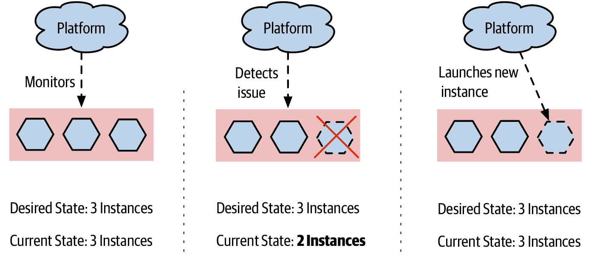

期望状态管理的美妙之处在于平台本身管理期望状态如何得以维持。它让开发和运维人员都不必担心事情具体是如何完成的——他们只需专注于首先正确定义期望状态。这也意味着在出现问题时，例如实例死亡、底层硬件故障或数据中心关闭，平台可以在无需人工干预的情况下为你处理这些问题。

虽然可以构建自己的工具链来实现期望状态管理，但通常你会使用已经支持它的平台。Kubernetes 就是这样一个拥抱这一想法的工具，你也可以在像 Azure 或 AWS 这样的公有云提供商上使用自动扩缩容组等概念来实现类似效果。另一个可以提供此功能的平台是 Nomad^(2)。与专注于部署和管理容器化工作负载的 Kubernetes 不同，Nomad 在运行其他类型应用程序工作负载方面具有非常灵活的模型，例如 Java 应用程序、虚拟机、Hadoop 作业等。如果你想要一个用于管理混合工作负载的平台，但仍使用期望状态管理等概念，那么值得一看。

这些平台了解底层资源的可用性，能够将期望状态的请求与可用资源匹配（否则会告诉你这不可行）。作为操作员，你与低级配置保持距离——你可以说一些简单的话，比如“I want 4 instances spread across both data centres”并依靠你的平台来确保这一点得到实现。不同平台提供不同程度的控制——如果你愿意，可以让你的期望状态定义变得更加复杂。

期望状态管理的使用偶尔会给你带来问题，如果你忘记自己在使用它。我记得有一次我在下班前关闭 AWS 上的开发集群。我正在关闭托管虚拟机实例（由 AWS 的 EC2 产品提供）以节省费用——它们夜间不会被使用。问题是当我杀掉其中一个实例时，另一个实例又弹了出来。我花了一段时间才意识到我配置了自动扩缩容组以确保机器数量的最低限度。AWS 检测到实例死亡，并启动了一个替换实例。像这样玩打地鼠游戏花了我 15 分钟才意识到发生了什么。问题是我们按小时计费 EC2。即使实例只运行了一分钟，我们也会被收取整整一小时的费用。所以我一天结束时的胡乱操作最终变得相当昂贵。从某种意义上说，这是一个成功的标志（至少我就是这么告诉自己的）——我们很久以前就设置了自动扩缩容组，它们一直运行良好，以至于我们忘记了它们的存在。解决未来问题的办法只是编写一个脚本，在集群关闭时禁用自动扩缩容组。

### 先决条件

要利用期望状态管理，平台需要某种方式自动启动你的微服务的实例。因此，拥有微服务实例的完全自动化部署是期望状态管理的明确先决条件。你可能还需要仔细考虑实例启动需要多长时间。如果你使用期望状态管理来确保有足够的计算资源处理用户负载，那么如果一个实例死亡，你希望尽快用替换实例填补空缺。如果配置新实例需要很长时间，你可能需要在实例死亡时处理负载的情况下预留额外容量，以便在启动新副本时有足够的缓冲时间。

虽然你可以为自己拼凑一个期望状态管理解决方案，但我不认为这是你时间的好用处。如果你想拥抱这一概念，我认为你最好采用将其作为一等概念的平台。由于这意味着要掌握可能代表新部署平台以及所有相关思想和工具，你可能希望在已有几个微服务运行后再采用期望状态管理。这将使你能够在被新技术压垮之前熟悉微服务的基础知识。Kubernetes 之类的平台在你需要管理大量事物时确实很有帮助——如果你只有几个进程需要担心，可以等到以后再采用这些工具。

### 以及 GitOps

GitOps 是一个相当新的概念，最初来自 Weave，它将期望状态管理与基础设施即代码的概念结合起来。GitOps 最初是在与 Kubernetes 协作的背景下构想的，相关工具也集中于此，尽管可以说它描述了一种他人之前使用过的工作流程。

# GitOps 概述
使用 `GitOps`，你的基础设施的期望状态以代码形式定义，并存储在源代码控制中。当对该期望状态进行更改时，一些工具确保将此更新后的期望状态应用到运行系统。其理念是为开发者提供简化的工作流程来处理他们的应用程序。

如果你使用过像 `Chef` 或 `Puppet` 这样的基础设施配置工具，这种模型对于管理基础设施来说是熟悉的。使用 `Chef Server` 或 `Puppet Master` 时，你拥有一个集中式系统，能够在更改时动态推送更改。`GitOps` 的转变在于，这些工具利用 `Kubernetes` 内部的功能来帮助管理应用程序，而不仅仅是基础设施。

像 `Flux` 这样的工具使得采纳这些理念变得容易得多。当然值得注意的是，虽然工具可以让你更容易改变工作方式，但它们无法强迫你采用新的工作方法。换句话说，仅因为你拥有 `Flux`（或其他 `GitOps` 工具），并不意味着你正在采纳期望状态管理或基础设施即代码的理念。

如果你处于 `Kubernetes` 的世界，采用像 `Flux` 这样的工具及其推广的工作流程，很可能会加快期望状态管理以及基础设施即代码等概念的引入。只要确保你不要忽视底层概念的目标，而被这个领域的各种新技术所迷惑！

# 部署选项
在我们可以用于微服务工作负载的方法和工具方面，我们有 *大量* 的选择。但是，我们应该根据上面概述的原则来看待这些选项。我们希望我们的微服务以隔离的方式运行，并且理想情况下以避免停机的形式部署。我们希望选择的工具能够让我们拥抱自动化文化，以代码形式定义我们的基础设施和应用程序配置，并且理想情况下也能为我们管理期望状态。

在评估它们如何实现这些理念之前，让我们先简要总结一下我们将要研究的各种部署选项。

**物理机**
微服务实例直接部署到物理机上，没有虚拟化。

**虚拟机**
微服务实例部署到虚拟机上。

**容器**
微服务实例作为单独的容器在虚拟机或物理机上运行。该容器运行时可能由像 `Kubernetes` 这样的容器编排工具管理。

**应用容器**
微服务实例在应用容器内运行，该容器管理其他应用程序实例，通常在同一运行时上。

**平台即服务 (`PAAS`)**
使用更高度抽象的平台来部署微服务实例，通常抽象掉运行微服务所使用的底层服务器的所有概念。示例包括 `Heroku`、`Google App Engine` 或 `AWS Beanstalk`。

**函数即服务 (`FAAS`)**
微服务实例作为一个或多个函数部署，由像 `AWS Lambda` 或 `Azure Cloud Functions` 这样的底层平台运行和管理。可以说，`FAAS` 是一种特定的 `PAAS` 类型，但鉴于该想法的近期流行以及它对微服务到部署工件映射提出的问题，它值得单独探索。

## 物理机
一种日益罕见的选项，你可能会发现自己将微服务 *直接* 部署到物理机上。所谓“直接”，我的意思是你在与底层硬件之间没有任何虚拟化或容器化层。

这变得越来越不常见，有几个原因。首先，直接部署到物理硬件可能导致整个环境利用率降低。如果我在物理机上运行一个微服务实例，并且只使用了硬件提供的 CPU、内存或 IO 的一半，那么剩余资源就会被浪费。

这个问题导致了大多数计算基础设施的虚拟化，使你能够在同一台物理机上共存多个虚拟机。它使你的基础设施利用率大大提高，这在成本效益方面具有一些显而易见的好处。

如果你可以直接访问物理硬件而没有虚拟化选项，那么诱惑就是在同一台机器上打包多个微服务——这当然违反了我们之前讨论的关于为你的服务提供 *隔离执行环境* 的原则。你可以使用像 `Puppet` 或 `Chef` 这样的工具来配置机器——帮助实现基础设施即代码。

问题在于，如果你只在单个物理机的层面工作，实现期望状态管理、零停机部署等概念需要我们在更高层次的抽象上工作，使用某种管理层。这些类型的系统更常与虚拟机一起使用，我们稍后会更深入地探讨。

总的来说，如今直接将微服务部署到物理机上是我几乎从未见到的情况，你很可能需要在你的情况下有一些非常具体的要求（或约束）来证明这一点优于虚拟化或容器化可能带来的灵活性。

## 虚拟机
虚拟化通过允许我们将现有的物理机分割成更小的虚拟机，改变了数据中心。像 `VMWare` 或主要云服务提供商使用的传统虚拟化所管理的虚拟机基础设施（如 `AWS` 的 `EC2` 服务）在提高计算基础设施利用率的同时，也大大减少了主机管理的开销。

从根本上说，虚拟化允许你将底层机器拆分为多个较小的“虚拟”机器，这些机器对虚拟机内部运行的软件来说就像普通的服务器一样。你可以将底层 CPU、内存、IO 和存储能力的一部分分配给每个虚拟机，在我们的上下文中，这允许你在单台物理机上容纳更多用于微服务实例的隔离执行环境。

由于每个虚拟机都为软件提供自己的操作系统和资源集，我们在实例之间有非常好的隔离程度。每个微服务实例都可以根据自身本地需求完全配置 VM 中的操作系统。然而我们仍然存在一个问题，那就是如果运行这些虚拟机的底层硬件出现故障，那么我们可能会丢失多个微服务实例。

有一些方法可以帮助解决这个问题，包括我们之前讨论过的期望状态管理。

### 虚拟化的成本
当你在同一底层硬件上打包越来越多的虚拟机时，你会发现可用于 VM 本身的计算资源呈递减回报。为什么会这样？

把我们的物理机想象成一个袜子抽屉。如果我们在抽屉里放很多木隔板，我们能存放更多的袜子还是更少的？答案是更少：隔板本身也会占用空间！我们的抽屉可能更容易处理和整理，也许我们现在可以在其中一个空间放 T 恤而不是只放袜子，但更多的隔板意味着总体空间更少。

在虚拟化世界中，我们有类似袜子抽屉隔板的开销。为了理解这种开销来自哪里，让我们看看大多数虚拟化是如何完成的。图 7-14 显示了两种虚拟化类型的比较。左侧我们看到的是称为 *类型 2 虚拟化* 所涉及的各个层，右侧我们看到的是 *基于容器的虚拟化*，我们稍后会更深入地探讨。

# 类型 2 虚拟化

类型 2 虚拟化是指由 AWS、VMWare、VSphere、Xen 和 KVM 实现的那种。（类型 1 虚拟化是指 VM 直接在硬件上运行，而非在另一个操作系统之上的技术。）在我们的物理基础设施上，我们有一个主机操作系统。在此操作系统上，我们运行一种称为 *超级监视器* 的东西，它有两个关键任务。首先，它将 CPU 和内存等资源从虚拟主机映射到物理主机。其次，它充当控制层，使我们能够操作虚拟机本身。

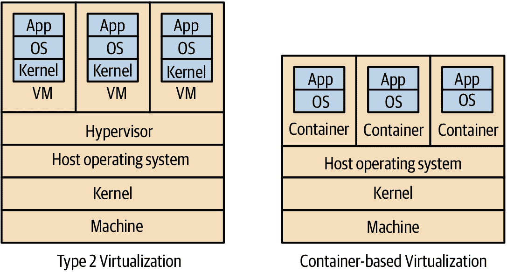

在 VM 内部，我们看到的是看起来完全不同的主机。它们可以运行自己的操作系统，并拥有自己的内核。它们可以被视为几乎是密封的机器，由超级监视器将其与底层物理主机和其他虚拟机隔离开来。

类型 2 虚拟化的问题在于，此处的超级监视器需要预留资源来完成其工作。这会占用本可用于其他地方的 CPU、I/O 和内存。超级监视器管理的主机越多，它需要的资源就越多。在某个点上，这种开销成为进一步分割物理基础设施的制约因素。实际上，这意味着将物理设备切分成越来越小的部分往往会产生递减回报，因为按比例而言，越来越多的资源被用于超级监视器的开销。

## 适合微服务吗？

回到我们的原则，虚拟机在隔离性方面表现非常出色，但代价不菲。它们的自动化便捷程度取决于所使用的具体技术——例如，Google Cloud、Azure 或 AWS 上的托管 VM 都可以通过得到良好支持的 API 以及建立在这些 API 之上的工具生态系统轻松实现自动化。此外，这些平台还提供诸如自动扩缩容组等概念，有助于实现期望状态管理。实现零停机部署需要更多的工作，但如果您使用的 VM 平台提供良好的 API，构建模块就已具备。问题在于，许多人使用的是由传统虚拟化平台（如 VMWare 提供的平台）提供的托管 VM，虽然理论上允许自动化，但在这种情况下通常并未使用。相反，这些平台往往由专门的操作团队集中控制，因此直接针对这些平台进行自动化的能力可能会受到限制。

尽管容器在微服务工作负载方面总体上更受欢迎，但许多组织已成功使用虚拟机运行大规模微服务系统。Netflix 作为微服务的代表之一，通过 EC2 在 AWS 的托管虚拟机之上构建了大部分微服务。如果您需要它们所能带来的更严格的隔离级别，或无法将应用程序容器化，它们会是一个很好的选择。

# 容器

自本书第一版以来，容器已成为服务器端软件部署中的主导概念，成为许多人打包和运行微服务架构的事实标准。由 Docker 普及的容器概念，并与 Kubernetes 等容器编排平台相结合，已成为许多人大规模运行微服务架构的首选。

在探讨其原因以及容器、Kubernetes 和 Docker 之间的关系之前，我们首先应探索容器到底是什么，并具体看看它与虚拟机有何不同。

## 以不同方式隔离

容器最初出现在类 UNIX 操作系统上，多年来在 Linux 等此类操作系统上才真正可行。虽然 Windows 容器也非常流行，但迄今为止容器在 Linux 操作系统上的影响最大。

在 Linux 上，进程由特定用户运行，并根据权限设置具有某些功能。进程可以生成其他进程。例如，如果我在终端中启动一个进程，那么该子进程通常被视为终端进程的子进程。Linux 内核的工作是维护这个进程树，确保只有被允许的用户才能访问此资源。此外，Linux 内核能够为这些不同进程分配资源——这都是构建可行的多用户操作系统的组成部分，您不希望一个用户的活动导致整个系统崩溃。

在同一台机器上运行的容器使用相同的底层内核（尽管我们稍后会探讨此规则的例外情况）。与其直接管理进程，不如将容器视为对整个系统进程树的一个子树进行的抽象，而内核则完成所有繁重的工作。这些容器可以分配物理资源，这是内核为我们处理的。这种通用方法以多种形式存在，例如 Solaris Zones 和 OpenVZ，但正是 LXC 让这一想法进入了 Linux 操作系统的主流。当 Docker 提供更高级别的容器抽象时，Linux 容器的概念得到了进一步发展，最初在底层使用 LXC，然后完全取代了它。

如果我们查看在 图 7-14 中运行容器的主机的堆栈图，与类型 2 虚拟化相比，我们会看到一些差异。首先，我们不需要超级监视器。其次，容器似乎没有内核——这是因为它使用了底层机器的内核。在 图 7-15 中我们能更清楚地看到这一点。容器可以运行自己的操作系统，但该操作系统使用共享内核的一部分——每个容器的进程树就存在于此内核中。这意味着我们的主机操作系统可以运行 Ubuntu，而我们的容器运行 CentOS，只要它们能够共享同一个内核即可。

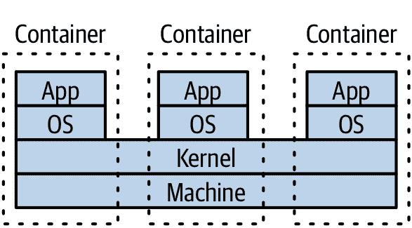

使用容器，我们不仅受益于无需超级监视器而节省的资源，还在反馈方面获益。Linux 容器比全功能虚拟机 *非常* 更快地进行配置。VM 启动需要数分钟的情况并不少见——但对于 Linux 容器而言，启动可能只需要几秒钟。您还可以更精细地控制容器本身在资源分配方面的设置，这使得调整设置以充分利用底层硬件变得更加容易。

由于容器的轻量级特性，我们可以在同一硬件上运行比 VM 更多的容器。通过按 图 7-16 中所示的方式为每个服务部署一个容器，我们可以获得与其他容器的隔离程度（尽管这并不完美），并且可以比在每个服务各自的 VM 中运行服务更具成本效益。

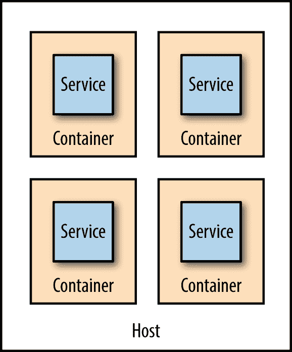

容器也可以很好地与“全功能”虚拟化一起使用，事实上这很常见。我见过不止一个项目配置大型 AWS EC2 实例并在其上运行多个容器，以获得两全其美的效果：以 EC2 形式提供的按需临时计算平台，加上在其上运行的高度灵活且快速的容器。

## 不完美

# 容器隔离与编排

Linux 容器并非没有一些问题。然而，想象一下我在主机上有很多微服务在各自的容器中运行。外部世界如何看到它们？你需要某种方式将外部世界路由到底层容器，超 visor 在常规虚拟化中会为你处理这个问题。像 `LXC` 这样的早期技术，你必须自己处理——这正是 `Docker`’s 对容器的处理方式大有帮助的一个领域。

另一个需要考虑的点是，从资源角度来看，这些容器可以被视为隔离的——我可以为每个容器分配划定的 CPU、内存等资源——这不一定与虚拟机或单独的物理机所提供的隔离程度相同。早期，有一些有据可查且已知的方式，一个容器的进程可以突破限制并与其他容器或底层主机交互。

为了解决这些问题投入了大量工作，容器编排系统和底层的容器运行时在研究如何更好地运行容器工作负载以改善这种隔离方面做得很好，但你需要认真考虑想要运行的工作负载类型。我自己的建议是，一般来说，你应该将容器视为隔离受信任软件执行的一种绝佳方式。如果你运行的是他人编写的代码，并且担心恶意方试图绕过容器级隔离，那么你需要自己更深入地研究处理此类情况的当前最佳实践。

## Windows 容器

从历史上看，Windows 用户会羡慕使用 Linux 的同行，因为容器是 Windows 操作系统所不具备的功能。然而在过去几年里情况发生了变化，容器现在已成为一个完全受支持的概念。延迟的真正原因在于底层 Windows 操作系统和内核需要支持与 Linux 世界中存在的同类功能才能使容器工作。正是随着 `Windows Server 2016` 的发布，很多事情发生了变化，此后 Windows 容器不断演进。

Windows 容器采用初期的一个主要障碍是 Windows 操作系统本身的大小。请记住，你需要在每个容器内部运行一个操作系统，因此在下载容器镜像时，你也在下载一个操作系统。而 Windows 则是 **庞大** ——大到使容器变得非常沉重，不仅在镜像大小方面，也在运行所需资源方面如此。

微软通过创建名为 `Windows Nano Server` 的精简操作系统来应对这个问题。`Nano Server` 的理念是拥有小占用空间的操作系统，并能够运行微服务实例之类的东西。[content]
# 容器隔离与编排

Linux 容器并非没有一些问题。然而，想象一下我在主机上有很多微服务在各自的容器中运行。外部世界如何看到它们？你需要某种方式将外部世界路由到底层容器，超 visor 在常规虚拟化中会为你处理这个问题。像 `LXC` 这样的早期技术，你必须自己处理——这正是 `Docker`’s 对容器的处理方式大有帮助的一个领域。

另一个需要考虑的点是，从资源角度来看，这些容器可以被视为隔离的——我可以为每个容器分配划定的 CPU、内存等资源——这不一定与虚拟机或单独的物理机所提供的隔离程度相同。早期，有一些有据可查且已知的方式，一个容器的进程可以突破限制并与其他容器或底层主机交互。

为了解决这些问题投入了大量工作，容器编排系统和底层的容器运行时在研究如何更好地运行容器工作负载以改善这种隔离方面做得很好，但你需要认真考虑想要运行的工作负载类型。我自己的建议是，一般来说，你应该将容器视为隔离受信任软件执行的一种绝佳方式。如果你运行的是他人编写的代码，并且担心恶意方试图绕过容器级隔离，那么你需要自己更深入地研究处理此类情况的当前最佳实践。

## Windows 容器

从历史上看，Windows 用户会羡慕使用 Linux 的同行，因为容器是 Windows 操作系统所不具备的功能。然而在过去几年里情况发生了变化，容器现在已成为一个完全受支持的概念。延迟的真正原因在于底层 Windows 操作系统和内核需要支持与 Linux 世界中存在的同类功能才能使容器工作。正是随着 `Windows Server 2016` 的发布，很多事情发生了变化，此后 Windows 容器不断演进。

Windows 容器采用初期的一个主要障碍是 Windows 操作系统本身的大小。请记住，你需要在每个容器内部运行一个操作系统，因此在下载容器镜像时，你也在下载一个操作系统。而 Windows 则是 **庞大** ——大到使容器变得非常沉重，不仅在镜像大小方面，也在运行所需资源方面如此。

微软通过创建名为 `Windows Nano Server` 的精简操作系统来应对这个问题。`Nano Server` 的理念是拥有小占用空间的操作系统，并能够运行微服务实例之类的东西。同时，他们还支持更大的 `Windows ServerCore` 操作系统，用于支持将传统 Windows 应用程序作为容器运行。问题是，与其 Linux 等价物相比，这些东西仍然相当大——早期版本的 Nano Server 仍超过 1GB，而像 `Alpine` 这样的小型 Linux 操作系统仅占用几兆字节。

虽然微软一直在努力减小 Nano Server 的大小，但这种尺寸差距仍然存在。实际上，由于容器镜像中常见层可以被缓存，这可能不是一个大问题。

在 Windows 容器世界中特别值得关注的是，它支持不同级别的隔离。标准的 Windows 容器使用进程隔离，与其 Linux 对应物类似。在进程隔离下，每个容器都在同一内核上运行，内核管理它们之间的隔离。对于 Windows 容器，你也可以通过在各自的 `Hyper-V` 虚拟机中运行容器来提供更强的隔离。这提供了接近完全虚拟化隔离级别的东西，但好处是你可以在启动容器时在 `Hyper-V` 或进程隔离之间进行选择——镜像不需要更改。

能够在不同类型的隔离中运行镜像具有其好处。在某些情况下，你的威胁模型可能规定你希望在运行进程之间实现比简单的进程级隔离更强的隔离。例如，你可能在自己的进程旁边运行“不受信任”的第三方代码。在这种情况下，能够将这些容器工作负载作为 `Hyper-V` 容器运行非常有用。当然请注意，`Hyper-V` 隔离可能会对启动时间和接近普通虚拟化的运行时成本产生影响。

## Docker

在 `Docker` 出现并推动该概念进入主流之前，容器使用有限。`Docker` 工具链为你处理了容器周围的大部分工作。`Docker` 管理容器配置，处理部分网络问题，甚至提供自己的注册表概念，允许你存储和版本化 `Docker` 应用程序。在 Docker 之前，我们没有容器的“镜像”概念——这加上用于处理容器的更友好的工具集，确实推动了容器进入主流。

`Docker` 镜像抽象对我们很有用，因为我们的微服务是如何实现的细节对我们是隐藏的。我们让微服务的构建创建一个 `Docker` 镜像作为构建产物，并将其存储在 `Docker` 注册表中，然后开始使用。当你启动一个 `Docker` 镜像的实例时，你有一组通用的工具来管理该实例，无论底层技术如何——用 `Go`、`Python`、`NodeJS` 或其他任何东西编写的微服务都可以同等对待。

`Docker` 还可以缓解为开发和测试目的在本地运行大量服务的某些缺点。以前，我可能会使用像 `Vagrant` 这样的工具，让我能够在开发机器上托管多个独立的虚拟机。这将允许我本地运行一个生产类似的 VM 来运行我的服务实例。这是一种相当重量级的方法，而且你能运行的 VM 数量有限。有了 `Docker`，只需直接在我的开发机器上运行 `Docker` 就很简单（可能使用 `Docker Desktop`^(4))。现在我只需为我的微服务实例构建一个 docker 镜像，或拉取一个预构建镜像，并在本地运行。这些 docker 镜像可以（也应该）与我最终在生产中运行的容器镜像相同。

当 `Docker` 首次出现时，其范围仅限于在一台机器上管理容器。这用途有限——如果我想跨多台机器管理容器怎么办？如果你想维护系统健康，如果你有一台机器宕机，或者只是想运行足够多的容器来处理系统的负载，这一点至关重要。`Docker` 本身推出了两个完全不同的产品来解决这个问题，令人困惑地称为“`Docker Swarm`”和“`Docker Swarm Mode`”——谁说命名东西很难来着？实际上，当谈到在许多机器上管理大量容器时，`Kubernetes` 在这里是王者，即使你可能使用 `Docker` 工具链来构建和管理单个容器。

## 适用于微服务

容器作为一个概念非常适合微服务，而 docker 使容器作为一个概念变得显著可行。我们获得了隔离，但成本可控。我们还隐藏了底层技术，允许我们混合不同的技术栈。当谈到实现诸如期望状态管理之类的概念时，我们需要像 `Kubernetes` 这样的东西来为我们处理。

`Kubernetes` 足够重要，值得更详细的讨论，所以我们将在本章后面再回来讨论它。但现在只需将其视为在大量机器上管理容器的一种方式，这对目前来说就足够了。

## 应用容器
如果您熟悉在 `IIS` 后面部署 `.NET` 应用程序，或将 `Java` 应用程序部署到类似 `Weblogic` 或 `Tomcat` 的环境中，您将非常熟悉这种模型：在这种模型中，多个不同的服务或应用程序位于单个应用容器内，而该容器又位于单个主机上，如 图 7-17 所示。其理念是，服务所在的应用程序容器在可管理性方面为您带来好处，例如支持集群以处理将多个实例分组在一起、监控工具等。

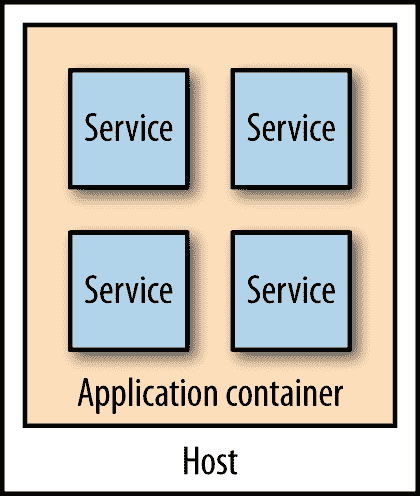

这种设置在减少语言运行时开销方面也能带来好处。考虑在单个 `Java` servlet 容器中运行五个 `Java` 服务。我只需要一个单一 `JVM` 的开销。将其与使用容器时在同一主机上运行五个独立的 `JVM` 相比较。话虽如此，我仍然认为这些应用容器有足够的缺点，您应该挑战自己看看它们是否真的必需。

首先，缺点之一是它们不可避免地限制了技术选择。您必须接受一个技术栈。这不仅可能限制服务本身实现的技术选择，还可能限制您在系统自动化和管理方面的选项。正如我们稍后将讨论的那样，解决管理多台主机的开销的一种方法是通过自动化，因此限制我们在解决此问题方面的选择可能会造成双重损害。

我也会质疑这些应用容器提供的某些功能的价值。许多容器都宣称能够管理集群以支持共享内存会话状态，而无论如何我们都绝对希望避免这一点，因为这在扩展服务时会带来挑战。它们提供的监控能力在我们考虑微服务世界中想要进行的联合监控时是不够的，正如我们将在 \[链接待定\] 中看到的那样。许多容器的启动时间也相当缓慢，影响了开发者的反馈周期。

还有其他问题。尝试在像 `JVM` 这样的平台上对应用程序进行适当生命周期管理可能有问题，而且比简单重启 `JVM` 更复杂。分析资源使用和线程也复杂得多，因为您有多个应用程序共享同一个进程。并且请记住，即使您确实从特定技术的容器中获得价值，它们也不是免费的。除了许多容器是商业产品因此有成本影响之外，它们本身也会增加资源开销。

最终，这种方法再次试图优化资源稀缺性，而这种稀缺性可能不再成立。无论您是否决定将每个主机部署多个服务作为部署模型，我强烈建议将自包含的可部署微服务视为制品，每个微服务实例作为自己的独立进程运行。

从根本上说，这种模型提供的隔离性缺乏是采用微服务架构的人们越来越少使用这种模型的主要原因之一。

## 平台即服务 (PAAS)
使用平台即服务 (`PAAS`) 时，您工作在比单个主机更高级别的抽象上。其中一些平台依赖于获取特定技术的制品，例如 `Java` `WAR` 文件或 `Ruby` gem，并自动为您配置和运行。一些平台会透明地尝试为您处理系统的扩展和缩减，而其他平台会让您在服务可能运行的节点数量上拥有一些控制权，但其余部分由平台处理。

正如我在撰写第一版时一样，最佳、最精致的 `PAAS` 解决方案大多是托管的。`Heroku` 为提供开发者友好的界面树立了标杆，并且可以说尽管在过去几年中功能集增长有限，但多年来一直保持着 `PAAS` 的黄金标准。像 `Heroku` 这样的平台不仅仅运行您的应用程序实例，还可以提供其他功能，例如为您运行数据库实例——这如果自己做会非常痛苦。

当 `PAAS` 解决方案运行良好时，它们确实运行得非常好。然而，当它们不太适合您时，您通常没有太多控制权来深入内部解决问题。这是您做出的权衡的一部分。我会说，根据我的经验，`PAAS` 解决方案试图变得越聪明，出现错误的可能性就越大。我使用过不止一个根据应用程序使用情况尝试自动扩展的 `PAAS`，但做得不好。不可避免地，驱动这些智能的启发式方法往往是为平均应用程序量身定制的，而不是您的特定用例。您的应用程序越不标准，它与 `PAAS` 配合良好的可能性就越低。

由于优秀的 `PAAS` 解决方案为您处理了这么多事情，它们可以成为处理因拥有更多移动部件而增加开销的绝佳方式。话虽如此，我仍然不确定我们在这个领域是否已经完全掌握了所有模型，而且有限的自托管选项意味着这种方法可能不适合您。当我撰写早期版本时，我希望在这个领域看到更多增长，但它并没有以我预期的方式发生。相反，我认为主要由公共云提供商提供的 `Serverless` 产品的发展开始填补了这一需求。它们不是提供用于托管应用程序的黑盒平台，而是提供即用的托管解决方案，用于消息代理、数据库、存储等，让我们能够混合搭配我们喜欢的组件来构建所需的东西。正是在这一背景下，`Function As A Service` 这种特定类型的 `Serverless` 产品获得了大量关注。

评估 `PAAS` 方案对微服务的适用性很困难，因为它们有多种形状和大小。例如，`Heroku` 看起来与 `Netlify` 非常不同，但两者都可以用作您微服务的部署平台，具体取决于应用程序的性质。

## 函数即服务 (FAAS)
在过去几年中，唯一在制造炒作方面接近 `Kubernetes` 的技术（至少在微服务的背景下）是 `Serverless`。`Serverless` 实际上是许多不同技术的总称，从使用者的角度来看，底层计算机并不重要。管理和配置机器的细节被从您手中夺走。正如 Ken Fromm^(5)（据我所知，他创造了 `Serverless` 这个术语）所说：

> “`Serverless`” 这一短语并不意味着服务器不再参与其中。它仅仅意味着开发人员不再需要过多考虑它们。计算资源作为服务使用，而无需围绕物理容量或限制进行管理。服务提供商越来越多地承担管理服务器、数据存储和其他基础设施资源的责任。开发人员可以自行设置自己的开源解决方案，但这意味着他们必须管理服务器、队列和负载

> 
> Ken Fromm - “为什么软件和应用的未来是无服务器的”

`Function As A Service`，或 `FAAS`，已成为 `Serverless` 的重要组成部分，以至于对许多人来说这两个术语可以互换。这是不幸的，因为它忽略了数据库、队列、存储解决方案等其他 `Serverless` 产品的重要性。尽管如此，这也说明了 `FAAS` 引发的兴奋，它主导了讨论。

FAAS 的第一个例子是 AWS 在 2014 年推出的 Lambda 产品。在某种程度上，这个概念非常简单。你部署一些代码（一个“函数”）。该代码处于休眠状态，直到有事件触发它。你负责决定触发条件是什么——它可能是文件到达某个位置、消息队列中出现项目、通过 HTTP 发来的调用或其他情况。

当你的函数被触发时，它会运行，运行结束时就会关闭。底层平台负责按需启动或关闭这些函数，并处理函数的并发执行，以便在适当的情况下同时运行多个副本。

这里的好处众多。未运行的代码不会产生费用——你只为实际使用付费。这使得 FAAS 成为负载低或不可预测情况下的理想选择。底层平台为你处理函数的启动和关闭，给予你一定程度的隐式高可用性和健壮性，而无需你做任何工作。从根本上说，使用 FAAS 平台，就像许多其他无服务器方案一样，可以大幅减少你需要担心的运维开销。

## 限制

在底层，我所了解的所有 FAAS 实现都使用某种容器技术。这对你来说是隐藏的——通常你不必担心构建要运行的容器，你只需提供代码的某种打包形式。这意味着你缺乏对实际可运行内容的控制程度，因此需要 FAAS 提供商支持你选择的语言。在主要云厂商中，Azure 的 Cloud Functions 在这方面做得最好，支持各种不同的运行时，而相比之下，Google Cloud 自家的 Cloud Functions 支持的语言非常少（截至撰写时，Google 仅支持 Go、某些 Node 版本和 Python）。

对底层运行时的控制缺乏也延伸到对每次函数调用所分配资源的控制缺乏。在 Google Cloud、Azure 和 AWS 上，你只能控制分配给每个函数的内存。这反过来似乎意味着分配给你的函数运行时的 CPU 和 IO 量，但你无法直接控制这些方面。这可能意味着你不得不为函数分配更多内存，即使它不需要，只是为了获得所需的 CPU。最终，如果你觉得需要对函数可用资源进行大量精细调优，那么我认为至少在现阶段 FAAS 可能不是一个很好的选择。

另一个需要注意的限制是函数调用在运行时间上存在限制。例如，Google Cloud Functions 目前执行时间上限为 9 分钟，而 AWS Lambda 函数最长可运行 15 分钟。Azure Functions 如果你愿意可以无限期运行（取决于你使用的计划类型）。就我个人而言，我认为如果你的函数运行时间很长，这可能表明这是一种函数并不合适的类型问题。

最后，大多数函数调用被视为无状态。从概念上讲，这意味着函数无法访问之前函数调用留下的状态，除非该状态存储在其他地方（例如数据库）。这使得将多个函数串联起来变得困难——考虑一个函数编排对其他下游函数的系列调用。Azure 推出了一个非常有趣的名为 Durable functions^(6) 的产品，以一种非常有趣的方式解决了这个问题，我认为它比 AWS 自家的使用基于 JSON 的配置将多个函数绑定的 Step Functions 要友好得多。

## 挑战

除了我们刚刚查看的限制之外，使用 FAAS 时你可能会遇到其他一些挑战。

首先，重要的是要解决在使用 FAAS 时经常被提出的担忧，即启动时间的问题。从概念上讲，函数在不需要时根本不运行。这意味着它们必须启动才能为传入请求提供服务。现在对于某些运行时，启动新版本的运行时需要很长时间——通常称为冷启动时间。JVM 和 .NET 运行时在这方面受影响很大，因此使用这些运行时的函数的“冷启动”时间往往会很显著。

然而，实际上这些运行时很少出现冷启动。至少在 AWS 上，运行时会被保持“预热”，以便传入的请求由已启动并正在运行的实例提供服务。这种情况发生的程度如此之大，以至于由于 FAAS 提供商在底层进行的优化，现在很难评估“冷启动”的影响。尽管如此，如果启动时间是一个问题，坚持使用启动速度快的运行时语言（Go、Python、Node 和 Ruby 值得一提）可以有效地规避这个问题。

最后，函数的动态扩展方面实际上可能成为一个问题。函数在被触发时启动。我使用过的所有平台都有最大并发函数调用数的硬性限制，这是你可能需要仔细注意的事情。我曾与不止一个团队交谈过，他们遇到的问题是函数扩展后压垮了基础设施中没有相同扩展属性的其他部分。Bustle 的 Steve Faulkner 分享了^(7)一个这样的例子，其中扩展的函数使他们的 Redis 基础设施过载，导致生产问题。如果你的系统的一部分可以动态扩展，但其他部分不能，那么你可能会发现这种不匹配会造成严重的麻烦。

## 映射到微服务

到目前为止，在讨论各种部署选项时，从微服务实例到部署机制的映射相当直接。单个微服务实例可以部署到虚拟机上，打包为单个容器，甚至部署到 Tomcat 或 IIS 等应用程序容器上。使用 FAAS 时，事情变得有点混乱。

### 每个微服务的函数

现在，很明显，单个微服务实例可以部署为单个函数，如图 7-18 所示。这可能是一个合理的起点。这保持了微服务实例作为部署单元的概念，这是我们迄今为止探索最多的模型。

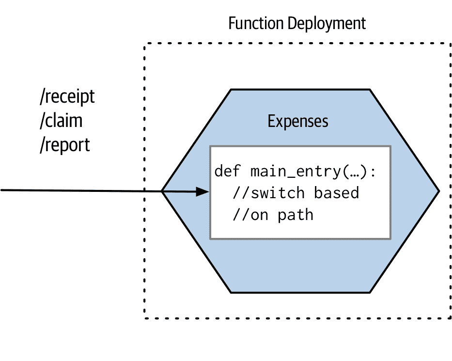

当被调用时，FAAS 平台会触发已部署函数中的单个入口点。这意味着，如果你要为整个服务使用单个函数部署，你需要有一种方式从该入口点分发到微服务中的不同功能部分。如果你将费用服务实现为基于 REST 的微服务，你可能会公开各种资源，如 `/receipt`、`/claim` 或 `/report`。使用这种模型，对这些资源的任何请求都会通过同一个入口点进来，因此你需要根据传入请求的路径将入站调用定向到适当的功能部分。

### 每个聚合的函数

那么我们如何将微服务实例拆分为更小的函数呢？如果你的微服务实例处理多个聚合，我认为一个合理的模型是为每个聚合拆分一个函数，如图 7-19 所示。这确保了单个聚合的所有逻辑都包含在函数内部，使得更容易确保聚合生命周期管理的统一实现。

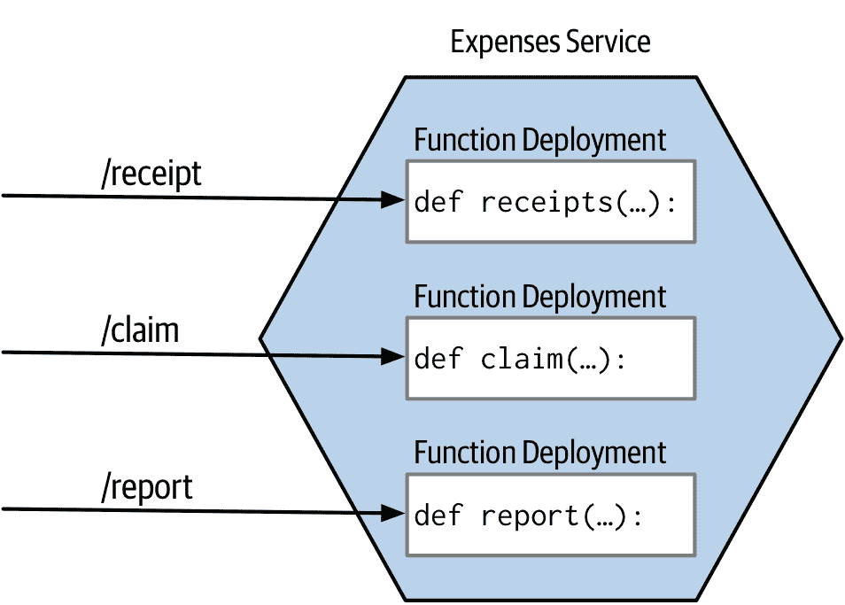

在这种模型下，我们的微服务实例不再映射到单一的部署单元。相反，我们的微服务现在更像是一个逻辑概念，由多个不同的函数组成，这些函数理论上可以独立于彼此进行部署。

这里有几点需要注意。首先，我强烈建议你保持更粗粒度的外部接口。对上游消费者而言，他们仍然在与 `Expenses` 服务通信——他们并不知道请求会被映射到更小范围的聚合上。这确保了如果你改变主意想要重新组合事物，甚至重构聚合模型，也不会影响上游消费者。

第二个问题涉及数据。这些聚合是否应继续使用共享数据库？就这个问题而言，我相对宽松一些。假设同一个团队管理所有这些函数，并且概念上它仍然是一个单一的“service”，那么我可以接受它们继续使用同一个数据库，如 图 7-20 所示。

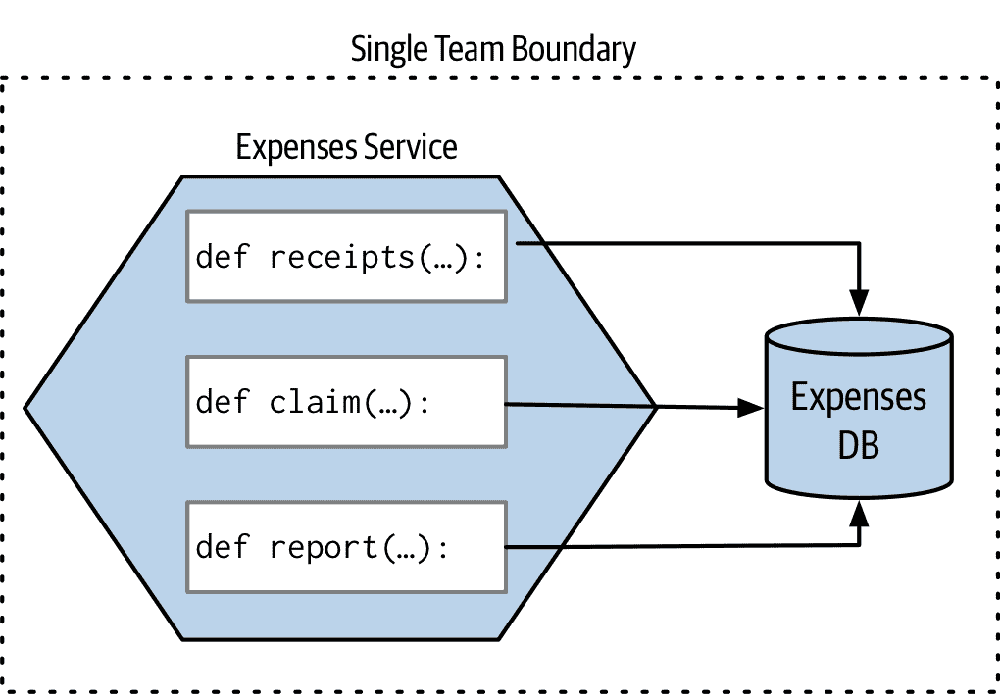

然而，随着时间的推移，如果每个聚合-函数的需要出现分歧，我会倾向于将它们的数据使用分离，特别是当你开始看到数据层中的耦合阻碍你轻松更改它们时。在这个阶段，你可以认为这些函数现在本身就是微服务——尽管如上所述，将它们对上游消费者仍表示为单个微服务可能仍有价值。

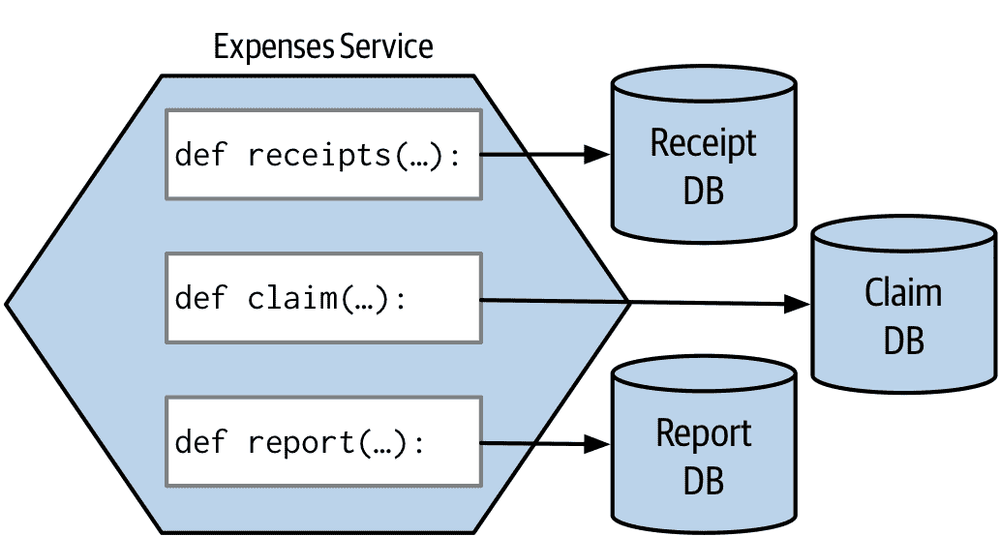

从单个微服务到多个更细粒度的可部署单元的这种映射在某种程度上扭曲了我们之前对微服务的定义。我们通常认为微服务是一个独立可部署的单元——现在一个微服务由 *multiple different* 独立可部署单元组成。概念上，在这个例子中，微服务更趋向于成为一个逻辑概念而非物理概念。

## 需要更细粒度的东西吗？

如果你想变得更小，就会有一种诱惑将每个聚合的函数拆分成更小的部分。我在这里要谨慎得多。除了这很可能造成的函数爆炸之外，它还违反了聚合的核心原则之一——我们希望将其视为一个单一单元，以确保我们能更好地管理聚合本身的完整性。

我以前考虑过让聚合的每个状态转换都成为自己的函数，但由于不一致相关的问题，我放弃了这个想法。当你有不同的独立可部署的东西，每个都管理整体状态转换的不同部分时，确保事情正确完成变得非常困难。这让我们进入了 Sagas 的范畴，我们在 第 3 章 中讨论过。在实现复杂业务流程时，像 sagas 这样的概念很重要，而且工作是合理的。但我很难看出在管理单个聚合的层面上增加这种复杂性的价值，而这本可以用单个函数轻松处理。

## 前进之路

我仍然坚信大多数开发者的未来是使用一个隐藏大部分底层细节的平台。多年以来，Heroku 是我能指出的最接近找到正确平衡的东西，但现在我们有了 FAAS 以及更广泛的即用型无服务器生态系统，它们走着不同的道路。

FAAS 仍有一些问题需要解决，但我认为虽然当前的一批产品仍需改变以解决它们的问题，但这正是大多数开发者最终会使用的平台类型。鉴于限制，并非所有应用程序都能很好地适应 FAAS 生态系统，但对于那些可以适应的应用程序，人们已经看到了显著的益处。随着越来越多的工作投入到 Kubernetes 支持的 FAAS 产品中，那些无法直接使用主要云提供商提供的 FAAS 解决方案的人将越来越多地能够利用这种新的工作方式。

因此，虽然 FAAS 可能不适用于所有情况，但它绝对是我敦促人们探索的东西。对于许多正在考虑转向基于云的 kubernetes 解决方案的客户，我一直在敦促他们先探索 FAAS，因为它可能提供他们所需的一切，同时隐藏大量复杂性并卸载大量工作。

# 哪种部署选项适合你？

天哪。所以我们有很多选择，对吧？我可能没帮上太多忙，因为我特意分享了每种方法的诸多利弊。如果你读到这里，你可能会对应该做什么感到有点困惑。

#### 提示

好吧，在我继续之前，我真的希望不用多说，如果你目前的做法对你有效，那么就 *keep doing it!* 不要让时尚支配你的技术决策。

如果你认为你确实需要改变部署微服务的方式，那么让我尝试提炼我们已经讨论的大部分内容并提供一些有用的指导。

重新审视我们微服务部署的原则，我们关注的最重要方面之一是确保微服务的隔离。仅将此作为指导原则，这可能会引导我们为每个微服务实例使用专用的物理机器！当然这很可能非常昂贵，而且正如我们已经讨论过的，如果我们走这条路，我们将无法使用一些非常强大的工具。

权衡取舍很多。在成本、使用便捷性、隔离性、熟悉度等方面取得平衡可能会让人不堪重负。所以让我们回到我喜欢称之为“萨姆关于如何部署事物的非常基础经验法则”的一套规则：

1. 如果它没坏，就不要修它^8。

2. 放弃你感觉舒适的尽可能多的控制权，然后再多放弃一点。如果你可以将所有工作卸载到像 Heroku（或 FAAS 平台）这样好的 PAAS 上，那就去做并感到高兴吧。你真的需要调整每一个设置吗？

3. 将你的微服务容器化并非毫无痛苦，但是在隔离成本方面是一个非常好的折中方案，并且对本地开发有很好的益处，同时仍能让你在发生的事情上保持一定程度的控制。期待 Kubernetes 在你的未来。

很多人都在说“要么 Kubernetes 要么完蛋！”我觉得这没什么帮助。如果你在使用公有云，并且你的问题适合 FAAS 作为部署模型，那就这样做并跳过 Kubernetes。你的开发人员很可能会变得更具生产力。正如我们将在 [待定链接] 中更详细讨论的那样，不要让锁定恐惧让你困在自己制造的混乱中。

找到像 Heroku 或 Zeit 这样很棒的 PAAS，并且有一个适合这些平台限制的应用程序？将所有工作推给平台，花更多时间在你的产品上。两者都是非常棒的平台，从开发者的角度来看可用性都很出色。你的开发人员难道不值得开心吗？

对于其他人来说，容器化是前进的方向，这意味着我们需要谈谈 Kubernetes。
