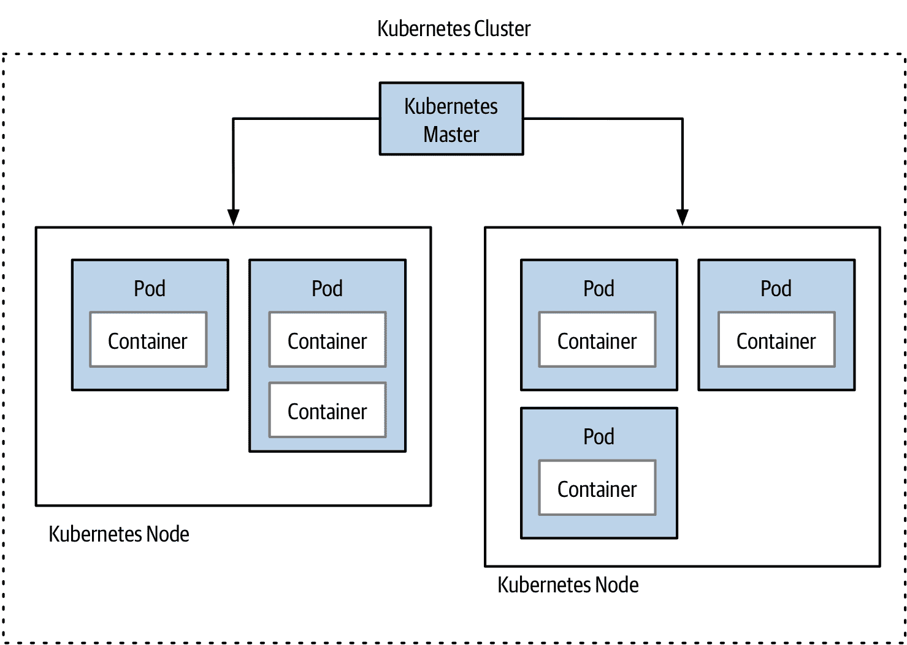
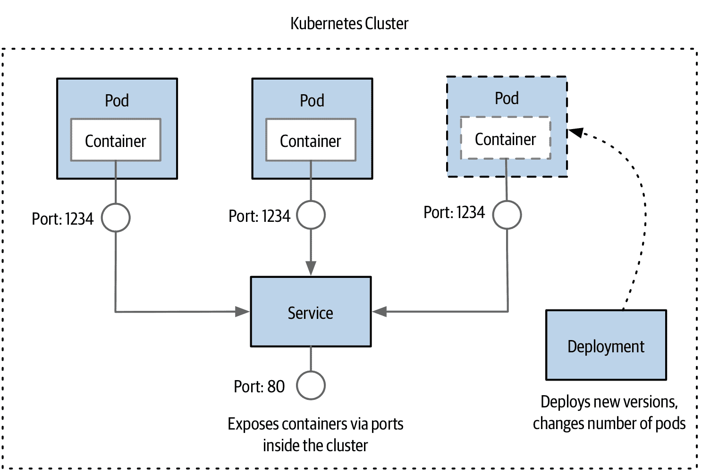
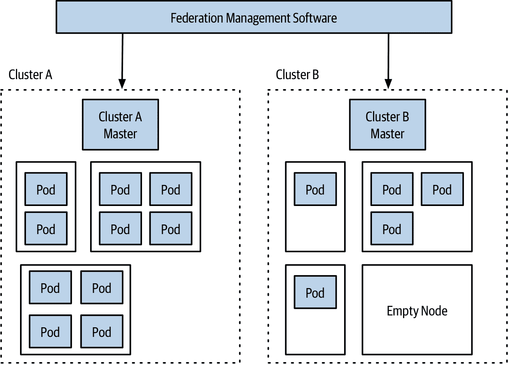

# Kubernetes 与容器编排

随着容器开始流行，很多人开始寻找在多台机器上管理容器的解决方案。Docker 尝试过两次（分别是 Docker Swarm 和 Docker Swarm Mode），像 Rancher 和 CoreOS 这样的公司提出了自己的方案，而更通用的平台如 Mesos 则被用来在其他类型的负载 alongside 运行容器。尽管这些产品投入了大量努力，但 Kubernetes 在过去几年里最终主导了这一领域。

在谈论 Kubernetes 本身之前，我们应该先讨论首先需要这样一个工具的原因。

## 容器编排的论证

广义来说，`Kubernetes` 可以被各种描述为容器编排平台，或者使用一个已不再流行的术语，容器调度器。那么这些平台是什么，我们为什么需要它们呢？

容器是通过在底层机器上隔离一组资源创建的。像 `docker` 这样的工具允许我们定义容器应该是什么样子，并在机器上创建该容器的实例。但大多数解决方案要求我们的软件在多台机器上定义，也许是为了处理足够的负载，或确保系统具有冗余以容忍单个 `node` 的故障。容器编排平台处理容器工作负载如何以及在哪里运行。在这种情况下，“scheduling” 一词开始变得更有意义。用户说“我希望这个东西运行”，而编排器会计算如何调度该作业——找到可用资源，必要时重新分配它们，并为您处理细节。

各种容器编排平台也为我们处理期望状态管理，确保一组容器（在我们的例子中是微服务实例）的预期状态得以维持。它们还允许我们指定希望这些工作负载如何分布，从而让我们能够针对资源利用率、进程间延迟或健壮性原因进行优化。

没有这样的工具，你就必须管理容器的分布，我可以凭亲身经验告诉你，这很快就会让人厌倦。编写脚本来管理容器实例的启动和网络连接并不有趣。

广义来说，所有容器编排平台，包括 `Kubernetes`，都以某种形式提供这些功能。如果你查看像 `Mesos` 或 `Nomad` 这样的通用调度器，以及像 AWS 的 `ECS`、`Docker Swam Mode` et al 这样的托管解决方案，你会看到类似的功能集。但由于我们稍后会探讨的原因，`Kubernetes` 赢得了这一领域。它还有一两个有趣的概念值得简要探讨。

## Kubernetes 概念的简化视图

`Kubernetes` 中还有许多其他概念，所以请原谅我没有全部涉及（这本身就足以写一本书了）。我在这里尝试概述你在开始使用该工具时需要接触的关键思想。让我们首先了解一下 `cluster` 的概念，如 图 7-22 所示。

从根本上说，`kubernetes` `cluster` 由两部分组成。首先是一组工作负载将在其上运行的机器，称为 `nodes`。其次是一组控制软件，用于管理这些 `nodes`，称为 `Kubernetes Master`。这些 `nodes` 在底层可以运行物理机或虚拟机。`Kubernetes` 不调度容器，而是调度它所称的 `Pod`。`Pod` 由一个或多个将一起部署的容器组成。

通常，`pod` 中只有一个容器——例如你的微服务的实例。尽管如此，在我经验中很少见的情况下，将多个容器一起部署是有意义的。一个很好的例子是使用像 `envoy` 这样的边车代理，它们通常作为服务网格的一部分使用——我们将在 ??? 中重新讨论这个主题。

下一个有用的概念称为 `Service`。在 `Kubernetes` 中，你通过说明哪些 `pods` 构成该 `service`，以及一些允许访问这些 `pods` 的配置来定义 `service`——本质上，我们将容器上的网络端口映射到 `kubernetes` `cluster` 内的可用端口，如 图 7-23 所示。其思想是给定的 `pod` 可以被视为短暂的——它可能会因多种原因而关闭，而 `service` 作为一个整体则持续存在。`service` 的存在是为了路由到 `pods` 的调用以及来自 `pods` 的调用，并且可以处理 `pods` 被关闭或新 `pods` 被启动的情况。纯粹从术语角度来看，这可能会令人困惑。我们更一般地谈论部署 `service`，但在 `Kubernetes` 中你并不部署 `service`——你部署映射到 `service` 的 `pods`。理解这一点可能需要一段时间。

接下来，我们有 `Replica Set`。使用 `replica set` 你可以定义一组 `pods` 的期望状态。这就是你会说“我想要 4 个这样的 `pods`，有这么多内存和这么多 CPU”，而 `Kubernetes` 处理其余部分的地方。这些似乎已不再被直接管理所青睐，而是更倾向于使用 `Deployment`，这是我们要查看的最后一个概念。`deployment` 是你对 `pods` 和 `replica sets` 应用更改的方式。使用 `deployment`，你可以执行诸如滚动升级（以便以渐进方式用更新版本替换 `pods` 以避免停机）、回滚、扩展 `nodes` 数量等操作。

因此，要部署你的微服务，你定义一个包含微服务实例的 `pod`。你定义一个 `service`，让 `kubernetes` 知道如何访问你的微服务，并使用 `deployment` 对正在运行的 `pods` 应用更改。听起来我说起来很容易，不是吗？就说我为了简洁省略了很多东西吧。

## 多租户与联邦

从效率角度来看，你希望将为你提供的所有计算资源汇集到单个 `kubernetes` `cluster` 中，并让来自组织各地的所有工作负载都在那里运行。这可能会带来更高的底层资源利用率，因为未使用的资源可以自由重新分配给需要的人。这反过来应该相应降低成本。

挑战在于，虽然 `Kubernetes` 能够很好地管理不同用途的微服务，但它在平台“多租户”程度方面存在局限性。组织中的不同部门可能希望对各种资源有不同程度的控制。这类控制并未内置于 `kubernetes` 中，这一决定在试图保持 `kubernetes` 范围相对有限方面似乎是合理的。为了解决这个问题，组织似乎探索了几种不同的路径。

第一个选项是采用构建在 `kubernetes` 之上的提供这些功能的平台——例如 `RedHat` 的 `OpenShift` 具有丰富的访问控制和其他功能，这些功能是为大型组织设计的，可以使多租户概念变得 somewhat 更容易。除了使用这类平台的任何财务影响外，要使其工作，有时你必须使用所选供应商提供的抽象——这意味着你的开发人员不仅需要知道如何使用 `Kubernetes`，还需要知道如何使用该特定供应商的平台。

另一种方法是考虑联邦模型，如 图 7-24 所示。在联邦中，你有多个独立的 `clusters`，其上有一层软件，允许你在需要时跨所有 `clusters` 进行更改。在许多情况下，人们会直接操作一个 `cluster`，从而获得相当熟悉的 `kubernetes` 体验，但在某些情况下，你可能希望将应用程序分布在多个 `clusters` 上，也许这些 `clusters` 位于不同的地理位置，你希望应用程序部署时能够处理整个 `cluster` 丢失的情况。

The federated nature makes resource pooling more challenging. As we see in 图 7-24, Cluster A is fully utilized, whereas Cluster B has lots of unused capacity. If we wanted to run more workloads on Cluster A, this would only be possible if we could give it more resources, such as moving the empty node on Cluster B over to Cluster A. How easy moving the node from one cluster to another will depend on the nature of the federation software being used, but I can well imagine this being a non-trivial change. Bear in mind that a single node can either be part of one cluster or another, so cannot run `pods` for both Cluster A or B.

Fundamentally, these are challenges of scale. For some organizations, you’ll never have these issues as you’re happy to share a single shared cluster. For other organizations looking to get efficiencies at larger scale, this is certainly an area that you’ll want to explore in more detail. It should be noted that there are a number of different visions for what Kubernetes federation should look like, and a number of different tool chains out there for managing them.

# 云原生计算联合会

The Cloud Native Computing Foundation (CNCF for short), is an offshoot of the non-profit Linux Foundation. The CNCF focuses on curating the ecosystem of projects to help promote cloud native development, although in practice this means supporting Kubernetes and projects which work with, or build upon Kubernetes itself. The projects themselves aren’t created or directly developed by the CNCF, instead you can see the CNCF as a place where these projects which might otherwise be developed in isolation can be hosted together in the same place, and where common standards and interoperability can be developed.

In this way, the CNCF reminds me of the role of the Apache Foundation - like the CNCF, a project being part of the Apache foundation normally implied a level of quality and wider community support. All of the projects hosted by the CNCF are open source, although the development of these projects may well be driven by commercial entities.

Aside from helping guide the development of these associated projects, the CNCF also run events, provide documentation, training materials, and also defines the various certification programs around Kubernetes. The group itself has members from across the industry, and although it can be difficult for smaller groups or independents to play much of a role in the organization itself, the degree of cross industry support (including many companies who are competitors with each other) is impressive.

As an outsider, the CNCF seems to have been a great success in helping spread the word regarding the usefulness of the projects they curate. It’s also acted as a place where the evolution of major projects can be discussed in the open, ensuring a lot of broad input. The CNCF has played a huge part in the success of Kubernetes - it’s easy to imagine that without it we’d still have a fragmented landscape in this area.

## 平台与可移植性

You’ll often hear Kubernetes described as a “platform”. It’s not really a platform in the sense that a developer would understand it though. Out of the box, all it really gives you is the ability to run container workloads. Most folks using Kubernetes end up assembling their own platform by installing supporting software like services meshes, message brokers, log aggregation tools and more. In larger organizations this ends up being the responsibility of a platform engineering team, who put this platform together and manage it, and help developers use the platform effectively.

This can be both a blessing and a curse. This pick-and-mix approach is made possible due to a fairly compatible ecosystem of tools (thanks in large part to the work by the CNCF). This means you can select your favorite tools for specific tasks if you want. But it can also lead to the tyranny of choice - we can easily become overwhelmed with so many options. Products like RedHat’s `OpenShift` partly take this choice away from us, as they give us a ready made platform with some decisions already made.

What this means is that although at the base level Kubernetes offers a portable abstraction for container execution, in practice it’s not as simple as taking an application that works on one cluster and expecting it will work elsewhere. Your application, your operations and developer workflow, may well rely on your own custom platform. Moving from one Kubernetes cluster to another may well also require that you rebuild that platform on your new destination. I’ve spoken to many organizations who have adopted Kubernetes primarily because they are worried about being locked-in to a single vendor, but these organizations haven’t understood this nuance - applications built on kubernetes are portable across kubernetes clusters in theory, but not always in practice.

## Helm、Operations 和 CRDs，哦天！

One area of continuing confusion in the space of Kubernetes is how to manage the deployment and lifecycle of third party applications and subsystems. Consider the need to run `Kafka` on your Kubernetes cluster. You could create your own `pod`, `service` and `deployment` specifications, and run those yourself. But what about managing an upgrade to your `Kafka` setup? What about other common maintenance tasks you might want to deal with, like upgrading running stateful software?

A number of tools have emerged that aim to give you the ability to manage these types of application at a more sensible level of abstraction. The idea is that someone creates something akin to a package for `Kafka`, and you run it on your Kubernetes cluster in a more black-box manner. Two of the best known tools in this space are `Operator` and `Helm`. `Helm` bills itself as “the missing package manager” for Kubernetes, and while the `Operator` can manage initial installation, it seems to be focused more on the ongoing management of the application. Confusingly, while you can see `Operator` and `Helm` as being alternatives to one another, you can also use both of them together in some situations (`Helm` for initial install, `Operator` for lifecycle operations).

A more recent evolution in this space is something called 自定义资源定义, or `CRDs`. With `CRDs` you can extend the core Kubernetes APIs, allowing you to plug in new behavior to your cluster. The nice thing about `CRDs` is that they integrate fairly seamlessly into the existing command line interface, access controls and more - so your custom extension doesn’t feel like an alien addition. They basically allow you to implement your own Kubernetes abstractions. Think of the `Pod`, `ReplicaSet`, `Service` and `Deployment` abstractions we discussed earlier - with `CRDs` you could add your own into the mix.

You can use `CRDs` for everything from managing small bits of configuration to controlling service meshes like `Istio` or cluster-based software like `Kafka`. With such a flexible and powerful concept, I find it difficult to best understand where `CRDs` should be used, and there doesn’t seem to be a general consensus out there amongst the experts I’ve chatted to either. This whole space still doesn’t seem to be settling down as quickly as I’d hoped, and there isn’t as much consensus as I’d like - a trend in the Kubernetes ecosystem.

## 以及 Knative

`Knative`^(12) is an open source project which is aiming to provide `FAAS`-style workflows to developers, using Kubernetes under the hood. Fundamentally, Kubernetes isn’t terribly developer friendly, especially if we compare it to the usability of things like `Heroku` or similar platforms. The aim with `Knative` is to bring the developer-experience of `FAAS` to kubernetes, hiding the complexity of kubernetes from developers. In turn, this should mean development teams are able to more easily manage the full lifecycle of their software.

我们已经讨论过服务网格，并特别在第 3 章中提到了 Istio。服务网格对于 Knative 的运行至关重要。虽然 Knative 理论上允许你接入不同的服务网格，但目前只有 Isitio 被认为稳定（对 Ambassador 和 Gloo 等其他网格的支持仍处于 alpha 阶段）。实际上，这意味着如果你想采用 Knative，你也必须同时接受 Istio。

Kubernetes 和 Istio 都是主要由 Google 推动的项目，它们花了很长时间才达到可以被认为稳定的阶段。Kubernetes 在 1.0 发布后仍有重大变化，而直到最近才对将支撑 Knative 的 Istio 进行了完全重构。这种在交付稳定、可用于生产项目的记录让我认为，Knative 可能需要更长时间才能为我们大多数人做好准备。虽然一些组织正在使用它，你大概也能使用它，但经验表明在某个重大变革到来之前只是时间问题，而这将需要痛苦的迁移。部分出于这个原因，我建议那些考虑为其 kubernetes 集群提供类似 FAAS 的服务的更保守的组织另寻他路——像 OpenFAAS 这样的项目已经在世界各地的组织中投入生产使用，并且不需要底层服务网格。如果你现在就跳上 Knative 这班列车，就不要对未来偶尔出现脱轨感到惊讶。

另外还有一点。看到 Google 决定不让 Knative 成为 CNCF 的一部分令人遗憾——只能假设这是因为 Google 想要自行主导该工具的方向。Kubernetes 在推出时对许多人来说令人困惑，部分原因是它反映了 Google 对容器应如何管理的思维方式。它从更广泛的行业参与中获得了巨大益处，而至少在现阶段，Google 决定对 Knative 不感兴趣于同样的广泛行业参与，令人遗憾。

## 未来

展望未来，我看不到 Kubernetes 这台肆虐的巨兽会很快停下来的迹象，并且完全预计会有更多组织为私有云实施自己的 Kubernetes 集群，或在公有云环境中使用托管集群。然而，我认为我们现在看到的、开发人员必须直接学习如何使用 Kubernetes 的情况，将是一个相对短暂的波动。Kubernetes 在管理容器工作负载和为其他事物构建平台方面非常出色。但它不能被认为是一种对开发者友好的体验。Google 本身已通过对 Knative 的推动向我们展示了这一点，我认为我们将继续看到 Kubernetes 被隐藏在更高层的抽象层之下。所以在未来，我预计 Kubernetes 无处不在。你只是不会知道它。

## 你应该使用它吗？

那么，对于那些还不是 Kubernetes 俱乐部完全付费成员的人来说，你应该加入吗？好吧，有几点指导。首先，实施和管理你自己的 kubernetes 集群不是胆小者能做的——这是一项重大的工作。你开发人员使用你的 Kubernetes 安装所获得的体验质量很大程度上取决于运行集群的团队的有效性。出于这个原因，我谈过的许多大型组织在选择在本地部署 Kubernetes 的道路后，已将这项工作外包给专业公司。

更好的是，使用完全托管的集群。如果你能利用公有云，那么使用 Google、Azure 或 AWS 等提供的完全托管解决方案。我的建议是，如果你能够使用公有云，那么要考虑 Kubernetes 是否真的适合你。如果你想要一个对开发者友好的平台来处理微服务的部署和生命周期，那么我们已经看过的 FAAS 平台可能非常合适。你也可以查看其他类似 PAAS 的产品，如 Azure Web Apps、Google App Engine 或一些较小的提供商如 Zeit 或 Heroku。

在你决定开始使用 Kubernetes 之前，让你的管理员和开发人员先使用它。开发人员可以开始运行 `minikube`，在他们的笔记本电脑上获得非常接近完整的 Kubernetes 体验。你将负责管理平台的人员可能需要更深入的学习。Katacoda^(13) 有一些很棒的在线教程来掌握核心概念，CNCF 也帮助发布了大量该领域的培训材料。确保实际使用这些东西的人在你做出决定之前先试用一下。

不要陷入“因为别人都在做所以我必须有 Kubernetes”的想法。这对于选择 Kubernetes 的理由和选择微服务的理由一样危险。Kubernetes 尽管很好，但并非适合所有人——请自行评估。但说实话——如果你只有一小批开发人员和几个微服务，Kubernetes 很可能会是巨大的过度设计，即使使用完全托管的平台。
