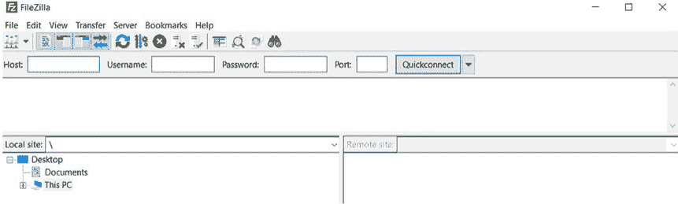
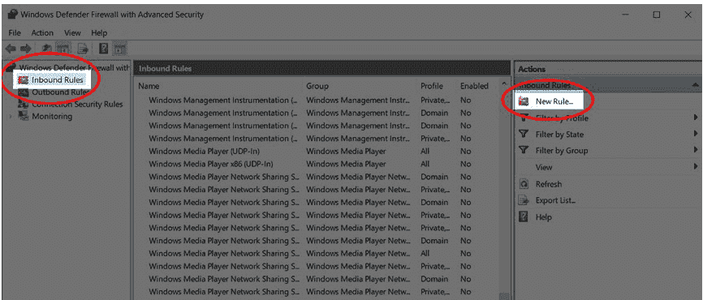
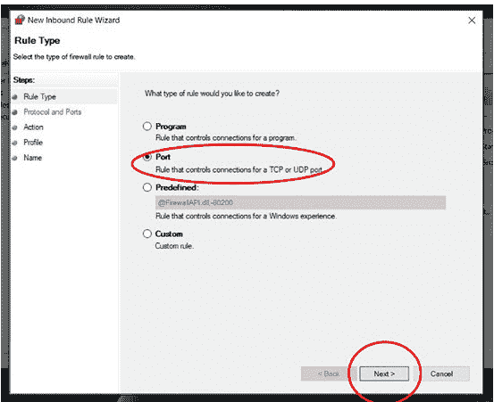
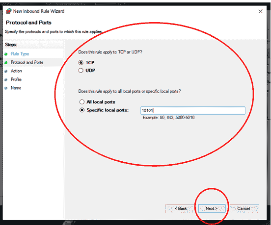

## CHAPTER 2   THE MESSENGER PIGEON, PACKETS, AND A TRIP AROUND THE WORLD

### When Do We Use It?

你应该始终将 Zenmap 放在你的调试工具库中。该工具功能强大，值得学习。如果你连接游戏服务器有困难，请考虑对服务器运行端口扫描以确保端口是开放的。

### FileZilla

FileZilla 是一个免费的开源文件传输协议应用程序，由 FileZilla Client 和 FileZilla Server 组成（图 2-23）。它允许我们将文件部署到用于托管测试服务器的远程服务器，而不是通过远程桌面协议复制它们。

下载：[https://filezilla-project.org/download.php](https://filezilla-project.org/download.php)

**Platforms:**
- Windows
- Linux
- Mac

*Figure 2-23.* A screenshot depicting the FileZilla interface awaiting connection to an FTP server

### What Does It Do?

FileZilla 是一个文件传输协议（FTP）应用程序，让你可以快速轻松地在 FTP 客户端（FileZilla Client）和 FTP 服务器（FileZilla Server）之间传输文件。

### EXERCISE 3 – CONFIGURING THE WINDOWS FIREWALL

在你拥有游戏服务器之前，你需要知道如何配置 Windows 防火墙。

如果不配置 Windows 防火墙，你的用户将无法连接到游戏服务器。因此，让我们为一个端口打开防火墙；建议在沙箱环境中执行此操作。或者，完成练习后只需记得删除记录。我们不想制造任何安全风险。

Step 1 – 打开 Windows 防火墙高级设置。你可以通过在 Windows 搜索栏中搜索它，或按 Windows 键 + R，然后输入 `control firewall.cpl` 并按回车，然后在左侧面板导航到高级设置来完成此操作。

Step 2 – 现在 Windows 防火墙高级设置已打开，导航到入站规则，然后从右侧面板选择新建规则。见图 2-31。

Figure 2-31. The screenshot shows how we can add a new inbound firewall rule

我们创建入站规则是因为我们希望允许传入连接连接到我们。

Step 3 – 在此选项列表中选择端口以创建规则，然后按下一步（图 2-32）。

图 2-32。截图显示了配置新防火墙规则所需的步骤

步骤 4 – 选择要打开的端口类型。这将根据你的游戏服务器的传输层而有所不同。为练习起见，选择 TCP，并在本书端口部分讨论的已注册端口范围内选择一个号码。我将使用端口号 10101（图 2-33）。

图 2-33。截图演示了如何为防火墙规则分配端口

步骤 5 – 选择允许此连接并单击下一步。

步骤 6 – 确保已勾选域、公用和专用，然后单击下一步。

步骤 7 – 为你的规则提供描述性的名称和描述，然后单击完成（图 2-34）。

示例端口打开全部是

图 2-34。该图展示了已配置的防火墙规则

完成！你现在可以在规则列表中找到你的防火墙规则。如果想删除该规则，请选中它，然后按键盘上的删除键，或选择右侧面板上的选项。我建议尝试使用练习 2 中学到的端口嗅探技术来访问该端口。

## 练习 5 – 使用 Windows 事件查看器

Windows 事件查看器是调试的有用工具，当 Unity 日志不够用时尤其如此。如果你在工作时遇到崩溃到桌面（CTD），这会特别有用
