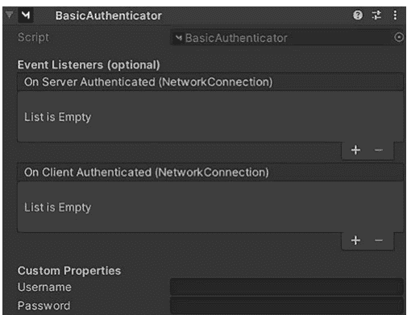
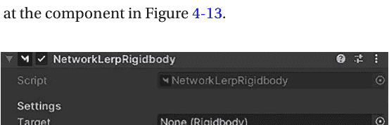
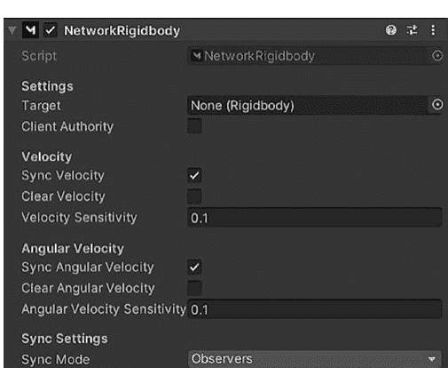
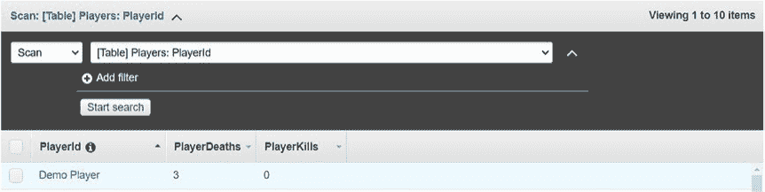
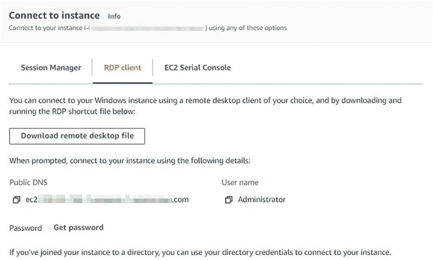
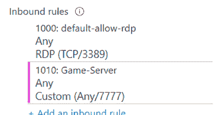

## 第 3 章

## 镜像大厅

现在我们了解了网络基础知识，我们可以更详细地讨论 Unity 中的多人游戏。我们将使用 Mirror Networking 在 Unity 中实现可扩展的多人网络。

那么 Mirror Networking 究竟是什么？Mirror Networking 是一个于 2018 年 10 月发布的网络库。它是为了修复被忽视的 UNET 并为其他开发者提供一个平台，以便他们在此基础上扩展、提交改进并协作而创建的。

Mirror 使用命令-RPC 网络结构，其中每个连接都需要对对象拥有权限才能在网络上修改它。Mirror Networking 易于实现且不会牺牲可扩展性。Mirror Networking 非常适合小型工作室和希望创建 MMO 级网络的大型 AAA 工作室。

Mirror 的优点在于客户端和服务器都是同一个项目，有助于在开发期间提高生产力。

## 架构

正如我之前简要提到的，Mirror 使用命令-RPC 网络结构。命令-RPC 架构意味着客户端和服务器通过命令（客户端到服务器）和远程过程调用（服务器到客户端）进行通信。命令允许客户端在自己拥有权限的对象上在服务器上执行远程方法。这是一种让客户端要求服务器执行给定命令的方式。

相反，RPC 允许服务器远程在客户端上执行方法。服务器和客户端之间的这种往返构成了我们网络的基础，使我们能够在网络上传输各种支持的数据类型和引用。命令-RPC 架构使代码比其他网络解决方案更容易遵循。

|  | Y - 是 | U - 未测试 | N - 否 | K - 有点 |  |  |  |  |  |  |  |  |
|---|---|---|---|---|---|---|---|---|---|---|---|---|
| 名称 | 备注 | Mirror 传输层 | 服务器 | 客户端 | Windows | Android | Linux | Mac | iOS | XBox | PS |
| Simple Web Transport | 此传输使用 websocket 协议。这使得该传输可用于 Unity 的 WebGL 构建。 | Y | Y | Y | Y | Y | Y | Y | U | U |
| Mirror WebRTC | 该传输的目的是提供一种不需要游戏主机进行端口转发的替代在线连接方法。 | Y | Y | Y | U | U | U | U | U | U |

图 3-1 第 3 部分。描绘了列表中最后两个传输层

SimpleWebTransport 是你需要 Web 应用连接到你的 Mirror 网络或反之时的首选。它是少数支持 WebSockets 的传输层之一。

Mirror WebRTC 是一种类似去中心化中继服务的服务，可扩展其他传输的功能。

## 附加传输组件逻辑

此外，传输层还可以充当其他传输层的中间人。它们可以提供额外的逻辑和功能，例如添加加密或提供 NAT 穿透。Monke 能够为传输层中传输的数据提供加密就是一个很好的例子。

这种传输层数据的交接也为其他传输层添加打开了可能性，例如回退传输组件。

## 回退传输组件

回退传输组件是规避平台限制的好方法。它允许我们在主要传输层在客户端当前平台上无法工作时切换到其他传输层。让我们看一下图 3-2。

缺点：

- 比 KCP 的 CPU 开销略高

无知是福，字面意思。

## Telepathy – TCP 传输层

Telepathy 是随 Mirror Networking 一起提供的默认传输层。Telepathy 是 Mirror Networking 示例中使用的传输层。

有人可能会认为默认传输层不会很好，但你会弄错。它在性能上仅略逊一筹，可能是 Mirror 可用的最佳 TCP 传输。

优点：

- 它就是能用。
- 舒适地处理 128+ 重负载带宽 CCU。

> “如果它没坏，为什么要修它？”

## 客户端、服务器和主机

所以现在我们已经涵盖了我们需要的许多低级网络概念，是时候开始谈论应用层，即 Mirror Networking 本身了。当使用 Mirror Networking 创建多人游戏时，有一个关键区别，你在编程游戏中将要执行的逻辑时始终需要牢记在心。

那就是尽管是同一个项目，你的游戏有两层和第三个混合层。这里至关重要的是要理解，我说的不是你在 Unity 中通常所用的层。我说的是游戏逻辑的实例。

让我详细说明。当使用 Mirror Networking 时，你有一个连接到服务器的客户端。两个独立的应用实例：制作两个构建，一个作为服务器运行，然后让客户端加入该游戏。够简单？

在客户端更改本地变量并不意味着该变量会在服务器上更改。客户端需要向服务器发出网络请求来更改变量，然后监听该更改。这种来回就是网络游戏的运作方式。在几乎所有情况下，服务器都不应信任客户端。



图 3-6。该图是 NetworkAuthenticator 的示例实现

现在，至关重要的是要理解 Network Authenticator 非常通用且可适应。一般来说，你不会在生产版本中使用 BasicAuthenticator。BasicAuthenticator 只是一个如何使用和继承 Network Authenticator 的示例。让我们在深入研究如何创建满足项目需求的网络身份验证器之前，更深入地研究基本身份验证器。

基本身份验证器非常、嗯、基本。它提供了一个明文用户名和密码验证系统的示例。首先，我们有公开的事件。如下所示。

### OnServerAuthenticated

当客户端成功被服务器接受为已认证时，此事件会被调用。Mirror 网络上的实体可以监听此事件，并帮助通知这些实体服务器已成功认证客户端。服务器本身通常使用 OnServerAuthenticated 事件，但其他玩家也可以使用该事件来查看他们的朋友是否已成功认证。

### OnClientAuthenticated

与 OnServerAuthenticated 事件类似，OnClientAuthenticated 是在服务器成功认证客户端连接后调用的事件。然而，与其影响 Mirror 网络上的监听器，此事件是在请求认证的客户端上调用的事件。OnClientAuthenticated 事件非常适合显示 UI 元素，通知用户其登录成功。


这涵盖了服务器端代码。它非常易于使用，也便于扩展。

接下来是客户端代码。

```
/// <summary>
/// Called on client from StartClient to initialize the Authenticator
/// <para>Client message handlers should be registered in this method.</para>
/// </summary>
public override void OnStartClient()
{
    // register a handler for the authentication response we expect from
    // server.
    NetworkClient.RegisterHandler<AuthResponseMessage>(OnAuthResponseMessage,
    false);
}
```

同样，与服务器端类似，我们需要注册一个处理器，但这次是针对 `AuthResponseMessage`，以便在收到服务器响应时采取相应操作。我们应该在 `OnStartClient` 中注册这个处理器。

```
/// <summary>
/// Called on client from OnClientAuthenticateInternal when a client needs to
/// authenticate
/// </summary>
/// <param name="conn">Connection of the client.</param>
public override void OnClientAuthenticate(NetworkConnection conn)
{
    AuthRequestMessage authRequestMessage = new AuthRequestMessage();

    NetworkClient.Send(authRequestMessage);
}
```

- **PlayerSpawnMethod** - 指定 Mirror Networking 是在随机的 `NetworkStart` 位置生成玩家，还是以轮询的方式生成。要让此功能正常工作，你需要在场景中放置带有 `NetworkStart` 组件的游戏对象。

## 已注册的可生成预制体

已注册的可生成预制体是一个手动注册的预制体列表，这些预制体允许在运行时生成。这些预制体也可以使用不同的流程自动分配，我们将在本书后面介绍。目前，需要注意的是，如果你打算在游戏过程中实例化并生成某个预制体，而该预制体不在场景文件中，则需要将其注册到此列表中。我们将在本书后面介绍生成网络化对象的内容。

## 网络标识

网络标识是 Mirror Networking 的核心；它们用于在网络中识别对象。如果某样东西需要联网，它就需要一个网络标识。更重要的是，一个网络标识不能成为另一个网络标识的子对象。这一点很重要，因为未来的 Mirror 版本将直接阻止这种情况发生。因此，最好将网络逻辑和网络标识都放在网络化预制体的根节点上。还需要注意，任何存在于场景中的网络标识，在服务器存在并连接之前，都会被 Unity 禁用。这一点很重要，因为在 `Awake` 中执行逻辑会导致逻辑先执行，然后对象被生成，这可能会破坏在 `Awake` 中初始化的一些逻辑，并且不会再次调用 `Awake`。因此，最好避免为附加到网络对象上的任何组件使用 `Awake`。相反，让你的类继承自 `NetworkBehaviour`，并调用 `public void override OnStartClient`。我们将在本书后面更详细地讨论网络行为，深入了解使用 Mirror Networking 创建多人游戏背后的编码。

## 小结

在本章中，我们了解了 Mirror Networking 和不同的网络架构、传输层，以及服务器、客户端和主机。我们还了解了网络管理器以及如何配置多人游戏环境。然后我们深入探讨了身份验证、玩家对象和已注册的可生成预制体。

在下一章中，我们将讨论指挥链，并深入理解权限（authority）以及它如何影响你使用 Mirror 构建多人游戏的方式。

## 练习 1 – 使用 Google 创建自定义 OAuth2 身份验证器

因此，我们打算使用 Google 登录来构建自定义身份验证器。标准的做法是使用 Google 的 SDK；然而，如果你希望开发同时支持桌面平台的产品，你会遇到一个障碍。截至撰写本文时，Google 的 SDK 并不支持原生 Unity 桌面应用程序。

为了为桌面构建目标构建登录流程，你需要使用玩家的浏览器构建一个完全自定义的登录流程，然后拦截 Web 响应。

由于在 Unity 中没有相关指南，更不用说 Mirror 了，我将向你展示如何创建这个自定义登录流程。值得注意的是，同样的概念也适用于 Facebook。然而，这是一个大问题：Facebook 的重定向需要通过 https 重定向到 SSL 加密的端点。这意味着重定向到客户端本地主机是不可行的。如果你打算使用这种方式，你需要托管一个身份验证站点来接收任何重定向。

让我们开始吧。在开始之前，我们需要先设置一些东西：

步骤 1 – 首先，我们需要通过 Google 的 API 开发者门户注册一个新应用。为此，你需要导航到 https://console.cloud.google.com/apis/dashboard 并登录。添加一个应用，然后按照提示操作。

步骤 2 – 接下来，你需要创建一个 API oAuth 2 客户端 ID 以供使用；你可以通过访问 https://console.cloud.google.com/apis/credentials 并确保在顶栏中选择了你的项目（图 3-9）来完成此操作。

那么为什么会有这么多模型呢？关于这一点，可悲的事实是，这直接源于你的一些玩家——作弊者。作弊者总会出现，并且总会抓住机会按自己的规则行事。作弊者作弊是为了自己的利益，或者仅仅是为了享受破坏其他玩家体验所带来的满足感。

游戏服务器架构有助于优化网络的整体设计，以减轻作弊问题，或者在你不在乎作弊者的情况下（例如本地合作游戏）改善玩家体验。因此，架构是一种设计理念，你应该在编写第一行网络代码之前仔细思考，同时权衡时间、精力和回报。

## 输入式与状态式架构

当我们构建多人游戏时，我们究竟在网络中复制什么？有人可能认为这是一个简单的问题，但它完全取决于你的游戏或产品、游戏类型以及架构应该满足的需求。

这就引出了输入式或状态式复制的主题。首先，让我解释一下这究竟是什么意思。当你使用基于输入的复制系统时，我们会通过网络发送玩家的输入，例如“PlayerPressedForwardInput()”命令。

另一方面，如果我们使用状态式架构，我们会通过网络发送位置值，而不是发送移动输入本身。这些方法中的每一种在网络化游戏服务器架构中都有其适用的场景。我们可以在游戏服务器架构中使用输入复制、状态式复制，或两者的组合。这些方法中的每一种在网络化游戏服务器架构中都有其适用的场景。我们的选择取决于网络模拟是否是确定性的。

## 基于输入的复制 – 优点与缺点

通常，这些不同复制形式的优缺点取决于架构本身，因为其中一些可能会变化。然而，一般而言，基于输入的复制具有以下优缺点：

优点

- **通常显著降低带宽使用** - 这是因为你只调用移动和交互命令。此外，在确定性环境中，你甚至不需要复制任何值。


## Lockstep

Lockstep 网络架构通常在 1990 年代末的 RTS 游戏中使用。它是一种网络架构，其中所有玩家都会等待所有其他玩家的承诺。这些承诺是预期操作的哈希版本。一旦玩家收到所有其他承诺，他们就会向所有其他玩家发送他们的操作。然后必须对该操作进行哈希处理并与原始承诺进行比较。

这种网络方法解决了被称为“先看作弊”的一种作弊方式的一些问题。例如，假设你正在玩石头剪刀布游戏，但你无法保证所有玩家会同时出牌。玩家 A 例如可以等待玩家 B 显示其决定，然后显示自己的决定，已知玩家 B 的决定。

在 lockstep 中，玩家 A 和玩家 B 各自共享承诺的哈希版本。此哈希承诺不应用于直接推断操作，但也应易于与操作进行比较。

这样，玩家 A 和玩家 B 就无法对他们的预期操作撒谎。Lockstep 然而带来了一个痛苦的缺点，使其不适合大多数现代游戏。整个网络的速度取决于最慢的玩家，这使其不适合许多游戏和类型。

因此，lockstep 网络的最后一个堡垒可能就是 RTS 游戏。但即使如此，还有另一个缺点。Lockstep 通常需要完全确定性的网络架构，并且由于与 lockstep 网络相关的复杂性和难度，我们通常会放弃它而采用客户端-服务器模型。

## True Lockstep Games

- Supreme Commander 1
- Warcraft 3
- Doom

## Pseudo-lockstep (Lockstep with Client-Server Model)

- Starcraft 2

## Client-Server Architecture

Client-Server Architecture – 这就是我们要介绍的内容。Mirror Networking 使用纯客户端-服务器模型。虽然理论上你可以扩展 Mirror Networking 来使用

RPC 属性可以在属性标志中包含一个特殊的参数，称为“includeOwner”。如果不传递该参数，则默认为 true。如果你决定传递该参数，你的新属性将看起来更像以下内容：

```
[RPC(includeOwner = false)]
public void Jump()
{
    PlayerController.Jump();
}
```

现在，你的 RPC 将仅在客户端上执行并排除主机玩家。通常没有太多理由这样做，但该功能存在。

## TargetRPC Attribute

TargetRPC 与 RPC 属性非常相似。TargetRPC 简单地代表 Target Remote Procedure Call。与 RPC 属性一样，我们需要添加一个属性，这次是 TargetRPC 属性。

TargetRPC 需要一个额外的步骤。我们必须将 NetworkConnection 作为方法的第一个参数包含在内，否则代码将无法工作。让我们看看它是什么样的：

```
[TargetRPC]
public void Jump(NetworkConnection connection)
{
    PlayerController.Jump();
}
```

然后你可以调用远程过程调用并传入你想要在其上调用远程过程的玩家的网络连接。某些 IDE 可能会警告参数未被使用，但这并非如此，你可以安全地忽略此警告。

## Commands

那么，如果我们希望客户端在服务器上执行一个方法呢？我们可以使用命令来实现；它们与 RPCs 非常相似，因为我们可以使用命令属性来识别 Mirror Networking 编译器的目标方法。

## Command Attribute

我们可以像标记方法为 RPCs 或 TargetRPCs 一样将方法标记为命令。重要的是要注意，默认情况下，你必须对你调用命令的网络身份拥有权限，这应该看起来像这样：

```
[Command]
public void AddGold()
{
    gold++;
}
```

给定的命令将允许对网络身份拥有权限的客户端添加金币。然后该 gold 变量可以通过使用 sync-vars 在网络上与其它客户端同步，我们稍后会讨论。

## Synchronization – Properties

Synchronization 是 Mirror Networking 的一个概念，我们可以在网络上同步变量的状态。Mirror Networking 通常在客户端加入网络或值发生变化时执行此同步，并将其添加到同步批处理队列中。

同步涵盖两个主要部分：同步属性和同步组件；后者是预先编写的组件，用于同步其它组件的状态，省去了从头重写大量样板代码的需要，但设计为可扩展以满足项目需求。

我们将从讨论同步属性开始。这些如下：

- SyncVars
- SyncLists
- SyncDictionaries
- SyncHashSets
- SyncSortedSets

然后最后，我们有通常的同步设置。

## Network Lerp Rigidbody

Network Lerp Rigidbody 组件是管理变换复制的替代方案。在你想要在网络上复制非运动学刚体时，它是有优势的。

然而，在刚体上使用 Network Transform 可能会导致物理系统出现异常行为，因为刚体本身的速率不会被修改。为抵消此问题，我们有 Network Lerp Rigidbody。

Network Lerp Rigidbody 同步刚体的速率值及其相关位置。

重要的是要注意，网络身份不应同时具有 Network Transform 和 Network Lerp Rigidbody 组件。你应该根据产品需求选择其一，通常更倾向于 Network Transform，除非速率很重要——例如刚体平台，或玩家可交互的刚体。让我们看一下图 4-13 中的组件。



Figure 4-13. The figure shows the Network Lerp Rigidbody component

与 Network Transform Child 类似，我们有一个目标，即我们想要复制的相关刚体。然后，我们有我们的 lerp 设置。这些 lerp 设置决定了组件应尝试在网络同步滴答之间填补空白的程度。

最后，我们有我们熟悉的客户端权限布尔值，它决定谁有权控制网络刚体。

## Network Rigidbody (2D and 3D Variants)

Network Rigidbody 是在网络上同步刚体的另一种方法。然而，这些不会插值其值。对于 2D 和 3D 刚体都有 Network Rigidbody 组件。

其同步属性与我们刚刚介绍的 Network Lerp Rigidbody 组件（图 4-14）有点不同，所以让我们看一下。

这里，我们也有一个可以指定的目标。我们还添加了一些复选框，可以让我们更好地控制应同步哪些属性。

这种额外的控制可以帮助我们在许多情况下减少网络带宽，例如我们可能只想同步速率的移动平台。



Figure 4-14. The figure shows the Network Lerp Rigidbody component


如果玩家被对手玩家吃掉，那么他们会在地图上随机重生，恢复最初的10分，而他们原有的分数则转移给对手玩家。

游戏还应提供退出菜单，以及返回主菜单的选项。

## 卡住了怎么办？

为了帮助你完成这个挑战，我基于经典的 snake.io 游戏制作了一个示例游戏。我鼓励你仔细研究代码并从中学习，从而攻克我提供的挑战。

你可以通过以下链接访问该示例的 GitHub 仓库。
https://github.com/VoidFletcher/MirrorSamples-WormGame
如有任何问题或疑问，欢迎通过 GitHub issue 反馈。

## 大型多人游戏的数据持久化

对于全球性、可扩展的游戏而言，最佳的数据持久化方案是使用数据库。数据库应用广泛，并且是一种以高性能方式安全处理用户数据的方案。我们甚至可以让多个游戏服务器共用一个数据库。

### 使用数据库进行数据持久化的优点

- **高性能**——开发者在设计数据库时充分考虑了性能。几乎所有你使用的网站和应用程序在其生命周期中的某个阶段都会与数据库交互。
- **可扩展**——速度和可扩展性是数据库设计的核心。无论你服务一千名用户还是十亿名用户，数据库都是为可扩展性而设计的。
- **成本低**——自行托管数据库很容易，而且市面上有许多廉价的服务可以帮你完成。
- **安全**——非常重要的是，对于数据库而言，安全是核心关注点。

### 使用数据库进行数据持久化的缺点

- **刚开始可能有些难度**——数据库一开始可能具有挑战性，但很快就能理解其中的逻辑。然而，掌握数据库开发、维护和管理可能需要数年时间。
- **需要额外的开发时间**——你需要设计和实现数据库架构，并编写数据库与游戏服务器之间的接口程序。这些额外的工作会增加开发时间。

那么，数据库到底是什么？

首先，在我们的 `AWSDatabaseApi` 类中，或者在你用来填充数据库的任何类中，我们需要添加一个新的 `DynamoDBContext` 对象。这个 `DynamoDBContext` 对象将为我们的代码提供关于数据库应如何呈现的上下文。让我们看看下面的代码：

```csharp
private DynamoDBContext context;
```

现在我们有了一个 `DynamoDBContext` 对象，我们需要通过初始化它来填充我们数据库的上下文。你需要确保在初始化 `IAmazonDynamoDB` 对象之后才调用此代码：

```csharp
private async void AddNewRandomPlayer()
{
    context = new DynamoDBContext(client);

    Player newPlayer = new Player
    {
        PlayerId = "newPlayer-" + Random.Range(0, 1000),
        PlayerDeaths = Random.Range(0, 30),
        PlayerKills = Random.Range(0, 30)
    };

    await context.SaveAsync<Player>(newPlayer);
}
```

在代码中，我们使用数据库客户端连接来获取数据库的上下文。然后我们创建一个新的 player 对象。这个 player 对象正是我们使用所需属性进行装饰的对象。

接着，我们可以用所需的数据填充 player 对象，并调用 `DynamoDBContext` 的 `SaveAsync` 方法。一旦 `await` 调用完成，你的“Players”表中就会有一个新生成的 player 条目。再次强调，重点是除了键之外，所有字段都不是必需的。向 player 对象添加额外字段也会将它们作为新列添加到数据库中！

这段代码将生成一个新用户，其玩家 ID 为“Demo Player”。然后我们将三次死亡和零击杀分配给该玩家。让我们运行这段代码，并在 DynamoDB Web 界面中查看结果。让我们看一看图 5-11。



**图 5-11.** *该图显示了“players”表中的演示玩家条目*

这就是我们的玩家，死亡三次，击杀为零。让我们更新玩家的击杀数。如果你使用我的示例，请右键单击 `AWSDatabaseApi` 组件，然后选择“Update Demo Player Kills Randomly。”

让我们看看下面的代码来了解发生了什么：

```csharp
private async void UpdateDemoPlayerKillsRandomly()
{
    var existingPlayer = await context.LoadAsync<Player>("Demo Player");

    if (existingPlayer == null)
    {
        Debug.LogError("Demo player does not exist yet.");
        return;
    }

    existingPlayer.PlayerKills = Random.Range(1, 1000);

    await context.SaveAsync(existingPlayer);
}
```

在这里，我们通过哈希键使用 `context.LoadAsync` 并指定类型 `Player` 来查找现有的 player 对象。然后我们更新“player kills”值，并通过 `context.SaveAsync` 将对象传回数据库。

让我们回到 DynamoDB Web 界面查看更改。

- 适合小型独立工作室。
- 适合开发环境。
- 适合 Web 服务器托管。
- 适合小型玩家运行的游戏服务器。
- 易于上手。

### 缺点

- 对于小型托管提供商来说，可扩展性很差。
- 如果共享资源拥塞，可能会受到性能影响。

Amazon Web Services EC2 是规则的主要例外之一——它通过重大的基础设施改进来减少上述缺点——但成本高于许多小型托管提供商。Google Cloud Hosting 和 Microsoft Azure 也是如此。

那么，有哪些替代方案呢？接下来让我们深入了解专用托管。

## 专用托管/裸金属

专用托管通过直接将硬件分配给客户端，消除了其他客户对给定硬件上的未知需求，从而将共享托管提升到了一个新的水平。在专用托管中，每个客户都可以直接访问其专用服务器的硬件，通常可以对 GPU 和 CPU 资源进行微调。

裸金属服务器正是因为这种对硬件的直接访问而得名，在这种模式下，提供商不会将服务器实例封装在虚拟化技术中。

让我们从概念层面看一下专用托管的样子，如图 6-6 所示：



该面板将为你提供远程桌面连接的下载链接。这个下载的文件相当于一个 RDP 快捷方式。你仍然需要你的密码，我们接下来会获取。

点击“Get Password”链接。第一次执行此操作时，AWS 会提示你下载并保存一个“.PEM”文件。这个文件至关重要，你应该将其保存在安全的地方，并考虑进行备份。

接下来，你可以使用 PEM 文件解密 Windows 密码。复制 Windows 密码并运行你的 RDP 快捷方式。忽略任何证书警告。这是因为 AWS 默认使用自签名证书。继续并连接到你的实例。接下来，你会看到一个熟悉的 Windows 桌面窗口。这个窗口就是你的远程机器，你可以在此安装游戏服务器。接下来让我们讨论 Windows 配置。

### Windows 配置

现在我们有了 EC2 虚拟机，我们需要进行 Windows 端的配置。这一步包括从安装我们的游戏服务器到可能需要的任何自动运行脚本，再到打开相应的防火墙端口。

你需要确保完成以下步骤：


The new instance wizard (Figures 6-10 and 6-11) will require us to complete the following:

- **Give the instance a name** - This is a human-friendly name that we can use to identify the instance. Naming our instance is helpful if we have multiple instances running.
- **Optionally add a key/value pair tag** - Much like AWS, this provides us with an optional label that can help identify the purpose of the instance. We can use this for specific group actions.
- **Select a region** - This will determine what area our endpoint is situated at, typically a geographic location.
- **Select a zone** - Zones are subdivisions of regions that typically represent a data center.
- **Select the machine configuration** - The machine configuration defines what hardware we want to provision for our virtual machine.

## Figure 6-11. The figure shows the last section of the GCP new instance wizard

- **Optionally enable “Confidential VM Service”** - This is an optional service in which the memory of the VM becomes encrypted to add another layer of security, where even Google would be unable to access the memory. Memory encryption is typically only used for extremely sensitive applications, and we can leave this disabled to save on cost and performance.
- **Optionally deploy a container to the VM** - This is useful if you have a docker container image ready.
- **Specify your boot disc and OS** - Here, we can specify the size of our boot disk and choose an operating system to use. Google includes licensing fees for the operating system selected.

- **Specify identity and API access** - Here, you can specify which account we should use for the instance. Selecting a service account allows your applications on your VM to make Google API calls.
- **Firewall** - Here, we can choose to allow HTTP and HTTPS traffic. Enable both checkboxes.

Selecting “Management, security, disks, networking, sole tenancy” will show additional options. The one we’re interested in here is “Preemptibility.” Preemptibility is an optional selection that will limit our server to only run for up to 24 hours. Depending on how you structure your game servers, preemptibility can be a valuable option to save on costs while developing significantly. It’s similar to AWS’s spot pricing.

Finally, click the create button.

From here, you can connect to the remote server, and much like with the AWS server, it’s important to remember to enable the appropriate firewall rules within Windows!

## Azure

Azure is Microsoft’s cloud solution and competitor to AWS and GCP. Much like its competitors, Microsoft provides a free trial, with $200 worth of credit to use in your first 30 days (Figures 6-12 and 6-13).

Head over to the following URL to sign up:

```
https://azure.microsoft.com/account/free
```

Once you’ve completed the account creation and verification process, you’ll have access to the Azure portal.

Select the burger menu at the top left, and choose “Virtual Machines” from the drop-down list. Then select “Create Instance.” You should see the following diagram:

## Create a virtual machine

Basics   Disks   Networking   Management   Advanced   Tags   Review + create

Create a virtual machine that runs Linux or Windows. Select an image from Azure marketplace or use your own customized image. Complete the Basics tab then Review + create to provision a virtual machine with default parameters or review each tab for full customization. Learn more

## Project details

Select the subscription to manage deployed resources and costs. Use resource groups like folders to organize and manage all your resources.

Subscription *  Free Trial

Resource group *  (New) _group  Create new

## Instance details

Virtual machine name *

Region *  (Africa) South Africa North

Availability options  No infrastructure redundancy required

Image *  Windows Server 2019 Datacenter - Gen2  See all images

Figure 6-12. The figure shows the first section of the Azure new instance wizard

Here, you’ll want to complete the following:

- Select your subscription - This determines how Azure will bill you. We can use the Free Trial subscription to test this process out.
- Name your server instance - Give your server instance a name that you can recognize.
- Set your server region - Set the region where you’d like Azure to provision your server.
- Select a server image - Select a server image, or a snapshot of the OS, much like AWS AMIs.



Figure 6-14. The figure shows our newly created inbound port rule

Finally, click the “Review + Create” button. Azure servers take quite a while to provision, but you’ll have a new server to use once the process is complete.

## Unity Multiplay

Unity Multiplay is by far one of the best hosting solutions out there for large, scalable multiplayer games. Unity Multiplay is essentially a pricing engine that grabs the best available price from the hosts that we just discussed and launches your game servers at the best rates.

It’s scalable and can handle millions of players. Major studios, including Respawn Entertainment with their incredibly successful “Apex Legends,” use Unity Multiplay, where Multiplay helped Respawn scale 50 million players in 24 days.

Unity Multiplay is not as easily accessible as directly hosting with the previous hosting providers, though. Still, if you’re expecting a massive launch or need for scalability, you can contact the Multiplay team over at the following URL:

https://create.unity3d.com/multiplay-contact-us

The Multiplay team is accommodating and will guide you through the process and provide additional valuable insight throughout your game launch.

## Stress Testing, Stress Clients, and Market Research

When it comes to scaling your multiplayer game, choosing the right cloud services is one of the most important decisions you can make. But how can you make decisions without knowing the variables?

The key is stress testing through the use of stress clients and market research.

A valuable tool to create is a game client that can run headless, which automatically connects to your game server and simulates traffic. Stress clients can be an excellent approach for testing how your network code scales. It’s essentially a DDOS attack of legitimate game traffic to see where your game servers start to take the strain.

Once you’re confident in your game’s net code, another step that can be invaluable in a pre-launch environment is performing a real-world stress test in the form of market research. You can perform real-world tests as a public test beta that runs for a limited duration. If you don’t have a large following, you can employ a company like Game Tester, where you pay a large userbase of players to test your game servers for a set duration.

You can have a look at Game Tester’s website over at the following URL:

```
https://GameTester.gg/
```
