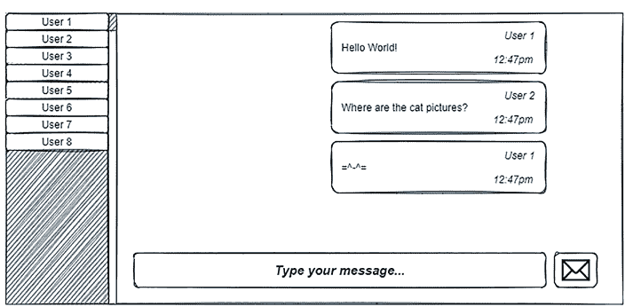
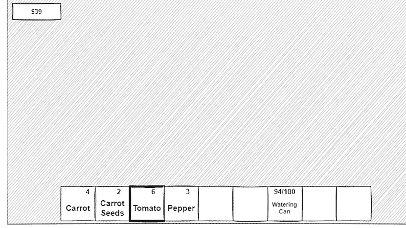

## 第8章

## 挑战你的认知

学习的最佳方式是实践。因此，我为你准备了一些挑战，让你练习在本书中学到的内容。这些挑战将分为三类，我建议你按顺序完成。

初级挑战会涉及使用Mirror Networking进行多人开发的基础细节。然后，我们会进入中级挑战，在前面的挑战基础上增加用户数据持久化。最后，我们会进一步扩展挑战——加入世界和用户数据持久化。

我鼓励你利用AWS或Azure的免费层级服务器来完成这些挑战——这会帮助你积累这些平台的使用经验，对你的职业生涯极有价值。

我会按如下格式布置挑战：先描述挑战，再给出完成挑战所需的条件，最后，如果你愿意进一步挑战自己，还有一些加分条件。

记住要适当休息，不要过度劳累。

让我们开始吧。

## 初级挑战 – 核心多人游戏功能

接下来的挑战将侧重培养你创建核心多人游戏功能的能力，这些功能将帮助在客户端之间传递游戏状态。你不必把这些挑战做得好看，所以如果没有美术资源，请使用基本形状和物体。我们这里专注于多人游戏部分。如果你想让它看起来更精致，那当然好，但也不必为此失眠。

## 挑战

在本挑战中，我希望你使用Mirror Networking在Unity中重制这个游戏。你的游戏应满足以下条件：

- 有一个主菜单，允许玩家执行以下操作：
- 开始新游戏，在游戏区域下方显示当前IP地址和游戏服务器端口。开始游戏的玩家应成为主机。
- 加入游戏，允许玩家输入另一玩家游戏服务器的IP地址和端口。如果玩家无法连接，游戏应显示超时消息并返回主菜单。
- 退出应用程序。
- 一个回合制系统，执行以下操作：
- 回合在5秒延迟后开始。
- 在中心生成一个球，并向其中一个玩家的方向随机射出。即，不是正上方。考虑限制起始角度。
- 每个玩家都应有一个球拍，该玩家可以单独在屏幕的竖直轴方向上控制它。
- 约束每个玩家的球拍，防止移出游戏区域。
- 球应从顶部和底部墙壁反弹。
- 球应从玩家的球拍反弹，并根据击球点离球拍中心的距离调整反弹角度。
- 球在碰撞到玩家球拍时应加速。
- 你应在每个回合开始时重置球速。
- 如果球击中左墙，给第二名玩家加一分，并开始新回合。反过来，如果球击中右墙，给第一名玩家加一分。
- 当任一玩家达到10分时，回合应结束。

- 创建一个拾取物，使对手的球拍缩小 25%。该拾取物应在回合结束时重置。
- 添加障碍物，使其在回合中随机生成在游戏空间的中间三分之一区域内。
- 将障碍物的数量限制为三个，并且在最初的 10 秒过后，每 10 秒才生成一个障碍物。
- 与该障碍物碰撞应将其摧毁并按预期反射球。
- 防止障碍物生成在球的正上方。
- 如果障碍物将与另一个障碍物相交，则更改原始障碍物的颜色，并需要额外一次击打才能破坏该障碍物。
- 添加一个退出菜单，允许玩家返回主菜单。

提示 在此过程中你可能会遇到一些小问题，因此我准备了一些提示，可能有助于你在本次挑战中。

- 在花费时间创建游戏循环之前，请考虑确保你的网络连接运行顺畅。
- Vector3.Reflect() 是计算反射角度的绝佳方法；你可以在 Unity 开发者文档中阅读更多关于它及其用法的介绍：https://docs.unity3d.com/ScriptReference/Vector3.Reflect.html
- 在测试时以窗口模式和较低分辨率构建你的游戏。这样可以让你同时看到两个游戏窗口。你可以在 Unity 的 Player Settings 中，在 Resolution and Presentation 下进行此操作。
- 请记住确保你的球拍逻辑仅在拥有客户端上执行。

- 攻击应在撞击处生成一个没有碰撞体的微小立方体，持续一秒。如果击中敌人或其他玩家，该立方体应为红色；如果击中环境，则为黑色。
- 攻击应有 1 秒的冷却时间。
- 攻击应消耗弹药，如果玩家没有弹药，则不应发射或进入冷却。
- 用攻击击中敌人应造成伤害。当敌人生命值降至零时，他们应变灰色，留下其物体。
- 弹药拾取物应在地图各处随机生成，为碰撞的玩家提供 20 发弹药。每五次击杀，地图上应生成一个弹药拾取物。
- 在屏幕右下角显示玩家的当前弹药。
- 如果玩家死亡，其角色，例如胶囊，应变灰色。
- 游戏应继续进行，直到没有玩家剩余或玩家累计击杀一百个敌人。
- 获胜时，显示胜利屏幕并提供再次游玩的选项。
- 失败时，显示失败屏幕，并提供再次游玩的选项。

# 奖励挑战

如果你喜欢这个挑战并想进一步挑战自己，这里有一些奖励挑战供你完成：

- 添加一个恢复系统。如果玩家死亡，允许另一名玩家走到该玩家身边并按住 E 键 5 秒钟来复活该玩家。
- 添加以下武器，玩家可以通过按 1–3 或使用鼠标滚轮在它们之间切换。这些武器不应共享冷却时间，但应仅在激活时扣除冷却时间。游戏应在屏幕底部显示当前激活的武器：
  - 默认武器。

- 你可以使用 Unity 的 NavMeshAgents 进行敌人移动，甚至玩家移动，如果你愿意的话。它们使用起来毫不费力。查看 Unity 开发者文档：https://docs.unity3d.com/ScriptReference/AI.NavMeshAgent.html
- 请记住将你的环境标记为 Navmesh Static，并烘焙你的 navmesh 数据。
- 如果你难以生成预制体，请记住将其包含在可生成预制体列表中。首先实例化游戏对象，然后再生成它。

# 中级挑战 – 用户数据持久化

是时候做一些更具挑战性的内容了。我们将围绕用户数据持久化来开展以下挑战。我鼓励你使用 Amazon DynamoDB 来完成以下挑战，以便熟悉使用基于云的用户数据持久化创建应用程序。

# 挑战 #3 – 带有用户消息历史的聊天室应用

# 概述

对于本次挑战，我希望你创建一个聊天室应用程序。目标是让你的应用程序连接到专用的游戏服务器，并在加入时提示用户输入显示名称。

用户应按字母顺序看到所有已连接用户的显示名称列表，包括他们自己的。还应有一个聊天窗口。当新用户加入聊天室时，应用程序应在聊天中显示一条消息。

你应在 Amazon DynamoDB 数据库中存储所有消息及其发送者显示名称。重新加入时，应用程序应向用户显示所有最近的消息。让我们看一下图 8-3：

图 8-3. 该图描绘了一个简单的消息应用

对于本次挑战，我们不担心安全、身份验证，甚至最佳实践。我希望你解决几乎任何在线游戏都有的一个需求——文本聊天的需求。

文本聊天是任何在线多人游戏的核心部分，因为它允许用户结交新朋友、制定策略，或只是互相冒犯。如果你正在开发多人产品，很可能你需要知道如何做到这一点。

那么，让我们开始吧。

# 挑战

- 开发一个多人应用程序，允许使用 Mirror KCP 传输最多 200 个已连接客户端。
- 让应用程序自动尝试连接到游戏服务器，直到连接成功为止重试。
- 应用程序应具有退出菜单。
- 应用程序应具有通知用户当前正在连接的屏幕。
- 应用程序应提示用户选择显示名称。使用 player prefs 记住他们的上一个显示名称。
- 应用程序应显示当前所有已连接的用户。
- 应用程序应具有用于显示用户消息的聊天窗口。
- 应提供文本输入和发送消息按钮。
- 应用程序应使用 Mirror Networking 的 Network Messages。
- 应用程序应在聊天中显示通知，显示用户何时加入对话并附带时间戳。
- 所有用户消息都应显示消息的时间戳。
- 所有用户消息都应显示发送者的显示名称。
- 用户发送的消息应与该用户不同。 即。 不同的聊天框颜色。

# 奖励挑战

想要挑战吗？以下是一些额外的任务，完成它们可以加深你对 Mirror Networking 的理解：

- 用户应通过在左侧用户菜单中点击目标用户，在单独的聊天窗口中直接向其他用户发送消息。此聊天也应持久化并可在会话之间访问。
- 允许用户创建群聊。群聊名称应显示在所有群聊成员的左侧用户菜单中。
- 允许用户选择图像文件并将其上传到聊天。你可以根据自己的喜好处理，只要图像在会话之间保持持久即可。
- 允许用户屏蔽另一用户。 该用户的消息应显示为“Blocked Message”，并且被屏蔽用户不应有向屏蔽者发送直接消息的能力。
- 确保你的用户界面可以适应多种屏幕分辨率。
- 部署到 Android 的构建，并让 Android 客户端能够连接到聊天。此 Android 客户端应与桌面客户端功能完全相同。
- 清理你的用户输入，以防止破坏数据库和应用程序，通过删除 TMPText markdown 和故障 ASCII 符号 https://en.wikipedia.org/wiki/Zalgo_text 。

# 挑战 #4 – 带有世界持久化的农场机制

农场游戏是合作游玩的热门类型。看看 Stardew Valley 和 Slime Rancher 的流行程度，我们可以看到人们喜欢花费时间获取资源并解锁新作物，或在 Slime Rancher 的情况下，解锁史莱姆。

我们将以 Stardew Valley 为灵感，并为本次挑战构建一些多人农场机制。游戏应使用客户端可以连接并进行身份验证的专用服务器，在此我们将挑战你对 Mirror Network Authenticators 的使用。

游戏本身应是一个简单的俯视游戏，使用跟随摄像机和 WASD 移动。玩家，可以是胶囊，应面向鼠标方向并具有一个界面，底部中间有一个快捷栏。快捷栏应有九个方格，当前选择应有轮廓。此快捷栏将代表玩家库存。

快捷栏应显示当前选定的物品。你可以通过简单地显示物品名称和玩家持有的物品数量来实现。

还应有一个显示在左上角的显示，显示玩家当前拥有的金钱。

让我们看一下图 8-4，以更好地理解挑战。

图 8-4. 该图描绘了玩家快捷栏

玩家应该能够走到作物前并使用其浇水壶为其浇水，玩家从一开始就拥有浇水壶且无法出售。

浇水壶可以通过在水上使用它来重新填充。使用浇水壶会消耗壶中的水，并且需要定期重新填充。

达到最大生长阶段的作物会以降低的速率消耗水，收获时会获得作物和种子。

## 挑战

让我们将其分解为挑战要点：

- 你的游戏必须包含主菜单，允许玩家退出游戏或加入专用服务器。
- 必须有一个逃脱菜单，允许玩家退出游戏。
- 加入专用服务器后，允许玩家创建账户或登录。用户应选择用户名、密码和显示名称。为本次挑战的目的，你可以使用明文处理所有登录，并使用带掩码的密码字段。
- 在登录期间，你应使用自定义 Mirror Authenticator 处理身份验证。然后服务器可以将用户名和密码与 DynamoDB 数据库进行比较，并允许或拒绝客户端。
- 你应将所有与玩家相关的数据存储在数据库中。你的数据存储应包括以下内容：
  - 玩家位置
  - 玩家快捷栏
  - 玩家金钱
  - 玩家账户详情
- 应该有一个购买、种植、浇水、收获和出售的游戏循环，所有操作都由服务器权威控制。
- 游戏服务器应支持最多八名玩家。
- 玩家显示名称应显示在玩家下方。
- 你应该为游戏创建一个小的游戏空间，其中包括：
乌鸦的范围以吓跑它，乌鸦会破坏作物，留下玩家需要清除的死作物。

## 提示

与最近的挑战一样，这里有一个帮助：

- 你可以使用可脚本化对象来创建你的物品数据。这样可以轻松地用新的作物类型扩展游戏。你可以通过为类添加 [Serializable] 属性，使类在可脚本化对象中可序列化。
- Camera.ScreenToWorldPoint 是获取玩家鼠标在世界空间中的位置的好方法。
- 要计算消耗速率，你可以使用“remaining -= waterConsumptionRatePerSecond * Time.deltaTime”在 Update 循环中使用该公式来相对准确地减少剩余水量。
- 请记住对任何用户输入进行清理，因为它们可能会破坏你的数据库或游戏服务器。
- 不要在每个 tick 都将植物和世界状态保存到数据库中，因为这可能会耗尽你在 AWS DynamoDB 上的速率限制。相反，考虑立即保存关键信息，例如玩家交易，并在尽可能少的数据库调用中每隔几分钟保存一次世界状态。
- 保存和加载很可能将是本次练习中最具挑战性的部分，这正是重点所在——不要放弃。
- 考虑使用挑战 #3 中链接的 MessagePackC# for Unity 来帮助保存和加载世界数据。
- 玩家应该能够收获和浇水其他玩家的作物；这是你在规划权威结构时需要考虑的事情。

## 挑战 #5 – Box-Hoarder

我设计了以下挑战，以推动你在多人环境中使用物理的程度，这是许多现代多人游戏的要求，同时也强化了你在上一个挑战中获得的世界持久化经验。

本挑战旨在创建一个支持 16 名玩家连接到专用服务器的第一人称游戏。目标是在游戏世界中收集箱子并将其带到你所声称的交付点。

有八个交付点散布在游戏区域周围。交付点包含一个划定区域、一个交付按钮和一个显示当前所有者的指示器。

声明指示器为颜色编码，并显示玩家对交付点的声明百分比。

如果玩家站在声明指示器内，他们就开始声明交付站点。如果另一个玩家控制着交付站点，他们将收到警报，通知他们有玩家正在尝试控制交付站点。如果两个或更多玩家在声明指示器内，声明过程将暂停，直到只有一个玩家在环内。

玩家一次只能拾取一个箱子，并且在投掷箱子时，箱子会在他们面前以抛物线弧线飞行。玩家需要在他们拥有的划定交付点内放置箱子并按下交付按钮。每在划定区域内多一个箱子，游戏就会将其得分乘以该交付的分数。让我们看一下图 8-6，了解计分的分解。

| 箱子 | 分数 |
|---|---|
| 1 | 1 |
| 2 | 4 |
| 3 | 9 |
| 4 | 12 |
| 5 | 25 |
| 6 | 36 |
| 7 | 49 |

图 8-6。 该图描绘了箱子收集者的计分表

- 在游戏开始时创建基本的登录和账户创建流程。用户应能够存储用户名、密码和显示名称。对于本次挑战，我们不太担心安全性。
- 存储有关用户的信息，例如成功交付的箱子数量、游戏时间以及他们从敌方划定区域偷来的箱子数量。
- 创建一个名为“安全屋”的菜单选项，当玩家加入安全屋时，加载一个场景，并在玩家在游戏中交付的每个箱子处生成箱子。游戏应将此数据存储在其账户中。离开安全屋时，保存所有箱子的位置，以便玩家下次加入安全屋时使用。
- 为箱子撞击物体添加音效，例如地面或其他箱子。
- 为游戏添加一些环境音乐。
- 允许玩家在被其他玩家投掷的交付箱击中时被击晕并击倒。
- 添加一个小地图，允许玩家查看地图布局和控制点所有权的概览。此小地图不应显示玩家或箱子的位置。
- 允许小地图显示每个划定区域内的箱子数量。
- 允许小地图显示当前活动的箱子数量。
- 允许玩家选择一个未被占用的颜色，并将其保存为其账户的偏好设置。
- 添加玩家跳跃的能力。
- 添加更垂直的地图设计，允许玩家将箱子扔下几层楼。玩家不会受到坠落伤害。
- 允许玩家一次携带多达两个交付箱。

## 提示

以下提示可能有所帮助：

- 你可以使用网络身份验证向服务器发送不同的自定义请求，例如查询有关你的账户的信息。这样，你就可以构建一个自定义身份验证枚举，说明你打算在不加入的情况下查询信息。服务器可以看到此请求，验证你的登录，查询数据，返回数据并拒绝你的连接。
- 使用 Network Rigidbody。
- 不要害怕跳过一些奖励挑战。它们可能非常具有挑战性。
- 如果你卡在某个问题上，继续处理不同的问题，然后之后再回过头来解决你的问题。

如果你能够完成这些挑战，那么你就正朝着使用 Mirror Networking 在 Unity 中构建多人游戏的方向迈进。如果你卡住了，我鼓励你重新阅读本书的某些部分。

多人代码很棘手，可惜的是，目前还没有 MakeMultiplayer() 方法。

最大的挑战是进入多人代码的心态。它需要一种不同的思考方式来应对传统上你可能觉得容易的挑战。有很多事情需要考虑。

总的来说，一旦你有了良好的基础，最好的提高方式是通过练习。

因此，我鼓励你寻找新的挑战并自己提出挑战；话虽如此，最关键的部分是从小开始。如果你提出一个庞大的挑战，一个月后就让你精疲力尽，那么就没有意义了。

外面的游戏创意生成器有很多。我鼓励你使用它们来为你的挑战提出想法。祝好运！

## D
- Defense Advanced Research Projects Agency (DARPA)，8
- Domain Name System (DNS)，19
- Dynamic Host Configuration Protocol (DHCP)，36
- DynamoDB
  - AWS .NET API
    - developer user to IAM，156
    - installing，155
    - local credentials file，156
  - designing，158–161
  - free-tier features，155
  - Game server, connecting
    - database，157, 158
  - retrieving information
    - LoadAsync，165
    - QueryAsync，166
    - ScanAsync，166
  - storing information，161–164
  - update information，167, 168

## E
- Elastic Compute Cloud，180, 182
- Event Viewer，56, 57, 64, 65

## F
- File transfer protocol (FTP)，54
- FileZilla，54
- Firewall，47

## G
- Game server architecture
  - client-server，108–110
  - definition，100
  - deterministic vs. indeterministic，103
  - input vs. state-based architecture，101–103
  - lockstep networking，108
  - models，101
  - peer-to-peer networking，104–107
- Game Tester’s website，194
- Google Cloud，187
- Google Cloud Platform (GCP)，187
- Google’s SDK，95
- Grinding Gear Games，173

## H
- Hacking，50
- Hosting servers
  - dedicated，177, 178
  - local，179
  - shared，176
- Hybrid network topology，34

## I, J, K
- Information Processing Techniques Office (IPTO)，8
- Interest management
  - approaches，142
  - distance，142, 143
  - spatial-hashing，143–145
- Intermediate challenges
  - user data persistence，212
  - user message history，212–215
- Internet Architecture Board (IAB)，9
- Internet Protocol (IP)，9, 11, 12, 15, 20, 29

## L
- Lockstep networking，108

## M
- Market research，194
- Media Access Control (MAC)，18
- Mesh topology，33
- Mirror networking，111, 140, 141
  - architecture，67
  - client，78
  - custom OAuth2 authenticator，95–98
  - definition，67
  - developers，200
  - games，195
  - game services，199
  - host，78, 79, 81
  - MMO，195, 196
  - multiplayer development
    - knowledge，229
  - MySQL/AWS，202
  - network identities，94
  - PC，197, 198
  - people，230
  - server，78
  - solutions，201
- Multiplayer games
  - benefits，2, 3
  - caveats，3
  - definition，2
  - game/product，6
  - mirror，5
  - options，4
  - prerequisites/resources，5
- Multiplex transport，72

## N
- Network address translation (NAT)，40–42, 58
- Neighbor discovery protocol (NDP)，18
- Networking
  - definition，7
  - network diagnostic
    - event viewer，56
    - FileZilla，54
    - mirror network profiler，57
    - Windows Remote Desktop，56
    - Wireshark，52
    - Zmap/Zenmap，53
  - OSI model，8
  - packets
    - definition，9
    - TCP，10, 11
    - UDP，10, 12, 13
  - pinging devices，59, 60
  - protocols，8
  - security
    - attacks，48–51
    - firewall，47, 48
    - network diagnostic，55, 56
  - TCP，8
  - Windows Event Viewer，65, 66
  - Windows firewall，62, 64
  - Zenmap，60, 61
- Network Lerp Rigidbody，131
- Network manager
  - authentication，85, 86
    - creating custom network，88–91, 93
    - custom network，86–88
  - definition，82
- NetworkAuthenticator，85
- network info，83, 84
- OnClientAuthenticated，85, 86
- OnServerAuthenticated，85
- player object，93, 94
- registered spawnable prefabs，94
- scene transition，83
- Network Rigidbody，132, 227

