## 第 1 章
### 创建你的第一个 Web 组件
欢迎构建你的第一个 Web 组件。本章讨论了创建第一个 Web 组件所需的各种工具、技术、设计和开发概念。你将了解什么是 Web 组件，以及什么是 Web 浏览器支持、设计系统和组件驱动开发（CDD）。

### 什么是 Web 组件？
在高层次上，Web Components 是隔离的片段（一种块），用户界面（UI）可以通过属性和事件（这些块的输入和输出）与之通信。例如 <video> 元素。我们可以在浏览器中使用任何技术使用此元素，并可以传递诸如宽度和高度之类的属性并监听诸如 onclick 之类的事件。

更严格地说，我们可以说 Web Components 是一组 Web 平台 API（应用程序编程接口），允许我们构建可在现代 Web 浏览器中工作的 HTML 标签，并且可与任何 JavaScript 技术（React、Angular、Vue.js 等）一起使用。

Web Components 有四个主要规范：
- 自定义元素
- Shadow DOM
- ES 模块
- HTML 模板

我将在下一章中更深入地介绍这些规范。

### Web 组件的历史
目前，Web Components 无处不在于前端环境中。三大最流行的框架（Angular、React 和 Vue.js）都将 Web Components 作为其架构的一部分。并非一直如此。Web Components 是随着时间的推移一点一点开发的。第一个重大进展是在 2010 年实现的，当时出现了 AngularJS（https://angularjs.org），这是一个引入指令概念的框架，作为创建自己的标签、具有自己的功能来构建 UI 的方式。后来，在 2011 年，Alex Russell 在 Fronteers 大会上发表了一场题为“Web Components and Model Driven Views”的演讲，提出了一些现在被广泛使用的关键概念和想法。¹ 2013 年，Google 凭借 Polymer 迈出了另一大步，Polymer 是一个基于 Web Components（使用 Web API）的库，已成为构建库、工具和标准的工具，以实现更好的 Web。

### 为什么使用 Web 组件？
今天，所有前端开发者都面临两个重大的问题，这可能消耗公司的精力、时间和财务。如下所示。

### 遗留代码
Legacy，即软件开发中众所周知的问题，指代旧的代码库，必须在某个时间点进行更新，以便与新的 JavaScript 项目和工具一起运行。

### 框架更迭
JavaScript 的工具及其框架生态系统正在迅速变化。选择新项目正确的框架可能令人压力很大且疲惫，因为我们无法猜测框架会有多长时间的相关性。这种相关性问题以及它如何影响对可能迅速过时的工具集的培训和开发投资，被称为框架更迭。

¹ Alex Russell，“Web Components and Model Driven Views”，Fronteers https://fronteers.nl/congres/2011/sessions/web-components-and-model-driven-views-alex-russell，访问日期 2020 年 9 月 28 日。


请记住，Web Components 是一组 Web 平台规范。因此，它们很可能长期被 Web 浏览器使用，并提供许多好处，包括以下内容：

- Web Components 可重用且可在框架之间工作。
- Web Components 可在所有主要 Web 浏览器中运行。
- Web Components 易于维护并为未来做好准备，主要因为它们基于 Web 平台规范。

## Web Components 生态系统的基本概念

在整本书中，我将使用一些与技术、方法或模式相关的术语，这些术语在我们的 Web 应用中使用 Web Components 时可以应用。如下所示。

## 设计系统

设计系统是可重用组件、指南和工具的目录或集合，使组织中的团队能够更高效地构建数字产品，并为所有产品应用一致的品牌形象。采用此方法的一些示例如下：

- *Google*：Material Design (https://material.io)
- *Adobe*：Spectrum (https://spectrum.adobe.com)
- *Ionic*：Ionic Framework (https://ionicframework.com/docs)

## 组件驱动开发

组件驱动开发意味着通过构建独立组件来设计软件应用程序。每个组件都有一个接口或 API 与系统的其余部分通信。使用此方法的一些优点是

- *更快开发*：将开发分离为组件允许你构建具有小范围和小目标的模块化部分。这意味着你可以更快地开发，并更快地为测试提供一个可供在其他系统中重用的部分。
- *更简便的维护*：当你必须添加或更新应用程序的功能时，你只需更新组件，而不必重构应用程序中更重要的部分。
- *可重用性*：模块化组件允许可重用功能，可以扩展以构建多个应用程序，从而消除反复重写的需要。
- *测试驱动开发 (TDD)*：实现单元测试以验证每个模块化组件的聚焦功能变得容易得多。
- *对系统的更好理解*：当系统由模块化组件组成时，更容易掌握、理解和操作。

## Web Components 的浏览器支持

在撰写本文时（2020 年初），Web Components 已被所有主要 Web 浏览器支持（见图 1-1）。

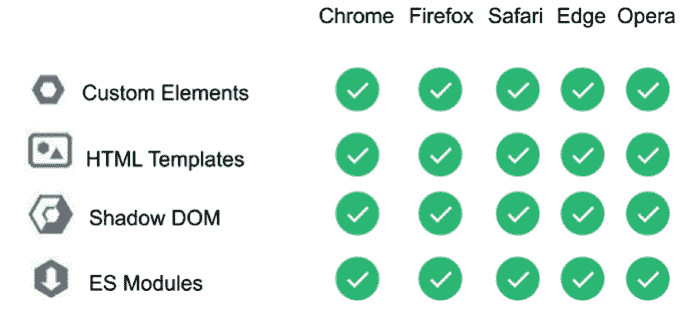

图 1-1. 支持 Web Components 主要规范的主要浏览器

## 入门

要开始使用 Web Components 构建应用，你必须了解并安装几种技术和工具。

## cmder（仅限 Windows）

cmder 是 Windows 的终端模拟器。默认情况下，Windows 操作系统自带一个终端（命令提示符），对开发并不实用。这就是为什么我们需要 cmder，它是一个模拟器，可让我们在终端中顺畅地运行命令。

- 要访问此模拟器，请前往 cmder.net 并下载最新版本。
- 将文件解压到你的 C:/ 位置。
- 进入 系统属性 ► 环境变量 并编辑 Path 变量，如图 1-2 所示。

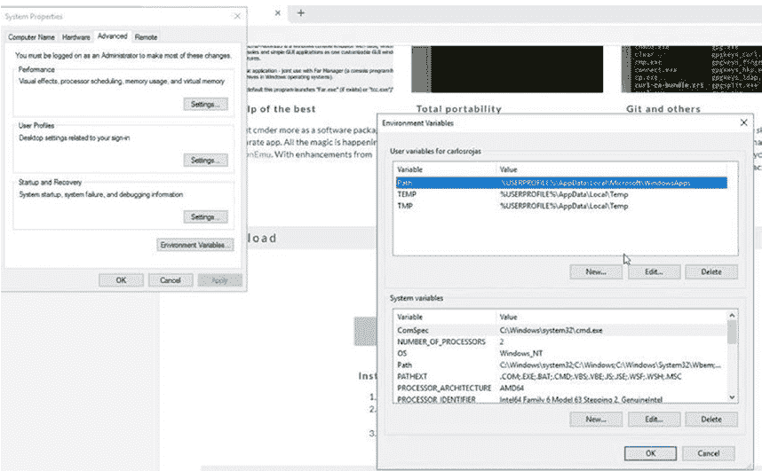

图 1-2. 系统属性中的环境变量首选项

将 cmder 位置添加到 Path 变量中，如图 1-3 所示。

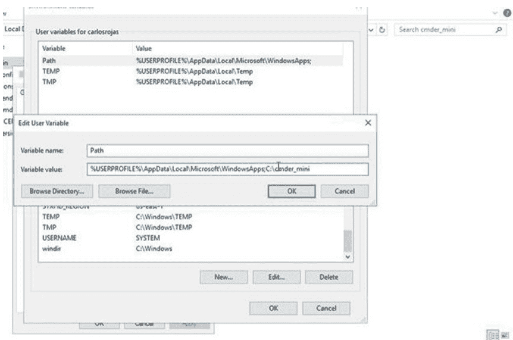

图 1-3. 系统属性中的 Path 变量首选项

从“选择命令提示符”运行 cmder，以测试环境变量（图 1-4）。

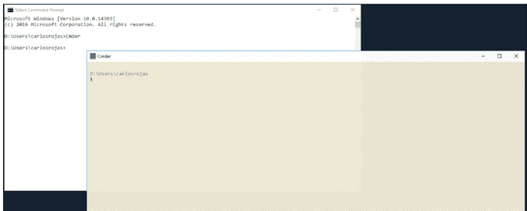

图 1-4. 从“选择命令提示符”运行 cmder

## Node.js

Node.js 是一个 JavaScript 运行时环境。大多数使用 JavaScript 的项目都使用 Node 来安装依赖项并创建脚本以自动化开发工作流。

你必须在你的机器上安装 Node。你可以从 https://nodejs.org/en/ 下载。

下载安装程序后，运行它并按照说明进行操作。

### 适用于 Mac

如果你使用的是 Mac，请按照图 1-5 所示的 Node.js 安装程序说明进行操作。

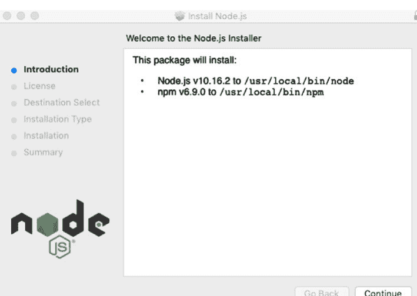

图 1-5. Node.js Mac 安装

然后打开你的终端并运行 $ node -v。如果一切正常，你将在终端中看到 Node 版本，如图 1-6 所示。

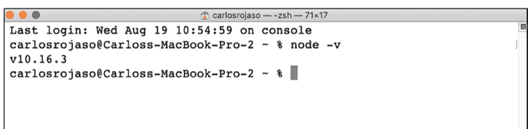

图 1-6. 终端中的 Node 版本

### 适用于 Windows

要为 Windows 安装 Node.js，请按照图 1-7 所示的安装程序说明进行操作。

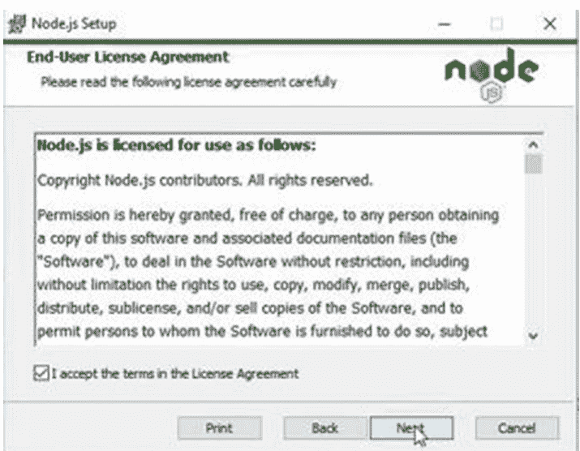

图 1-7. Node.js Windows 安装

然后，完成后，打开 cmder 并运行 $ node -v。

## npm

安装 Node.js 时，你也会安装 npm。npm 是 Node.js 的包管理器，允许用户安装依赖项并在其 JavaScript 项目中运行小型脚本。

### 适用于 Mac 和 Windows

通过在终端中运行 $ npm -v 检查 npm 版本。如果一切正常，你将在终端中看到 npm 版本，如图 1-8 所示。

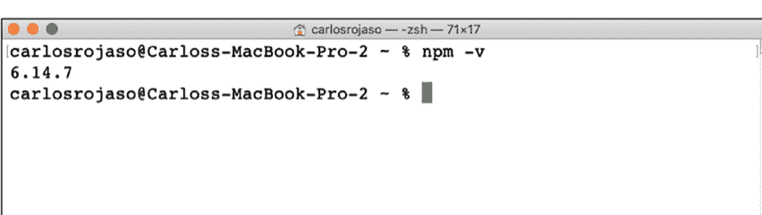

图 1-8. 终端中的 npm 版本

## Google Chrome

Chrome 是一款提供对 Web Components 优秀支持的 Web 浏览器，并包含 Chrome DevTools，这对开发者来说是一个方便的功能。你可以从 www.google.com/chrome/ 下载并安装 Chrome。

### 适用于 Mac 和 Windows

要为 Mac 和 Windows 安装 Chrome，运行安装程序并按照相关步骤操作。Chrome 安装成功后，打开它，你将看到欢迎屏幕（图 1-9）。

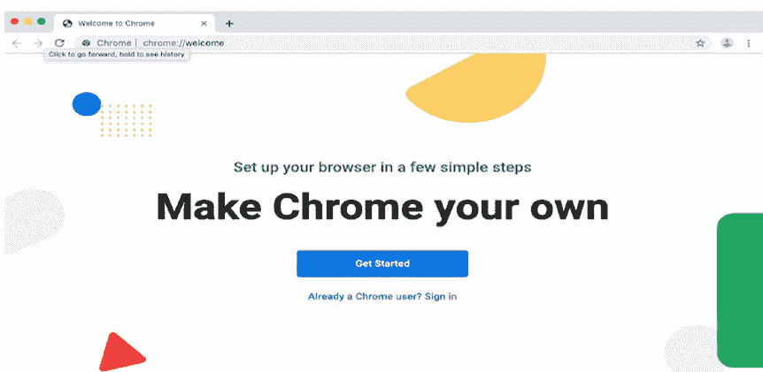

图 1-9. Google Chrome 安装

## Chrome DevTools

Chrome DevTools 是包含在 Google Chrome 浏览器中的一组 Web 开发者工具。此工具帮助你作为开发者诊断应用中的问题并使其更快。打开时，按 Command+Option+J（Mac）或 Control+Shift+J（Windows、Linux、Chrome OS），直接跳转到控制台面板（图 1-10）。

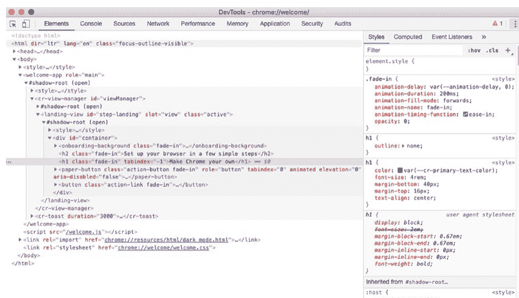

图 1-10. Google Chrome DevTools

## Lighthouse

Lighthouse 是一个用于改善网页质量的开源自动化工具。Lighthouse 可在 Chrome 的 DevTools 中找到。² 前往“审核”标签页访问它（图 1-11）。

²Google Developers，“Lighthouse”，https://developers.google.com/web/tools/lighthouse/，访问日期 2020 年 9 月 28 日。

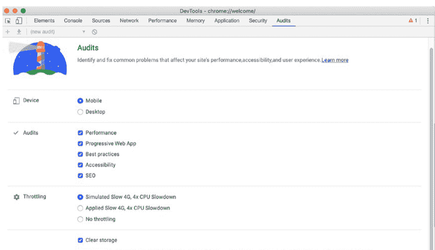

图 1-11. Google Chrome DevTools 审核标签页

## Vue

本书中的一些示例将使用 Vue.js 框架。Vue.js 是一个简单且令人耳目一新的 JavaScript 框架。Vue 主要面向视图层，但你可以添加所需的内容，并利用其生态系统中的所有工具构建强大的渐进式 Web 应用。

在你的项目中使用 Vue 非常容易。你只需要在 index.html 中添加以下内容，如清单 1-1 所示。

### 清单 1-1. 从 CDN 开发版本添加 Vue

```
<!-- development version, includes helpful console warnings -->
<script src="https://cdn.jsdelivr.net/npm/vue/dist/vue.js"></script>
```

或添加生产版本，如清单 1-2 所示。

### 清单 1-2. 从 CDN 生产版本添加 Vue

```
<!-- production version, optimized for size and speed -->
<script src="https://cdn.jsdelivr.net/npm/vue"></script>
```

## Vue CLI

Vue CLI 是一个用于快速 Vue.js 开发的完整系统。借助此工具，我们在处理 Webpack、EsLint 和其他工具时可以避免一些额外工作，专注于在应用中构建业务逻辑。你必须通过在终端中运行以下命令在系统中安装它：$npm install -g @vue/cli。

如果一切正常，你将在终端中看到 Vue CLI 版本，如图 1-12 所示。

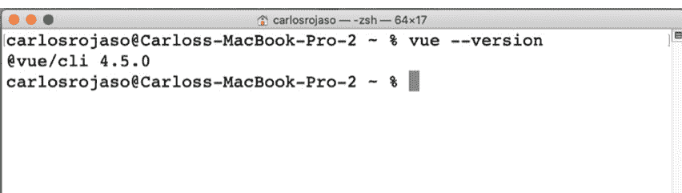

图 1-12. 终端中的 Vue CLI 版本

## Git

Git 是一个设计用于处理项目中不同更改的版本控制系统。我们将使用 Git 来操作我们的 Web 应用项目并处理各章中概述的后续步骤。你可以从 https://git-scm.com/downloads 下载并安装 Git。

### 适用于 Mac 和 Windows

要安装，运行安装程序并按照步骤操作。完成后，打开 cmd.exe/终端并运行 $ git --version。

如果一切正常，你将在终端中看到 Git 版本，如图 1-13 所示。


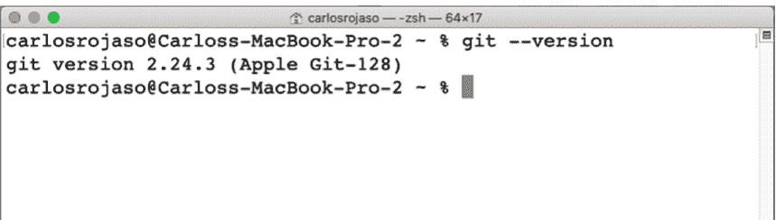

Figure 1-13. 终端中的 Git 版本

## Firebase

Firebase 是一种云服务，可帮助您自动化后端开发。

您可以将 Firebase 理解为一个无需后端知识即可保存数据、资源并对用户进行身份验证的地方。Firebase 非常稳健，并得到 Google 的支持。对于我们的项目，您必须通过 $npm install -g firebase-tools 在终端中安装 Firebase CLI。

此外，您必须在 https://firebase.google.com/ 注册并创建一个新项目。我创建了项目“apress-book-webcomponents”（图 1-14）。我将使用此项目来连接和发布本书中涵盖的所有功能。

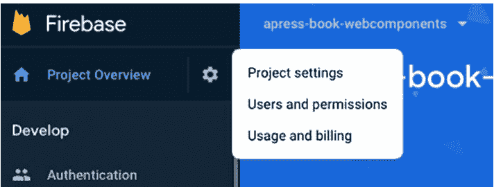

Figure 1-14. Firebase 网页控制台项目概览

在整本书中，我们将使用 Authentication、Database 和 Hosting 来增强我们的应用。

### Firebase Authentication

Firebase Authentication 是允许我们在应用中拥有身份验证系统的服务，用于处理安全和服务器相关问题。

您可以通过 Develop ▶ Authentication（图 1-15）从网页控制台（https://console.firebase.google.com）访问 Firebase Authentication。

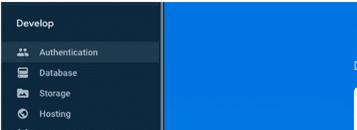

Figure 1-15. Firebase 网页控制台身份验证

### Firebase Database

Firebase Database 是一项服务，可让我们添加远程数据库来保存用户数据。此外，它是处理应用实时性的绝佳选择，这意味着我们可以从移动设备或桌面设备打开应用，并显示相同的信息。

您可以在网页控制台（https://console.firebase.google.com）中的 Develop ▶ Database（图 1-16）找到 Firebase Database。

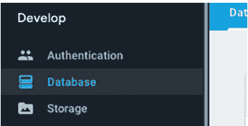

Figure 1-16. Firebase 网页控制台数据库

### Firebase Hosting

Firebase Hosting 是一项托管服务，可让您提供所有静态文件、连接您的域名并快速获取 SSL 证书。它也易于部署。

您可以通过 Develop ► Hosting（图 1-17）从网页控制台（https://console.firebase.google.com）找到 Firebase Hosting。

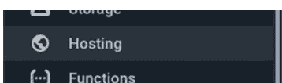

Figure 1-17. Firebase 网页控制台托管

## Visual Studio Code

Visual Studio Code 是一款免费的代码编辑器，可通过一套集成工具以及通过插件扩展的可能性来协助开发。您可以从 https://code.visualstudio.com/ 下载 Visual Studio Code。

### 适用于 Mac 和 Windows

要安装 Visual Studio Code，只需运行安装程序并按照步骤操作。然后从“应用程序/程序”列表中打开 Visual Studio Code。

有许多代码编辑器可用，但我们将在本书中使用 Visual Studio Code，主要是因为它免费、运行流畅，并且拥有庞大的插件生态系统。

## Developing Our First Web Component

现在我们将创建我们的第一个 Web 组件，一个我们称之为 vanilla-placeholder-component 的占位符。有了这个组件，您可以用红色背景和“placeholder”一词填充网页上的块，如图 1-18 所示。

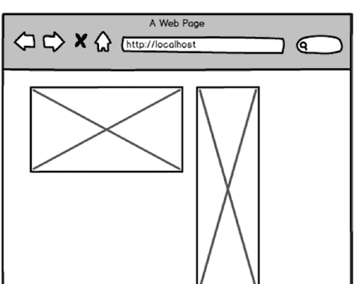

Figure 1-18. 占位符组件

在我们的 HTML 中使用此组件的基本用法如清单 1-3 所示。

Listing 1-3. 使用 vanilla-placeholder-component

```
<vanilla-placeholder-content></vanilla-placeholder-content>
```

我们可以添加一些属性，如清单 1-4 所示。

Listing 1-4. 使用带属性的 vanilla-placeholder-component

```
<vanilla-placeholder-content height="100px" width="50px">
</vanilla-placeholder-content>
```

我们的组件接受 height 和 width 属性来自定义大小，但如果我们不提供这些信息，我们将为两者默认分配 100px。

首先我们必须创建一个文件 index.html 并用基本结构填充它，如清单 1-5 所示。

Listing 1-5. index.html—基本结构

```
<!DOCTYPE html>
<html lang="en">
<head>
    <meta charset="UTF-8">
    <meta name="viewport" content="width=device-width, initial-scale=1.0">
    <title>Demo - vanilla-placeholder</title>
</head>
<body>
</body>
</html>
```

有了这段代码，我们就有一个基本 HTML 页面，body 中没有任何内容。因此，我们将在 </body> 之前使用 <script></script> 标签添加一些 JavaScript，并添加创建自定义组件的基本结构，如清单 1-6 所示。

Listing 1-6. 在 index.html 中添加自定义组件

```
<!DOCTYPE html>
<html lang="en">
<head>
    <meta charset="UTF-8">
    <meta name="viewport" content="width=device-width, initial-scale=1.0">
    <title>Demo - vanilla-placeholder</title>
</head>
<body>
<script>
class VanillaPlaceholderContent extends HTMLElement {
    constructor() {}
}
customElements.define('vanilla-placeholder-content',
VanillaPlaceholderContent);
</script>
</body>
</html>
```

通过此操作，我们将定义我们的标签 <vanilla-placeholder-content> 并创建一个继承自 HTMLElement（https://developer.mozilla.org/en-US/docs/Web/API/HTMLElement）的 JavaScript 类，从而让我们有机会定义我们的组件。

最后，我们将向 VanillaPlaceholderContent 类添加一些代码，如清单 1-7 所示。

Listing 1-7. 向 vanilla-placeholder-component 添加组件逻辑

```
<!DOCTYPE html>
<html lang="en">
<head>
    <meta charset="UTF-8">
    <meta name="viewport" content="width=device-width, initial-scale=1.0">
    <title>Demo - vanilla-placeholder</title>
</head>
<body>
<script>
class VanillaPlaceholderContent extends HTMLElement {
    constructor() {
        super();
        const placeholder = document.createElement('template');
        const height = this.getAttribute('height') || '100px';
        const width = this.getAttribute('width') || '100px';
        placeholder.innerHTML = VanillaPlaceholderContent.template
        (height, width);
        this.appendChild(document.importNode(placeholder.content, true));
    }
    static template (height, width) {
        return `
<style>
.placeholder {
    background-color: red;
    width: ${height};
    height: ${width};
}
</style>
<div class='placeholder'>Placeholder</div>`;
    }
}
customElements.define('vanilla-placeholder-content',
VanillaPlaceholderContent);
</script>
</body>
</html>
```

总体而言，我们使用 constructor() 来初始化组件，并通过 this.getAttribute('') 检查是否获取了一些属性，例如 height 和 width。接下来，我们使用 template() 方法创建元素和样式，最后使用 this.appendChild(document.importNode(placeholder.content, true)); 将其添加到我们的 UI 中。
我们可以在网页浏览器中看到结果（图 1-19）。

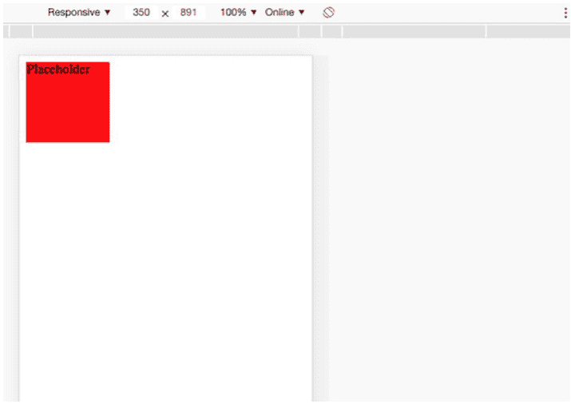

Figure 1-19. 网页浏览器中的占位符组件

如果现在有些东西难以理解也不用担心。在接下来的章节中，您将更多地了解此 API 以及它为何有用。

您可以通过 $git checkout chap-1 访问本书的源代码（https://github.com/carlosrojaso/apress-book-web-components）。

## Summary

在本章中，您学习了以下内容：

- Web Components 是什么以及主要浏览器中的当前支持情况
- 设计系统是什么以及我们在网络上可以找到的一些示例
- 组件驱动开发（CDD）是什么以及在软件应用中使用这种方法的好处

## CHAPTER 2

## Custom Elements

在本章中，我们将探索 Web Components 集合中的 Custom Elements 规范。您将学习自定义元素是什么、如何创建它们以及自定义元素的生命周期是什么。然后我们将为我们的集合构建一个新的 Web 组件。

### What Are Custom Elements?

Custom Elements 是一种 Web 开发者可用于创建新 HTML 标签的机制。我们可以通过使用 CustomElementRegistry 对象来创建标签。例如，我们可以定义一个 random-icon-placeholder，如清单 2-1 所示。

Listing 2-1. 使用 CustomElements 定义 Web 组件

```
```js
class randomIconPlaceholder extends HTMLElement {
    constructor(){...}
}
customElements.define('random-icon-placeholder', randomIconPlaceholder);
```
```

这里，我们使用的是小写、由连字符分隔的名称（kebab-case），这是为自定义标签分配名称所必需的。此外，我们使用的是继承自 HTMLElement 的类。HTMLElement 是 HTML 中的主要对象，文档对象模型（DOM）中的任何元素都将继承其属性。（您可以在 https://developer.mozilla.org/en-US/docs/Web/API/HTMLElement 上找到更多信息。）

有两种类型的自定义元素：自主型和定制型。自主自定义元素不继承自另一个标准 HTML 元素，例如 <p>、<a>、<br> 等。我们可以说前一个示例（清单 2-1）中的 <random-icon-placeholder> 是一个自主自定义元素。


自定义内置元素继承自另一个标准 HTML 元素。例如，我们可以定义一个扩展 <p> 元素的元素，如清单 2-2 所示。

### 清单 2-2. 定义自定义元素

```
class randomParagraphSizePlaceholder extends HTMLParagraphElement {
    constructor(){...}
}

customElements.define('random-paragraph-size-placeholder',
randomParagraphSizePlaceholder, {extends: 'p'});
```

现在我们可以在 HTML 文档中使用此元素，如清单 2-3 所示。

### 清单 2-3. 使用自定义元素

```
<p is="random-paragraph-size-placeholder">Some text</p>
```

你可以在 https://html.spec.whatwg.org/multipage/indices.html#element-interfaces 上找到可继承的接口列表。

## 自定义元素生命周期钩子

当我们定义自定义元素时，可以使用生命周期钩子在组件生命周期中的特定时刻运行代码。我们可以在自定义元素中使用四个主要时刻。

- constructor: 这在元素实例被创建或升级时触发。它用于初始化变量、添加事件监听器或创建 Shadow DOM。
- connectedCallback: 这在自定义元素每次被追加到文档中时触发。这将在节点每次被移动时发生，并且可能在元素内容完全解析之前发生。
- attributeChangedCallback (attrName, oldVal, newVal): 这在自定义元素的某个属性被添加、移除或更改时每次调用。要注意变化的观察属性由静态 get observedAttributes 方法指定。
- disconnectedCallback: 这在自定义元素每次从文档的 DOM 中断开连接时调用。

我们可以在图 2-1 中看到 Web Components 生命周期之前的所有方法。

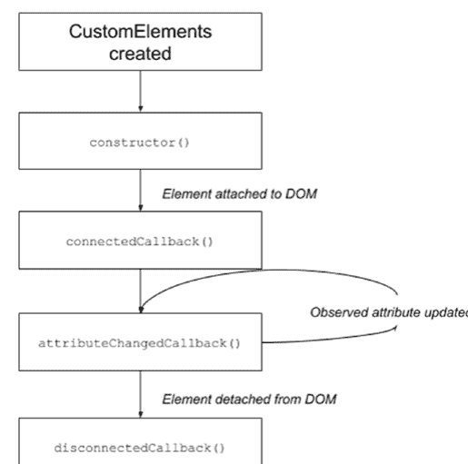

图 2-1. Web Components 生命周期

## 构建自定义元素

为了学习如何使用 customElements 对象和生命周期钩子，我们将创建 randomParagraphSizePlaceholder 组件。此简单组件生成介于 12 和 50px 之间的随机数并接收属性 'text'。

要在 HTML 文档中使用此组件，我们必须调用 <random-paragraph-size-placeholder>，如清单 2-4 所示。

### 清单 2-4. 使用 random-paragraph-size-placeholder

```
<random-paragraph-size-placeholder text="My Personal Text"></random-paragraph-size-placeholder>
```

接下来，我们必须为自主自定义元素创建一个通用结构，如清单 2-5 所示。

### 清单 2-5. 声明 random-paragraph-size-placeholder 组件

```
class RandomParagraphSizePlaceholder extends HTMLElement {
    constructor(){...}
}
customElements.define('random-paragraph-size-placeholder',
RandomParagraphSizePlaceholder);
```

有了这个，网络浏览器就知道我们想要注册一个新的 HTML 标签。
稍后，我们将把生命周期钩子添加为方法，并添加 console.log()，以便知道方法何时被触发。（参见清单 2-6。）

### 清单 2-6. 定义 random-paragraph-size-placeholder 组件

```
class RandomParagraphSizePlaceholder extends HTMLElement {
    constructor(){
        console.log(`constructor.`)
    }
    connectedCallback() {
        console.log(`connectedCallback hook`);
    }
    disconnectedCallback() {
        console.log(`disconnectedCallback hook`);
    }
    attributeChangedCallback(attrName, oldVal, newVal) {
        console.log(`attributeChangedCallback hook`);
    }
}
customElements.define('random-paragraph-size-placeholder',
RandomParagraphSizePlaceholder);
```

为了使 attributeChangedCallback() 方法正常工作，我们必须添加静态方法 observedAttributes() 并返回我们想要观察的属性。在这种情况下，我们只有 'text' 属性，如清单 2-7 所示。

### 清单 2-7. 在 attributeChangedCallback 中添加要观察的文本

```
static get observedAttributes() {
    return ['text'];
}
```

接下来，我们将在构造函数中添加基本逻辑，以生成随机数并将其发送到模板方法，如清单 2-8 所示。

### 清单 2-8. 添加初始化 random-paragraph-size-placeholder 的逻辑

```
constructor() {
    console.log(`constructor hook`);
    super();
    const placeholder = document.createElement('template');
    const myText = this.getAttribute('text') || 'Lorem Ipsum';
    const randomSize = Math.floor((Math.random() * (50 - 12 + 1)) + 12);
    placeholder.innerHTML = RandomParagraphSizePlaceholder.template
    (myText, randomSize);
    this.appendChild(document.importNode(placeholder.content, true));
}
```

总的来说，代码将如下所示清单 2-9。

### 清单 2-9. random-paragraph-size-placeholder 的最终代码

```
<!DOCTYPE html>
<html lang="en">
<head>
    <meta charset="UTF-8">
    <meta name="viewport" content="width=device-width, initial-scale=1.0">
    <title>Demo - random-paragraph-size-placeholder</title>
</head>
<body>
<div id="parent">
    <random-paragraph-size-placeholder text="My Personal Text">
    </random-paragraph-size-placeholder>
</div>
<button id="myButton" onclick="removeElement()">Remove Element</button>
<script>
class RandomParagraphSizePlaceholder extends HTMLElement {
    constructor() {
        console.log(`constructor hook`);
        super();
        const placeholder = document.createElement('template');
        const myText = this.getAttribute('text') || 'Lorem Ipsum';
        const randomSize = Math.floor((Math.random() * (50 - 12 + 1)) + 12);
        placeholder.innerHTML = RandomParagraphSizePlaceholder.
        template(myText, randomSize);
        this.appendChild(document.importNode(placeholder.content, true));
    }
    static get observedAttributes() {
        return ['text'];
    }
    set text(val) {
        if (val) {
            this.setAttribute(`text`, val);
        } else {
            this.setAttribute(`text`, ``);
        }
    }
    get text() {
        return this.getAttribute('text');
    }
    connectedCallback() {
        console.log(`connectedCallback hook`);
    }
    disconnectedCallback() {
        console.log(`disconnectedCallback hook`);
    }
    attributeChangedCallback(attrName, oldVal, newVal) {
        console.log(`attributeChangedCallback hook`);
        console.log(`attrName`, attrName);
        console.log(`oldVal`, oldVal);
        console.log(`newVal`, newVal);
    }
    static template (myText, randomSize) {
        return `
    <div style="font-size:${randomSize}px">${myText}</div>`;
    }
}
customElements.define('random-paragraph-size-placeholder',
RandomParagraphSizePlaceholder);

const element = document.querySelector('random-paragraph-size-placeholder');

function removeElement() {
    const parentElement = document.getElementById('parent')
    parentElement.removeChild(element);
    const myButton = document.getElementById('myButton');
    myButton.disabled = true;
}
</script>
</body>
</html>
```

你还会注意到我添加了一个额外的函数 removeElement，以查看当组件从 DOM 中移除时 disconnectedCallback() 如何被触发。你可以访问本书的代码（https://github.com/carlosrojaso/apress-book-web-components）在 git checkout chap-2。

## 摘要

在本章中，你学习了以下内容：

- CustomElementRegistry 对象是什么以及如何使用它
- 自定义元素的两种主要类型是什么
- 生命周期钩子是什么以及何时触发
