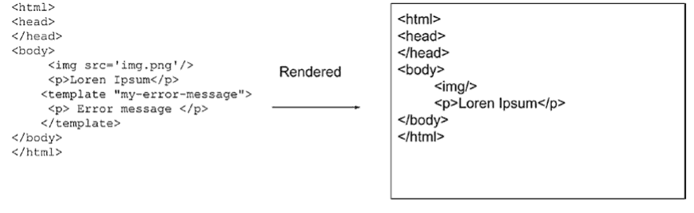
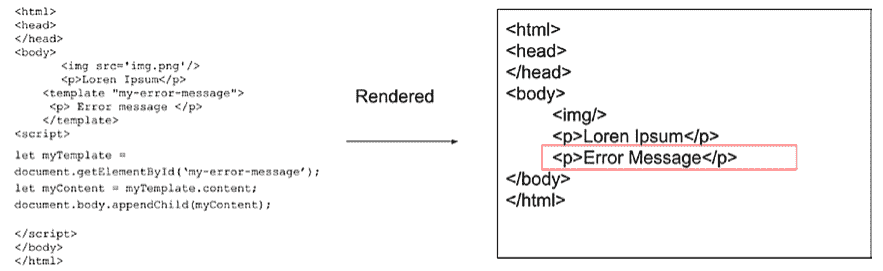
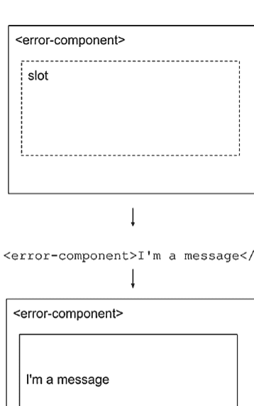
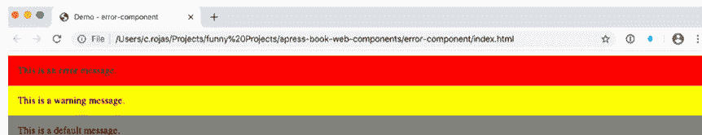

## 第 3 章

## HTML 模板

在本章中，我们将研究 HTML Template，这是 Web Components 规范集中的另一个规范。你将学习什么是 HTML 模板以及如何在 Web 组件中使用 HTML 模板。然后我们将为我们的集合构建一个新的 Web 组件。

### 什么是 HTML 模板？

HTML Template 规范定义了 <template> 元素，用于创建标记片段，以便在运行时稍后激活之前在自定义元素中未使用。这些片段可以被克隆并由脚本插入到 HTML 中。

<template> 内部的内容具有以下属性：

- 内容在被激活之前不会渲染。<template> 内部的标记是隐藏的且不渲染。
- 内容不会产生副作用。脚本、图像和媒体标签在激活之前不会运行。
- 内容不会被视为 Document Object Model（DOM）的一部分。使用 getElementById() 或 querySelector() 不会返回模板的子节点。

使用 <template> 的基本方式在清单 3-1 中说明。

### 清单 3-1. 使用 <template> 的基本示例

```
<template id="my-error-message">
    <p>
        Some error messages.
    </p>
</template>
```


我的段落对 DOM 是隐藏的，如图 3-1 所示。



### 图 3-1. 带模板的网页中的隐藏段落

如果我想显示我的内容，必须用代码激活它，如代码清单 3-2 所示。

### 代码清单 3-2. 在 <template> 中激活内容

```
let myTemplate = document.getElementById('my-error-message');
let myContent = myTemplate.content;
document.body.appendChild(myContent);
```

这样，我们就可以在文档中激活内容，如图 3-2 所示。



### 图 3-2. 在网页中激活模板

## 插槽

除了 `<template>` 之外，我们还可以在内容中使用 `<slot>`。插槽允许你在模板中定义占位符，如图 3-3 所示。结合其他 Web Components 规范，插槽在元素内部插入标记时非常有用。

使用 `<slot>` 的基本方式在代码清单 3-3 中概述。

### 代码清单 3-3. 使用 <slot>

```
<p>
    <slot>This is a default message</slot>
</p>
```



### 图 3-3. 在 error-component 中用消息填充插槽

## 使用 <template> 构建 Web 组件

现在我们将创建一个组件来处理应用中的错误和警告消息。使用此组件，你可以发送一种错误或警告消息，以及在 <error-component></error-component> 之间想要显示的消息。如果发送的是错误消息，你将看到消息显示在红色背景上。警告消息将显示在黄色背景上。

首先，我们将创建组件的基本结构，如代码清单 3-4 所示。

### 代码清单 3-4. error-component 的基本结构

```
<!DOCTYPE html>
<html lang="en">
<head>
    <meta charset="UTF-8">
    <meta name="viewport" content="width=device-width, initial-scale=1.0">
    <title>Demo - error-component</title>
</head>
<body>
<script>
class ErrorComponent extends HTMLElement {
    constructor() {
        super();
    }
}
customElements.define('error-component', ErrorComponent);
</script>
</body>
</html>
```

现在我们将创建静态方法 template()，用它来生成我们的标记，如代码清单 3-5 所示。

### 代码清单 3-5. 添加 template() 方法

```
<!DOCTYPE html>
<html lang="en">
<head>
    <meta charset="UTF-8">
    <meta name="viewport" content="width=device-width, initial-scale=1.0">
    <title>Demo - error-component</title>
</head>
<body>
<script>
class ErrorComponent extends HTMLElement {
    constructor() {
        super();
    }

    static template () {
        return `
<template class="warning-type">
    <style>
        .warning {
            background-color: yellow;
            padding: 15px;
            color: black;
        }
    </style>
    <div class="warning">
        <slot>Error component</slot>
    </div>
</template>
<template class="error-type">
    <style>
        .error {
            background-color: red;
            padding: 15px;
            color: black;
        }
    </style>
    <div class="error">
        <slot>Error component</slot>
    </div>
</template>
<template class="none-type">
    <style>
    .none {
        background-color: gray;
        padding: 15px;
        color: black;
    }
    </style>
    <div class="none">
        <slot>Error component</slot>
    </div>
</template>
    `;
}
}
customElements.define('error-component', ErrorComponent);
</script>
</body>
</html>
```

在我们的标记中，我们有三个 <template> 块——每个可接收的消息类型各一个：error、warning 和 none。此外，我们在每个块中都添加了 <slot>，它将接收我们在标签之间传递的值，如代码清单 3-6 所示。

### 代码清单 3-6. 使用插槽传递错误消息

```
<error-component>Value that the slot going to take</error-component>
```

最后，我们将使用生命周期钩子 connectedCallback() 来处理选择使用哪个模板的逻辑，如代码清单 3-7 所示。

### 代码清单 3-7. 在 connectedCallback() 中初始化属性

```
<!DOCTYPE html>
<html lang="en">
<head>
    <meta charset="UTF-8">
    <meta name="viewport" content="width=device-width, initial-scale=1.0">
    <title>Demo - error-component</title>
</head>
<body>
<script>
class ErrorComponent extends HTMLElement {
    constructor() {
        super();
    }

    connectedCallback() {
        this.root = this.attachShadow({mode: 'open'});
        this.templates = document.createElement('div');
        this.container = document.createElement('div');
        this.root.appendChild(this.templates);
        this.root.appendChild(this.container);
        this.templates.innerHTML = ErrorComponent.template();
        const kind = this.getAttribute(`kind`) || `none`;

        const template = this.templates.querySelector(`template.${kind}-type`);
        if (template) {
            const clone = template.content.cloneNode(true);
            this.container.innerHTML = '';
            this.container.appendChild(clone);
        }
    }

    static template () {
        return `
    <template class="warning-type">
        <style>
            .warning {
                background-color: yellow;
                padding: 15px;
                color: black;
            }
        </style>
        <div class="warning">
            <slot>Error component</slot>
        </div>
    </template>
    <template class="error-type">
        <style>
            .error {
                background-color: red;
                padding: 15px;
                color: black;
            }
        </style>
        <div class="error">
            <slot>Error component</slot>
        </div>
    </template>
    <template class="none-type">
        <style>
            .none {
                background-color: gray;
                padding: 15px;
                color: black;
            }
        </style>
        <div class="none">
            <slot>Error component</slot>
        </div>
    </template>
`;
}
}
customElements.define('error-component', ErrorComponent);
</script>
</body>
</html>
```

在这里，我们使用 'this' 在组件中进行引用，并使用方法 connectedCallback() 来初始化这些属性。

我们也在使用 Shadow DOM 'this.attachShadow({mode: 'open'});'。Shadow DOM 是下一章的主题，但你可以把这里的理解为专属于我们组件的受保护 DOM 树。

在此逻辑中，我们获取 'kind' 属性并渲染正确的 <template>，无论是 error、warning 还是 none。你可以在图 3-4 中看到结果。



### 图 3-4. 在 Chrome 上使用错误组件

你可以从仓库 (https://github.com/carlosrojaso/apress-book-web-components) 访问相关代码，执行 $git checkout chap-3。

## 摘要

本章你学习了以下内容：

- <template> 是什么以及如何在我们的 Web 组件中使用它
- <slot> 是什么以及如何在我们的 Web 组件中使用它
- 如何创建 Web 组件来处理错误和警告
