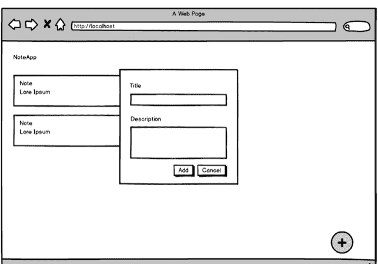
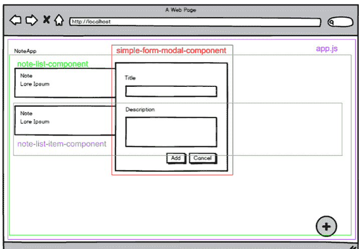
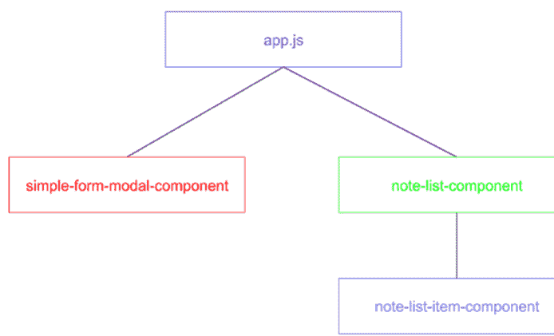
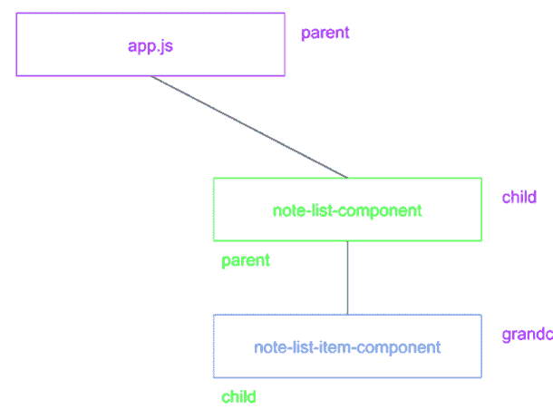
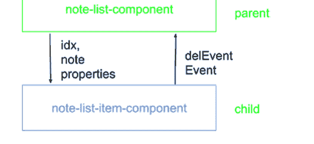
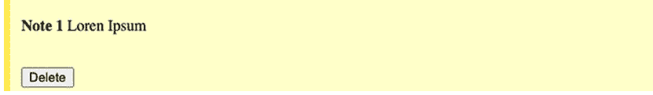
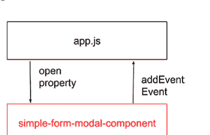
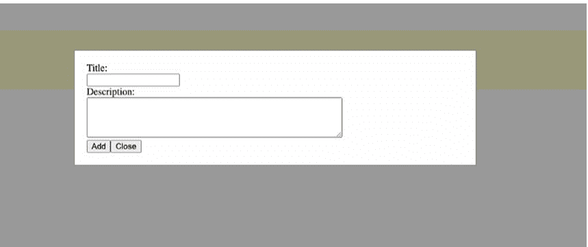
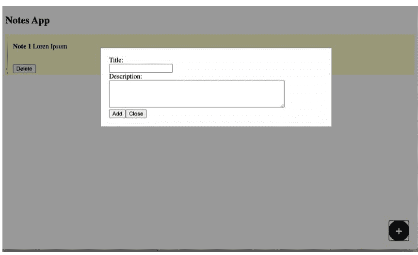

## 第 6 章
## 组件架构

在本章中，你将学习如何设计组件并使它们在 Web 应用中协同工作。我们将把 Web 应用连接到应用程序编程接口（API）并为我们的组件定义数据流。

### 我们的 NoteApp 应用

我们将创建一个简单的笔记应用，允许用户做笔记，如图 6-1 所示。当用户点击按钮时，将使用模态框和包含“Title”和“Description”的表单创建新笔记，在用户添加信息后。我们必须将此信息添加到 Notes 列表中，该列表显示用户过去创建的所有笔记并从该列表中删除笔记。



### 图 6-1. NoteApp 模型


## 第 6 章：组件架构

现在我们可以拿这个初始的 mock-up，思考如何将元素拆分为小的片段，使我们的开发更轻松，并更好地面向未来可用的组件。

在图 6-2 中，你可以看到我们有三个主要组件（`simple-form-modal-component`、`note-list-component` 和 `note-list-item-component`），我们可以在 `app.js` 的逻辑中使用它们，以实现拥有笔记列表、删除笔记的能力以及允许添加新笔记的目标。



图 6-2. 在我们的应用中识别组件

在定义了组件之后，我们可以思考组件的层级结构（如图 6-3 所示），以了解它们之间的关系。



图 6-3. 在我们的应用中识别组件的层级结构

我们可以看到主要元素是 `app.js`。我们将向其添加两个兄弟组件，`simple-form-modal-component` 和 `note-list-component`，并且在 `note-list-component` 内部，我们将拥有多个作为 `note-list-component` 子元素的 `note-list-item-component` 元素。清楚地理解这种关系将有助于我们在下一步中需要做出的其他架构决策。

### 组件间通信

在处理组件时，通常我们需要一种在父组件和子组件之间发送和接收数据的方式（如图 6-4 所示），以更新或发送通知，通知用户或其他组件在应用业务逻辑中的某个时刻所做的更改。为此，我们使用属性获取数据，使用事件向其他组件发送数据。



图 6-4. 识别组件间的通信

在图 6-5 中，你可以看到我们将使用 idx 和 note 属性从 note-list-component 传递数据，并使用 delEvent 事件接收数据。



图 6-5. 设计 note-list-component 与 note-list-item-component 之间的通信机制

这意味着在我们的 NoteListComponent 中，我们将创建所需的 <note-list-item-component> 元素并传递一个 note 对象和一个 idx 数字，如列表 6-1 所示。

### 列表 6-1. 定义 NoteListComponent

```
class NoteListComponent extends HTMLElement {
    constructor() {
    }

    render() {
        return `
            <note-list-item-component note='${JSON.stringify(note)}'
            idx='${idx}'></note-list-item-component> ;
    }
}
customElements.define('note-list-component', NoteListComponent);
```

我们将使用 JSON.stringify() 正确传递 note 对象，并使用 JSON.parse() 在子组件中接收该数据。你可以在 https://developer.mozilla.org/en-US/docs/Web/JavaScript/Reference/Global_Objects/JSON/stringify 和 https://developer.mozilla.org/en-US/docs/Web/JavaScript/Reference/Global_Objects/JSON/parse 了解更多关于这些方法的信息。

现在，在我们的 NoteListItemComponent 中，我们将创建一个自定义事件，使 NoteListComponent 可以监听该事件，并知道用户何时想要从列表中删除一个笔记，如列表 6-2 所示。

### 列表 6-2. 在 NoteListItemComponent 中添加自定义事件

```
class NoteListItemComponent extends HTMLElement {
    constructor() {
    }

    handleDelete() {
    this.dispatchEvent(new CustomEvent('delEvent', {bubbles: true,
    detail: {idx: this.idx}}));
    }
}
customElements.define('note-list-item-component', NoteListItemComponent);
```

在这里，我们创建了一个 handleDelete() 方法，它使用 CustomEvent() 创建事件，并在 detail 中发送我们需要的数据。这样，父组件就会知道需要从列表中删除哪一项。你可以在 https://developer.mozilla.org/en-US/docs/Web/API/CustomEvent/CustomEvent 了解更多关于 CustomEvent 的信息。

通常，使用属性和事件，我们可以在中小规模的大多数场景中处理组件间的通信。尽管如此，如果你的应用更复杂且组件间交互复杂，你将需要一个事件总线，你可以在 www.npmjs.com/package/js-event-bus 找到它，或使用 Redux 等模式，你可以在 https://github.com/reduxjs/redux 找到它。

### NoteListComponent

在上一节中，你学习了如何使我们的 Web 组件通信。现在我们将构建这些组件。首先，更自然地处理笔记的方式是接收一个笔记数组并为每个元素创建一个项目。然后，我们将获取 notes 属性并使用 JSON.parse() 方法将其转换为对象。我们使用 _notes，以避免与组件中的 setter 冲突，并在每次更新时重新渲染所有笔记（见列表 6-3）。

*列表 6-3. NoteListComponent 中的 getter 和 setter*

```js
class NoteListComponent extends HTMLElement {
  constructor() {
    super();

    this._notes = JSON.parse(this.getAttribute('notes')) || [];
    this.root = this.attachShadow({mode: 'open'});
    this.root.innerHTML = this.render();
  }

  render() {
    let noteElements = '';
    this._notes.map(
    (note, idx) => {
      noteElements += `
<note-list-item-component note='${JSON.stringify(note)}'
    idx='${idx}'></note-list-item-component>`;
}
);
return `
    ${noteElements}`;
}

get notes(){
    return this._notes;
}

set notes(newValue) {
    this._notes = newValue;
    this.root.innerHTML = this.render();
}
}
customElements.define('note-list-component', NoteListComponent);
```

此外，我们在 render 方法中使用 map()，以遍历 notes 对象并创建我们需要的每个项目，并使用项目列表更新 Shadow DOM。请记住，每次需要从列表中删除一个项目时，我们都会接收到一个 delEvent 事件。因此，我们必须在此处处理此行为，为该事件添加监听器并从列表中删除元素，如列表 6-4 所示。

### 列表 6-4. 在 NoteListComponent 中添加监听器

```
class NoteListComponent extends HTMLElement {
    constructor() {
        super();
        this._notes = JSON.parse(this.getAttribute('notes')) || [];
        this.root = this.attachShadow({mode: 'open'});
        this.root.innerHTML = this.render();
        this.handleDelEvent = this.handleDelEvent.bind(this);
    }

connectedCallback() {
    this.root.addEventListener('delEvent', this.handleDelEvent);
}

disconnectedCallback () {
    this.root.removeEventListener('delEvent', this.handleDelEvent);
}

handleDelEvent(e) {
    this._notes.splice(e.detail.idx, 1);
    this.root.innerHTML = this.render();
}

render() {
    let noteElements = '';
    this._notes.map(
    (note, idx) => {
        noteElements += `
        <note-list-item-component note='${JSON.stringify(note)}'
        idx='${idx}'></note-list-item-component>`;
    }
    );
    return `
        ${noteElements}`;
}

get notes(){
    return this._notes;
}

set notes(newValue) {
    this._notes = newValue;
    this.root.innerHTML = this.render();
}
}
customElements.define('note-list-component', NoteListComponent);
```

在这里，我们在 connectedCallback() 中添加监听器，并在 disconnectedCallback() 中移除监听器，以避免组件被移除时出现不必要的监听器。此外，我们在构造函数中使用 bind()，以在构造函数中指示我们正在定义 handleDelEvent()，并确保在我们想要在组件中传递该方法时它不会变为 undefined。经过这些修改后，我们的组件就完成了。

### NoteListItemComponent

现在 NoteListComponent 创建一个 <note-list-item-component> 元素列表，并传递一个 note 对象和一个相当于笔记数组中位置的 idx 数字。我们将在 NoteListItemComponent 中添加 getter 和 setter，并在 constructor() 中初始化这些属性。请记住，note 是一个对象，并且使用 JSON.parse()，我们将把这些数据转换为对象（见列表 6-5）。

### 列表 6-5. 在 NoteListItemComponent 中添加 Getter 和 Setter

```
class NoteListItemComponent extends HTMLElement {
    constructor() {
        super();

        this._note = JSON.parse(this.getAttribute('note')) || {};
        this.idx = this.getAttribute('idx') || -1;
        this.root = this.attachShadow({mode: 'open'});
    }

    get note() {
        return this._note;
    }

    set note(newValue) {
        this._note = newValue;
    }

    get idx() {
        return this._idx;
    }
}
```


```
set idx(newValue) {
    this._idx = newValue;
}

handleDelete() {
    this.dispatchEvent(new CustomEvent('delEvent', {bubbles: true, detail:
    {idx: this.idx}}));
}
customElements.define('note-list-item-component', NoteListItemComponent);
```

我们将为此组件添加模板和样式，以获得漂亮的笔记项（参见列表 6-6）。

## 列表 6-6. 在 NoteListItemComponent 中添加模板和样式

```
class NoteListItemComponent extends HTMLElement {

    constructor() {
        super();

        this._note = JSON.parse(this.getAttribute('note')) || {};
        this.idx = this.getAttribute('idx') || -1;
        this.root = this.attachShadow({mode: 'open'});
        this.root.innerHTML = this.getTemplate();
    }

    get note() {
        return this._note;
    }

    set note(newValue) {
        this._note = newValue;
    }

    get idx() {
        return this._idx;
    }

set idx(newValue) {
    this._idx = newValue;
}

handleDelete() {
    this.dispatchEvent(new CustomEvent('delEvent', {bubbles: true, detail:
    {idx: this.idx}}));
}

getStyle() {
    return `
<style>
.note {
    background-color: #ffffcc;
    border-left: 6px solid #ffeb3b;
}
div {
    margin: 5px 0px 5px;
    padding: 4px 12px;
}
</style>
`;
}

getTemplate() {
    return`
${this.getStyle()}
<div class="note">
    <p><strong>${this._note.title}</strong> ${this._note.description}</p>
    <br/>
    <button type="button" id="deleteButton">Delete</button>
</div>`;
}
}
customElements.define('note-list-item-component', NoteListItemComponent);
```

通过这些增强，我们的 <note-list-item-component> 将看起来像图 6-6。

## 图 6-6. Google Chrome 中的 note-list-item 组件



最后，我们将为 Delete 按钮添加一个事件监听器，该监听器会触发 delEvent 事件。与 NoteListComponent 一样，我们必须在 connectedCallback() 中添加监听器，并在 disconnectedCallback() 中将其移除，如列表 6-7 所示。

## 列表 6-7. 在 NoteListItemComponent 中添加事件监听器

```
class NoteListItemComponent extends HTMLElement {
    constructor() {
        super();

        this._note = JSON.parse(this.getAttribute('note')) || {};
        this.idx = this.getAttribute('idx') || -1;
        this.root = this.attachShadow({mode: 'open'});
        this.root.innerHTML = this.getTemplate();
        this.handleDelete = this.handleDelete.bind(this);
    }

    connectedCallback() {
        this.delBtn.addEventListener('click', this.handleDelete);
    }

    disconnectedCallback () {
        this.delBtn.removeEventListener('click', this.handleDelete);
    }

    get note() {
        return this._note;
    }

    set note(newValue) {
        this._note = newValue;
    }

get idx() {
    return this._idx;
}

set idx(newValue) {
    this._idx = newValue;
}

handleDelete() {
    this.dispatchEvent(new CustomEvent('delEvent', {bubbles: true,
    detail: {idx: this.idx}}));
}

getStyle() {
    return `
<style>
.note {
    background-color: #ffffcc;
    border-left: 6px solid #ffeb3b;
}
div {
    margin: 5px 0px 5px;
    padding: 4px 12px;
}
</style>
`;
}

getTemplate() {
    return`
${this.getStyle()}
<div class="note">
    <p><strong>${this._note.title}</strong> ${this._note.description}
    </p><br/>
    <button type="button" id="deleteButton">Delete</button>
</div>`;
}
}
customElements.define('note-list-item-component', NoteListItemComponent);
```

现在，当用户点击 Delete 按钮时，NoteListItemComponent 将发送自定义事件，而 NoteListComponent 将知道必须从列表中删除的项目。

## SimpleFormModalComponent

NoteListComponent 和 NoteListItemComponent 就绪后，我们现在需要在应用中轻松添加新笔记的方式。因此，我们将创建 SimpleFormModalComponent，这是一个表单，允许用户输入标题和描述。该组件将与 app.js 通信，我们将使用 open 属性来知道何时显示或隐藏模态框以及用户何时在表单中输入数据。我们将通过自定义事件 addEvent 传递该数据，如图 6-7 所示。



图 6-7. simple-form-modal-component 与 app.js 之间通信的识别

我们将开始定义我们的组件，添加 setter 和 getter，如列表 6-8 所示。

## 列表 6-8. 在 SimpleFormModalComponent 中添加 Getter 和 Setter

```
class SimpleFormModalComponent extends HTMLElement {
    constructor() {
        super();

        this.root = this.attachShadow({mode: 'open'});
        this.container = document.createElement('div');

this.container.innerHTML = this.getTemplate();
this.root.appendChild(this.container.cloneNode(true));

this._open = this.getAttribute('open') || false;
}
get open() {
    return this._open;
}

set open(newValue) {
    this._open = newValue;
}
}
customElements.define('simple-form-modal-component',
SimpleFormModalComponent);
```

现在我们将添加显示和隐藏组件所需的模板和样式（参见列表 6-9）。

## 列表 6-9. 在 SimpleFormModalComponent 中添加模板和样式

```
class SimpleFormModalComponent extends HTMLElement {

    constructor() {
        super();
        this.root = this.attachShadow({mode: 'open'});
        this.container = document.createElement('div');
        this.container.innerHTML = this.getTemplate();
        this.root.appendChild(this.container.cloneNode(true));

        this._open = this.getAttribute('open') || false;
    }
    get open() {
        return this._open;
    }
    set open(newValue) {
        this._open = newValue;
    }
    getTemplate() {
return `
${this.getStyle()}
<div id="myModal" class="modal">
    <div class="modal-content">
        <form id="myForm">
            <label for="ftitle">Title:</label><br>
            <input type="text" id="ftitle" name="ftitle"><br>
            <label for="fdesc">Description:</label><br>
            <textarea id="fdesc" name="fdesc" rows="4" cols="50">
            </textarea><br/>
            <button type="button" id="addBtn">Add</button><button type=
            "button" id="closeBtn">Close</button>
        </form>
    </div>
</div>`;

}

getStyle() {
    return `
<style>
.modal {
    display: none;
    position: fixed;
    z-index: 1;
    padding-top: 100px;
    left: 0;
    top: 0;
    width: 100%;
    height: 100%;
    overflow: auto;
    background-color: rgb(0,0,0);
    background-color: rgba(0,0,0,0.4);
}
.modal-content {
    background-color: #fefefe;
    margin: auto;
padding: 20px;
border: 1px solid #888;
width: 50%;
}
.close {
  color: #aaaaaa;
  float: right;
  font-size: 28px;
  font-weight: bold;
}
.close:hover,
.close:focus {
  color: #000;
  text-decoration: none;
  cursor: pointer;
}
</style>`;
}
}
customElements.define('simple-form-modal-component',
SimpleFormModalComponent);
```

通过此增强，我们将显示一个包含两个输入框和两个按钮的表单。modal 类将把元素置于所有内容之上，并在窗口中间以半透明灰色背景显示它。此外，由于默认的 display 为 "none"，这意味着我们将隐藏此元素，并在将该属性设置为 "block" 时使其可见。为了处理此行为，我们将创建 showModal() 方法，并在 open 属性的 setter 中触发它，如列表 6-10 所示。

## 列表 6-10. 在 SimpleFormModalComponent 中添加 showModal()

```
class SimpleFormModalComponent extends HTMLElement {
  constructor() {
    super();

    this.root = this.attachShadow({mode: 'open'});
    this.container = document.createElement('div');

this.container.innerHTML = this.getTemplate();
this.root.appendChild(this.container.cloneNode(true));

this._open = this.getAttribute('open') || false;
this.modal = this.root.getElementById("myModal");
}
get open() {
    return this._open;
}
set open(newValue) {
    this._open = newValue;
    this.showModal(this._open);
}
showModal(state) {
    if(state) {
        this.modal.style.display = "block";
    } else {
        this.modal.style.display = "none"
    }
}
getTemplate() {
    return `
${this.getStyle()}
<div id="myModal" class="modal">
    <div class="modal-content">
        <form id="myForm">
            <label for="ftitle">Title:</label><br>
            <input type="text" id="ftitle" name="ftitle"><br>
            <label for="fdesc">Description:</label><br>
            <textarea id="fdesc" name="fdesc" rows="4" cols="50">
            </textarea><br/>
            <button type="button" id="addBtn">Add</button><button
            type="button" id="closeBtn">Close</button>
        </form>
    </div>
</div>`;
}
```


```
getStyle() {
  return `
<style>
.modal {
  display: none;
  position: fixed;
  z-index: 1;
  padding-top: 100px;
  left: 0;
  top: 0;
  width: 100%;
  height: 100%;
  overflow: auto;
  background-color: rgb(0,0,0);
  background-color: rgba(0,0,0,0.4);
}
.modal-content {
  background-color: #fefefe;
  margin: auto;
  padding: 20px;
  border: 1px solid #888;
  width: 50%;
}
.close {
  color: #aaaaaa;
  float: right;
  font-size: 28px;
  font-weight: bold;
}
.close:hover,
.close:focus {
  color: #000;
  text-decoration: none;
  cursor: pointer;
}
</style>`;
}
}
customElements.define('simple-form-modal-component',
SimpleFormModalComponent);
```

最后，我们将为按钮创建事件，并在用户添加笔记时发送自定义事件（参见清单 6-11）。

## Listing 6-11. 在 SimpleFormModalComponent 中添加事件

```
class SimpleFormModalComponent extends HTMLElement {
    constructor() {
        super();

        this.root = this.attachShadow({mode: 'open'});
        this.container = document.createElement('div');
        this.container.innerHTML = this.getTemplate();
        this.root.appendChild(this.container.cloneNode(true));

        this._open = this.getAttribute('open') || false;

        this.modal = this.root.getElementById("myModal");
        this.addBtn = this.root.getElementById("addBtn");
        this.closeBtn = this.root.getElementById("closeBtn");

        this.handleAdd = this.handleAdd.bind(this);
        this.handleCancel = this.handleCancel.bind(this);
    }

    connectedCallback() {
        this.addBtn.addEventListener('click', this.handleAdd);
        this.closeBtn.addEventListener('click', this.handleCancel);
    }

disconnectedCallback () {
    this.addBtn.removeEventListener('click', this.handleAdd);
    this.closeBtn.removeEventListener('click', this.handleCancel);
}

get open() {
    return this._open;
}

set open(newValue) {
    this._open = newValue;
    this.showModal(this._open);
}

handleAdd() {
    const fTitle = this.root.getElementById('ftitle');
    const fDesc = this.root.getElementById('fdesc');
    this.dispatchEvent(new CustomEvent('addEvent', {detail: {title: fTitle.value, description: fDesc.value}}));

    fTitle.value = '';
    fDesc.value = '';
    this.open = false;
}

handleCancel() {
    this.open = false;
}

showModal(state) {
    if(state) {
        this.modal.style.display = "block";
    } else {
        this.modal.style.display = "none"
    }
}

getTemplate() {
    return `
    ${this.getStyle()}
    <div id="myModal" class="modal">
        <div class="modal-content">
            <form id="myForm">
                <label for="ftitle">Title:</label><br>
                <input type="text" id="ftitle" name="ftitle"><br>
                <label for="fdesc">Description:</label><br>
                <textarea id="fdesc" name="fdesc" rows="4" cols="50">
                </textarea><br/>
                <button type="button" id="addBtn">Add</button><button
                type="button" id="closeBtn">Close</button>
            </form>
        </div>
    </div>`;
}
getStyle() {
    return `
    <style>
        .modal {
            display: none;
            position: fixed;
            z-index: 1;
            padding-top: 100px;
            left: 0;
            top: 0;
            width: 100%;
            height: 100%;
            overflow: auto;
            background-color: rgb(0,0,0);
            background-color: rgba(0,0,0,0.4);
        }
    </style>

.modal-content {
  background-color: #fefefe;
  margin: auto;
  padding: 20px;
  border: 1px solid #888;
  width: 50%;
}
.close {
  color: #aaaaaa;
  float: right;
  font-size: 28px;
  font-weight: bold;
}
.close:hover,
.close:focus {
  color: #000;
  text-decoration: none;
  cursor: pointer;
}
</style>`;
}
}
customElements.define('simple-form-modal-component',
SimpleFormModalComponent);
```

这段代码与我们为 NoteListComponent 和 NoteListItemComponent 所做的代码类似。我们在 connectedCallback() 中添加监听器，在 disconnectedCallback() 中移除它，并在 handleAdd() 中发送自定义事件。现在我们有一个模态框（参见图 6-8）。



图 6-8. simple-form-modal-component 在 Google Chrome 中

## 添加 API

通常，当你在开发 Web 应用时，必须将应用连接到服务。我们将使用 API Rest 连接开放 API https://jsonplaceholder.typicode.com/。该 API 拥有可在实际应用中使用的所有 HTTP 方法（GET、POST、PUT、PATCH、DELETE）。

在我们应用的各个部分调用 API 方法都很常见。因此，我们很可能会在多个组件中重用这些方法。这就是为什么我们要构建一个包含调用的小模块，今后只需导入它并使用所需的函数即可（参见清单 6-12）。

## Listing 6-12. 创建 notes-data-api.js

```
const apiUrl= 'https://jsonplaceholder.typicode.com';
export const notesDataApi = {
    createTask(task) {
        return fetch(`${apiUrl}/posts/`, {
            method: 'POST',
            body: JSON.stringify(task),
            headers: {
                "Content-type": "application/json; charset=UTF-8"
            }
        });
    }
},
deleteTask(id) {
    return fetch(`${apiUrl}/posts/${id}`, {method: 'DELETE'});
},
getTasks(id) {
    return fetch(`${apiUrl}/users/${id}/posts`);
}
};
```

在此模块中，我们创建用于创建、获取和删除任务的函数。这些函数将使用 Mozilla（https://developer.mozilla.org/en-US/docs/Web/API/Fetch_API）向 API 发出 HTTP 请求并返回我们所需的数据。

现在我们已经拥有了应用所需的所有小组件，接下来将把它们全部整合起来。首先，我们将创建 index.html 并调用我们使用的所有组件和模块，如清单 6-13 所示。

## Listing 6-13. 创建 index.html

```
<!DOCTYPE html>
<html>
<head>
    <meta name="viewport" content="width=device-width, initial-scale=1">
    <script async src="./simple-form-modal-component/simple-form-modal-component.js"></script>
    <script async type="module" src="./note-list-component/note-list-component.js"></script>
    <script async src="./note-list-item-component/note-list-item-component.js"></script>
    <link rel="stylesheet" type="text/css" href="./style.css">
</head>
<body>
    <h2>Notes App</h2>
    <button class="fab" id="myBtn">+</button>
    <simple-form-modal-component></simple-form-modal-component>
    <note-list-component></note-list-component>
</body>
</html>
```

在 index.html 中，我们添加了一个按钮，当用户需要添加新笔记时显示模态框，并且我们将创建 app.js 为 index.html 提供少量逻辑来连接所有组件（参见清单 6-14）。

## Listing 6-14. 创建 app.js

```js
import { notesDataApi } from './utils/notes-data-api.js';
const formModal = document.querySelector('simple-form-modal-component');
const noteList = document.querySelector('note-list-component');

notesDataApi.getTasks(1)
  .then((res) => res.json())
  .then((items) => {
    const allNotes = items.map((item)=>({title: item.title, description:
    item.body}));
    noteList.notes = allNotes;
  });

formModal.addEventListener('addEvent', function(e) {
  let notes = noteList.notes;

  notes.push({"title": e.detail.title, "description": e.detail.
  description});
  noteList.notes = notes;
});

const myBtn = document.getElementById('myBtn');
myBtn.addEventListener('click', function() {
  formModal.open = !formModal.open;
});
```

这里，我们为在 index.html 中添加的按钮添加逻辑。该按钮将向 SimpleFormModalComponent 传递一个状态，以显示或隐藏模态框。我们为自定义事件 addEvent 添加监听器，以获取新笔记的数据并将其传递给 NoteListComponent。我们使用 note-data-api 模块获取 API 中所有的笔记，并将这些数据发送到 NoteListComponent，以默认填充示例笔记。最后，我们将添加一个样式文件，以改善 index.html 中按钮的外观，如清单 6-15 所示。


### 列表 6-15. 创建 style.css

```
.fab {
  width: 50px;
  height: 50px;
  background-color: black;
  border-radius: 50%;
  border: 1px solid black;
  transition: all 0.1s ease-in-out;

  font-size: 30px;
  color: white;
  text-align: center;
  line-height: 50px;

  position: fixed;
  right: 20px;
  bottom: 20px;
}

.fab:hover {
  box-shadow: 0 6px 14px 0 #666;
  transform: scale(1.05);
}
```

现在我们的 NoteApp 已完成，看起来像图 6-9。



*图 6-9. Google Chrome 中的 NoteApp*

你可以访问本书的源代码 (https://github.com/carlosrojaso/apress-book-web-components) 在 `$git checkout chap-6`。

## 摘要

在本章中，你学习了

- 如何在真实的 Web 应用中设计组件
- 如何让所有组件通过属性和自定义事件协同工作
- 如何将我们的应用连接到 API
