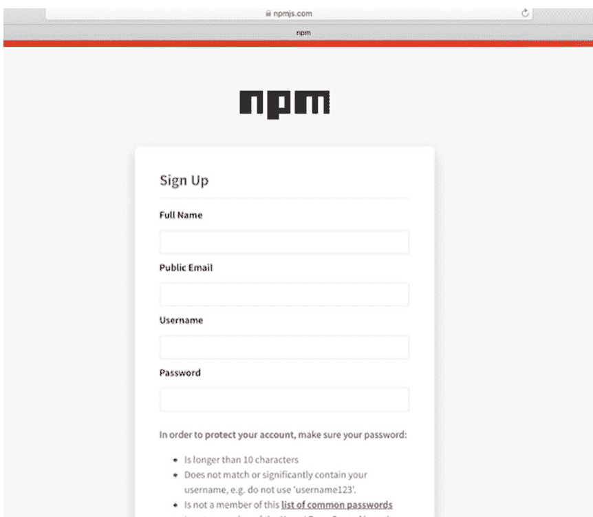
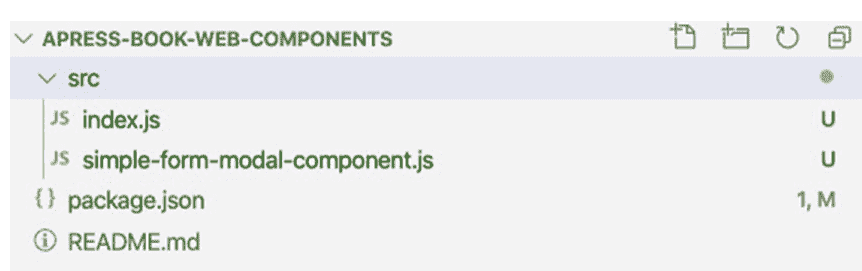
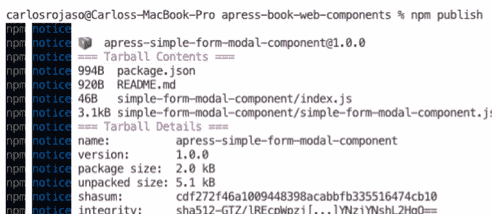
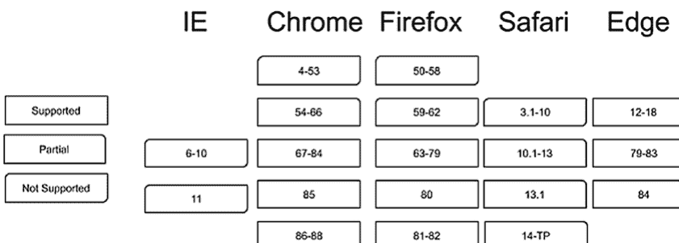
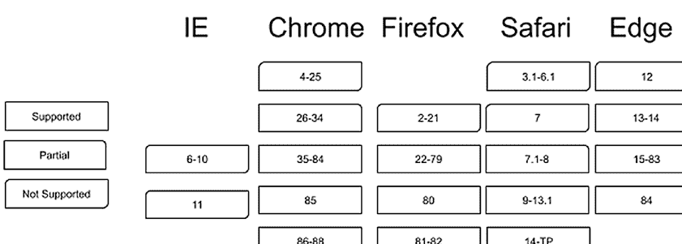
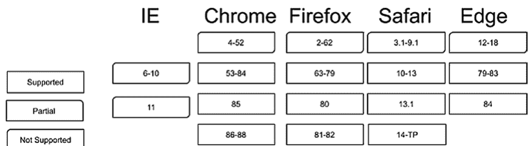
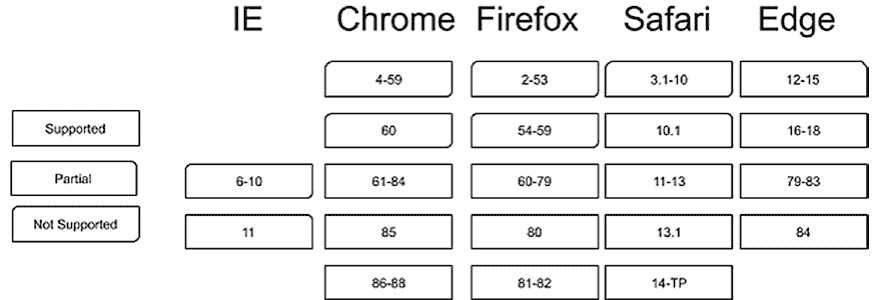
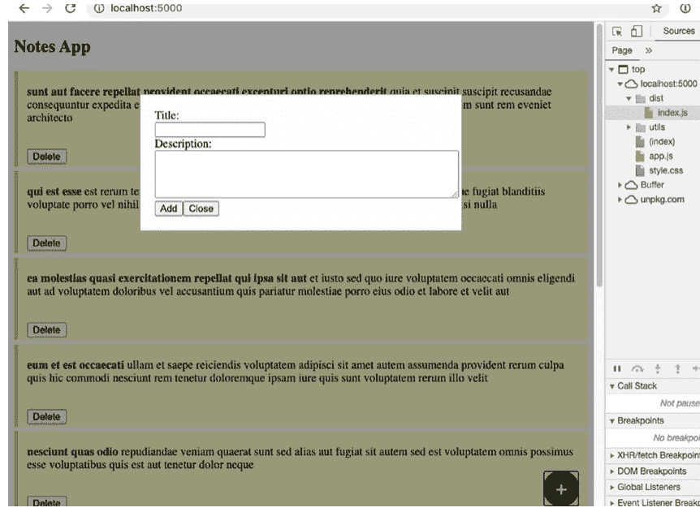

## 第 7 章

## 分发 Web 组件

在本章中，你将学习如何将我们的 Web 组件发布到 npm。你还将了解 Web Components API 提供的浏览器支持，如何添加 polyfill 以支持更多 Web 浏览器，以及如何添加 Webpack 和 Babel 来处理和准备我们的 Web 组件以供发布。

### 发布到 npm

在第 6 章中，我们创建了三个组件：`<simple-form-modal-component>`、`<note-list-component>` 和 `<note-list-item-component>`。现在我们将通过 www.npmjs.com 使这些组件可用。npm 是一个包仓库，我们可以用命令 `$npm install <package>` 轻松地将其添加到项目中。

首先，我们需要一个账户来发布包（参见图 7-1）。



图 7-1. 在 npmjs.com 创建用户账户

接下来，我们必须使用 $npm adduser 将我们的账户与终端连接起来（图 7-2）。

```
carlosrojaso@Carloss-MacBook-Pro apress-book-web-components % npm adduser
Username: carlosrojaso
Password:
Email: (this IS public) ing.carlosandresrojas@pm.me
Logged in as carlosrojaso on https://registry.npmjs.org/.
carlosrojaso@Carloss-MacBook-Pro apress-book-web-components %
```

图 7-2. 将我们的终端与 npm 连接

现在我们必须分离我们的组件并使它们成为模块，其结构如图所示 7-3。



### 图 7-3. 发布组件的结构

我们为组件创建一个 package.json 文件，如列表 7-1 所示。

### 列表 7-1. simple-form-modal-component 的 package.json

```
{
  "name": "apress-simple-form-modal-component",
  "version": "1.0.1",
  "description": "simple form modal component",
  "main": "src/index.js",
  "module": "src/index.js",
  "directories": {
    "src": "src"
  },
  "scripts": {
    "test": "echo \"Error: no test specified\" && exit 1"
  },
  "repository": {
    "type": "git",
    "url": "git+https://github.com/carlosrojaso/apress-book-web-components.git"
  },
  "author": "Carlos Rojas",
  "license": "MIT",
}
```

```
"bugs": {
    "url": "https://github.com/carlosrojaso/apress-book-web-components/issues"
},
"homepage": "https://github.com/carlosrojaso/apress-book-web-components#readme"
}
```

在这个 package.json 文件中，我们定义了组件在 npmjs.com 中的名称以及文件的结构。npm 包名称应该是唯一的。因此，你必须确保你在 package.json 中为 name 属性选择的名称在 npmjs.com 中尚未被占用。

现在我们将创建一个名为 src 的目录，在其中放置我们的代码源。然后，我们将把 simple-form-modal-component.js 移到那里并创建一个新的文件 index.js，如列表 7-2 所示。

### 列表 7-2. simple-form-modal-component 的 index.js

```
export * from './simple-form-modal-component';
```

这只是一行代码，我们用它导入 simple-form-modal-component.js 中的所有内容。因此，在我们的文件 simple-form-modal-component.js 中，我们必须添加 export 关键字，以使我们的组件作为模块可用，如列表 7-3 所示。

### 列表 7-3. 将 simple-form-modal-component 转换为模块

```
export class SimpleFormModalComponent extends HTMLElement {
...
}
customElements.define('simple-form-modal-component', SimpleFormModalComponent);
```

好的，现在我们的组件已准备就绪。下一步是运行

```
$npm publish
```

现在我们已发布了我们的组件（参见图 7-4）。



### 图 7-4. 发布 simple-form-modal-component

你可以访问本书的代码 (https://github.com/carlosrojaso/apress-book-web-components) 在 $git checkout chap-7-1。

这个过程对于 <note-list-component> 和 <note-list-item-component> 也是类似的。如果想查看修改内容，可以在 $git checkout chap-7-2 和 $git checkout chap-7-3 查看。

现在我们可以在项目中轻松使用我们的组件。目前，我们将使用服务 unpkg.com。unpkg 是 npm 包的 CDN，以便轻松插入我们的包，如列表 7-4 所示。

### 列表 7-4. simple-form-modal-component 的 package.json

```
<!DOCTYPE html>
<html>
<head>
<meta name="viewport" content="width=device-width, initial-scale=1">
<script async type="module" src="http://unpkg.com/apress-simple-form-modal-component@1.0.1/src/simple-form-modal-component.js"></script>
```

```
<script async type="module" src="http://unpkg.com/apress-book-web-components-note-list@1.0.1/src/note-list-component.js"></script>
<script async type="module" src="http://unpkg.com/apress-note-list-item-component@1.0.1/src/note-list-item-component.js"></script>

<script async type="module" src="./app.js"></script>

<link rel="stylesheet" type="text/css" href="./style.css">

</head>
<body>
<h2>Notes App</h2>

<button class="fab" id="myBtn">+</button>

<simple-form-modal-component></simple-form-modal-component>

<note-list-component></note-list-component>

</body>
</html>
```

你可以访问代码 (https://github.com/carlosrojaso/apress-book-web-components) 在 $git checkout chap-7-4。

通过这些修改，我们不需要在项目中引入组件文件，因为我们是从 unpkg.com 导入的。在下一节中，你将学习添加其他工具，以便从本地环境运行所有内容，使用 npm 而不使用 unpkg.com。

### 旧版 Web 浏览器支持

Web Components 在主要浏览器、WebKit 以及所有基于 Chrome 的 Web 浏览器中都有出色的支持（参见图 7-5）。但是如果我们必须支持像 IE 11 这样的 Web 浏览器会怎样？

| Specification | Chrome | Firefox | Safari | Edge | Opera |
|---|---|---|---|---|---|
| Custom Elements | ✓ | ✓ | ✓ | ✓ | ✓ |
| HTML Templates | ✓ | ✓ | ✓ | ✓ | ✓ |
| Shadow DOM | ✓ | ✓ | ✓ | ✓ | ✓ |
| ES Modules | ✓ | ✓ | ✓ | ✓ | ✓ |

### 图 7-5. 支持 Web Components 主要规范的主要浏览器

如果你访问 Can I use (caniuse.com) 并搜索我们使用 Web Components 所需的每个规范，你会发现对于 ES6，IE 11 的支持有限（图 7-6）。

| Support Level | IE | Chrome | Firefox | Safari | Edge |
|---|---|---|---|---|---|
| Supported |  | 4-20 | 2-5 | 3.1-7 | 12-14 |
| Supported |  | 21-50 | 6-53 | 7.1-9.1 | 15-18 |
| Partial | 6-10 | 51-81 | 54-79 | 10-13 | 79-83 |
| Not Supported | 11 | 83 | 80 | 13.1 | 84 |
|  |  | 84-86 | 81-82 | 14-TP |  |

### 图 7-6. 支持 ES6 的 Web 浏览器版本¹

IE 11 不提供对自定义元素的支持（图 7-7）。

¹https://caniuse.com/es6



图 7-7. 支持自定义元素的 Web 浏览器版本²

IE 11 不提供对 HTML 模板的支持（图 7-8）。



图 7-8. 支持 HTML 模板的 Web 浏览器版本³

IE 11 不提供对 Shadow DOM 的支持（图 7-9）。

²https://caniuse.com/custom-elementsv1
³https://caniuse.com/template




## 图 7-9. 支持 Shadow DOM 的 Web 浏览器版本⁴

IE 11 不支持 ES 模块（图 7-10）。



## 图 7-10. 支持 ES 模块的 Web 浏览器版本⁵

IE 11 是一款尚未流行的 Web 浏览器；因此，我们在某些项目中很可能会在某个时候遇到问题。幸运的是，我们可以通过 polyfills 来解决这些问题。

## 垫片

垫片用于通过模拟这些功能的库为 Web 浏览器添加缺失的功能。对于 Web 组件，有一个可靠的包我们可以添加到项目中以支持更多 Web 浏览器。你可以在 https://github.com/webcomponents/polyfills/tree/master/packages/webcomponentsjs 访问该项目，并使用 unpkg.com 快速添加垫片（清单 7-5）。

### 清单 7-5. 添加 webcomponentsjs 垫片

```html
<!DOCTYPE html>
<html>
<head>
<meta name="viewport" content="width=device-width, initial-scale=1">
<script async src="https://unpkg.com/browse/@webcomponents/webcomponentsjs@2.4.3/webcomponents-bundle.js"></script>
<script async type="module" src="http://unpkg.com/apress-simple-form-modal-component@1.0.1/src/simple-form-modal-component.js"></script>
<script async type="module" src="http://unpkg.com/apress-book-web-components-note-list@1.0.1/src/note-list-component.js"></script>
<script async type="module" src="http://unpkg.com/apress-note-list-item-component@1.0.1/src/note-list-item-component.js"></script>
<script async type="module" src="./app.js"></script>
<link rel="stylesheet" type="text/css" href="./style.css">
</head>
<body>
<h2>Notes App</h2>
<button class="fab" id="myBtn">+</button>
<simple-form-modal-component></simple-form-modal-component>
<note-list-component></note-list-component>
</body>
</html>
```

通过此修改，我们现在对缺乏 Web Components API 的 Web 浏览器具有更好的支持。

你可以访问本书的代码（https://github.com/carlosrojaso/apress-book-web-components）于 $git checkout chap-7-5。

## Webpack 和 Babel

有了垫片，我们现在拥有了项目中之前缺失的功能。尽管如此，我们仍需要 IE 11 理解我们使用 ES6 的 JS。为了实现这一点，我们将使用 Babel 作为转译器并将我们的代码转换为 ES5。Webpack 将处理所有依赖项并把所有内容放在 Web 浏览器无需 ES 模块即可找到的地方。你可以在 babeljs.io 和 webpack.js.org 阅读更多关于这些工具的信息。

首先，在每个组件中，我们将通过 npm 安装我们所需的所有流程所需的工具。为此，运行以下命令：

```
$ npm install rimraf webpack webpack-cli babel-core babel-loader babel-preset-env path serve copyfiles --save-dev
```

通过此命令，你将把所有工具添加到 package.json。对于此示例，我正在使用 simple-form-modal-component。

现在我要创建一个 webpack.config.js 文件并添加一些设置（清单 7-6）。

### 清单 7-6. 在 simple-form-modal-component 项目中添加 webpack.config.js

```
var path = require('path');
module.exports = {
  entry: './src/index.js',
  output: {
    path: path.resolve(__dirname, 'dist'),
    filename: 'index.js',
    library: 'apressSimpleFormModalComponent',
    libraryTarget: 'umd'
  }
};
```

这里，我们的意思是取 ./src/index.js 中的文件并解析所有依赖项，将它们放在 ./dist/index.js 中，并以 umd 格式作为库处理。通用模块定义，或 UMD，是一种在 Web 浏览器中添加 JS 模块之前创建模块的方式。

现在我们将在项目中添加一些 npm 脚本（清单 7-7）。

### 清单 7-7. 在 package.json 中添加 npm 脚本

```
"scripts": {
  "clean": "rimraf dist",
  "build": "npm run clean && webpack --mode production",
  "cpdir": "copyfiles -V \"./dist/*.js\" \"./example/\"",
  "start": "npm run build && npm run cpdir && serve example"
}
```

clean 删除上一次构建生成的任何代码。cpdir 将 ./dist 目录复制到 ./example 文件夹中。build 使用 webpack 创建转译文件和 start 运行本地服务器以查看我们的编译组件在示例中运行。

现在我要创建一个 sample 文件夹并在其中复制我们的完整 NoteApp 项目，如你在分支 chap-7-5 中找到的那样。为了测试我们的构建，我们必须修改 index.html，如清单 7-8 所示。

### 清单 7-8. 从 ./dist/index.js 加载我们的 simple-form-modal-component

```
<!DOCTYPE html>
<html>

<head>

<meta name="viewport" content="width=device-width, initial-scale=1">

<script async src="https://unpkg.com/browse/@webcomponents/webcomponentsjs@2.4.3/webcomponents-bundle.js"></script>

<script async src="./dist/index.js"></script>

<script async type="module" src="http://unpkg.com/apress-book-web-components-note-list@1.0.1/src/note-list-component.js"></script>

<script async type="module" src="http://unpkg.com/apress-note-list-item-component@1.0.1/src/note-list-item-component.js"></script>

<script async type="module" src="./app.js"></script>

<link rel="stylesheet" type="text/css" href="./style.css">
</head>
...
```

通过这样，每次运行新的构建时，我们都可以测试编译后的文件是否仍按预期工作。

现在你可以运行命令 $npm run start 并访问 localhost:5000，以查看一切是否按预期工作（图 7-11）。



图 7-11. 从编译文件运行 simple-form-modal

它按预期工作——现在我们可以在旧的 Web 浏览器中使用它，例如 IE 11——并且使用的是 ES5，这是一种 IE 11 应该理解的 JS 规范。

你可以访问代码（https://github.com/carlosrojaso/apress-book-web-components）使用 `$git checkout chap-7-6`。

此过程对于 `<note-list-component>` 和 `<note-list-item-component>` 也是类似的。如果想查看修改内容，可以从 `$git checkout chap-7-7` 和 `$git checkout chap-7-8` 访问。

你可以在 `$git checkout chap-7` 找到使用垫片和编译组件的最终示例。

## 摘要

在本章中，你学习了

- 如何发布到 npmjs.com
- 如何使我们的组件可用于旧的 Web 浏览器
- 如何使用 Babel 和 Webpack 编译我们的组件
