## 第 8 章

## Polymer

在本章中，你将学习如何使用 Polymer 构建 Web 组件，为什么使用 Polymer 而不是 VanillaJS，如何在我们的 Web 组件中使用 LitElement，以及如何使用 lit-html。

Polymer 已存在很长时间，从 Polymer 1x 和 2x 版本开始。该项目专注于构建一个完整的框架，使用 Polymer CLI 和 PolymerElements 来制作完整项目。借助 Polymer 3x，你仍然可以使用 Polymer CLI 和 PolymerElements。然而，该项目现在更倾向于使用 LitElement 和 LitHtml 库来构建组件并使其在所有 JS 项目中可用。这就是我们将重点关注这些库的原因。

像 Google、YouTube、可口可乐、麦当劳和 BBVA 等大型公司，以及许多其他公司，都使用 Polymer 构建项目。

### 入门

为了开始构建我们的组件，Polymer 提供了两个很棒的“starter”，让我们可以使用 LitElement 开发组件，并提供一些方便的工具用于代码检查、测试和生成文档。你不必使用 starter，但它会让事情更简单。你可以在 https://github.com/PolymerLabs/lit-element-starter-js 获取 JS Starter，并在 https://github.com/PolymerLabs/lit-element-starter-ts 获取 TS Starter。我将使用 JS Starter 来构建本章中的示例。

- 首先，通过运行 `$ git clone` 在你的机器上克隆项目（可在 https://github.com/PolymerLabs/lit-element-starter-js.git 获取）。
- 安装依赖项，在项目文件夹中运行 `$ npm install`。
- 就这样。现在你可以通过执行 `$ npm run serve` 运行本地服务器。
- 访问 http://localhost:8000/dev/ 查看示例 Web 组件运行，如图 8-1 所示。


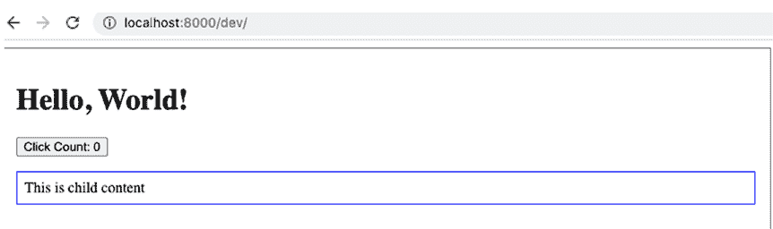

## 图 8-1. Hello, World! 示例

你可以通过执行 $ npm run lint 来运行 ESLint。
终端将显示在组件中发现的所有代码样式问题（参见图 8-2）。

```
> lit-element-starter-js@0.0.0 lint /Users/carlosrojaso/Projects/lit-element-starter-js
> lit-analyzer my-element.js && eslint '**/*.js'

Analyzing 1 files...

✓ Found 0 problems in 1 file
```

## 图 8-2. 运行 ESLint

你可以通过执行 $ npm run test 来使用 Karma、Chai 和 Mocha 运行测试。
终端将显示我们为组件编写的所有测试（参见图 8-3）。

```
> karma start karma.conf.cjs

START:
26 07 2020 16:23:17.024:WARN [filelist]: Pattern "/Users/carlosrojaso/Projects/lit-element-starter-js/_snapshots_/**/*.md" does not match any file.
26 07 2020 16:23:17.073:INFO [karma-server]: Karma v4.4.1 server started at http://0.0.0.0:9876/
26 07 2020 16:23:17.073:INFO [launcher]: Launching browsers ChromeHeadlessNoSandbox with concurrency unlimited
26 07 2020 16:23:17.083:INFO [launcher]: Starting browser ChromeHeadless
26 07 2020 16:23:17.593:INFO [HeadlessChrome 84.0.4147 (Mac OS X 10.15.6)]: Connected on socket iZiRPsCAH4c09V-AAAA with id 22384050
  my-element
    ✓ is defined
    ✓ renders with default values
    ✓ renders with a set name
    ✓ handles a click

Finished in 0.046 secs / 0.014 secs @ 16:23:18 GMT-0500 (Colombia Standard Time)

SUMMARY:
✓ 4 tests completed
```

## 图 8-3. 运行测试

你可以通过执行 `$ npm run docs` 来生成文档。
使用 `$ npm run docs:serve`，你可以看到生成的文档。
这些任务使用 eleventy，一个静态站点生成器，根据我们在文件夹 `docs-src` 中创建的模板来生成精美的文档（图 8-4）。

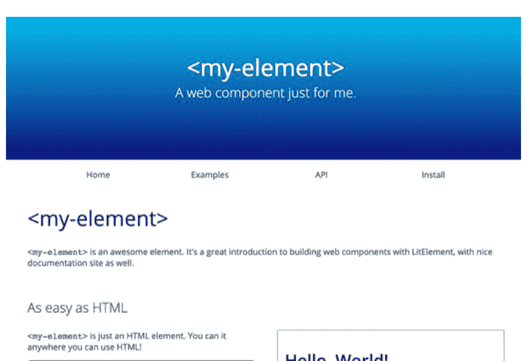

## 图 8-4. 运行文档

如你所见，这个入门模板是构建我们组件的一个良好起点。在接下来的章节中，我们将迁移 `<simple-form-modal-component>`、`<note-list-component>` 和 `<note-list-item-component>`，为每个 Web 组件使用一个新项目。

## LitElement

LitElement 是一个库，它为我们提供了一个创建 Web 组件的基础类，而无需担心在使用仅 JS 时需要处理低级复杂性，例如每次更新时渲染元素。

LitElement 使用 lit-html 来处理组件中的模板。lit-html 是一个模板库，我们可以独立地将其添加到 JS 项目中，以高效地使用数据渲染 HTML 模板。

### 属性

在之前的章节中，你可能记得我们在类中通过 setter 和 getter 创建属性。在 LitElement 中，我们只需要将所有属性声明在 get properties() 静态方法内部，如清单 8-1 所示。

### 清单 8-1. 声明属性

```
static get properties() {
  return { propertyName: options};
}
```

LitElement 将正确地为我们处理更新和转换。在 options 中，我们可以添加以下值：

- Attribute：此值指示属性是否与属性关联，或与关联属性的自定义名称关联。
- hasChanged：这是一个函数，它接受 oldValue 和 newValue 并返回一个 Boolean，以指示在设置时属性是否已更改。
- Type：这是在属性和属性之间转换的类型提示。你可以使用 String、Number、Boolean、Array、Object。

在 <simple-form-modal-component> 中声明属性的示例在清单 8-2 中给出。

### 清单 8-2. 在 <simple-form-modal-component> 中声明属性

```
static get properties() {
    return {
        open: {
            type: Boolean,
            hasChanged(newVal, oldVal) {
                if (oldVal !== newVal) {
                    return true;
                }
                else {
                    return false;
                }
            }
        }
    };
}
```

这里，我们将 open 属性创建为 Boolean 并检查属性更改时的逻辑。你可以在 https://lit-element.polymer-project.org/guide/properties 找到有关属性的所有机制。

### 模板

当更改发生时渲染和更新 DOM 是一个困难的任务，这可能会影响处理此操作的函数中的代码性能。lit-html 解决了这一复杂性，并为我们提供了构建模板的舒适方式。

使用模板很简单：只需在组件中使用 render() 方法并返回带有 html 标签函数的模板字面量，如清单 8-3 所示。

### 清单 8-3. 使用模板

```
import { LitElement, html } from 'lit-element';
class MyComponent extends LitElement {
    render(){
        return html`
            <div>
                My Component content
            </div>
        `;
    }
}
customElements.define('my-component', MyComponent);
```

如果我们需要使用属性，我们必须在模板字面量内部调用它，使用 this. prop 记法，如清单 8-4 所示。

### 清单 8-4. 在模板中使用属性

```
import { LitElement, html } from 'lit-element';
class MyComponent extends LitElement {
static get properties() {
    return {
        myString: { type: String }
    };
}
render(){
    return html`
        <div>
            My Component content with ${this.myString}
        </div>
    `;
}
}
customElements.define('my-component', MyComponent);
```

如果我们想绑定一个属性，可以直接从模板字面量传递，如清单 8-5 所示。

### 清单 8-5. 在模板中绑定属性

```
import { LitElement, html } from 'lit-element';
class MyComponent extends LitElement {
static get properties() {
    return {
        myId: { type: String }
    };
}
render(){
    return html`
        <div id="${this.myId}">
            My Component content
        </div>
    `;
}
}
```

如果我们想绑定一个属性，可以使用 .prop 记法从模板字面量传递，如清单 8-6 所示。

### 清单 8-6. 在模板中绑定属性

```
import { LitElement, html } from 'lit-element';
class MyComponent extends LitElement {
static get properties() {
    return {
        myValue: { type: String }
    };
}
render(){
    return html`
        <input type="checkbox" .value="${this.myValue}"/>
    `;
}
}
```

如果我们想将 clickHandler 绑定到 click 事件，可以使用 $click 记法从模板字面量传递，如清单 8-7 所示。

### 清单 8-7. 在 Click 事件中绑定 clickHandler

```
import { LitElement, html } from 'lit-element';
class MyComponent extends LitElement {
  render(){
    return html`
      <button @click="${this.clickHandler}">click</button>
    `;
  }
  clickHandler(e) {
    console.log(e.target);
  }
}
```

你可以在 https://lit-element.polymer-project.org/guide/templates 或 https://lit-html.polymer-project.org/guide 找到有关模板的所有机制。

### 样式

使用 Polymer 在 Web 组件中添加样式非常简单。只需在静态方法 styles() 中添加选择器和属性，如清单 8-8 所示。

### 清单 8-8. 在 Web 组件中添加样式

```
import { LitElement, html } from 'lit-element';

class MyComponent extends LitElement {
  static get styles() {
    return css`
      div { color: blue; }
    `;
  }
}
```

```js
render() {
    return html`
        <div>Content in Blue!</div>
    `;
}
```

你可以在 https://lit-element.polymer-project.org/guide/styles 阅读更多关于样式的内容。

### 事件

你可以直接在模板中添加事件监听器，如清单 8-9 所示。

### 清单 8-9. 在模板中添加事件

```js
import { LitElement, html } from 'lit-element';
class MyComponent extends LitElement {
    render() {
        return html`<button @click="${this.handleEvent}">click</button>`;
    }
    handleEvent(e) {
        console.log(e);
    }
}
```

你也可以直接在组件中添加监听器，在生命周期的某个方法中，如清单 8-10 所示。

### 清单 8-10. 在组件中添加事件

```js
import { LitElement, html } from 'lit-element';
class MyComponent extends LitElement {
    constructor() {
        super();
        this.addEventListener('DOMContentLoaded', this.handleEvent);
    }
}
```


```js
handleEvent() {
  console.log('It is Loaded');
}
}
```

你可以在 https://lit-element.polymer-project.org/guide/events 阅读更多关于事件的信息。

## 生命周期

LitElement 继承了 Web Components 标准中的默认生命周期回调，以及一些可用于在组件中添加逻辑的额外方法。

connectedCallback：当组件被添加到文档的 DOM 中时调用（清单 8-11）。

### 清单 8-11. connectedCallback

```js
import { LitElement, html } from 'lit-element';

class MyComponent extends LitElement {
    connectedCallback() {
        super.connectedCallback();
        console.log('added');
    }
}
```

disconnectedCallback：当组件从文档的 DOM 中移除时调用（清单 8-12）。

### 清单 8-12. disconnectedCallback

```js
import { LitElement, html } from 'lit-element';

class MyComponent extends LitElement {
    disconnectedCallback() {
        super.disconnectedCallback();
```
```
console.log('removed');
}
}
```

adoptedCallback：当组件被移动到新文档时调用（清单 8-13）。

### 清单 8-13. adoptedCallback

```js
import { LitElement, html } from 'lit-element';

class MyComponent extends LitElement {
  adoptedCallback() {
    super.disconnectedCallback();
    console.log('moved');
  }
}
```

attributeChangedCallback：当组件属性发生变化时调用（清单 8-14）。

### 清单 8-14. attributeChangedCallback

```js
import { LitElement, html } from 'lit-element';

class MyComponent extends LitElement {
  attributeChangedCallback(name, oldVal, newVal) {
    super.attributeChangedCallback(name, oldVal, newVal);
    console.log('attribute change: ', name, newVal);
  }
}
```

firstUpdated：组件首次更新并渲染后调用（清单 8-15）。

### 清单 8-15. firstUpdated

```js
import { LitElement, html } from 'lit-element';

class MyComponent extends LitElement {
  firstUpdated(changedProperties) {
    console.log('first updated');
  }
}
```

updated：当元素的 DOM 已更新并渲染时调用（清单 8-16）。

### 清单 8-16. updated

```js
import { LitElement, html } from 'lit-element';

class MyComponent extends LitElement {
  updated(changedProperties) {
    changedProperties.forEach((oldValue, propName) => {
      console.log(`${propName} changed. oldValue: ${oldValue}`);
    });
  }
}
```

你可以在 https://lit-element.polymer-project.org/guide/lifecycle 阅读更多关于生命周期的信息。

## 使用 Polymer 构建

在本节中，我们将使用 Polymer starter 构建我们的 <simple-form-modal-component>、<note-list-component> 和 <note-list-item-component>。

如清单 8-17 所示，我们在 VanillaJS 中有 SimpleFormModalComponent。

### 清单 8-17. VanillaJS 中的 SimpleFormModalComponent

```js
export class SimpleFormModalComponent extends HTMLElement {
    constructor() {
        super();

        this.root = this.attachShadow({mode: 'open'});
        this.container = document.createElement('div');
        this.container.innerHTML = this.getTemplate();
        this.root.appendChild(this.container.cloneNode(true));

        this._open = this.getAttribute('open') || false;

        this.modal = this.root.getElementById("myModal");
        this.addBtn = this.root.getElementById("addBtn");
        this.closeBtn = this.root.getElementById("closeBtn");

        this.handleAdd = this.handleAdd.bind(this);
        this.handleCancel = this.handleCancel.bind(this);
    }

    connectedCallback() {
        this.addBtn.addEventListener('click', this.handleAdd);
        this.closeBtn.addEventListener('click', this.handleCancel);
    }

    disconnectedCallback () {
        this.addBtn.removeEventListener('click', this.handleAdd);
        this.closeBtn.removeEventListener('click', this.handleCancel);
    }

    get open() {
        return this._open;
    }

    set open(newValue) {
        this._open = newValue;
        this.showModal(this._open);
    }
}
```
```js
handleAdd() {
    const fTitle = this.root.getElementById('ftitle');
    const fDesc = this.root.getElementById('fdesc');
    this.dispatchEvent(new CustomEvent('add-event', {bubbles: true,
    composed:true, detail: {title: fTitle.value, description: fDesc.value}}));

    fTitle.value = '';
    fDesc.value = '';
    this.open = false;
}

handleCancel() {
    this.open = false;
}

showModal(state) {
    if(state) {
        this.modal.style.display = "block";
    } else {
        this.modal.style.display = "none"
    }
}

getTemplate() {
    return `
    ${this.getStyle()}
    <div id="myModal" class="modal">
        <div class="modal-content">
            <form id="myForm">
                <label for="ftitle">Title:</label><br>
                <input type="text" id="ftitle" name="ftitle"><br>
                <label for="fdesc">Description:</label><br>
                <textarea id="fdesc" name="fdesc" rows="4" cols="50">
                </textarea><br/>
                <button type="button" id="addBtn">Add</button><button type="button" id="closeBtn">Close</button>
```
```
</form>
</div>
</div>`;
}
getStyle() {
    return `
<style>
.modal {
    display: none;
    position: fixed;
    z-index: 1;
    padding-top: 100px;
    left: 0;
    top: 0;
    width: 100%;
    height: 100%;
    overflow: auto;
    background-color: rgb(0,0,0);
    background-color: rgba(0,0,0,0.4);
}
.modal-content {
    background-color: #fefefe;
    margin: auto;
    padding: 20px;
    border: 1px solid #888;
    width: 50%;
}
</style>`;
}
}
customElements.define('simple-form-modal-component',
SimpleFormModalComponent);
```

我们有一个 getTemplate() 方法用于返回组件的 HTML，一个 getStyle() 方法用于返回组件内部使用的样式规则，还有一些用于处理组件逻辑的方法，以及一些用于更新组件属性的 setter 和 getter。我们可以使用相同的原则快速创建 LitElement 并使代码更简洁，因为 LitElement 为我们处理了一些底层工作。

我们可以从使用 LitElement 语法定义属性开始，如清单 8-18 所示。

### 清单 8-18. 使用 LitElement 在 SimpleFormModalComponent 中添加属性

```js
import {LitElement, html, css} from 'lit-element';

export class SimpleFormModalComponent extends LitElement {
static get properties() {
    return {
        open: {
            type: Boolean
        }
    };
}

    constructor() {
        super();
        this.open = false;
    }
}

window.customElements.define('simple-form-modal-component',
SimpleFormModalComponent);
```

在这里，我们将 'open' 属性添加为 Boolean，并在 constructor() 中将其初始化为 false。

接下来，我们将把 getTemplate() 方法迁移到 LitElement 中，如清单 8-19 所示。

### 清单 8-19. 使用 LitElement 在 SimpleFormModalComponent 中添加 render()

```js
import {LitElement, html, css} from 'lit-element';

export class SimpleFormModalComponent extends LitElement {
static get properties() {
    return {
        open: {
            type: Boolean
        }
    };
}

constructor() {
    super();
    this.open = false;
}

render() {
    return html`
        <div id="myModal" class="modal">
            <div class="modal-content">
                <form id="myForm">
                    <label for="ftitle">Title:</label><br>
                    <input type="text" id="ftitle" name="ftitle"><br>
                    <label for="fdesc">Description:</label><br>
                    <textarea id="fdesc" name="fdesc" rows="4" cols="50">
                    </textarea><br/>
                    <button type="button" id="addBtn">Add</button>
                    <button type="button" id="closeBtn">Close</button>
                </form>
            </div>
        </div>
    `;
}
}

window.customElements.define('simple-form-modal-component',
SimpleFormModalComponent);
```


如你所见，代码几乎相同，但我们使用 render() 方法并返回 HTML 标签字面量而不是字符串。

现在我们将对 getStyle() 做同样的处理，将其移至 styles() getter 中，如清单 8-20 所示。

## 清单 8-20. 在 SimpleFormModalComponent 中使用 LitElement 添加 render()

```js
import {LitElement, html, css} from 'lit-element';

export class SimpleFormModalComponent extends LitElement {
static get styles() {
    return css`
      .modal {
        display: none;
        position: fixed;
        z-index: 1;
        padding-top: 100px;
        left: 0;
        top: 0;
        width: 100%;
        height: 100%;
        overflow: auto;
        background-color: rgb(0,0,0);
        background-color: rgba(0,0,0,0.4);
      }
      .modal-content {
        background-color: #fefefe;
        margin: auto;
        padding: 20px;
        border: 1px solid #888;
        width: 50%;
      }
    `;
}
}
```

```
static get properties() {
    return {
        open: {
            type: Boolean
        }
    };
}

constructor() {
    super();
    this.open = false;
}

render() {
    return html`
        <div id="myModal" class="modal">
            <div class="modal-content">
                <form id="myForm">
                    <label for="ftitle">Title:</label><br>
                    <input type="text" id="ftitle" name="ftitle"><br>
                    <label for="fdesc">Description:</label><br>
                    <textarea id="fdesc" name="fdesc" rows="4" cols="50">
                    </textarea><br/>
                    <button type="button" id="addBtn">Add</button>
                    <button type="button" id="closeBtn">Close</button>
                </form>
            </div>
        </div>
    `;
}
}

window.customElements.define('simple-form-modal-component',
SimpleFormModalComponent);
```

现在我们将为按钮添加处理方法，使用 @click 记法，如清单 8-21 所示。

## 清单 8-21. 在 SimpleFormModalComponent 中使用 LitElement 添加 styles()

```javascript
import {LitElement, html, css} from 'lit-element';

export class SimpleFormModalComponent extends LitElement {
  static get styles() {
    return css`
      .modal {
        display: none;
        position: fixed;
        z-index: 1;
        padding-top: 100px;
        left: 0;
        top: 0;
        width: 100%;
        height: 100%;
        overflow: auto;
        background-color: rgb(0,0,0);
        background-color: rgba(0,0,0,0.4);
      }
      .modal-content {
        background-color: #fefefe;
        margin: auto;
        padding: 20px;
        border: 1px solid #888;
        width: 50%;
      }
    `;
  }

  static get properties() {
    return {
      open: {
        type: Boolean
      }
    };
  }
}
```

```
constructor() {
    super();
    this.open = false;
}

render() {
    return html`
        <div id="myModal" class="modal">
            <div class="modal-content">
                <form id="myForm">
                    <label for="ftitle">Title:</label><br>
                    <input type="text" id="ftitle" name="ftitle"><br>
                    <label for="fdesc">Description:</label><br>
                    <textarea id="fdesc" name="fdesc" rows="4" cols="50">
                    </textarea><br/>
                    <button type="button" id="addBtn" @click=${this.handleAdd}>
                    Add</button>
                    <button type="button" id="closeBtn" @click=${this.handleCancel}>Close</button>
                </form>
            </div>
        </div>
    `;
}

handleAdd() {
    const fTitle = this.shadowRoot.getElementById('ftitle');
    const fDesc = this.shadowRoot.getElementById('fdesc');
    this.dispatchEvent(new CustomEvent('addEvent', {detail: {title: fTitle.value, description: fDesc.value}}));

    fTitle.value = '';
    fDesc.value = '';
    this.open = false;
}
```

```
handleCancel() {
    this.open = false;
}
}
window.customElements.define('simple-form-modal-component',
SimpleFormModalComponent);
```

最后，我们将为 'open' 更新时添加 showModal() 方法，如清单 8-22 所示。

## 清单 8-22. 在 SimpleFormModalComponent 中使用 LitElement 添加 render()

```
import {LitElement, html, css} from 'lit-element';

export class SimpleFormModalComponent extends LitElement {
    static get styles() {
        return css`
        .modal {
            display: none;
            position: fixed;
            z-index: 1;
            padding-top: 100px;
            left: 0;
            top: 0;
            width: 100%;
            height: 100%;
            overflow: auto;
            background-color: rgb(0,0,0);
            background-color: rgba(0,0,0,0.4);
        }
        .modal-content {
            background-color: #fefefe;
            margin: auto;
            padding: 20px;
            border: 1px solid #888;
            width: 50%;
        }
    }
```

```
`;
}
static get properties() {
    return {
        open: {
            type: Boolean,
            hasChanged(newVal, oldVal) {
                if (oldVal !== newVal) {
                    return true;
                }
                else {
                    return false;
                }
            }
        }
    };
}
constructor() {
    super();
    this.open = false;
}
render() {
    return html`
        <div id="myModal" class="modal">
            <div class="modal-content">
                <form id="myForm">
                    <label for="ftitle">Title:</label><br>
                    <input type="text" id="ftitle" name="ftitle"><br>
                    <label for="fdesc">Description:</label><br>
                    <textarea id="fdesc" name="fdesc" rows="4" cols="50">
                    </textarea><br/>
                    <button type="button" id="addBtn" @click=${this.handleAdd}>
                    Add</button>
```

```
            <button type="button" id="closeBtn" @click=${this.handleCancel}>Close</button>
            </form>
        </div>
    </div>
    `;
}

handleAdd() {
    const fTitle = this.shadowRoot.getElementById('ftitle');
    const fDesc = this.shadowRoot.getElementById('fdesc');
    this.dispatchEvent(new CustomEvent('addEvent', {detail: {title: fTitle.value, description: fDesc.value}}));

    fTitle.value = '';
    fDesc.value = '';
    this.open = false;
}

handleCancel() {
    this.open = false;
}

showModal(state) {
    const modal = this.shadowRoot.getElementById("myModal");
    if(state) {
        modal.style.display = "block";
    } else {
        modal.style.display = "none"
    }
}

updated(){
    this.showModal(this.open);
}
}

window.customElements.define('simple-form-modal-component',
SimpleFormModalComponent);
```

这里，我们在 'open' 中使用 hasChanged() 选项来检查何时触发更新，并通过 updated() 方法使用 showModal() 方法来显示/隐藏模态框。现在，我们的 <simple-form-modal-component> 已准备就绪。

你可以通过以下方式访问本书的代码 (https://github.com/carlosrojaso/apress-book-web-components) 

```
$git checkout chap-8.
```

我在 dev/ 文件夹中创建了一个示例，在 docs-src/ 文件夹中创建了文档，并在 test/ 文件夹中创建了一些基本测试，然后你可以运行以下命令：

```
$ npm install
```

```
$ npm run serve
```

要在 localhost:8080/dev 查看示例运行，请运行

```
$ npm run docs
```

```
$ npm run docs:serve
```

我们将继续使用我们在前几章中编写的 <note-list-component>，如清单 8-23 所示。

## 清单 8-23. 使用 VanillaJS 的 NoteListComponent

```
export class NoteListComponent extends HTMLElement {
static get observedAttributes() { return ['notes']; }

constructor() {
super();

this._notes = JSON.parse(this.getAttribute('notes')) || [];
this.root = this.attachShadow({mode: 'open'});
this.root.innerHTML = this.render();

this.handleDelEvent = this.handleDelEvent.bind(this);
}

attributeChangedCallback(name, oldValue, newValue) {
switch(name) {
case 'notes':
```


```
this.note = JSON.parse(newValue);
this.root.innerHTML = this.render();
break;
}
}
connectedCallback() {
    this.root.addEventListener('del-event', this.handleDelEvent);
}
disconnectedCallback () {
    this.root.removeEventListener('del-event', this.handleDelEvent);
}
handleDelEvent(e) {
    this._notes.splice(e.detail.idx, 1);
    this.root.innerHTML = this.render();
}
render() {
    let noteElements = '';
    this._notes.map(
        (note, idx) => {
            noteElements += `
            <note-list-item-component note='${JSON.stringify(note)}'
            idx='${idx}'></note-list-item-component>`;
        }
    );
    return `
        ${noteElements}`;
}
get notes(){
    return this._notes;
}
```
```
set notes(newValue) {
    this._notes = newValue;
    this.root.innerHTML = this.render();
}
}
customElements.define('note-list-component', NoteListComponent);
```

我们将为组件添加属性，参考清单 8-24。

## Listing 8-24. 在 NoteListComponent 中使用 LitElement 添加属性

```
import {LitElement, html, css} from 'lit-element';

export class NoteListComponent extends LitElement {
static get properties() {
    return {
        notes: {
            type: Array,
            attribute: true,
            reflect: true,
        }
    };
}

constructor() {
    super();
    this.notes = this.getAttribute("notes") || [];
}
}
```

这里，我们将 notes 属性定义为数组，并添加 options 属性使该属性作为属性正确工作。在 constructor() 中，我们使用 'notes' 中的值或空数组初始化 this.notes。

现在我们将迁移 render() 方法，它与 LitElement 类似，如清单 8-25 所示。

## Listing 8-25. 在 NoteListComponent 中使用 LitElement 添加模板

```
import {LitElement, html, css} from 'lit-element';

export class NoteListComponent extends LitElement {
static get properties() {
    return {
      notes: {
        type: Array,
        attribute: true,
        reflect: true,
      }
    };
  }

  constructor() {
    super();
    this.notes = this.getAttribute("notes") || [];
  }

  render() {
    return html`
      ${this.notes.map((note, idx) => {
        return html` <note-list-item-component
          note="${JSON.stringify(note)}"
          idx="${idx}"
        ></note-list-item-component>`;
      })}
    `;
  }
}
```

这里，我们使用 map() 遍历 notes 并将其全部作为 HTML 标签字面量返回，以使模板正常工作。

我们必须在值发生变化时每次更新 notes，但为此我们必须做一些特殊处理，因为当作为引用传递时，hasChanged() 选项无法检测到数组发生变化的情况。为修复此问题，我们将使用 attributeChangedCallback()，如清单 8-26 所示。

## Listing 8-26. 在 NoteListComponent 中使用 LitElement 添加 attributeChangedCallback

```
import {LitElement, html, css} from 'lit-element';

export class NoteListComponent extends LitElement {
  static get properties() {
    return {
      notes: {
        type: Array,
        attribute: true,
        reflect: true,
      }
    };
  }

  constructor() {
    super();
    this.notes = this.getAttribute("notes") || [];
  }

  attributeChangedCallback() {
    this.notes = [...this.notes];
    super.attributeChangedCallback();
  }

  render() {
    return html`
      ${this.notes.map((note, idx) => {
        return html`<note-list-item-component
          note="${JSON.stringify(note)}"
          idx="${idx}"
        ></note-list-item-component>`;
      })}
    `;
  }
}
```

这里，在 attributeChangedCallback() 中，我们检测组件的变化。如果发生了变化，我们可以使用展开运算符将 this.notes 更新为新数组（而不是引用），通过这个小修复，我们的组件将再次正常工作。

最后，我们将为 'del-event' 添加事件监听器和 handleDelEvent() 函数，如清单 8-27 所示。通过这些修改，我们的组件已准备就绪。

## Listing 8-27. 在 NoteListComponent 中使用 LitElement 添加事件监听器

```
import {LitElement, html, css} from 'lit-element';

export class NoteListComponent extends LitElement {
static get properties() {
    return {
        notes: {
            type: Array,
            attribute: true,
            reflect: true,
        }
    };
}

constructor() {
    super();
    this.notes = this.getAttribute("notes") || [];
    this.addEventListener("del-event", this.handleDelEvent);
}

attributeChangedCallback() {
    this.notes = [...this.notes];
    super.attributeChangedCallback();
}

handleDelEvent(e) {
    this.notes.splice(e.detail.idx, 1);
    this.requestUpdate();
}
}
```
```
render() {
    return html`
        ${this.notes.map((note, idx) => {
            return html` <note-list-item-component
                note="${JSON.stringify(note)}"
                idx="${idx}"
                ></note-list-item-component>`;
        })}
    `;
}
```

你可以访问本书的代码 (https://github.com/carlosrojaso/apress-book-web-components) ，执行 $git checkout chap-8-1。

我在 dev/ 文件夹中创建了一个示例，在 docs-src/ 文件夹中创建了文档，并在 test/ 文件夹中创建了一些基本测试，然后你可以运行以下命令：

```
$ npm install

$ npm run serve
```

要在 localhost:8080/dev 查看示例运行，请运行以下命令：

```
$ npm run docs

$ npm run docs:serve
```

现在我们将迁移我们在前几章中编写的最后一个组件 <note-list-item-component>（见清单 8-28）。

## Listing 8-28. VanillaJS 中的 NoteListComponent

```
export class NoteListItemComponent extends HTMLElement {
    static get observedAttributes() { return ['note', 'idx']; }

    constructor() {
        super();

        this._note = JSON.parse(this.getAttribute('note')) || {};
        this.idx = this.getAttribute('idx') || -1;
```
```
this.root = this.attachShadow({mode: 'open'});
this.root.innerHTML = this.getTemplate();

this.delBtn = this.root.getElementById('deleteButton');
this.handleDelete = this.handleDelete.bind(this);
}

connectedCallback() {
    this.delBtn.addEventListener('click', this.handleDelete);
}

disconnectedCallback () {
    this.delBtn.removeEventListener('click', this.handleDelete);
}

attributeChangedCallback(name, oldValue, newValue) {
    switch(name) {
        case 'note':
            this.note = JSON.parse(newValue);
            this.handleUpdate();
            break;
        case 'idx':
            this.idx = newValue;
            this.handleUpdate();
            break;
    }
}

get note() {
    return this._note;
}

set note(newValue) {
    this._note = newValue;
}

get idx() {
    return this._idx;
}
```
```
set idx(newValue) {
    this._idx = newValue;
}

handleDelete() {
    this.dispatchEvent(new CustomEvent('del-event', {bubbles:
    true,  composed: true, detail: {idx: this.idx}}));
}

handleUpdate() {
    this.root.innerHTML = this.getTemplate();
    this.delBtn = this.root.getElementById('deleteButton');
    this.handleDelete = this.handleDelete.bind(this);
    this.delBtn.addEventListener('click', this.handleDelete);
}

getStyle() {
    return `
<style>
.note {
    background-color: #ffffcc;
    border-left: 6px solid #ffe3b;
}
div {
    margin: 5px 0px 5px;
    padding: 4px 12px;
}
</style>
`;
}

getTemplate() {
    return`
${this.getStyle()}
<div class="note">
    <p><strong>${this._note.title}</strong> ${this._note.description}
    </p><br/>
```
```
<button type="button" id="deleteButton">Delete</button>
</div>`;
}
}
customElements.define('note-list-item-component', NoteListItemComponent);
```

迁移此组件的过程与我们之前遵循的步骤类似。因此，我将跳过解释，直接向你展示 LitElement 中的完整组件（清单 8-29）。

## Listing 8-29. 使用 LitElement 的 NoteListItemComponent

```
import { LitElement, html, css } from "lit-element";

/**
 * A Note List Item Component
 */
export class NoteListItemComponent extends LitElement {
  static get properties() {
    return {
      /**
       * The attribute is an Object.
       */
      note: {
        type: Object,
        attribute: true,
        reflect: true,
      },
      /**
       * The attribute is a number.
       */
      idx: {
        type: Number,
        attribute: true,
        reflect: true,
      }
    };
  }
}
```

static get styles() {
    return css`
        .note {
            background-color: #ffffcc;
            border-left: 6px solid #ffeb3b;
        }

        div {
            margin: 5px 0px 5px;
            padding: 4px 12px;
        }
    `;
}

constructor() {
    super();
    this.note = JSON.parse(this.getAttribute('note')) || {};
    this.idx = this.getAttribute('idx') || -1;
}

render() {
    return html`
    <div class="note">
        <p><strong>${this.note.title}</strong> ${this.note.description}
        </p><br/>
        <button type="button" id="deleteButton" @click="${this.
        handleDelete}">Delete</button>
    </div>
    `;
}

handleDelete() {
    this.dispatchEvent(new CustomEvent('del-event', {bubbles:
    true,  composed: true, detail: {idx: this.idx}}));
}
}

```js
window.customElements.define('note-list-item-component',
NoteListItemComponent);
```

你可以访问本书的代码（[https://github.com/carlosrojaso/aopress-book-web-components](https://github.com/carlosrojaso/aopress-book-web-components)）在 `$git checkout chap-8-2`。

太棒了！我们现在已经将所有组件在 Polymer 中作为 LitElements 实现。

## 摘要

本章中，你学习了

- 如何在我们的组件中使用 LitElement 和 lit-html
- 如何将组件从 VanillaJS 迁移到 Polymer
- litElement 的主要特性是什么

## 第 9 章

## 使用 Vue.js

Vue.js 是一个开源的、渐进式的 JavaScript 框架，用于构建旨在可增量采用的用户界面。Vue.js 的核心库仅专注于视图层，易于上手并与其他库或现有项目集成。

你将学习如何利用其功能构建快速、高性能的 Web 应用。在本章中，我们将开发一个应用，你将学习一些关键概念并了解如何集成 Web Components 和 Vue.js。

## Vue.js 的主要特性有哪些？

Vue.js 拥有构建单页应用的框架应具备的所有功能。其中一些特性尤为突出，如下所示：

- *虚拟 DOM*：虚拟 DOM 是原始 HTML DOM 的轻量级内存树表示，可以在不影响原始 DOM 的情况下进行更新。
- *组件*：这些用于在 Vue.js 应用中创建可复用的自定义元素。
- *模板*：Vue.js 提供基于 HTML 的模板，将 DOM 与 Vue 实例数据绑定。
- *路由*：页面之间的导航通过 vue-router 实现。
- *轻量级*：与其它框架相比，Vue.js 是一个轻量级库。

## Vue.js 中的组件是什么？

组件是可以复用的元素，我们用它们来定义名称和行为。要理解这个概念，请看图 9-1。

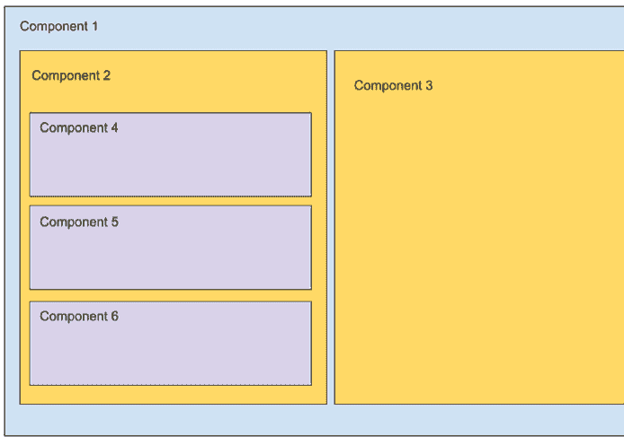

图 9-1. Web 应用中的组件

在图 9-1 中可以看到，我们在不同层级上有六个组件。组件 1 是组件 2 和组件 3 的父级，也是组件 4、组件 5 和组件 6 的祖父级。因此，我们可以建立一个层次树来表达这种关系（图 9-2）。

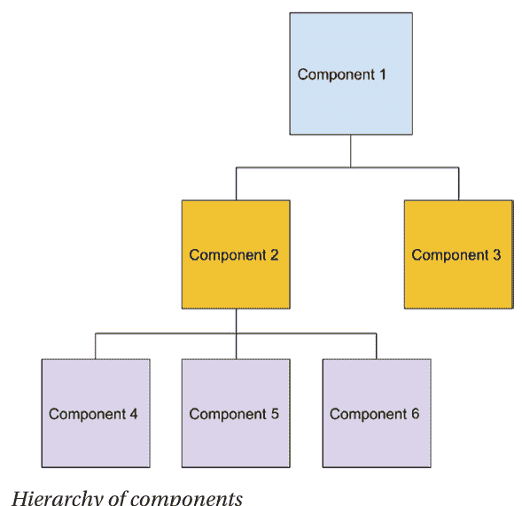

图 9-2. 组件的层次结构

现在，想象每个组件可以是我们想要的任何东西——一个列表、一张图片、一个按钮、文本，或我们定义的任何内容。定义一个简单的 Vue 组件的基本方式如清单 9-1 所示。

## 清单 9-1. 声明 Vue 组件

```js
const app = createApp({...})
app.component('my-button', {
  data: function () {
    return {
      counter: 0
    }
  },
  template: '<button v-on:click="counter++">Clicks {{ counter }}.</button>'
})
```

我们可以将它作为新的 HTML 标签添加到我们的应用中，如清单 9-2 所示。

## 清单 9-2. 使用 Vue 组件

```html
<div id="app">
    <my-button></my-button>
</div>
```

## Vue 组件中的生命周期钩子是什么？

组件会被创建和销毁。总体而言，这些过程被称为生命周期，我们可以使用一些方法在该周期的特定时刻运行函数。请考虑清单 9-3 中出现的组件。

## 清单 9-3. 在 Vue 组件中使用生命周期钩子

```html
<script>
export default {
    name: 'HelloWorld',
    created: function () {
        console.log('Component created.');
    },
    mounted: function() {
        fetch('https://randomuser.me/api/?results=1')
        .then(
            (response) => {
                return response.json();
            }
        )
        .then(
            (responseObject) => {
                this.email = responseObject.results[0].email;
            }
        );
        console.log('Component is mounted.');
    },
}
</script>
```

```html
props: {
    msg: String,
    email:String
}
}
</script>
```

这里，我们使用 created() 和 mounted() 方法添加了一个 email 属性。这些方法被称为 *生命周期钩子*。我们将使用它们在组件的特定时刻执行操作，例如，当组件挂载时调用 API 并在此时获取电子邮件。

生命周期钩子是任何严肃 Vue 组件的重要组成部分（见图 9-3）。

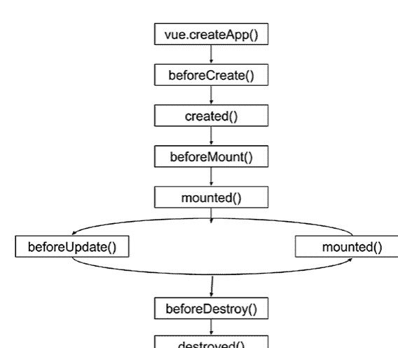

*图 9-3. Vue 组件的生命周期*

## beforeCreate

beforeCreate 钩子在组件的早期初始化时运行。你可以像清单 9-4 中那样使用此方法。

## 清单 9-4. 在 Vue 组件中使用 beforeCreate

```js
Vue.createApp({
  beforeCreate: function () {
    console.log('Initialization is happening');
  }
})
```

## created

created 钩子在组件初始化时运行。你将能够访问响应式数据，并且事件处于激活状态。你可以像清单 9-5 中那样使用此方法。

## 清单 9-5. 在 Vue 组件中使用 created

```js
Vue.createApp({
  created: function () {
    console.log('The Component is created');
  }
})
```

## beforeMount

beforeMount 钩子在初始渲染发生之前、模板或渲染函数编译之后立即运行。你可以像清单 9-6 中那样使用此方法。

## 清单 9-6. 在 Vue 组件中使用 beforeMount

```js
Vue.createApp({
  beforeMount: function () {
    console.log('The component is going to be Mounted');
  }
})
```

## mounted

mounted 钩子提供对响应式组件、模板和已渲染 DOM（通过 this.$el）的完全访问。你可以像清单 9-7 中那样使用此方法。

## 清单 9-7. 在 Vue 组件中使用 mounted

```js
Vue.createApp({
  mounted: function () {
    console.log('The component is mounted');
  }
})
```

## beforeUpdate

beforeUpdate 钩子在组件数据发生变化且更新周期开始后、DOM 被修补和重新渲染之前运行。你可以像清单 9-8 中那样使用此方法。

## 清单 9-8. 在 Vue 组件中使用 beforeUpdate

```js
Vue.createApp({
  beforeUpdate: function () {
    console.log('The component is going to be updated');
  }
})
```

## updated

updated 钩子在组件数据发生变化且 DOM 重新渲染后运行。你可以像清单 9-9 中那样使用此方法。

## 清单 9-9. 在 Vue 组件中使用 updated

```js
Vue.createApp({
  updated: function () {
    console.log('The component is updated');
  }
})
```

## beforeDestroy

beforeDestroy 钩子在组件被销毁之前立即调用。你的组件仍将完全存在且功能正常。你可以像清单 9-10 中那样使用此方法。

## 清单 9-10. 在 Vue 组件中使用 beforeDestroy

```js
Vue.createApp({
    beforeDestroy: function () {
        console.log('The component is going to be destroyed');
    }
})
```

## destroyed

destroyed 钩子在附加到它的所有内容都被销毁时调用。你可能会使用 destroyed 钩子执行任何最后的清理工作。你可以像清单 9-11 中那样使用此方法。

## 清单 9-11. 在 Vue 组件中使用 destroyed

```js
Vue.createApp({
    destroyed: function () {
        console.log('The component is destroyed');
    }
})
```

## Vue 组件之间的通信

组件通常需要在它们之间共享信息。对于这些基本场景，我们可以使用 props 或 ref 属性，如果你想将数据传递给子组件；使用发射器，如果你要将数据传递给父组件；以及双向数据绑定，以使子组件和父组件之间的数据同步（见图 9-4）。


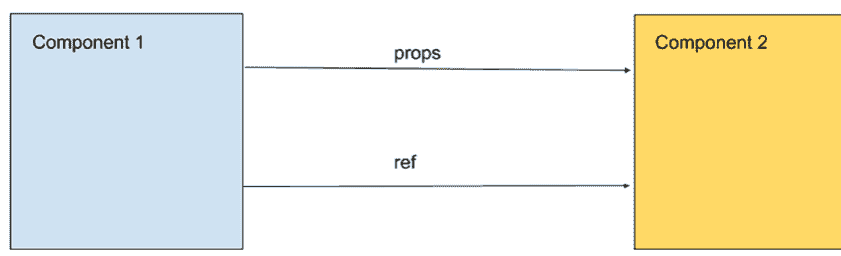

图 9-4. 父组件与子组件之间的通信

如图 9-4 所示，如果你想让父组件与子组件通信，可以使用 props 或 ref 属性。

## 什么是 Props？

Props 是可以在组件上注册的自定义属性。当值传递给 prop 属性时，它会成为该组件实例上的一个属性。你可以在清单 9-12 中看到基本结构。

### 清单 9-12. 在 Vue 组件中声明 Props

```
const app = createApp({...})
app.component('some-item', {
  props: ['somevalue'],
  template: '<div>{{ somevalue }}</div>'
})
```

现在你可以像清单 9-13 中那样传递值。

### 清单 9-13. 在 Vue 组件中使用 Props

```
<some-item somevalue="value for prop"></some-item>
```

## 什么是 Ref 属性？

ref 属性用于注册对元素或子组件的引用。引用将注册在父组件的 $refs 对象下。¹ 你可以在清单 9-14 中看到基本结构。

### 清单 9-14. 在 Vue 组件中使用 Ref

```
<input type="text" ref="email">

<script>
    const input = this.$refs.email;
</script>
```

## 发射事件

如果你想从子组件向父组件通信，可以使用 $emit()，这是传递信息的推荐方法。调用 prop 函数是传递信息的另一种方法（图 9-5），但这是一种不好的做法，因为当项目增长时可能会令人困惑，因此我将跳过这一点。

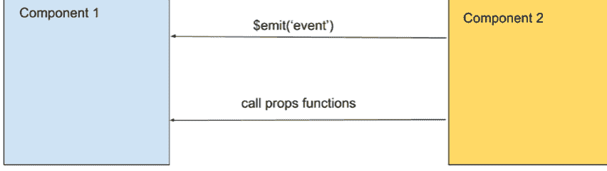

图 9-5. 使用父组件与子组件通信

在 Vue 中，$emit 方法可用于向父组件发送数据。在清单 9-15 中，你可以看到发射事件的基本结构。

### 清单 9-15. 在 Vue 组件中使用 $emit

```
const app = createApp({...})
app.component('child-custom-component', {
  data: function () {
    return {
      customValue: 0
    }
  },
  methods: {
    giveValue: function () {
      this.$emit('give-value', this.customValue++)
    }
  },
  template: `
    <button v-on:click="giveValue">
      Click me for value
    </button>
  `
})
```

## 使用双向数据绑定

在组件之间促进通信的一种简单方法是使用双向数据绑定。在以下场景中，Vue.js 为我们处理组件之间的通信（图 9-6）。

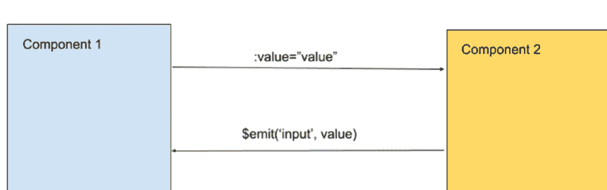

图 9-6. 组件之间的双向通信

双向数据绑定意味着 Vue.js 为你同步数据属性和 DOM。数据属性的更改会更新 DOM，而对 DOM 所做的修改会更新数据属性。因此，数据双向流动。在清单 9-16 中，你可以看到使用双向数据绑定的基本结构。

### 清单 9-16. 在 Vue 组件中使用 v-model

```
const app = Vue.createApp({})
app.component('my-component', {
  props: {
    myProp: String
  },
  template: `
    <input
      type="text"
      :value="myProp"
      @input="$emit('update:myProp', $event.target.value)">
  `
})
<my-component v-model:myProp="Some Value"></my-component>
```

## Material Web 组件

在第 8 章中，我们使用 VanillaJS 和 Polymer 构建了一些 Web 组件。这是在这些技术基础上学习基础知识的绝佳方式。尽管如此，对于我们的 VueNoteApp，我们将使用 Google 维护的更强大的 Web 组件目录，该目录实现了 Material Design 并使用 LitElement 构建。你可以在 https://github.com/material-components/material-components-web-components 找到这些组件。

使用这些组件有助于提高我们的生产力，因为我们拥有 Material Design 的正确指南，并且提升质量，因为它们经过更充分的测试，并且在用户界面中有更多使用选项。

## 构建 VueNoteApp

在本节中，我们将使用 Vue 并使用 Material Design 构建一个完整的笔记应用，如图 9-7 所示。

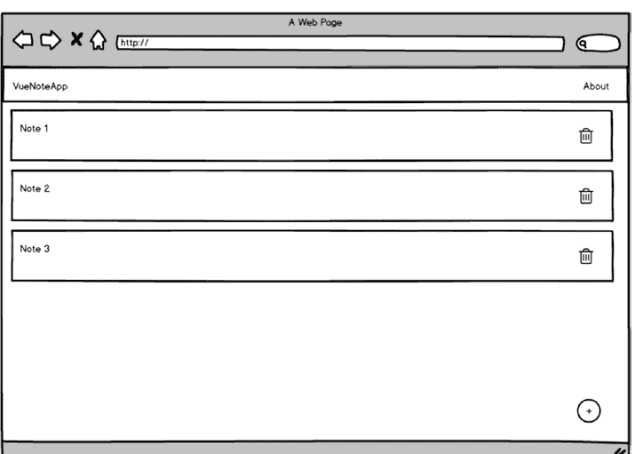

图 9-7. VueNoteApp 设计

## 创建新的 Vue 项目

首先，我们将使用 Vue CLI 在 Vue 3 中创建一个新项目。请确保你使用的是最新版本的 Vue CLI 并运行以下命令：

```
$npm update -g @vue/cli
```

要创建项目，请在终端中运行以下命令：

```
$vue create note-app
```

选择 Vue 3，如图 9-8 所示。

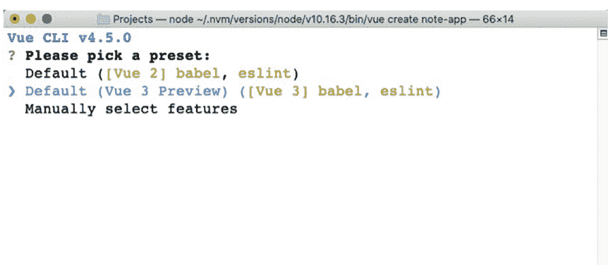

图 9-8. 在 Vue CLI 中选择 Vue 3

安装完所有依赖项后，进入项目文件夹。

```
$cd note-app
```

## 添加 Material Web 组件

首先，我们将安装要在应用中使用的 Web 组件。

安装 mwc-button（图 9-9）。


图 9-9. mwc-button 组件

然后在终端中运行以下命令：

```
$npm install --save @material/mwc-button
```

你可以在 https://github.com/material-components/material-components-web-components/tree/master/packages/button 查看其所有属性。

安装 mwc-dialog（图 9-10）。

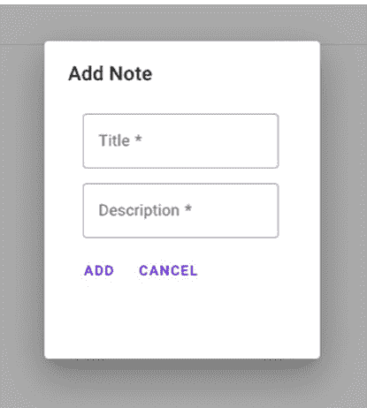

图 9-10. *mwc-dialog* 组件

然后在终端中运行以下命令：

```
$npm install --save @material/mwc-dialog
```

你可以在 https://github.com/material-components/material-components-web-components/tree/master/packages/dialog 查看其所有属性。

安装 mwc-fab（图 9-11）。


图 9-11. *mwc-fab* 组件

然后在终端中运行以下命令：

```
$npm install --save @material/mwc-fab
```

你可以在 https://github.com/material-components/material-components-web-components/tree/master/packages/fab 查看其所有属性。

## 第 9 章：使用 Vue.js

安装 mwc-icon-button（图 9-12）。


图 9-12. mwc-icon-button 组件

然后在终端中运行以下命令：

```
$npm install --save @material/mwc-icon-button
```

你可以在 https://github.com/material-components/material-components-web-components/tree/master/packages/icon-button 查看其所有属性。

安装 mwc-list（图 9-13）。

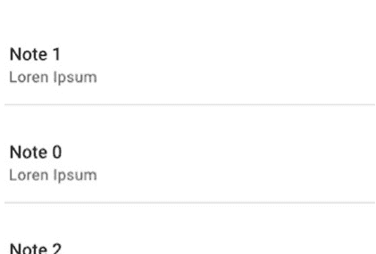

图 9-13. mwc-list 组件

然后在终端中运行以下命令：

```
$npm install --save @material/mwc-list
```

你可以在 https://github.com/material-components/material-components-web-components/tree/master/packages/list 查看其所有属性。

安装 mwc-textfield（图 9-14）。

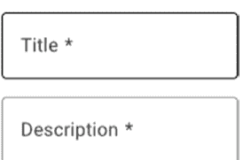

图 9-14. mwc-textfield 组件

然后在终端中运行以下命令：

```
$npm install --save @material/mwc-textfield
```

你可以在 https://github.com/material-components/material-components-web-components/tree/master/packages/textfield 查看其所有属性。

安装 mwc-top-app-bar（图 9-15）。


登录

图 9-15. mwc-top-app-bar 组件

然后在终端中运行以下命令：

```
$npm install --save @material/mwc-top-app-bar
```

你可以在 https://github.com/material-components/material-components-web-components/tree/master/packages/top-app-bar 查看其所有属性。

现在我们将安装 Polyfills 以支持旧版 Web 浏览器。

安装以下依赖项：

```
$npm install --save-dev copy-webpack-plugin @webcomponents/webcomponentsjs
```

将 copy-webpack-plugin 添加到 Vue 的 Webpack 配置文件。为此，我们必须创建一个新文件 vue.config.js，并添加清单 9-17 中的代码。

### 清单 9-17. 使用 copy-webpack-plugin 与 webcomponentsjs

```
const CopyWebpackPlugin = require('copy-webpack-plugin');

module.exports = {
    configureWebpack: {
        plugins: [
            new CopyWebpackPlugin({
                patterns: [{
                    context: 'node_modules/@webcomponents/webcomponentsjs',
                    from: '**/*.js',
                    to: 'webcomponents'
                }]
            })
        ]
    }
};
```

构建时，copy-webpack-plugin 现在会将所有必需的 JS 文件复制到 webcomponents 目录中。

现在，在 public/index.html 中，我们将添加几行代码来检查 Web 浏览器是否支持 customElements 或使用 Polyfills（见清单 9-18）。

### 清单 9-18. 在 VueNoteApp 中添加 webcomponentjs

```
<!DOCTYPE html>
<html lang="en">
<head>
...
    <script src="webcomponents/webcomponents-loader.js"></script>
    <script>
        if (!window.customElements) { document.write('<!--'); }
    </script>
    <script src="webcomponents/custom-elements-es5-adapter.js"></script>
    <!-- ! DO NOT REMOVE THIS COMMENT -->
...
</body>
</html>
```


在 components/HelloWorld.vue 中，我们将添加 mwc-button（见清单 9-19）。

### 清单 9-19. 在 HelloWorld.vue 中使用 mwc-button
```
<template>
<div class="hello">
<h1>{{ msg }}</h1>
<p>
For a guide and recipes on how to configure / customize this
project,<br>
check out the
<a href="https://cli.vuejs.org" target="_blank" rel="noopener">
vue-cli documentation</a>.
</p>
<h3>Installed CLI Plugins</h3>
<ul>
<li><a href="https://github.com/vuejs/vue-cli/tree/dev/packages/%40vue/cli-plugin-babel" target="_blank" rel="noopener">babel</a></li>
<li><a href="https://github.com/vuejs/vue-cli/tree/dev/packages/%40vue/cli-plugin-eslint" target="_blank" rel="noopener">eslint</a></li>
</ul>
<h3>Essential Links</h3>
<ul>
<li><a href="https://vuejs.org" target="_blank" rel="noopener">Core Docs</a></li>
<li><a href="https://forum.vuejs.org" target="_blank" rel="noopener">Forum</a></li>
<li><a href="https://chat.vuejs.org" target="_blank" rel="noopener">Community Chat</a></li>
<li><a href="https://twitter.com/vuejs" target="_blank" rel="noopener">Twitter</a></li>
<li><a href="https://news.vuejs.org" target="_blank" rel="noopener">News</a></li>
</ul>
<h3>Ecosystem</h3>
<ul>
    <li><a href="https://router.vuejs.org" target="_blank" rel="noopener">vue-router</a></li>
    <li><a href="https://vuex.vuejs.org" target="_blank" rel="noopener">vuex</a></li>
    <li><a href="https://github.com/vuejs/vue-devtools#vue-devtools" target="_blank" rel="noopener">vue-devtools</a></li>
    <li><a href="https://vue-loader.vuejs.org" target="_blank" rel="noopener">vue-loader</a></li>
    <li><a href="https://github.com/vuejs/awesome-vue" target="_blank" rel="noopener">awesome-vue</a></li>
</ul>
<mwc-button id="myButton" label="Click Me!" @click="handleClick" raised></mwc-button>
</div>
</template>

<script>
import '@material/mwc-button';

export default {
  name: 'HelloWorld',
  props: {
    msg: String
  },
  methods: {
    handleClick() {
      console.log('click');
    }
  },
}
</script>
<!-- Add "scoped" attribute to limit CSS to this component only -->
<style scoped>
h3 {
  margin: 40px 0 0;
}
ul {
  list-style-type: none;
  padding: 0;
}
li {
  display: inline-block;
  margin: 0 10px;
}
a {
  color: #42b983;
}
</style>
```

要测试，请运行以下命令：

```
$ npm run serve
```

你应该能在 VueNoteApp 中看到该组件，如图 9-16 所示。

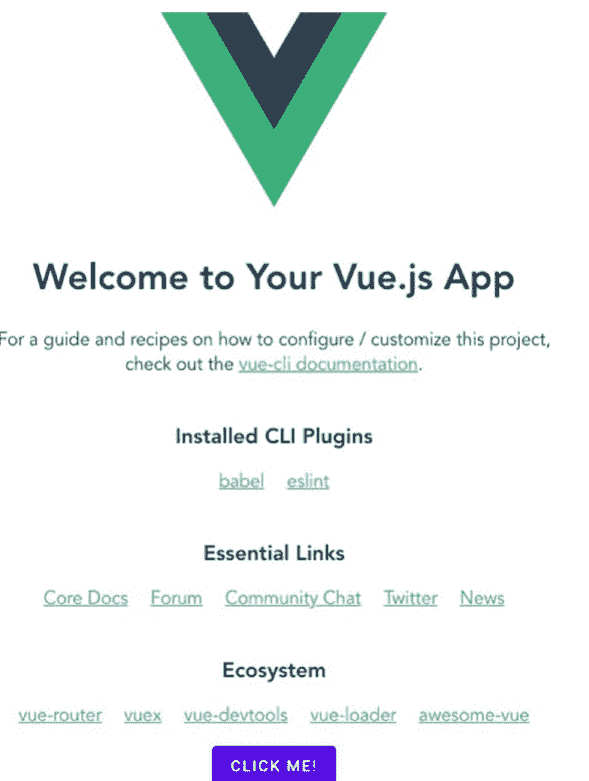

### 图 9-16. 在 HelloWorld.vue 中添加 mwc-button

你可以从 GitHub 仓库通过 $ git checkout v1.0.1 进入。

## 添加头部

我们将添加 mwc-top-app-bar 并创建一些空组件，以便以更好的结构组织文件。我们必须修改 Apps.vue 并在此处添加 mwc-top-app-bar 组件，如清单 9-20 所示。

### 清单 9-20. 在 HelloWorld.vue 中使用 mwc-button
```
<!-- eslint-disable vue/no-deprecated-slot-attribute -->
<template>
  <mwc-top-app-bar centerTitle>
    <mwc-icon-button icon="menu" slot="navigationIcon"></mwc-icon-button>
    <div slot="title">VueNoteApp</div>
    <mwc-icon-button icon="help" slot="actionItems"></mwc-icon-button>
    <div><!-- content --></div>
  </mwc-top-app-bar>
</template>

<script>
import '@material/mwc-top-app-bar';
import '@material/mwc-icon-button';

export default {
  name: 'App',
}
</script>
```

此时，你可以使用 $ npm run serve。结果将类似于图 9-17。

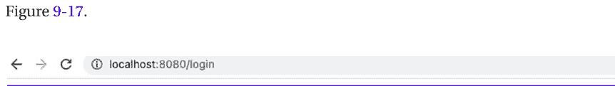

### 图 9-17. 添加 mwc-top-app-bar

此外，我们将创建两个空组件，views/Dashboard.vue（见清单 9-21）和 views/About.vue（见清单 9-22），以便我们的应用拥有不同的视图。

### 清单 9-21. Dashboard.vue
```
<template>
  <div>
    Dashboard
  </div>
</template>
<script>
export default {
  name: 'Dashboard'
}
</script>
<style>

</style>
```

### 清单 9-22. About.vue
```
<template>
  <div class="about">
    <h1>This is an about page</h1>
  </div>
</template>
```

你可以从 GitHub 仓库通过 $ git checkout v1.0.2 访问此代码。

## 添加 Vue Router

Vue Router 是专为在 Vue.js 框架中使用而设计的单页应用的官方路由插件。路由器是在单页应用中在不同视图之间跳转而无需刷新网页浏览器的一种方式。将 Vue Router 集成到 VueNoteApp 中非常容易。

安装插件。

```
$ vue add router
```

在 main.js 中添加 VueRouter，如清单 9-23 所示。

### 清单 9-23. 在 main.js 中添加 Router
```
import { createApp } from 'vue'
import App from './App.vue'
import router from './router'

createApp(App).use(router).mount('#app')
```

编辑 router/index.js 文件并添加 Dashboard 和 About 的路由，如清单 9-24 所示。

### 清单 9-24. 在 router/index.js 中添加 Router
```
import { createRouter, createWebHistory } from 'vue-router'
import Dashboard from '../views/Dashboard.vue'
const routes = [
  {
    path: '/',
    name: 'Dashboard',
    component: Dashboard
  },
  {
    path: '/about',
    name: 'About',
    component: () => import(/* webpackChunkName: "about" */ '../views/About.vue')
  }
]
const router = createRouter({
  history: createWebHistory(process.env.BASE_URL),
  routes
})

export default router
```

如果你查看 /about 路由，我们使用 import() 来加载组件。这是因为我们是在用户使用该视图时加载组件，而不是在应用启动时加载所有内容。这称为懒加载，对性能有益。现在我们必须在 App.vue 中添加一些内容。占位符 <router-view> 是组件将被加载的位置，具体取决于路由，而 <router-link> 是在模板中更改路由的一种方式（见清单 9-25）。

### 清单 9-25. 在 App.vue 中添加 Routes
```
<!-- eslint-disable vue/no-deprecated-slot-attribute -->
<template>
    <mwc-top-app-bar centerTitle>
        <div slot="title"><router-link to="/">VueNoteApp</router-link></div>
        <div slot="actionItems"><router-link to="/About">About</router-link></div>
        <div><router-view/></div>
    </mwc-top-app-bar>
</template>

<script>
import '@material/mwc-top-app-bar';
import '@material/mwc-icon-button';

export default {
    name: 'App',
    methods: {
        handleAbout() {
            this.$router.push('About');
        }
    },
}
</script>

<style>
    a, a:visited {
        color:white;
        text-decoration:none;
        padding: 5px;
    }
</style>
```

通过这些小的更改，你应该能看到带有路由的头部，你可以通过点击链接来更改，如图 9-18 所示。

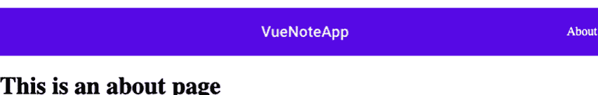

## 这是一个关于页面

### 图 9-18. 添加路由

你可以从 GitHub 仓库通过 $ git checkout v1.0.3 访问代码。
现在我们将在 views/Dashboard.vue 中添加一些元素（见清单 9-26）。

### 清单 9-26. 在 Dashboard.vue 中添加 Web 组件
```
<!-- eslint-disable vue/no-deprecated-slot-attribute -->
<template>
    <div>
        <mwc-list multi>
            <mwc-list-item twoline>
                <span>Item 0</span>
                <span slot="secondary">Secondary line</span>
            </mwc-list-item>
            <li divider padded role="separator"></li>
            <mwc-list-item twoline>
                <span>Item 1</span>
                <span slot="secondary">Secondary line</span>
            </mwc-list-item>
            <li divider padded role="separator"></li>
            <mwc-list-item twoline>
                <span>Item 2</span>
                <span slot="secondary">Secondary line</span>
            </mwc-list-item>
            <li divider padded role="separator"></li>
            <mwc-list-item twoline>
              <span>Item 3</span>
              <span slot="secondary">Secondary line</span>
            </mwc-list-item>
        </mwc-list>
        <mwc-fab class="floatButton" mini icon="add"></mwc-fab>
    </div>
</template>
<script>
import '@material/mwc-list/mwc-list';
import '@material/mwc-list/mwc-list-item';
import '@material/mwc-fab';

export default {
  name: 'Dashboard'
}
</script>
<style scoped>
.floatButton {
  position: fixed;
  bottom: 20px;
  right: 20px;
}
</style>
```

我们添加 mwc-list-items 来显示笔记，并添加一个 mwc-fab 作为浮动按钮，我们将用它来添加新笔记。

我们还在 Listing 9-27 所示的 views/About.vue 中添加内容。

### 清单 9-27. 在 About.vue 中添加 Routes
```
<template>
  <div class="about">
    <h1>Building Native Web Components</h1>
    <h2><i>Front-End Development with Polymer and Vue.js</i></h2>
    <p>
```


开始使用现代架构开发单页应用（SPAs）。本书展示了如何创建、设计和发布原生 Web 组件，最终让你能够在现代 JavaScript 框架中将这些元素组合起来。

《Building Native Web Components》立即深入，带你开始构建第一个 Web 组件。你将被介绍到原生 Web 组件设计系统和框架，讨论组件驱动开发并了解其在大规模公司中的重要性。你随后将转向使用模板和 API 以及自定义事件生命周期构建 Web 组件。移动数据、自定义和分发组件的技术和最佳实践也涵盖在内。在整个过程中，你将建立一个基础，以便在日常工作中开始使用 Polymer、Vue.js 和 Firebase。

自信地应用现代模式并开发工作流程，以构建可在 SPA 中重用的框架无关软件组件。《Building Native Web Components》是你的指南，帮助你开发小型且自主的 Web 组件，这些组件专注、独立、可重用、可测试，并且适用于所有 JavaScript 框架、现代浏览器和库。

```
</p>
</div>
</template>
<style scoped>
.about {
  background-color: white;
  text-justify:auto;
  padding: 30px;
}
</style>
```

我们正在添加有关本书的一些信息，在图 9-19 中你可以看到外观的改进，更符合我们的目标。

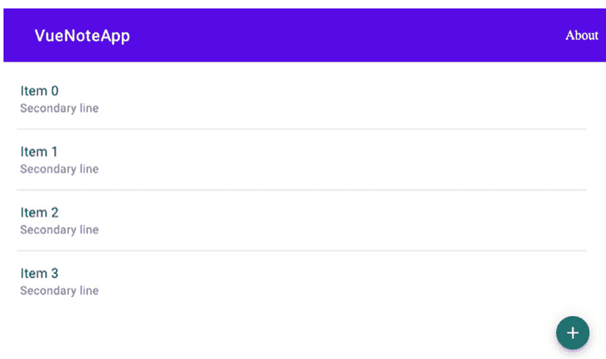

图 9-19. 在 Dashboard.vue 中添加 Web 组件

你可以在 GitHub 仓库中通过 $git checkout v1.0.4 访问代码。

## 删除笔记

使用 mwc-list 和 mwc-list-item，我们可以在 Dashboard.vue 中以更悦目的方式查看我们的笔记，但我们的笔记在代码中是静态的。这就是为什么我们要创建一个位于 utils/DummyData.js 中的模块，如列表 9-28 所示。

### 列表 9-28. DummyData 模块

```
export const notesData = [
  {id: 1, title: "Note 1", description: "Lorem Ipsum"},
  {id: 2, title: "Note 2", description: "Lorem Ipsum"},
  {id: 3, title: "Note 3", description: "Lorem Ipsum"},
  {id: 4, title: "Note 4", description: "Lorem Ipsum"},
  {id: 5, title: "Note 5", description: "Lorem Ipsum"},
  {id: 6, title: "Note 6", description: "Lorem Ipsum"},
  {id: 7, title: "Note 7", description: "Lorem Ipsum"}
];
```

该模块只是一个包含一些笔记的简单数组，我们可以在 Dashboard.vue 中导入它，但它很方便，因为现在我们可以动态加载此数据，如列表 9-29 所示。将来，我们可以轻松地将其替换为 API 或 Firebase。

### 列表 9-29. DummyData 模块

```
<!-- eslint-disable vue/no-deprecated-slot-attribute -->
<template>
  <div>
    <mwc-list v-for="(note) in notes" :key="note.id" multi>
      <mwc-list-item twoline hasMeta>
        <span>{{note.title}}</span>
        <span slot="meta" class="material-icons">delete</span>
        <span slot="secondary">{{note.description}}</span>
      </mwc-list-item>
      <li divider padded role="separator"></li>
    </mwc-list>
    <mwc-fab class="floatButton" mini icon="add"></mwc-fab>
  </div>
</template>
<script>
import '@material/mwc-list/mwc-list';
import '@material/mwc-list/mwc-list-item';
import '@material/mwc-fab';
import '@material/mwc-button';
import { notesData } from '../utils/DummyData';

export default {
  name: 'Dashboard',
  data() {
    return {
      notes: notesData
    }
  }
}
</script>
```

```
<style scoped>
.floatButton {
  position: fixed;
  bottom: 20px;
  right: 20px;
}
</style>
```

现在，在 Dashboard.vue 中，我们在 notes 属性中导入 notesData，并在模板中使用 v-for 指令遍历所有笔记并为每个笔记创建一个 mwc-list-item，如图 9-20 所示。

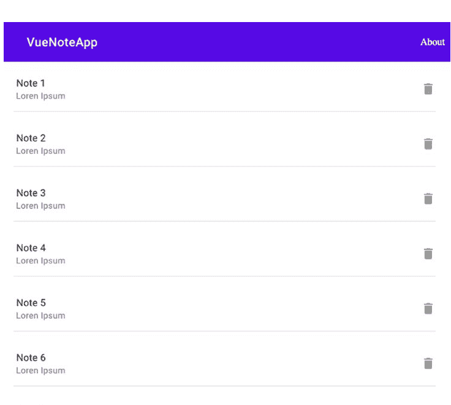

图 9-20. 在 Dashboard.vue 中添加 notesData

用户在插入新笔记时可能会犯错。因此我们必须允许他们删除笔记。为此，我们必须修改我们的数组并移除元素。JavaScript 有一个方法可以帮助我们做到这一点：Splice。Splice 方法允许我们更改数组中的内容。

我们将创建 handleDelete(id) 方法并将其添加到 Delete 按钮中，我们将向其传递要删除的项目索引。使用 Splice，我们可以从数组中移除内容，如列表 9-30 所示。

### 列表 9-30. DummyData 模块

```
<!-- eslint-disable vue/no-deprecated-slot-attribute -->
<template>
  <div>
    <mwc-list v-for="(note) in notes" :key="note.id" multi>
      <mwc-list-item twoline hasMeta>
        <span>{{note.title}}</span>
        <span slot="meta" class="material-icons" @click="handleDelete(note.id)">delete</span>
        <span slot="secondary">{{note.description}}</span>
      </mwc-list-item>
      <li divider padded role="separator"></li>
    </mwc-list>
    <mwc-fab class="floatButton" mini icon="add"></mwc-fab>
  </div>
</template>
<script>
import '@material/mwc-list/mwc-list';
import '@material/mwc-list/mwc-list-item';
import '@material/mwc-fab';
import '@material/mwc-button';
import { notesData } from '../utils/DummyData';

export default {
  name: 'Dashboard',
  data() {
    return {
      notes: notesData
    }
  }

```

```
}
},
methods: {
  handleDelete(id) {
    const noteToDelete = this.notes.findIndex((item) => (item.id ===
    id));
    this.notes.splice(noteToDelete, 1);
  }
},
}
</script>
<style scoped>
.floatButton {
  position: fixed;
  bottom: 20px;
  right: 20px;
}
</style>
```

你可以在 GitHub 仓库中通过 $git checkout v1.0.5 访问相关代码。

## 添加新笔记

此时，我们可以动态加载笔记，并且可以从列表中删除笔记。现在我们将添加一个机制来添加新笔记，使用我们之前在右下角添加的 fab 按钮。为此，我们将使用 mwc-dialog，以显示一个模态框，其中包含一个表单，用户可以通过它添加新笔记或取消并返回到笔记列表（见图 9-21）。

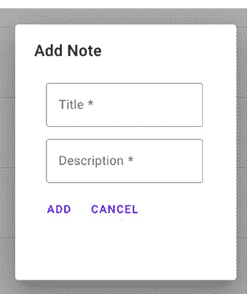

图 9-21. Dashboard.vue 中的 mwc-dialog

此外，我们将添加 uuid 库。有了这个库，我们可以为新笔记生成新的唯一 id。运行以下命令：

```
$npm install -save uuid
```

在模板中，我们将添加 mwc-dialog，如列表 9-31 所示。

### 列表 9-31. 添加 mwc-dialog

```
<!-- eslint-disable vue/no-deprecated-slot-attribute -->
<template>
  <div>
    <mwc-list v-for="(note) in notes" :key="note.id" multi>
      <mwc-list-item twoline hasMeta>
        <span>{{note.title}}</span>
        <span slot="meta" class="material-icons" @click="handleDelete(note.id)">delete</span>
        <span slot="secondary">{{note.description}}</span>
      </mwc-list-item>
      <li divider padded role="separator"></li>
    </mwc-list>
  </div>
</template>
```

```
<mwc-fab class="floatButton" @click="handleAdd" mini icon="add">
</mwc-fab>
<mwc-dialog id="dialog" heading="Add Note">
  <div class="formFields">
    <mwc-textfield
      id="text-title"
      outlined
      minlength="3"
      label="Title"
      required>
    </mwc-textfield>
  </div>
  <div class="formFields">
  <mwc-textfield
    id="text-description"
    outlined
    minlength="3"
    label="Description"
    required>
  </mwc-textfield>
  </div>
  <div>
  <mwc-button
    id="primary-action-button"
    slot="primaryAction"
    @click="handleAddNote">
    Add
  </mwc-button>
  <mwc-button
    slot="secondaryAction"
    dialogAction="close"
    @click="handleClose">
    Cancel
  </mwc-button>
  </div>
</mwc-dialog>
```

```
</mwc-dialog>
</div>
</template>
```

在这里，我们在 mwc-dialog 内添加了一个表单，该表单使用 mwc-textfield 和 mwc-button 组件来允许输入新笔记并触发 handleAddNote 方法或 handleClose 方法来处理用户选择。接下来，我们将把此逻辑添加到 Dashboard.vue 中，如列表 9-32 所示。

### 列表 9-32. 添加 mwc-dialog

```
<!-- eslint-disable vue/no-deprecated-slot-attribute -->
<template>
  <div>
    <mwc-list v-for="(note) in notes" :key="note.id" multi>
      <mwc-list-item twoline hasMeta>
        <span>{{note.title}}</span>
        <span slot="meta" class="material-icons" @click="handleDelete(note.id)">delete</span>
        <span slot="secondary">{{note.description}}</span>
      </mwc-list-item>
      <li divider padded role="separator"></li>
    </mwc-list>
    <mwc-fab class="floatButton" @click="handleAdd" mini icon="add">
    </mwc-fab>
    <mwc-dialog id="dialog" heading="Add Note">
      <div class="formFields">
        <mwc-textfield
          id="text-title"
          outlined
          minlength="3"
          label="Title"
          required>
        </mwc-textfield>
      </div>
      <div class="formFields">
        <mwc-textfield
```


```
id="text-description"
outlined
minlength="3"
label="Description"
required>
</mwc-textfield>
</div>
<div>
<mwc-button
id="primary-action-button"
slot="primaryAction"
@click="handleAddNote">
Add
</mwc-button>
<mwc-button
slot="secondaryAction"
dialogAction="close"
@click="handleClose">
Cancel
</mwc-button>
</div>
</mwc-dialog>
</div>
</template>
<script>
import '@material/mwc-list/mwc-list';
import '@material/mwc-list/mwc-list-item';
import '@material/mwc-fab';
import '@material/mwc-button';
import '@material/mwc-dialog';
import '@material/mwc-textfield';
import { notesData } from '../utils/DummyData';
import { v4 as uuidv4 } from 'uuid';
export default {
    name: 'Dashboard',
    data() {
        return {
            notes: notesData
        }
    },
    methods: {
        handleDelete(id) {
            const noteToDelete = this.notes.findIndex((item) => (item.id === id));
            this.notes.splice(noteToDelete, 1);
        },
        handleAdd() {
            const formDialog = this.$el.querySelector('#dialog');
            formDialog.show();
        },
        handleAddNote() {
            const formDialog = this.$el.querySelector('#dialog');
            let txtTitle = this.$el.querySelector('#text-title');
            let txtDescription = this.$el.querySelector('#text-description');
            const isValid = txtTitle.checkValidity() && txtDescription.
            checkValidity();

            if(isValid) {
                const newIndex = uuidv4();
                this.notes.push({id: newIndex, title: txtTitle.value, description:
                txtDescription.value});

                txtTitle.value ='';
                txtDescription.value = '';
                formDialog.close();
            }
        },
    }
handleClose() {
  let txtTitle = this.$el.querySelector('#text-title');
  let txtDescription = this.$el.querySelector('#text-description');
  const formDialog = this.$el.querySelector('#dialog');

  txtTitle.value = '';
  txtDescription.value = '';
  formDialog.close();
}
},
}
</script>
<style scoped>
.floatButton {
  position: fixed;
  bottom: 20px;
  right: 20px;
}

.formFields {
  margin: 15px;
}
</style>
```

这里，我们使用 this.$el.querySelector() 来选择 Web 组件并使用其方法执行逻辑，例如 formDialog.show() 和 formDialog.close()，以显示和隐藏 mwc-dialog。此外，在 handleAddNote() 中，我们使用 uuidv4() 方法根据用户在表单中输入的数据生成新的索引，并通过 this.notes.push() 将新笔记添加到我们用于保存所有笔记的本地数组中。通过这些修改，您可以添加笔记（见图 9-22）。

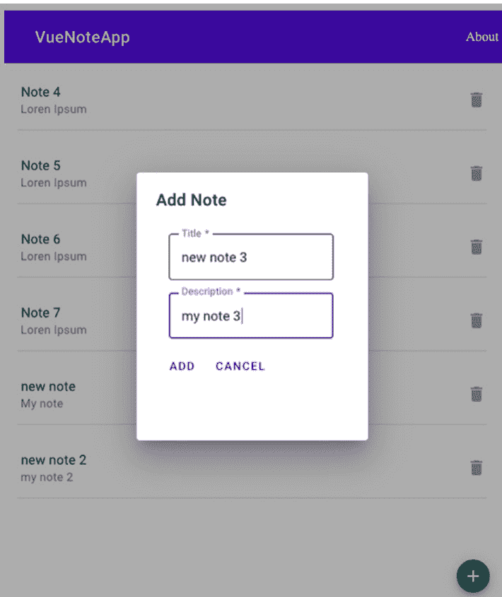

## 图 9-22. 添加新笔记

您可以在 GitHub 仓库中通过 `$git checkout v1.0.6` 访问相关代码。

## 挑战练习

添加一个操作按钮及其在我们的应用中编辑笔记的功能。

- 添加一个新按钮 Edit，类似于 Delete。
- 当用户点击 Edit 时，应用将打开一个类似于 New Note 的对话框窗口，但其中包含所选笔记的信息。
- 用户可以进行更改并再次保存数据，笔记应得到更新。

## 添加 Firebase

如果您尝试重新加载应用，您会发现我们丢失了所有笔记。我们需要一个外部持久化系统来保存我们的数据并在所有客户端之间同步。

Firebase 数据库为我们提供了一个完美的解决方案，可实时为所有客户端同步数据，并且我们可以使用 Firebase 的 JavaScript 软件开发工具包（SDK）轻松保存数据。

开始使用时，请访问 firebase.google.com 并使用您的 Google 账号登录。接下来，前往控制台（图 9-23）。


图 9-23. Firebase 控制台链接

创建新项目（图 9-24）。

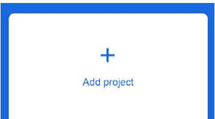

图 9-24. 添加项目按钮

接下来，您将选择项目的名称（图 9-25）。

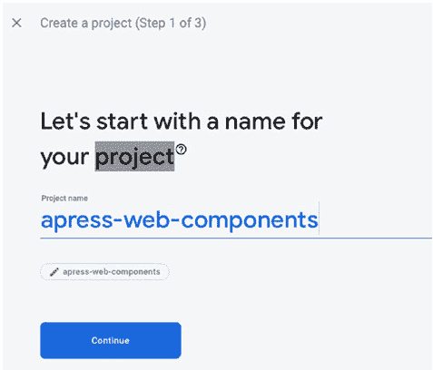

图 9-25. 在 Firebase 中创建新项目

选择是否要在项目中使用 Google Analytics 集成（图 9-26）。


## 图 9-26. 为新的 Firebase 项目添加 Google Analytics

只需几分钟，您就可以开始使用新项目。

当您的项目在 Firebase 控制台中准备就绪时，您将需要一些信息来连接我们的应用和 Firebase。

为此，请前往 项目概览 ► 项目设置。（见图 9-27。）

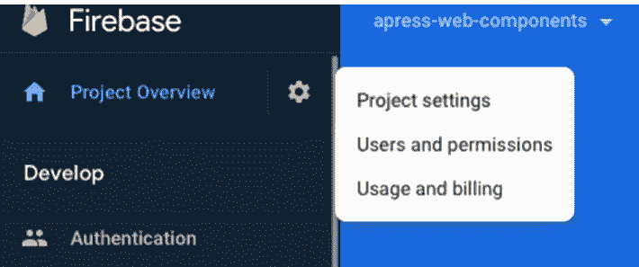

## 图 9-27. Firebase 项目概览

现在点击 Web 应用图标（图 9-28）。

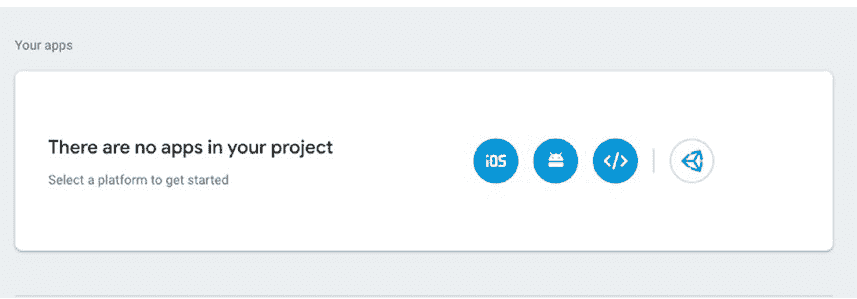

## 图 9-28. Firebase 项目设置视图

Firebase 将启动一个向导（图 9-29）。


## 图 9-29. Firebase Web 应用向导

最后，您将看到我们的 firebaseConfig 摘要（图 9-30）。

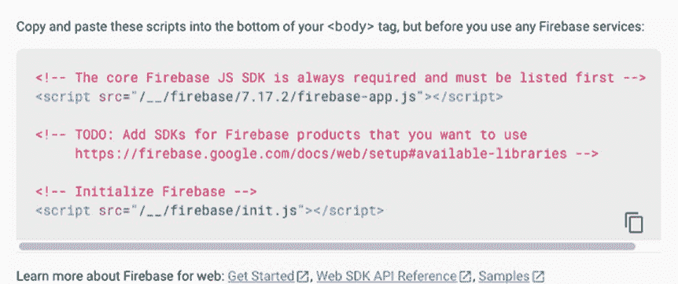

## 图 9-30. Firebase 配置摘要

复制此信息。创建项目的 firebase.js 文件时您将需要它。

我们在控制台中需要做的最后一件事是创建一个新数据库以及无需身份验证即可访问它的安全规则。（我们这样做是为了保持应用简单。）前往 数据库（图 9-31）。

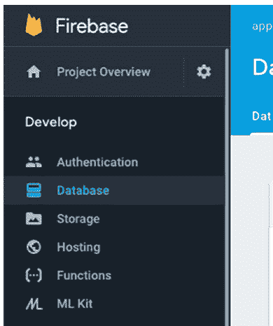

图 9-31. Firebase 数据库链接

选择创建实时数据库（图 9-32）。

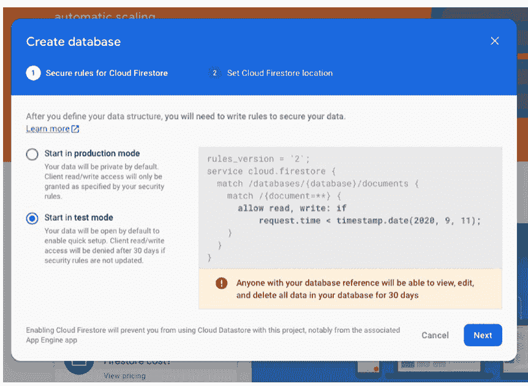

## 图 9-32. Firebase 安全规则

选择以测试模式启动。在此模式下，我们可以在没有身份验证的情况下向数据库写入数据。这在开发中很方便，但在生产环境中不安全。现在我们可以返回到我们的应用。

在终端运行以下命令：

```
$npm install firebase --save
```

创建一个新的 firebase.js 文件并粘贴来自您 Firebase 项目的数据，如清单 9-33 所示。

## 清单 9-33. 添加 Firebase

```
import Firebase from 'firebase';

let config = {
    apiKey: "xxx",
```
```
authDomain: "xxx",
databaseURL: "xxx",
projectId: "xxx",
storageBucket: "xxx",
messagingSenderId: "xxx",
appId: "xxx"
};
```
```
Firebase.initializeApp(config)
```
```
export const fireApp = Firebase;
```

导入 main.js，如清单 9-34 所示。

## 清单 9-34. 在 main.js 中导入 Firebase

```
import Firebase from 'firebase';

import './firebase';
import { createApp } from 'vue'
import App from './App.vue'
import router from './router'

createApp(App).use(router).mount('#app')...
```

您可以在 GitHub 仓库中通过 $git checkout v1.0.7 访问相关代码。

现在，在 Dashboard.vue 中，我们必须使用生命周期 mounted() 方法并恢复实时数据库中的所有笔记。我们还必须更新 saveNote() 和 deleteNote()，以便在 Firebase 中更新新笔记。

With the following, we import Fireapp from firebase.js to keep a reference in our app:

```
const db = fireApp.database().ref();
```

现在，使用 db.push 向 Firebase 添加数据，并使用 remove() 从 Firebase 删除数据（清单 9-35）。有关更多信息，您可以访问相关文档 https://firebase.google.com/docs/reference/js/firebase.database。

## 清单 9-35. 在 Dashboard.vue 中添加 Firebase

```
<!-- eslint-disable vue/no-deprecated-slot-attribute -->
<template>
    <div>
        <mwc-list v-for="(note) in notes" :key="note.id" multi>
            <mwc-list-item twoline hasMeta>
                <span>{{note.title}}</span>
                <span slot="meta" class="material-icons" @click="handleDelete
                (note.id)">delete</span>
                <span slot="secondary">{{note.description}}</span>
            </mwc-list-item>
            <li divider padded role="separator"></li>
        </mwc-list>
        <mwc-fab class="floatButton" @click="handleAdd" mini icon="add">
        </mwc-fab>
        <mwc-dialog id="dialog" heading="Add Note">
            <div class="formFields">
                <mwc-textfield
                    id="text-title"
                    outlined
                    minlength="3"
                    label="Title"
                    required>
                </mwc-textfield>
            </div>
            <div class="formFields">
                <mwc-textfield
                    id="text-description"
                    outlined
                    minlength="3"
                    label="Description"
                    required>
                </mwc-textfield>
            </div>
        </mwc-dialog>
```


```
<div>
    <mwc-button
        id="primary-action-button"
        slot="primaryAction"
        @click="handleAddNote">
        Add
    </mwc-button>
    <mwc-button
        slot="secondaryAction"
        dialogAction="close"
        @click="handleClose">
        Cancel
    </mwc-button>
</div>
</mwc-dialog>
</div>
</template>
<script>
import '@material/mwc-list/mwc-list';
import '@material/mwc-list/mwc-list-item';
import '@material/mwc-fab';
import '@material/mwc-button';
import '@material/mwc-dialog';
import '@material/mwc-textfield';
import { fireApp } from '../firebase'
import { v4 as uuidv4 } from 'uuid';

const db = fireApp.database().ref();

export default {
    name: 'Dashboard',
    data() {
        return {
            notes: []
        }
    },
    mounted() {
        db.once('value', (notes) => {
            notes.forEach((note) => {
                this.notes.push({
                    id: note.child('id').val(),
                    title: note.child('title').val(),
                    description: note.child('description').val(),
                    ref: note.ref
                })
            })
        });
    },
    methods: {
        handleDelete(id) {
            const noteToDelete = this.notes.findIndex((item) => (item.id === id));
            const noteRef = this.notes[noteToDelete].ref;
            if(noteRef) {
                noteRef.remove();
            }
            this.notes.splice(noteToDelete, 1);
        },
        handleAdd() {
            const formDialog = this.$el.querySelector('#dialog');
            formDialog.show();
        },
        handleAddNote() {
            const formDialog = this.$el.querySelector('#dialog');
            let txtTitle = this.$el.querySelector('#text-title');
            let txtDescription = this.$el.querySelector('#text-description');
            const isValid = txtTitle.checkValidity() && txtDescription.checkValidity();

            if(isValid) {
                const newIndex = uuidv4();
                const newItem = {id: newIndex, title: txtTitle.value, description: txtDescription.value};
                this.notes.push(newItem);
                db.push(newItem);

                txtTitle.value = '';
                txtDescription.value = '';
                formDialog.close();
            }
        },
        handleClose() {
            let txtTitle = this.$el.querySelector('#text-title');
            let txtDescription = this.$el.querySelector('#text-description');
            const formDialog = this.$el.querySelector('#dialog');

            txtTitle.value = '';
            txtDescription.value = '';
            formDialog.close();
        }
    }
}
</script>
<style scoped>
.floatButton {
    position: fixed;
    bottom: 20px;
    right: 20px;
}

.formFields {
    margin: 15px;
}
</style>
```

现在我们可以在 Firebase 中看到我们的数据存储（图 9-33）。

```
apress-book-webcomponents
  +- MEXfpdMxKGU6YibbhFz
  +- MEXfrcbO6It_8ZvR6nK
      description: "Note in Firebase"
      id: "6b696488-5b36-47d8-abe1-96b191114fcb"
      title: "Note 2"
```

图 9-33. Firebase 数据库控制台

刷新后，我们的数据将被保存（图 9-34）。

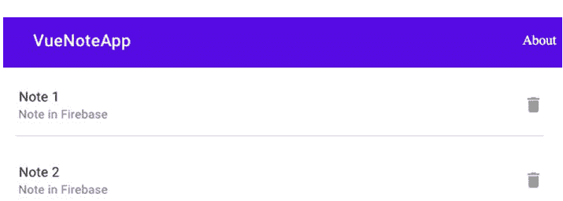

图 9-34. 在 Firebase 中具有持久性的 VueNoteApp

您可以从 GitHub 仓库访问相关代码，执行 $git checkout chap-9。

## 摘要

本章中，您学习了以下内容：

- Vue.js 仅专注于视图层，并且易于上手并与其他库或现有项目集成。
- 组件是在统称为生命周期的过程中创建和销毁的。我们可以使用一些方法在特定时刻运行函数。这些方法称为生命周期钩子。生命周期钩子是任何严肃组件不可或缺的一部分。
- 组件通常需要在它们之间共享信息。对于这些基本场景，我们可以使用 props、ref 属性、发射器和双向数据绑定。
- Vue Router 是为在 Vue.js 框架内使用而设计的单页应用程序的官方路由插件。路由器是在单页应用程序中从一个视图跳转到另一个视图的方式。
- 我们可以使用 Firebase 数据库使所有客户端之间的笔记保持同步。

## 第 10 章

## 发布

恭喜！我们现在有了使用 Vue.js 和 Web Components 的网络应用，但我们希望与全世界分享我们的应用。Firebase Hosting 可以帮助我们使应用公开，而 Firebase Authentication 允许我们添加身份验证系统并为每个用户注册用户及其关联的笔记。

## 添加 Firebase 身份验证

通过其软件开发工具包，Firebase Authentication 为我们在 JavaScript 应用中添加身份验证提供了一种安全的方法。然而，我们必须选择要在应用中支持的登录提供商。您可以选择 Facebook 和 Google 等最受欢迎的选项，或将登录集成到自定义身份验证系统中。我们将只选择电子邮件和密码，以保持简单。

首先，我们将进入 Firebase 网页控制台并选择身份验证（见图 10-1）。

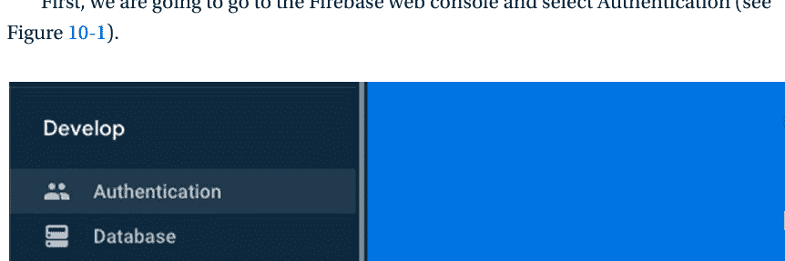

图 10-1. Firebase 网页控制台中的身份验证链接

在身份验证中（图 10-2），我们将选择登录方法。

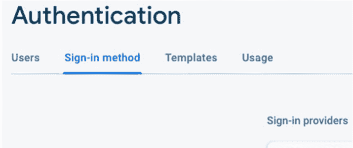

图 10-2. Firebase 网页控制台中的身份验证部分

现在启用电子邮件/密码（图 10-3）。

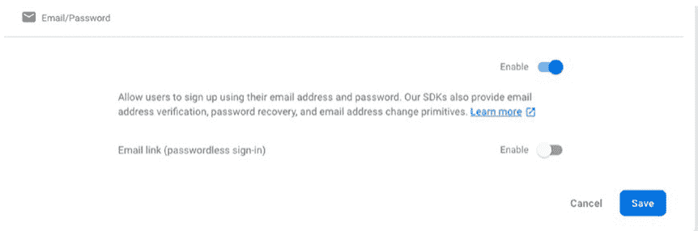

图 10-3. 在 Firebase 网页控制台中启用电子邮件/密码身份验证

好的，就目前而言，网页控制台的工作就到此为止了。

回到我们的代码。我们需要一个带有表单的新组件，以便我们可以输入电子邮件和密码来执行身份验证过程。

创建一个新的 components/Login.vue 文件并添加模板，如清单 10-1 所示。

## 清单 10-1. 在 Login.vue 中添加模板

```
<!-- eslint-disable vue/no-deprecated-slot-attribute -->
<template>
    <div class="formContainer">
        <div class="formLogin">
            <div class="formFields">
                <h1>{{actionText}}</h1>
                <mwc-textfield
                    id="text-email"
                    outlined
                    minlength="3"
                    label="Email"
                    required>
                </mwc-textfield>
            </div>
            <div class="formFields">
                <mwc-textfield
                    id="text-password"
                    type="password"
                    outlined
                    minlength="3"
                    label="Password"
                    required>
                </mwc-textfield>
            </div>
            <div class="actionButtons">
                <mwc-button
                    id="link-action-button"
                    class="actionButton"
                    slot="primaryAction"
                    @click="goToLink">
                    {{linkButton}}
                </mwc-button>
            </div>
            <div class="actionButtons">
                <mwc-button
                    raised
                    id="primary-action-button"
                    class="actionButton"
                    slot="primaryAction"
                    @click="submitAction">
                    {{actionButton}}
                </mwc-button>
                <mwc-button
                    raised
                    slot="secondary-action-button"
                    class="actionButton"
                    @click="handleClear">
                    Clear
                </mwc-button>
            </div>
        </div>
    </div>
</template>
<script>
import '@material/mwc-textfield';
import '@material/mwc-button';
export default {
    name: 'Login',
    data() {
        return {
            actionText: 'Login',
            actionButton: 'Send',
            linkButton: 'Register'
        }
    },
    methods: {
        goToLink () {
            switch(this.linkButton) {
                case 'Login':
                    this.actionText= 'Login';
                    this.actionButton= 'Send';
                    this.linkButton = 'Register';
                    break;
                case 'Register':
                    this.actionText= 'Register';
                    this.actionButton= 'Register';
                    this.linkButton = 'Login';
                    break;
            }
        }
    }
}
</script>
<style scoped>
.formContainer {
    display:flex;
}
.formLogin {
    margin:auto;
}
.formFields {
    margin: 15px;
}
.actionButtons {
    text-align:center;
}
.actionButton {
    margin: 10px;
}
</style>
```


通过此操作，我们正在为登录和注册用户添加一个表单。我们对两个操作使用相同的视图，并使用 actionText、actionButton 和 linkButton 来切换用户在视图中可以看到的文本，如图 10-4 所示。

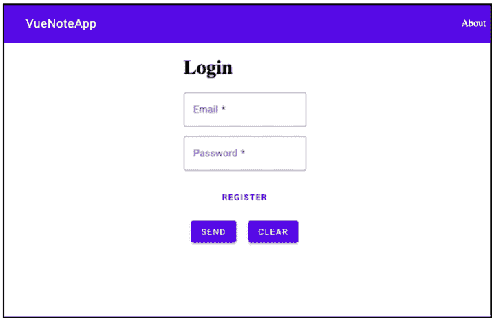

图 10-4. 登录组件

下一步是添加身份验证功能（清单 10-2）。

## 清单 10-2. 在 Login.vue 中添加 Firebase 身份验证

```
<!-- eslint-disable vue/no-deprecated-slot-attribute -->
<template>
    <div class="formContainer">
        <div class="formLogin">
            <div class="formFields">
                <h1>{{actionText}}</h1>
                <mwc-textfield
                    id="text-email"
                    outlined
                    minlength="3"
label="Email"
    required>
    </mwc-textfield>
</div>
<div class="formFields">
    <mwc-textfield
        id="text-password"
        type="password"
        outlined
        minlength="3"
        label="Password"
        required>
    </mwc-textfield>
</div>
<div class="actionButtons">
    <mwc-button
        id="link-action-button"
        class="actionButton"
        slot="primaryAction"
        @click="goToLink">
        {{linkButton}}
    </mwc-button>
</div>
<div class="actionButtons">
    <mwc-button
        raised
        id="primary-action-button"
        class="actionButton"
        slot="primaryAction"
        @click="submitAction">
        {{actionButton}}
    </mwc-button>
    <mwc-button
        raised
        slot="secondary-action-button"
class="actionButton"
@click="handleClear">
Clear
</mwc-button>
</div>
</div>
</div>
</template>
<script>
import '@material/mwc-textfield';
import '@material/mwc-button';
import { fireApp } from '../firebase';
const auth = fireApp.auth();

export default {
  name: 'Login',
  data() {
    return {
      actionText: 'Login',
      actionButton: 'Send',
      linkButton: 'Register'
    }
  },
  methods: {
    goToLink () {
      switch(this.linkButton) {
      case 'Login':
        this.actionText= 'Login';
        this.actionButton= 'Send';
        this.linkButton = 'Register';
        break;
      case 'Register':
        this.actionText= 'Register';
        this.actionButton= 'Register';
        this.linkButton = 'Login';
break;
}
},
goToDashboard () {
    this.$router.push('/dashboard');
},
signInUser (email, password) {
    auth.signInWithEmailAndPassword(email,password)
    .then(
        () => {
        this.goToDashboard();
        }
    )
    .catch(
        // eslint-disable-next-line
        (error) => {console.log('Something happened.', error)}
    );
},
signUpUser (email, password) {
    auth.createUserWithEmailAndPassword(email,password)
    .then(
        // eslint-disable-next-line
        (user) => {console.log('User registered.', user)}
    )
    .catch(
        // eslint-disable-next-line
        (error) => {console.log('Something happened.', error)}
    );
},
submitAction () {

    let txtEmail = this.$el.querySelector('#text-email');
    let txtPassword = this.$el.querySelector('#text-password');
    const isValid = txtEmail.checkValidity() && txtPassword.checkValidity();
if(isValid) {
    switch(this.actionText) {
        case 'Login':
            this.signInUser (txtEmail.value, txtPassword.value);
            txtEmail.value = '';
            txtPassword.value ='';
            break;
        case 'Register':
            this.signUpUser (txtEmail.value, txtPassword.value);
            txtEmail.value = '';
            txtPassword.value ='';
            break;
    }
}
}
},
</script>
<style scoped>
.formContainer {
    display:flex;
}
.formLogin {
    margin:auto;
}
.formFields {
    margin: 15px;
}
.actionButtons {
    text-align:center;
}
.actionButton {
    margin: 10px;
}
</style>
```

在这里，我们使用 submitAction() 方法来检查我们是在创建新用户还是在应用中登录，并传递用户在表单中输入的电子邮件和密码。如果用户想要登录应用，我们使用 Firebase 的 auth.signInWithEmailAndPassword() 方法来检查用户是否在 Firebase 中存在。如果密码正确，我们将被重定向到 Dashboard 视图。如果用户正在创建新账户，我们使用 Firebase 的 auth.createUserWithEmailAndPassword() 方法将此新用户添加到 Firebase。

最后，我们将修改文件 router/index.js 以添加此新组件（清单 10-3）。

## 清单 10-3. 在 Vue Router 中添加登录组件

```
<!-- eslint-disable vue/no-deprecated-slot-attribute -->
import { createRouter, createWebHistory } from 'vue-router'
import Login from '../views/Login.vue'

const routes = [
  {
    path: '',
    component: Login
  },
  {
    path: '/login',
    name: 'Login',
    component: Login
  },
  {
    path: '/dashboard',
    name: 'Dashboard',
    component: () => import(/* webpackChunkName: "dashboard" */ '../views/Dashboard.vue')
  },
  {
    path: '/about',
    name: 'About',
    component: () => import(/* webpackChunkName: "about" */ '../views/About.vue')
  }
]

const router = createRouter({
  history: createWebHistory(process.env.BASE_URL),
  routes
})
export default router
```

从 GitHub 仓库（https://github.com/carlosrojaso/apress-book-web-components）可以访问相关代码，执行 $git checkout v1.0.8。

## 添加守卫

现在，在 App.vue 中，我们必须添加一种机制，防止未登录的用户直接通过 URL 访问 Dashboard.vue。为此，我们将使用 Vue Router 的一个功能，称为 Guards。Guards 主要用于保护导航，通过重定向或取消它们。您可以在 https://router.vuejs.org/guide/advanced/navigation-guards.html#global-before-guards 了解更多关于 Guards 的信息。我们将在 router/index.js 文件中添加此机制（清单 10-4）。

## 清单 10-4. 在 Vue Router 中添加导航守卫

```
import { createRouter, createWebHistory } from 'vue-router'
import Login from '../views/Login.vue'
import { fireApp } from '../firebase';

const routes = [
  {
    path: '',
    component: Login
  },
  {
    path: '/login',
    name: 'Login',
    component: Login
  },
  {
    path: '/dashboard',
    name: 'Dashboard',
    component: () => import(/* webpackChunkName: "dashboard" */ '../views/Dashboard.vue'),
    meta: {
        requiresAuth: true
    }
  },
  {
    path: '/about',
    name: 'About',
    component: () => import(/* webpackChunkName: "about" */ '../views/About.vue')
  }
]

const router = createRouter({
    history: createWebHistory(process.env.BASE_URL),
    routes
})

router.beforeEach(async (to, from, next) => {
    const requiresAuth = to.matched.some(record => record.meta.requiresAuth);
    if (requiresAuth && !await fireApp.getCurrentUser()) {
        next('Login');
    } else {
        next();
    }
})

export default router
```

在这里，我们在 /Dashboard 中使用路由 meta 字段来强制此路由的身份验证，并在守卫中检查它。此外，我们正在检查来自 fireApp 的 getCurrentUser() 方法。我们必须在 firebase.js 中添加此方法（清单 10-5）。

## 清单 10-5. 在 firebase.js 中添加 getCurrentUser() 方法

```
import Firebase from 'firebase';

let config = {
  apiKey: "xxx",
  authDomain: "xxx",
  databaseURL: "xxx",
  projectId: "xxx",
  storageBucket: "xxx",
  messagingSenderId: "xxx",
  appId: "xxx"
};

Firebase.initializeApp(config)

Firebase.getCurrentUser = () => {
  return new Promise((resolve, reject) => {
    const unsubscribe = Firebase.auth().onAuthStateChanged(user => {
      unsubscribe();
      resolve(user);
    }, reject);
  })
};
export const fireApp = Firebase;
```

getCurrentUser 方法为我们提供有关当前用户的信息或拒绝。最后，我们将在顶部添加一个注销链接，以便用户关闭其会话。

在 App.vue 中，我们将在 <mwc-top-app-bar> 中添加一个链接（清单 10-6）。


## 列表 10-6. 在 App.vue 中添加注销机制

```
<!-- eslint-disable vue/no-deprecated-slot-attribute -->
<template>
    <mwc-top-app-bar>
        <div slot="title"><router-link to="/">VueNoteApp</router-link></div>
        <div slot="actionItems"><router-link to="/About">About</router-link>
        </div>
        <div slot="actionItems" v-if="logged" @click="handleLogout">Logout
        </div>
        <div><router-view/></div>
    </mwc-top-app-bar>
</template>

<script>
import '@material/mwc-top-app-bar';

import { fireApp } from './firebase';
const auth = fireApp.auth();

export default {
    name: 'App',
    data() {
        return {
            logged: false
        }
    },
    mounted() {
        fireApp.getCurrentUser()
            .then((user)=> {
                this.logged = user;
                this.$router.push('Dashboard');
            })
            .catch(() => {
                this.logged = false;
            });
    },
methods: {
    handleAbout() {
        this.$router.push('About');
    },
    handleLogout() {
        auth.signOut()
            .then(()=>{
                this.$router.push('/login');
                this.logged= false;
            })
            .catch((error)=> {
                // eslint-disable-next-line
                console.log('error', error)
            });
    }
},
}
</script>
<style>
    a, a:visited {
        color:white;
        text-decoration:none;
        padding: 5px;
    }
</style>
```

这里，我们使用 fireApp.currentUser() 在 Login.vue 的 mounted() 时检查用户是否已登录，如果可以则直接跳转到 Dashboard.vue，否则要求用户输入凭据。此外，我们创建了 handleLogout() 方法，该方法使用 auth.signOut 关闭会话并将用户重定向到 Login.vue。当用户已登录时，我们使用 v-if 指令显示注销链接，然后，只有在用户已登录后，我们才向用户显示此链接（图 10-5）。

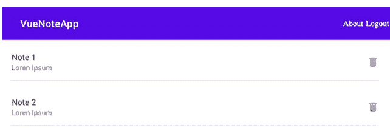

### 图 10-5. 注销链接

从 GitHub 仓库 (https://github.com/carlosrojaso/apress-book-web-components)，你可以在 $git checkout v1.0.9 处访问相关代码。

## 为数据添加用户

如果你创建多个用户并添加或删除笔记，你会发现这些笔记在所有账户中共享。这是因为我们没有为每个用户过滤笔记。要实现这一点，我们必须采取一些额外步骤。

首先，我们将在用户创建的每条笔记中添加用户 ID，如列表 10-7 所示。

## 列表 10-7. 在新笔记中添加 userId 属性

```
...
    handleAddNote() {
      const formDialog = this.$el.querySelector('#dialog');
      let txtTitle = this.$el.querySelector('#text-title');
      let txtDescription = this.$el.querySelector('#text-description');
      const isValid = txtTitle.checkValidity() && txtDescription.
      checkValidity();
      if(isValid) {
        const newIndex = uuidv4();
const newItem = {
  id: newIndex,
  title: txtTitle.value,
  description: txtDescription.value,
  userId: this.user.uid
};
this.notes.push(newItem);
db.push(newItem);

txtTitle.value = '';
txtDescription.value = '';
formDialog.close();
}
},
...
```

现在，数据在每条笔记与其创建者用户之间建立了关联关系（图 10-6）。

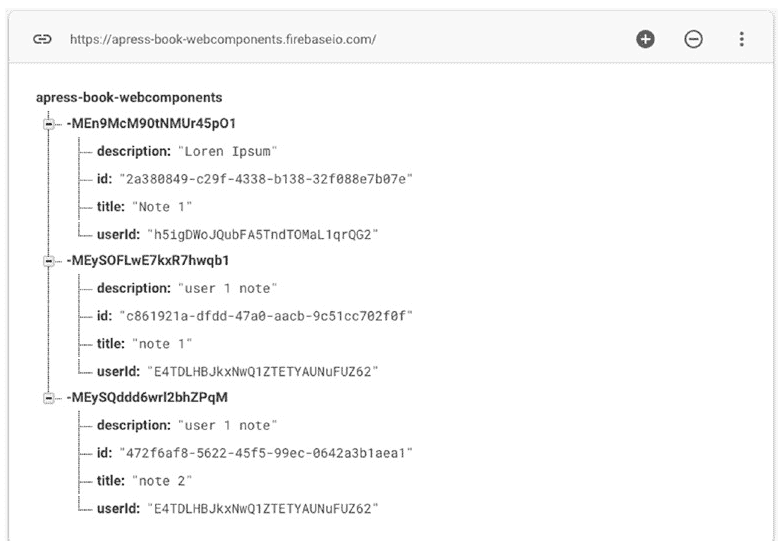

图 10-6. Firebase 网页控制台数据库数据

现在我们必须返回 Firebase 网页控制台并更新我们的安全规则（图 10-7）。

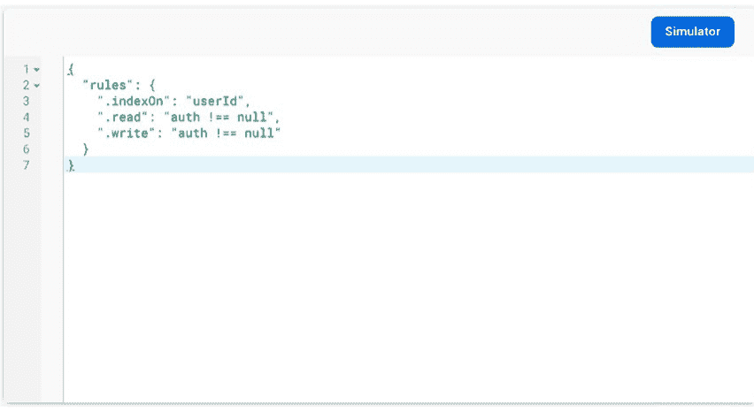

### 图 10-7. Firebase 网页控制台数据库安全规则

通过这样设置，只有已登录的会话才能在我们的数据库中读取和写入数据。此外，我们使用 userId 创建了一个索引，以便更快地进行搜索/排序。

现在我们必须过滤笔记（列表 10-8）。

## 列表 10-8. 在 Dashboard.vue 中过滤笔记

```
<!-- eslint-disable vue/no-deprecated-slot-attribute -->
<template>
  <div>
    <mwc-list v-for="(note) in notes" :key="note.id" multi>
      <mwc-list-item twoline hasMeta>
        <span>{{note.title}}</span>
        <span slot="meta" class="material-icons" @click="handleDelete
(note.id)">delete</span>
        <span slot="secondary">{{note.description}}</span>
      </mwc-list-item>
    </mwc-list>
  </div>
<li divider padded role="separator"></li>
</mwc-list>
<mwc-fab class="floatButton" @click="handleAdd" mini icon="add">
</mwc-fab>
<mwc-dialog id="dialog" heading="Add Note">
  <div class="formFields">
    <mwc-textfield
      id="text-title"
      outlined
      minlength="3"
      label="Title"
      required>
    </mwc-textfield>
  </div>
  <div class="formFields">
    <mwc-textfield
      id="text-description"
      outlined
      minlength="3"
      label="Description"
      required>
    </mwc-textfield>
  </div>
  <div>
    <mwc-button
      id="primary-action-button"
      slot="primaryAction"
      @click="handleAddNote">
      Add
    </mwc-button>
    <mwc-button
      slot="secondaryAction"
      dialogAction="close"
      @click="handleClose">
      Cancel
    </mwc-button>
    </div>
    </mwc-dialog>
    </div>
</template>
<script>
import '@material/mwc-list/mwc-list';
import '@material/mwc-list/mwc-list-item';
import '@material/mwc-fab';
import '@material/mwc-button';
import '@material/mwc-dialog';
import '@material/mwc-textfield';
import { fireApp } from '../firebase'
import { v4 as uuidv4 } from 'uuid';

const db = fireApp.database().ref();
const auth = fireApp.auth();

export default {
  name: 'Dashboard',
  data() {
    return {
      notes: [],
      user: null
    }
  },
  mounted() {
    this.isUserLoggedIn()
    .then(
      (user) => {
        this.user = user;
        this.updateLogged();
        this.getUserNotes();
      }
    )
  }
}
.catch(
  () => {
    this.$router.push('/login');
  }
)
;
},
methods: {
  getUserNotes() {
  db.orderByChild('userId')
    .equalTo(this.user.uid)
    .once("value")
    .then(
      (notes) => {
        notes.forEach((note) => {
          this.notes.push({
            id: note.child('id').val(),
            title: note.child('title').val(),
            description: note.child('description').val(),
            userId: note.child('userId').val(),
            ref: note.ref
          })
        })
      }
    );
  },
  handleDelete(id) {
    const noteToDelete = this.notes.findIndex((item) => (item.id === id));
    const noteRef = this.notes[noteToDelete].ref;
    if(noteRef) {
      noteRef.remove();
    }
    this.notes.splice(noteToDelete, 1);
  },
}
handleAdd() {
    const formDialog = this.$el.querySelector('#dialog');
    formDialog.show();
},
handleAddNote() {
    const formDialog = this.$el.querySelector('#dialog');
    let txtTitle = this.$el.querySelector('#text-title');
    let txtDescription = this.$el.querySelector('#text-description');
    const isValid = txtTitle.checkValidity() && txtDescription.
    checkValidity();

    if(isValid) {
        const newIndex = uuidv4();
        const newItem = {
            id: newIndex,
            title: txtTitle.value,
            description: txtDescription.value,
            userId: this.user.uid
        };
        this.notes.push(newItem);
        db.push(newItem);

        txtTitle.value = '';
        txtDescription.value = '';
        formDialog.close();
    }
},
handleClose() {
    let txtTitle = this.$el.querySelector('#text-title');
    let txtDescription = this.$el.querySelector('#text-description');
    const formDialog = this.$el.querySelector('#dialog');

    txtTitle.value = '';
    txtDescription.value = '';
    formDialog.close();
},
updateLogged() {
    this.$emit("update-logged", true);
},
isUserLoggedIn () {
    return new Promise(
        (resolve, reject) => {
            auth.onAuthStateChanged(function(user) {
                if (user) {
                    resolve(user);
                }
                else {
                    reject(user);
                }
            })
        }
    );
}
},
}
</script>
<style scoped>
.floatButton {
    position: fixed;
    bottom: 20px;
    right: 20px;
}

.formFields {
    margin: 15px;
}
</style>
```

这里，在 getUserNotes() 方法中，我们使用用户 ID db.orderByChild('userId').equalTo(this.user.uid).once("value") 获取与一个用户关联的笔记。通过这样做，我们解决了笔记的问题，用户可以在每个账户中拥有自己的笔记。


来自 GitHub 仓库 (https://github.com/carlosrojaso/apress-book-web-components)，你可以在 $git checkout v1.0.10 处访问相关代码。

## 发送到 Firebase Hosting

首先，我们必须使用 Firebase 账户对 Firebase CLI 进行身份验证。为此运行以下命令：

```
$ firebase login
```

身份验证成功后，您可以开始使用 Firebase 工具将应用与 Firebase 连接。下一步是创建生产包。为此运行

```
$ npm run build
```

此命令创建包含所有已优化应用的 dist/ 文件夹。

现在我们必须运行 Firebase CLI 向导将 VueNoteApp 与 Firebase 连接（图 10-8）。运行

```
$ firebase init
```

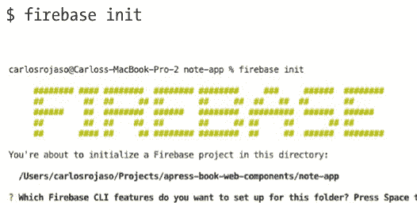

图 10-8. Firebase CLI 选择要配置的服务

选择托管（见图 10-9）。

```
? Which Firebase CLI features do you want to set up for this folder? Press Space
```

## 项目设置

首先，让我们将此项目目录与 Firebase 项目关联。您可以通过运行 firebase use --add 创建多个项目别名，但现在我们只需设置默认项目。

```
? Please select an option: Use an existing project
? Select a default Firebase project for this directory:
amp-html-ionbook (amp-html-ionbook)
amp-html-vueclassroom (amp-html-vueclassroom)
apress-book-pwa (apress-book-pwa)
> apress-book-webcomponents (apress-book-webcomponents)
apress-web-components (apress-web-components)
carlosrojas-dev (www-carlosrojas-dev)
codelab-22299 (frontend-bootstrapping)
```

## 图 10-9. Firebase CLI 选择 Firebase 项目设置

选择你在 firebase.google.com 中创建的项目——就我而言，是 apress-book-webcomponents（图 10-10）。

```
=== Hosting Setup

Your public directory is the folder (relative to your project directory) that will contain Hosting assets to be uploaded with firebase deploy. If you have a build process for your assets, use your build's output directory.

? What do you want to use as your public directory? dist
? Configure as a single-page app (rewrite all urls to /index.html)? No
? Wrote dist/404.html
? File dist/index.html already exists. Overwrite? No
  Skipping write of dist/index.html
  Writing configuration info to firebase.json...
  Writing project information to .firebaserc...
✓ Firebase initialization complete!
```

## 图 10-10. Firebase CLI 选择公共目录

公共目录是 dist/。

好的。有了这个，我们就可以准备将应用发送到 Firebase Hosting。为此，运行以下命令：

```
$ npm run build
$ firebase deploy
```

你将看到如图 10-11 所示的进度。

```
carlosrojaso@Carloss-MacBook-Pro-2 note-app % firebase deploy

=== Deploying to 'apress-book-webcomponents'...

i  deploying hosting
i  hosting[apress-book-webcomponents]: beginning deploy...
i  hosting[apress-book-webcomponents]: found 26 files in dist
✓ hosting[apress-book-webcomponents]: file upload complete
i  hosting[apress-book-webcomponents]: finalizing version...
i  hosting[apress-book-webcomponents]: version finalized
i  hosting[apress-book-webcomponents]: releasing new version...
✓ hosting[apress-book-webcomponents]: release complete

✓ Deploy complete!

Project Console: https://console.firebase.google.com/project/apress-book-webcomponents/overview
Hosting URL: https://apress-book-webcomponents.web.app
```

图 10-11. Firebase CLI 部署并获取公共 URL

最后，你会得到一个 Hosting URL。这就是你的网页 URL。你现在可以用 https://apress-book-webcomponents.web.app 试用。

## 摘要

本章中，你学习了

- 如何在 VueNoteApp 中使用导航守卫
- 如何在 Firebase 中启用电子邮件/密码身份验证
- 如何将数据关联到用户账户
- 如何准备并将 Web 应用发送到 Firebase Hosting

## 最后的想法

如果你已经走到这一步，恭喜！你现在知道如何在任何现有 Web 应用中构建、设计和使用 Web 组件。

如果你有任何评论或反馈，欢迎通过 iam@carlosrojas.dev 联系我。

如果代码方面有任何问题，请不要犹豫，查询本书的 GitHub 仓库 https://github.com/carlosrojaso/apress-book-web-components/issues。

此外，请经常检查代码的官方仓库（https://github.com/carlosrojaso/apress-book-web-components）以获取更新。

稍后再见，继续编程吧！

## 索引

## A

- 应用程序编程接口 (API)
  - app.js, 86
  - index.html, 85–86
  - NoteApp, 87–88
  - notes-data-api.js, 84–85
  - style.css, 86–87
- 身份验证
  - 启用电子邮件/密码，196
  - 功能，200–205
  - 链接创建，195
  - 登录组件，200–205
  - Login.vue 文件，197–200
  - 登录方法，196
- NoteListComponent, 64–65
- NotelistItemComponent, 65
- 组件驱动
  - 开发 (CDD), 3–4
- 自定义元素
  - attributeChangedCallback()
    - 方法，27
  - 定义，26
  - 通用结构，26
  - HTML 文档，25–26
  - 生命周期钩子，24–25
  - 源代码，27–29
  - template() 方法，27
  - Web 开发人员，23–24

## B

- 浏览器 (Web 浏览器)
  - 元素，96
  - ES 模块，97
  - ES6 版本，95
  - HTML 模板，96
  - shadow DOM，96–97
  - 规范，94–95

## C

- 通信
  - 组件，63–64
  - handleDelete() 方法，66
  - note-list-component/note-list-item-component，64

## D

文档对象模型 (DOM)，31

## E

- ES 模块
  - 常量，53
  - 文件 math-constants.js，54
  - 图形表示，54
  - MathOperationsComponent
    - constructor()，56–58
    - 定义，55
  - Google Chrome，59
  - index.html 文件，55
  - package.json 文件，59
  - 参数，56

## F, G

- Firebase
  - 身份验证 (参见 Authentication)
  - CLI 选择公共目录，220
  - 守卫
    - getCurrentUser() 方法，208–210
    - 注销链接，211
    - 导航，206–207
  - 托管信息，219–221
  - 用户/数据
    - 数据库数据，212
    - 已登录会话，213–219
    - 安全规则，213
    - userId 属性，211

## H, I, J, K

- HTML 模板
  - connectedCallback() 方法，36–39
  - 错误消息，39
  - 错误消息，36
  - 隐藏段落，32
  - 属性，31
  - 插槽，33
  - 结构，34
  - template() 方法，34–36
  - 网页，32

## L, M

- LitElement
  - 属性，109
  - 事件监听器，111
  - 生命周期回调
    - adoptedCallback，113
    - attributeChangedCallback，113
    - connectedCallback，112
    - disconnectedCallback，112
  - firstUpdated，113
  - updated，114
  - 属性，106–107
  - render() 方法，107
  - 样式，110
  - 模板，107–110

## N, O

- Node 包管理 (npm)
  - 组件，89，92
  - index.js 文件，92
  - npmjs.com，90
  - package.json 文件，91–94
  - 发布组件，91
  - 终端连接，90
- NoteApp 应用
  - 层次结构，63
  - 识别组件，62
  - 模型，61
- NoteListComponent
  - getter/setter，66
  - 监听器，67–69
  - map() 方法，67
- NotelistItemComponent
  - 事件监听器，72–74
  - getter/setters，69–70
  - Google Chrome，72
  - 模板/样式，70–71

## P, Q, R

- Polyfills，98–99
- Polymer
  - docs 运行，105
  - ESLint，104
  - getStyle() 方法，118
  - Hello, World，104

## S, T

## U

## V

- 含义，103
- NoteListComponent
  - attributeChangedCallback，131
  - handleDelEvent() 函数，132
  - LitElement，136–138
  - 属性，129
  - 源代码，127–128
  - 模板，130
  - VanillaJS，133–136
- render() 方法，119-120
- showModal() 方法，124–126
- SimpleFormModalComponent，114–115，118
- styles() 方法，122–125
- 测试，104
- Web 组件，103
- setters 和 getters，74
- showModal() 方法，77–80
- 模板和样式，75–77
- 用户界面 (UI)，1
- Vue.js
  - 通信
    - 事件，148–149
    - material web components，150
    - 父/子组件，147
    - props 声明，147
    - ref 属性，148
    - 双向数据绑定，149–150
  - 组件，140–142
  - 功能，139
  - firebase 数据库
    - app 向导，184
    - 配置摘要，184
    - 控制台链接，180
    - Dashboard.vue，188–192
    - 数据库链接，185
    - firebase 控制台项目，191–192
    - firebase.js 文件，186–187
    - Google analytics，182
    - main.js 文件，187
    - 概述，182–183
    - 持久性，192
    - 项目按钮，181
    - 安全规则，186
    - Web 应用图标，183
  - 生命周期钩子
    - beforeCreate，143–144
    - beforeDestroy，146
- Shadow DOM
  - attachShadow() 方法，42
  - 优点，42
  - 边界，44
  - 定义，41
  - Google Chrome，42
  - 主机，44
  - 根节点，43
- SocialShareComponent
  - constructor() 方法，48–51
  - 定义，45
  - Google Chrome，51
  - 静态方法，46–49
- 树创建，43
- video 标签，41
- SimpleFormModalComponent
  - app.js，74
  - 事件，80–83
  - Google Chrome，84


## W, X, Y, Z

- Vue.js（续）
  - 挂载前, 144
  - 更新前, 145
  - 组件, 142-143
  - 创建钩子, 144
  - 销毁, 146
  - 挂载, 144-145
  - 更新, 145
- Material Web 组件
  - 删除, 168-172
  - 对话框组件, 153
  - FAB 组件, 153
  - 头部, 160-162
  - HelloWorld.vue, 157-160
  - 图标按钮组件, 154
  - 列表组件, 154
  - mwc-button, 152
  - 注释, 172-179
  - 属性, 152-155
  - 路由, 162-168
  - 文本框组件, 155
  - 顶部应用栏, 155
  - webcomponents.js 文件, 156
- 项目创建, 151-152
- VueNoteApp 设计, 151
- Web 组件
  - 属性, 17
  - Chrome DevTools, 10-12
  - CLI 版本, 13
  - cmder 命令, 5-7
  - 组件驱动开发, 3-4
- 设计系统, 3
- Firebase
  - 身份验证, 15
  - 数据库, 15
  - 托管, 16
  - 项目概述, 14
- 框架生态系统, 2
- Git 版本, 14
- Google Chrome 安装, 10-11
- 历史, 2
- HTML 代码, 17
- index.html 文件, 17-18
- 遗留, 2
- Lighthouse, 11
- Mac/Windows, 9
- Mac 安装, 7-8
- 含义, 1
- Node.js, 7
- Node 版本, 8
- npm 版本, 9
- 占位组件, 17
- 源代码, 19-21
- 规范, 4-5
- 结构, 17
- Visual Studio Code, 16
- Vue.js 框架, 12-13
- Web 浏览器, 20
- Windows, 8
- Webpack/Babel
  - 编译文件, 101
  - 功能, 99
  - index.html, 100
  - package.json, 100
  - webpack.config.js 文件, 99
