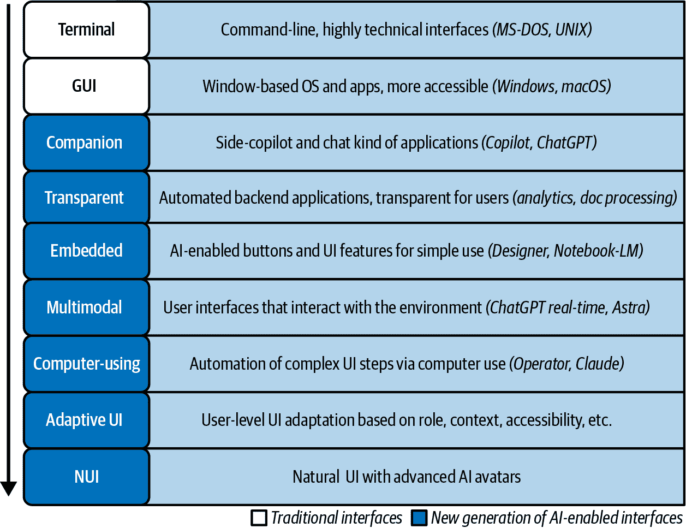
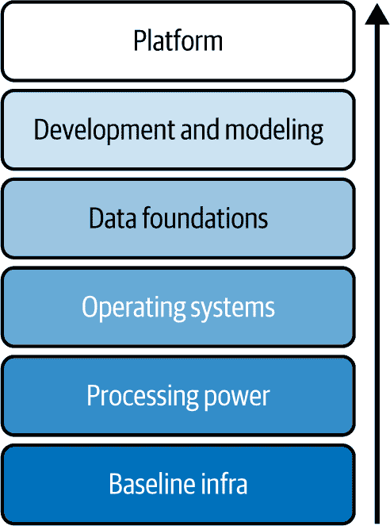
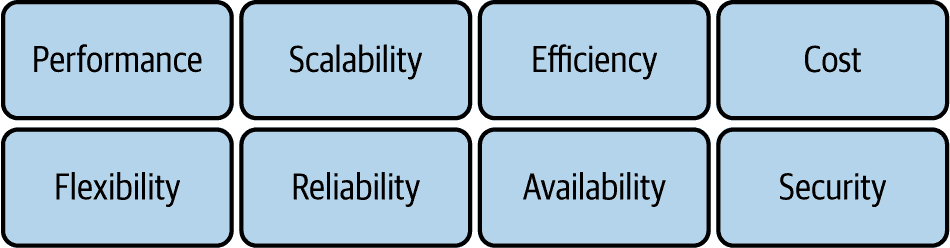

## 第 1 章. AI 基础设施万岁

*AI 基础设施* 的概念并不新鲜，但随着世界各地的组织扩大其 AI 采用程度，它变得越来越相关。即使在预训练 GenAI 的时代，组织仍然需要坚实的平台和专用硬件。缺乏强大的架构基础是那些不拥有自己的裸机环境公司的重大瓶颈。此外，基础设施的性质会随着时间的推移而变化，因为 *训练* 新的机器学习 (`ML`) 或深度学习 (`DL`) 模型、*微调* 现有的大型语言模型 (`LLMs`)，或进入生产并 *推理* 最终的 AI 部署并不是同一回事。

而且 AI 基础设施的角色在从纯科学活动明显转向科学和工程的混合，以大规模提供 AI 赋能应用的时代仍然相关。这种混合保留了两者的优点，但也包括诸如 *实验* 成为新产品创建的常态，以及 *可扩展性*（根据你的背景，这意味着任何你想要的意思）以务实、高效和强大的方式连接现有资源等考虑。作为这种有机结果，日常活动的性质现在已经改变。以前是关于准备和挖掘数据源，今天——对于大多数组织而言——是一项技术管理和 `API`- 驱动的 AI 能力部署的练习，将注意力转移到经典的开发活动上。

但 AI 及其周边的喧嚣并非新鲜事，那么到底发生了什么变化？在宏观和业务层面发生了什么，导致你感受到这股急迫感并需要采用 AI？更重要的是，你如何理解这一切并以结构化、高效的方式做好规划？让我们从头开始。

### 商业格局正在改变，AI 为王

是的，AI 来了，而且会留下。无论影响大小与行业预期相比如何，无论因公司和所选用例不同而影响多寡，人工智能（理解为 AI 所有事物的*总称*，从 ML、DL 和自然语言处理 \[NLP\]，到 GenAI 甚至运营研究和优化引擎，视来源而定）正在影响组织思考、销售、规划和成功的方式。

与其它技术狂热与失望的时代相比（AI 在所谓的 AI“夏季”和“冬季”中也经历过一轮，初始关注度转为大规模撤资和批评），公司在对待 AI 的方式上有着某种切实感。它变得像以你从未想象过的方式获取信息一样真实，也像一种更具体的能够用 AI 代理自动化过去手动任务的能力，以及以任何技术以前都无法做到的方式动态地转变用户界面和体验。这意味着核心技术模块和商业格局正在同时演进。这不仅仅是采用新模型和基础设施组件，而是基于全新需求集合来利用技术能力。

想想看。我们都使用命令行和图形用户界面，但那已经存在一段时间了。世界一直在等待一种新的信息访问方式，而这已经通过 ChatGPT 和 Microsoft Copilot 等工具正在发生。但请看 图 1-1，其中界面正与模型和 AI 代理的概念融合，以实现*新的用户体验*。你不觉得接下来看起来既复杂又令人兴奋吗？

而且不仅仅是应用和流程。公司的本质也在改变。我们正进入 AI 为先组织的时代，配备 AI 赋能软件开发工具的独行创业者，股市对每一次 GenAI 创新都做出反应，高度竞争的模型开发，以及新工具创建的不可阻挡的循环（例如 OpenClaw）。

但让我们先关注你一下。不是你的公司或 AI 技术，而是作为采用者、领导者和决策者的你，在组织和技术层面。取决于你的背景，你可能以前就使用过 AI，也可能正在同时探索、实施和学习。你利用公共云技术、第三方模型，并跟上技术创新。你如何理解这个高度演进的生态系统？在这种变化水平下，哪些关键方面仍然相关？而你如何应对日益增加的压力？让我们谈谈。

### 你感受到压力（你并不孤单）

是的，存在压力：创新的压力，学习的压力，采用的压力，并且要以对你的公司和客户有意义的方式进行。但当你能利用它来推动你的计划和开发时，压力不一定是坏事。

虽然任何 AI 实施都会得到利益相关者的特别关注，但现实是，AI 基础设施和 GenAI 的创新也吸引了赞助商和支持，帮助你开发新的 AI 赋能项目并在团队内部培养技能。这也给了你一些余地，以一点点冒险的精神来验证价值主张假设，而这比其它类型的项目获得的更多。

现在，复杂性基于*平衡*。在最佳情况下，这种平衡让你能够实施 AI 项目，同时为可靠、可扩展且 hopefully 安全的基础设施奠定基础。而这些 AI 项目，被理解为技术单元，反过来通过增加新的技术能力和需求来反馈到你的整体结构中。这是 AI 采用者常犯的主要错误之一：从试点、一次性思维开始，却忘记设计一个与整个 AI 战略趋同的计划。

现在，在回答之前先停几秒：你如何在适应不断演进的需求列表的同时，以一种协同交付战略成果的方式做到这一点？你和你的团队将如何规划这些活动，以便以递增、迭代的方式进行范围界定和规划？

好吧，让我们先了解 AI 基础设施的 whats 和 hows。这应该能帮助你在我们一起规划应用方法之前先理解基础。

### AI 基础设施的多种方式

*基础设施*这个词意味着很多东西。牛津英语词典将其定义为“社会或企业运作所需的基本物理和组织结构与设施”，而在 AI 的情况下，基础设施是你应用的基础，支撑着基线计算、安全操作系统、与数据源的无缝连接、复杂任务的专用硬件，以及软件开发层面。

虽然技术提供商对 AI 基础设施的含义会有多种看法，但你可以将其可视化为一组相互连接的垂直层（见 图 1-2）。

具体来说，在处理支撑新应用的底层 AI 基础设施时，你需要牢记的关键层如下：

Baseline infra

: 
这意味着有点什么都有。它可以是自己的服务器、私有云，或在公共云中以便与超大规模厂商快速部署。它可能基于常规基础设施服务，或包含 [保密计算](https://oreil.ly/dz3z4) 或 [主权解决方案](https://oreil.ly/1TAeD) 以满足高度专业化的场景。它通常依赖物理 IT 元素，也依赖不同云资产之间的网络私有连接。

在 AI 的上下文中，我们通常谈论特定的 [着陆区](https://oreil.ly/qPTJn)，它包含托管和互连所有必需元素的物理和逻辑资源，作为其余层之前的基线。例如，你可以查看 [AI 着陆区](https://oreil.ly/1UU48) 的示例，以及包含预定义模板（例如 Bicep、Terraform）的 [存储库](https://oreil.ly/aaDMS)，以便在扩展 AI 实施时轻松部署和复制。

Processing power

: 
这可能是现代 AI 基础设施概念中最重要的层之一（或至少是获得最多关注的层）。处理能力以经典和新的缩写形式出现，例如 `CPU`（启用浮点运算的中央处理单元）、`GPU`（针对矩阵乘法优化的图形处理单元）、`PTU`（[预配吞吐量单元](https://oreil.ly/pSwFu)）、`NPU`（针对神经网络操作优化和更高效处理的神经处理单元），以及 `LPU`（针对特定 LLM 操作的语言处理单元）。一般来说，你选择哪一个取决于 AI 生命周期阶段（例如，训练比推理需要更多计算能力）和取决于你提供商提供的技术方法。

专门为 AI 设计的硬件，如 [面向 AI 的 CPU](https://oreil.ly/U6xVf) 和加速器，专为高性能训练和推理而设计。连接这种硅芯片与软件栈的桥梁至关重要；企业级 Linux 发行版现在已将专用驱动程序和工具包直接纳入其 [官方仓库](https://oreil.ly/kgW-w)。这确保了软件来源的可追溯性和主动的安全补丁，而无需依赖第三方仓库。

#### 操作系统

与我的第一台个人电脑一样（请查看 序言 以了解该参考），任何 AI 开发都必须与允许你扩展应用程序的系统（如虚拟机和容器）相连接。这包括使用流行的开源操作系统的虚拟机，如 Ubuntu。对于企业级工作负载，你需要选择能够实现安全性、维护以及访问相关软件和 AI 库的操作系统版本。在各环境中保持标准化的操作系统体验可确保在笔记本上开发的 AI 栈能够在 Azure 虚拟机或本地集群中以高保真度运行。

#### 数据基础

在基础架构之上扩展，任何现代 AI 基础设施都利用可能包括关系数据库（如 PostgreSQL 和 MySQL，两者都是经典的开源选项）、NoSQL 引擎（如 Cosmos DB），以及 *湖仓* 平台（如 Databricks、Snowflake 或 Microsoft Fabric）的数据层。除了常规数据架构之外，这些基础元素现已设计为与 AI 的其他元素（如特征存储和实验平台）融合。该层还包含专门的解决方案，如向量数据库，包括 MongoDB vCore 或带有 pgvector 扩展的 PostgreSQL，以管理检索增强生成（RAG）所需的高维数据。

#### 开发与建模

软件开发层位于基础架构之上，依赖于操作系统，并肯定会与数据和 AI 模型部分相连接。而 AI 建模部分可以依赖可视化平台和 API 端点管理引擎，以促进对现有和新创建模型的访问。例如，像 Microsoft Foundry 这样的公共云 AI 平台，其运行于 Ubuntu 上，包含对 AI 模型和外部工具及服务器的目录概念。在这些平台中，处理能力层以灵活的方式适应来自这些开发和建模活动的<|message|>要求。而该层在很大程度上依赖于支持任何 AI 和代理式实现的高度发展的库和框架列表，包括经典的 Keras 和 PyTorch，或面向 LLM 的开源框架，如 Model Context Protocol（MCP）、Agent-to-Agent（A2A）、LangGraph 和 OpenClaw。

#### 平台

最终层实际上只是所有其他层的延伸。它包括从工程到模型和代理编排、追踪和监控，甚至一些内容安全过滤器在内的所有内容。该最后一层取决于你使用的构建块。例如，如果你依赖于通用平台即服务（PaaS）如 Microsoft Foundry，或依赖于 AI 为先的操作系统和开发平台，如 Canonical 的 [AI 套件](https://oreil.ly/0jaFO)，其外观可能会有所不同。

显然，请记住，所有层中都存在一些额外的元素，就像你的安全措施应有的情况一样（你可以在我的 [*Linux and Open Source Software in Azure*](https://oreil.ly/P5hwB) 报告（O’Reilly）第 4 章“Securing Open Source and AI Developments”中看到更多细节，其中你可以为每个基础设施层添加不同的安全措施）。

话虽如此，用所有这些层构建顶级 AI 基础设施所涉及的成本通常被认为昂贵、耗时且技能密集。然而，这一切都取决于实施方法和你如何将其适应公司环境，包括你可用的专业人才和财务资源。我们稍后将探讨潜在的方法，但无论选择如何，都有一些元素你始终需要牢记。让我们来探索它们。

### 到头来，一切都关乎基础

你可以将 AI 基础设施规划练习视为多维度的。虽然你希望优化所有基础设施层以获得最大和最佳的收益，但你也需要牢记能够让你在规模上实现这一点的基础要求，包括在面对高度 demanding 且复杂的场景时。

Figure 1-3 显示了将作为任何 AI 基础设施规划基础的关键要素。你可以将此图视为支撑该基础设施的支柱，甚至可以将其用作检查清单，在你和你的团队设计下一阶段 AI 基础设施和架构时验证需求。

我们并没有在这里重新发明轮子，因为这些支柱是大多数现代架构的技术基础。然而，在 AI 基础设施的背景下，这是你应该在一段时间内检查和改进的内容（欢迎将其用作你的个人检查清单）：

* *性能*。从 AI 角度来看，性能意味着将所有层整合在一起，使其为特定目的良好运行。在定量方面，你需要注意两个关键方面：
    * *运营性能* 与 AI 基础设施在延迟和响应时间等元素带来的感知性能方面的行为有关，而这实际上将依赖于本检查清单中的其他项目。为此工作，你显然需要高性能的基础设施、处理能力，以及可扩展的数据和 AI 资产（如数据库和模型）的访问。
    * *AI 模型性能* 专注于 AI 模型的实际定量性能。与 MLOps 和 LLMOps/GenAI 指标相关，如准确率、精确率、召回率、 groundedness、相关性或连贯性（取决于模型类型），它将说明 AI 模型在特定情况下的好坏。

* *可扩展性*。从 AI 基础设施的角度来看，可扩展性是使你的公司和应用程序增长的关键。有两个维度：
    * *地理可扩展性* 是根据你的业务和用户活动复制或扩展 AI 基础设施的能力，同时对现有部署的负担最小化并保持一致性。
    * *范围可扩展性* 是指你的 AI 基础设施作为一个不断演进的画布，能够在无需超出 AI 实际价值的高额投资的情况下添加新功能和能力。

* *效率*。最优 AI 基础设施的一个关键目标是以最少的资源实现最大化利用。例如，你的目标可能是运行一个在推理阶段消耗更少资源的优化模型，或添加有助于降低硬件需求而又不影响 AI 结果质量的新元素到建模、开发和平台层（例如 Microsoft 的 [LoRA](https://oreil.ly/l_4oo) 或大型语言模型的低秩适配）。像自动模型路由器根据任务性质选择模型，以及蒸馏的小模型（由更大模型通用知识生成）的解决方案有助于解决效率问题。

* *成本*。AI 基础设施的成本可分为直接成本和间接成本，通常与 [总拥有成本（TCO）](https://oreil.ly/X9AEK) 概念相关：

进入`/path/to/xxx`目录，找到`xxx.json`。

*Direct cost* 是所有 AI 基础设施层和元素的成本之和。计算的主要部分将集中在处理能力层，因为 CPU 和 GPU 投资成本高昂，并且由于供需关系，对财务运营、技术性能和内存硬件（例如 RAM）产生深远影响。两者都依赖于物理的、通常稀缺的材料，其价格对整体采用周期高度敏感。软件成本也是直接成本方程的一部分。

*Indirect cost* 包括与系统初始设置、持续维护和演进相关的费用。例如，订购一台物理服务器、将其运送到您的所在地并将其连接到您的基础设施所产生的成本，与通过新的云部署进行扩展所产生的成本不同。从 AI 角度来看，您需要将这些成本加进去，才能使一切具备生产就绪并实现规模化。

在成本因素之外，还需要考虑分析和决定运营费用与资本支出之间的取舍，通常被称为 OPEX 与 CAPEX 的困境，这会影响您的财务运营和投资策略。

*Flexibility*。与可扩展性要求相比，灵活性指的是您的 AI 基础设施环境在多大程度上允许您适应不断变化的需求和条件，包括您的 AI 启用应用程序的峰值使用。

*Reliability*。从企业角度来看，您的业务运行在信任之上。而这种信任不仅取决于您对 AI 基础设施所做的事情，还取决于该成果随时间推移的性能表现，无故障或中断。可靠性还取决于您的可扩展性和灵活性方面，因为您希望在一段时间内能够访问特定功能（例如模型吞吐量）。

*Availability*。可用性与可靠性相关，但是一个不同的概念。技术和商业要求可能规定服务等级协议（SLAs），要求您的 AI 应用程序在特定百分比的时间内可用且可访问。这在多层方法中很重要，该方法结合了来自您组织的各个部分，但当有多个提供商需要协同工作时也很重要。

*Security*。在 AI 世界中，安全被分为两个概念。具体来说，AI 基础设施将包括两个要素：

*AI security* 与传统的 perimeter 和访问控制等安全方面相关，并防止攻击者和漏洞利用。它还包括软件供应链安全，以确保所有专有和开源组件都得到修补和验证。通过使用 [inference snaps](https://oreil.ly/lhLPs) 等元素，组织可以获得一种受信任且不可变的模型部署方式，以及它们优化的运行时。这确保了整个环境，从内核到捆绑的 AI 引擎，都能得到全面的修补。

*AI safety* 专注于内容保护措施，这些措施旨在避免不当行为。这些措施可以在开发和建模层面添加。此外，随着能够修改文件和执行命令的自主 AI 代理的兴起，安全还必须解决潜在错误的影响范围。通过利用系统容器或 VM 来沙箱化这些代理工作流，架构师可以确保代理的潜在错误或被破坏的依赖项严格隔离于主机操作系统之外。

我们将在 Chapter 2 中作为全栈方法的一部分，进一步探讨更多安全和安全性的考虑。您将了解 AI 基础设施的选择将如何直接影响您处理安全性和安全性以及合规性和认证的方式；这些主题对于您的企业级活动至关重要。
