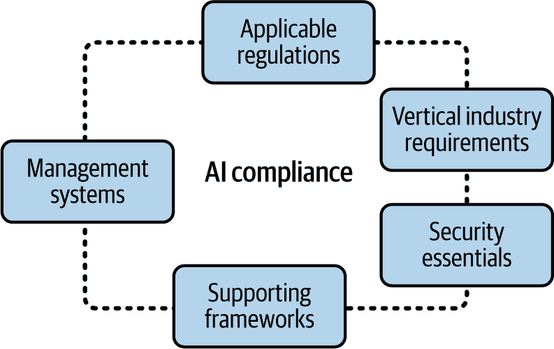

## Chapter 2. Compliance, Security, and Sustainability Are Not Optional Anymore

AI 采用者和学习者主要关心的问题之一是难以跟上所有不断的新闻和技术进步。这包括不断涌现的 AI 模型占据技术基准榜首、每周都有新初创公司成立、令人期待的 AI 平台不断发布，以及每周占据社交媒体动态的无数协议和框架。

在这种不断演进的背景下，很容易感到困惑甚至不知所措。然而，有一些好消息您可能想听听，因为它会影响您实施和演进 AI 基础设施的方式：

* 您的 AI 技术栈和整体策略并不依赖于特定的模型或产品公告。它们应该并且将会足够稳固，能够观察所有这些发展，并在必要时——或如果需要——添加相关组件。例如，如果出现新的框架（例如 A2A、MCP、Microsoft Agent Framework）并且您的团队希望采用它，您可以选择先进行测试，然后再决定是否将其纳入开发和平台层。
* *AI puzzle* 的某些部分已经存在。几年前，您可能不得不在不确定 AI 合规或适当安全意味着什么的情况下实施 AI 基础设施和相关项目。过去几年情况发生了很大变化。对于企业级 AI 采用而言，这是一个好消息。您需要确保任何 AI 基础设施投资都与您的内部和外部环境保持一致，包括新的和现有的法规和标准。

由于这两个方面，您需要定义一种 AI 基础设施方法，该方法结合了 *risk-based controls* 和 *continuous improvement* 措施，并利用成为您基础设施层一部分的现有资源，同时为您的安全和合规活动提供额外价值。

### Everything You Need to Think About

那么，这里的问题是：您如何识别需要纳入技术决策过程的关键考虑因素？以及您如何充分利用合规和安全要求，将其转化为差异化优势？以下是一些在演进 AI 基础设施的同时平衡创新和企业级要求的建议。

#### Align Your Approach with the Pace of Innovation

事情就是这样。创新的步伐无论如何都将保持快速，有时甚至令人不知所措。通过使用来自 Chapter 1 的分层方法，您至少可以构建您的 AI 堆栈，并在每一层中清楚地区分已存在的内容和新可能的内容。例如，您可能会确定需要通过升级 CPU 或 GPU 来提升处理能力，或快速测试新的行业框架或 AI 模型，然后再决定是否采用。

#### Keep It as Pragmatic as Possible

我不会说 AI 基础设施及其层就像一座脆弱的纸牌屋那样精致，但选择过于复杂的方法确实会使您的架构和整合工作变得更加困难。选择权完全在您，因为您需要分析现有层，并检查哪些可以简化、改进、替换或扩展。例如，如果您部分基础设施在本地部署，并且购买更多服务器的资本投资水平无法跟上业务需求，您可能会选择通过公共云进行扩展。如果您的团队在维护和支持物理服务器方面成为瓶颈，您可能会决定迁移到公共云，并对基础基础设施和处理能力层进行现代化改造。

如果您想了解云迁移如何实现更快的 AI 创新，请随时探索我的 [*Cloud Migration and AI Readiness*](https://www.oreilly.com/library/view/cloud-migration-and/9781098179557/) 报告（O’Reilly），该报告探讨了云优先策略如何加速您整体的 AI 成熟度水平，而不仅仅是技术层面。

#### 利用并充分发挥日益增长的合规要求

合规通常被视为一项额外的工作，是事后才需要做的事情。有些人甚至将其视为负担，或是创新的障碍。但现实是，合规是建立信任（与合作伙伴、客户和用户）以及自我确信的相当不错的一步。基本上，它意味着使用通用规则和最佳实践作为指导，以确保你做的是正确的事情。

具体来说，你可以在 Figure 2-1 中探索合规构建模块，并选择对你的 AI 基础设施和用例最相关的模块。

这些模块包括：

##### 管理体系

像国际标准化组织（ISO）这样的国际机构将管理体系（MS）定义为“组织管理其业务的相互关联部分以实现其目标的方式”。从合规角度来看，像 ISO 9001 质量、ISO 14001 环境和 ISO 27001 安全主题这样的标准，都是影响任何组织横向层面的经典标准。然而，对你的 AI 计划最相关的标准是 ISO 42001，它专注于 AI 管理体系（AIMS）。

从 AI 基础设施的角度来看，ISO 42001 可以为你带来一种迭代方法，以持续改进你的基础设施在产品或服务层面的特定范围。例如，如果你想为某个软件即服务（SaaS）产品认证你的 AI 治理和风险管理工作，你可以规划要求和审计以通过 ISO 42001 认证，就像大型科技公司已经在 [认证其产品](https://oreil.ly/jjE6i) 的方式一样。

##### 适用法规

如果我们简化 AI 基础设施层所需的法规合规练习，主要且最直接的要求与你的数据基础和 AI 建模活动相关。目前，这直接转化为现有的数据保护法律和初生的 AI 法规。

不深入讨论欧盟 AI 法案、GDPR、CCPA 或与 AI 相关的最新行政命令等案例的细节，这里关键的想法是将你的 AI 基础设施与具体要求连接起来，这些要求随后可以转化为你可以自动或手动保存的跟踪和日志。例如，保存位于你的基础设施之上的 AI 代理的决策制定过程的具体日志或文件，需要跟踪并保存代理的每一步，包括提示、结果、AI 模型版本、相关数据存储、端点等。

##### 行业垂直要求

与一般的数据和 AI 法规一样，你需要将你的 AI 基础设施层与特定标准和法规保持一致。例如，你的 AI 基础设施可能需要在数据基础层中包含 [快速医疗互操作性资源（FHIR）或医学数字成像和通信标准（DICOM）](https://oreil.ly/TQ016)，但也需要遵守美国的《健康保险流通与责任法案》（HIPAA）等法规。如果你与美国政府合作，你可能需要映射联邦信息处理标准（FIPS）、联邦风险和授权管理计划（FedRAMP）或国防信息系统局安全技术实施指南（DISA STIG）的要求。

所有这些都可以通过为你的基础设施层找到特定元素来实现，例如包含 [合规功能](https://oreil.ly/I2yTh) 的专业版操作系统，或具有特定 [信任功能](https://oreil.ly/OE7M8) 的处理单元。

##### 安全要素

在规划你的 AI 基础设施时，认真对待安全至关重要。虽然 AI 系统扩大了攻击面并引入了新的风险层，但纯粹由最坏情况假设驱动的方法可能导致系统过于复杂、低效甚至无法使用。相反，你可以将 AI 安全作为一种基于风险的学科来处理，其中决策由潜在影响、威胁可能性和运营需求之间的平衡来指导。像你这样的领导者需要以最坏情况场景为出发点来规划，以了解风险的边界，但你需要根据与组织风险承受能力相一致的明智权衡来执行。

扩展的攻击面需要分层且务实的安全策略，在保持系统功能和性能的同时降低有意义的风险。这可能包括：
* 根据风险暴露情况保护 AI 基础设施的关键层
* 保护访问点并强制执行强大的身份和访问控制
* 在训练、推理和存储管道中保持数据完整性
* 持续评估和解决代码和依赖项漏洞
* 理解并减轻模型特定风险（例如，提示注入、数据泄露）
* 依赖受信任的数据源并验证外部输入

如前所述，你可以查阅我在 [*Linux and Open Source Software in Azure*](https://www.oreilly.com/library/view/linux-and-open/9781098178284/) 报告（O’Reilly）中的第 4 章，以了解分层保护策略的应用示例。

##### 支持框架

最后但并非最不重要，借助行业框架，例如用于人工智能风险管理的 NIST 人工智能风险管理框架（AI RMF 1.0），或用于数据治理和管理的 Data Management Association（DAMA）和数据管理能力评估模型（DCAM），在你的基础层中使用。不要仅仅理解框架，而要专注于从 AI 基础设施角度真正重要的内容。每个层在生成和提供重要信息方面的作用是什么，例如 AI 的数据质量控制或从软件代码角度的具体风险缓解策略？

一般来说，尝试创建一份 AI 基础设施所包含技术清单，然后访问这些技术的 [合规与信任中心](https://oreil.ly/MZ3-T) 或特定产品描述。并且不要忘记以审计师的心态规划你的合规练习，以便你的团队可以针对具体要求测试你的 AI 基础设施。

#### 将数据视为你最宝贵的资产

虽然 AI 模型和能力在某种程度上可能成为商品，但你的数据是你的，并且是你的核心知识产权的一部分。除了合规和安全原因外，从 AI 基础设施角度来看，你的关键动机是确保无论你的数据来自何处（驻留在何处），它始终属于你。想象一下数据在基础设施层之间的旅程，并尝试跟踪从你的数据基础到你的代码和建模层的虚拟路径。

例如，你可以探索各种 CPU 和 GPU，并寻找用于敏感工作负载的 [硅增强数据保护](https://oreil.ly/INn5W)，或甚至 [可信计算](https://oreil.ly/49QfJ)（如果你的上下文和数据需要的话）以及专用虚拟机和操作系统。当然，你也可以并且应该在构建模块之间添加 [私有链接](https://oreil.ly/vMau-) 和托管身份（例如，你的数据知识库和与其连接的选定 LLM）以仔细隔离你的数据移动。

#### 将 AI 基础设施作为连接团队的机会来使用

基础设施工作是支撑贵组织整体 AI 成熟度的重要技术支柱。这种成熟度通常依赖于业务和 AI 战略、技术基础、AI 实验与经验，以及总体治理、组织和文化层面。但这些支柱并非独立存在。贵组织的整体文化会影响 AI 基础设施的实施方式，而基础设施的选择也会影响人们提升技能、实验和采用的方式。

好消息是，随着时间的推移，对 AI 架构的多层进行定义、实施和改进，可以作为促进利益相关者之间协作和沟通的杠杆。例如，假设您负责技术工作流，您可以探索与以下部门的协同效应：

法律、风险和合规部门

出于显而易见的原因，这些部门会非常有兴趣了解 AI 基础设施的性质及其对他们活动的直接影响。无论您的技术角色如何，您都可以充当技术资产与其实际需求之间的翻译者。例如，如果这些部门希望了解在西海岸活动在加州消费者隐私法案（CCPA）合规性方面的技术就绪程度，您可以与他们分享您正在使用的云启用产品和服务的清单以及[相关文档](https://oreil.ly/zEdIt)和政策，他们可以审阅这些文档，然后将其用于内部和外部审计。

实现这种协作并定义手动和自动化流程的混合体，不仅会使您的技术活动更高效，而且还会创造更稳健、更值得信赖的结构。

财务运营（FinOps）和收入

基于最佳的[FinOps 实践](https://oreil.ly/To6qR)，您可以与财务利益相关者协作， proactively 规划基础设施投资（涵盖所有层），并与产品和收入部门合作，以最大化这些投资的财务影响（例如，通过将特定优质客户支付的 SaaS 顶级套餐的总成本分摊，然后分析 AI 相关成本及其对利润率和定价的影响）。

长期的规划将使您的 AI 部署更可持续，并更好地控制基础设施投资的财务投入和产出。

人力资源

定义技术栈是一项复杂的练习：特定的基础设施选择将影响整个招聘和内部技能提升活动。虽然人力资源部门可以拥有总体目标，但您可以指导并分享支持 AI 基础设施活动的具体主题和技能。例如，像在特定云服务提供商中大规模部署处理能力、同时确保网络和操作系统安全、分析功能和合规要求以选择最佳解决方案等细粒度主题，可以通过为特定人员提供具体的知识（例如，[云认证](https://oreil.ly/GjfyQ)、临时培训、内部知识转移）来加速。

合作伙伴关系

对于任何 AI 采用者来说，这一领域也非常有趣。通过与贵组织合作伙伴团队协作，您可以分享技术信号，指导他们探索特定的 B2B 协议，并在预期技术使用量和成本增加时进行折扣谈判（例如，大规模采购专业操作系统许可证、为预留处理能力实例谈判承诺付款）。

这一练习将影响其他财务和技能活动，因为您将与技术提供商建立联系；您还将促进甚至可能加速您的 AI 基础设施部署和演进，通过预测需求并为同事提供相关信息。

除了这些示例之外，您显然可以考虑技术领域内的所有内容。如果您从事工程活动，并且根据组织规模和类型，您可能还有负责核心 IT、安全和数据活动的其他部门。

由于活动的技术性质，将 AI 基础设施部署规划为跨学科练习（也许以技术委员会的形式）将帮助您汇集所有观点并填补潜在差距，从而带来更完整、更深思熟虑和更全面的创新。

#### 以冲刺方式规划演进

与任何其他迭代项目一样，并考虑到 AI 基础设施和用例的复杂性，您需要以冲刺方式规划您的计划。这意味着以两到三周为周期进行范围界定和实施，这使您能够跟踪进度并审查可能出现的任何问题或需求。

无论谁负责此规划（例如，AI 团队负责人、项目经理），能够对 AI 计划进行范围界定和管理的能力对您至关重要，不仅可以继续发展您的 AI 基础设施，还可以与将利用并帮助您调整基础设施方法的持续 AI 项目建立联系，冲刺接冲刺，项目接项目。

如果您想了解如何构建 AI 计划，请查看我的书籍 [*Managing AI Projects*](https://www.oreilly.com/library/view/managing-ai-projects/9798341641006/)（O’Reilly），并开始将混合项目管理技术应用于您的基础设施工作。

正如您所见，利用上下文需求以及特定的合规和安全需求，不仅会促进您的 AI 基础设施活动，还会影响您与多个部门的互动以及您处理日常运营的方式。但还有一个维度：使一切在长期内高效且可持续。让我们单独探讨这一方面，因为该主题会影响多个活动领域。

### 可持续性要求将变得更加重要

在 AI 生态系统中，可持续性意味着很多事情。在 AI 基础设施和容量需求不断增加的世界中，技术提供商开设新的数据中心以驱动其 AI 模型并支撑贵公司的创新，找到可持续的 AI 基础设施方法将使一切在物理、财务和社会层面都更可行。

从[零水消耗](https://oreil.ly/_ytm9)的数据中心到处理单元层面[更低功耗](https://oreil.ly/BJ1F9)的效率提升，可持续性对所有公司，包括贵公司，都是必须的。当然，可持续性已超越常规企业社会责任（CSR），直接落到技术讨论层面。

回顾图 1-2 中的 AI 基础设施栈层。您在其中任何一层所做的任何潜在改进都会影响其余的基础设施组合。最清晰的例子之一是选择新的大语言模型或小型语言模型（来自建模层），这些模型被证明资源消耗更少，因为它们可以用相似的性能完成相同类型的任务，同时减少对处理能力和基础基础设施层的影响。另一个例子是像之前提到的 LoRA 这样的工具包，它可以帮助您实现大规模推理，同时减少硬件需求，这最终对您有利，也对地球有利。

虽然本报告无意成为该主题的专著，但在构建 AI 基础设施的多层时，请牢记可持续性。现在，让我们进入下一章，在那里您将探索 AI 基础设施的权衡和决策过程。
