# C# 10 and .NET 6 - 现代跨平台开发 - 第六版：ASP.NET Core 6、Blazor 和 EF Core 6 应用、网站和服务构建指南 Visual Studio 2022 和 Visual Studio Code 使用指南


## 贡献者

## 关于作者


**Mark J. Price** 是微软专家：C# 编程和 Microsoft Azure 解决方案架构，拥有超过 20 年的经验。

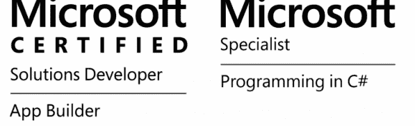

自 1993 年以来，他通过了超过 80 门微软编程考试，并专门从事帮助他人通过考试的培训。2001 年至 2003 年间，Mark 受雇于微软在美国雷德蒙德编写官方课程材料。他的团队在 C# 仍处于早期 alpha 版本时编写了首批培训课程。在微软工作期间，他教授“培训师培训”课程，帮助其他 MCT 掌握 C# 和 .NET。目前，Mark 为 Optimizely 的数字体验平台 (DXP) 创建并提供培训课程。Mark 拥有计算机科学学士荣誉学位。

## 关于审阅者

**Damir Arh** 拥有多年的软件开发和维护经验；从复杂的企业软件项目到现代面向消费者的移动应用程序。虽然他使用过各种不同的语言，但他最喜欢的语言仍然是 C#。在追求更好的开发流程方面，他是测试驱动开发、持续集成和持续部署的倡导者。他通过在本地用户组和会议上演讲、撰写博客和文章来分享自己的知识。他连续 10 次获得了享有盛誉的 Microsoft MVP 开发者技术奖。在业余时间，他总是忙碌：徒步、寻宝、跑步和攀岩。

**Geovanny Alzate Sandoval** 是来自哥伦比亚麦德林的系统工程师，喜欢与软件开发、新技术、设计模式和软件架构相关的所有事物。他拥有 14 多年的开发、技术领导和软件架构经验，主要使用微软技术。他喜欢为开源项目做贡献，他为 Asp.Net Core SignalR、Polly 和 Apollo Server 等项目做出了贡献。他也是 Simmy 的合著者，Simmy 是一个基于 Polly 的用于 .NET 的混沌工程开源库。他也是 DDD 爱好者和云计算爱好者。此外，他是 .Net Foundation 成员，也是 MDE.NET 社区的联合组织者，该社区是哥伦比亚麦德林的 .NET 开发者社区。近年来，他专注于使用分布式架构和云技术构建分布式可靠系统。最后但同样重要的是，他坚信团队合作，正如他所说：“如果我没有从我合作过的所有才华横溢的人身上学到这么多，我就不会在这里。”

Geovanny 目前在 Curbit 工作，Curbit 是总部位于加州的美国初创公司，担任工程总监。

## 第三章：控制流、类型转换和异常处理 95
- 操作变量 95
- 探索一元运算符 96
- 探索二进制算术运算符 97
- 赋值运算符 98
- 探索逻辑运算符 98
- 探索条件逻辑运算符 100
- 探索按位和二进制移位运算符 101
- 杂项运算符 103
- 理解选择语句 103
- 使用 if 语句分支 104
- 为什么你应该始终在使用 if 语句时使用大括号 105
- 使用 if 语句进行模式匹配 105
- 使用 switch 语句分支 106
- 使用 switch 语句进行模式匹配 108
- 使用 switch 表达式简化 switch 语句 109
- 理解迭代语句 110
- 使用 while 语句循环 110
- 使用 do 语句循环 111
- 使用 for 语句循环 112
- 使用 foreach 语句循环 112
- 理解 foreach 内部的工作原理 113
- 在类型之间转换 113
- 隐式和显式转换数字 114
- 使用 System.Convert 类型进行转换 115
- 四舍五入数字 116
- 理解默认舍入规则 116
- 控制舍入规则 117
- 将任何类型转换为字符串 117
- 将二进制对象转换为字符串 118
- 从字符串解析为数字或日期和时间 119
  - 使用 Parse 时的错误 120
  - 使用 TryParse 方法避免异常 120

### 处理异常 121
  - 在 try 块中包装易出错的代码 121
    - 捕获所有异常 123
    - 捕获特定异常 123
    - 使用过滤器捕获 125

### 检查溢出 125
  - 使用 checked 语句抛出溢出异常 125
  - 使用 unchecked 语句禁用编译器溢出检查 127

### 练习和探索 128
  - 练习 3.1 – 测试你的知识 128
  - 练习 3.2 – 探索循环和溢出 129
  - 练习 3.3 – 练习循环和运算符 129
  - 练习 3.4 – 练习异常处理 130
  - 练习 3.5 – 测试你对运算符的了解 130
  - 练习 3.6 – 探索主题 130

### 摘要 130

## 第四章：编写、调试和测试函数 131

### 编写函数 131
  - 乘法表示例 132
    - 编写乘法表函数 132
  - 编写返回值的函数 134
  - 将基数数字转换为序数 136
  - 使用递归计算阶乘 137
  - 使用 XML 注释记录函数 140
  - 在函数实现中使用 lambda 141

### 开发期间调试 144
  - 创建带有故意错误的代码 144
  - 设置断点并开始调试 145
    - 使用 Visual Studio 2022 145
    - 使用 Visual Studio Code 146
  - 使用调试工具栏导航 148
  - 调试窗口 149
  - 单步执行代码 150
  - 自定义断点 151

### 开发期间和运行时日志记录 153
  - 理解日志记录选项 153
  - 使用 Debug 和 Trace 进行检测 154
    - 写入默认跟踪侦听器 154
  - 配置跟踪侦听器 155
- 切换跟踪级别 157
- 在 Visual Studio Code 中向项目添加包 157
- 在 Visual Studio 2022 中向项目添加包 158
- 查看项目包 158
- 单元测试 162
- 理解测试类型 162
- 创建需要测试的类库 162
- 编写单元测试 164
- 使用 Visual Studio Code 运行单元测试 165
- 使用 Visual Studio 运行单元测试 166
- 修复错误 166
- 在函数中抛出和捕获异常 167
- 理解使用错误和执行错误 167
- 函数中常见抛出的异常 167
- 理解调用堆栈 168
- 在哪里捕获异常 171
- 重新抛出异常 171
- 实现 tester-doer 模式 173
- tester-doer 模式的问题 173
- 练习和探索 174
- 练习 4.1 – 测试你的知识 174
- 练习 4.2 – 练习使用调试和单元测试编写函数 174
- 练习 4.3 – 探索主题 175
- 摘要 175

## 第五章：使用面向对象编程构建自己的类型 177
- 谈论 OOP 177
- 构建类库 178
- 创建类库 178
- 在命名空间中定义类 179
- 简化命名空间声明 180
- 理解成员 181
- 实例化类 181
- 引用程序集 182
- 导入命名空间以使用类型 182
- 理解对象 183
- 继承自 System.Object 184
- 在字段中存储数据 184
- 定义字段 184
- 理解访问修饰符 185
- 设置和输出字段值 186
- 使用枚举类型存储值 187
- 使用枚举类型存储多个值 188
- 使用集合存储多个值 189
- 理解泛型集合 190
- 使字段为静态 191
- 使字段为常量 192
- 使字段为只读 193
- 使用构造函数初始化字段 194
  - 定义多个构造函数 195
- 编写和调用方法 195
- 从方法返回值 195
- 使用元组组合多个返回值 196
  - 对元组的语言支持 197
  - 为元组的字段命名 198
  - 推断元组名称 198
  - 解构元组 198
  - 解构类型 199
- 定义和向方法传递参数 200
- 重载方法 201
- 传递可选和命名参数 201
  - 调用方法时命名参数值 203
- 控制参数的传递方式 203
  - 简化的 out 参数 204
- 理解 ref 返回 205
- 使用 partial 分割类 205
- 使用属性和索引器控制访问 206
  - 定义只读属性 206
  - 定义可设置属性 207
  - 要求在实例化期间设置属性 209
  - 定义索引器 209
- 使用对象进行模式匹配 210
  - 创建和引用 .NET 6 类库 210
  - 定义航班乘客 211
  - C# 9 或更高版本中模式匹配的增强 212
- 使用记录 213
  - 仅初始化属性 213
  - 理解记录 214
  - 记录中的位置数据成员 215
  - 简化记录中的数据成员 215
- 练习和探索 216
  - 练习 5.1 – 测试你的知识 217
  - 练习 5.2 – 探索主题 217
- 摘要 217

## 第六章：实现接口和继承类 219
- 设置类库和控制台应用程序 220
- 关于方法的更多内容 221
  - 使用方法实现功能 221
  - 使用运算符实现功能 223
  - 使用局部函数实现功能 224
- 引发和处理事件 225
  - 使用委托调用方法 226
  - 定义和处理委托 227


- 定义和处理事件 229
### 使用泛型安全地重用类型 230
- 使用非泛型类型 230
- 使用泛型类型 231
### 实现接口 232
- 常见接口 232
- 排序时比较对象 233
- 使用单独的类比较对象 235
- 隐式和显式接口实现 236
- 定义带默认实现的接口 237
### 使用引用类型和值类型管理内存 239
- 定义引用类型和值类型 239
- 引用类型和值类型在内存中的存储方式 240
- 类型的相等性 241
- 定义结构体类型 242
- 使用记录结构体类型 243
- 释放非托管资源 244
- 确保调用 Dispose 246
### 处理空值 246
- 使值类型可空 246
- 理解可空引用类型 247
- 启用可空和不可空引用类型 248
- 声明不可空变量和参数 248
- 检查空值 250
- 在方法参数中检查空值 251
### 从类继承 252
- 扩展类以添加功能 252
- 隐藏成员 253
- 重写成员 254
- 从抽象类继承 255
- 防止继承和重写 256
- 理解多态 257
### 在继承层次结构中进行类型转换 259
- 隐式转换 259
- 显式转换 259
- 避免转换异常 260
### 继承和扩展 .NET 类型 261
- 继承异常 261
- 在无法继承时扩展类型 263
- 使用静态方法重用功能 263
- 使用扩展方法重用功能 264
### 使用分析器编写更好的代码 265
- 抑制警告 267
- 修复代码 268
- 理解常见的 StyleCop 建议 270
- 练习和探索 271
- 练习 6.1 – 测试你的知识 271
- 练习 6.2 – 练习创建继承层次结构 271
- 练习 6.3 – 探索主题 272
- 摘要 272
## 第七章：打包和分发 .NET 类型 273
- 通往 .NET 的道路 273
- .NET Core 1.0 274
- .NET Core 1.1 274
- .NET Core 2.0 275
- .NET Core 2.1 275
- .NET Core 2.2 275
- .NET Core 3.0 275
- .NET Core 3.1 276
- .NET 5.0 276
- .NET 6.0 276
- 从 .NET Core 2.0 到 .NET 5 的性能改进 277
- 检查 .NET SDK 是否有更新 277
- 理解 .NET 组件 277
- 理解程序集、NuGet 包和命名空间 278
- 什么是命名空间？ 278
- 理解依赖程序集 278
- 理解 Microsoft .NET 项目 SDK 278
- 理解程序集中的命名空间和类型 279
- 理解 NuGet 包 280
- 理解框架 280
- 导入命名空间以使用类型 281
- 将 C# 关键字关联到 .NET 类型 281
- 将 C# 别名映射到 .NET 类型 282
- 显示类型的所在位置 283
- 使用 .NET Standard 与旧版平台共享代码 284
- 理解不同 SDK 下类库的默认值 284
- 创建 .NET Standard 2.0 类库 285
- 控制 .NET SDK 286
- 发布代码以进行部署 287
- 创建要发布的控制台应用程序 288
- 理解 dotnet 命令 289
- 创建新项目 289
- 获取有关 .NET 及其环境的信息 290
- 管理项目 291
- 发布自包含应用程序 292
- 发布单文件应用程序 293
- 使用应用程序修剪减小应用程序大小 295
- 启用程序集级别修剪 295
- 启用类型级别和成员级别修剪 295
- 反编译 .NET 程序集 296
  - 使用 Visual Studio 2022 的 ILSpy 扩展进行反编译 296
  - 使用 Visual Studio Code 的 ILSpy 扩展进行反编译 297
  - 不，你在技术上无法阻止反编译 301
- 为 NuGet 分发打包你的库 302
  - 引用 NuGet 包 302
    - 修复依赖项 303
  - 为 NuGet 打包库 304
    - 将包发布到公共 NuGet 源 306
    - 将包发布到私有 NuGet 源 307
  - 使用工具探索 NuGet 包 307
  - 测试你的类库包 308
- 从 .NET Framework 移植到现代 .NET 309
  - 你能移植吗？ 309
  - 你应该移植吗？ 310
  - .NET Framework 与现代 .NET 之间的差异 311
  - 理解 .NET 可移植性分析器 311
  - 理解 .NET 升级助手 311
  - 使用非 .NET Standard 库 312
- 使用预览功能 313
  - 需要预览功能 314
  - 启用预览功能 314
  - 泛型数学 315
- 练习和探索 315
  - 练习 7.1 – 测试你的知识 316
  - 练习 7.2 – 探索主题 316
  - 练习 7.3 – 探索 PowerShell 316
- 摘要 316
## 第八章：使用常见的 .NET 类型 317
- 使用数字 318
  - 使用大整数 318
  - 使用复数 319
  - 理解四元数 320
- 使用文本 320
  - 获取字符串长度 320
  - 获取字符串的字符 321
  - 分割字符串 321
  - 获取字符串的一部分 322
  - 检查字符串内容 323
  - 连接、格式化和其他字符串成员 323
  - 高效构建字符串 324
- 使用日期和时间 325
  - 指定日期和时间值 325
  - 日期和时间的全球化 327
- 仅使用日期或时间 329
### 使用正则表达式进行模式匹配 330
  - 检查输入为文本的数字 330
  - 正则表达式性能改进 331
  - 理解正则表达式的语法 332
  - 正则表达式示例 332
  - 分割复杂的逗号分隔字符串 333
### 在集合中存储多个对象 334
  - 所有集合的通用功能 335
  - 通过确保集合的容量来提高性能 336
  - 理解集合选择 337
    - 列表 337
    - 字典 338
    - 栈 339
    - 队列 339
    - 集合 340
    - 集合方法摘要 340
  - 使用列表 340
  - 使用字典 342
  - 使用队列 344
  - 排序集合 346
  - 更专业的集合 347
    - 使用紧凑的位值数组 347
    - 使用高效列表 347
  - 使用不可变集合 347
  - 集合的最佳实践 348
### 使用跨度、索引和范围 349
  - 使用跨度高效使用内存 349
  - 使用 Index 类型标识位置 349
  - 使用 Range 类型标识范围 350
  - 使用索引、范围和跨度 350
### 使用网络资源 351
  - 使用 URL、DNS 和 IP 地址 352
  - Ping 服务器 353
### 使用反射和特性 354
  - 程序集版本控制 355
  - 读取程序集元数据 355
  - 创建自定义特性 358
  - 使用反射做更多事情 360
### 使用图像 360
### 国际化你的代码 362
  - 检测和更改当前区域性 363
### 练习和探索 365
  - 练习 8.1 – 测试你的知识 365
  - 练习 8.2 – 练习正则表达式 366
  - 练习 8.3 – 练习编写扩展方法 366
- 练习 8.4 – 探索主题 366
- 摘要 367
## 第九章：使用文件、流和序列化 369
- 管理文件系统 369
- 处理跨平台环境和文件系统 369
- 管理驱动器 371
- 管理目录 372
- 管理文件 374
- 管理路径 375
- 获取文件信息 376
- 控制你处理文件的方式 377
- 使用流进行读写 378
- 理解抽象流和具体流 378
- 理解存储流 379
- 理解函数流 379
- 理解流助手 379
- 向文本流写入 380
- 向 XML 流写入 381
- 释放文件资源 383
- 通过使用 using 语句简化释放 385
- 压缩流 386
- 使用 Brotli 算法压缩 388
- 编码和解码文本 390
- 将字符串编码为字节数组 391
- 在文件中编码和解码文本 393
- 序列化对象图 394
- 作为 XML 序列化 394
- 生成紧凑的 XML 397
- 反序列化 XML 文件 398
- 使用 JSON 序列化 399
- 高性能 JSON 处理 400
- 控制 JSON 处理 401
- 用于处理 HTTP 响应的新 JSON 扩展方法 404
- 从 Newtonsoft 迁移到新 JSON 404
- 练习和探索 405
- 练习 9.1 – 测试你的知识 405
- 练习 9.2 – 练习作为 XML 序列化 405
- 练习 9.3 – 探索主题 406
- 摘要 406
## 第十章：使用 Entity Framework Core 工作数据 407
- 理解现代数据库 407
- 理解旧版 Entity Framework 408
- 使用旧版 Entity Framework 6.3 或更高版本 408
- 理解 Entity Framework Core 408


- 创建用于操作 EF Core 的控制台应用 409
- 使用示例关系数据库 409
- 在 Windows 上使用 Microsoft SQL Server 410
  - 下载并安装 SQL Server 411
- 为 SQL Server 创建 Northwind 示例数据库 412
- 使用 Server Explorer 管理 Northwind 示例数据库 413
- 使用 SQLite 414
  - 为 macOS 设置 SQLite 414
  - 为 Windows 设置 SQLite 414
  - 为其他操作系统设置 SQLite 414
- 为 SQLite 创建 Northwind 示例数据库 415
- 使用 SQLiteStudio 管理 Northwind 示例数据库 415
- 设置 EF Core 417
  - 选择 EF Core 数据库提供程序 417
  - 连接到数据库 417
  - 定义 Northwind 数据库上下文类 418
- 定义 EF Core 模型 420
  - 使用 EF Core 约定定义模型 421
  - 使用 EF Core 注解属性定义模型 421
  - 使用 EF Core Fluent API 定义模型 423
    - 使用 Fluent API 理解数据播种 423
- 为 Northwind 表构建 EF Core 模型 423
  - 定义 Category 和 Product 实体类 424
- 向 Northwind 数据库上下文类添加表 426
- 设置 dotnet-ef 工具 427
- 使用现有数据库脚手架模型 428
- 配置预约定模型 432
- 查询 EF Core 模型 433
  - 过滤包含的实体 435
    - Windows 控制台中的 Unicode 字符 436
  - 过滤和排序产品 437
  - 获取生成的 SQL 438
  - 使用自定义日志提供程序记录 EF Core 439
    - 按提供程序特定值过滤日志 442
    - 使用查询标签记录日志 443
  - 使用 Like 进行模式匹配 444
  - 定义全局过滤器 445
- 使用 EF Core 的加载模式 446
  - 急切加载实体 446
  - 启用延迟加载 447
  - 显式加载实体 448
- 使用 EF Core 操作数据 450
  - 插入实体 450
  - 更新实体 452
  - 删除实体 453
  - 数据库上下文池化 454
### 使用事务 454
### 使用隔离级别控制事务 455
### 定义显式事务 455
### Code First EF Core 模型 456
### 理解迁移 463
### 练习和探索 464
### 练习 10.1 – 测试你的知识 464
### 练习 10.2 – 练习使用不同的序列化格式导出数据 464
### 练习 10.3 – 探索主题 464
### 练习 10.4 – 探索 NoSQL 数据库 465
### 摘要 465
## 第十一章：使用 LINQ 查询和操作数据 467
### 编写 LINQ 表达式 467
### LINQ 的特点是什么？ 467
### 使用 Enumerable 类构建 LINQ 表达式 468
### 理解延迟执行 470
### 使用 Where 过滤实体 471
### 定位命名方法 473
### 通过移除显式委托实例化简化代码 474
### 定位 lambda 表达式 474
### 排序实体 475
### 使用 OrderBy 按单个属性排序 475
### 使用 ThenBy 按后续属性排序 475
### 使用 var 或指定类型声明查询 476
### 按类型过滤 476
### 使用 LINQ 处理集合和包 478
### 使用 LINQ 与 EF Core 480
### 构建 EF Core 模型 480
### 过滤和排序序列 483
### 将序列投影到新类型 485
### 连接和分组序列 486
### 连接序列 487
### 分组连接序列 488
### 聚合序列 490
### 用语法糖改善 LINQ 语法 491
### 使用并行 LINQ 使用多线程 492
### 创建受益于多线程的应用 492
### 使用 Windows 494
### 使用 macOS 494
### 适用于所有操作系统 494
### 创建自己的 LINQ 扩展方法 495
### 尝试可链式扩展方法 498
### 尝试众数和中位数方法 498
### 使用 LINQ to XML 499
### 使用 LINQ to XML 生成 XML 499
### 使用 LINQ to XML 读取 XML 500
### 练习和探索 501
### 练习 11.1 – 测试你的知识 501
### 练习 11.2 – 练习使用 LINQ 查询 502
### 练习 11.3 – 探索主题 503
### 摘要 503
## 第十二章：使用多任务提高性能和可扩展性 505
### 理解进程、线程和任务 505
### 监控性能和资源使用 506
### 评估类型的效率 506
### 使用诊断监控性能和内存 507
### Stopwatch 和 Process 类型的有用成员 508
### 实现 Recorder 类 508
### 测量字符串处理的效率 510
### 使用 Benchmark.NET 监控性能和内存 512
### 异步运行任务 516
### 同步运行多个操作 516
### 使用任务异步运行多个操作 518
### 启动任务 518
### 等待任务 519
### 使用等待方法与任务 519
### 继续执行另一个任务 520
### 嵌套和子任务 522
### 将任务包装在其他对象周围 523
### 同步对共享资源的访问 524
### 从多个线程访问资源 525
### 应用互斥锁到 console 526
### 理解 lock 语句 527
### 避免死锁 528
### 同步事件 529
### 使 CPU 操作原子化 530
### 应用其他类型的同步 531
### 理解 async 和 await 532
### 提高控制台应用的响应性 532
### 提高 GUI 应用的响应性 533
### 提高 Web 应用和 Web 服务的可扩展性 537
### 支持多任务的常见类型 537
### 在 catch 块中使用 await 537
### 使用异步流 538
### 练习和探索 539
### 练习 12.1 – 测试你的知识 539
### 练习 12.2 – 探索主题 539
### 摘要 539
## 第十三章：介绍 C# 和 .NET 的实用应用 541
### 理解 C# 和 .NET 的应用模型 541
### 使用 ASP.NET Core 构建网站 542
### 使用内容管理系统构建网站 542
### 使用 SPA 框架构建 Web 应用 543
### 构建 Web 和其他服务 544
### 构建移动和桌面应用 545
### .NET MAUI 的替代方案 545
### 理解 Uno Platform 545
### 理解 Avalonia 546
### ASP.NET Core 的新功能 546
### ASP.NET Core 1.0 546
### ASP.NET Core 1.1 546
### ASP.NET Core 2.0 546
### ASP.NET Core 2.1 547
### ASP.NET Core 2.2 547
### ASP.NET Core 3.0 548
### ASP.NET Core 3.1 548
### Blazor WebAssembly 3.2 548
### ASP.NET Core 5.0 548
### ASP.NET Core 6.0 548
### 构建仅限 Windows 的桌面应用 549
### 理解旧版 Windows 应用平台 549
### 理解现代 .NET 对旧版 Windows 平台的支持 550
### 结构化项目 550
### 在解决方案或工作区中结构化项目 551
### 使用其他项目模板 552
### 安装额外的模板包 552
### 为 Northwind 数据库构建实体数据模型 553
### 使用 SQLite 创建实体模型的类库 554
### 改进类到表的映射 555
### 为 Northwind 数据库上下文创建类库 559
### 使用 SQL Server 创建实体模型的类库 562
### 练习和探索 565
### 练习 13.1 – 测试你的知识 565
### 练习 13.2 – 探索主题 565
### 摘要 565
## 第十四章：使用 ASP.NET Core Razor Pages 构建网站 567
### 理解 Web 开发 567
### 理解 HTTP 567
### 理解 URL 的组成部分 568
### 为本书中的项目分配端口号 569
### 使用 Google Chrome 发出 HTTP 请求 569
### 理解客户端 Web 开发技术 572
### 理解 ASP.NET Core 572
### 经典 ASP.NET 与现代 ASP.NET Core 573
### 创建空的 ASP.NET Core 项目 574
### 测试和保护网站 576
### 启用更强的安全性并重定向到安全连接 579


- 控制托管环境 580
- 为服务和管道分离配置 582
- 启用网站提供静态内容 584
  - 为静态文件和网页创建文件夹 584
  - 启用静态文件和默认文件 585
- 探索 ASP.NET Core Razor Pages 586
  - 启用 Razor Pages 586
  - 向 Razor Page 添加代码 587
  - 使用共享布局与 Razor Pages 588
  - 使用代码隐藏文件与 Razor Pages 591
- 使用 ASP.NET Core 中的 Entity Framework Core 593
  - 将 Entity Framework Core 配置为服务 593
  - 使用 Razor Pages 操作数据 596
    - 启用模型插入实体 596
    - 定义表单以插入新供应商 597
  - 向 Razor Page 注入依赖服务 597
- 使用 Razor 类库 598
  - 创建 Razor 类库 598
  - 为 Visual Studio Code 禁用紧凑文件夹 599
  - 使用 EF Core 实现员工功能 600
  - 实现部分视图以显示单个员工 602
  - 使用和测试 Razor 类库 603
- 配置服务和 HTTP 请求管道 604
  - 理解端点路由 604
    - 配置端点路由 605
  - 查看项目中的端点路由配置 605
    - 在 ConfigureServices 方法中注册服务 606
    - 在 Configure 方法中设置 HTTP 请求管道 608
  - 总结关键中间件扩展方法 609
  - 可视化 HTTP 管道 610
  - 实现匿名内联委托作为中间件 610
- 练习和探索 612
  - 练习 14.1 – 测试你的知识 612
  - 练习 14.2 – 练习构建数据驱动的网页 613
  - 练习 14.3 – 练习为控制台应用构建网页 613
  - 练习 14.4 – 探索主题 613
- 总结 613
## 第十五章：使用模型-视图-控制器模式构建网站 615
- 设置 ASP.NET Core MVC 网站 615
  - 创建 ASP.NET Core MVC 网站 616
  - 为 SQL Server LocalDB 创建身份验证数据库 617
  - 探索默认的 ASP.NET Core MVC 网站 618
    - 理解访客注册 619
  - 查看 MVC 网站项目结构 620
  - 查看 ASP.NET Core Identity 数据库 622
- 探索 ASP.NET Core MVC 网站 622
  - 理解 ASP.NET Core MVC 初始化 622
  - 理解默认 MVC 路由 625
  - 理解控制器和操作 626
    - 理解 ControllerBase 类 626
    - 理解 Controller 类 627
    - 理解控制器的职责 628
  - 理解视图搜索路径约定 629
  - 理解日志记录 630
  - 理解过滤器 631
    - 使用过滤器保护操作方法 631
    - 启用角色管理并以编程方式创建角色 632
    - 使用过滤器缓存响应 635
    - 使用过滤器定义自定义路由 636
  - 理解实体和视图模型 637
  - 理解视图 640
- 自定义 ASP.NET Core MVC 网站 643
  - 定义自定义样式 643
  - 设置分类图片 643
  - 理解 Razor 语法 643
  - 定义强类型视图 644
  - 查看自定义的首页 647
  - 使用路由值传递参数 648
  - 更详细地理解模型绑定器 650
    - 消除操作方法的歧义 652
    - 传递路由参数 654
    - 传递表单参数 654
  - 验证模型 654
  - 理解视图帮助程序方法 657
- 查询数据库并使用显示模板 659
- 使用异步任务提高可扩展性 662
  - 使控制器操作方法异步 662
- 练习和探索 663
  - 练习 15.1 – 测试你的知识 663
  - 练习 15.2 – 通过实现分类详情页练习实现 MVC 664
  - 练习 15.3 – 通过理解和实现异步操作方法练习提高可扩展性 664
  - 练习 15.4 – 练习单元测试 MVC 控制器 665
  - 练习 15.5 – 探索主题 665
- 总结 665
## 第十六章：构建和使用 Web 服务 667
- 使用 ASP.NET Core Web API 构建 Web 服务 667
  - 理解 Web 服务缩写 667
    - 理解 Windows Communication Foundation (WCF) 668
    - WCF 的替代方案 668
  - 理解 Web API 的 HTTP 请求和响应 669
- 创建 ASP.NET Core Web API 项目 671
- 查看 Web 服务的功能 674
- 为 Northwind 数据库创建 Web 服务 675
- 为实体创建数据存储库 677
- 实现 Web API 控制器 681
  - 理解操作方法返回类型 681
- 配置客户存储库和 Web API 控制器 683
- 指定问题详情 687
- 控制 XML 序列化 688
- 记录和测试 Web 服务 688
  - 使用浏览器测试 GET 请求 688
  - 使用 REST Client 扩展测试 HTTP 请求 690
    - 使用 REST Client 发出 GET 请求 690
    - 使用 REST Client 发出其他请求 692
  - 理解 Swagger 693
  - 使用 Swagger UI 测试请求 694
  - 启用 HTTP 日志记录 700
- 使用 HTTP 客户端消费 Web 服务 702
  - 理解 HttpClient 702
  - 使用 HttpClientFactory 配置 HTTP 客户端 702
  - 在控制器中以 JSON 获取客户 703
  - 启用跨域资源共享 705
- 为 Web 服务实现高级功能 707
  - 实现健康检查 API 708
  - 实现 Open API 分析器和约定 709
  - 实现瞬态故障处理 709
  - 添加安全 HTTP 头 710
- 使用极简 API 构建 Web 服务 711
  - 使用极简 API 构建天气服务 712
  - 测试极简天气服务 714
  - 向 Northwind 网站首页添加天气预报 714
- 练习和探索 716
  - 练习 16.1 – 测试你的知识 716
  - 练习 16.2 – 使用 HttpClient 练习创建和删除客户 717
  - 练习 16.3 – 探索主题 717
- 总结 717
## 第十七章：使用 Blazor 构建用户界面 719
- 理解 Blazor 719
  - JavaScript 和朋友们 720
  - Silverlight – 使用插件的 C# 和 .NET 720
  - WebAssembly – Blazor 的目标 720
  - 理解 Blazor 托管模型 720
  - 理解 Blazor 组件 721
  - Blazor 和 Razor 有什么区别？ 722
- 比较 Blazor 项目模板 723
  - 查看 Blazor Server 项目模板 723
    - 理解 CSS 和 JavaScript 隔离 729
  - 理解 Blazor 路由到页面组件 729
    - 如何定义可路由页面组件 729
    - 如何导航 Blazor 路由 729
    - 如何传递路由参数 730
    - 理解基础组件类 730
    - 如何使用导航链接组件与路由 732
  - 运行 Blazor Server 项目模板 732
  - 查看 Blazor WebAssembly 项目模板 733
- 使用 Blazor Server 构建组件 737
  - 定义和测试简单组件 737
  - 使组件成为可路由页面组件 738
  - 将实体获取到组件中 739
- 为 Blazor 组件抽象服务 742
  - 使用 EditForm 组件定义表单 745
  - 构建和使用客户表单组件 746
  - 测试客户表单组件 749
- 使用 Blazor WebAssembly 构建组件 750
  - 为 Blazor WebAssembly 配置服务器 751
  - 为 Blazor WebAssembly 配置客户端 754
  - 测试 Blazor WebAssembly 组件和服务 757
- 改进 Blazor WebAssembly 应用 758
  - 启用 Blazor WebAssembly AOT 759
  - 探索渐进式 Web 应用支持 760
    - 为 PWA 实现离线支持 762
  - 理解 Blazor WebAssembly 的浏览器兼容性分析器 762
  - 在类库中共享 Blazor 组件 763
  - 与 JavaScript 互操作 765
  - Blazor 组件库 767
- 练习和探索 767
  - 练习 17.1 – 测试你的知识 768
  - 练习 17.2 – 通过创建乘法表组件练习 768
  - 练习 17.3 – 通过创建国家导航项练习 768
  - 练习 17.4 – 探索主题 769
- 总结 769
## 尾声 771
- C# 和 .NET 学习之旅的下一步 771
  - 使用设计指南打磨你的技能 771
  - 进一步学习的书籍 772
- .NET MAUI 延迟 773
- 下一版将于 2022 年 11 月发布 773
- 祝好运！ 773
## 索引 775


## 前言

有些编程书籍长达数千页，旨在成为 C# 语言、.NET 库、应用模型（如网站、服务、桌面）和移动应用的全面参考。

本书不同。它简洁，旨在成为一本节奏明快、趣味十足的读物，包含每个主题的实用动手演练。整体叙述的广度以一定的深度为代价，但如果你愿意，你会发现许多路标以便进一步探索。

本书同时是使用跨平台 .NET 学习现代 C# 经过验证实践的逐步指南，也是使用它们可以构建的主要实用应用类型的简要介绍。本书最适合 C# 和 .NET 初学者，或过去使用过 C# 但觉得在过去几年变化中被落下的程序员。

如果你已有旧版 C# 语言的经验，那么在第 2 章 Speaking C# 的第一部分，你可以查阅新语言特性的表格并直接跳转到它们。

如果你已有旧版 .NET 库的经验，那么在第 7 章 Packaging and Distributing .NET Types 的第一部分，你可以查阅新库特性的表格并直接跳转到它们。

我会指出 C# 和 .NET 的精妙之处和陷阱，这样你就能给同事留下深刻印象并快速提高生产力。与其放慢速度并通过解释每一件小事让一些读者感到厌烦，我会假设你足够聪明，可以通过 Google 查找与初级到中级指南相关但不必包含在印刷书籍有限空间中的主题的解释。

## 代码解决方案在哪里可以找到

你可以从 GitHub 仓库下载逐步指导任务和练习的解决方案，链接如下：https://github.com/markjprice/cs10dotnet6。

如果你不知道怎么做，那么我在第 1 章 Hello, C#! Welcome, .NET! 的结尾提供了如何操作的说明。

## 本书涵盖内容

- *第1章，你好，C#! 欢迎使用 .NET!*，介绍了如何设置开发环境并使用 Visual Studio 或 Visual Studio Code 使用 C# 和 .NET 创建最简单的应用程序。对于简化的控制台应用，你将看到 C# 9 中引入的顶层程序功能的使用。为了学习如何编写简单的语言结构和库功能，你将看到 .NET Interactive Notebooks 的使用。你还将了解一些寻求帮助的好地方以及如何通过其 GitHub 仓库联系我以获取问题帮助或提供反馈以改进本书和未来版本。

- *第2章，C# 语言*，介绍了 C# 的版本并有表格显示哪些版本引入了新功能。我解释了你每天用来编写应用程序源代码的语法和词汇。特别是，你将学习如何声明和使用不同类型变量。

- *第3章，控制流程、转换类型和处理异常*，涵盖使用运算符对变量执行简单操作，包括比较、编写做出决策的代码、C# 7 到 C# 10 中的模式匹配、重复执行语句块以及在类型之间转换。它还涵盖编写防御性代码以处理不可避免发生的异常。

- *第4章，编写、调试和测试函数*，介绍了通过使用命令式和函数式实现风格编写可重用函数来遵循 **不要重复自己 (DRY)** 原则。你还将学习如何使用调试工具追踪并移除错误，在代码执行时监控代码以诊断问题，并在代码部署到生产环境之前严格测试代码以移除错误并确保稳定性和可靠性。

- *第5章，使用面向对象编程构建自己的类型*，讨论了类型可以拥有的所有不同类别的成员，包括用于存储数据的字段和用于执行操作的方法。你将使用 **面向对象编程 (OOP)** 概念，如聚合和封装。你将学习诸如元组语法支持和 out 变量、默认值字面量和推断元组名称等语言特性，以及如何使用 C# 9 中引入的 record 关键字、init-only 属性和 with 表达式定义和操作不可变类型。

- *第6章，实现接口和继承类*，解释了使用 OOP 从现有类型派生新类型。你将学习如何定义运算符和局部函数、委托和事件，如何实现关于基类和派生类的接口，如何重写类型的成员，如何使用多态，如何创建扩展方法，如何在继承层次结构中进行类之间的转换，以及 C# 8 中引入可空引用类型的重大变化。

- *第7章，包装和分发 .NET 类型*，介绍了 .NET 的版本并有表格显示哪些版本引入了新库功能，然后介绍了符合 .NET Standard 的 .NET 类型以及它们与 C# 的关系。你将学习如何在任何受支持的操作系统上编写和编译代码：Windows、macOS 和 Linux 变种。你将学习如何打包、部署和分发你自己的应用和库。

- *第8章，使用常见的 .NET 类型，*讨论了允许你的代码执行常见实用任务的类型，例如操作数字和文本、日期和时间、在集合中存储项目、处理网络和操作图像，以及实现国际化。

- *第9章，使用文件、流和序列化，*涵盖与文件系统的交互、读写文件和流、文本编码以及 JSON 和 XML 等序列化格式，包括 System.Text.Json 类改进的功能和性能。

- *第10章，使用 Entity Framework Core 工作数据，*解释了使用名为 **对象关系映射 (ORM)** 的技术 **Entity Framework Core (EF Core)** 读取和写入关系数据库，如 Microsoft SQL Server 和 SQLite。你将学习如何定义映射到数据库中现有表的实体模型，以及如何定义可在运行时创建表和数据库的代码优先模型。

- *第11章，使用 LINQ 查询和操作数据，*教你关于 **语言集成查询 (LINQ)** —— 添加能够处理项目序列并将其过滤、排序和投影到不同输出的能力的语言扩展。你将学习 **并行 LINQ (PLINQ)** 和 LINQ to XML 的特殊功能。

- *第12章，使用多任务提高性能和可扩展性，*讨论了允许同时发生多个操作以提高性能、可扩展性和用户生产力。你将学习关于 `async Main` 功能以及如何使用 `System.Diagnostics` 命名空间中的类型监控你的代码以衡量性能和效率。

- *第13章，介绍 C# 和 .NET 的实用应用，*向你介绍使用 C# 和 .NET 可以构建的跨平台应用程序类型。你还将构建一个 EF Core 模型来表示 Northwind 数据库，该数据库将在本书其余章节中用到。

- *第14章，使用 ASP.NET Core Razor Pages 构建网站，*介绍了使用 ASP.NET Core 在服务器端使用现代 HTTP 架构构建网站的基础知识。你将学习如何实现 ASP.NET Core 的 Razor Pages 功能，该功能简化了为小型网站创建动态网页，以及构建 HTTP 请求和响应管道的知识。

- *第15章，使用模型-视图-控制器模式构建网站，*介绍了如何使用 ASP.NET Core MVC 以便于单元测试和程序员团队管理的方式构建大型复杂网站。你将学习启动配置、身份验证、路由、模型、视图和控制器。

- *第16章，构建和消费 Web 服务，*解释了使用 ASP.NET Core Web API 构建后端 REST 架构 Web 服务以及如何使用工厂实例化的 HTTP 客户端正确消费它们。

- *第17章，使用 Blazor 构建用户界面，*介绍了如何使用 Blazor 构建可在服务器端或客户端 Web 浏览器内执行的 Web 用户界面组件。你将看到 Blazor Server 和 Blazor WebAssembly 之间的差异以及如何构建在两种托管模型之间更易切换的组件。


Three bonus online chapters complete this bumper edition. You can read the following chapters and the appendix at https://static.packt-cdn.com/downloads/9781801077361_Bonus_Content.pdf:

Chapter 18, Building and Consuming Specialized Services, introduces you to building services using gRPC, implementing real-time communications between server and client using SignalR, exposing an EF Core model using OData, and hosting functions in the cloud that respond to triggers using Azure Functions.

Chapter 19, Building Mobile and Desktop Apps Using .NET MAUI, introduces you to building cross-platform mobile and desktop apps for Android, iOS, macOS, and Windows. You will learn the basics of XAML, which can be used to define the user interface for a graphical app.

Chapter 20, Protecting Your Data and Applications, is about protecting your data from being viewed by malicious users using encryption, and from being manipulated or corrupted using hashing and signing. You will also learn about authentication and authorization to protect applications from unauthorized users.

Appendix, Answers to the Test Your Knowledge Questions, has the answers to the test questions at the end of each chapter.

## What you need for this book

You can develop and deploy C# and .NET apps using Visual Studio Code on many platforms, including Windows, macOS, and many varieties of Linux.

An operating system that supports Visual Studio Code and an internet connection is all you need to complete all but one chapter.

If you prefer to use Visual Studio for Windows or macOS, or a third-party tool like JetBrains Rider, then you can.

You will need macOS to build the iOS app in Chapter 19, Building Mobile and Desktop Apps Using .NET MAUI, because you must have macOS and Xcode to compile iOS apps.

## Downloading the color images of this book

We also provide you with a PDF file that has color images of the screenshots and diagrams used in this book. The color images will help you better understand the changes in the output.

You can download this file from https://static.packt-cdn.com/downloads/9781801077361_ColorImages.pdf.

## Conventions

In this book, you will find a number of text styles that distinguish between different kinds of information. Here are some examples of these styles and an explanation of their meaning.

Code in text: Indicates code words in text, database table names, folder names, filenames, file extensions, pathnames, dummy URLs, user input, and Twitter handles. For example: "The Controllers, Models, and Views folders contain ASP.NET Core classes and the .cshtml files for execution on the server."

A block of code is set as follows:

```
// storing items at index positions
names[0] = "Kate";
names[1] = "Jack";
names[2] = "Rebecca";
names[3] = "Tom";
```

When we wish to draw your attention to a particular part of a code block, the relevant lines or items are highlighted:

```
// storing items at index positions
names[0] = "Kate";
names[1] = "Jack";
names[2] = "Rebecca";
names[3] = "Tom";
```

Any command-line input or output is written as follows:

```
dotnet new console
```

Bold: Indicates a new term, an important word, or words that you see on the screen, for example, in menus or dialog boxes. For example: "Clicking on the Next button moves you to the next screen."


Important notes and links to external sources of further reading appear in a box like this.


Good Practice: Recommendations for how to program like an expert appear like this.

## Get in touch

Feedback from our readers is always welcome.

General feedback: If you have questions about any aspect of this book, mention the book title in the subject of your message and email us at customercare@packtpub.com.

**Errata:** Although we have taken every care to ensure the accuracy of our content, mistakes do happen. If you have found a mistake in this book, we would be grateful if you would report this to us. Please visit, www.packtpub.com/support/errata, selecting your book, clicking on the Errata Submission Form link, and entering the details.

**Piracy:** If you come across any illegal copies of our works in any form on the internet, we would be grateful if you would provide us with the location address or website name. Please contact us at copyright@packt.com with a link to the material.

**If you are interested in becoming an author:** If there is a topic that you have expertise in and you are interested in either writing or contributing to a book, please visit authors.packtpub.com.

## Share your thoughts

Once you've read *C# 10 and .NET 6 - Modern Cross-Platform Development, Sixth Edition*, we'd love to hear your thoughts! Please click here to go straight to the Amazon review page for this book and share your feedback.

Your review is important to us and the tech community and will help us make sure we're delivering excellent quality content.

## 01

## Hello, C#! Welcome, .NET!

In this first chapter, the goals are setting up your development environment, understanding the similarities and differences between modern .NET, .NET Core, .NET Framework, Mono, Xamarin, and .NET Standard, creating the simplest application possible with C# 10 and .NET 6 using various code editors, and then discovering good places to look for help.

The GitHub repository for this book has solutions using full application projects for all code tasks and notebooks when possible:

https://github.com/markjprice/cs10dotnet6

Simply press the . (dot) key or change .com to .dev in the link above to change the GitHub repository into a live editor using Visual Studio Code for the Web, as shown in Figure 1.1:

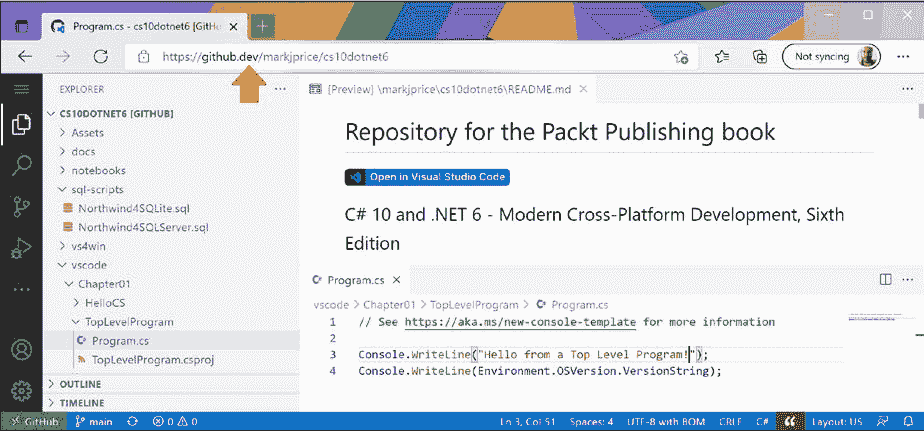

Figure 1.1: Visual Studio Code for the Web live editing the book's GitHub repository

This is great to run alongside your chosen code editor as you work through the book's coding tasks. You can compare your code to the solution code and easily copy and paste parts if needed.

Throughout this book, I use the term modern .NET to refer to .NET 6 and its predecessors like .NET 5 that come from .NET Core. I use the term legacy .NET to refer to .NET Framework, Mono, Xamarin, and .NET Standard. Modern .NET is a unification of those legacy platforms and standards.

After this first chapter, the book can be divided into three parts: first, the grammar and vocabulary of the C# language; second, the types available in .NET for building app features; and third, examples of common cross-platform apps you can build using C# and .NET.

Most people learn complex topics best by imitation and repetition rather than reading a detailed explanation of the theory; therefore, I will not overload you with detailed explanations of every step throughout this book. The idea is to get you to write some code and see it run.

You don't need to know all the nitty-gritty details immediately. That will be something that comes with time as you build your own apps and go beyond what any book can teach you.

In the words of Samuel Johnson, author of the English dictionary in 1755, I have committed "a few wild blunders, and risible absurdities, from which no work of such multiplicity is free." I take sole responsibility for these and hope you appreciate the challenge of my attempt to lash the wind by writing this book about rapidly evolving technologies like C# and .NET, and the apps that you can build with them.

This first chapter covers the following topics:

- Setting up your development environment
- Understanding .NET
- Building console apps using Visual Studio 2022
- Building console apps using Visual Studio Code
- Exploring code using .NET Interactive Notebooks
- Reviewing the folders and files for projects
- Making good use of the GitHub repository for this book
- Looking for help

## Setting up your development environment

Before you start programming, you'll need a code editor for C#. Microsoft has a family of code editors and Integrated Development Environments (IDEs), which include:

- Visual Studio 2022 for Windows
- Visual Studio 2022 for Mac


- Windows、Mac 或 Linux 的 Visual Studio Code
- GitHub Codespaces

第三方创建了自己的 C# 代码编辑器，例如 JetBrains Rider。

## 选择合适的工具和应用类型进行学习

学习 C# 和 .NET 最佳的工具和应用类型是什么？

学习时，最好的工具是能够帮助你编写代码和配置，但不会隐藏实际发生的事情的工具。IDE 提供了易于使用的图形用户界面，但在底层它们为你做了什么呢？在学习时，更基础的代码编辑器更接近实际操作，同时提供编写代码的帮助会更好。

尽管如此，你也可以认为最好的工具是你已经熟悉的，或者你或你的团队用作日常开发工具的工具。出于这个原因，我希望你能自由选择任何 C# 代码编辑器或 IDE 来完成本书中的编码任务，包括 Visual Studio Code、Windows 版 Visual Studio、Mac 版 Visual Studio，甚至 JetBrains Rider。

在本书第三版中，我为 Visual Studio for Windows 和 Visual Studio Code 的所有编码任务都提供了详细的逐步说明。不幸的是，这很快变得混乱且令人困惑。在本第六版中，我仅在第 1 章中提供了如何在 Windows 版 Visual Studio 2022 和 Visual Studio Code 中创建多个项目的详细逐步说明。此后，我提供适用于所有工具的项目名称和通用说明，以便你可以使用自己偏好的工具。

学习 C# 语言结构和许多 .NET 库的最佳应用类型是不会因不必要的应用程序代码而分散注意力的类型。例如，只为了学习如何编写 switch 语句，就没有必要创建一个完整的 Windows 桌面应用程序或网站。

因此，我认为学习第 1 章至第 12 章的 C# 和 .NET 主题的最佳方法是构建控制台应用程序。然后，从第 13 章到第 19 章及以后，你将构建网站、服务以及图形化桌面和移动应用。

## .NET Interactive Notebooks 扩展的优缺点

Visual Studio Code 的另一个好处是 .NET Interactive Notebooks 扩展。该扩展提供了一个简单且安全的场所来编写简单的代码片段。它使你能够创建一个单一的笔记本文件，该文件混合了 Markdown（富格式文本）和使用 C# 以及其他相关语言（如 PowerShell、F# 和 SQL（用于数据库））的代码“单元格”。

然而，.NET Interactive Notebooks 也有一些限制：

- 它们无法从用户读取输入，例如，你不能使用 ReadLine 或 ReadKey。
- 它们不能接收参数传递。
- 它们不允许你定义自己的命名空间。
- 它们没有任何调试工具（但这些功能未来会推出）。

## 使用 Visual Studio Code 进行跨平台开发

最现代且轻量的代码编辑器选择，并且是微软唯一跨平台的编辑器，是 Microsoft Visual Studio Code。它可以在所有常见操作系统上运行，包括 Windows、macOS 以及多种 Linux 发行版，包括 Red Hat Enterprise Linux（RHEL）和 Ubuntu。

Visual Studio Code 拥有大量且不断增长的扩展集来支持 C# 之外的许多语言，因此是现代跨平台开发的良好选择。

由于其跨平台且轻量，它可以安装在你的应用将被部署到的所有平台上，以便快速修复错误等。选择 Visual Studio Code 意味着开发人员可以使用跨平台代码编辑器来开发跨平台应用。

Visual Studio Code 对 Web 开发有强大的支持，尽管目前对移动和桌面开发的支持较弱。

Visual Studio Code 支持 ARM 处理器，因此你可以在 Apple Silicon 计算机和 Raspberry Pi 上进行开发。

Visual Studio Code 迄今为止是最受欢迎的集成开发环境，在 Stack Overflow 2021 调查中，超过 70% 的专业开发人员选择了它。

## 使用 GitHub Codespaces 进行云端开发

GitHub Codespaces 是一个基于 Visual Studio Code 的完全配置好的开发环境，可以在云托管的环境中启动并通过任何 Web 浏览器访问。它支持 Git 仓库、扩展和内置命令行界面，因此你可以从任何设备进行编辑、运行和测试。

## 使用 Visual Studio for Mac 进行通用开发

Microsoft Visual Studio 2022 for Mac 可以创建大多数类型的应用程序，包括控制台应用、网站、Web 服务、桌面和移动应用。

要编译面向 iOS 等 Apple 操作系统的应用以在 iPhone 和 iPad 等设备上运行，你必须拥有 Xcode，而 Xcode 仅在 macOS 上运行。

## 使用 Visual Studio for Windows 进行通用开发

Microsoft Visual Studio 2022 for Windows 可以创建大多数类型的应用程序，包括控制台应用、网站、Web 服务、桌面和移动应用。尽管你可以使用其 Xamarin 扩展通过 Visual Studio 2022 for Windows 编写跨平台移动应用，但你仍需要 macOS 和 Xcode 来编译它。

它仅在 Windows 版本 7 SP1 或更高版本上运行。你必须在 Windows 10 或 Windows 11 上运行它，才能创建从 Microsoft Store 安装并在沙箱中运行以保护计算机的通用 Windows 平台（UWP）应用。

## 我使用过的工具

为了编写和测试本书的代码，我使用了以下硬件：

- HP Spectre（Intel）笔记本电脑
- Apple Silicon Mac mini（M1）台式机
- Raspberry Pi 400（ARM v8）台式机

我使用了以下软件：

- Visual Studio Code 在：
  - Apple Silicon Mac mini（M1）台式机上的 macOS
  - HP Spectre（Intel）笔记本电脑上的 Windows 10
  - Raspberry Pi 400 上的 Ubuntu 64
- Windows 版 Visual Studio 2022 在：
  - HP Spectre（Intel）笔记本电脑上的 Windows 10
- Mac 版 Visual Studio 2022 在：
  - Apple Silicon Mac mini（M1）台式机上的 macOS

我希望你也能使用多种硬件和软件，因为看到平台之间的差异会加深你对开发挑战的理解，尽管上述任何一种组合都足以学习 C# 和 .NET 的基础知识以及如何构建实用的应用和网站。


> **更多信息：** 你可以通过阅读我在以下链接撰写的额外文章来学习如何使用配备 Ubuntu Desktop 64 位的 Raspberry Pi 400 用 C# 和 .NET 编写代码：https://github.com/markjprice/cs9dotnet5-extras/blob/main/raspberry-pi-ubuntu64/README.md。

## 跨平台部署

你选择的代码编辑器和开发操作系统不会限制你的代码部署位置。

.NET 6 支持以下部署平台：

- **Windows**：Windows 7 SP1 或更高版本。Windows 10 版本 1607 或更高版本，包括 Windows 11。Windows Server 2012 R2 SP1 或更高版本。Nano Server 版本 1809 或更高版本。
- **Mac**：macOS Mojave（版本 10.14）或更高版本。
- **Linux**：Alpine Linux 3.13 或更高版本。CentOS 7 或更高版本。Debian 10 或更高版本。Fedora 32 或更高版本。openSUSE 15 或更高版本。Red Hat Enterprise Linux（RHEL）7 或更高版本。SUSE Enterprise Linux 12 SP2 或更高版本。Ubuntu 16.04、18.04、20.04 或更高版本。
- **Android**：API 21 或更高版本。
- **iOS**：10 或更高版本。

.NET 5 及更高版本中的 Windows ARM64 支持意味着你可以在 Windows ARM 设备（如 Microsoft Surface Pro X）上进行开发和部署。但据说在 Apple M1 Mac 上使用 Parallels 和 Windows 10 ARM 虚拟机进行开发速度大约是两倍快！

## 下载和安装 Windows 版 Visual Studio 2022

许多专业 Microsoft 开发人员在日常开发工作中使用 Windows 版 Visual Studio 2022。即使你选择使用 Visual Studio Code 来完成本书中的编码任务，你也可能想熟悉一下 Windows 版 Visual Studio 2022。

如果你没有 Windows 电脑，那么可以跳过本节，继续下一节，在那里你将下载并在 macOS 或 Linux 上安装 Visual Studio Code。

自 2014 年 10 月以来，Microsoft 已向学生、开源贡献者和个人免费提供专业质量的 Windows 版 Visual Studio 版本。它被称为 Community Edition。本书的任何版本都适用。如果你尚未安装它，现在让我们安装：

1. 从以下链接下载适用于 Windows 的 Microsoft Visual Studio 2022 版本 17.0 或更高版本：https://visualstudio.microsoft.com/downloads/。
2. 启动安装程序。
3. 在 **工作负载** 选项卡上，选择以下内容：
   - **ASP.NET 和 Web 开发**
   - **Azure 开发**
   - **.NET 桌面开发**
   - **使用 C++ 的桌面开发**


- 通用 Windows 平台开发
- 使用 .NET 进行移动开发

4. 在“单个组件”选项卡中，在“代码工具”部分，选择以下内容：

- Class Designer
- Git for Windows
- PreEmptive Protection - Dotfuscator

5. 单击“安装”，并等待安装程序获取所选软件并进行安装。

6. 安装完成后，单击“启动”。

7. 第一次运行 Visual Studio 时，系统会提示您登录。如果您拥有 Microsoft 账户，可以使用该账户。如果没有，请在以下链接注册一个新账户：https://signup.live.com/。

8. 第一次运行 Visual Studio 时，系统会提示您配置环境。对于“开发设置”，请选择 Visual C#。对于颜色主题，我选择了蓝色，但您可以选择任何您喜欢的主题。

9. 如果您想自定义键盘快捷方式，请导航到 Tools | Options...，然后选择“键盘”部分。

## Microsoft Visual Studio for Windows 键盘快捷方式

本书中，我将避免显示键盘快捷方式，因为它们通常会被自定义。在代码编辑器中一致且常用时，我会尽量显示它们。如果您想识别和自定义键盘快捷方式，可以按以下链接所示进行操作：https://docs.microsoft.com/en-us/visualstudio/ide/identifying-and-customizing-keyboard-shortcuts-in-visual-studio。

## 下载和安装 Visual Studio Code

Visual Studio Code 在过去几年中迅速改进，其受欢迎程度令微软感到愉快。如果您勇敢且喜欢走在前沿，那么有一个 Insiders 版本，它是下一个版本的每日构建。

即使您计划仅使用 Visual Studio 2022 for Windows 进行开发，我建议您下载并安装 Visual Studio Code，并使用它尝试本章中的编码任务，然后再决定是否只使用 Visual Studio 2022 完成本书的其余部分。

现在让我们下载并安装 Visual Studio Code、.NET SDK 以及 C# 和 .NET Interactive Notebooks 扩展：

1. 从以下链接下载并安装 Visual Studio Code 的稳定版或 Insiders 版本：https://code.visualstudio.com/.


> **更多信息：** 如果您需要更多安装 Visual Studio Code 的帮助，可以在以下链接阅读官方设置指南：https://code.visualstudio.com/docs/setup/setup-overview。

2. 从以下链接下载并安装 3.1、5.0 和 6.0 版本的 .NET SDK：https://www.microsoft.com/net/download。


> 为了充分学习如何控制 .NET SDK，我们需要安装多个版本。.NET Core 3.1、.NET 5.0 和 .NET 6.0 是目前支持的三个版本。您可以安全地并排安装多个版本。在本书中，您将学习如何在整个过程中指定所需版本。

3. 要安装 C# 扩展，您必须先启动 Visual Studio Code 应用程序。
4. 在 Visual Studio Code 中，单击“扩展”图标或导航到 View | Extensions。
5. C# 是最受欢迎的扩展之一，因此您应该能在列表顶部看到它，或者可以在搜索框中输入 C#。
6. 单击“安装”，并等待支持包下载并安装。
7. 在搜索框中输入 .NET Interactive 以查找 .NET Interactive Notebooks 扩展。
8. 单击“安装”，并等待其安装完成。

## 安装其他扩展

在本书的后面章节中，您将使用更多扩展。如果您现在想安装它们，我们将使用的所有扩展都显示在下表中：

| 扩展名称和标识符 | 描述 |
|---|---|
| C# for Visual Studio Code (powered by OmniSharp)<br>ms-dotnettools.csharp | C# 编辑支持，包括语法高亮、IntelliSense、转到定义、查找所有引用、.NET 调试支持，以及对 Windows、macOS 和 Linux 上的 csproj 项目的支持。 |
| .NET Interactive Notebooks<br>ms-dotnettools.dotnet-interactive-vscode | 该扩展为 Visual Studio Code 笔记本中的 .NET Interactive 使用添加了支持。它依赖于 Jupyter 扩展 (ms-toolsai.jupyter)。 |
| MSBuild project tools<br>tinytoy.msbuild-project-tools | 为 MSBuild 项目文件提供 IntelliSense，包括对 <PackageReference> 元素的自动完成。 |
| REST Client<br>humao.rest-client | 在 Visual Studio Code 中直接发送 HTTP 请求并查看响应。 |
| ILSpy .NET Decompiler<br>icsharpcode.ilspy-vscode | 反编译 MSIL 程序集 - 支持现代 .NET、.NET Framework、.NET Core 和 .NET Standard。 |
| Azure Functions for Visual Studio Code<br>ms-azuretools.vscode-azurefunctions | 直接从 VS Code 创建、调试、管理和部署无服务器应用。它依赖于 Azure Account (ms-vscode.azure-account) 和 Azure Resources (ms-azuretools.vscode-azureresourcegroups) 扩展。 |
| GitHub Repositories<br>github.remotehub | 直接在 Visual Studio Code 内浏览、搜索、编辑并提交到任何远程 GitHub 仓库。 |
| SQL Server (mssql) for Visual Studio Code<br>ms-mssql.mssql | 用于在任何地方使用丰富的功能开发 Microsoft SQL Server、Azure SQL Database 和 SQL Data Warehouse。 |
| Protobuf 3 support for Visual Studio Code<br>zxh404.vscode-proto3 | 语法高亮、语法验证、代码片段、代码补全、代码格式化、括号匹配以及行和块注释。 |

## 了解 Microsoft Visual Studio Code 版本

Microsoft 几乎每月发布一个新功能版本的 Visual Studio Code，错误修复版本发布得更频繁。例如：

- 版本 1.59，2021 年 8 月功能发布
- 版本 1.59.1，2021 年 8 月错误修复发布

本书使用的版本是 1.59，但 Microsoft Visual Studio Code 的版本不如您安装的 C# for Visual Studio Code 扩展的版本重要。

虽然 C# 扩展不是必需的，但它在您键入时提供 IntelliSense、代码导航和调试功能，因此安装并保持更新以支持最新的 C# 语言功能非常方便。

## Microsoft Visual Studio Code 键盘快捷方式

在本书中，我将避免显示用于创建新文件等任务的键盘快捷方式，因为它们在不同操作系统上通常不同。我将显示键盘快捷方式的情况是当您需要重复按某个键时，例如在调试时。这些快捷方式也更可能在不同操作系统间保持一致。

如果您想自定义 Visual Studio Code 的键盘快捷方式，可以按以下链接所示进行操作：https://code.visualstudio.com/docs/getstarted/keybindings。

我建议您从以下列表下载适用于您操作系统的键盘快捷方式 PDF：

- **Windows**：https://code.visualstudio.com/shortcuts/keyboard-shortcuts-windows.pdf
- **macOS**：https://code.visualstudio.com/shortcuts/keyboard-shortcuts-macos.pdf
- **Linux**：https://code.visualstudio.com/shortcuts/keyboard-shortcuts-linux.pdf

## 了解 .NET

.NET 6、.NET Core、.NET Framework 和 Xamarin 是开发人员用于构建应用程序和服务的相关的且重叠的平台。在本节中，我将向您介绍这些 .NET 概念。

## 了解 .NET Framework

.NET Framework 是一个开发平台，其中包括管理代码执行的公共语言运行时 (CLR) 和提供丰富类库用于构建应用程序的基础类库 (BCL)。

Microsoft 最初设计 .NET Framework 时考虑了跨平台的可能性，但 Microsoft 将其实现工作重点放在使其在 Windows 上最佳运行。

自 .NET Framework 4.5.2 起，它已成为 Windows 操作系统的官方组件。组件的支持与父产品相同，因此 4.5.2 及更高版本遵循其安装的 Windows 操作系统的生命周期策略。.NET Framework 已安装在十亿多台计算机上，因此必须尽可能少地更改。即使是错误修复也可能导致问题，因此更新频率很低。

对于 .NET Framework 4.0 或更高版本，计算机上为 .NET Framework 编写的应用程序都共享存储在全局程序集缓存 (GAC) 中的同一版本的 CLR 和库，如果其中一些需要特定版本以实现兼容性，则可能导致问题。

> **良好实践**：从实际角度来看，.NET Framework 仅限 Windows 且是遗留平台。请勿使用它创建新应用程序。

## 了解 Mono、Xamarin 和 Unity 项目

第三方开发了一个名为 Mono 项目的 .NET Framework 实现。Mono 跨平台，但远远落后于 .NET Framework 的官方实现。

Mono 已成为 Xamarin 移动平台以及 Unity 等跨平台游戏开发平台的基础。


微软于 2016 年收购了 Xamarin，现在将过去昂贵的 Xamarin 扩展免费随 Visual Studio 提供。微软将只能创建移动应用的 Xamarin Studio 开发工具重命名为 Visual Studio for Mac，并赋予其创建其他类型项目（如控制台应用和 Web 服务）的能力。在 Visual Studio 2022 for Mac 中，微软用来自 Visual Studio 2022 for Windows 的部分组件替换了 Xamarin Studio 编辑器的部分内容，以提供更接近的体验和性能一致性。Visual Studio 2022 for Mac 也被重写为真正原生的 macOS UI 应用，以提高可靠性和与 macOS 内置辅助技术的配合。

## 了解 .NET Core

如今，我们生活在一个真正的跨平台世界中，现代移动和云开发使得 Windows 作为操作系统的的重要性大大降低。因此，微软一直在努力将 .NET 与其与 Windows 的紧密联系解耦。在重写 .NET Framework 以实现真正的跨平台时，他们借此机会重构并移除了不再被视为核心的主要部分。

这个新产品被命名为 .NET Core，包含一个名为 CoreCLR 的跨平台 CLR 实现和一个名为 CoreFX 的精简 BCL。

微软 .NET 合作伙伴总监项目经理 Scott Hunter 表示：“我们的 .NET Core 客户中有四成是该平台的新开发者，这正是我们希望看到的 .NET Core 的情况。我们希望吸引新的人加入。”

.NET Core 发展迅速，并且由于它可以与应用程序并排部署，因此可以频繁更改，而不会影响同一台机器上的其他 .NET Core 应用。微软对 .NET Core 和现代 .NET 所做的多数改进无法轻松添加到 .NET Framework。

## 了解通往统一 .NET 的旅程

在 2020 年 5 月的 Microsoft Build 开发者大会上，.NET 团队宣布其 .NET 统一计划已被推迟。他们表示 .NET 5 将于 2020 年 11 月 10 日发布，并将统一除移动平台外的所有 .NET 平台。直到 2021 年 11 月的 .NET 6，移动平台才会得到统一 .NET 平台的支持。

.NET Core 已更名为 .NET，并且主版本号跳过了数字四，以避免与 .NET Framework 4.x 混淆。微软计划每年 11 月发布主要版本，就像苹果每年 9 月发布 iOS 的主要版本号一样。

下表显示了现代 .NET 的关键版本何时发布、未来版本计划何时发布，以及本书各版次使用的是哪个版本：

| 版本 | 发布日期 | 版次 | 出版日期 |
|---|---|---|---|
| .NET Core RC1 | November 2015 | 第一版 | March 2016 |
| .NET Core 1.0 | June 2016 |  |  |
| .NET Core 1.1 | November 2016 |  |  |
| .NET Core 1.0.4 and .NET Core 1.1.1 | March 2017 | 第二版 | March 2017 |
| .NET Core 2.0 | August 2017 |  |  |
| .NET Core for UWP in Windows 10 Fall Creators Update | October 2017 | 第三版 | November 2017 |
| .NET Core 2.1 (LTS) | May 2018 |  |  |
| .NET Core 2.2 (Current) | December 2018 |  |  |
| .NET Core 3.0 (Current) | September 2019 | 第四版 | October 2019 |
| .NET Core 3.1 (LTS) | December 2019 |  |  |
| Blazor WebAssembly 3.2 (Current) | May 2020 |  |  |
| .NET 5.0 (Current) | November 2020 | 第五版 | November 2020 |
| .NET 6.0 (LTS) | November 2021 | 第六版 | November 2021 |
| .NET 7.0 (Current) | November 2022 | 第七版 | November 2022 |
| .NET 8.0 (LTS) | November 2023 | 第八版 | November 2023 |

.NET Core 3.1 包含 Blazor Server 用于构建 Web 组件。微软原本计划在该版本中包含 Blazor WebAssembly，但被推迟了。Blazor WebAssembly 后来作为 .NET Core 3.1 的可选附加组件发布。我将其包含在上表中，因为它被命名为 3.2 版本，以将其排除在 .NET Core 3.1 的 LTS 之外。

## 了解 .NET 支持

.NET 版本要么是长期支持（LTS），要么是当前版，如下列表所述：

- **LTS** 版本稳定，生命周期内需要的更新较少。对于不打算频繁更新的应用程序来说，这是一个不错的选择。LTS 版本将在正式发布后 3 年内得到支持，或在下一个 LTS 版本发布后 1 年内得到支持，以时间较长者为准。
- **Current** 版本包含可能根据反馈而更改的功能。对于正在积极开发的应用程序来说，这是一个不错的选择，因为它们可以访问最新的改进。在 6 个月的维护期后，或在正式发布后 18 个月后，之前的次要版本将不再受支持。

两者在生命周期内都会收到安全性和可靠性的关键修复。你必须保持最新补丁的更新才能获得支持。例如，如果系统运行的是 1.0，而 1.0.1 已发布，则需要安装 1.0.1 才能获得支持。

为了更好地理解你对 Current 和 LTS 版本的选择，视觉化查看会有所帮助，LTS 版本用长 3 年的黑色条表示，Current 版本用长度不一的灰色条表示，并在新主要或次要版本发布后仍保留支持的 6 个月内以斜线收尾，如图 1.2 所示：

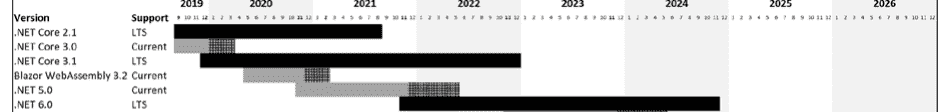

Figure 1.2: 支持各种版本

例如，如果你使用 .NET Core 3.0 创建了一个项目，那么当微软于 2019 年 12 月发布 .NET Core 3.1 时，你必须在 2020 年 3 月前将项目升级到 .NET Core 3.1。（在 .NET 5 之前，Current 版本的维护期只有三个月。）

如果你需要微软的长期支持，那么今天选择 .NET 6.0 并坚持使用到 .NET 8.0，即使微软发布了 .NET 7.0。这是因为 .NET 7.0 将是一个当前版本，因此它会在 .NET 6.0 之前失去支持。只需记住，即使使用 LTS 版本，你也必须升级到像 6.0.1 这样的错误修复版本。

除以下列表中所示的版本外，.NET Core 和现代 .NET 的所有版本都已达到生命周期结束：

- .NET 5.0 将于 2022 年 5 月达到生命周期结束。
- .NET Core 3.1 将于 2022 年 12 月 3 日达到生命周期结束。
- .NET 6.0 将于 2024 年 11 月达到生命周期结束。

## 了解 .NET 运行时和 .NET SDK 版本

.NET 运行时版本遵循语义化版本，即主版本号递增表示破坏性更改，次版本号递增表示新功能，补丁版本号递增表示错误修复。

.NET SDK 版本不遵循语义化版本。主要和次要版本号与之匹配的运行时版本绑定。补丁号遵循一种约定，表示 SDK 的主要和次要版本。

你可以在下表中看到此示例：

| 更改 | 运行时 | SDK |
|---|---|---|
| 初始发布 | 6.0.0 | 6.0.100 |
| SDK 错误修复 | 6.0.0 | 6.0.101 |
| 运行时和 SDK 错误修复 | 6.0.1 | 6.0.102 |
| SDK 新功能 | 6.0.1 | 6.0.200 |

## 移除旧版本的 .NET

.NET 运行时更新与 6.x 等主版本兼容，并且 .NET SDK 的更新版本仍保持构建针对早期运行时版本的应用的能力，这使得安全移除旧版本成为可能。

你可以使用以下命令查看当前安装了哪些 SDK 和运行时：

- `dotnet --list-sdks`
- `dotnet --list-runtimes`

在 Windows 上，使用“应用和功能”部分移除 .NET SDK。在 macOS 或 Windows 上，使用 dotnet-core-uninstall 工具。该工具默认未安装。

例如，在撰写第四版时，我每月都会使用以下命令：

```
dotnet-core-uninstall remove --all-previews-but-latest --sdk
```

## 现代 .NET 有何不同？

与单体式的传统 .NET Framework 相比，现代 .NET 采用模块化设计。它是开源的，微软在公开环境中做出改进和更改的决策。微软特别努力改进现代 .NET 的性能。

由于移除了传统和非跨平台技术，它比 .NET Framework 的最后一个版本更小。例如，Windows Forms 和 Windows Presentation Foundation（WPF）等工作负载可用于构建图形用户界面（GUI）应用程序，但它们与 Windows 生态系统紧密绑定，因此在 macOS 和 Linux 上的 .NET 中不包含它们。

## Windows 开发

现代 .NET 的一个特性是使用随 .NET Core 3.1 或更高版本的 Windows 版本一起提供的 Windows Desktop Pack 支持运行旧的 Windows Forms 和 WPF 应用程序，这也是它比 macOS 和 Linux 的 SDK 更大的原因。如果必要，你可以对遗留的 Windows 应用进行一些小改动，然后为 .NET 6 重新构建它，以利用新功能和性能改进。


## Web 开发

ASP.NET Web Forms 和 Windows Communication Foundation (WCF) 是旧的 Web 应用和服务技术，今天越来越少的开发者会为新的开发项目选择使用它们，因此它们也被从现代 .NET 中移除。相反，开发者更倾向于使用 ASP.NET MVC、ASP.NET Web API、SignalR 和 gRPC。这些技术已被重构并合并为一个在现代 .NET 上运行的平台，名为 ASP.NET Core。你将在 *Chapter 14, Building Websites Using ASP.NET Core Razor Pages, Chapter 15, Building Websites Using the Model-View-Controller Pattern, Chapter 16, Building and Consuming Web Services, and Chapter 18, Building and Consuming Specialized Services.* 中学习这些技术。

**更多信息：** 一些 .NET Framework 开发者对 ASP.NET Web Forms、WCF 和 Windows Workflow (WF) 缺失于现代 .NET 表示不满，并希望微软改变主意。有开源项目可实现 WCF 和 WF 迁移到现代 .NET。你可以在以下链接阅读更多内容：https://devblogs.microsoft.com/dotnet/supporting-the-community-with-wf-and-wcf-oss-projects/。以下链接有一个用于 Blazor Web Forms 组件的开源项目：https://github.com/FritzAndFriends/BlazorWebFormsComponents。

## 数据库开发

**Entity Framework (EF)** 6 是一种对象关系映射技术，旨在与存储在关系数据库（如 Oracle 和 Microsoft SQL Server）中的数据一起工作。多年来它积累了大量包袱，因此跨平台 API 已被精简，已获得对非关系数据库（如 Microsoft Azure Cosmos DB）的支持，并被更名为 Entity Framework Core。你将在 *Chapter 10, Working with Data Using Entity Framework Core.* 中学习它。

如果你有使用旧版 EF 的现有应用，则版本 6.3 在 .NET Core 3.0 或更高版本上受支持。

## 现代 .NET 的主题

微软使用 Blazor 创建了一个网站来展示现代 .NET 的主要主题：https://themesof.net/。

## 了解 .NET Standard

2019 年 .NET 的情况是，微软控制着三个分支的 .NET 平台，如下列表所示：

- **.NET Core：** 用于跨平台和新应用
- **.NET Framework：** 用于遗留应用
- **Xamarin：** 用于移动应用

每个平台都有其优缺点，因为它们都是为不同的场景设计的。这导致开发者必须学习三个平台，每个平台都有烦人的怪癖和限制。

因此，微软定义了 .NET Standard —— 一组 API 的规范，所有 .NET 平台都可以实现以表明其兼容性级别。例如，基本支持由平台符合 .NET Standard 1.4 来表示。

随着 .NET Standard 2.0 及更高版本，微软使所有三个平台在现代最低标准上趋同，这使得开发者在任何 .NET 变体之间共享代码变得容易得多。

对于 .NET Core 2.0 及更高版本，这增加了开发者将为 .NET Framework 编写的旧代码移植到跨平台 .NET Core 所需的大多数缺失 API。然而，一些 API 已实现但会抛出异常，以告知开发者不应真正使用它们！这通常是由于运行 .NET 的操作系统存在差异。你将在 Chapter 2, Speaking C# 中学习如何处理这些异常。

必须理解 .NET Standard 只是一个标准。你无法像无法安装 HTML5 一样安装 .NET Standard。要使用 HTML5，你必须安装实现 HTML5 标准的 Web 浏览器。

要使用 .NET Standard，你必须安装实现 .NET Standard 规范的 .NET 平台。最后一个 .NET Standard 版本 2.1 由 .NET Core 3.0、Mono 和 Xamarin 实现。C# 8.0 的一些功能需要 .NET Standard 2.1。.NET Standard 2.1 未由 .NET Framework 4.8 实现，因此我们应将 .NET Framework 视为遗留。

随着 2021 年 11 月发布 .NET 6，对 .NET Standard 的需求已大幅降低，因为现在所有平台，包括移动平台，都有一个单一的 .NET。.NET 6 具有单一的 BCL 和两个 CLR：CoreCLR 针对网站和 Windows 桌面应用等服务器或桌面场景进行了优化，而 Mono 运行时针对资源有限的移动和 Web 浏览器应用进行了优化。

即使现在，为 .NET Framework 创建的应用和网站仍需要支持，因此了解你可以创建与遗留 .NET 平台向后兼容的 .NET Standard 2.0 类库是很重要的。

## 书籍各版使用的 .NET 平台和工具

本书第一版于 2016 年 3 月撰写，我专注于 .NET Core 功能，但在 .NET Core 1.0 最终发布之前，重要或有用的功能尚未在 .NET Core 中实现时使用了 .NET Framework。大多数示例使用 Visual Studio 2015，Visual Studio Code 仅简要展示。

第二版几乎完全删除了所有 .NET Framework 代码示例，以便读者能够专注于真正跨平台运行的 .NET Core 示例。

第三版完成了转换。它被重写为所有代码均为纯 .NET Core。但为 Visual Studio Code 和 Visual Studio 2017 的所有任务提供逐步说明增加了复杂性。

第四版继续这一趋势，仅在最后两章之外展示使用 Visual Studio Code 的编码示例。在第 20 章 Building Windows Desktop Apps 中，它使用在 Windows 10 上运行的 Visual Studio，在第 21 章 Building Cross-Platform Mobile Apps 中，它使用 Visual Studio for Mac。

在第五版中，第 20 章 Building Windows Desktop Apps 被移至附录 B，以腾出空间用于新的第 20 章 Building Web User Interfaces Using Blazor。Blazor 项目可以使用 Visual Studio Code 创建。

在本第六版中，第 19 章 Building Mobile and Desktop Apps Using .NET MAUI 已更新，以展示如何使用 Visual Studio 2022 和 .NET MAUI（Multi-platform App UI）创建移动和桌面跨平台应用。

到第七版和 .NET 7 发布时，Visual Studio Code 将拥有支持 .NET MAUI 的扩展。届时，读者将能够为本书中的所有示例使用 Visual Studio Code。

## 了解中间语言

dotnet CLI 工具使用的 C# 编译器（名为 Roslyn）将你的 C# 源代码转换为中间语言（IL）代码，并将 IL 存储在程序集（DLL 或 EXE 文件）中。IL 代码语句类似于汇编语言指令，由 .NET 的虚拟机执行，称为 CoreCLR。

在运行时，CoreCLR 从程序集中加载 IL 代码，即时（JIT）编译器将其编译为本地 CPU 指令，然后由你机器上的 CPU 执行。

这种两步编译过程的好处是微软可以为 Linux 和 macOS 以及 Windows 创建 CLR。相同的 IL 代码在任何地方都能运行，因为第二步编译会为原生操作系统和 CPU 指令集生成代码。

无论源代码使用何种语言编写，例如 C#、Visual Basic 或 F#，所有 .NET 应用程序都使用存储在程序集中的 IL 代码作为指令。微软和其他公司提供反编译工具，可以打开程序集并显示此 IL 代码，例如 ILSpy .NET Decompiler 扩展。

## 比较 .NET 技术

我们可以总结并比较今天的 .NET 技术，如下表所示：

| 技术 | 描述 | 主机操作系统 |
|---|---|---|
| Modern .NET | 现代功能集，完全支持 C# 8、9 和 10，用于移植现有应用或创建新的桌面、移动和 Web 应用及服务 | Windows, macOS, Linux, Android, iOS |
| .NET Framework | 遗留功能集，仅有限支持 C# 8，不支持 C# 9 或 10，仅用于维护现有应用程序 | Windows only |
| Xamarin | 仅移动和桌面应用 | Android, iOS, macOS |

## 使用 Visual Studio 2022 构建控制台应用

本节的目标是展示如何使用适用于 Windows 的 Visual Studio 2022 构建控制台应用。

如果你没有 Windows 计算机或想使用 Visual Studio Code，则可以跳过本节，因为代码将相同，只是工具体验不同。

## 使用 Visual Studio 2022 管理多个项目

Visual Studio 2022 具有名为解决方案的概念，允许你同时打开和管理多个项目。我们将使用解决方案来管理本章中你将创建的两个项目。

## 使用 Visual Studio 2022 编写代码

让我们开始编写代码！

- 1. 启动 Visual Studio 2022。
- 2. 在开始窗口中，单击创建新项目。
- 3. 在创建新项目对话框中，在搜索模板框中输入 console，并选择控制台应用程序，确保你选择的是 C# 项目模板而不是其他语言，例如 F# 或 Visual Basic，如图 1.3 所示：

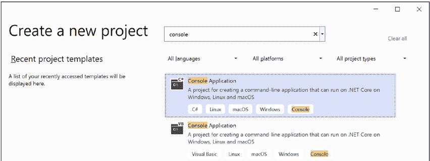

图 1.3：选择控制台应用程序项目模板


4. 单击 **Next**。

5. 在 **配置你的新项目** 对话框中，输入 HelloCS 作为项目名称，输入 C:\Code 作为位置，并输入 Chapter01 作为解决方案名称，如图 1.4 所示：

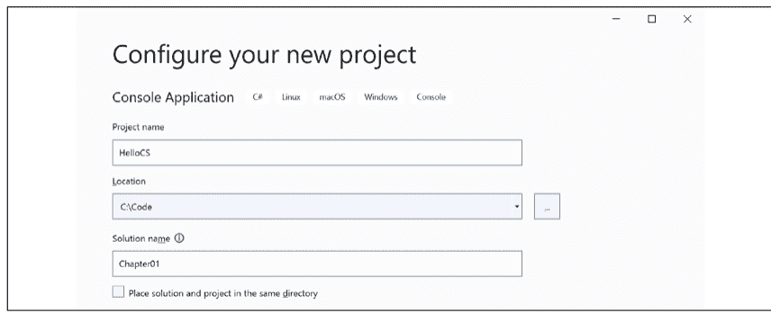

Figure 1.4: 为新项目配置名称和位置

6. 单击 **Next**。

> 我们故意使用旧的 .NET 5.0 项目模板来查看完整的控制台应用程序是什么样的。在下一节中，你将使用 .NET 6.0 创建控制台应用程序并查看发生了什么变化。

7. 在 **其他信息** 对话框中，在 **目标框架** 下拉列表中，注意 .NET 的 Current 和长期支持版本的选项，然后选择 **.NET 5.0 (Current)** 并单击 **Create**。

8. 在 **解决方案资源管理器** 中，双击打开名为 Program.cs 的文件，并注意 **解决方案资源管理器** 显示 **HelloCS** 项目，如图 1.5 所示：

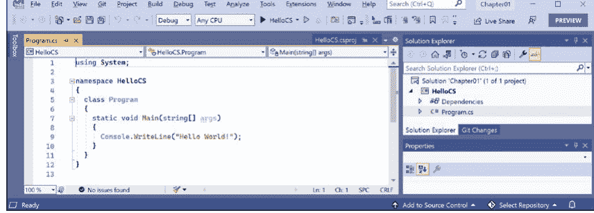

Figure 1.5: 在 Visual Studio 2022 中编辑 Program.cs

9. 在 Program.cs 中，修改第 9 行，使写入控制台的文本显示为 Hello, C#!

## 使用 Visual Studio 编译和运行代码

下一个任务是编译和运行代码。

- 1. 在 Visual Studio 中，导航到 Debug | Start Without Debugging。
- 2. 控制台窗口中的输出将显示运行应用程序的结果，如图 1.6 所示：
- 3. 按任意键关闭控制台窗口并返回 Visual Studio。
- 4. 选择 HelloCS 项目，然后在解决方案资源管理器 工具栏中打开 Show All Files 按钮，并注意编译器生成的 bin 和 obj 文件夹可见，如图 1.7 所示：

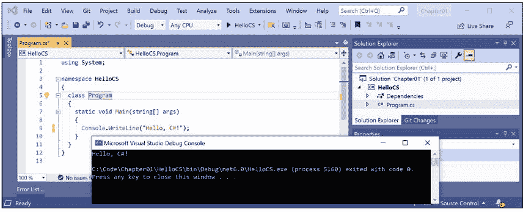

Figure 1.6: 在 Windows 上运行控制台应用

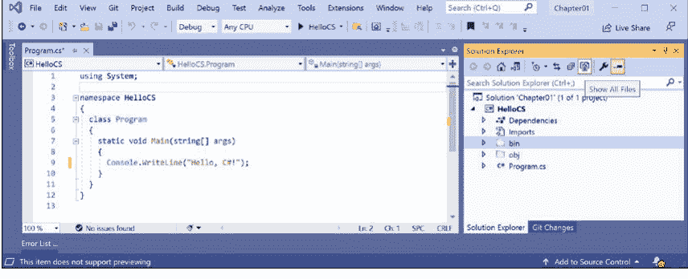

Figure 1.7: 显示编译器生成的 文件夹和文件

## 了解编译器生成的 文件夹和文件

创建了两个编译器生成的 文件夹，名为 obj 和 bin。你目前不需要查看这些文件夹内部或理解其文件。只要知道编译器需要创建临时文件夹和文件来完成工作即可。你可以删除这些文件夹及其文件，它们稍后可以重新创建。开发者经常这样做来“清理”项目。Visual Studio 甚至在 Build 菜单上有一个名为 Clean Solution 的命令，可以为你删除其中一些临时文件。在 Visual Studio Code 中的等效命令是 dotnet clean。

- obj 文件夹包含每个源代码文件的一个编译对象文件。这些对象尚未链接成最终的可执行文件。
- bin 文件夹包含应用程序或类库的二进制可执行文件。我们将在第 7 章《Packaging and Distributing .NET Types》中更详细地介绍这一点。

## 编写顶层程序

你可能会想，仅输出 Hello, C#! 就需要这么多代码。

尽管项目模板为你编写了样板代码，但有没有更简单的方法？

有的，在 C# 9 或更高版本中，有一种称为顶层程序 的方法。

让我们比较一下项目模板创建的控制台应用，如以下代码所示：

```
using System;

namespace HelloCS
{
    class Program
    {
        static void Main(string[] args)
        {
            Console.WriteLine("Hello World!");
        }
    }
}
```

与新的顶层程序最小控制台应用相比，如以下代码所示：

```
using System;

Console.WriteLine("Hello World!");
```

这要简单得多，对吧？如果你必须从空白文件开始并自己编写所有语句，这更好。但它是如何工作的？

在编译期间，用于定义命名空间、Program 类及其 Main 方法的所有样板代码都会生成并包裹在你编写的语句周围。

关于顶层程序需要记住的关键点包括以下列表：

- 任何 using 语句仍必须放在文件的顶部。
- 项目中只能有一个这样的文件。

文件顶部的 using System; 语句导入了 System 命名空间。这使得 Console.WriteLine 语句能够工作。你将在下一章了解更多关于命名空间的内容。

## 使用 Visual Studio 2022 添加第二个项目

让我们向解决方案添加第二个项目以探索顶层程序：

- 1. 在 Visual Studio 中，导航到 File | Add | New Project。
- 2. 在 Add a new project 对话框中，在 Recent project templates 中，选择 Console Application [C#] 然后单击 Next。
- 3. 在 Configure your new project 对话框中，对于 Project name，输入 TopLevelProgram，将位置保留为 C:\Code\Chapter01，然后单击 Next。
- 4. 在 Additional information 对话框中，选择 .NET 6.0 (Long-term support)，然后单击 Create。
- 5. 在解决方案资源管理器 中，在 TopLevelProgram 项目中，双击 Program.cs 以打开它。
- 6. 在 Program.cs 中，注意代码仅由一条注释和一条语句组成，因为它使用了 C# 9 中引入的顶层程序功能，如以下代码所示：

```
// See https://aka.ms/new-console-template for more information
Console.WriteLine("Hello, World!");
```

但是当我之前介绍顶层程序的概念时，我们需要一个 using System; 语句。为什么这里不需要呢？

## 隐式导入的命名空间

诀窍是我们仍然需要导入 System 命名空间，但现在它已通过 C# 10 中引入的功能为我们完成。让我们看看如何实现：

- 1. 在解决方案资源管理器 中，选择 TopLevelProgram 项目并打开 Show All Files 按钮，并注意编译器生成的 bin 和 obj 文件夹可见。
- 2. 展开 obj 文件夹，展开 Debug 文件夹，展开 net6.0 文件夹，并打开名为 TopLevelProgram.GlobalUsings.g.cs 的文件。
- 3. 注意此文件是由编译器为目标 .NET 6 的项目自动创建的，并且它使用 C# 10 中引入的名为 global imports 的功能，导入一些常用命名空间（如 System）供所有代码文件使用，如以下代码所示：

```
// <autogenerated />
global using global::System;
global using global::System.Collections.Generic;
global using global::System.IO;
global using global::System.Linq;
global using global::System.Net.Http;
global using global::System.Threading;
global using global::System.Threading.Tasks;
```

我将在下一章更详细地解释此功能。目前，只需注意 .NET 5 和 .NET 6 之间一个显著的变化是，许多项目模板（如控制台应用程序的模板）使用新的语言功能来隐藏实际发生的情况。

- 4. 在 TopLevelProgram 项目中，在 Program.cs 中，修改语句以输出不同的消息和操作系统的版本，如以下代码所示：

```
Console.WriteLine("Hello from a Top Level Program!");
Console.WriteLine(Environment.OSVersion.VersionString);
```

- 5. 在解决方案资源管理器 中，右键单击 Chapter01 解决方案，选择 Set Startup Projects...，设置 Current selection，然后单击 OK。
- 6. 在解决方案资源管理器 中，单击 TopLevelProgram 项目（或其内的任何文件或文件夹），并注意 Visual Studio 通过将项目名称加粗来指示 TopLevelProgram 现在是启动项目。
- 7. 导航到 Debug | Start Without Debugging 以运行 TopLevelProgram 项目，并注意结果，如图 1.8 所示：

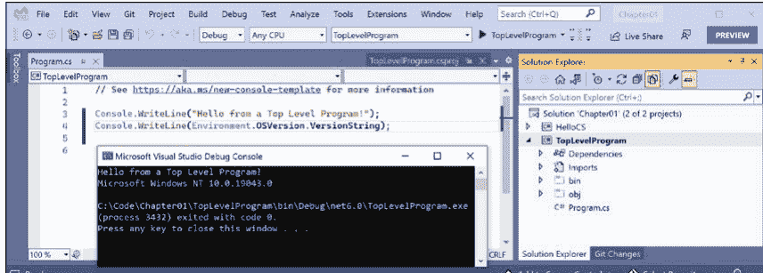

Figure 1.8: 在包含两个项目的 Visual Studio 解决方案中在 Windows 上运行顶层程序

## 使用 Visual Studio Code 构建控制台应用

本节的目标是展示如何使用 Visual Studio Code 构建控制台应用。

如果你永远不想尝试 Visual Studio Code 或 .NET Interactive Notebooks，那么请随意跳过本节和下一节，然后继续与 *审查项目的文件夹和文件* 部分。

本节中的说明和屏幕截图适用于 Windows，但相同的操作也适用于 macOS 和 Linux 版本的 Visual Studio Code。

主要区别将是原生命令行操作，例如删除文件：在 Windows 或 macOS 和 Linux 上，命令和路径可能不同。幸运的是，dotnet 命令行工具在所有平台上都是相同的。

## 使用 Visual Studio Code 管理多个项目

Visual Studio Code 有一个名为 **workspace** 的概念，允许你同时打开和管理多个项目。我们将使用工作区来管理本章中创建的两个项目。

## 使用 Visual Studio Code 编写代码

让我们开始编写代码！

- 1. 启动 Visual Studio Code。
- 2. 确保你没有任何打开的文件、文件夹或工作区。
- 3. 导航到 **File** | **Save Workspace As**....。
- 4. 在对话框中，导航到 macOS 上的用户文件夹（我的名为 `markjprice`）、Windows 上的 Documents 文件夹，或你想要保存项目的任何目录或驱动器。
- 5. 单击 **New Folder** 按钮并将文件夹命名为 Code。（如果你完成了 Visual Studio 2022 部分，那么此文件夹已存在。）
- 6. 在 Code 文件夹中，创建一个名为 Chapter01-vscode 的新文件夹。
- 7. 在 Chapter01-vscode 文件夹中，将工作区保存为 Chapter01.code-workspace。
- 8. 导航到 **File** | **Add Folder to Workspace**... 或单击 **Add Folder** 按钮。


9. 在 Chapter01-vscode 文件夹中，创建一个名为 HelloCS 的新文件夹。

10. 选择 HelloCS 文件夹并点击添加按钮。

11. 导航到 查看 | 终端。

> 我们故意使用旧的 .NET 5.0 项目模板来查看完整的控制台应用程序是什么样的。在下一节中，你将使用 .NET 6.0 创建一个控制台应用程序并查看有什么变化。

12. 在 终端 中，确保你位于 HelloCS 文件夹中，然后使用 dotnet 命令行工具创建一个以 .NET 5.0 为目标的新控制台应用，如以下命令所示：

```
dotnet new console -f net5.0
```

13. 你会看到 dotnet 命令行工具在当前文件夹为你创建了一个新的控制台应用程序项目，并且 资源管理器 窗口显示了创建的两个文件 HelloCS.csproj 和 Program.cs，以及 obj 文件夹，如图 1.9 所示：

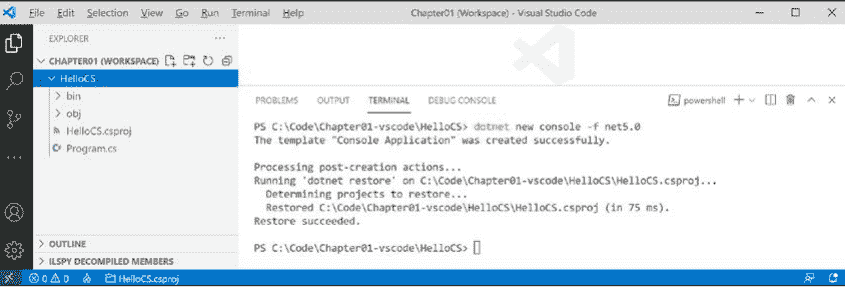

Figure 1.9: 资源管理器 窗口将显示已创建两个文件和一个文件夹

14. 在 资源管理器 中，点击名为 Program.cs 的文件以在编辑器窗口中打开它。第一次这样做时，Visual Studio Code 可能需要下载并安装 C# 依赖项，如 OmniSharp、.NET Core 调试器 和 Razor 语言服务器，如果在安装 C# 扩展时未执行此操作或需要更新。Visual Studio Code 将在输出窗口中显示进度，最终显示消息 Finished，如以下输出所示：

```
Installing C# dependencies...
Platform: win32, x86_64

Downloading package 'OmniSharp for Windows (.NET 4.6 / x64)' (36150 KB).................. Done!
Validating download...
Integrity Check succeeded.
Installing package 'OmniSharp for Windows (.NET 4.6 / x64)'

Downloading package '.NET Core Debugger (Windows / x64)' (45048 KB)................ Done!
Validating download...
Integrity Check succeeded.
Installing package '.NET Core Debugger (Windows / x64)'

Downloading package 'Razor Language Server (Windows / x64)' (52344 KB)................ Done!
Installing package 'Razor Language Server (Windows / x64)'

Finished
```

前面的输出来自 Windows 上的 Visual Studio Code。在 macOS 或 Linux 上运行输出会略有不同，但会下载并安装适用于你的操作系统的等效组件。

15. 将创建名为 obj 和 bin 的文件夹，当你看到提示缺少必需资源 的通知时，点击 是，如图 1.10 所示：

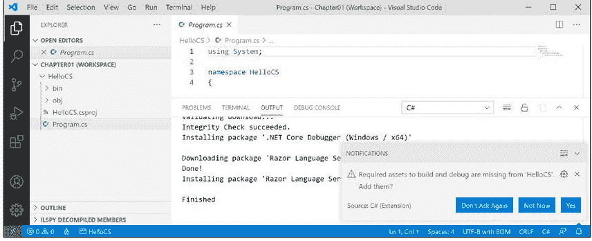

Figure 1.10: 添加所需的构建和调试资源的警告消息

16. 如果通知在你能够与之交互之前消失了，那么你可以点击状态栏最右侧角的铃铛图标再次显示它。

- 17. 经过几秒钟后，将创建另一个名为 .vscode 的文件夹，其中包含一些文件，这些文件由 Visual Studio Code 用于在调试期间提供 IntelliSense 等功能，你将在第 4 章 编写、调试和测试函数 中了解更多信息。
- 18. 在 Program.cs 中，修改第 9 行，使写入控制台的文本显示为 Hello, C#!

> 良好实践：导航到 文件 | 自动保存。此切换开关将节省每次重建应用程序前记住保存的麻烦。

## 使用 dotnet CLI 编译和运行代码

下一个任务是编译和运行代码：

1. 导航到 查看 | 终端 并输入以下命令：

```
dotnet run
```

2. 终端 窗口中的输出将显示运行应用程序的结果，如图 1.11 所示：

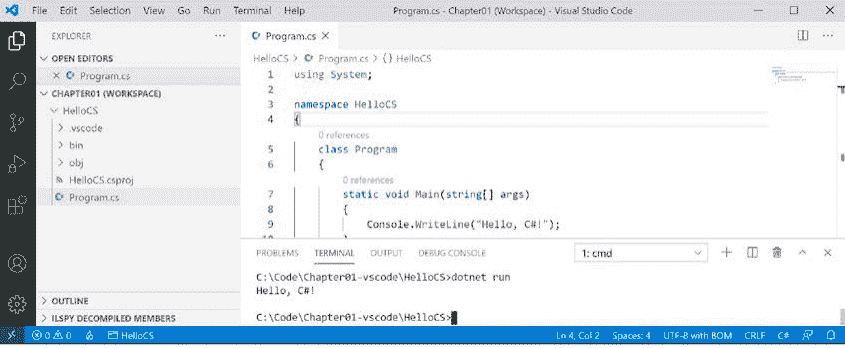

Figure 1.11: 运行你的第一个控制台应用程序的输出

## 使用 Visual Studio Code 添加第二个项目

让我们向工作区添加第二个项目以探索顶级程序：

- 1. 在 Visual Studio Code 中，导航到 文件 | 将文件夹添加到工作区....
- 2. 在 Chapter01-vscode 文件夹中，使用 **新建文件夹** 按钮创建一个名为 TopLevelProgram 的新文件夹，选择它，然后点击 **添加**。
- 3. 导航到 **终端** | **新建终端**，并在出现的下拉列表中选择 **TopLevelProgram**。或者，在 **资源管理器** 中，右键单击 TopLevelProgram 文件夹，然后选择 **在集成终端中打开**。
- 4. 在 **终端** 中，确认你位于 TopLevelProgram 文件夹中，然后输入创建新控制台应用程序的命令，如以下命令所示：

```bash
dotnet new console
```


> **良好实践：** 使用工作区时，在 **终端** 中输入命令时要小心。确保在输入可能具有破坏性的命令之前位于正确的文件夹中！这就是为什么我在发出创建新控制台应用的命令之前让你为 TopLevelProgram 创建一个新终端。

5. 导航到 **查看** | **命令面板**。
6. 输入 omni，然后在出现的下拉列表中选择 **OmniSharp: 选择项目**。
7. 在两个项目的下拉列表中，选择 **TopLevelProgram** 项目，并在提示时点击 **是** 以添加所需的调试资源。

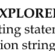

> **良好实践：** 要启用调试和其他有用的功能，如代码格式化和 转到定义，你必须告诉 OmniSharp 你在 Visual Studio Code 中正在积极工作的项目。你可以通过点击状态栏左侧火焰图标右侧的项目/文件夹来快速切换活动项目。

8. 在 **资源管理器** 中，在 TopLevelProgram 文件夹中选择 Program.cs，然后更改现有语句以输出不同的消息并输出操作系统版本字符串，如以下代码所示：

```csharp
Console.WriteLine("Hello from a Top Level Program!");
Console.WriteLine(Environment.OSVersion.VersionString);
```

9. 在 **终端** 中，输入运行程序的命令，如以下命令所示：

```bash
dotnet run
```

10. 注意 终端 窗口中的输出，如图 1.12 所示：

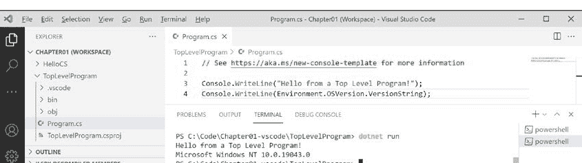

Figure 1.12: 在 Windows 上具有两个项目的 Visual Studio Code 工作区中运行顶级程序

如果你在 macOS Big Sur 上运行该程序，环境操作系统会不同，如以下输出所示：

```
Hello from a Top Level Program!
Unix 11.2.3
```

## 使用 Visual Studio Code 管理多个文件

如果你同时想要处理多个文件，那么在编辑时可以将它们并排放置：

- 1. 在 资源管理器 中，展开两个项目。
- 2. 打开两个项目中的 Program.cs 文件。
- 3. 点击、按住并拖动其中一个打开文件的编辑窗口标签，将它们排列以便同时查看两个文件。

## 使用 .NET Interactive Notebooks 探索代码

.NET Interactive Notebooks 使编写代码比顶级程序更简单。
它需要 Visual Studio Code，因此如果你之前未安装，请现在安装。

### 创建笔记本

首先，我们需要创建一个笔记本：

- 1. 在 Visual Studio Code 中，关闭任何打开的工作区或文件夹。
- 2. 导航到 **查看** | **命令面板**。
- 3. 输入 `.net inter`，然后选择 `.NET Interactive: 创建新的空白笔记本`，如 *图 1.13* 所示：

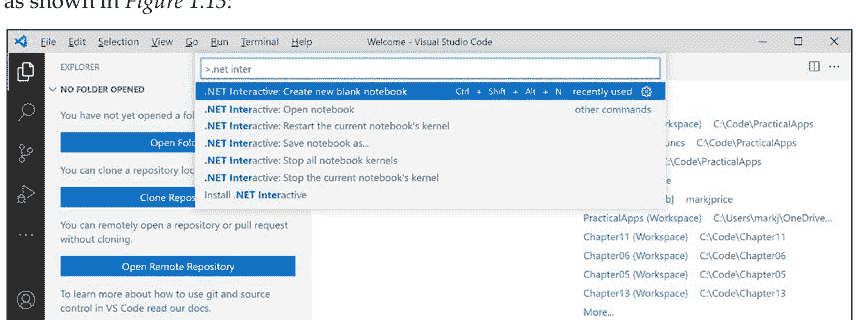

Figure 1.13: 创建新的空白 .NET 笔记本

4. 在提示选择文件扩展名时，选择 **创建为 '.dib'**。

> .dib 是 Microsoft 定义的一种实验性文件格式，旨在避免与 Python 交互式笔记本使用的 .ipynb 格式的混淆和兼容性问题。该文件扩展名历史上仅用于 Jupyter 笔记本，可包含交互式 (I) 的数据、Python 代码 (PY) 和笔记本文件中的输出 (NB)。使用 .NET Interactive Notebooks，该概念已扩展以允许混合 C#、F#、SQL、HTML、JavaScript、Markdown 和其他语言。.dib 是多语言的，意味着它支持混合语言。.dib 和 .ipynb 文件格式之间支持转换。

- 5. 为笔记本中的代码单元选择 **C#** 作为默认语言。
- 6. 如果有更新版本的 .NET Interactive 可用，你可能需要等待它卸载旧版本并安装新版本。导航到 **查看** | **输出** 并在下拉列表中选择 **.NET Interactive : diagnostics**。请耐心等待。笔记本出现可能需要几分钟，因为它必须启动 .NET 的托管环境。如果几分钟后没有任何反应，请关闭 Visual Studio Code 并重新启动它。


7. 一旦 .NET Interactive Notebooks 扩展下载并安装完成，**输出** 窗口的诊断信息将显示内核进程已启动（你的进程和端口号与下面的输出不同），如下所示的输出已编辑以节省空间：

```
Extension started for VS Code Stable.
...
Kernel process 12516 Port 59565 is using tunnel uri http://
localhost:59565/
```

## 在笔记本中编写和运行代码

接下来，我们可以在笔记本单元中编写代码：

1. 第一个单元应已设置为 **C# (.NET Interactive)**，但如果设置为其他内容，则单击代码单元右下角的语言选择器，然后选择 **C# (.NET Interactive)** 作为该单元的语言模式，并注意代码单元的其他语言选择，如图 1.14 所示：

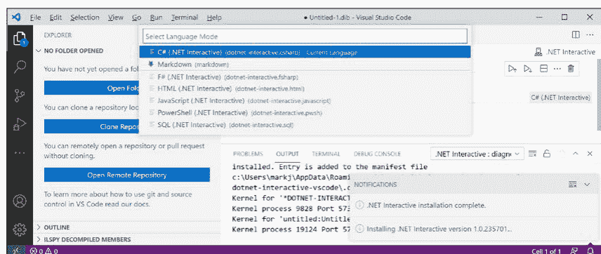

图 1.14：在 .NET Interactive 笔记本中更改代码单元的语言

2. 在 **C# (.NET Interactive)** 代码单元中，输入一条语句以向控制台输出消息，并注意你不需要像在完整应用程序中那样以分号结束语句，如以下代码所示：

```
Console.WriteLine("Hello, .NET Interactive!")
```

3. 单击代码单元左侧的 **执行单元** 按钮并注意在代码单元下方的灰色框中出现的输出，如图 1.15 所示：

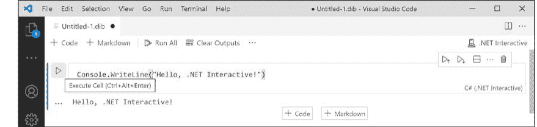

图 1.15：在笔记本中运行代码并查看下方的输出

## 保存笔记本

像任何其他文件一样，我们在继续之前应保存笔记本：

- 1. 导航到 **文件** | **另存为**...
- 2. 更改到 `Chapter01-vscode` 文件夹并将笔记本保存为 `Chapter01.dib`。
- 3. 关闭 `Chapter01.dib` 编辑器选项卡。

## 向笔记本添加 Markdown 和特殊命令

我们可以混合使用包含 Markdown 和代码的单元以及特殊命令：

- 1. 导航到 **文件** | **打开文件**...，并选择 `Chapter01.dib` 文件。
- 2. 如果提示 `Do you trust the authors of these files?`，请单击 **打开**。
- 3. 将鼠标悬停在代码块上方并单击 **+ 标记** 以添加 Markdown 单元。
- 4. 输入 1 级标题，如以下 Markdown 所示：
- 5. 单击单元右上角的勾选标记以停止编辑单元并查看处理的 Markdown。

```
## Chapter 1 - Hello, C##! Welcome, .NET!
Mixing *rich* **text** and code is cool!
```

> 如果你的单元顺序错误，则可以拖放以重新排列它们。

- 6. 将鼠标悬停在 Markdown 单元和代码单元之间并单击 + Code。
- 7. 输入特殊命令以输出有关 .NET Interactive 的版本信息，如以下代码所示：
- 8. 单击 Execute Cell 按钮并注意输出，如图 1.16 所示：

```
### !about
```

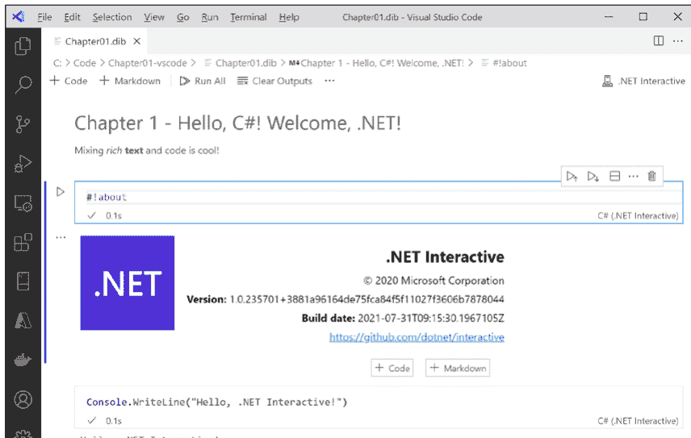

图 1.16：在 .NET Interactive 笔记本中混合使用 Markdown、代码和特殊命令

## 在多个单元中执行代码

当笔记本中有多个代码单元时，必须先执行前面的代码单元，然后它们的内容才会在后续代码单元中可用：

- 1. 在笔记本底部添加一个新的代码单元，然后输入一条语句声明变量并分配整数值，如以下代码所示：
- 2. 在笔记本底部添加一个新的代码单元，然后输入一条语句输出 number 变量，如以下代码所示：

```
int number = 8;
```

```
Console.WriteLine(number);
```

3. 请注意，第二个代码单元不知道 number 变量，因为它是在另一个代码单元中定义和分配的，即上下文，如图 1.17 所示：

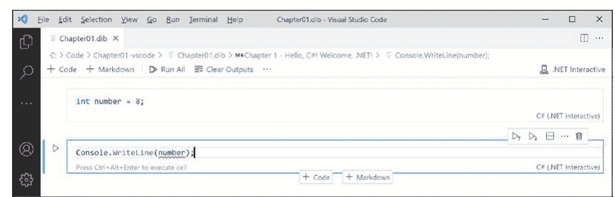

图 1.17：number 变量在当前单元或上下文中不存在

4. 在第一个单元中，单击 **执行单元** 按钮以声明并为变量分配值，然后在第二个单元中，单击 **执行单元** 按钮以输出 number 变量，并注意这可行。（或者，在第一个单元中，你可以单击 **执行单元并以下** 按钮。）

> **良好实践：** 如果你将相关代码拆分到两个单元中，请记住在执行后续单元之前先执行前面的单元。在笔记本顶部，有以下按钮 – **清除输出** 和 **全部运行**。这些非常方便，因为你可以先单击一个然后再单击另一个，以确保所有代码单元都正确执行，只要它们按正确的顺序排列。

## 使用本书代码的 .NET Interactive 笔记本

在接下来的章节中，我不会给出使用笔记本的明确说明，但本书的 GitHub 仓库在适当时会提供解决方案笔记本。我预计许多读者会想要运行我预先创建的笔记本，以了解 *第 2 章到第 12 章* 中涵盖的语言和库功能，并在无需编写完整应用程序（即使只是控制台应用程序）的情况下亲眼看到并学习它们：

https://github.com/markjprice/cs10dotnet6/tree/main/notebooks

## 查看项目的文件夹和文件

在本章中，你创建了两个名为 `HelloCS` 和 `TopLevelProgram` 的项目。

Visual Studio Code 使用工作区文件来管理多个项目。Visual Studio 2022 使用解决方案文件来管理多个项目。你还创建了一个 .NET Interactive 笔记本。

结果是一个文件夹结构和文件，将在后续章节中重复出现，尽管不止两个项目，如图 1.18 所示：

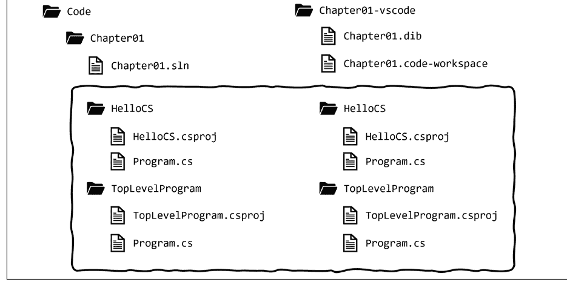

图 1.18：本章两个项目的目录结构和文件

## 了解常见的文件夹和文件

尽管 .code-workspace 和 .sln 文件不同，但诸如 HelloCS 和 TopLevelProgram 之类的项目文件夹和文件对于 Visual Studio 2022 和 Visual Studio Code 来说是相同的。这意味着如果你愿意，可以在两个代码编辑器之间混合使用：

- - 在 Visual Studio 2022 中，打开解决方案后，导航到 **文件 | 添加现有项目...** 以添加由其他工具创建的项目文件。
- - 在 Visual Studio Code 中，打开工作区后，导航到 **文件 | 添加文件夹到工作区...** 以添加由其他工具创建的项目文件夹。

> **良好实践：** 尽管源代码（如 `.csproj` 和 `.cs` 文件）是相同的，但编译器自动生成的 `bin` 和 `obj` 文件夹可能存在文件版本不匹配导致错误的情况。如果你想在 Visual Studio 2022 和 Visual Studio Code 中同时打开同一个项目，请在另一个代码编辑器中打开项目之前删除临时的 `bin` 和 `obj` 文件夹。这就是为什么我在本章中要求你为 Visual Studio Code 解决方案创建不同的文件夹。

## 在 GitHub 上了解解决方案代码

本书 GitHub 仓库中的解决方案代码包含 Visual Studio Code、Visual Studio 2022 和 .NET Interactive 笔记本文件的独立文件夹，如下列表所示：

- - Visual Studio 2022 解决方案: https://github.com/markjprice/cs10dotnet6/tree/main/vs4win
- - Visual Studio Code 解决方案: https://github.com/markjprice/cs10dotnet6/tree/main/vscode
- - .NET Interactive Notebook 解决方案: https://github.com/markjprice/cs10dotnet6/tree/main/notebooks

> **良好实践：** 如果需要，请返回本章以提醒自己如何在你选择的代码编辑器中创建和管理多个项目。GitHub 仓库提供了四个代码编辑器（Windows 版 Visual Studio 2022、Visual Studio Code、Mac 版 Visual Studio 2022 和 JetBrains Rider）的逐步说明，以及额外的屏幕截图：https://github.com/markjprice/cs10dotnet6/blob/main/docs/code-editors/。

## 充分利用本书的 GitHub 仓库

Git 是一个常用的源代码管理系统。GitHub 是一家公司、网站和桌面应用程序，使管理 Git 变得更容易。微软于 2018 年收购了 GitHub，因此它将继续与微软工具实现更紧密的集成。

我为本书创建了一个 GitHub 仓库，我用它来做以下事情：

- - 存储可在印刷出版日期后维护的本书解决方案代码。
- - 提供扩展书籍的额外材料，如勘误修复、小改进、有用链接列表以及无法放入印刷书籍的更长文章。
- - 为读者提供一个联系我的地方，如果他们对书籍有问题。

## 提出书籍问题

如果你在按照本书中的任何说明操作时遇到困难，或者发现正文或解决方案代码中的错误，请在 GitHub 仓库中提出问题：


- 1. 使用您喜欢的浏览器导航到以下链接：https://github.com/markjprice/cs10dotnet6/issues。
- 2. 点击 **新问题**。
- 3. 尽可能详细地输入信息以帮助我诊断问题。例如：
- 1. 您的操作系统，例如 Windows 11 64 位，或 macOS Big Sur 版本 11.2.3。
- 2. 您的硬件，例如 Intel、Apple Silicon 或 ARM CPU。
- 3. 您的代码编辑器，例如 Visual Studio 2022、Visual Studio Code 或其他编辑器，包括版本号。
- 4. 您认为相关且必要的尽可能多的代码和配置。
- 5. 预期行为和实际经历的行为的描述。
- 6. 屏幕截图（如有可能）。

撰写本书对我来说是一项副业。我有一份全职工作，所以我主要在周末工作于本书。这意味着我不能总是立即回复问题。但我希望我的所有读者都能成功使用我的书，所以如果我能在不费太多麻烦的情况下帮助您（和其他人），我会很乐意这样做。

## 给我反馈

如果您想对本书提供更一般的反馈，那么 GitHub 仓库 README.md 页面上有一些调查的链接。您可以匿名提供反馈，或者如果您希望我回复，则可以提供电子邮件地址。我只会使用此电子邮件地址来回答您的反馈。

我很乐意听到我的读者对本书的喜欢之处，以及改进建议和他们如何使用 C# 和 .NET，所以不要害羞。请联系我！

提前感谢您富有思考且建设性的反馈。

## 从 GitHub 仓库下载解决方案代码

我使用 GitHub 来存储所有动手、分步编码示例以及每章末尾 featured 的实践练习的解决方案。您可以在以下链接找到仓库：https://github.com/markjprice/cs10dotnet6。

如果您只想在不使用 Git 的情况下下载所有解决方案文件，请点击绿色的 Code 按钮，然后选择 Download ZIP，如图 1.19 所示：

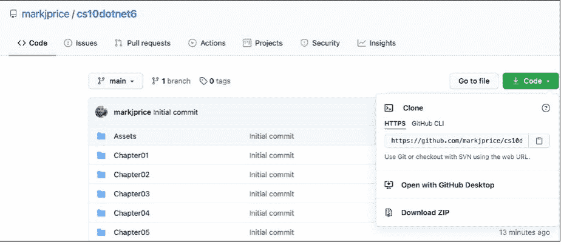

图 1.19：以 ZIP 文件形式下载仓库

我建议您将上述链接添加到您最喜欢的书签中，因为我还使用本书的 GitHub 仓库来发布勘误（更正）和其他有用的链接。

## 使用 Visual Studio Code 和命令行进行 Git

Visual Studio Code 支持 Git，但它会使用您操作系统的 Git 安装，因此您必须先安装 Git 2.0 或更高版本，然后才能获得这些功能。

您可以从以下链接安装 Git：https://git-scm.com/download。

如果您喜欢使用 GUI，可以从以下链接下载 GitHub Desktop：https://desktop.github.com。

## 克隆本书解决方案代码仓库

让我们克隆本书解决方案代码仓库。在接下来的步骤中，您将使用 Visual Studio Code 终端，但您也可以在任何命令提示符或终端窗口中输入命令：

- 1. 在您的用户或文档文件夹中，或您想要存储 Git 仓库的任何位置创建一个名为 Repos-vscode 的文件夹。
- 2. 在 Visual Studio Code 中打开 Repos-vscode 文件夹。
- 3. 导航到 View | Terminal，并输入以下命令：

```
git clone https://github.com/markjprice/cs10dotnet6.git
```

- 4. 请注意，克隆所有章节的所有解决方案需要一分钟左右，如图 1.20 所示：

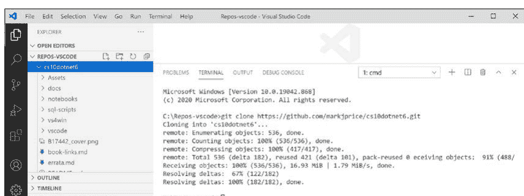

图 1.20：使用 Visual Studio Code 克隆本书解决方案代码

## 寻找帮助

本节全部关于如何在网上找到有关编程的质量信息。

## 阅读 Microsoft 文档

获取有关 Microsoft 开发工具和平台帮助的权威资源是 Microsoft Docs，您可以在以下链接找到它：https://docs.microsoft.com/。

## 获取 dotnet 工具的帮助

在命令行中，您可以要求 dotnet 工具提供其命令的帮助：

- 1. 要在浏览器窗口中打开 dotnet new 命令的官方文档，请在命令行或 Visual Studio Code 终端中输入以下内容：
- 2. 要在命令行获取帮助输出，请使用 -h 或 --help 标志，如以下命令所示：
- 3. 您将看到以下部分输出：

```
dotnet help new
```

```
dotnet new console -h
```

```
Console Application (C#)
Author: Microsoft
Description: A project for creating a command-line application that can run on .NET Core on Windows, Linux and macOS
```

```
Options:
-f|--framework. The target framework for the project.
    net6.0      - Target net6.0
    net5.0      - Target net5.0
    netcoreapp3.1.  - Target netcoreapp3.1
    netcoreapp3.0.  - Target netcoreapp3.0
Default: net6.0

--langVersion   Sets langVersion in the created project file text -
Optional
```

## 获取类型及其成员的定义

代码编辑器最有用的功能之一是 **转到定义**。它在 Visual Studio Code 和 Visual Studio 2022 中可用。它将通过读取编译后的程序集中的元数据来显示类型或成员的公共定义是什么样的。

一些工具，例如 ILSpy .NET Decompiler，甚至会为您从元数据和 IL 代码反向工程回 C#。

让我们看看如何使用 **转到定义** 功能：

- 1. 在 Visual Studio 2022 或 Visual Studio Code 中打开名为 Chapter01 的解决方案/工作区。
- 2. 在 HelloCS 项目中，在 Program.cs 中，在 Main 中，输入以下语句声明一个名为 z 的整数变量：
```
int z;
```
- 3. 点击 int 内部，然后右键单击并选择 **转到定义**。
- 4. 在出现的代码窗口中，您可以看到 int 数据类型是如何定义的，如图 1.21 所示：

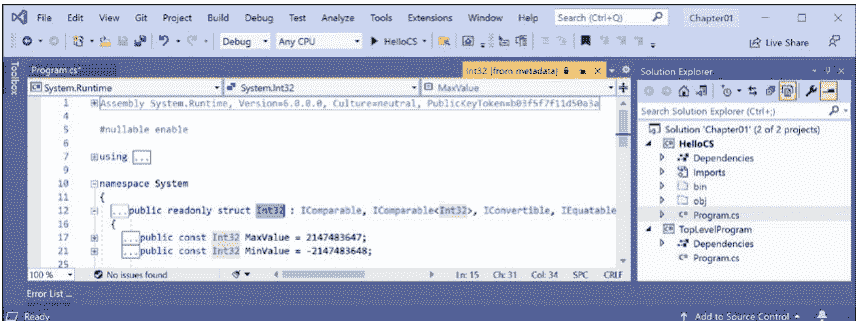

图 1.21：int 数据类型元数据

您可以看到 int：

- 使用 struct 关键字定义
- 在 System.Runtime 程序集中
- 在 System 命名空间中
- 命名为 Int32
- 因此是 System.Int32 类型的别名
- 实现接口如 IComparable
- 具有其最大值和最小值的常量值
- 具有方法如 Parse

> **良好实践：** 当您在 Visual Studio Code 中尝试使用 **转到定义** 时，有时会看到 **未找到定义** 的错误。这是因为 C# 扩展不知道当前项目。要修复此问题，请导航到 **视图 | 命令面板**，输入 omni，选择 **OmniSharp: 选择项目**，然后选择您想要工作的项目。

现在，**转到定义** 功能对您来说并不那么有用，因为您还不知道所有这些信息意味着什么。

到本书第一部分结束时，该部分包括第 2 章到第 6 章，并教您有关 C# 的知识，您将知道足够的信息使此功能变得非常方便。

- 5. 在代码编辑器窗口中，向下滚动以找到第 106 行具有单个字符串参数的 Parse 方法，以及第 86 行到第 105 行记录它的注释，如图 1.22 所示：

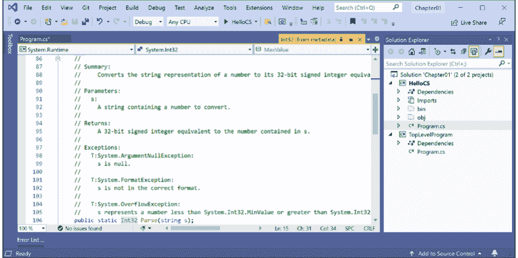

图 1.22：具有字符串参数的 Parse 方法的注释

在注释中，您会看到 Microsoft 已记录以下内容：

- 描述该方法的摘要。
- 可以传递给该方法的参数，如字符串值。
- 该方法的返回值，包括其数据类型。
- 如果您调用此方法可能会发生的三个异常，包括 ArgumentNullException、FormatException 和 OverflowException。现在，我们知道我们可以选择将对该方法的调用包装在 try 语句中并捕获哪些异常。

希望您迫不及待地想学习所有这些意味着什么！

再耐心一点。您几乎到了本章的末尾，在下一章中，您将深入 C# 语言的细节。但首先，让我们看看您还能在哪里寻找帮助。

## 在 Stack Overflow 上寻找答案

Stack Overflow 是获取困难编程问题答案最受欢迎的第三方网站。它如此受欢迎，以至于像 DuckDuckGo 这样的搜索引擎有一种特殊的方法来编写查询以搜索该网站：

- 1. 启动您喜欢的网络浏览器。
- 2. 导航到 DuckDuckGo.com，输入以下查询，并注意搜索结果，也显示在图 1.23 中：

```
!so securestring
```

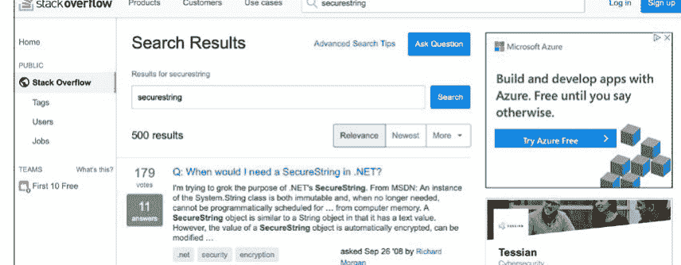

图 1.23：securestring 的 Stack Overflow 搜索结果


## 使用 Google 搜索答案

你可以使用高级搜索选项搜索 Google，以提高找到所需内容的机会：

- 1. 导航到 Google。
- 2. 使用简单的 Google 查询搜索有关垃圾回收的信息，并注意你很可能会在看到计算机科学中垃圾回收的维基百科定义之前，先看到你所在地区垃圾回收服务的许多广告。
- 3. 通过将其限制在有用的站点（如 Stack Overflow），并删除我们可能不关心的语言，如 C++、Rust 和 Python，或显式添加 C# 和 .NET 来改进搜索，如以下搜索查询所示：

```
garbage collection site:stackoverflow.com +C# -Java
```

## 订阅官方 .NET 博客

为了及时了解 .NET，一个值得订阅的优秀博客是官方 .NET 博客，由 .NET 工程团队撰写，你可以在以下链接找到它：https://devblogs.microsoft.com/dotnet/。

## 观看 Scott Hanselman 的视频

来自 Microsoft 的 Scott Hanselman 有一个关于他们没教你计算机知识的优秀 YouTube 频道：http://computerstufftheydidntteachyou.com/。

我推荐给所有从事计算机工作的人。

## 练习和探索

让我们现在通过尝试回答一些问题、进行一些实践操作，并更详细地深入本章涵盖的主题来测试你的知识和理解。

## 练习 1.1 – 测试你的知识

请尝试回答以下问题，记住虽然大多数答案可以在本章中找到，但你应该进行一些在线研究或编写代码来回答其他问题：

- 1. Visual Studio 2022 比 Visual Studio Code 更好吗？
- 2. .NET 6 比 .NET Framework 更好吗？
- 3. 什么是 .NET Standard，为什么它仍然重要？
- 4. 为什么程序员可以使用不同的语言，例如 C# 和 F#，来编写在 .NET 上运行的应用程序？
- 5. .NET 控制台应用程序的入口点方法名称是什么，应该如何声明？
- 6. 什么是顶层程序，如何访问任何命令行参数？
- 7. 在提示符下输入什么来构建和执行 C# 源代码？
- 8. 使用 .NET Interactive Notebooks 编写 C# 代码有哪些好处？
- 9. 你会在哪里查找 C# 关键字的帮助？
- 10. 你会在哪里查找常见编程问题的解决方案？

附录《测试你的知识问题的答案》可从 GitHub 仓库 README 中的链接下载：https://github.com/markjprice/cs10dotnet6。

## 练习 1.2 – 在任何地方练习 C#

你不需要 Visual Studio Code，甚至也不需要 Windows 或 Mac 上的 Visual Studio 2022 就可以编写 C#。你可以前往 .NET Fiddle – https://dotnetfiddle.net/ – 在线开始编码。

## 练习 1.3 – 探索主题

一本书是一种精心策划的体验。我尝试在印刷书籍中包含主题的正确平衡。其他我撰写的内容可以在本书的 GitHub 仓库中找到。

我相信这本书涵盖了 C# 和 .NET 开发人员应该具备或了解的所有基础知识和技能。一些较长的示例最好作为指向 Microsoft 文档或第三方文章作者的链接包含在内。

使用以下页面上的链接了解本章涵盖主题的更多详细信息：

https://github.com/markjprice/cs10dotnet6/blob/main/book-links.md#chapter-1--hello-c-welcome-net

## 摘要

在本章中，我们：

- 设置你的开发环境。
- 讨论了现代 .NET、.NET Core、.NET Framework、Xamarin 和 .NET Standard 之间的相似性和差异。
- 使用 .NET SDK 的 Visual Studio Code 和 Windows 版 Visual Studio 2022 创建了一些简单的控制台应用程序。
- 使用 .NET Interactive Notebooks 执行代码片段以进行学习。
- 学会了如何从 GitHub 仓库下载本书的解决方案代码。
- 最重要的是，学会了如何查找帮助。

在下一章，你将学习如何“说”C#。

## 02

## 说 C#

本章全部关于 C# 编程语言的基础知识。在本章中，你将学习如何使用 C# 的语法编写语句，以及介绍你每天会使用的一些常用词汇。此外，到本章结束时，你将有信心知道如何临时存储和处理计算机内存中的信息。

本章涵盖以下主题：

- 介绍 C# 语言
- 理解 C# 语法和词汇
- 使用变量
- 进一步探索控制台应用程序

## 介绍 C# 语言

本书的这一部分是关于 C# 语言——你每天用来编写应用程序源代码的语法和词汇。

编程语言与人类语言有很多相似之处，只是编程语言中你可以自己创造单词，就像 Dr. Seuss 一样！

在 Dr. Seuss 于 1950 年撰写的《If I Ran the Zoo》一书中，他写道：

> "And then, just to show them, I'll sail to Ka-Troo And Bring Back an It-Kutch, a Preep, and a Proo, A Nerkle, a Nerd, and a Seersucker, too!"

## 理解语言版本和功能

本书的这一部分涵盖 C# 编程语言，主要面向初学者，因此涵盖了所有开发人员需要了解的基础主题，从声明变量到存储数据再到如何定义自己的自定义数据类型。

本书涵盖了 C# 语言从 1.0 版本到最新 10.0 版本的功能。

如果你已经熟悉 C# 的旧版本，并且渴望了解最新版本 C# 中的新功能，我通过在下面列出语言版本及其重要的新功能，以及可以了解它们的章节编号和主题标题，使你更容易跳转。

## C# 1.0

C# 1.0 于 2002 年发布，包含了静态类型面向对象现代语言的所有重要功能，如你在 *第 2 章到第 6 章* 中所见。

## C# 2.0

C# 2.0 于 2005 年发布，重点是通过使用泛型实现强数据类型，以提高代码性能并减少类型错误，包括以下表中列出的主题：

| Feature | Chapter | Topic |
|---|---|---|
| Nullable value types | 6 | Making a value type nullable |
| Generics | 6 | Making types more reusable with generics |

## C# 3.0

C# 3.0 于 2007 年发布，重点是通过 **语言集成查询 (LINQ)** 以及匿名类型和 lambda 表达式等相关功能实现声明式编码，包括以下表中列出的主题：

| Feature | Chapter | Topic |
|---|---|---|
| Implicitly typed local variables | 2 | Inferring the type of a local variable |
| LINQ | 11 | All topics in Chapter 11, Querying and Manipulating Data Using LINQ |

## C# 4.0

C# 4.0 于 2010 年发布，重点是提高与动态语言（如 F# 和 Python）的互操作性，包括以下表中列出的主题：

| Feature | Chapter | Topic |
|---|---|---|
| Dynamic types | 2 | Storing dynamic types |
| Named/optional arguments | 5 | Optional parameters and named arguments |

## C# 5.0

C# 5.0 于 2012 年发布，重点是通过在编写看起来像同步语句的同时自动实现复杂的有限状态机来简化异步操作支持，包括以下表中列出的主题：

| Feature | Chapter | Topic |
|---|---|---|
| Simplified asynchronous tasks | 12 | Understanding async and await |

## C# 6.0

C# 6.0 于 2015 年发布，重点是对语言进行小幅改进，包括以下表中列出的主题：

| Feature | Chapter | Topic |
|---|---|---|
| static imports | 2 | Simplifying the usage of the console |
| Interpolated strings | 2 | Displaying output to the user |
| Expression bodied members | 5 | Defining read-only properties |

## C# 7.0

C# 7.0 于 2017 年 3 月发布，重点是添加诸如元组和模式匹配等函数式语言功能，以及对语言的小幅改进，包括以下表中列出的主题：

| Feature | Chapter | Topic |
|---|---|---|
| Binary literals and digit separators | 2 | Storing whole numbers |
| Pattern matching | 3 | Pattern matching with the if statement |
| out variables | 5 | Controlling how parameters are passed |
| Tuples | 5 | Combining multiple values with tuples |
| Local functions | 6 | Defining local functions |

## C# 7.1

C# 7.1 于 2017 年 8 月发布，重点是对语言进行小幅改进，包括以下表中列出的主题：

| Feature | Chapter | Topic |
|---|---|---|
| Default literal expressions | 5 | Setting fields with default literal |
| Inferred tuple element names | 5 | Inferring tuple names |
| async Main | 12 | Improving responsiveness for console apps |


## C# 7.2

C# 7.2 于 2017 年 11 月发布，专注于对语言的细微改进，包括以下表格中列出的主题：

| 特性 | 章节 | 主题 |
|---|---|---|
| 数字字面量中的前导下划线 | 2 | 存储整数 |
| 非尾随命名参数 | 5 | 可选参数和命名参数 |
| private protected 访问修饰符 | 5 | 理解访问修饰符 |
| 可以使用元组类型测试 == 和 != | 5 | 比较元组 |

## C# 7.3

C# 7.3 于 2018 年 5 月发布，专注于性能导向的安全代码，改进了 ref 变量、指针和 stackalloc。这些是高级功能，对大多数开发者来说很少需要，因此本书不予涵盖。

## C# 8

C# 8 于 2019 年 9 月发布，专注于与空值处理相关的语言重大变更，包括以下表格中列出的主题：

| 特性 | 章节 | 主题 |
|---|---|---|
| 可空引用类型 | 6 | 使引用类型可空 |
| Switch 表达式 | 3 | 使用 switch 表达式简化 switch 语句 |
| 默认接口方法 | 6 | 理解默认接口方法 |

## C# 9

C# 9 于 2020 年 11 月发布，专注于记录类型、模式匹配的改进以及最小代码控制台应用，包括以下表格中列出的主题：

| 特性 | 章节 | 主题 |
|---|---|---|
| 最小代码控制台应用 | 1 | 顶层程序 |
| 目标类型 new | 2 | 使用目标类型 new 实例化对象 |
| 增强的模式匹配 | 5 | 使用对象进行模式匹配 |
| 记录 | 5 | 使用记录 |

## C# 10

C# 10 于 2021 年 11 月发布，专注于在常见场景中减少所需代码量的功能，包括以下表格中列出的主题：

| 特性 | 章节 | 主题 |
|---|---|---|
| 全局命名空间导入 | 2 | 导入命名空间 |
| 常量字符串字面量 | 2 | 使用插值字符串格式化 |
| 文件作用域命名空间 | 5 | 简化命名空间声明 |
| 必需属性 | 5 | 要求在实例化期间设置属性 |
| 记录结构体 | 6 | 使用记录结构体类型 |
| 空参数检查 | 6 | 检查方法参数中的 null |

## Understanding C# standards

多年来，Microsoft 已向标准机构提交了几个版本的 C#，如下表所示：

| C# 版本 | ECMA 标准 | ISO/IEC 标准 |
|---|---|---|
| 1.0 | ECMA-334:2003 | ISO/IEC 23270:2003 |
| 2.0 | ECMA-334:2006 | ISO/IEC 23270:2006 |
| 5.0 | ECMA-334:2017 | ISO/IEC 23270:2018 |

C# 6 的标准仍为草案，添加 C# 7 功能的工作正在进行中。Microsoft 于 2014 年将 C# 开源。

目前有三个公开的 GitHub 仓库用于尽可能开放 C# 及相关技术的工作，如下表所示：

| 描述 | 链接 |
|---|---|
| C# 语言设计 | https://github.com/dotnet/csharplang |
| 编译器实现 | https://github.com/dotnet/roslyn |
| 描述语言的标准 | https://github.com/dotnet/csharpstandard |

## Discovering your C# compiler versions

.NET 语言编译器用于 C# 和 Visual Basic，也称为 Roslyn，以及用于 F# 的单独编译器，作为 .NET SDK 的一部分分发。要使用特定版本的 C#，你必须安装至少该版本的 .NET SDK，如下表所示：

| .NET SDK | Roslyn 编译器 | 默认 C# 语言 |
|---|---|---|
| 1.0.4 | 2.0 - 2.2 | 7.0 |
| 1.1.4 | 2.3 - 2.4 | 7.1 |
| 2.1.2 | 2.6 - 2.7 | 7.2 |
| 2.1.200 | 2.8 - 2.10 | 7.3 |
| 3.0 | 3.0 - 3.4 | 8.0 |
| 5.0 | 3.8 | 9.0 |
| 6.0 | 3.9 - 3.10 | 10.0 |

当你创建类库时，你可以选择定位 .NET Standard 以及现代 .NET 的版本。它们有默认的 C# 语言版本，如下表所示：

| .NET Standard | C# |
|---|---|
| 2.0 | 7.3 |
| 2.1 | 8.0 |

## How to output the SDK version

让我们看看你有哪些可用的 .NET SDK 和 C# 语言编译器版本：

- 1. 在 macOS 上，启动 **Terminal**。在 Windows 上，启动 **Command Prompt**。
- 2. 要确定你有哪些可用的 .NET SDK 版本，输入以下命令：
- 3. 请注意，写作时的版本为 6.0.100，表示它是 SDK 的初始版本，尚未进行任何错误修复或新功能，如以下输出所示：

```
dotnet --version
```

```
6.0.100
```

## Enabling a specific language version compiler

开发工具如 Visual Studio 和 dotnet 命令行界面默认假设你想要使用最新主要版本的 C# 语言编译器。在 C# 8.0 发布之前，C# 7.0 是最新主要版本并被默认使用。要使用 C# 点发布版如 7.1、7.2 或 7.3 中的改进，你必须在项目文件中添加一个 <LangVersion> 配置元素，如以下标记所示：

```xml
<LangVersion>7.3</LangVersion>
```

在 .NET 6.0 中发布 C# 10.0 后，如果 Microsoft 发布了 C# 10.1 编译器并且你想使用其新语言功能，那么你将必须在项目文件中添加一个配置元素，如以下标记所示：

```xml
<LangVersion>10.1</LangVersion>
```

<LangVersion> 的可能值如下表所示：

| LangVersion | 描述 |
|---|---|
| 7, 7.1, 7.2, 7.3<br>8, 9, 10 | 输入特定版本号将使用该编译器（如果已安装）。 |
| latestmajor | 使用最高的 major 数字，例如，2019 年 8 月的 7.0，2019 年 10 月的 8.0，2020 年 11 月的 9.0，2021 年 11 月的 10.0。 |
| latest | 使用最高的 major 和最高的 minor 数字，例如 2017 年的 7.2，2018 年的 7.3，2019 年的 8，也许 2022 年初的 10.1。 |
| preview | 使用最高可用的预览版本，例如安装 .NET 6.0 预览版 6 时的 2021 年 7 月的 10.0。 |

创建新项目后，你可以编辑 .csproj 文件并添加 <LangVersion> 元素，如以下标记中突出显示所示：

```xml
<Project Sdk="Microsoft.NET.Sdk">

  <PropertyGroup>
    <OutputType>Exe</OutputType>
    <TargetFramework>net6.0</TargetFramework>
    <LangVersion>preview</LangVersion>
  </PropertyGroup>

</Project>
```

你的项目必须定位 net6.0 才能使用 C# 10 的全部功能。


> **Good Practice:** 如果你使用 Visual Studio Code 并且尚未安装，请安装名为 **MSBuild project tools** 的 Visual Studio Code 扩展。这将在编辑 .csproj 文件时提供 IntelliSense，包括轻松添加具有适当值的 <LangVersion> 元素。

## Understanding C# grammar and vocabulary

要学习简单的 C# 语言功能，你可以使用 .NET Interactive Notebooks，这消除了创建任何类型应用程序的需求。

要学习其他一些 C# 语言功能，你需要创建一个应用程序。最简单的应用程序类型是控制台应用程序。

让我们开始查看 C# 的语法和词汇的基础知识。在本章中，你将创建多个控制台应用程序，每个应用程序展示 C# 语言的相关功能。

## Showing the compiler version

我们将开始编写显示编译器版本的代码：

- 1. 如果你已完成第 1 章，Hello, C#! Welcome, .NET!，那么你将已经拥有一个 Code 文件夹。如果没有，那么你需要创建它。
- 2. 使用你喜欢的代码编辑器创建一个新的控制台应用，如以下列表中定义：
  - 1. 项目模板：**Console Application [C#]** / `console`
  - 2. 工作区/解决方案文件和文件夹：Chapter02
  - 3. 项目文件和文件夹：Vocabulary

> **Good Practice:** 如果你忘记了如何操作，或未完成上一章，那么创建包含多个项目的工作区/解决方案的分步说明在 *Chapter 1, Hello, C#! Welcome, .NET!* 中给出。

- 3. 打开 Program.cs 文件，并在文件顶部，在注释下方，添加一条语句以将 C# 版本作为错误显示，如以下代码所示：

```
#error version
```

- 4. 运行控制台应用程序：
  - 1. 在 Visual Studio Code 中，在终端中输入命令 `dotnet run`。
  - 2. 在 Visual Studio 中，导航到 **Debug | Start Without Debugging**。当提示继续并运行最后一次成功构建时，单击 No。

- 5. 请注意编译器版本和语言版本会作为编译器错误消息编号 CS8304 出现，如图 2.1 所示：

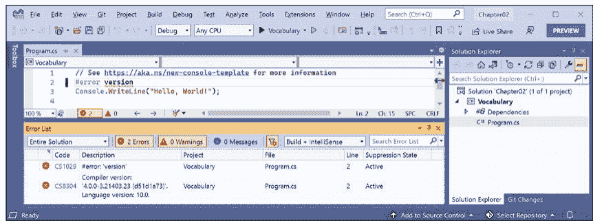

图 2.1：显示 C# 语言版本的编译器错误

- 6. Visual Studio Code PROBLEMS 窗口或 Visual Studio 错误列表窗口中的错误消息说编译器版本为 '4.0.0...'，语言版本为 10.0。

- 7. 注释掉导致错误的语句，如以下代码所示：

```
// #error version
```

- 8. 请注意编译器错误消息消失了。


## 理解 C# 语法

C# 的语法包括语句和代码块。要记录你的代码，可以使用注释。


> **良好实践：** 注释不应是你记录代码的唯一方式。为变量和函数选择有意义的名称、编写单元测试以及创建实际文档都是记录代码的其他方式。

## 语句

在英语中，我们用句号表示句子的结束。句子可以由多个单词和短语组成，单词的顺序是语法的一部分。例如，在英语中，我们说“the black cat.”

形容词 black 在名词 cat 之前。而法语语法顺序不同；形容词在名词之后：“le chat noir。” 从中需要记住的重要一点是顺序很重要。

C# 用分号表示语句的结束。语句可以由多个变量和表达式组成。例如，在以下语句中，totalPrice 是一个变量，而 subtotal + salesTax 是一个表达式：

```
var totalPrice = subtotal + salesTax;
```

该表达式由名为 subtotal 的操作数、运算符 + 以及另一个名为 salesTax 的操作数组成。操作数和运算符的顺序很重要。

## 注释

编写代码时，你可以使用双斜杠 // 添加注释来解释代码。通过插入 //，编译器会忽略 // 之后直到行尾的所有内容，如以下代码所示：

```
// sales tax must be added to the subtotal
var totalPrice = subtotal + salesTax;
```

要编写多行注释，请在注释开头使用 /*，在结尾使用 */，如以下代码所示：

```
/*
This is a multi-line comment.
*/
```

> **良好实践**：设计良好的代码，包括具有命名良好的参数的函数签名和类封装，在某种程度上可以自文档化。当你发现自己在代码中添加了太多注释和解释时，请问自己：我能否重写，即重构，这段代码使其在没有冗长注释的情况下更易于理解？


你的代码编辑器有命令可以更轻松地添加和删除注释字符，如以下列表所示：

- **Visual Studio 2022 for Windows**：导航至 Edit | Advanced | Comment Selection 或 Uncomment Selection
- **Visual Studio Code**：导航至 Edit | Toggle Line Comment 或 Toggle Block Comment

> **良好实践**：你通过在代码语句上方或之后添加描述性文本来 **注释** 代码。你通过在语句之前或周围添加注释字符使它们处于非活动状态来 **注释掉** 代码。**取消注释** 指的是删除注释字符。


## 代码块

在英语中，我们通过另起一行来表示新段落。C# 使用大括号 { } 表示代码块。

代码块以声明开始以指示正在定义的内容。例如，代码块可以定义许多语言构造的开始和结束，包括命名空间、类、方法或像 foreach 这样的语句。

你将在本章和后续章节中更详细地了解命名空间、类和方法，但现在简要介绍一下这些概念：

- 一个 **命名空间** 包含类型（如类）以将它们分组在一起。
- 一个 **类** 包含对象的成员，包括方法。
- 一个 **方法** 包含实现对象可以执行的操作的语句。

## 语句和代码块的示例

在针对 .NET 5.0 的控制台应用项目模板中，请注意 C# 语法的示例已由项目模板为你编写。我已对语句和代码块添加了一些注释，如以下代码所示：

```csharp
using System; // a semicolon indicates the end of a statement

namespace Basics
{ // an open brace indicates the start of a block
    class Program
    {
static void Main(string[] args)
{
    Console.WriteLine("Hello World!"); // a statement
}
}
} // a close brace indicates the end of a block
```

## 理解 C# 词汇

C# 词汇由关键字、符号字符和类型组成。

本书中你会看到的一些预定义、保留关键字包括 using、namespace、class、static、int、string、double、bool、if、switch、break、while、do、for、foreach、and、or、not、record 和 init。

你会看到的一些符号字符包括 "、'、+、-、*、/、% 、@ 和 $。

还有其他上下文关键字，它们仅在特定上下文中才有特殊含义。

然而，这仍然意味着该语言中实际的 C# 关键字只有大约 100 个。

## 将编程语言与人类语言进行比较

英语有超过 250,000 个不同的单词，那么 C# 如何仅用大约 100 个关键字就能行得通？而且，如果它只有英语单词数量的 0.0416%，为什么 C# 这么难学？

人类语言和编程语言之间的关键区别之一是，开发人员需要能够为新的“单词”定义新的含义。除了 C# 语言中大约 100 个关键字外，本书将教你其他开发人员定义的一些数十万个“单词”，你也将学习如何定义自己的“单词”。

世界各地的程序员必须学习英语，因为大多数编程语言使用英语单词，例如 namespace 和 class。也有使用其他人类语言（如阿拉伯语）的编程语言，但它们很少见。如果你有兴趣了解更多，这个 YouTube 视频展示了阿拉伯编程语言的演示：https://youtu.be/dk08cdwf6v8。

## 更改 C# 语法的配色方案

默认情况下，Visual Studio Code 和 Visual Studio 会将 C# 关键字显示为蓝色，以便更容易与其它代码区分。两个工具都允许你自定义配色方案：

- 1. 在 Visual Studio Code 中，导航至 Code | Preferences | Color Theme（在 Windows 上位于 File 菜单）。
- 2. 选择一个配色主题。供参考，我将使用 **Light+ (default light)** 配色主题，以便屏幕截图在印刷书籍中看起来不错。
- 3. 在 Visual Studio 中，导航至 **Tools | Options**。
- 4. 在 **Options** 对话框中，选择 **Fonts and Colors**，然后选择你想要自定义的显示项。

## 编写正确代码的帮助

像 Notepad 这样的纯文本编辑器不会帮助你编写正确的英语。同样，Notepad 也不会帮助你编写正确的 C#。

Microsoft Word 可以通过用红色波浪线突出拼写错误来帮助你编写英语，Word 会说 “icecream” 应该是 ice-cream 或 ice cream，并用蓝色波浪线突出语法错误，例如句子应以大写字母开头。

同样，Visual Studio Code 的 C# 扩展和 Visual Studio 可以通过突出拼写错误来帮助你编写 C# 代码，例如方法名应为 WriteLine 且 L 为大写，以及语法错误，例如语句必须以分号结束。

C# 扩展会不断监视你的输入，并通过用彩色波浪线突出问题来提供反馈，类似于 Microsoft Word。

让我们看看它实际运行的情况：

- 1. 在 Program.cs 中，将 WriteLine 方法中的 L 改为小写。
- 2. 删除语句末尾的分号。
- 3. 在 Visual Studio Code 中，导航至 View | Problems，或在 Visual Studio 中导航至 View | Error List，并注意红色波浪线出现在代码错误下方并且显示了详细信息，如图 2.2 所示：

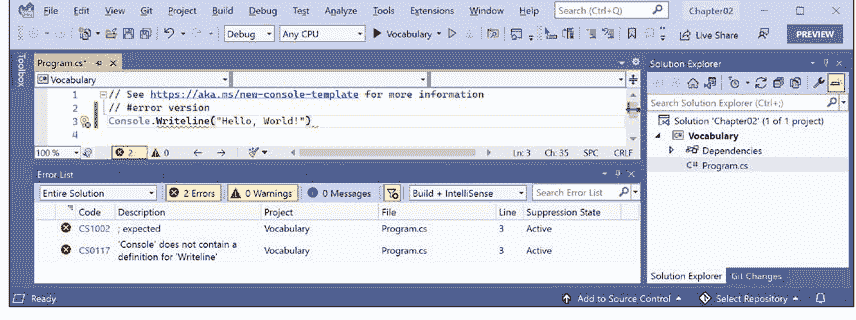

图 2.2：错误列表窗口显示两个编译错误

- 4. 修复这两个编码错误。

## 导入命名空间

System 是一个命名空间，它就像类型的地址。要精确地指某人的位置，你可能会使用 Oxford.HighStreet.BobSmith，这告诉我们要在牛津市的 High Street 上寻找名为 Bob Smith 的人。

System.Console.WriteLine 告诉编译器在名为 System 的命名空间中名为 Console 的类型中查找名为 WriteLine 的方法。为了简化我们的代码，.NET 6.0 之前每个版本的控制台应用程序项目模板都在代码文件顶部添加了一条语句，告诉编译器始终在 System 命名空间中查找未使用其命名空间前缀的类型，如以下代码所示：

```
using System; // import the System namespace
```

我们称之为导入命名空间。导入命名空间的效果是该命名空间中的所有可用类型都可在你的程序中使用，而无需输入命名空间前缀，并且在编写代码时会在 IntelliSense 中显示。

> .NET Interactive 笔记本会自动导入大多数命名空间。

## 隐式和全局导入命名空间

传统上，每个需要导入命名空间的 .cs 文件都必须以 using 语句开始来导入这些命名空间。像 System 和 System.Linq 这样的命名空间几乎在所有 .cs 文件中都需要，因此每个 .cs 文件的前几行通常至少有几个 using 语句，如以下代码所示：

```
using System;
using System.Linq;
using System.Collections.Generic;
```

使用 ASP.NET Core 创建网站和服务时，通常有数十个命名空间，每个文件都需要导入。

C# 10 引入了一些简化导入命名空间的新功能。

首先，全局 using 语句意味着你只需在一个 .cs 文件中导入命名空间，它就会在所有 .cs 文件中可用。你可以将全局 using 语句放在 Program.cs 文件中，但我建议为这些语句创建一个单独的文件，命名为 GlobalUsings.cs 或 GlobalNamespaces.cs 之类的，如以下代码所示：

```
global using System;
global using System.Linq;
global using System.Collections.Generic;
```


**良好实践**：随着开发者逐渐习惯这个新的 C# 特性，我预计这种文件的某种命名约定将成为标准。

其次，任何以 .NET 6.0 为目标并且因此使用 C# 10 编译器的项目都会在 obj 文件夹中生成一个 .cs 文件，以隐式全局导入一些常见的命名空间，如 System。隐式导入的命名空间的具体列表取决于你所针对的 SDK，如下表所示：

| SDK | 隐式导入的命名空间 |
|---|---|
| Microsoft.NET.Sdk | System<br>System.Collections.Generic<br>System.IO<br>System.Linq<br>System.Net.Http<br>System.Threading<br>System.Threading.Tasks |
| Microsoft.NET.Sdk.Web | 与 Microsoft.NET.Sdk 相同，并且：<br>System.Net.Http.Json<br>Microsoft.AspNetCore.Builder<br>Microsoft.AspNetCore.Hosting<br>Microsoft.AspNetCore.Http<br>Microsoft.AspNetCore.Routing<br>Microsoft.Extensions.Configuration<br>Microsoft.Extensions.DependencyInjection<br>Microsoft.Extensions.Hosting<br>Microsoft.Extensions.Logging |
| Microsoft.NET.Sdk.Worker | 与 Microsoft.NET.Sdk 相同，并且：<br>Microsoft.Extensions.Configuration<br>Microsoft.Extensions.DependencyInjection<br>Microsoft.Extensions.Hosting<br>Microsoft.Extensions.Logging |

让我们看看当前的自动生成的隐式导入文件：

- 1. 在 **解决方案资源管理器** 中，选择 Vocabulary 项目，打开 **显示所有文件** 按钮，并注意编译器生成的 bin 和 obj 文件夹可见。
- 2. 展开 obj 文件夹，展开 Debug 文件夹，展开 net6.0 文件夹，并打开名为 Vocabulary.GlobalUsings.g.cs 的文件。
- 3. 注意此文件是由编译器为以 .NET 6.0 为目标的项目自动创建的，并且它导入了一些常用的命名空间，包括 System.Threading，如以下代码所示：
- 4. 关闭 Vocabulary.GlobalUsings.g.cs 文件。
- 5. 在 **解决方案资源管理器** 中，选择项目，然后向项目文件添加额外的条目以控制隐式导入哪些命名空间，如以下标记中突出显示的那样：
- 6. 保存对项目文件的更改。
- 7. 展开 obj 文件夹，展开 Debug 文件夹，展开 net6.0 文件夹，并打开名为 Vocabulary.GlobalUsings.g.cs 的文件。
- 8. 注意此文件现在导入 System.Numerics 而不是 System.Threading，如以下代码中突出显示的那样：

// <autogenerated />
global using global::System;
global using global::System.Collections.Generic;
global using global::System.IO;
global using global::System.Linq;
global using global::System.Net.Http;
global using global::System.Threading;
global using global::System.Threading.Tasks;
```
<Project Sdk="Microsoft.NET.Sdk">

    <PropertyGroup>
        <OutputType>Exe</OutputType>
        <TargetFramework>net6.0</TargetFramework>
        <Nullable>enable</Nullable>
        <ImplicitUsings>enable</ImplicitUsings>
    </PropertyGroup>

    <ItemGroup>
        <Using Remove="System.Threading" />
        <Using Include="System.Numerics" />
    </ItemGroup>

</Project>
```
// <autogenerated />
global using global::System;
global using global::System.Collections.Generic;
global using global::System.IO;
global using global::System.Linq;
global using global::System.Net.Http;
global using global::System.Threading.Tasks;
global using global::System.Numerics;
```
- 9. 关闭 Vocabulary.GlobalUsings.g.cs 文件。

你可以通过在项目文件中删除一个条目来为所有 SDK 禁用隐式导入命名空间的功能，如以下标记所示：

```
<ImplicitUsings>enable</ImplicitUsings>
```

## 动词是方法

在英语中，动词是执行或动作的词，例如 run 和 jump。在 C# 中，执行或动作的词称为方法。C# 可用数十万个方法。在英语中，动词的写法会根据动作发生的时间而改变。例如，Amir was jumping in the past，Beth jumps in the present，they jumped in the past，而 Charlie will jump in the future。

在 C# 中，像 WriteLine 这样的方法会根据动作的具体情况改变调用或执行方式。这称为重载，我们将在第 5 章，Building Your Own Types with Object-Oriented Programming 中更详细地介绍。但现在，请考虑以下示例：

// outputs the current line terminator string
// by default, this is a carriage-return and line feed
Console.WriteLine();

// outputs the greeting and the current line terminator string
Console.WriteLine("Hello Ahmed");

// outputs a formatted number and date and the current line terminator string
Console.WriteLine("Temperature on {0:D} is {1}°C.",
    DateTime.Today, 23.4);
```
另一种类比是，有些词拼写相同，但在不同上下文中含义不同。

## 名词是类型、变量、字段和属性

在英语中，名词是用来指代事物的名称。例如，Fido 是狗的名字。单词“dog”告诉我们 Fido 的类型，因此为了让 Fido 取回球，我们会使用他的名字。

在 C# 中，它们的等价物是 **类型**、**变量**、**字段** 和 **属性**。例如：

- `Animal` 和 `Car` 是类型；它们是用于对事物进行分类的名词。
- `Head` 和 `Engine` 可能是字段或属性；属于 `Animal` 和 `Car` 的名词。
- `Fido` 和 `Bob` 是变量；用于指代特定对象的名词。

C# 可用数万种类型，不过你是否注意到我没有说，“C# 中有数万种类型！”区别很微妙但很重要。C# 语言只有少数用于类型的关键字，例如 `string` 和 `int`，严格来说，C# 并未定义任何类型。看起来像类型的关键字，例如 `string` 是 **别名**，它们代表 C# 运行的平台提供的类型。

很重要的是要知道 C# 不能单独存在；毕竟它是一种运行在 .NET 变体上的语言。理论上，有人可以编写一个使用不同平台、具有不同底层类型的 C# 编译器。实际上，C# 的平台是 .NET，它为 C# 提供了数万种类型，包括 `System.Int32`，它是 C# 关键字别名 `int` 映射到的类型，以及更多复杂类型，例如 `System.Xml.Linq.XDocument`。

值得注意的是，术语 **类型** 常常与 **类** 混淆。你是否玩过客厅游戏 *Twenty Questions*，也称为 *Animal, Vegetable, or Mineral*？在游戏中，一切都可以归类为动物、蔬菜或矿物。在 C# 中，每个 **类型** 都可以归类为 `class`、`struct`、`enum`、`interface` 或 `delegate`。你将在 *Chapter 6, Implementing Interfaces and Inheriting Classes* 中学习这些含义。例如，C# 关键字 `string` 是一个 `class`，但 `int` 是一个 `struct`。因此，最好使用术语 **类型** 来指代两者。

## 揭示 C# 词汇的广度

我们知道 C# 中有超过 100 个关键字，但有多少种类型呢？让我们编写一些代码来找出在我们的简单控制台应用程序中 C# 可用的类型（及其方法）数量。

现在不必担心这段代码的确切工作原理，但要知道它使用了一种称为 **反射** 的技术：

- 1. 我们将首先在 `Program.cs` 文件顶部导入 `System.Reflection` 命名空间，如以下代码所示：
- 2. 删除写入 `Hello World!` 的语句并将其替换为以下代码：

```csharp
using System.Reflection;
```
```csharp
Assembly? assembly = Assembly.GetEntryAssembly();
if (assembly == null) return;

// Loop through the assemblies that this app references
foreach (AssemblyName name in assembly.GetReferencedAssemblies())
{
    // Load the assembly so we can read its details
    Assembly a = Assembly.Load(name);

    // declare a variable to count the number of methods
    int methodCount = 0;

    // Loop through all the types in the assembly
    foreach (TypeInfo t in a.DefinedTypes)
    {
        // add up the counts of methods
        methodCount += t.GetMethods().Count();
    }

    // output the count of types and their methods
    Console.WriteLine(
"{0:N0} types with {1:N0} methods in {2} assembly.",
arg0: a.DefinedTypes.Count(),
arg1: methodCount, arg2: name.Name);
}
```
- 3. 运行代码。你将在最简单的应用程序中看到在你的操作系统上可用的实际类型和方法的数量。显示的类型和方法的数量会根据你使用的操作系统而不同，如以下输出所示：

```text
// Output on Windows
0 types with 0 methods in System.Runtime assembly.
106 types with 1,126 methods in System.Linq assembly.
44 types with 645 methods in System.Console assembly.

// Output on macOS
0 types with 0 methods in System.Runtime assembly.
103 types with 1,094 methods in System.Linq assembly.
57 types with 701 methods in System.Console assembly.
```


> 为什么 System.Runtime 程序集包含零个类型？此程序集很特殊，因为它只包含类型转发器而不是实际类型。类型转发器代表在 .NET 之外实现的类型，或出于某些其他高级原因。

- 4. 在导入命名空间后向文件顶部添加语句以声明一些变量，如以下代码中突出显示的那样：

```csharp
using System.Reflection;

// declare some unused variables using types
// in additional assemblies
```


```
System.Data.DataSet ds;
HttpClient client;
```

通过声明使用其他程序集中的类型的变量，这些程序集会随我们的应用程序一起加载，从而使我们的代码能够看到其中的所有类型和方法。编译器会警告你存在未使用的变量，但这不会阻止你的代码运行。

- 5. 再次运行控制台应用程序并查看结果，其应类似于以下输出：

// Output on Windows
0 types with 0 methods in System.Runtime assembly.
383 types with 6,854 methods in System.Data.Common assembly.
456 types with 4,590 methods in System.Net.Http assembly.
106 types with 1,126 methods in System.Linq assembly.
44 types with 645 methods in System.Console assembly.

// Output on macOS
0 types with 0 methods in System.Runtime assembly.
376 types with 6,763 methods in System.Data.Common assembly.
522 types with 5,141 methods in System.Net.Http assembly.
103 types with 1,094 methods in System.Linq assembly.
57 types with 701 methods in System.Console assembly.

现在，你对学习 C# 为什么具有挑战性有了更好的认识，因为有太多类型和方法需要学习。方法只是类型可能拥有的成员的一个类别，而你和其他程序员不断地定义新的类型和成员！

## 使用变量

所有应用程序都处理数据。数据传入，数据被处理，然后数据传出。

数据通常从文件、数据库或用户输入进入我们的程序，并可以暂时放入变量中，这些变量会存储在运行程序的内存中。当程序结束时，内存中的数据会丢失。数据通常输出到文件和数据库，或屏幕或打印机。当使用变量时，你应该首先考虑变量在内存中占用的空间，其次是它能被处理的快慢。

我们通过选择合适的类型来控制这一点。你可以将 int 和 double 等简单常见类型视为不同大小的存储盒，其中较小的盒子占用内存较少，但处理速度可能不如大盒子快；例如，在 64 位操作系统上，添加 16 位数字可能不如添加 64 位数字处理得快。其中一些盒子可能紧密堆叠在一起，而一些可能被扔到更远的大堆中。

## 命名事物和赋值

有命名约定，并且遵循它们是良好的做法，如下表所示：

| 命名约定 | 示例 | 用途 |
|---|---|---|
| 小驼峰式 | cost, orderDetail, dateOfBirth | 局部变量、私有字段 |
| 标题式 aka Pascal 式 | String, Int32, Cost, DateOfBirth, Run | 类型、非私有字段以及其他成员如方法 |


> **良好实践**：遵循一致的命名约定集将使你的代码能够被其他开发者（以及未来的你自己！）轻松理解。

以下代码块展示了声明命名局部变量并使用 = 符号为其赋值的示例。你应该注意，你可以使用 C# 6.0 中引入的关键字 nameof 来输出变量的名称：

// let the heightInMetres variable become equal to the value 1.88
double heightInMetres = 1.88;
Console.WriteLine($"The variable {nameof(heightInMetres)} has the value {heightInMetres}.");

前述代码中双引号内的消息会换到第二行，因为印刷页面的宽度太窄。在代码编辑器中输入此类语句时，请将其全部输入在一行中。

## 字面值

当你为变量赋值时，你经常（但并非总是）会赋一个字面值。但什么是字面值？字面值是表示固定值的记法。数据类型对其字面值有不同的记法，在接下来的几个部分中，你将看到使用字面值记法为变量赋值的示例。

## 存储文本

对于文本，单个字母，如 A，被存储为 char 类型。


> **良好实践**：实际上，这可能比看起来更复杂。埃及象形文字 A002（U+13001）需要两个 System.Char 值（称为代理对）来表示它：\uD80C 和 \uDC01。不要总是假设一个 char 等于一个字母，否则你可能会在代码中引入奇怪的错误。

char 是使用字面值周围的单引号分配的，或分配虚构函数调用的返回值，如以下代码所示：

```
char letter = 'A'; // assigning literal characters
char digit = '1';
char symbol = '$';
char userChoice = GetSomeKeystroke(); // assigning from a fictitious function
```

对于文本，多个字母，如 Bob，被存储为 string 类型，并使用字面值周围的双引号分配，或分配函数调用的返回值，如以下代码所示：

```
string firstName = "Bob"; // assigning literal strings
string lastName = "Smith";
string phoneNumber = "(215) 555-4256";

// assigning a string returned from a fictitious function
string address = GetAddressFromDatabase(id: 563);
```

## 理解字面字符串

当在字符串变量中存储文本时，你可以包含转义序列，它们使用反斜杠表示制表符和换行符等特殊字符，如以下代码所示：

```
string fullNameWithTabSeparator = "Bob\tSmith";
```

但是，如果你在存储 Windows 上的文件路径，并且其中一个文件夹名称以 T 开头，如以下代码所示？

```
string filePath = "C:\televisions\sony\bravia.txt";
```

编译器会将 \t 转换为制表符，你将收到错误！

你必须使用 @ 符号作为前缀来使用逐字字面字符串，如以下代码所示：

```
string filePath = @"C:\televisions\sony\bravia.txt";
```

总结：

- **字面字符串**：用双引号字符括起来的字符。它们可以使用转义字符，如 \t 表示制表符。要表示反斜杠，请使用两个：\\。
- **逐字字符串**：以 @ 为前缀的字面字符串，用于禁用转义字符，使反斜杠保持为反斜杠。它还允许字符串值跨越多行，因为空白字符被视为其本身而不是编译器的指令。
- **插值字符串**：以 $ 为前缀的字面字符串，用于启用嵌入格式化的变量。你将在本章后面了解更多关于此的内容。

## 存储数字

数字是我们想要执行算术计算的数据，例如乘法。电话号码不是数字。要决定变量是否应存储为数字，请问自己是否需要对该数字执行算术运算，或者该数字是否包含非数字字符（如括号或连字符）来格式化数字，例如 (414) 555-1234。在这种情况下，数字是字符序列，因此应存储为字符串。

数字可以是自然数，如 42，用于计数（也称为整数）；它们也可以是负数，如 -42（称为整数）；或者，它们可以是实数，如 3.9（带小数部分），在计算中称为单精度或双精度浮点数。

让我们探索数字：

- 1. 使用你喜欢的代码编辑器向 Chapter02 工作区/解决方案添加一个新的控制台应用程序，命名为 Numbers：
  - 1. 在 Visual Studio Code 中，将 Numbers 选择为活动的 OmniSharp 项目。当你看到弹出警告消息说缺少必需的资源时，单击 Yes 以添加它们。
  - 2. 在 Visual Studio 中，将启动项目设置为当前选择。
- 2. 在 Program.cs 中，删除现有代码，然后输入语句声明一些使用各种数据类型的数字变量，如以下代码所示：

```csharp
// unsigned integer means positive whole number or 0
uint naturalNumber = 23;

// integer means negative or positive whole number or 0
int integerNumber = -23;

// float means single-precision floating point
// F suffix makes it a float literal
float realNumber = 2.3F;

// double means double-precision floating point
double anotherRealNumber = 2.3; // double literal
```

## 存储整数

你可能知道计算机将所有内容存储为位。位的取值只有 0 或 1。这称为二进制数系统。人类使用十进制数系统。

十进制数系统，也称为 Base 10，以 10 为基数，意味着有十个数字，从 0 到 9。尽管它是人类文明中最常用的数字基数，但在科学、工程和计算中，其他数字基数系统也很流行。二进制数系统，也称为 Base 2，以 2 为基数，意味着有两个数字，0 和 1。


The following table shows how computers store the decimal number 10. Take note of the bits with the value 1 in the 8 and 2 columns; 8 + 2 = 10:

| 128 | 64 | 32 | 16 | 8 | 4 | 2 | 1 |
|---|---|---|---|---|---|---|---|
| 0 | 0 | 0 | 0 | 1 | 0 | 1 | 0 |

So, 10 in decimal is 00001010 in binary.

## 通过使用数字分隔符提高可读性

Two of the improvements seen in C# 7.0 and later are the use of the underscore character _ as a digit separator, and support for binary literals.

You can insert underscores anywhere into the digits of a number literal, including decimal, binary, or hexadecimal notation, to improve legibility.

For example, you could write the value for 1 million in decimal notation, that is, Base 10, as 1_000_000.

You can even use the 2/3 grouping common in India: 10_00_000.

## 使用二进制表示法

To use binary notation, that is, Base 2, using only 1s and 0s, start the number literal with 0b. To use hexadecimal notation, that is, Base 16, using 0 to 9 and A to F, start the number literal with 0x.

## 探索整数

Let's enter some code to see some examples:

- 1. In Program.cs, type statements to declare some number variables using underscore separators, as shown in the following code:
- 2. Run the code and note the result is that all three numbers are the same, as shown in the following output:

```
// three variables that store the number 2 million
int decimalNotation = 2_000_000;
int binaryNotation = 0b_0001_1110_1000_0100_1000_0000;
int hexadecimalNotation = 0x_001E_8480;

// check the three variables have the same value
// both statements output true
Console.WriteLine($"{decimalNotation == binaryNotation}");
Console.WriteLine(
    $"{decimalNotation == hexadecimalNotation}");
```

```
True
True
```

Computers can always exactly represent integers using the int type or one of its sibling types, such as long and short.

## 存储实数

Computers cannot always represent real, aka decimal or non-integer, numbers precisely. The float and double types store real numbers using single- and double-precision floating points.

Most programming languages implement the IEEE Standard for Floating-Point Arithmetic. IEEE 754 is a technical standard for floating-point arithmetic established in 1985 by the Institute of Electrical and Electronics Engineers (IEEE).

The following table shows a simplification of how a computer represents the number 12.75 in binary notation. Note the bits with the value 1 in the 8, 4, ½, and ¼ columns.

8 + 4 + ½ + ¼ = 12¾ = 12.75.

| 128 | 64 | 32 | 16 | 8 | 4 | 2 | 1 | . | ½ | ¼ | 1/8 | 1/16 |
| --- | --- | --- | --- | --- | --- | --- | --- | --- | --- | --- | --- | --- |
| 0 | 0 | 0 | 0 | 1 | 1 | 0 | 0 | . | 1 | 1 | 0 | 0 |

So, 12.75 in decimal is 00001100.1100 in binary. As you can see, the number 12.75 can be exactly represented using bits. However, some numbers can't, something that we'll be exploring shortly.

## 编写代码探索数字大小

C# has an operator named sizeof() that returns the number of bytes that a type uses in memory. Some types have members named MinValue and MaxValue, which return the minimum and maximum values that can be stored in a variable of that type. We are now going to use these features to create a console application to explore number types:

- 1. In Program.cs, type statements to show the size of three number data types, as shown in the following code:

```csharp
Console.WriteLine($"int uses {sizeof(int)} bytes and can store numbers in the range {int.MinValue:N0} to {int.MaxValue:N0}.");
Console.WriteLine($"double uses {sizeof(double)} bytes and can store numbers in the range {double.MinValue:N0} to {double.MaxValue:N0}.");
Console.WriteLine($"decimal uses {sizeof(decimal)} bytes and can store numbers in the range {decimal.MinValue:N0} to {decimal.MaxValue:N0}.");
```

The width of the printed pages in this book makes the string values (in double quotes) wrap over multiple lines. You must type them on a single line, or you will get compile errors.

- 2. Run the code and view the output, as shown in Figure 2.3:

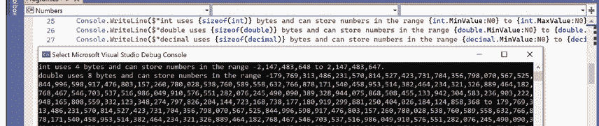

Figure 2.3: Size and range information for common number data types

An int variable uses four bytes of memory and can store positive or negative numbers up to about 2 billion. A double variable uses eight bytes of memory and can store much bigger values! A decimal variable uses 16 bytes of memory and can store big numbers, but not as big as a double type.

But you may be asking yourself, why might a double variable be able to store bigger numbers than a decimal variable, yet it's only using half the space in memory? Well, let's now find out!

## 比较 double 和 decimal 类型

You will now write some code to compare double and decimal values. Although it isn't hard to follow, don't worry about understanding the syntax right now:

- 1. Type statements to declare two double variables, add them together and compare them to the expected result, and write the result to the console, as shown in the following code:

```
Console.WriteLine("Using doubles:");
double a = 0.1;
double b = 0.2;

if (a + b == 0.3)
{
    Console.WriteLine($"{a} + {b} equals {0.3}");
}
else
{
    Console.WriteLine($"{a} + {b} does NOT equal {0.3}");
}
```

- 2. Run the code and view the result, as shown in the following output:

```
Using doubles:
0.1 + 0.2 does NOT equal 0.3
```

In locales that use a comma for the decimal separator the result will look slightly different, as shown in the following output:

```
0,1 + 0,2 does NOT equal 0,3
```

The double type is not guaranteed to be accurate because some numbers like 0.1 literally cannot be represented as floating-point values.

As a rule of thumb, you should only use double when accuracy, especially when comparing the equality of two numbers, is not important. An example of this may be when you're measuring a person's height and you will only compare values using greater than or less than, but never equals.

The problem with the preceding code is illustrated by how the computer stores the number 0.1, or multiples of it. To represent 0.1 in binary, the computer stores 1 in the 1/16 column, 1 in the 1/32 column, 1 in the 1/256 column, 1 in the 1/512 column, and so on.

The number 0.1 in decimal is 0.00011001100110011... in binary, repeating forever:

| 4 | 2 | 1 | . | 1/2 | 1/4 | 1/8 | 1/16 | 1/32 | 1/64 | 1/128 | 1/256 | 1/512 | 1/1024 | 1/2048 |
|---|---|---|---|---|---|---|---|---|---|---|---|---|---|---| 
| 0 | 0 | 0 | . | 0 | 0 | 0 | 1 | 1 | 0 | 0 | 1 | 1 | 0 | 0 |

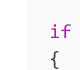

**Good Practice**: Never compare double values using ==. During the First Gulf War, an American Patriot missile battery used double values in its calculations. The inaccuracy caused it to fail to track and intercept an incoming Iraqi Scud missile, and 28 soldiers were killed; you can read about this at https://www.ima.umn.edu/~arnold/disasters/patriot.html.

- 1. Copy and paste the statements that you wrote before (that used the double variables).
- 2. Modify the statements to use decimal and rename the variables to c and d, as shown in the following code:

```
Console.WriteLine("Using decimals:");
decimal c = 0.1M; // M suffix means a decimal literal value
decimal d = 0.2M;

if (c + d == 0.3M)
{
    Console.WriteLine($"{c} + {d} equals {0.3M}");
}
else
{
```

```
Console.WriteLine($"{c} + {d} does NOT equal {0.3M}");
}
```

- 3. Run the code and view the result, as shown in the following output:

```
Using decimals:
0.1 + 0.2 equals 0.3
```

The decimal type is accurate because it stores the number as a large integer and shifts the decimal point. For example, 0.1 is stored as 1, with a note to shift the decimal point one place to the left. 12.75 is stored as 1275, with a note to shift the decimal point two places to the left.


Good Practice: Use int for whole numbers. Use double for real numbers that will not be compared for equality to other values; it is okay to compare double values being less than or greater than, and so on. Use decimal for money, CAD drawings, general engineering, and wherever the accuracy of a real number is important.

The double type has some useful special values: double.NaN represents not-a-number (for example, the result of dividing by zero), double.Epsilon represents the smallest positive number that can be stored in a double, and double.PositiveInfinity and double.NegativeInfinity represent infinitely large positive and negative values.

## 存储布尔值

Booleans can only contain one of the two literal values true or false, as shown in the following code:

```
bool happy = true;
bool sad = false;
```

They are most commonly used to branch and loop. You don't need to fully understand them yet, as they are covered more in Chapter 3, Controlling Flow, Converting Types, and Handling Exceptions.

## 存储任何类型的对象

There is a special type named object that can store any type of data, but its flexibility comes at the cost of messier code and possibly poor performance. Because of those two reasons, you should avoid it whenever possible. The following steps show how to use object types if you need to use them:

- 1. Use your preferred code editor to add a new Console Application to the Chapter02 workspace/solution named Variables.
- 2. In Visual Studio Code, select Variables as the active OmniSharp project. When you see the pop-up warning message saying that required assets are missing, click Yes to add them.


3. 在 Program.cs 中，输入语句以声明并使用 object 类型的一些变量，如以下代码所示：

```
object height = 1.88; // storing a double in an object
object name = "Amir"; // storing a string in an object
Console.WriteLine($"{name} is {height} metres tall.");

int length1 = name.Length; // gives compile error!
int length2 = ((string)name).Length; // tell compiler it is a string
Console.WriteLine($"{name} has {length2} characters.");
```

4. 运行代码并注意第四条语句无法编译，因为编译器不知道 name 变量的数据类型，如图 2.4 所示：

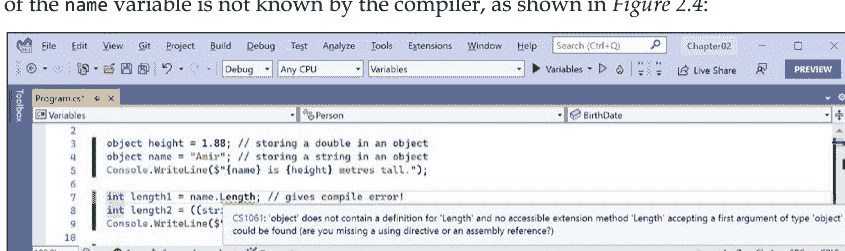

图 2.4：object 类型没有 Length 属性

5. 在无法编译的语句开头添加注释双斜杠，以“注释掉”该语句使其处于非活动状态。

6. 再次运行代码并注意，如果程序员通过使用类似 (string) 的强制转换表达式前缀明确告诉编译器 object 变量包含一个字符串，则编译器可以访问字符串的长度，如以下输出所示：

```
Amir is 1.88 metres tall.
Amir has 4 characters.
```

object 类型自 C# 的第一个版本以来就可用，但 C# 2.0 及更高版本有一种更好的替代方案，称为 generics，我们将在第 6 章 Implementing Interfaces and Inheriting Classes 中介绍，它将为我们提供所需的灵活性，但不会带来性能开销。

## 存储 dynamic 类型

还有另一种名为 dynamic 的特殊类型，它也可以存储任何类型的数据，但比 object 更灵活，其灵活性是以性能为代价的。dynamic 关键字是在 C# 4.0 中引入的。然而，与 object 不同，存储在变量中的值可以在没有显式强制转换的情况下调用其成员。让我们使用 dynamic 类型：

1. 添加语句声明一个 dynamic 变量，然后分配一个字符串字面值，然后是一个整数值，然后是一个整数值的数组，如以下代码所示：

```
// storing a string in a dynamic object
// string has a Length property
dynamic something = "Ahmed";

// int does not have a Length property
// something = 12;

// an array of any type has a Length property
// something = new[] { 3, 5, 7 };
```

2. 添加语句输出 dynamic 变量的长度，如以下代码所示：

```
// this compiles but would throw an exception at run-time
// if you later store a data type that does not have a
// property named Length
Console.WriteLine($"Length is {something.Length}");
```

3. 运行代码并注意它有效，因为字符串值确实具有 Length 属性，如以下输出所示：

```
Length is 5
```

4. 取消注释分配 int 值的语句。

5. 运行代码并注意运行时错误，因为 int 没有 Length 属性，如以下输出所示：

```
Unhandled exception. Microsoft.CSharp.RuntimeBinder.
RuntimeBinderException: 'int' does not contain a definition for 'Length'
```

6. 取消注释分配数组的语句。

7. 运行代码并注意输出，因为三个 int 值的数组确实具有 Length 属性，如以下输出所示：

```
Length is 3
```

dynamic 的一个限制是代码编辑器无法显示 IntelliSense 来帮助您编写代码。这是因为编译器在构建时无法检查类型是什么。相反，CLR 在运行时检查成员，如果缺少则抛出异常。

异常是表明运行时出现问题的一种方式。您将在第 3 章 Controlling Flow, Converting Types, and Handling Exceptions 中了解更多关于它们的内容以及如何处理它们。

## 声明局部变量

局部变量在方法内部声明，并且它们仅在该方法执行期间存在，一旦方法返回，分配给任何局部变量的内存将被释放。

严格来说，值类型会被释放，而引用类型必须等待垃圾回收。您将在第 6 章 Implementing Interfaces and Inheriting Classes 中了解值类型和引用类型之间的区别。

## 指定局部变量的类型

让我们探索使用特定类型声明的局部变量以及使用类型推断：

- 1. 输入语句以使用特定类型声明并为一些局部变量赋值，如以下代码所示：

```
```csharp
int population = 66_000_000; // 66 million in UK
double weight = 1.88; // in kilograms
decimal price = 4.99M; // in pounds sterling
string fruit = "Apples"; // strings use double-quotes
char letter = 'Z'; // chars use single-quotes
bool happy = true; // Booleans have value of true or false
```
```

根据您的代码编辑器和配色方案，它将在每个变量名下方显示绿色波浪线，并使文本颜色变浅，以警告您变量已赋值但其值从未使用。

## 推断局部变量的类型

您可以使用 var 关键字声明局部变量。编译器将从赋值运算符 = 之后赋值的<|message|> 推断类型。

没有小数点的字面数字被推断为 int 变量，即，除非您添加后缀，如以下列表所述：

- L：推断为 long
- UL：推断为 ulong
- M：推断为 decimal
- D：推断为 double
- F：推断为 float

带小数点的字面数字被推断为 double，除非您添加 M 后缀，在这种情况下，它推断为 decimal 变量，或添加 F 后缀，在这种情况下，它推断为 float 变量。

双引号表示 string 变量，单引号表示 char 变量，true 和 false 值推断为 bool 类型：

1. 修改之前的语句以使用 var，如以下代码所示：

```
var population = 66_000_000; // 66 million in UK
var weight = 1.88; // in kilograms
var price = 4.99M; // in pounds sterling
var fruit = "Apples"; // strings use double-quotes
var letter = 'Z'; // chars use single-quotes
var happy = true; // Booleans have value of true or false
```

2. 将鼠标悬停在每个 var 关键字上并注意您的代码编辑器显示一个工具提示，其中包含有关已推断类型的信息。

3. 在类文件的顶部，导入用于处理 XML 的命名空间，以便我们能够使用该命名空间中的类型声明一些变量，如以下代码所示：

```
using System.Xml;
```

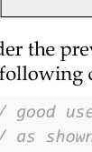

**Good Practice:** 如果您使用的是 .NET Interactive Notebooks，则在编写主代码的代码单元上方单独的代码单元中添加 using 语句。然后单击 Execute Cell 以确保命名空间已导入。它们随后将在后续代码单元中可用。

4. 在之前的语句下方，添加语句以创建一些新对象，如以下代码所示：

```
// good use of var because it avoids the repeated type
// as shown in the more verbose second statement
var xml1 = new XmlDocument();
XmlDocument xml2 = new XmlDocument();

// bad use of var because we cannot tell the type, so we
// should use a specific type declaration as shown in
// the second statement
var file1 = File.CreateText("something1.txt");
StreamWriter file2 = File.CreateText("something2.txt");
```


**Good Practice:** 尽管使用 var 很方便，但一些开发人员避免使用它，以便代码阅读者更容易理解所使用的类型。我只在类型明显时使用它。例如，在前面的代码语句中，第一个语句与第二个语句一样清楚地说明了 xml 变量的类型，但更简短。然而，第三个语句在显示 file 变量的类型方面不够清晰，因此第四个更好，因为它显示类型是 StreamWriter。如果有疑问，就写清楚！


## 使用目标类型 new 实例化对象

在 C# 9 中，Microsoft 引入了另一种用于实例化对象的语法，称为 **目标类型 new**。实例化对象时，可以先指定类型，然后使用 new 而无需重复类型，如以下代码所示：

```
XmlDocument xml3 = new(); // target-typed new in C# 9 or later
```

如果某个类型具有需要设置字段或属性，则可以推断出类型，如以下代码所示：

```
class Person
{
    public DateTime BirthDate;
}

Person kim = new();
kim.BirthDate = new(1967, 12, 26); // instead of: new DateTime(1967, 12, 26)
```


> **良好实践：** 除非必须使用 C# 9 之前的编译器，否则请使用目标类型 new 来实例化对象。我在本书其余部分中始终使用了目标类型 new。如果您发现我遗漏的任何情况，请告知我！

## 获取和设置类型的默认值

除了 string 之外的大多数原始类型都是 **值类型**，这意味着它们必须具有值。您可以使用 default() 运算符并将类型作为参数传递来确定类型默认值。您可以使用 default 关键字为类型分配默认值。

string 类型是 **引用类型**。这意味着 string 变量包含值的内存地址，而不是值本身。引用类型变量可以具有 null 值，该字面量表示变量尚未引用任何内容。null 是所有引用类型的默认值。

您将在 *第 6 章，实现接口和继承类* 中了解更多有关值类型和引用类型的信息。

让我们探索默认值：

- 1. 添加语句以显示 int、bool、DateTime 和 string 的默认值，如以下代码所示：

```
Console.WriteLine($"default(int) = {default(int)}");
Console.WriteLine($"default(bool) = {default(bool)}");
Console.WriteLine($"default(DateTime) = {default(DateTime)}");
Console.WriteLine($"default(string) = {default(string)}");
```

- 2. 运行代码并查看结果，注意如果您不在英国运行，日期和时间的输出格式可能不同，并且 null 值输出为空字符串，如以下输出所示：

```
default(int) = 0
default(bool) = False
default(DateTime) = 01/01/0001 00:00:00
default(string) =
```

- 3. 添加语句声明一个数字，分配一个值，然后将其重置为默认值，如以下代码所示：

```
int number = 13;
Console.WriteLine($"number has been set to: {number}");
number = default;
Console.WriteLine($"number has been reset to its default: {number}");
```

- 4. 运行代码并查看结果，如以下输出所示：

```
number has been set to: 13
number has been reset to its default: 0
```

## 在数组中存储多个值

当您需要存储相同类型的多个值时，可以声明一个数组。例如，当您需要在字符串数组中存储四个名称时可能会这样做。

您接下来编写的代码将为存储四个字符串值的数组分配内存。然后它将在索引位置 0 到 3 处存储字符串值（数组通常的下界为零，因此最后一项的索引比数组长度少一）。


> 良好实践：不要假设所有数组都从零开始计数。.NET 中最常见的数组类型是 szArray，即单维零索引数组，它们使用正常的 [] 语法。但 .NET 也有 mdArray，即多维数组，它们不必具有零的下界。这些很少使用，但您应该知道它们存在。

最后，它将使用 for 语句遍历数组中的每个项目，我们将在第 3 章《控制流、转换类型和处理异常》中更详细地介绍这一点。

让我们看看如何使用数组：

- 1. 输入语句声明并使用字符串值数组，如以下代码所示：

```
string[] names; // can reference any size array of strings

// allocating memory for four strings in an array
names = new string[4];

// storing items at index positions
names[0] = "Kate";
names[1] = "Jack";
names[2] = "Rebecca";
names[3] = "Tom";

// looping through the names
for (int i = 0; i < names.Length; i++)
{
    // output the item at index position i
    Console.WriteLine(names[i]);
}
```

- 2. 运行代码并注意结果，如以下输出所示：

```
Kate
Jack
Rebecca
Tom
```

数组在内存分配时始终具有固定大小，因此您需要在实例化它们之前决定要存储多少项。

定义数组的另一种方法，而不是像上面那样分三步进行，是使用数组初始化器语法，如以下代码所示：

```
string[] names2 = new[] { "Kate", "Jack", "Rebecca", "Tom" };
```

当您使用 new[] 语法为数组分配内存时，必须在花括号中至少有一个项，以便编译器可以推断数据类型。

数组对于临时存储多个项很有用，但在动态添加和删除项时，集合是更灵活的选择。您现在不必担心集合，因为我们将在第 8 章《使用常见的 .NET 类型》中介绍它们。

## 更深入地探索控制台应用程序

我们已经创建并使用过基本的控制台应用程序，但现在我们应该更深入地研究它们。

控制台应用程序基于文本，并在命令行中运行。它们通常执行需要脚本化的简单任务，例如编译文件或加密配置文件的一部分。

同样，它们也可以接收参数来控制其行为。

一个例子是使用 F# 语言创建新的控制台应用程序，并指定名称而不是使用当前文件夹的名称，如以下命令行所示：

```bash
dotnet new console -lang "F#" --name "ExploringConsole"
```

## 向用户显示输出

控制台应用程序执行的两个最常见任务是写入和读取数据。我们已经在使用 WriteLine 方法输出，但如果我们不希望行尾有回车，我们可以使用 Write 方法。

## 使用编号位置参数进行格式化

生成格式化字符串的一种方法是使用编号位置参数。

此功能由 Write 和 WriteLine 等方法支持，对于不支持该功能的方法，可以使用 string 的 Format 方法格式化字符串参数。

> 本节中的前几个代码示例将与 .NET Interactive 笔记本一起使用，因为它们是关于向控制台输出的。本节后面您将学习如何通过控制台获取输入，可惜笔记本不支持此功能。

让我们开始格式化：

- 1. 使用您喜欢的代码编辑器向 Chapter02 工作区/解决方案添加一个新的控制台应用程序，命名为 Formatting。
- 2. 在 Visual Studio Code 中，将 Formatting 选择为活动的 OmniSharp 项目。
- 3. 在 Program.cs 中，输入语句声明一些数字变量并将它们写入控制台，如以下代码所示：

```csharp
int numberOfApples = 12;
decimal pricePerApple = 0.35M;

Console.WriteLine(
    format: "{0} apples costs {1:C}",
    arg0: numberOfApples,
    arg1: pricePerApple * numberOfApples);

string formatted = string.Format(
    format: "{0} apples costs {1:C}",
    arg0: numberOfApples,
    arg1: pricePerApple * numberOfApples);

//WriteToFile(formatted); // writes the string into a file
```

WriteToFile 方法是一个不存在的方法，用于说明该想法。


> **良好实践：** 一旦您对格式化字符串更加熟悉，就应该停止命名参数，例如，停止使用 format:、arg0: 和 arg1:。前面的代码使用非规范样式来显示 0 和 1 的来源，以便您在学习时了解。

## 使用插值字符串进行格式化

C# 6.0 及更高版本具有一个方便的功能，称为插值字符串。以 $ 为前缀的字符串可以使用花括号括住变量或表达式的名称，以在字符串的该位置输出该变量或表达式的当前值，如下所示：

- 1. 在 Program.cs 文件底部输入一条语句，如以下代码所示：
- 2. 运行代码并查看结果，如以下部分输出所示：

```
Console.WriteLine($"{numberOfApples} apples costs {pricePerApple * numberOfApples:C}");
```

```
12 apples costs £4.20
```

对于简短的格式化字符串值，插值字符串可能更容易阅读。但对于书中的代码示例，其中行需要在多行之间换行，这可能很棘手。本书中的许多代码示例我将使用编号位置参数。

避免使用插值字符串的另一个原因是它们无法从资源文件中读取以进行本地化。

在 C# 10 之前，字符串常量只能通过使用连接来组合，如以下代码所示：

```
private const string firstname = "Omar";
private const string lastname = "Rudberg";
private const string fullname = firstname + " " + lastname;
```

使用 C# 10，现在可以使用插值字符串，如以下代码所示：

```
private const string fullname = "{firstname} {lastname}";
```

这仅适用于组合字符串常量值。它不能用于需要运行时数据类型转换的其他类型，如数字。

## 理解格式字符串

变量或表达式可以使用逗号或冒号后的格式字符串进行格式化。

N0 格式字符串表示带有千位分隔符且没有小数位数的数字，而 C 格式字符串表示货币。货币格式将由当前线程决定。


例如，如果你在英国的 PC 上运行此代码，你会得到英镑且千位分隔符为逗号，但如果在德国的 PC 上运行此代码，你会得到欧元且千位分隔符为点。

The full syntax of a format item is:

```
{ index [, alignment ] [ : formatString ] }
```

每个格式项可以有一个对齐方式，这在输出值表格时很有用，其中某些值可能需要在一定字符宽度内左对齐或右对齐。对齐值是整数。正整数表示右对齐，负整数表示左对齐。

例如，要输出水果及其数量的表格，我们可能希望在宽度为 10 个字符的列中左对齐名称，并在宽度为 6 个字符的列中右对齐以零位小数格式化的数量：

- 1. 在 Program.cs 底部，输入以下语句：
- 2. 运行代码并注意对齐和数字格式的效果，如以下输出所示：

```
string applesText = "Apples";
int applesCount = 1234;

string bananasText = "Bananas";
int bananasCount = 56789;

Console.WriteLine(
    format: "{0,-10} {1,6:N0}",
    arg0: "Name",
    arg1: "Count");

Console.WriteLine(
    format: "{0,-10} {1,6:N0}",
    arg0: applesText,
    arg1: applesCount);

Console.WriteLine(
    format: "{0,-10} {1,6:N0}",
    arg0: bananasText,
    arg1: bananasCount);
```

| 名称 | 计数 |
|------|-------|
| Apples | 1,234 |
| Bananas | 56,789 |

## 从用户获取文本输入

我们可以 使用 ReadLine 方法从用户获取文本输入。此方法等待用户输入一些文本，然后一旦用户按下 Enter，输入的内容就会作为字符串值返回。


Good Practice: 如果你在本节中使用 .NET Interactive 笔记本，请注意它不支持使用 Console.ReadLine() 从控制台读取输入。相反，你必须设置字面值，如以下代码所示： string? firstName = "Gary";。这样通常更快地进行实验，因为你可以简单地更改字面字符串值并单击执行单元按钮，而不必每次想要输入不同的字符串值时都重新启动控制台应用程序。

让我们从用户获取输入：

- 1. 输入语句询问用户的姓名和年龄，然后输出他们输入的内容，如以下代码所示：
- 2. 运行代码，然后输入姓名和年龄，如以下输出所示：

```
Console.Write("Type your first name and press ENTER: ");
string? firstName = Console.ReadLine();

Console.Write("Type your age and press ENTER: ");
string? age = Console.ReadLine();

Console.WriteLine(
$"Hello {firstName}, you look good for {age}.");
```

```
Type your name and press ENTER: Gary
Type your age and press ENTER: 34
Hello Gary, you look good for 34.
```


字符串? 数据类型声明末尾的问号表示我们承认 ReadLine 调用可能返回 null（空）值。你将在第 6 章《实现接口和继承类》中了解更多相关内容。

## 简化控制台的使用

在 C# 6.0 及更高版本中，using 语句不仅可用于导入命名空间，还可通过导入静态类进一步简化我们的代码。然后，我们就不需要在代码中到处输入 Console 类型名称。你可以使用代码编辑器的查找和替换功能删除之前编写的 Console：

- 1. 在 Program.cs 文件顶部，添加一条语句以静态导入 System.Console 类，如以下代码所示：

```csharp
using static System.Console;
```

- 2. 在代码中选择第一个 Console.，确保也选择 Console 词后的点。
- 3. 在 Visual Studio 中，导航到 编辑 | 查找和替换 | 快速替换，或在 Visual Studio Code 中导航到 编辑 | 替换，注意会出现一个覆盖对话框，准备让你输入想要替换 Console. 的内容，如图 2.5 所示：

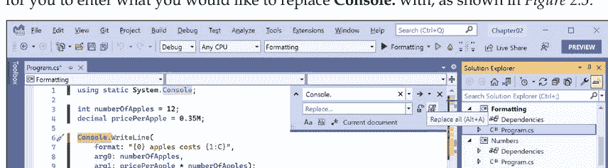

Figure 2.5: 使用 Visual Studio 中的替换功能简化代码

- 4. 将替换框留空，单击替换框右侧两个按钮中的第二个“全部替换”按钮，然后通过单击其右上角的叉号关闭替换框。

## 从用户获取按键输入

我们可以使用 ReadKey 方法从用户获取按键输入。此方法等待用户按下某个键或键组合，然后将其作为 ConsoleKeyInfo 值返回。

你将无法使用 .NET Interactive 笔记本执行对 ReadKey 方法的调用，但如果你创建了控制台应用程序，那么让我们探索读取按键：

- 1. 输入语句询问用户按任意键组合，然后输出有关它的信息，如以下代码所示：

```csharp
Write("Press any key combination: ");
ConsoleKeyInfo key = ReadKey();
WriteLine();
WriteLine("Key: {0}, Char: {1}, Modifiers: {2}",
    arg0: key.Key,
    arg1: key.KeyChar,
    arg2: key.Modifiers);
```

- 2. 运行代码，按下 K 键，并注意结果，如以下输出所示：

```
Press any key combination: k
Key: K, Char: k, Modifiers: 0
```

- 3. 运行代码，按住 Shift 并按下 K 键，并注意结果，如以下输出所示：

```
Press any key combination: K
Key: K, Char: K, Modifiers: Shift
```

- 4. 运行代码，按下 F12 键，并注意结果，如以下输出所示：

```
Press any key combination:
Key: F12, Char: , Modifiers: 0
```


> 在 Visual Studio Code 内的终端中运行控制台应用程序时，一些键盘组合会在你的应用程序处理之前被代码编辑器或操作系统捕获。

## 向控制台应用程序传递参数

你可能一直在想如何获取可能传递给控制台应用程序的任何参数。

在 .NET 6.0 之前的每个版本中，控制台应用程序项目模板都显而易见，如以下代码所示：

```
using System;

namespace Arguments
{
    class Program
    {
        static void Main(string[] args)
        {
            Console.WriteLine("Hello World!");
        }
    }
}
```

string[] args 参数在 Program 类的 Main 方法中声明并传递。它们是一个用于将参数传递到控制台应用程序的数组。但在顶级程序中，如 .NET 6.0 及更高版本中控制台应用程序项目模板所使用，Program 类及其 Main 方法是隐藏的，连同 args 字符串数组的声明。诀窍是必须知道它仍然存在。

命令行参数由空格分隔。连字符和冒号等其他字符被视为参数值的一部分。

要在参数值中包含空格，请将参数值用单引号或双引号括起来。

想象一下，我们希望能够在命令行输入前景和背景的一些颜色名称以及终端窗口的尺寸。我们将能够通过从 args 数组读取颜色和数字来读取它们，该数组始终传递给 Main 方法，即控制台应用程序的入口点：

- 1. 使用你喜欢的代码编辑器在 Chapter02 工作区/解决方案中添加一个名为 Arguments 的新控制台应用程序。你将无法使用 .NET Interactive 笔记本，因为你无法向笔记本传递参数。
- 2. 在 Visual Studio Code 中，选择 Arguments 作为活动的 OmniSharp 项目。
- 3. 添加一条语句以静态导入 System.Console 类型，并添加一条语句以输出传递给应用程序的参数数量，如以下代码所示：
- 4. 运行代码并查看结果，如以下输出所示：
- 5. 如果你使用的是 Visual Studio，则导航到 项目 | Arguments 属性，选择 调试 选项卡，并在 应用程序参数 框中输入一些参数，保存更改，然后运行控制台应用程序，如图 2.6 所示：
- 6. 如果你使用的是 Visual Studio Code，则在终端中，在 dotnet run 命令后输入一些参数，如以下命令行所示：

```
using static System.Console;

WriteLine($"There are {args.Length} arguments.");
```

> Good Practice: 请记住在所有未来项目中静态导入 System.Console 类型以简化代码，因为这些说明不会每次都重复。

```
There are 0 arguments.
```

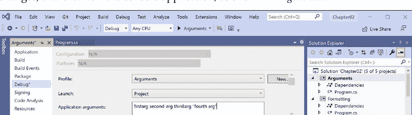

Figure 2.6: 在 Visual Studio 项目属性中输入应用程序参数

```
dotnet run firstarg second-arg third:arg "fourth arg"
```

7. 请注意结果显示有四个参数，如以下输出所示：

```
There are 4 arguments.
```

8. 要枚举或迭代（即遍历）这四个参数的值，请在输出数组长度后添加以下语句：

```
foreach (string arg in args)
{
    Console.WriteLine(arg);
}
```

9. 再次运行代码并注意结果显示了四个参数的详细信息，如以下输出所示：

```
There are 4 arguments.
firstarg
second-arg
third:arg
fourth arg
```

## 使用参数设置选项

我们现在将使用这些参数来允许用户为输出窗口的背景、前景和光标大小选择颜色。光标大小可以是 1 到 100 之间的整数值，1 表示光标单元格底部的线条，100 表示光标单元格高度的百分比。

System 命名空间已导入，因此编译器知道 ConsoleColor 和 Enum 类型：

- 1. 添加语句以在用户未输入三个参数时警告用户，然后解析这些参数并使用它们设置控制台窗口的颜色和尺寸，如以下代码所示：

```
if (args.Length < 3)
{
    Console.WriteLine("You must specify two colors and cursor size, e.g.");
    Console.WriteLine("dotnet run red yellow 50");
    return; // stop running
}

Console.ForegroundColor = (ConsoleColor)Enum.Parse(
    enumType: typeof(ConsoleColor),
    value: args[0],
    ignoreCase: true);

Console.BackgroundColor = (ConsoleColor)Enum.Parse(
    enumType: typeof(ConsoleColor),
    value: args[1],
    ignoreCase: true);

Console.CursorSize = int.Parse(args[2]);
```

> 设置 CursorSize 仅在 Windows 上受支持。

- 2. 在 Visual Studio 中，导航到 项目 | 参数 属性，并将参数更改为：red yellow 50，运行控制台应用程序，并注意光标大小减半且窗口中的颜色已更改，如图 2.7 所示：

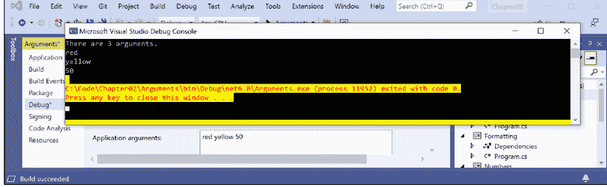

图 2.7：设置 Windows 上的颜色和光标大小

- 3. 在 Visual Studio Code 中，使用参数运行代码以将前景色设置为红色、背景色设置为黄色、光标大小设置为 50%，如下所示的命令：

```
dotnet run red yellow 50
```

在 macOS 上，您会看到未处理的异常，如图 2.8 所示：

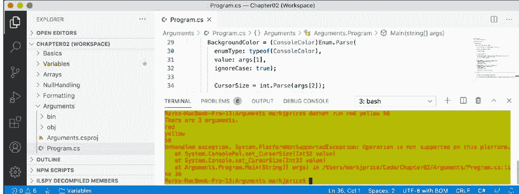

图 2.8：在不受支持的 macOS 上出现未处理的异常

尽管编译器没有给出错误或警告，但在运行时某些 API 调用在某些平台上可能会失败。尽管在 Windows 上运行的控制台应用程序可以更改其光标大小，但在 macOS 上则不能，如果尝试更改会报错。

## 处理不支持 API 的平台

那么我们如何解决这个问题？我们可以通过使用异常处理程序来解决。你将在第 3 章《控制流、转换类型和处理异常》中学习有关 try-catch 语句的更多细节，因此现在只需输入代码：

- 1. 修改代码，将更改光标大小的行包装在 try 语句中，如以下代码所示：
- 2. 如果你在 macOS 上运行代码，则会看到异常被捕获，并向用户显示更友好的消息。

```
try
{
    Console.CursorSize = int.Parse(args[2]);
}
catch (PlatformNotSupportedException)
{
    Console.WriteLine("The current platform does not support changing the size of the cursor.");
}
```

处理操作系统差异的另一种方法是使用 System 命名空间中的 OperatingSystem 类，如以下代码所示：

```
if (OperatingSystem.IsWindows())
{
    // execute code that only works on Windows
}
else if (OperatingSystem.IsWindowsVersionAtLeast(major: 10))
{
    // execute code that only works on Windows 10 or later
}
else if (OperatingSystem.IsIOSVersionAtLeast(major: 14, minor: 5))
{
    // execute code that only works on iOS 14.5 or later
}
else if (OperatingSystem.IsBrowser())
{
    // execute code that only works in the browser with Blazor
}
```

OperatingSystem 类对 Android、iOS、Linux、macOS 等其他常见操作系统甚至浏览器都有等效方法，这对于 Blazor Web 组件很有用。

处理不同平台的第三种方法是使用条件编译语句。

有四个预处理器指令控制条件编译：#if、#elif、#else 和 #endif。

你使用 #define 定义符号，如以下代码所示：

```csharp
#define MYSYMBOL
```

许多符号已自动为你定义，如下表所示：

| 目标框架 | 符号 |
|---|---|
| .NET Standard | NETSTANDARD2_0, NETSTANDARD2_1, 等等 |
| Modern .NET | NET6_0, NET6_0_ANDROID, NET6_0_IOS, NET6_0_WINDOWS, 等等 |

然后你可以编写仅为指定平台编译的语句，如以下代码所示：

```csharp
#if NET6_0_ANDROID
// compile statements that only works on Android
#elif NET6_0_IOS
// compile statements that only works on iOS
#else
// compile statements that work everywhere else
#endif
```

## 练习和探索

通过回答一些问题来测试你的知识和理解，进行一些实践，并通过更深入的研究探索本章涵盖的主题。

## 练习 2.1 – 测试你的知识

要获得这些问题的最佳答案，你需要自己进行研究。我希望你“跳出书本思考”，因此我故意没有在书中提供所有答案。

我希望鼓励你养成向别处寻求帮助的好习惯，遵循“授人以渔”的原则。

- 1. 你可以在 C# 文件中输入什么语句来发现编译器和语言版本？
- 2. C# 中的两种注释类型是什么？
- 3. 字面字符串和插值字符串有什么区别？
- 4. 为什么在使用 float 和 double 值时应谨慎？
- 5. 如何确定像 double 这样的类型在内存中使用多少字节？
- 6. 何时应使用 var 关键字？
- 7. 创建 XmlDocument 之类的类的实例的最新的方法是什么？
- 8. 为什么在使用 dynamic 类型时应谨慎？
- 9. 如何右对齐格式字符串？
- 10. 什么字符分隔控制台应用程序的参数？


附录，测试你的知识问题的答案可从 GitHub 仓库 README 上的链接下载：https://github.com/markjprice/cs10dotnet6。

## 练习 2.2 – 测试你对数字类型的知识

对于以下“数字”，你会选择什么类型？

- 1. 一个人的电话号码
- 2. 一个人的身高
- 3. 一个人的年龄
- 4. 一个人的薪水
- 5. 一本书的 ISBN
- 6. 一本书的价格
- 7. 一本书的运输重量
- 8. 一个国家的人口
- 9. 宇宙中的恒星数量
- 10. 英国每个中小型企业中的员工数量（每个企业约多达 50,000 名员工）

## 练习 2.3 – 练习数字大小和范围

在 Chapter02 解决方案/工作区中，创建一个名为 Exercise02 的控制台应用程序项目，输出以下每个数字类型在内存中使用的字节数以及它们可以具有的最小值和最大值：sbyte、byte、short、ushort、int、uint、long、ulong、float、double 和 decimal。

运行你的控制台应用程序的结果应类似于图 2.9：

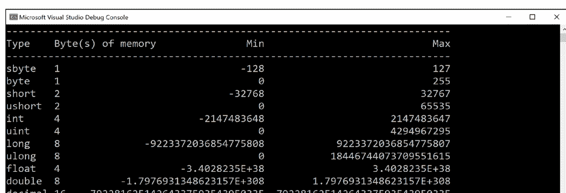

图 2.9：输出数字类型大小的结果

所有练习的代码解决方案可从 GitHub 仓库的以下链接下载或克隆：https://github.com/markjprice/cs10dotnet6。

## 练习 2.4 – 探索主题

使用以下页面上的链接了解本章涵盖主题的更多详细信息：

https://github.com/markjprice/cs10dotnet6/blob/main/book-links.md#chapter-2---speaking-c

## 总结

在本章中，你学习了如何：

- 使用指定或推断的类型声明变量。
- 使用一些内置类型用于数字、文本和布尔值。
- 在数字类型之间进行选择。
- 控制控制台应用程序的输出格式。

在下一章中，你将学习运算符、分支、循环、类型转换以及如何处理异常。


