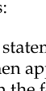
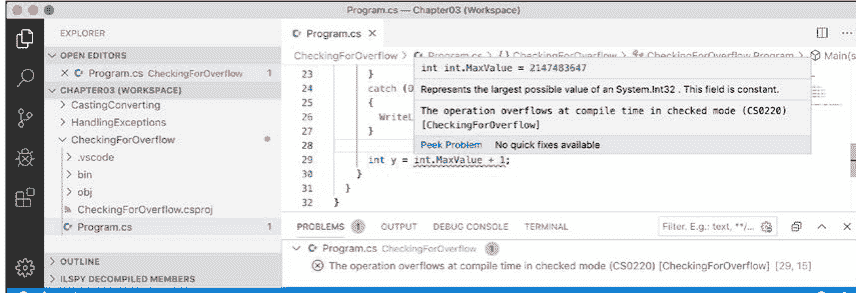
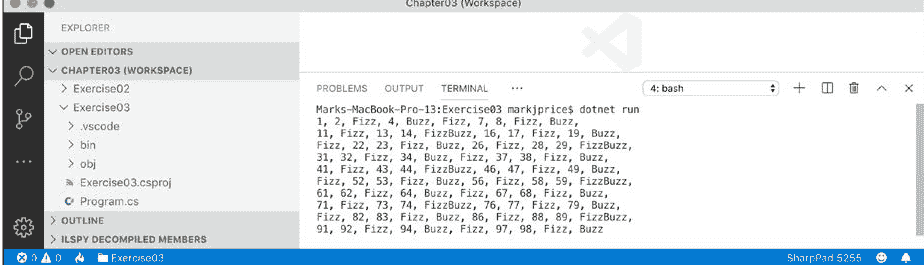

## 03

## 控制流、类型转换和异常处理

本章全部关于编写执行变量上的简单操作、做出决策、执行模式匹配、重复语句或代码块、将变量或表达式值从一种类型转换为另一种类型、处理异常以及检查数字变量溢出的代码。

本章涵盖以下主题：

- 操作变量
- 理解选择语句
- 理解迭代语句
- 在类型之间进行强制转换和转换
- 处理异常
- 检查溢出

### 操作变量

**运算符** 对诸如变量和字面值之类的 **操作数** 应用诸如加法和乘法之类的简单操作。它们通常返回操作结果的新值，该值可以分配给变量。

大多数运算符是二元的，这意味着它们作用于两个操作数，如以下伪代码所示：

```
var resultOfOperation = firstOperand operator secondOperand;
```

二元运算符的示例包括加法和乘法，如以下代码所示：

```
int x = 5;
int y = 3;
int resultOfAdding = x + y;
int resultOfMultiplying = x * y;
```

一些运算符是一元的，这意味着它们作用于单个操作数，并且可以在操作数之前或之后应用，如以下伪代码所示：

```
var resultOfOperation = onlyOperand operator;
var resultOfOperation2 = operator onlyOperand;
```

一元运算符的示例包括增量器和检索类型或其以字节为单位的大小，如以下代码所示：

```
int x = 5;
int postfixIncrement = x++;
int prefixIncrement = ++x;
Type theTypeOfAnInteger = typeof(int);
int howManyBytesInAnInteger = sizeof(int);
```

三元运算符作用于三个操作数，如以下伪代码所示：

```
var resultOfOperation = firstOperand ? secondOperand : thirdOperand;
```

### 探索一元运算符

两个常见的一元运算符用于递增 ++ 和递减 -- 一个数字。让我们编写一些示例代码来展示它们的工作方式：

1. 如果您已完成前面的章节，那么您已经拥有一个 Code 文件夹。如果没有，则需要创建它。
2. 使用您首选的编码工具创建新的控制台应用程序，如以下列表中定义：
   1. 项目模板：控制台应用程序 / console
   2. 工作区/解决方案文件和文件夹：Chapter03
   3. 项目文件和文件夹：Operators
3. 在 Program.cs 顶部，静态导入 System.Console。
4. 在 Program.cs 中，声明两个名为 a 和 b 的整数变量，将 a 设置为 3，在分配结果的同时递增 a，然后输出它们的值，如以下代码所示：

```
int a = 3;
int b = a++;
WriteLine($"a is {a}, b is {b}");
```

5. 在运行控制台应用程序之前，请问自己一个问题：您认为输出时 b 的值会是多少？思考之后，运行代码，并将您的预测与实际结果进行比较，如以下输出所示：

```
a is 4, b is 3
```

变量 b 的值为 3，因为 ++ 运算符在赋值之后执行；这被称为后缀运算符。如果需要在赋值之前递增，则使用前缀运算符。

6. 复制并粘贴语句，然后修改它们以重命名变量并使用前缀运算符，如以下代码所示：

```
int c = 3;
int d = ++c; // increment c before assigning it
WriteLine($"c is {c}, d is {d}");
```

7. 重新运行代码并注意结果，如以下输出所示：

```
a is 4, b is 3
c is 4, d is 4
```



**良好实践：** 由于在与赋值结合使用时，递增和递减运算符的前缀和后缀形式会造成混淆，Swift 编程语言设计者在第 3 版中决定放弃对该运算符的支持。我在 C# 中的使用建议是永远不要将 ++ 和 -- 运算符的使用与赋值运算符 = 结合使用。将操作作为单独的语句执行。

### 探索二元算术运算符

递增和递减是一元算术运算符。其他算术运算符通常是二元的，允许您对两个数字执行算术运算，如下所示：

1. 添加语句以声明并为两个名为 e 和 f 的整数变量分配值，然后将五个常见的二元算术运算符应用于这两个数字，如以下代码所示：

```
int e = 11;
int f = 3;
WriteLine($"e is {e}, f is {f}");
WriteLine($"e + f = {e + f}");
WriteLine($"e - f = {e - f}");
WriteLine($"e * f = {e * f}");
WriteLine($"e / f = {e / f}");
WriteLine($"e % f = {e % f}");
```

2. 运行代码并注意结果，如以下输出所示：

```
e is 11, f is 3
e + f = 14
e - f = 8
e * f = 33
e / f = 3
e % f = 2
```

要理解将除法 / 和取模 % 运算符应用于整数时的工作原理，您需要回想小学知识。想象您有十一个糖果和三个朋友。

您如何将糖果分给朋友？您可以给每个朋友三个糖果，还会剩下两个。这些两个糖果就是模数，也称为除法后的余数。如果您有十二个糖果，那么每个朋友得到四个，没有剩余，因此余数将为 0。

3. 添加语句以声明并为名为 g 的 double 变量分配值，以显示整数除法和实数除法的区别，如以下代码所示：

```
double g = 11.0;
WriteLine($"g is {g:N1}, f is {f}");
WriteLine($"g / f = {g / f}");
```

4. 运行代码并注意结果，如以下输出所示：

```
g is 11.0, f is 3
g / f = 3.6666666666666665
```

如果第一个操作数是浮点数，例如值为 11.0 的 g，则除法运算符返回浮点值，例如 3.66666666666665，而不是整数。

### 赋值运算符

您已经在使用最常见的赋值运算符 =。

为了使代码更简洁，您可以将赋值运算符与其他运算符（如算术运算符）结合使用，如以下代码所示：

```
int p = 6;
p += 3; // equivalent to p = p + 3;
p -= 3; // equivalent to p = p - 3;
p *= 3; // equivalent to p = p * 3;
p /= 3; // equivalent to p = p / 3;
```

### 探索逻辑运算符

逻辑运算符作用于布尔值，因此返回 true 或 false。让我们探索作用于两个布尔值的二元逻辑运算符：

1. 使用您首选的编码工具向 Chapter03 工作区/解决方案添加一个新的控制台应用程序，命名为 BooleanOperators。
   1. 在 Visual Studio Code 中，选择 BooleanOperators 作为活动的 OmniSharp 项目。当您看到弹出警告消息说缺少必需的资源时，单击“是”以添加它们。
   2. 在 Visual Studio 中，将解决方案的启动项目设置为当前选择。

> **良好实践：** 请记住静态导入 System.Console 类型以简化语句。

2. 在 Program.cs 中，添加语句以声明两个布尔变量，其值分别为 true 和 false，然后输出显示应用 AND、OR 和 XOR（异或）逻辑运算符结果的真值表，如以下代码所示：

```
bool a = true;
bool b = false;

WriteLine($"AND  | a      | b      ");
WriteLine($"a    | {a & a,-5} | {a & b,-5} ");
WriteLine($"b    | {b & a,-5} | {b & b,-5} ");
WriteLine();
WriteLine($"OR   | a      | b      ");
WriteLine($"a    | {a | a,-5} | {a | b,-5} ");
WriteLine($"b    | {b | a,-5} | {b | b,-5} ");
WriteLine();
WriteLine($"XOR  | a      | b      ");
WriteLine($"a    | {a ^ a,-5} | {a ^ b,-5} ");
WriteLine($"b    | {b ^ a,-5} | {b ^ b,-5} ");
```

3. 运行代码并注意结果，如以下输出所示：

```
AND  | a      | b
 a    | True   | False
 b    | False  | False

OR   | a      | b
 a    | True   | True
 b    | True   | False

XOR  | a      | b
 a    | False  | True
 b    | True   | False
```


对于 AND & 逻辑运算符，两个操作数都必须为 true，结果才为 true。对于 OR | 逻辑运算符，只要任一操作数为 true，结果就为 true。对于 XOR ^ 逻辑运算符，只要任一操作数为 true（但不能同时为 true！）结果才为 true。

## 探索条件逻辑运算符

条件逻辑运算符与逻辑运算符类似，但你使用两个符号而不是一个，例如，使用 && 代替 &，或使用 || 代替 |。

在第 4 章《编写、调试和测试函数》中，你将更详细地了解函数，但我现在需要介绍函数来解释条件逻辑运算符，也称为短路布尔运算符。

函数执行语句然后返回一个值。该值可以是布尔值，如 true，用于布尔运算。让我们使用条件逻辑运算符：

- 1. 在 Program.cs 底部，编写语句声明一个向控制台写入消息并返回 true 的函数，如以下代码所示：
```csharp
static bool DoStuff()
{
    WriteLine("I am doing some stuff.");
    return true;
}
```

> **良好实践：** 如果你使用的是 .NET Interactive Notebook，请将 DoStuff 函数写入单独的代码单元，然后执行它以使其上下文可供其他代码单元使用。

- 2. 在之前的 WriteLine 语句之后，对 a 和 b 变量以及调用函数的结果执行 AND & 操作，如以下代码所示：
```csharp
WriteLine();
WriteLine($"a & DoStuff() = {a & DoStuff()}");
WriteLine($"b & DoStuff() = {b & DoStuff()}");
```

- 3. 运行代码，查看结果，注意函数被调用了两次，一次用于 a，一次用于 b，如以下输出所示：
```
I am doing some stuff.
a & DoStuff() = True
I am doing some stuff.
b & DoStuff() = False
```

- 4. 将 & 运算符更改为 && 运算符，如以下代码所示：
```csharp
WriteLine($"a && DoStuff() = {a && DoStuff()}");
WriteLine($"b && DoStuff() = {b && DoStuff()}");
```

- 5. 运行代码，查看结果，注意函数在与 a 变量组合时确实会运行。它在与 b 变量组合时不会运行，因为 b 变量为 false，所以结果无论如何都将为 false，因此无需执行函数，如以下输出所示：
```
I am doing some stuff.
a && DoStuff() = True
b && DoStuff() = False // DoStuff function was not executed!
```


> **良好实践：** 现在你可以看到为什么条件逻辑运算符被称为短路运算符。它们可以使你的应用程序更高效，但如果假设函数总是会被调用，也可能引入微妙的错误。在与会产生副作用的函数组合使用时，最安全的做法是避免使用它们。

## 探索按位和二进制移位运算符

按位运算符会影响数字中的位。二进制移位运算符可以比传统运算符更快地执行一些常见的算术计算，例如，乘以 2 的任意倍数。

让我们探索按位和二进制移位运算符：

- 1. 使用你喜欢的编码工具，在 Chapter03 工作区/解决方案中添加一个名为 BitwiseAndShiftOperators 的新控制台应用程序。
- 2. 在 Visual Studio Code 中，将 BitwiseAndShiftOperators 选择为活动的 OmniSharp 项目。当你看到弹出警告消息说缺少必需的资源时，单击“是”以添加它们。
- 3. 在 Program.cs 中，键入语句声明两个整数变量，其值分别为 10 和 6，然后输出应用 AND、OR 和 XOR 按位运算符的结果，如以下代码所示：
```csharp
int a = 10; // 00001010
int b = 6;  // 00000110

WriteLine($"a = {a}");
WriteLine($"b = {b}");
WriteLine($"a & b = {a & b}"); // 2-bit column only
WriteLine($"a | b = {a | b}"); // 8, 4, and 2-bit columns
WriteLine($"a ^ b = {a ^ b}"); // 8 and 4-bit columns
```

- 4. 运行代码并注意结果，如以下输出所示：
```
a = 10
b = 6
a & b = 2
```
```
a | b = 14
a ^ b = 12
```

- 5. 在 Program.cs 中，添加语句输出应用左移运算符将变量 a 的位移动三列、将 a 乘以 8 以及将变量 b 的位右移一列的结果，如以下代码所示：
```csharp
// 01010000 Left-shift a by three bit columns
WriteLine($"a << 3 = {a << 3}");

// multiply a by 8
WriteLine($"a * 8 = {a * 8}");

// 00000011 right-shift b by one bit column
WriteLine($"b >> 1 = {b >> 1}");
```

- 6. 运行代码并注意结果，如以下输出所示：
```
a << 3 = 80
a * 8 = 80
b >> 1 = 3
```

80 的结果是因为其中的位向左移动了三列，因此 1 位移入了 64 位和 16 位列，且 64 + 16 = 80。这相当于乘以 8，但 CPU 可以更快地执行位移位。3 的结果是因为 b 中的 1 位向右移动了一列，进入了 2 位和 1 位列。


> 良好实践：请记住，当对整数值进行操作时，& 和 | 符号是按位运算符，而当对布尔值（如 true 和 false）进行操作时，& 和 | 符号是逻辑运算符。

我们可以通过将整数值转换为由零和一组成的二进制字符串来说明这些操作：

- 1. 在 Program.cs 底部，添加一个函数将整数值转换为最多八个零和一的二进制（Base2）字符串，如以下代码所示：
```csharp
static string ToBinaryString(int value)
{
    return Convert.ToString(value, 2).PadLeft(8, '0');
}
```

- 2. 在函数上方，添加语句输出 a、b 以及各种按位运算符的结果，如以下代码所示：
```csharp
WriteLine();
WriteLine("Outputting integers as binary:");
```
```csharp
WriteLine($"a =      {ToBinaryString(a)}");
WriteLine($"b =      {ToBinaryString(b)}");
WriteLine($"a & b = {ToBinaryString(a & b)}");
WriteLine($"a | b = {ToBinaryString(a | b)}");
WriteLine($"a ^ b = {ToBinaryString(a ^ b)}");
```

- 3. 运行代码并注意结果，如以下输出所示：
```
Outputting integers as binary:
a =      00001010
b =      00000110
a & b = 00000010
a | b = 00001110
a ^ b = 00001100
```

## 杂项运算符

nameof 和 sizeof 在处理类型时是方便的运算符：

- nameof 返回变量、类型或成员的短名称（不带命名空间）作为字符串值，这在输出异常消息时很有用。
- sizeof 返回简单类型的字节大小，这对于确定数据存储的效率很有用。

还有许多其他运算符；例如，变量与其成员之间的点称为成员访问运算符，函数或方法名称末尾的圆括号称为调用运算符，如以下代码所示：
```csharp
int age = 47;

// How many operators in the following statement?
char firstDigit = age.ToString()[0];

// There are four operators:
// = is the assignment operator
// . is the member access operator
// () is the invocation operator
// [] is the indexer access operator
```

## 理解选择语句

每个应用程序都需要能够从选项中选择并沿不同的代码路径分支。C# 中的两个选择语句是 if 和 switch。你可以用 if 编写所有代码，但在某些常见场景下，switch 可以简化代码，例如当有一个变量可以有多个值，每个值都需要不同的处理时。

## 使用 if 语句分支

if 语句通过计算布尔表达式来确定遵循哪个分支。如果表达式为 true，则执行该块。else 块是可选的，如果 if 表达式为 false，则执行它。if 语句可以嵌套。

if 语句可以与其他 if 语句组合作为 else if 分支，如以下代码所示：
```csharp
if (expression1)
{
    // runs if expression1 is true
}
else if (expression2)
{
    // runs if expression1 is false and expression2 if true
}
else if (expression3)
{
    // runs if expression1 and expression2 are false
    // and expression3 is true
}
else
{
    // runs if all expressions are false
}
```

每个 if 语句的布尔表达式彼此独立，并且与 switch 语句不同，不需要引用单个值。

让我们编写一些代码来探索像 if 这样的选择语句：

- 1. 使用你喜欢的编码工具，在 Chapter03 工作区/解决方案中添加一个名为 SelectionStatements 的新控制台应用程序。
- 2. 在 Visual Studio Code 中，将 SelectionStatements 选择为活动的 OmniSharp 项目。
- 3. 在 Program.cs 中，键入语句检查密码是否至少为八个字符，如以下代码所示：
```csharp
string password = "ninja";

if (password.Length < 8)
{
    WriteLine("Your password is too short. Use at least 8 characters.");
}
else
{
    WriteLine("Your password is strong.");
}
```


4. 运行代码并注意结果，如以下输出所示：

```
Your password is too short. Use at least 8 characters.
```

## 为什么应该始终在使用 if 语句时使用大括号

由于每个块内只有一个语句，前面的代码可以不使用大括号编写，如以下代码所示：

```
if (password.Length < 8)
    WriteLine("Your password is too short. Use at least 8 characters.");
else
    WriteLine("Your password is strong.");
```

这种 if 语句的写法应避免，因为它可能引入严重的错误，例如苹果 iPhone iOS 操作系统中臭名昭著的 #gotofail 错误。

在 2012 年 9 月发布 Apple 的 iOS 6 之后 18 个月，其 Secure Sockets Layer (SSL) 加密代码中存在一个错误，这意味着任何运行 Safari（设备的网络浏览器）的用户尝试连接安全网站，例如他们的银行，都无法得到适当的保护，因为一个重要的检查被意外跳过。

仅仅因为你可以省略大括号并不意味着你应该这样做。没有它们，你的代码并不是“更高效”；相反，它的可维护性更差，并且可能更危险。

## 使用 if 语句进行模式匹配

从 C# 7.0 及更高版本引入的一项功能是模式匹配。if 语句可以结合使用 is 关键字和声明局部变量来使代码更安全：

- 1. 添加语句，以便如果变量名为 o 中存储的值是 int，则该值会被赋给局部变量名为 i，然后可以在 if 语句内部使用。这比使用变量名为 o 更安全，因为我们确信 i 是一个 int 变量而不是其他东西，如以下代码所示：

```
// add and remove the """ to change the behavior
object o = "3";
int j = 4;

if (o is int i)
{
    WriteLine($"{i} x {j} = {i * j}");
}
else
{
    WriteLine("o is not an int so it cannot multiply!");
}
```

2. 运行代码并查看结果，如以下输出所示：

```
o is not an int so it cannot multiply!
```

3. 删除 "3" 值周围的双引号字符，以便变量名为 o 中存储的值是 int 类型而不是字符串类型。

4. 重新运行代码以查看结果，如以下输出所示：

```
3 x 4 = 12
```

## 使用 switch 语句进行分支

switch 语句与 if 语句不同，因为 switch 将单个表达式与多个可能的 case 语句列表进行比较。每个 case 语句都与单个表达式相关。每个 case 部分必须以以下内容结束：

- - break 关键字（如以下代码中的 case 1）
- - 或 goto case 关键字（如以下代码中的 case 2）
- - 或它们不应该有语句（如以下代码中的 case 3）
- - 或引用命名标签的 goto 关键字（如以下代码中的 case 5）
- - 或 return 关键字以离开当前函数（代码中未显示）

让我们编写一些代码来探索 switch 语句：

1. 输入 switch 语句的语句。你应该注意倒数第二个语句是一个可以跳转到的标签，并且第一个语句生成 1 到 6 之间的随机数（代码中的数字 7 是排他性的上界）。switch 语句的分支基于此随机数的值，如以下代码所示：

```
int number = (new Random()).Next(1, 7);
WriteLine($"My random number is {number}");

switch (number)
{
    case 1:
        WriteLine("One");
        break; // jumps to end of switch statement
    case 2:
        WriteLine("Two");
        goto case 1;
    case 3: // multiple case section
    case 4:
        WriteLine("Three or four");
        goto case 1;
    case 5:
        goto A_label;
    default:
        WriteLine("Default");
        break;
} // end of switch statement

WriteLine("After end of switch");
A_label:
WriteLine($"After A_label");
```


**良好实践：** 你可以使用 goto 关键字跳转到另一个 case 或标签。大多数程序员都不赞成使用 goto 关键字，但在某些场景下它可以成为代码逻辑的良好解决方案。然而，你应该谨慎使用它。

- 2. 多次运行代码以查看随机数各种情况下会发生什么，如以下示例输出所示：

```
// first random run
My random number is 4
Three or four
One
After end of switch
After A_label

// second random run
My random number is 2
Two
One
After end of switch
After A_label

// third random run
My random number is 6
Default
After end of switch
After A_label

// fourth random run
My random number is 1
One
After end of switch
After A_label

// fifth random run
My random number is 5
After A_label
```

## 使用 switch 语句进行模式匹配

与 if 语句一样，switch 语句在 C# 7.0 及更高版本中支持模式匹配。case 值不再需要是字面值；它们可以是模式。

让我们看一个使用文件夹路径的 switch 语句模式匹配的示例。如果你使用的是 macOS，请交换设置 path 变量的注释语句并用你的用户文件夹名称替换我的用户名：

- 1. 添加语句以声明一个指向文件的字符串路径，将其打开为只读或可写流，然后根据流的类型和功能显示一条消息，如以下代码所示：

```csharp
// string path = "/Users/markjprice/Code/Chapter03";
string path = @"C:\Code\Chapter03";

Write("Press R for read-only or W for writeable: ");
ConsoleKeyInfo key = ReadKey();
WriteLine();

Stream? s;

if (key.Key == ConsoleKey.R)
{
    s = File.Open(
        Path.Combine(path, "file.txt"),
        FileMode.OpenOrCreate,
        FileAccess.Read);
}
else
{
    s = File.Open(
        Path.Combine(path, "file.txt"),
        FileMode.OpenOrCreate,
        FileAccess.Write);
}

string message;

switch (s)
{
    case FileStream writeableFile when s.CanWrite:
        message = "The stream is a file that I can write to.";
        break;
    case FileStream readOnlyFile:
        message = "The stream is a read-only file.";
        break;
    case MemoryStream ms:
        message = "The stream is a memory address.";
        break;
    default: // always evaluated last despite its current position
        message = "The stream is some other type.";
        break;
    case null:
        message = "The stream is null.";
        break;
}

WriteLine(message);
```

2. 运行代码并注意变量名为 s 被声明为 Stream 类型，因此它可以是任何子类型的流，例如内存流或文件流。在此代码中，流是使用 File.Open 方法创建的，该方法返回一个文件流，并且根据你的按键，它将是可写或只读的，因此结果将是一条描述情况的消息，如以下输出所示：

```
The stream is a file that I can write to.
```

在 .NET 中，有多个 Stream 的子类型，包括 FileStream 和 MemoryStream。在 C# 7.0 及更高版本中，你的代码可以根据流的子类型更简洁地分支，并声明和分配局部变量以安全地使用它。你将在第 9 章《使用文件、流和序列化》中了解更多关于 System.IO 命名空间和 Stream 类型的内容。

此外，case 语句可以包含 when 关键字以执行更具体的模式匹配。在前述代码中的第一个 case 语句中，s 只有在流是 FileStream 并且其 CanWrite 属性为 true 时才匹配。

## 使用 switch 表达式简化 switch 语句

在 C# 8.0 或更高版本中，你可以使用 switch 表达式简化 switch 语句。

大多数 switch 语句非常简单，但需要大量输入。switch 表达式旨在简化你需要输入的代码，同时在所有 case 都返回一个值以设置单个变量的场景中仍然表达相同的意图。switch 表达式使用 lambda，=>，来指示返回值。

让我们使用 switch 表达式实现之前使用 switch 语句的代码，以便你可以比较这两种风格：

- 1. 输入语句以使用 switch 表达式根据流的类型和功能设置 message，如以下代码所示：

```
message = s switch
{
```

```
FileStream writableFile when s.CanWrite
    => "The stream is a file that I can write to.",
FileStream readOnlyFile
    => "The stream is a read-only file.",
MemoryStream ms
    => "The stream is a memory stream.",
null
    => "The stream is null.",
_
    => "The stream is some other type."
};

WriteLine(message);
```

主要区别在于移除了 case 和 break 关键字。下划线字符 _ 用于表示默认返回值。

2. 运行代码，并注意结果与之前相同。

## 理解迭代语句

迭代语句在条件为真时重复执行一段语句，或对集合中的每个项执行。选择使用哪种语句基于解决逻辑问题的易理解性以及个人偏好的结合。

## 使用 while 语句循环

The while 语句评估布尔表达式，并在其为真时继续循环。让我们探索迭代语句：

- 1. 使用你偏好的编码工具在 Chapter03 工作区/解决方案中添加一个新的控制台应用程序，命名为 IterationStatements。
- 2. 在 Visual Studio Code 中，将 IterationStatements 选择为活动的 OmniSharp 项目。
- 3. 在 Program.cs 中，输入语句定义一个 while 语句，在整数变量的值小于 10 时循环，如以下代码所示：

```
int x = 0;

while (x < 10)
{
    WriteLine(x);
    x++;
}
```

4. 运行代码并查看结果，应为数字 0 到 9，如以下输出所示：

```
0
1
2
3
4
5
6
7
8
9
```

## 使用 do 语句循环

do 语句与 while 类似，只是布尔表达式在块底部而不是顶部检查，这意味着块至少执行一次，如下所示：

1. 输入语句定义一个 do 循环，如以下代码所示：

```
string? password;

do
{
    Write("Enter your password: ");
    password = ReadLine();
}
while (password != "Pa$$w0rd");

WriteLine("Correct!");
```

2. 运行代码，注意系统会反复提示你输入密码，直到输入正确，如以下输出所示：

```
Enter your password: password
Enter your password: 12345678
Enter your password: ninja
Enter your password: correct horse battery staple
Enter your password: Pa$$w0rd
Correct!
```

3. 作为可选挑战，添加语句使用户最多只能尝试十次，然后显示错误消息。

## 使用 for 语句循环

for 语句与 while 类似，只是更简洁。它结合了：

- 一个 **初始化表达式**，在循环开始时执行一次。
- 一个 **条件表达式**，在每次迭代开始时执行，以检查是否应继续循环。
- 一个 **迭代器表达式**，在语句底部每次循环时执行。

for 语句通常与整数计数器一起使用。让我们探索一些代码：

1. 输入一个 for 语句输出数字 1 到 10，如以下代码所示：

```
for (int y = 1; y <= 10; y++)
{
    WriteLine(y);
}
```

2. 运行代码查看结果，应为数字 1 到 10。

## 使用 foreach 语句循环

foreach 语句与之前的三个迭代语句略有不同。

它用于对序列中的每个项执行一段语句，例如数组或集合。每个项通常是只读的，如果在迭代期间修改序列结构，例如通过添加或删除项，则会抛出异常。

尝试以下示例：

1. 输入语句创建一个字符串变量数组，然后输出每个的长度，如以下代码所示：

```
string[] names = { "Adam", "Barry", "Charlie" };

foreach (string name in names)
{
    WriteLine($"{name} has {name.Length} characters.");
}
```

2. 运行代码并查看结果，如以下输出所示：

```
Adam has 4 characters.
Barry has 5 characters.
Charlie has 7 characters.
```

## 理解 foreach 内部的工作原理

表示多个项的任何类型的创建者，如数组或集合，应确保程序员可以使用 foreach 语句枚举该类型项。

从技术上讲，foreach 语句可用于遵循以下规则的任何类型：

- 1. 该类型必须有一个名为 GetEnumerator 的方法，返回一个对象。
- 2. 返回的对象必须具有名为 Current 的属性和名为 MoveNext 的方法。
- 3. MoveNext 方法必须更改 Current 的值，并在仍有项可枚举时返回 true，或在没有更多项时返回 false。

存在名为 IEnumerable 和 IEnumerable<T> 的接口正式定义了这些规则，但从技术上讲，编译器并不要求类型实现这些接口。

编译器将前述示例中的 foreach 语句转换为类似以下伪代码的内容：

```
IEnumerator e = names.GetEnumerator();

while (e.MoveNext())
{
    string name = (string)e.Current; // Current is read-only!
    WriteLine($"{name} has {name.Length} characters.");
}
```

由于使用了迭代器，foreach 语句中声明的变量不能用于修改当前项的值。

## 在类型之间进行转换和转换

你经常需要在不同类型之间转换变量的值。例如，数据输入通常以文本形式在控制台输入，因此最初存储在 string 类型的变量中，但随后需要根据存储和处理方式将其转换为日期/时间、数字或其他数据类型。

有时在执行计算之前，你需要在数字类型之间转换，例如在整数和浮点数之间。

转换也称为强制转换，有两种类型：隐式和显式。隐式转换会自动发生，并且是安全的，意味着不会丢失任何信息。

显式转换必须手动执行，因为它可能会丢失信息，例如数字的精度。通过显式转换，你是在告诉 C# 编译器你理解并接受风险。

## 隐式和显式地转换数字

将 int 变量隐式转换为 double 变量是安全的，因为不会丢失信息，如下所示：

- 1. 使用你偏好的编码工具在 Chapter03 工作区/解决方案中添加一个新的控制台应用程序，命名为 CastingConverting。
- 2. 在 Visual Studio Code 中，将 CastingConverting 选择为活动的 OmniSharp 项目。
- 3. 在 Program.cs 中，输入语句声明并赋值一个 int 变量和一个 double 变量，然后在将其赋值给 double 变量时隐式转换整数的值，如以下代码所示：
- 4. 输入语句声明并赋值一个 double 变量和一个 int 变量，然后在将其赋值给 int 变量时隐式转换 double 值，如以下代码所示：
- 5. 运行代码并注意错误消息，如以下输出所示：
- 6. 修改 d 变量的赋值语句，如以下代码所示：
- 7. 运行代码查看结果，如以下输出所示：

```
int a = 10;
double b = a; // an int can be safely cast into a double
WriteLine(b);
```

```
double c = 9.8;
int d = c; // compiler gives an error for this line
WriteLine(d);
```

```
Error: (6,9): error CS0266: Cannot implicitly convert type 'double' to 'int'. An explicit conversion exists (are you missing a cast?)
```

此错误消息也会出现在 Visual Studio 错误列表或 Visual Studio Code PROBLEMS 窗口中。

你不能将 double 变量隐式转换为 int 变量，因为它可能不安全且可能丢失数据，例如小数点后的值。你必须使用一对圆括号围绕要转换 double 类型成的类型，显式地将 double 变量转换为 int 变量。这对圆括号是强制转换运算符。即便如此，你也必须注意，小数点后的部分将被无警告地截断，因为你选择执行显式转换，因此理解其后果。

```
int d = (int)c;
WriteLine(d); // d is 9 losing the .8 part
```

```
10
9
```


我们在较大整数和较小整数之间转换值时也必须执行类似的操作。同样要注意，你可能会丢失信息，因为任何过大的值都会被复制其位，然后以你可能意想不到的方式进行解释！

8. 输入语句声明并为一个 int 32 位变量分配一个 long 64 位变量的值，同时使用一个可行的较小值和一个不可行的过大值，如以下代码所示：

```
long e = 10;
int f = (int)e;
WriteLine($"e is {e:N0} and f is {f:N0}");
e = long.MaxValue;
f = (int)e;
WriteLine($"e is {e:N0} and f is {f:N0}");
```

9. 运行代码查看结果，如以下输出所示：

```
e is 10 and f is 10
e is 9,223,372,036,854,775,807 and f is -1
```

10. 将 e 的值修改为 50 亿，如以下代码所示：

```
e = 5_000_000_000;
```

11. 运行代码查看结果，如以下输出所示：

```
e is 5,000,000,000 and f is 705,032,704
```

## 使用 System.Convert 类型进行转换

替代使用强制转换运算符的方法是使用 System.Convert 类型。System.Convert 类型可以转换到和来自所有 C# 数字类型，以及布尔值、字符串和日期时间值。

让我们编写一些代码来实际查看其效果：

1. 在 Program.cs 顶部静态导入 System.Convert 类，如以下代码所示：

```
using static System.Convert;
```

2. 在 Program.cs 底部输入语句声明并为 double 变量分配值，将其转换为整数，然后将两个值写入控制台，如以下代码所示：

```
double g = 9.8;
int h = ToInt32(g); // a method of System.Convert
WriteLine($"g is {g} and h is {h}");
```

3. 运行代码并查看结果，如以下输出所示：

```
g is 9.8 and h is 10
```

强制转换和转换之间一个区别是，转换会将 double 值 9.8 四舍五入为 10，而不是截掉小数点后的部分。

## 数字舍入

你现在已经看到强制转换运算符会截掉实数的小数部分，而 System.Convert 方法会向上或向下舍入。然而，舍入的规则是什么？

### 了解默认舍入规则

在英国 5 至 11 岁儿童的小学里，学生被教导如果小数部分为 .5 或更高则向上舍入，如果小数部分更小则向下舍入。

让我们探索 C# 是否遵循相同的[content]

我们在较大整数和较小整数之间转换值时也必须执行类似的操作。同样要注意，你可能会丢失信息，因为任何过大的值都会被复制其位，然后以你可能意想不到的方式进行解释！

8. 输入语句声明并为一个 int 32 位变量分配一个 long 64 位变量的值，同时使用一个可行的较小值和一个不可行的过大值，如以下代码所示：

```
long e = 10;
int f = (int)e;
WriteLine($"e is {e:N0} and f is {f:N0}");
e = long.MaxValue;
f = (int)e;
WriteLine($"e is {e:N0} and f is {f:N0}");
```

9. 运行代码查看结果，如以下输出所示：

```
e is 10 and f is 10
e is 9,223,372,036,854,775,807 and f is -1
```

10. 将 e 的值修改为 50 亿，如以下代码所示：

```
e = 5_000_000_000;
```

11. 运行代码查看结果，如以下输出所示：

```
e is 5,000,000,000 and f is 705,032,704
```

## 使用 System.Convert 类型进行转换

替代使用强制转换运算符的方法是使用 System.Convert 类型。System.Convert 类型可以转换到和来自所有 C# 数字类型，以及布尔值、字符串和日期时间值。

让我们编写一些代码来实际查看其效果：

1. 在 Program.cs 顶部静态导入 System.Convert 类，如以下代码所示：

```
using static System.Convert;
```

2. 在 Program.cs 底部输入语句声明并为 double 变量分配值，将其转换为整数，然后将两个值写入控制台，如以下代码所示：

```
double g = 9.8;
int h = ToInt32(g); // a method of System.Convert
WriteLine($"g is {g} and h is {h}");
```

3. 运行代码并查看结果，如以下输出所示：

```
g is 9.8 and h is 10
```

强制转换和转换之间一个区别是，转换会将 double 值 9.8 四舍五入为 10，而不是截掉小数点后的部分。

## 数字舍入

你现在已经看到强制转换运算符会截掉实数的小数部分，而 System.Convert 方法会向上或向下舍入。然而，舍入的规则是什么？

### 了解默认舍入规则

在英国 5 至 11 岁儿童的小学里，学生被教导如果小数部分为 .5 或更高则向上舍入，如果小数部分更小则向下舍入。

让我们探索 C# 是否遵循相同的[content]

我们在较大整数和较小整数之间转换值时也必须执行类似的操作。同样要注意，你可能会丢失信息，因为任何过大的值都会被复制其位，然后以你可能意想不到的方式进行解释！

8. 输入语句声明并为一个 int 32 位变量分配一个 long 64 位变量的值，同时使用一个可行的较小值和一个不可行的过大值，如以下代码所示：

```
long e = 10;
int f = (int)e;
WriteLine($"e is {e:N0} and f is {f:N0}");
e = long.MaxValue;
f = (int)e;
WriteLine($"e is {e:N0} and f is {f:N0}");
```

9. 运行代码查看结果，如以下输出所示：

```
e is 10 and f is 10
e is 9,223,372,036,854,775,807 and f is -1
```

10. 将 e 的值修改为 50 亿，如以下代码所示：

```
e = 5_000_000_000;
```

11. 运行代码查看结果，如以下输出所示：

```
e is 5,000,000,000 and f is 705,032,704
```

## 使用 System.Convert 类型进行转换

替代使用强制转换运算符的方法是使用 System.Convert 类型。System.Convert 类型可以转换到和来自所有 C# 数字类型，以及布尔值、字符串和日期时间值。

让我们编写一些代码来实际查看其效果：

1. 在 Program.cs 顶部静态导入 System.Convert 类，如以下代码所示：

```
using static System.Convert;
```

2. 在 Program.cs 底部输入语句声明并为 double 变量分配值，将其转换为整数，然后将两个值写入控制台，如以下代码所示：

```
double g = 9.8;
int h = ToInt32(g); // a method of System.Convert
WriteLine($"g is {g} and h is {h}");
```

3. 运行代码并查看结果，如以下输出所示：

```
g is 9.8 and h is 10
```

强制转换和转换之间一个区别是，转换会将 double 值 9.8 四舍五入为 10，而不是截掉小数点后的部分。

## 数字舍入

你现在已经看到强制转换运算符会截掉实数的小数部分，而 System.Convert 方法会向上或向下舍入。然而，舍入的规则是什么？

### 了解默认舍入规则

在英国 5 至 11 岁儿童的小学里，学生被教导如果小数部分为 .5 或更高则向上舍入，如果小数部分更小则向下舍入。

让我们探索 C# 是否遵循相同的[content]

我们在较大整数和较小整数之间转换值时也必须执行类似的操作。同样要注意，你可能会丢失信息，因为任何过大的值都会被复制其位，然后以你可能意想不到的方式进行解释！

8. 输入语句声明并为一个 int 32 位变量分配一个 long 64 位变量的值，同时使用一个可行的较小值和一个不可行的过大值，如以下代码所示：

```
long e = 10;
int f = (int)e;
WriteLine($"e is {e:N0} and f is {f:N0}");
e = long.MaxValue;
f = (int)e;
WriteLine($"e is {e:N0} and f is {f:N0}");
```

9. 运行代码查看结果，如以下输出所示：

```
e is 10 and f is 10
e is 9,223,372,036,854,775,807 and f is -1
```

10. 将 e 的值修改为 50 亿，如以下代码所示：

```
e = 5_000_000_000;
```

11. 运行代码查看结果，如以下输出所示：

```
e is 5,000,000,000 and f is 705,032,704
```

## 使用 System.Convert 类型进行转换

替代使用强制转换运算符的方法是使用 System.Convert 类型。System.Convert 类型可以转换到和来自所有 C# 数字类型，以及布尔值、字符串和日期时间值。

让我们编写一些代码来实际查看其效果：

1. 在 Program.cs 顶部静态导入 System.Convert 类，如以下代码所示：

```
using static System.Convert;
```

2. 在 Program.cs 底部输入语句声明并为 double 变量分配值，将其转换为整数，然后将两个值写入控制台，如以下代码所示：

```
double g = 9.8;
int h = ToInt32(g); // a method of System.Convert
WriteLine($"g is {g} and h is {h}");
```

3. 运行代码并查看结果，如以下输出所示：

```
g is 9.8 and h is 10
```

强制转换和转换之间一个区别是，转换会将 double 值 9.8 四舍五入为 10，而不是截掉小数点后的部分。

## 数字舍入

你现在已经看到强制转换运算符会截掉实数的小数部分，而 System.Convert 方法会向上或向下舍入。然而，舍入的规则是什么？

### 了解默认舍入规则

在英国 5 至 11 岁儿童的小学里，学生被教导如果小数部分为 .5 或更高则向上舍入，如果小数部分更小则向下舍入。

让我们探索 C# 是否遵循相同的[content]
We must perform a similar operation when converting values between larger integers and smaller integers. Again, beware that you might lose information because any value too big will have its bits copied and then be interpreted in ways that you might not expect!

8. Enter statements to declare and assign a long 64-bit variable to an int 32-bit variable, both using a small value that will work and a too-large value that will not, as shown in the following code:

```
long e = 10;
int f = (int)e;
WriteLine($"e is {e:N0} and f is {f:N0}");
e = long.MaxValue;
f = (int)e;
WriteLine($"e is {e:N0} and f is {f:N0}");
```

9. Run the code to view the results, as shown in the following output:

```
e is 10 and f is 10
e is 9,223,372,036,854,775,807 and f is -1
```

10. Modify the value of e to 5 billion, as shown in the following code:

```
e = 5_000_000_000;
```

11. Run the code to view the results, as shown in the following output:

```
e is 5,000,000,000 and f is 705,032,704
```

## Converting with the System.Convert type

An alternative to using the cast operator is to use the System.Convert type. The System.Convert type can convert to and from all the C# number types, as well as Booleans, strings, and date and time values.

Let's write some code to see this in action:

1. At the top of Program.cs, statically import the System.Convert class, as shown in the following code:

```
using static System.Convert;
```

2. At the bottom of Program.cs, type statements to declare and assign a value to a double variable, convert it to an integer, and then write both values to the console, as shown in the following code:

```
double g = 9.8;
int h = ToInt32(g); // a method of System.Convert
WriteLine($"g is {g} and h is {h}");
```

3. Run the code and view the result, as shown in the following output:

```
g is 9.8 and h is 10
```

One difference between casting and converting is that converting rounds the double value 9.8 up to 10 instead of trimming the part after the decimal point.

## Rounding numbers

You have now seen that the cast operator trims the decimal part of a real number and that the System.Convert methods round up or down. However, what is the rule for rounding?

### Understanding the default rounding rules

In British primary schools for children aged 5 to 11, pupils are taught to round up if the decimal part is .5 or higher and round down if the decimal part is less.

Let's explore if C# follows the same primary school rule:

1. Type statements to declare and assign an array of double values, convert each of them to an integer, and then write the result to the console, as shown in the following code:

```
double[] doubles = new[]
{ 9.49, 9.5, 9.51, 10.49, 10.5, 10.51 };

foreach (double n in doubles)
{
    WriteLine($"ToInt32({n}) is {ToInt32(n)}");
}
```

2. Run the code and view the result, as shown in the following output:

```
ToInt32(9.49) is 9
ToInt32(9.5) is 10
ToInt32(9.51) is 10
ToInt32(10.49) is 10
ToInt32(10.5) is 10
ToInt32(10.51) is 11
```

We have shown that the rule for rounding in C# is subtly different from the primary school rule:

- It always rounds down if the decimal part is less than the midpoint .5.
- It always rounds up if the decimal part is more than the midpoint .5.
- It will round up if the decimal part is the midpoint .5 and the non-decimal part is odd, but it will round down if the non-decimal part is even.

This rule is known as **Banker's Rounding**, and it is preferred because it reduces bias by alternating when it rounds up or down. Sadly, other languages such as JavaScript use the primary school rule.

### Taking control of rounding rules

You can take control of the rounding rules by using the Round method of the Math class:

1. Type statements to round each of the double values using the "away from zero" rounding rule, also known as rounding "up," and then write the result to the console, as shown in the following code:
2. Run the code and view the result, as shown in the following output:

```
foreach (double n in doubles)
{
    WriteLine(format:
        "Math.Round({0}, 0, MidpointRounding.AwayFromZero) is {1}",
        arg0: n,
        arg1: Math.Round(value: n, digits: 0,
            mode: MidpointRounding.AwayFromZero));
}
```

```
Math.Round(9.49, 0, MidpointRounding.AwayFromZero) is 9
Math.Round(9.5, 0, MidpointRounding.AwayFromZero) is 10
Math.Round(9.51, 0, MidpointRounding.AwayFromZero) is 10
Math.Round(10.49, 0, MidpointRounding.AwayFromZero) is 10
Math.Round(10.5, 0, MidpointRounding.AwayFromZero) is 11
Math.Round(10.51, 0, MidpointRounding.AwayFromZero) is 11
```


**Good Practice:** For every programming language that you use, check its rounding rules. They may not work the way you expect!

## Converting from any type to a string

The most common conversion is from any type into a string variable for outputting as human-readable text, so all types have a method named ToString that they inherit from the System.Object class.

The ToString method converts the current value of any variable into a textual representation. Some types can't be sensibly represented as text, so they return their namespace and type name instead.

Let's convert some types into a string:

1. Type statements to declare some variables, convert them to their string representation, and write them to the console, as shown in the following code:
2. Run the code and view the result, as shown in the following output:

```
int number = 12;
WriteLine(number.ToString());

bool boolean = true;
WriteLine(boolean.ToString());

DateTime now = DateTime.Now;
WriteLine(now.ToString());

object me = new();
WriteLine(me.ToString());
```

```
12
True
02/28/2021 17:33:54
System.Object
```

### Converting from a binary object to a string

When you have a binary object like an image or video that you want to either store or transmit, you sometimes do not want to send the raw bits because you do not know how those bits could be misinterpreted, for example, by the network protocol transmitting them or another operating system that is reading the stored binary object.

The safest thing to do is to convert the binary object into a string of safe characters. Programmers call this Base64 encoding.

The Convert type has a pair of methods, ToBase64String and FromBase64String, that perform this conversion for you. Let's see them in action:

1. Type statements to create an array of bytes randomly populated with byte values, write each byte nicely formatted to the console, and then write the same bytes converted to Base64 to the console, as shown in the following code:

```
// allocate array of 128 bytes
byte[] binaryObject = new byte[128];

// populate array with random bytes
(new Random()).NextBytes(binaryObject);

WriteLine("Binary Object as bytes:");

for(int index = 0; index < binaryObject.Length; index++)
```

```
{
    Write($"{binaryObject[index]:X} ");
}
WriteLine();

// convert to Base64 string and output as text
string encoded = ToBase64String(binaryObject);

WriteLine($"Binary Object as Base64: {encoded}");
```

By default, an int value would output assuming decimal notation, that is, base10. You can use format codes such as :X to format the value using hexadecimal notation.

2. Run the code and view the result, as shown in the following output:

```
Binary Object as bytes:
B3 4D 55 DE 2D E BB CF BE 4D E6 53 C3 C2 9B 67 3 45 F9 E5 20 61 7E 4F 7A
81 EC 49 F0 49 1D 8E D4 F7 DB 54 AF A0 81 5 B8 BE CE F8 36 90 7A D4 36 42
4 75 81 1B AB 51 CE 5 63 AC 22 72 DE 74 2F 57 7F CB E7 47 B7 62 C3 F4 2D
61 93 85 18 EA 6 17 12 AE 44 A8 D B8 4C 89 85 A9 3C D5 E2 46 E0 59 C9 DF
10 AF ED EF 8AA1 B1 8D EE 4A BE 48 EC 79 A5 A 5F 2F 30 87 4A C7 7F 5D C1 D
26 EE
Binary Object as Base64: s01V3i0U8++TeZTW8KbZwNF+eUgYX5P eoHsSfBJHY7U99tU r6CBBbi+zvg2kHrUNK1EdYEbq1HOBWOsInLedC9XF8vnR7diw/QtYZOFGoOGFxKuRKgNuEyJha k81eJG4FnJ3xCv7e+KobGN7kq+SO x5pQpfLzCHSsd/XcENJu4=
```

## Parsing from strings to numbers or dates and times

The second most common conversion is from strings to numbers or date and time values.

The opposite of ToString is Parse. Only a few types have a Parse method, including all the number types and DateTime.

Let's see Parse in action:

1. Type statements to parse an integer and a date and time value from strings and then write the result to the console, as shown in the following code:

```
int age = int.Parse("27");
DateTime birthday = DateTime.Parse("4 July 1980");

WriteLine($"I was born {age} years ago.");
WriteLine($"My birthday is {birthday}.");
WriteLine($"My birthday is {birthday:D}.");
```

2. Run the code and view the result, as shown in the following output:

```
I was born 27 years ago.
My birthday is 04/07/1980 00:00:00.
My birthday is 04 July 1980.
```


默认情况下，日期和时间值会以短日期和时间格式输出。你可以使用 D 等格式代码，仅使用长日期格式输出日期部分。


> 良好实践：使用标准日期和时间格式说明符，如以下链接所示：https://docs.microsoft.com/en-us/dotnet/standard/base-types/standard-date-and-time-format-strings#table-of-format-specifiers

## 使用 Parse 时的错误

Parse 方法的一个问题是，如果字符串无法转换，它会引发错误。

- 1. 输入一条语句，尝试将包含字母的字符串解析为整数变量，如以下代码所示：
- 2. 运行代码并查看结果，如以下输出所示：

```
int count = int.Parse("abc");
```

```
Unhandled Exception: System.FormatException: Input string was not in a correct format.
```

除上述异常消息外，你还会看到堆栈跟踪。本书中未包含堆栈跟踪，因为它们占用太多空间。

## 使用 TryParse 方法避免异常

为了避免错误，你可以使用 TryParse 方法代替。TryParse 会尝试转换输入字符串，如果转换成功则返回 true，如果转换失败则返回 false。

out 关键字是必需的，以便在转换成功时允许 TryParse 方法设置 count 变量。

让我们看看 TryParse 的实际效果：

- 1. 用使用 TryParse 方法的语句替换 int count 声明，并提示用户输入鸡蛋数量，如以下代码所示：

```
Write("How many eggs are there? ");
string? input = ReadLine(); // or use "12" in notebook

if (int.TryParse(input, out int count))
{
    WriteLine($"There are {count} eggs.");
}
else
{
    WriteLine("I could not parse the input.");
}
```

- 2. 运行代码，输入 12，并查看结果，如以下输出所示：

```
How many eggs are there? 12
There are 12 eggs.
```

- 3. 运行代码，输入 twelve（或在笔记本中将字符串值更改为 "twelve"），并查看结果，如以下输出所示：

```
How many eggs are there? twelve
I could not parse the input.
```

你也可以使用 System.Convert 类型的 方法将字符串值转换为其他类型；然而，与 Parse 方法一样，如果无法转换，它会引发错误。

## 处理异常

你已经看到在转换类型时发生错误的几种情况。某些语言在出现问题时会返回错误代码。.NET 使用异常，它们比具有多种用途的返回值更丰富，并且专门用于失败报告。当这种情况发生时，我们说已抛出运行时异常。

当抛出异常时，线程会被挂起，如果调用代码定义了 try-catch 语句，则会给它一个处理异常的机会。如果当前方法未处理它，则其调用方法会得到机会，依此类推，直到调用堆栈顶部。

如你所见，控制台应用程序或 .NET Interactive 笔记本的默认行为是输出有关异常的消息，包括堆栈跟踪，然后停止运行代码。应用程序被终止。这比允许代码在可能已损坏的状态下继续执行要好。你的代码只应捕获并处理它理解并且能够正确修复的异常。


> 良好实践：尽可能避免编写会抛出异常的代码，也许可以通过执行 if 语句检查来实现。有时你无法做到，有时最好允许异常被调用你的代码的高层组件捕获。你将在第 4 章，Writing, Debugging, and Testing Functions 中学习如何做到这一点。

## 将易出错的代码包装在 try 块中

当你知道某条语句可能导致错误时，应将该语句包装在 try 块中。例如，从文本解析为数字可能会导致错误。catch 块中的任何语句只有在 try 块中的语句抛出异常时才会执行。

我们不必在 catch 块内做任何事情。让我们看看实际效果：

- 1. 使用你喜欢的编码工具，在 Chapter03 工作区/解决方案中添加一个名为 HandlingExceptions 的新控制台应用程序。
- 2. 在 Visual Studio Code 中，将 HandlingExceptions 选择为活动的 OmniSharp 项目。
- 3. 输入语句提示用户输入他们的年龄，然后将年龄写入控制台，如以下代码所示：

```
WriteLine("Before parsing");
Write("What is your age? ");
string? input = ReadLine(); // or use "49" in a notebook

try
{
    int age = int.Parse(input);
    WriteLine($"You are {age} years old.");
}
catch
{
}
WriteLine("After parsing");
```

> 你将看到以下编译器消息：Warning CS8604 Possible null reference argument for parameter 's' in 'int int.Parse(string s)'。默认情况下，在新的 .NET 6 项目中，Microsoft 已启用可空引用类型，因此你会看到更多类似的编译器警告。在生产代码中，你应添加代码来检查 null 并适当处理这种可能性。在本书中，我不会包含这些 null 检查，因为代码示例并非设计为生产质量，并且到处进行 null 检查会使代码杂乱并占用宝贵的页面。在这种情况下，input 不可能为 null，因为用户必须按 Enter 键 ReadLine 才会返回，而这将返回一个空字符串。你将在本书的代码示例中看到数百个可能为 null 的变量的更多示例。对于本书的代码示例，这些警告可以安全忽略。你只需要在编写自己的生产代码时才需要类似的警告。你将在第 6 章，Implementing Interfaces and Inheriting Classes 中看到更多关于 null 处理的内容。

此代码包含两个消息以指示解析前和解析后，以便更清晰地了解代码的流程。随着示例代码变得更复杂，这些消息将特别有用。

- 4. 运行代码，输入 49，并查看结果，如以下输出所示：

```
Before parsing
What is your age? 49
You are 49 years old.
After parsing
```

- 5. 运行代码，输入 Kermit，并查看结果，如以下输出所示：

```
Before parsing
What is your age? Kermit
After parsing
```

当代码执行时，错误异常被捕获，默认消息和堆栈跟踪未输出，并且控制台应用程序继续运行。这比默认行为更好，但查看发生的错误类型可能很有用。

> **良好实践：** 你永远不应在生产代码中使用这样的空 catch 语句，因为它会“吞掉”异常并隐藏潜在问题。你至少应记录异常，如果你无法或不想正确处理它，或者重新抛出它，以便更高层的代码可以决定。你将在 *Chapter 4, Writing, Debugging, and Testing Functions* 中学习日志记录。

## 捕获所有异常

为了获取可能发生的任何类型异常的信息，你可以在 catch 块中声明 System.Exception 类型的变量：

- 1. 在 catch 块中添加异常变量声明，并使用它将有关异常的信息写入控制台，如以下代码所示：

```
catch (Exception ex)
{
    WriteLine($"{ex.GetType()} says {ex.Message}");
}
```

- 2. 运行代码，再次输入 Kermit，并查看结果，如以下输出所示：

```
Before parsing
What is your age? Kermit
System.FormatException says Input string was not in a correct format.
After parsing
```

## 捕获特定异常

现在我们知道了发生的特定异常类型，我们可以通过仅捕获该类型的异常并自定义向用户显示的消息来改进代码：

- 1. 保留现有的 catch 块，并在其上方为格式异常类型添加一个新的 catch 块，如以下突出显示的代码所示：

```
catch (FormatException)
{
    WriteLine("The age you entered is not a valid number format.");
}
```


```
}
catch (Exception ex)
{
    WriteLine($"{ex.GetType()} says {ex.Message}");
}
```

2. 运行代码，再次输入 Kermit，并查看结果，如以下输出所示：

```
Before parsing
What is your age? Kermit
The age you entered is not a valid number format.
After parsing
```

我们希望保留下面的更通用 catch 的原因是可能会发生其他类型的异常。

3. 运行代码，输入 9876543210，并查看结果，如以下输出所示：

```
Before parsing
What is your age? 9876543210
System.OverflowException says Value was either too large or too small for an Int32.
After parsing
```

让我们为此类型的异常添加另一个 catch 块。

4. 保留现有的 catch 块，并添加一个新的用于溢出异常类型的 catch 块，如以下高亮代码所示：

```
catch (OverflowException)
{
    WriteLine("Your age is a valid number format but it is either too big or small.");
}
catch (FormatException)
{
    WriteLine("The age you entered is not a valid number format.");
}
```

5. 运行代码，输入 9876543210，并查看结果，如以下输出所示：

```
Before parsing
What is your age? 9876543210
Your age is a valid number format but it is either too big or small.
After parsing
```

捕获异常的顺序很重要。正确的顺序与异常类型的继承层次结构相关。你将在第 5 章《使用面向对象编程构建自己的类型》中学习继承。不过不用太担心——如果异常顺序错误，编译器会给出构建错误。

### 良好实践：避免过度捕获异常
避免过度捕获异常。它们通常应允许沿调用栈向上传播，以便在更了解可能改变处理逻辑的情况的层级进行处理。你将在 *第 4 章，编写、调试和测试函数* 中学习到这一点。

## 使用过滤器捕获

你也可以使用 when 关键字向 catch 语句添加过滤器，如以下代码所示：

```
Write("Enter an amount: ");
string? amount = ReadLine();
try
{
    decimal amountValue = decimal.Parse(amount);
}
catch (FormatException) when (amount.Contains("$"))
{
    WriteLine("Amounts cannot use the dollar sign!");
}
catch (FormatException)
{
    WriteLine("Amounts must only contain digits!");
}
```

## 检查溢出

之前我们看到过，在数字类型之间进行转换时可能会丢失信息，例如从 long 变量转换为 int 变量时。如果存储在类型中的值太大，就会发生溢出。

## 使用 checked 语句抛出溢出异常

checked 语句告诉 .NET 在发生溢出时抛出异常，而不是默默允许它发生，而默认情况下出于性能原因会这样做。

我们将 int 变量的初始值设置为其最大值减一。然后，我们将多次递增它，每次输出其值。一旦它超过最大值，就会溢出到最小值并从那里继续递增。让我们看看实际效果：

- 1. 使用你喜欢的编码工具在 Chapter03 工作区/解决方案中添加一个新的 **控制台应用程序**，命名为 CheckingForOverflow。
- 2. 在 Visual Studio Code 中，将 CheckingForOverflow 选择为活动的 OmniSharp 项目。
- 3. 在 Program.cs 中，输入语句声明并将一个整数赋值为其最大可能值减一，然后递增它并三次将其值写入控制台，如以下代码所示：

```
int x = int.MaxValue - 1;
WriteLine($"Initial value: {x}");
x++;
WriteLine($"After incrementing: {x}");
x++;
WriteLine($"After incrementing: {x}");
x++;
WriteLine($"After incrementing: {x}");
```

- 4. 运行代码并查看结果，显示值静默溢出并回绕到大负值，如以下输出所示：

```
Initial value: 2147483646
After incrementing: 2147483647
After incrementing: -2147483648
After incrementing: -2147483647
```

- 5. 现在，让我们通过使用 checked 语句块包装语句来让编译器警告我们溢出，如以下高亮代码所示：

```
checked
{
    int x = int.MaxValue - 1;
    WriteLine($"Initial value: {x}");
    x++;
    WriteLine($"After incrementing: {x}");
    x++;
    WriteLine($"After incrementing: {x}");
    x++;
    WriteLine($"After incrementing: {x}");
}
```

- 6. 运行代码并查看结果，显示溢出被检查并导致抛出异常，如以下输出所示：

```
Initial value: 2147483646
After incrementing: 2147483647
Unhandled Exception: System.OverflowException: Arithmetic operation resulted in an overflow.
```

- 7. 就像其他任何异常一样，我们应该将这些语句包装在 try 语句块中并为用户显示更友好的错误消息，如以下代码所示：

```
try
{
    // previous code goes here
}
catch (OverflowException)
{
    WriteLine("The code overflowed but I caught the exception.");
}
```

- 8. 运行代码并查看结果，如以下输出所示：

```
Initial value: 2147483646
After incrementing: 2147483647
The code overflowed but I caught the exception.
```

## 使用 unchecked 语句禁用编译器溢出检查

上一节是关于运行时默认的溢出行为以及如何使用 checked 语句更改该行为。本节是关于编译时溢出行为以及如何使用 unchecked 语句更改该行为。

一个相关的关键字是 unchecked。该关键字在代码块内关闭编译器执行的溢出检查。让我们看看如何操作：

- 1. 在前面的语句末尾输入以下语句。编译器不会编译此语句，因为它知道这会溢出：

```
int y = int.MaxValue + 1;
```

- 2. 将鼠标指针悬停在错误上，注意编译时检查显示为错误消息，如图 3.1 所示：



图 3.1：PROBLEMS 窗口中的编译时检查

- 3. 要禁用编译时检查，将语句包装在 unchecked 块中，将 y 的值写入控制台，递减它并重复，如以下代码所示：

```
unchecked
{
    int y = int.MaxValue + 1;
    WriteLine($"Initial value: {y}");
    y--;
    WriteLine($"After decrementing: {y}");
    y--;
    WriteLine($"After decrementing: {y}");
}
```

- 4. 运行代码并查看结果，如以下输出所示：

```
Initial value: -2147483648
After decrementing: 2147483647
After decrementing: 2147483646
```

当然，你明确关闭此类检查的情况会很少，因为它允许溢出发生。但也许你可以想到一个可能想要这种行为的场景。

## 练习与探索

通过回答一些问题来测试你的知识和理解，进行一些实践操作，并通过深入研究本章主题进行探索。

### 练习 3.1 – 测试你的知识

回答以下问题：

- 1. 当 int 变量除以 0 时会发生什么？
- 2. 当 double 变量除以 0 时会发生什么？
- 3. 当 int 变量溢出时，即将其设置为超出其范围的值，会发生什么？
- 4. x = y++; 和 x = ++y; 有什么区别？
- 5. 在循环语句中使用时，break、continue 和 return 有什么区别？
- 6. for 语句的三个部分是什么，其中哪些是必需的？
- 7. = 和 == 运算符有什么区别？
- 8. 以下语句是否能编译？

```
for ( ; true; );
```

- 9. 在 switch 表达式中，下划线 _ 代表什么？
- 10. 对象必须实现什么接口才能使用 foreach 语句进行枚举？

### 练习 3.2 – 探索循环和溢出

如果执行此代码会发生什么？

```
int max = 500;
for (byte i = 0; i < max; i++)
{
    WriteLine(i);
}
```

在 Chapter03 中创建一个名为 Exercise02 的控制台应用程序并输入上述代码。运行控制台应用程序并查看输出。会发生什么？

你可以添加什么代码（不要更改上述任何代码）来警告我们这个问题？

### 练习 3.3 – 练习循环和运算符

FizzBuzz 是一种团体文字游戏，用于教孩子们除法。玩家轮流递增计数，用单词 fizz 替换能被三整除的数字，用单词 buzz 替换能被五整除的数字，用 fizzbuzz 替换能同时被两者整除的数字。

在 Chapter03 中创建一个名为 Exercise03 的控制台应用程序，输出一个模拟的 FizzBuzz 游戏，计数到 100。输出应类似于图 3.2：



图 3.2：模拟的 FizzBuzz 游戏输出


## 练习 3.4 – 练习异常处理

在 Chapter03 中创建一个名为 Exercise04 的控制台应用程序，要求用户输入两个范围在 0-255 之间的数字，然后用第二个数字除第一个数字：

```
Enter a number between 0 and 255: 100
Enter another number between 0 and 255: 8
100 divided by 8 is 12
```

编写异常处理程序以捕获所有抛出的错误，如以下输出所示：

```
Enter a number between 0 and 255: apples
Enter another number between 0 and 255: bananas
FormatException: Input string was not in a correct format.
```

## 练习 3.5 – 测试你对运算符的了解

执行以下语句后 x 和 y 的值是多少？

- 1. 自增和加法运算符：
```
x = 3;
y = 2 + ++x;
```
- 2. 二进制移位运算符：
```
x = 3 << 2;
y = 10 >> 1;
```
- 3. 按位运算符：
```
x = 10 & 8;
y = 10 | 7;
```

## 练习 3.6 – 探索主题

使用以下页面上的链接了解本章涵盖主题的更多详细信息：

https://github.com/markjprice/cs10dotnet6/blob/main/book-links.md#chapter-3---controlling-flow-and-converting-types

## 摘要

在本章中，你练习了一些运算符，学习了如何分支和循环，如何在类型之间转换，以及如何捕获异常。

你现在准备好学习如何通过定义函数来重用代码块，如何向它们传递值并获取返回值，以及如何在代码中追踪错误并将其消除！
