## 04
### 编写、调试和测试函数

本章介绍如何编写函数以重用代码，在开发期间调试逻辑错误，在运行时记录异常，通过单元测试你的代码以消除错误，并确保稳定性和可靠性。

本章涵盖以下主题：

- 编写函数
- 开发期间的调试
- 运行时日志记录
- 单元测试
- 在函数中抛出和捕获异常

### 编写函数

编程的一个基本原则是不要重复自己（DRY）。

在编程时，如果你发现自己一遍又一遍地编写相同的语句，那么就将这些语句变成一个函数。函数就像完成一个小任务的微型程序。例如，你可能会编写一个函数来计算销售税，然后在财务应用程序的许多地方重用该函数。

与程序一样，函数通常具有输入和输出。它们有时被描述为黑盒，你将一些原材料输入一端，制造好的物品从另一端出现。一旦创建，你就不需要考虑它们的工作原理。

### 乘法表示例

假设你想帮助你的孩子学习乘法表，所以你想让生成一个数字的乘法表变得容易，例如 12 的乘法表：

```
1 x 12 = 12
2 x 12 = 24
...
12 x 12 = 144
```

你之前在本书中学习过 for 语句，所以你知道它可用于在存在规律模式时生成重复的行输出，例如 12 的乘法表，如以下代码所示：

```
for (int row = 1; row <= 12; row++)
{
    Console.WriteLine($"{row} x 12 = {row * 12}");
}
```

然而，与其输出 12 的乘法表，我们希望使其更灵活，以便它可以输出任何数字的乘法表。我们可以通过创建函数来实现这一点。

### 编写乘法表函数

让我们通过创建一个函数来输出 0 到 255 的数字乘以 1 到 12 的任意乘法表来探索函数：

- 1. 使用你喜欢的编码工具创建新的控制台应用，如以下列表中定义：
  - 1. 项目模板：Console Application / console
  - 2. 工作区/解决方案文件和文件夹：Chapter04
  - 3. 项目文件和文件夹：WritingFunctions
- 2. 静态导入 System.Console。
- 3. 在 Program.cs 中，编写语句来定义一个名为 TimesTable 的函数，如以下代码所示：

```
static void TimesTable(byte number)
{
    WriteLine($"This is the {number} times table:");

    for (int row = 1; row <= 12; row++)
    {
        WriteLine($"{row} x {number} = {row * number}");
    }
    WriteLine();
}
```

在前面的代码中，请注意以下几点：

- TimesTable 必须有一个作为参数名为 number 的 byte 值传递给它。
- TimesTable 是一个静态方法，因为它将由静态方法 Main 调用。
- TimesTable 不向调用者返回值，因此在它名称之前使用 void 关键字声明。
- TimesTable 使用 for 语句输出传递给它的数字的乘法表。

4. 在静态导入 Console 类的语句之后以及 TimesTable 函数之前，调用该函数并传入 number 参数的 byte 值，例如 6，如以下代码中突出显示所示：

```
using static System.Console;

TimesTable(6);
```

良好实践：如果函数有一个或多个参数，仅传递值可能不足以提供足够含义，那么你可以选择同时指定参数的名称及其值，如以下代码所示： TimesTable(number: 6)。

5. 运行代码然后查看结果，如以下输出所示：

```
This is the 6 times table:
1 x 6 = 6
2 x 6 = 12
3 x 6 = 18
4 x 6 = 24
5 x 6 = 30
6 x 6 = 36
7 x 6 = 42
8 x 6 = 48
9 x 6 = 54
10 x 6 = 60
11 x 6 = 66
12 x 6 = 72
```

6. 将传递给 TimesTable 函数的数字更改为 0 到 255 之间的其他 byte 值，并确认输出的乘法表是正确的。

7. 请注意，如果你尝试传递非 byte 数字，例如 int 或 double 或 string，将返回错误，如以下输出所示：

```
Error: (1,12): error CS1503: Argument 1: cannot convert from 'int' to 'byte'
```

### 编写返回值的函数

前一个函数执行了操作（循环和向控制台写入），但它没有返回值。假设你需要计算销售税或增值税（VAT）。在欧洲，增值税率可在瑞士的 8% 到匈牙利的 27% 之间。在美国，各州销售税可在俄勒冈州的 0% 到加利福尼亚州的 8.25% 之间。

> 税率不断变化，并且根据许多因素而变化。你不需要联系我告诉我弗吉尼亚州的税率是 6%。谢谢。

让我们实现一个函数来计算世界各地不同地区的税款：

- 1. 添加一个名为 CalculateTax 的函数，如以下代码所示：

```
static decimal CalculateTax(
    decimal amount, string twoLetterRegionCode)
{
    decimal rate = 0.0M;

    switch (twoLetterRegionCode)
    {
        case "CH": // Switzerland
            rate = 0.08M;
            break;
        case "DK": // Denmark
        case "NO": // Norway
            rate = 0.25M;
            break;
        case "GB": // United Kingdom
        case "FR": // France
            rate = 0.2M;
            break;
        case "HU": // Hungary
            rate = 0.27M;
            break;
        case "OR": // Oregon
        case "AK": // Alaska
        case "MT": // Montana
            rate = 0.0M;
            break;
        case "ND": // North Dakota
        case "WI": // Wisconsin
        case "ME": // Maine
        case "VA": // Virginia
            rate = 0.05M;
            break;
        case "CA": // California
            rate = 0.0825M;
            break;
        default: // most US states
            rate = 0.06M;
            break;
    }

    return amount * rate;
}
```

在前面的代码中，请注意以下几点：

- CalculateTax 有两个输入：一个名为 amount 的参数将是花费的金额，以及一个名为 twoLetterRegionCode 的参数将是花费金额所在的地区。
- CalculateTax 将使用 switch 语句执行计算，然后以十进制值返回金额应支付的销售税或增值税；因此，在函数名称之前，我们已将返回值的<|message|>
- 2. 注释掉 TimesTable 方法调用并调用 CalculateTax 方法，传递 amount 等于 149 等值以及 FR 等有效地区代码，如以下代码所示：

```
// TimesTable(6);

decimal taxToPay = CalculateTax(amount: 149, twoLetterRegionCode: "FR");
WriteLine($"You must pay {taxToPay} in tax.");
```

3. 运行代码并查看结果，如以下输出所示：

```
You must pay 29.8 in tax.
```


> 我们可以通过使用 {taxToPay:C} 来格式化 taxToPay 输出为货币，但它将使用你的本地文化来决定如何格式化货币符号和小数。例如，对我来说在英国，我会看到 £29.80。

你能想到 CalculateTax 函数编写时存在哪些问题吗？如果用户输入的代码例如 fr 或 UK 会发生什么？你如何重写函数以改进它？使用 switch 表达式而不是 switch 语句会更清晰吗？


## 从基数到序数转换数字

用于计数的数字称为 **cardinal** 数字，例如 1、2 和 3，而用于排序的数字是 **ordinal** 数字，例如 1st、2nd 和 3rd。让我们创建一个函数来将基数转换为序数：

- 1. 编写一个名为 CardinalToOrdinal 的函数，将基数 int 值转换为序数字符串值；例如，它将 1 转换为 1st，2 转换为 2nd，等等，如以下代码所示：

```
static string CardinalToOrdinal(int number)
{
    switch (number)
    {
        case 11: // special cases for 11th to 13th
        case 12:
        case 13:
            return $"{number}th";
        default:
            int lastDigit = number % 10;

            string suffix = lastDigit switch
            {
                1 => "st",
                2 => "nd",
                3 => "rd",
                _ => "th"
            };
            return $"{number}{suffix}";
    }
}
```

从前面的代码中，请注意以下几点：

- CardinalToOrdinal 有一个输入：名为 number 的 int 类型参数，以及一个输出：string 类型的返回值。
- 使用 switch 语句处理 11、12 和 13 的特殊情况。
- 然后 switch 表达式处理所有其他情况：如果最后一位数字是 1，则使用 st 作为后缀；如果最后一位数字是 2，则使用 nd 作为后缀；如果最后一位数字是 3，则使用 rd 作为后缀；如果最后一位数字是其他任何数字，则使用 th 作为后缀。

- 2. 编写一个名为 RunCardinalToOrdinal 的函数，使用 for 语句从 1 循环到 40，对每个数字调用 CardinalToOrdinal 函数并将返回的字符串写入控制台，用空格字符分隔，如以下代码所示：

```
static void RunCardinalToOrdinal()
{
    for (int number = 1; number <= 40; number++)
    {
        Write($"{CardinalToOrdinal(number)} ");
    }
    WriteLine();
}
```

3. 注释掉 CalculateTax 语句，并调用 RunCardinalToOrdinal 方法，如以下代码所示：

```
// TimesTable(6);

// decimal taxToPay = CalculateTax(amount: 149, twoLetterRegionCode: "FR");
// WriteLine($"You must pay {taxToPay} in tax.");

RunCardinalToOrdinal();
```

4. 运行代码并查看结果，如以下输出所示：

```
1st 2nd 3rd 4th 5th 6th 7th 8th 9th 10th 11th 12th 13th 14th 15th 16th
17th 18th 19th 20th 21st 22nd 23rd 24th 25th 26th 27th 28th 29th 30th 31st
32nd 33rd 34th 35th 36th 37th 38th 39th 40th
```

## 使用递归计算阶乘

5 的阶乘是 120，因为阶乘是通过将起始数字乘以比它小 1 的数，然后再乘以更小的数，等等，直到数字减少到 1 来计算的。这里有一个例子可以看出：5 x 4 x 3 x 2 x 1 = 120。

阶乘是这样写的：5!，其中感叹号读作 bang，所以 5! = 120，即五 bang 等于一百二十。Bang 是一个好名字，因为它们的大小增长非常迅速，就像爆炸一样。

我们将编写一个名为 Factorial 的函数；它将计算作为参数传递给它的 int 的阶乘。我们将使用一种称为递归的巧妙技术，这意味着一个函数在其实现内部调用自身，可以是直接的也可以是间接的：

1. 添加一个名为 Factorial 的函数，以及一个调用它的函数，如以下代码所示：

```
static int Factorial(int number)
{
    if (number < 1)
    {
        return 0;
    }
    else if (number == 1)
    {
        return 1;
    }
    else
    {
        return number * Factorial(number - 1);
    }
}
```

如前所述，前面的代码有几个值得注意的元素，包括以下内容：

- 如果输入参数 number 为零或负数，Factorial 返回 0。
- 如果输入参数 number 为 1，Factorial 返回 1，因此停止调用自身。
- 如果输入参数 number 大于一，在所有其他情况下，Factorial 将 number 乘以调用自身并传递比 number 少 1 的结果。这使得函数具有递归性。

**更多信息：** 递归很巧妙，但它可能导致问题，例如由于每次函数调用都使用内存来存储数据而导致堆栈溢出，因为函数调用太多，最终使用太多。迭代是在 C# 等语言中更实用、如果不太简洁的解决方案。你可以在以下链接阅读更多相关信息：https://en.wikipedia.org/wiki/Recursion_(computer_science)#Recursion_versus_iteration.

2. 添加一个名为 RunFactorial 的函数，使用 for 语句输出 1 到 14 的数字的阶乘，在其循环中调用 Factorial 函数，然后输出结果，使用代码 N0 格式化，这意味着数字格式使用千位分隔符且小数位数为零，如以下代码所示：

```
static void RunFactorial()
{
    for (int i = 1; i < 15; i++)
    {
        WriteLine($"{i}! = {Factorial(i):N0}");
    }
}
```

3. 注释掉 RunCardinalToOrdinal 方法调用并调用 RunFactorial 方法。

4. 运行代码并查看结果，如以下输出所示：

```
1! = 1
2! = 2
3! = 6
4! = 24
5! = 120
6! = 720
7! = 5,040
8! = 40,320
9! = 362,880
10! = 3,628,800
11! = 39,916,800
12! = 479,001,600
13! = 1,932,053,504
14! = 1,278,945,280
```

在之前的输出中并不明显，但 13 及以上的阶乘会溢出 int 类型，因为它们太大了。12! 是 479,001,600，大约是五亿。int 变量中可以存储的最大正值约为二十亿。13! 是 6,227,020,800，大约是六十亿，当存储在 32 位整数中时，它会静默溢出而不会显示任何问题。

你还记得我们可以做什么来收到数值溢出的通知吗？

当发生溢出时你应该做什么？当然，我们可以通过使用 long（64 位整数）而不是 int（32 位整数）来解决 13! 和 14! 的问题，但我们很快就会再次达到溢出限制。

本节的重点是理解数字可能会溢出以及如何显示它而不是忽略它，而不是专门如何计算大于 12! 的阶乘。

1. 修改 Factorial 函数以检查溢出，如以下代码中突出显示所示：

```
checked // for overflow
{
    return number * Factorial(number - 1);
}
```

2. 修改 RunFactorial 函数以处理调用 Factorial 函数时发生的溢出异常，如以下代码中突出显示所示：

```
try
{
    WriteLine($"{i}! = {Factorial(i):N0}");
}
catch (System.OverflowException)
{
    WriteLine($"{i}! is too big for a 32-bit integer.");
}
```

3. 运行代码并查看结果，如以下输出所示：

```
1! = 1
2! = 2
3! = 6
4! = 24
5! = 120
6! = 720
7! = 5,040
8! = 40,320
9! = 362,880
10! = 3,628,800
11! = 39,916,800
12! = 479,001,600
13! is too big for a 32-bit integer.
14! is too big for a 32-bit integer.
```

## 使用 XML 注释记录函数

默认情况下，调用 CardinalToOrdinal 等函数时，代码编辑器会显示一个包含基本信息的工具提示，如图 4.1 所示：

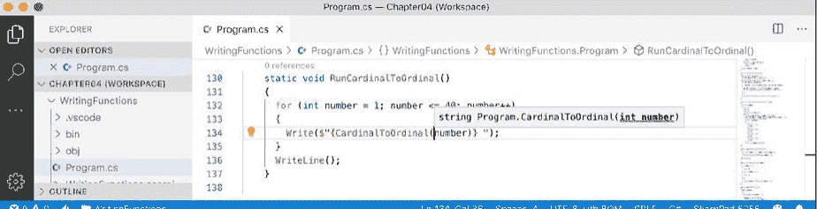

图 4.1：显示默认简单方法签名的工具提示

让我们通过添加额外信息来改进工具提示：

- 1. 如果你使用的是带有 C# 扩展的 Visual Studio Code，你应该导航到 View | Command Palette | Preferences: Open Settings (UI)，然后搜索 formatOnType 并确保它已启用。C# XML 文档注释是 Visual Studio 2022 的内置功能。
- 2. 在 CardinalToOrdinal 函数上方的行输入三个正斜杠 ///，并注意它们会扩展为 XML 注释，该注释识别该函数有一个名为 number 的单个参数。

3. 输入适合 XML 文档注释的摘要信息以及描述 CardinalToOrdinal 函数的输入参数和返回值的说明，如以下代码所示：

```
/// <summary>
/// Pass a 32-bit integer and it will be converted into its ordinal equivalent.
/// </summary>
/// <param name="number">Number is a cardinal value e.g. 1, 2, 3, and so on.</param>
/// <returns>Number as an ordinal value e.g. 1st, 2nd, 3rd, and so on.</returns>
```

4. 现在，调用该函数时，你将看到更多详细信息，如图 4.2 所示：

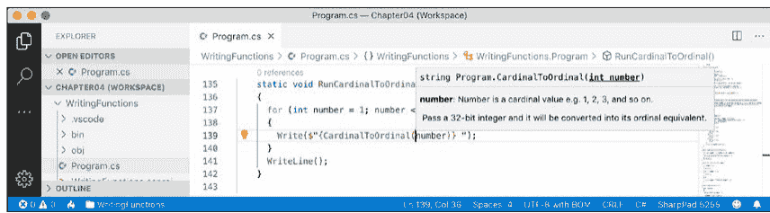

图 4.2：显示更详细方法签名的工具提示

在撰写第六版时，C# XML 文档注释在 .NET Interactive 笔记本中不起作用。

> 良好实践：为所有函数添加 XML 文档注释。

## 在函数实现中使用 lambda

F# 是微软的强类型函数优先编程语言，与 C# 一样，编译为 IL 由 .NET 执行。函数式语言源于 lambda 演算；一种仅基于函数的计算系统。代码看起来更像数学函数而不是食谱中的步骤。

函数式语言的一些重要属性在以下列表中定义：

- **模块化**：在 C# 中定义函数的相同好处适用于函数式语言。将大型复杂的代码库分解为更小的部分。
- **不可变性**：C# 意义上的变量不存在。函数内部的任何数据值都不能更改。相反，可以从现有值创建新数据值。这减少了错误。


-   **可维护性**：代码更简洁、更清晰（对于数学倾向的程序员来说！）。

自 C# 6 以来，Microsoft 一直致力于为语言添加功能以支持更函数式的方法。例如，在 C# 7 中添加 **元组** 和 **模式匹配**，在 C# 8 中添加 **可空引用类型**，并在 C# 9 中改进模式匹配并添加记录，即 **不可变对象**。

在 C# 6 中，Microsoft 添加了对 **表达式体函数成员** 的支持。我们现在将看一个示例。

**斐波那契数列** 总是从 0 和 1 开始。然后数列的其余部分使用将前两个数字相加的规则生成，如以下数字序列所示：

```
0 1 1 2 3 5 8 13 21 34 55 ...
```

数列中的下一个项将是 34 + 55，即 89。

我们将使用斐波那契数列来说明命令式和声明式函数实现之间的区别：

-   1. 添加一个名为 FibImperative 的函数，该函数将以命令式风格编写，如以下代码所示：
-   2. 添加一个名为 RunFibImperative 的函数，该函数在 for 语句内部调用 FibImperative，循环从 1 到 30，如以下代码所示：

```
static int FibImperative(int term)
{
    if (term == 1)
    {
        return 0;
    }
    else if (term == 2)
    {
        return 1;
    }
    else
    {
        return FibImperative(term - 1) + FibImperative(term - 2);
    }
}
```

```
static void RunFibImperative()
{
    for (int i = 1; i <= 30; i++)
    {
        WriteLine("The {0} term of the Fibonacci sequence is {1:N0}.",
            arg0: CardinalToOrdinal(i),
            arg1: FibImperative(term: i));
    }
}
```

3. 注释掉其他方法调用并调用 RunFibImperative 方法。

4. 运行代码并查看结果，如以下输出所示：

```
The 1st term of the Fibonacci sequence is 0.
The 2nd term of the Fibonacci sequence is 1.
The 3rd term of the Fibonacci sequence is 1.
The 4th term of the Fibonacci sequence is 2.
The 5th term of the Fibonacci sequence is 3.
The 6th term of the Fibonacci sequence is 5.
The 7th term of the Fibonacci sequence is 8.
The 8th term of the Fibonacci sequence is 13.
The 9th term of the Fibonacci sequence is 21.
The 10th term of the Fibonacci sequence is 34.
The 11th term of the Fibonacci sequence is 55.
The 12th term of the Fibonacci sequence is 89.
The 13th term of the Fibonacci sequence is 144.
The 14th term of the Fibonacci sequence is 233.
The 15th term of the Fibonacci sequence is 377.
The 16th term of the Fibonacci sequence is 610.
The 17th term of the Fibonacci sequence is 987.
The 18th term of the Fibonacci sequence is 1,597.
The 19th term of the Fibonacci sequence is 2,584.
The 20th term of the Fibonacci sequence is 4,181.
The 21st term of the Fibonacci sequence is 6,765.
The 22nd term of the Fibonacci sequence is 10,946.
The 23rd term of the Fibonacci sequence is 17,711.
The 24th term of the Fibonacci sequence is 28,657.
The 25th term of the Fibonacci sequence is 46,368.
The 26th term of the Fibonacci sequence is 75,025.
The 27th term of the Fibonacci sequence is 121,393.
The 28th term of the Fibonacci sequence is 196,418.
The 29th term of the Fibonacci sequence is 317,811.
The 30th term of the Fibonacci sequence is 514,229.
```

5. 添加一个名为 FibFunctional 的函数，以声明式风格编写，如以下代码所示：

```
static int FibFunctional(int term) =>
    term switch
    {
        1 => 0,
        2 => 1,
        _ => FibFunctional(term - 1) + FibFunctional(term - 2)
    };
```

6. 添加一个函数在 for 语句内部调用它，循环从 1 到 30，如以下代码所示：

```csharp
static void RunFibFunctional()
{
    for (int i = 1; i <= 30; i++)
    {
        WriteLine("The {0} term of the Fibonacci sequence is {1:N0}.",
            arg0: CardinalToOrdinal(i),
            arg1: FibFunctional(term: i));
    }
}
```

7. 注释掉 RunFibImperative 方法调用，并调用 RunFibFunctional 方法。

8. 运行代码并查看结果（与之前相同）。

## 开发期间的调试

在本节中，您将学习如何在开发时调试问题。您必须使用具有调试工具的代码编辑器，例如 Visual Studio 或 Visual Studio Code。在撰写本文时，您无法使用 .NET Interactive Notebooks 调试代码，但预计将来会添加此功能。


> **更多信息：** 有些人发现为 Visual Studio Code 设置 OmniSharp 调试器很棘手。我已包含最常见问题的说明，但如果您仍有困难，请尝试阅读以下链接中的信息：https://github.com/OmniSharp/omnisharp-vscode/blob/master/debugger.md

## 创建带有故意错误的代码

让我们通过创建一个带有故意错误的控制台应用程序来探索调试，然后使用代码编辑器中的调试器工具跟踪并修复它：

-   1. 使用您首选的编码工具在名为 Debugging 的 Chapter04 工作区/解决方案中添加一个新的 **控制台应用程序**。
-   2. 在 Visual Studio Code 中，将 Debugging 选择为活动的 OmniSharp 项目。当您看到弹出警告消息说缺少必需的资源时，单击 **是** 以添加它们。
-   3. 在 Visual Studio 中，将解决方案的启动项目设置为当前选择。
-   4. 在 Program.cs 中，添加一个带有故意错误的功能，如以下代码所示：

```csharp
static double Add(double a, double b)
{
    return a * b; // deliberate bug!
}
```

5. 在 Add 函数下方，编写语句声明并设置一些变量，然后使用有问题的函数将它们相加，如以下代码所示：

```
double a = 4.5;
double b = 2.5;
double answer = Add(a, b);
WriteLine($"{a} + {b} = {answer}");

WriteLine("Press ENTER to end the app.");
ReadLine(); // wait for user to press ENTER
```

6. 运行控制台应用程序并查看结果，如以下部分输出所示：

```
4.5 + 2.5 = 11.25
```

但等等，有一个错误！4.5 加上 2.5 应该是 7，而不是 11.25！

我们将使用调试工具来追踪并消除这个错误。

## 设置断点并开始调试

断点允许我们标记一行代码，以便在该处暂停以检查程序状态并查找错误。

## 使用 Visual Studio 2022

让我们设置一个断点，然后使用 Visual Studio 2022 开始调试：

-   1. 单击声明名为 a 的变量的语句。
-   2. 导航到 Debug | Toggle Breakpoint 或按 F9。然后在左侧边距栏中会出现一个红色圆圈，并且该语句会被高亮显示为红色以指示已设置断点，如图 4.3 所示：

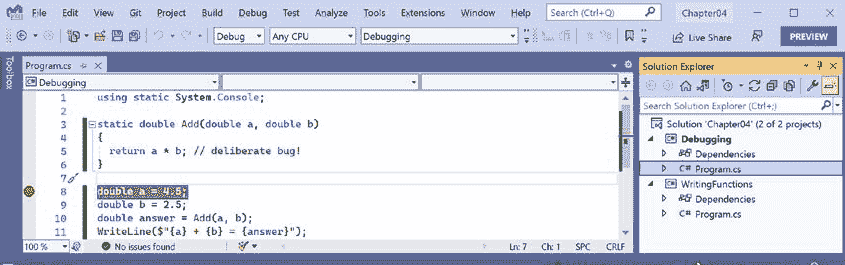

图 4.3：使用 Visual Studio 2022 切换断点

断点可以用相同的操作关闭。您也可以在边距中左键单击以打开或关闭断点，或右键单击断点以查看更多选项，例如删除、禁用或编辑现有断点的条件或操作。

-   3. 导航到 **Debug** | **Start Debugging** 或按 *F5*。Visual Studio 启动控制台应用程序，然后在遇到断点时暂停。这称为中断模式。标题为 **Locals**（显示局部变量的当前值）、**Watch 1**（显示您定义的任何监视表达式）、**Call Stack**、**Exception Settings** 和 **Immediate Window** 的额外窗口会出现。**Debugging** 工具栏出现。下一行要执行的代码会以黄色高亮显示，并且黄色箭头从边距栏指向该行，如图 4.4 所示：

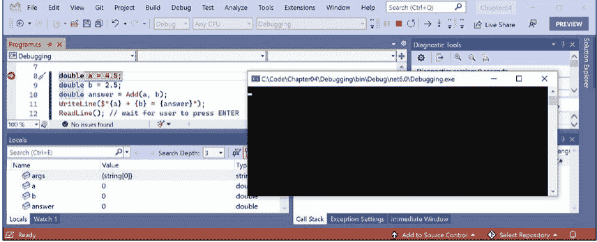

图 4.4：Visual Studio 2022 中的中断模式

如果您不想了解如何使用 Visual Studio Code 开始调试，则可以跳过下一节并继续阅读标题为 使用调试工具栏导航 的部分。

## 使用 Visual Studio Code

让我们设置一个断点，然后使用 Visual Studio Code 开始调试：

-   1. 单击声明名为 a 的变量的语句。
-   2. 导航到 **Run** | **Toggle Breakpoint** 或按 *F9*。左侧边距栏中会出现一个红色圆圈以指示已设置断点，如图 4.5 所示：


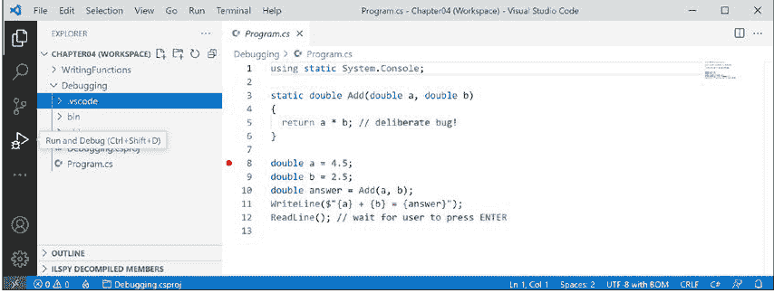

图 4.5：使用 Visual Studio Code 切换断点

断点也可以使用相同操作关闭。你也可以在边距中左键单击以打开或关闭断点，或右键单击以查看更多选项，例如移除、编辑或禁用现有断点；或在尚不存在断点时添加断点、条件断点或日志点。

> 日志点（Logpoints），也称为跟踪点（tracepoints），表示你希望记录一些信息，而无需在该点实际停止代码执行。

- 3. 导航到 View | Run，或在左侧导航栏中点击 Run and Debug 图标（三角形“播放”按钮和“虫子”），如 图 4.5 所示。
- 4. 在 DEBUG 窗口顶部，点击 Start Debugging 按钮（绿色三角形“播放”按钮）右侧的下拉菜单，并选择 .NET Core Launch (console) (Debugging)，如 图 4.6 所示：

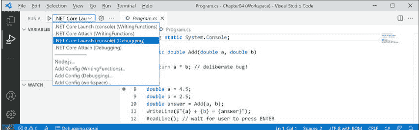

图 4.6：使用 Visual Studio Code 选择要调试的项目

**良好实践：** 如果在下拉列表中看不到 **Debugging** 项目的选项，是因为该项目缺少调试所需的资源。这些资源存储在 **.vscode** 文件夹中。要为项目创建 **.vscode** 文件夹，请导航到 **View | Command Palette**，选择 **OmniSharp: Select Project**，然后选择 **Debugging** 项目。几秒钟后，出现提示时，**'Debugging' 中缺少构建和调试所需的资源。添加它们？**，点击 **Yes** 以添加缺失的资源。

- 5. 在 **DEBUG** 窗口顶部，点击 **Start Debugging** 按钮（绿色三角形“播放”按钮），或导航到 **Run | Start Debugging**，或按 F5。Visual Studio Code 启动控制台应用程序，然后在遇到断点时暂停。这称为中断模式。下一行将要执行的代码以黄色高亮显示，并且边距栏中有一个黄色块指向该行，如 图 4.7 所示：

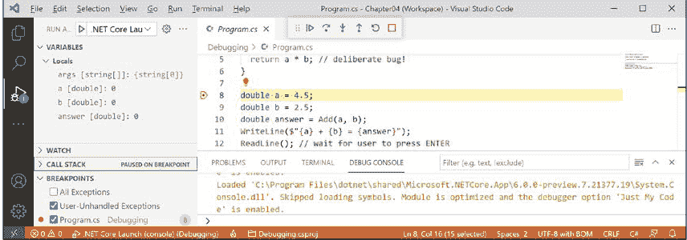

图 4.7：Visual Studio Code 中的中断模式

## 使用调试工具栏导航

Visual Studio Code 显示一个浮动工具栏，其中包含按钮以便轻松访问调试功能。Visual Studio 2022 在其 **Standard** 工具栏中有一个按钮用于启动或继续调试，并有一个单独的 **Debugging** 工具栏用于其余工具。

两者均在 图 4.8 中显示，并在以下列表中描述：

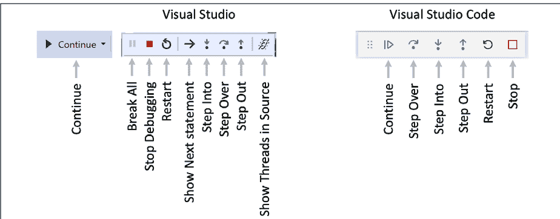

图 4.8：Visual Studio 2022 和 Visual Studio Code 中的调试工具栏

- **Continue**/*F5*：此按钮将从当前位置继续运行程序，直到结束或遇到另一个断点。
- **Step Over**/*F10*、**Step Into**/*F11* 和 **Step Out**/*Shift + F11*（蓝色箭头覆盖点）：这些按钮以各种方式逐步执行代码语句，如你稍后将看到的。
- **Restart**/*Ctrl or Cmd + Shift + F5*（循环箭头）：此按钮将停止程序，然后立即重新启动程序并再次附加调试器。
- **Stop**/*Shift + F5*（红色方块）：此按钮将停止调试会话。

## 调试窗口

调试时，Visual Studio Code 和 Visual Studio 都显示额外的窗口，允许你在逐步执行代码时监视有用的信息，例如变量。

最有用的窗口在以下列表中描述：

- **VARIABLES**，包括 **Locals**，它会自动显示任何局部变量的名称、值和类型。在逐步执行代码时请留意此窗口。
- **WATCH** 或 **Watch 1**，显示你手动输入的变量和表达式的值。
- **CALL STACK**，显示函数调用的堆栈。
- **BREAKPOINTS**，显示所有断点并允许更精细地控制它们。

在中断模式下，编辑区域底部还有一个有用的窗口：

- **DEBUG CONSOLE** 或 **Immediate Window** 允许与代码进行实时交互。你可以通过输入变量名称等方式询问程序状态。例如，你可以通过输入 1+2 并按 Enter 来提问“1+2 是多少？”，如 图 4.9 所示：


图 4.9：询问程序状态

## 逐步执行代码

让我们探索使用 Visual Studio 或 Visual Studio Code 逐步执行代码的一些方法：

- 1. 导航到 **Run/Debug | Step Into**，或在工具栏中点击 **Step Into** 按钮，或按 *F11*。黄色高亮向前移动一行。
- 2. 导航到 **Run/Debug | Step Over**，或在工具栏中点击 **Step Over** 按钮，或按 *F10*。黄色高亮向前移动一行。目前，你可以看到使用 **Step Into** 或 **Step Over** 没有区别。
- 3. 你现在应该位于调用 Add 方法的那一行，如 图 4.10 所示：

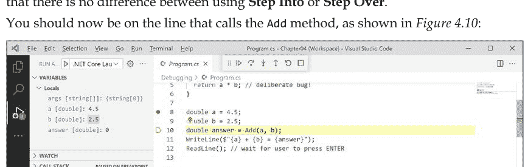

图 4.10：逐步进入和越过代码

**Step Into** 和 **Step Over** 之间的区别在即将执行方法调用时可见：

- 如果你点击 **Step Into**，调试器将 *进入* 方法，以便你可以逐步执行该方法中的每一行。
- 如果你点击 **Step Over**，整个方法将一次性执行；它不会在不执行方法的情况下跳过方法。

- 4. 点击 **Step Into** 进入方法内部。
- 5. 将鼠标指针悬停在代码编辑窗口中的 a 或 b 参数上，注意会出现一个工具提示显示其当前值。
- 6. 选择表达式 a * b，右键单击该表达式，然后选择 **Add to Watch** 或 **Add Watch**。表达式将被添加到 **WATCH** 窗口，显示该运算符将 a 乘以 b 得到结果 11.25。
- 7. 在 **WATCH** 或 **Watch 1** 窗口中，右键单击表达式并选择 **Remove Expression** 或 **Delete Watch**。
- 8. 通过在 Add 函数中将 * 更改为 + 来修复错误。
- 9. 通过点击循环箭头 **Restart** 按钮或按 Ctrl 或 Cmd + Shift + F5 来停止调试、重新编译并重新启动调试。
- 10. 越过该函数，花一点时间注意它现在如何正确计算，然后点击 **Continue** 按钮或按 F5。
- 11. 使用 Visual Studio Code 时，请注意在调试期间写入控制台时，输出会出现在 **DEBUG CONSOLE** 窗口而不是 **TERMINAL** 窗口中，如 图 4.11 所示：

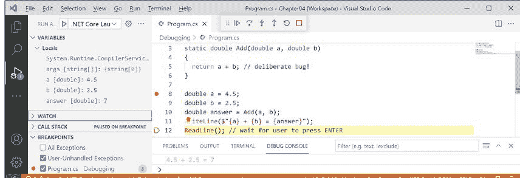

图 4.11：调试期间向 DEBUG CONSOLE 写入内容

## 自定义断点

制作更复杂的断点很容易：

- 1. 如果你仍在调试，请点击调试工具栏中的 **Stop** 按钮，或导航到 **Run/Debug | Stop Debugging**，或按 Shift + F5。
- 2. 导航到 **Run | Remove All Breakpoints** 或 **Debug | Delete All Breakpoints**。
- 3. 点击输出答案的 WriteLine 语句。
- 4. 通过按 F9 或导航到 **Run/Debug | Toggle Breakpoint** 设置断点。
- 5. 在 Visual Studio Code 中，右键单击断点并选择 **Edit Breakpoint...**，然后输入一个表达式，例如 answer 变量必须大于 9，并注意表达式必须求值为 true 断点才会激活，如 图 4.12 所示：

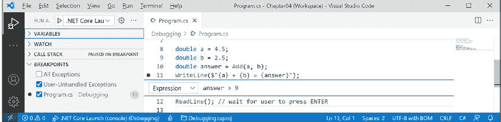

图 4.12：使用 Visual Studio Code 用表达式自定义断点

- 6. 在 Visual Studio 中，右键单击断点并选择 **Conditions...**，然后输入一个表达式，例如 answer 变量必须大于 9，并注意表达式必须求值为 true 断点才会激活。
- 7. 启动调试并注意断点未被命中。
- 8. 停止调试。
- 9. 编辑断点或其条件，并将其表达式更改为小于 9。
- 10. 启动调试并注意断点被命中。
- 11. 停止调试。
- 12. 编辑断点或其条件（在 Visual Studio 中点击 **Add condition**），并选择 **Hit Count**，然后输入一个数字，例如 3，表示必须命中断点三次后它才会激活，如 图 4.13 所示：

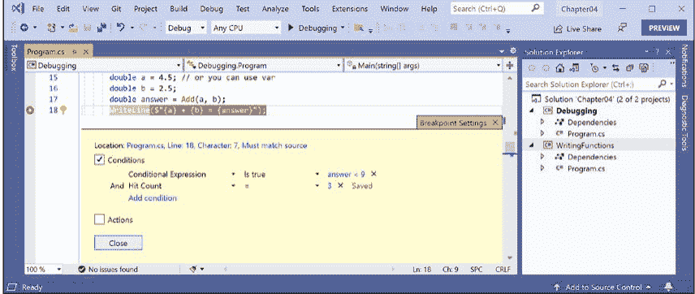

图 4.13：使用 Visual Studio 2022 用表达式和命中次数自定义断点


13. 将鼠标悬停在断点的红色圆圈上以查看摘要，如图 4.14 所示：

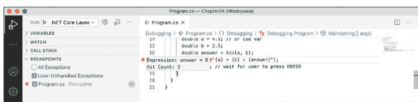

图 4.14：Visual Studio Code 中自定义断点的摘要

你现在已经使用一些调试工具修复了一个错误，并看到了设置断点的一些高级可能性。

## 开发期间和运行时的日志记录

一旦你认为代码中的所有错误都已消除，你就会编译一个发行版本并部署应用程序，以便人们可以使用它。但没有任何代码是完全没有错误的，在运行时可能会出现意外的错误。

终端用户在记住、承认然后准确描述错误发生时他们正在做什么方面臭名昭著地很差，所以你不应该依赖他们准确提供有用的信息来重现问题以了解问题的原因然后修复它。相反，你可以**为你的代码添加检测**，这意味着记录感兴趣的事件。

> **良好实践：** 在整个应用程序中添加代码以记录正在发生的事情，尤其是在出现异常时，以便你可以查看日志并使用它们来追踪问题并修复问题。尽管我们将在*第 10 章，使用 Entity Framework Core 工作与数据*中再次看到日志记录，并在*第 15 章，使用模型-视图-控制器模式构建网站*中看到，日志记录是一个庞大的主题，因此本书只能涵盖基础知识。

## 了解日志记录选项

.NET 包含一些内置方法，通过添加日志记录功能来为你的代码添加检测。本书将介绍基础知识。但日志记录是一个第三方创建了丰富的强大解决方案生态系统来扩展微软提供的功能的领域。我无法做出具体推荐，因为最佳日志框架取决于你的需求。但我在下面的列表中列出了一些常见的框架：

- Apache log4net
- NLog
- Serilog

## 使用 Debug 和 Trace 进行检测

有两种类型可用于为你的代码添加简单的日志记录：Debug 和 Trace。

在更详细地探讨它们之前，让我们先快速概述一下每一种：

- Debug 类用于添加仅在开发期间写入的日志记录。
- Trace 类用于添加在开发期间和运行时都会写入的日志记录。

你已经见过 Console 类型及其 WriteLine 方法将内容写入控制台窗口的使用。还有一对名为 Debug 和 Trace 的类型，它们在输出位置方面具有更大的灵活性。

Debug 和 Trace 类写入任何跟踪侦听器。跟踪侦听器是一种类型，可以配置为在调用 WriteLine 方法时将输出写入任何你喜欢的位置。.NET 提供了多个跟踪侦听器，包括一个输出到控制台的侦听器，你甚至可以通过继承 TraceListener 类型来自定义一个。

## 写入默认跟踪侦听器

一个跟踪侦听器 DefaultTraceListener 类会自动配置并写入 Visual Studio Code 的 DEBUG CONSOLE 窗口或 Visual Studio 的 Debug 窗口。你可以使用代码配置其他跟踪侦听器。

让我们看看跟踪侦听器的实际效果：

- 1. 使用你喜欢的编码工具在 Chapter04 工作区/解决方案中添加一个新的控制台应用程序，命名为 Instrumenting。
- 2. 在 Visual Studio Code 中，将 Instrumenting 选择为活动的 OmniSharp 项目。当你看到弹出警告消息说缺少必需的资源时，点击 Yes 以添加它们。
- 3. 在 Program.cs 中导入 System.Diagnostics 命名空间。
- 4. 从 Debug 和 Trace 类写入一条消息，如以下代码所示：
- 5. 在 Visual Studio 中，导航到 View | Output 并确保 Show output from: Debug 已被选中。
- 6. 开始调试 Instrumenting 控制台应用程序，并注意 Visual Studio Code 中的 DEBUG CONSOLE 或 Visual Studio 2022 中的 Output 窗口显示了这两条消息，与其他调试信息混合在一起，例如已加载的程序集 DLL，如图 4.15 和 4.16 所示：

```
Debug.WriteLine("Debug says, I am watching!");
Trace.WriteLine("Trace says, I am watching!");
```

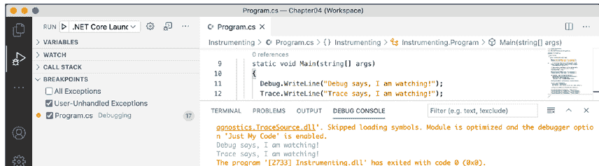

图 4.15：Visual Studio Code DEBUG CONSOLE 以蓝色显示两条消息

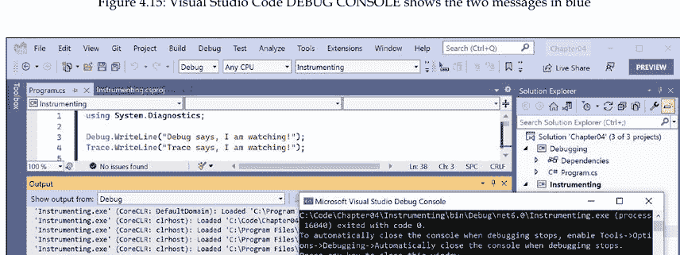

图 4.16：Visual Studio 2022 Output 窗口显示包含两条消息的 Debug 输出

## 配置跟踪侦听器

现在，我们将配置另一个跟踪侦听器，使其写入文本文件：

- 1. 在 Debug 和 Trace 对 WriteLine 的调用之前，添加一条语句以在桌面上创建一个新文本文件并将其传递给知道如何写入文本文件的新跟踪侦听器，并启用其缓冲区的自动刷新，如以下代码中突出显示所示：

```
// write to a text file in the project folder
Trace.Listeners.Add(new TextWriterTraceListener(
    File.CreateText(Path.Combine(Environment.GetFolderPath(
        Environment.SpecialFolder.DesktopDirectory), "log.txt"))));

// text writer is buffered, so this option calls
// Flush() on all listeners after writing
Trace.AutoFlush = true;

Debug.WriteLine("Debug says, I am watching!");
Trace.WriteLine("Trace says, I am watching!");
```

> **良好实践：** 代表文件的任何类型通常都会实现缓冲区以提高性能。不是立即将数据写入文件，而是将数据写入内存缓冲区，只有当缓冲区满时才会一次性写入文件。这种行为在调试时可能会令人困惑，因为我们不会立即看到结果！启用 AutoFlush 意味着它在每次写入后自动调用 Flush 方法。

- 2. 在 Visual Studio Code 中，通过在 Instrumenting 项目的 **TERMINAL** 窗口中输入以下命令来运行控制台应用程序的发行配置，并注意似乎没有任何事情发生：

```
dotnet run --configuration Release
```

- 3. 在 Visual Studio 2022 中，在标准工具栏中，在 Solution Configurations 下拉列表中选择 Release，如图 4.17 所示：


图 4.17：在 Visual Studio 中选择 Release 配置

- 4. 在 Visual Studio 2022 中，通过导航到 Debug | Start Without Debugging 来运行控制台应用程序的发行配置。

- 5. 在你的桌面上打开名为 log.txt 的文件并注意它包含消息 Trace says, I am watching!。

- 6. 在 Visual Studio Code 中，通过在 Instrumenting 项目的 **TERMINAL** 窗口中输入以下命令来运行控制台应用程序的调试配置：

```
dotnet run --configuration Debug
```

- 7. 在 Visual Studio 中，在标准工具栏中，在 Solution Configurations 下拉列表中选择 Debug，然后通过导航到 Debug | Start Debugging 来运行控制台应用程序。

- 8. 在你的桌面上打开名为 log.txt 的文件并注意它同时包含消息 Debug says, I am watching! 和 Trace says, I am watching!。

> **良好实践：** 使用 Debug 配置运行时，Debug 和 Trace 都处于活动状态，并将写入任何跟踪侦听器。使用 Release 配置运行时，只有 Trace 会写入任何跟踪侦听器。因此，你可以在代码中随意使用 Debug.WriteLine 调用，因为你知道在构建应用程序的发行版本时它们会被自动删除，因此不会影响性能。

## 切换跟踪级别

Trace.WriteLine 调用即使在发行后仍保留在你的代码中。因此，能够精细控制它们何时输出会很好。这正是我们可以使用跟踪开关实现的功能。

跟踪开关的值可以使用数字或单词设置。例如，数字 3 可以替换为单词 Info，如下表所示：

| 数字 | 单词 | 描述 |
|---|---|---|
| 0 | Off | 这将不输出任何内容。 |
| 1 | Error | 这将仅输出错误。 |
| 2 | Warning | 这将输出错误和警告。 |
| 3 | Info | 这将输出错误、警告和信息。 |
| 4 | Verbose | 这将输出所有级别。 |

让我们探索使用跟踪开关。首先，我们将向项目添加一些 NuGet 包以启用从 JSON appsettings 文件加载配置设置。

## 在 Visual Studio Code 中向项目添加包

Visual Studio Code 没有添加 NuGet 包到项目的机制，因此我们将使用命令行工具：

- 1. 导航到 Instrumenting 项目的 **TERMINAL** 窗口。
- 2. 输入以下命令：
- 3. 输入以下命令：
- 4. 输入以下命令：
- 5. 输入以下命令：

```
dotnet add package Microsoft.Extensions.Configuration
```

```
dotnet add package Microsoft.Extensions.Configuration.Binder
```

```
dotnet add package Microsoft.Extensions.Configuration.Json
```

```
dotnet add package Microsoft.Extensions.Configuration.FileExtensions
```


> dotnet add package 将对 NuGet 包的引用添加到你的项目文件中。它将在构建过程中下载。dotnet add reference 将项目到项目的引用添加到你的项目文件中。引用的项目在构建过程中如果需要将被编译。


## 在 Visual Studio 2022 中向项目添加包

Visual Studio 具有用于添加包的图形用户界面。

- 1. 在 **解决方案资源管理器** 中，右键单击 **Instrumenting** 项目并选择 **管理 NuGet 程序包**。
- 2. 选择 **浏览** 选项卡。
- 3. 在搜索框中输入 Microsoft.Extensions.Configuration。
- 4. 选择以下每个 NuGet 程序包并单击 **安装** 按钮，如图 4.18 所示：
  - 1. Microsoft.Extensions.Configuration
  - 2. Microsoft.Extensions.Configuration.Binder
  - 3. Microsoft.Extensions.Configuration.Json
  - 4. Microsoft.Extensions.Configuration.FileExtensions

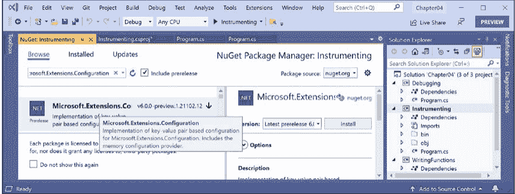

图 4.18：使用 Visual Studio 2022 安装 NuGet 程序包

**良好实践**：还有用于从 XML 文件、INI 文件、环境变量和命令行加载配置的程序包。在项目中设置配置时使用最合适的技术。

## 查看项目程序包

添加 NuGet 程序包后，我们可以在项目文件中看到引用：

- 1. 打开 Instrumenting.csproj（在 Visual Studio 的 **解决方案资源管理器** 中双击 **Instrumenting** 项目）并注意包含已添加 NuGet 程序包的 <ItemGroup> 部分，如以下标记中突出显示所示：

```
<Project Sdk="Microsoft.NET.Sdk">

  <PropertyGroup>
<OutputType>Exe</OutputType>
<TargetFramework>net6.0</TargetFramework>
<Nullable>enable</Nullable>
<ImplicitUsings>enable</ImplicitUsings>
</PropertyGroup>

<ItemGroup>
  <PackageReference
    Include="Microsoft.Extensions.Configuration"
    Version="6.0.0" />
  <PackageReference
    Include="Microsoft.Extensions.Configuration.Binder"
    Version="6.0.0" />
  <PackageReference
    Include="Microsoft.Extensions.Configuration.FileExtensions"
    Version="6.0.0" />
  <PackageReference
    Include="Microsoft.Extensions.Configuration.Json"
    Version="6.0.0" />
</ItemGroup>

</Project>
```

- 2. 在 Instrumenting 项目文件夹中添加一个名为 appsettings.json 的文件。
- 3. 修改 appsettings.json 以定义名为 PacktSwitch 且具有 Level 值的设置，如以下代码所示：

```
{
  "PacktSwitch": {
    "Level": "Info"
  }
}
```

- 4. 在 Visual Studio 2022 中，在解决方案资源管理器中，右键单击 appsettings.json，选择属性，然后在属性窗口中，将输出目录的复制方式更改为如果较新则复制。这是因为与在项目文件夹中运行控制台应用的 Visual Studio Code 不同，Visual Studio 在 Instrumenting\bin\Debug\net6.0 或 Instrumenting\bin\Release\net6.0 中运行控制台应用。
- 5. 在 Program.cs 顶部，导入 Microsoft.Extensions.Configuration 命名空间。
- 6. 在 Program.cs 末尾添加一些语句，以创建在当前文件夹中查找名为 appsettings.json 的文件的配置生成器，构建配置，创建跟踪开关，通过绑定到配置设置其级别，然后输出四个跟踪开关级别，如以下代码所示：

```
ConfigurationBuilder builder = new();

builder.SetBasePath(Directory.GetCurrentDirectory())
.AddJsonFile("appsettings.json",
    optional: true, reloadOnChange: true);

IConfigurationRoot configuration = builder.Build();

TraceSwitch ts = new(
    displayName: "PacktSwitch",
    description: "This switch is set via a JSON config.");

configuration.GetSection("PacktSwitch").Bind(ts);

Trace.WriteLineIf(ts.TraceError, "Trace error");
Trace.WriteLineIf(ts.TraceWarning, "Trace warning");
Trace.WriteLineIf(ts.TraceInfo, "Trace information");
Trace.WriteLineIf(ts.TraceVerbose, "Trace verbose");
```

- 7. 在 Bind 语句上设置断点。
- 8. 开始调试 Instrumenting 控制台应用。在变量或本地窗口中，展开 ts 变量表达式，并注意其 Level 为 Off 且 TraceError、TraceWarning 等均为 false，如图 4.19 所示：

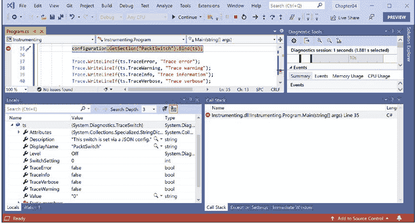

图 4.19：在 Visual Studio 2022 中监视跟踪开关变量属性

- 9. 通过单击进入或逐过程按钮或按 F11 或 F10 进入 Bind 方法的调用，并注意 ts 变量监视表达式更新为 Info 级别。
- 10. 进入或越过对 Trace.WriteLineIf 的四次调用，并注意所有级别直到 Info 都写入 DEBUG 控制台或输出 - 调试窗口，但 Verbose 不写入，如图 4.20 所示：

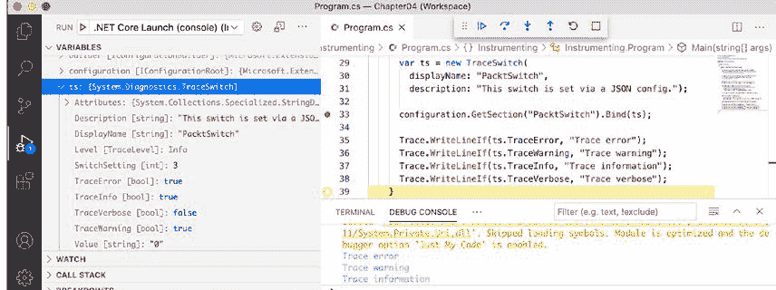

图 4.20：在 Visual Studio Code 的 DEBUG 控制台中显示的不同跟踪级别

- 11. 停止调试。
- 12. 修改 appsettings.json 以将级别设置为 2，这意味着警告，如以下 JSON 文件所示：

```
{
  "PacktSwitch": {
    "Level": "2"
  }
}
```

- 13. 保存更改。
- 14. 在 Visual Studio Code 中，通过在 Instrumenting 项目的终端窗口中输入以下命令运行控制台应用程序：

```
dotnet run --configuration Release
```

- 15. 在 Visual Studio 中，在标准工具栏中，在解决方案配置下拉列表中选择 Release，然后通过导航到调试 | 启动而不调试来运行控制台应用。
- 16. 打开名为 log.txt 的文件并注意，这次四个潜在跟踪级别的输出只有跟踪错误和警告级别，如以下文本文件所示：

```
Trace says, I am watching!
Trace error
Trace warning
```

如果未传递参数，则默认跟踪开关级别为 Off（0），因此不会输出任何开关级别。

## 单元测试

修复代码中的错误代价高昂。开发过程中越早发现错误，修复成本就越低。

单元测试是及早在开发过程中发现错误的好方法。一些开发人员甚至遵循程序员应在编写代码之前创建单元测试的原则，这被称为 **测试驱动开发（TDD）**。

Microsoft 有一个专有的单元测试框架称为 **MS Test**。还有一个名为 **NUnit** 的框架。然而，我们将使用免费的开源第三方框架 **xUnit.net**。xUnit 由构建 NUnit 的同一团队创建，但他们修复了之前认为自己犯的错误。xUnit 更具可扩展性，并且具有更好的社区支持。

## 了解测试类型

单元测试只是众多测试类型之一，如下表所述：

| 测试类型 | 描述 |
|---|---|
| 单元 | 测试代码的最小单元，通常是方法或函数。单元测试在将代码单元与其依赖项隔离的情况下执行，如果需要则对其进行模拟。每个单元应有多个测试：一些使用典型输入和预期输出，一些使用极端输入值来测试边界，一些使用故意错误的输入来测试异常处理。 |
| 集成 | 测试较小的单元和较大的组件是否作为单个软件一起工作。有时涉及与您没有源代码的外部组件集成。 |
| 系统 | 测试软件将运行的整个系统环境。 |
| 性能 | 测试软件的性能；例如，您的代码必须在 20 毫秒内向访客返回一个充满数据的网页。 |
| 负载 | 测试软件在保持所需性能的同时可以同时处理多少请求，例如，网站的 10,000 名并发访客。 |
| 用户验收 | 测试用户是否能愉快地使用您的软件完成工作。 |

## 创建需要测试的类库

首先，我们将创建一个需要测试的函数。我们将在类库项目中创建它。类库是可以分发并由其他 .NET 应用程序引用的代码包：

- 1. 使用您首选的编码工具向 Chapter04 工作区/解决方案添加一个新的 **类库**，命名为 CalculatorLib。`dotnet new` 模板名为 `classlib`。
- 2. 将名为 `Class1.cs` 的文件重命名为 `Calculator.cs`。


3. 修改文件以定义一个 Calculator 类（故意包含一个错误！），如下所示的代码：

```
namespace Packt
{
    public class Calculator
    {
        public double Add(double a, double b)
        {
            return a * b;
        }
    }
}
```

4. 编译你的类库项目：
- 1. 在 Visual Studio 2022 中，导航到 **构建 | 构建 CalculatorLib**。
- 2. 在 Visual Studio Code 中，在 **终端** 中，输入命令 `dotnet build`。

5. 使用你偏好的编码工具，在 Chapter04 工作区/解决方案中添加一个新的 xUnit 测试项目 [C#]，命名为 CalculatorLibUnitTests。dotnet new 模板名为 xunit。

6. 如果你使用的是 Visual Studio，在 **解决方案资源管理器** 中，选择 CalculatorLibUnitTests 项目，导航到 **项目 | 添加项目引用...**，选中复选框以选择 CalculatorLib 项目，然后单击“确定”。

7. 如果你使用的是 Visual Studio Code，使用 dotnet add reference 命令或单击名为 CalculatorLibUnitTests.csproj 的文件，并修改配置以添加一个包含对 CalculatorLib 项目的项目引用的项组，如以下标记中突出显示所示：

```
<Project Sdk="Microsoft.NET.Sdk">

    <PropertyGroup>
        <TargetFramework>net6.0</TargetFramework>
        <Nullable>enable</Nullable>

        <IsPackable>false</IsPackable>
    </PropertyGroup>

    <ItemGroup>
        <PackageReference Include="Microsoft.NET.Test.Sdk" Version="16.10.0" />
        <PackageReference Include="xunit" Version="2.4.1" />
        <PackageReference Include="xunit.runner.visualstudio" Version="2.4.3">
            <IncludeAssets>runtime; build; native; contentfiles; analyzers; buildtransitive</IncludeAssets>
            <PrivateAssets>all</PrivateAssets>
        </PackageReference>
        <PackageReference Include="coverlet.collector" Version="3.0.2">
<IncludeAssets>runtime; build; native; contentfiles;
    analyzers; buildtransitive</IncludeAssets>
    <PrivateAssets>all</PrivateAssets>
</PackageReference>
</ItemGroup>

<ItemGroup>
    <ProjectReference
        Include="..\CalculatorLib\CalculatorLib.csproj" />
</ItemGroup>
</Project>
```

8. 构建 CalculatorLibUnitTests 项目。

## 编写单元测试

一个编写良好的单元测试将包含三个部分：
- **Arrange**：此部分将声明并实例化输入和输出的变量。
- **Act**：此部分将执行你正在测试的单元。在我们的例子中，这意味着调用我们想要测试的方法。
- **Assert**：此部分将对输出做出一个或多个断言。断言是一种信念，如果不为真，则表示测试失败。例如，在添加 2 和 2 时，我们期望结果为 4。

现在，我们将为 Calculator 类编写一些单元测试：
- 1. 将文件 UnitTest1.cs 重命名为 CalculatorUnitTests.cs，然后打开它。
- 2. 在 Visual Studio Code 中，将类重命名为 CalculatorUnitTests。（Visual Studio 在重命名文件时会提示你重命名类。）
- 3. 导入 Packt 命名空间。
- 4. 修改 CalculatorUnitTests 类，使其具有两个用于添加 2 和 2 以及添加 2 和 3 的测试方法，如以下代码所示：

```
using Packt;
using Xunit;

namespace CalculatorLibUnitTests
{
    public class CalculatorUnitTests
    {
[Fact]
public void TestAdding2And2()
{
    // arrange
    double a = 2;
    double b = 2;
    double expected = 4;
    Calculator calc = new();

    // act
    double actual = calc.Add(a, b);

    // assert
    Assert.Equal(expected, actual);
}

[Fact]
public void TestAdding2And3()
{
    // arrange
    double a = 2;
    double b = 3;
    double expected = 5;
    Calculator calc = new();

    // act
    double actual = calc.Add(a, b);

    // assert
    Assert.Equal(expected, actual);
}
}
}
```

## 使用 Visual Studio Code 运行单元测试

现在我们准备好运行单元测试并查看结果：
- 1. 在 CalculatorLibUnitTest 项目的 **终端** 窗口中，运行测试，如以下命令所示：

```
dotnet test
```

2. 请注意，结果表明运行了两个测试，一个测试通过，一个测试失败，如图 4.21 所示：

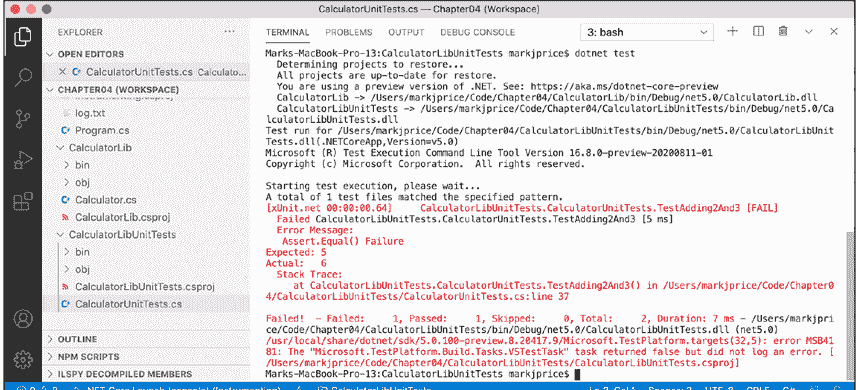

图 4.21：Visual Studio Code 的终端中的单元测试结果

## 使用 Visual Studio 运行单元测试

现在我们准备好运行单元测试并查看结果：
- 1. 导航到 测试 | 运行全部测试。
- 2. 在 测试资源管理器 中，请注意结果表明运行了两个测试，一个测试通过，一个测试失败，如图 4.22 所示：

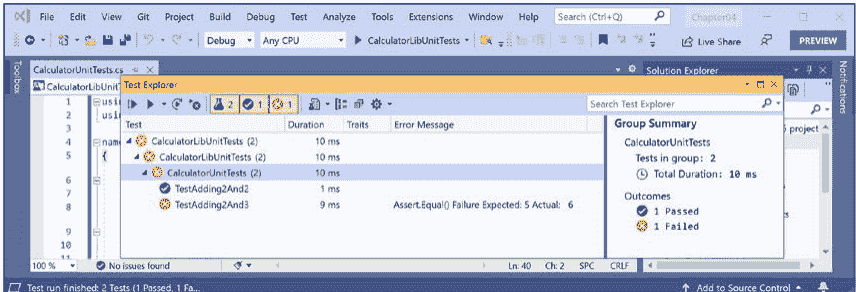

图 4.22：Visual Studio 2022 的测试资源管理器中的单元测试结果

## 修复错误

现在你可以修复错误：
- 1. 修复 Add 方法中的错误。
- 2. 再次运行单元测试，查看错误现在已修复且两个测试都通过。

## 在函数中抛出和捕获异常

在第 3 章《控制流、转换类型和处理异常》中，你了解了异常以及如何使用 try-catch 语句来处理它们。但你只有在有足够信息来缓解问题时才应捕获并处理异常。如果没有，则应允许异常通过调用栈传递到更高层级。

## 理解使用错误和执行错误

使用错误是指程序员错误地使用函数，通常通过传递无效的参数值。他们可以通过更改代码以传递有效值来避免这些错误。当一些程序员首次学习 C# 和 .NET 时，他们有时认为异常总是可以避免的，因为他们假设所有错误都是使用错误。使用错误应在生产运行时之前全部修复。

执行错误是指在运行时发生的事情，无法通过编写“更好的”代码来修复。执行错误可以分为程序错误和系统错误。如果你尝试访问网络资源但网络已关闭，你需要能够通过记录异常来处理该系统错误，并且可能在一段时间后退避并重试。但某些系统错误，例如内存耗尽，根本无法处理。如果你尝试打开一个不存在的文件，你可能能够捕获该错误并通过以编程方式创建新文件来处理它。程序错误可以通过编写智能代码以编程方式修复。系统错误通常无法以编程方式修复。

## 函数中常见抛出的异常

极少情况下你应该定义新的异常类型来指示使用错误。.NET 已经定义了许多你应该使用的异常。

在定义带有参数的自己的函数时，你的代码应检查参数值，并在它们具有会阻止函数正常运行的值时抛出异常。

例如，如果参数不应为 null，则抛出 ArgumentNullException。对于其他问题，抛出 ArgumentException、NotSupportedException 或 InvalidOperationException。对于任何异常，都应包含描述问题的消息，供阅读它的人（通常是类库和函数的开发人员受众，或如果在 GUI 应用的最高层级则是最终用户）阅读，如以下代码所示：

```
static void Withdraw(string accountName, decimal amount)
{
    if (accountName is null)
    {
        throw new ArgumentNullException(paramName: nameof(accountName));
    }

    if (amount < 0)
{
    throw new ArgumentException(
        message: $"{nameof(amount)} cannot be less than zero.");
}

// process parameters
}
```

**良好实践：** 如果函数无法成功执行其操作，你应将其视为函数失败并通过抛出异常来报告。

你永远不需要编写 try-catch 语句来捕获这些使用类型错误。你希望应用程序终止。这些异常应导致调用函数的程序员修复其代码以防止问题发生。它们应在生产部署之前修复。这并不意味着你的代码不需要抛出使用错误类型异常。你应该——以迫使其他程序员正确调用你的函数！

## 理解调用栈

.NET 控制台应用程序的入口点是 Program 类的 Main 方法，无论你是否显式定义了此类和方法，还是由顶层程序功能为你创建。

Main 方法将调用其他方法，这些方法又调用其他方法，依此类推，这些方法可能在当前项目中，也可能在引用的项目和 NuGet 包中，如图 4.23 所示：

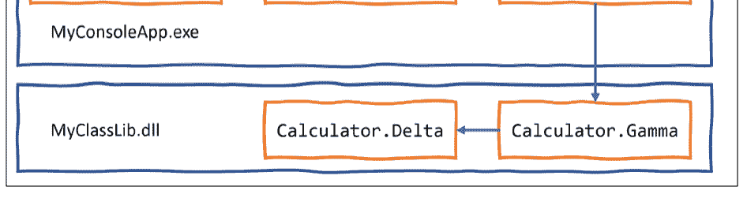

图 4.23：创建调用栈的方法调用链

让我们创建一个类似的方法链来探索我们可以捕获和处理异常的位置：

1. 使用您首选的编码工具在 Chapter04 工作区/解决方案中添加一个新的类库，命名为 CallStackExceptionHandlingLib。
2. 将 Class1.cs 文件重命名为 Calculator.cs。
3. 打开 Calculator.cs 并修改其内容，如以下代码所示：
4. 使用您首选的编码工具在 Chapter04 工作区/解决方案中添加一个新的控制台应用程序，命名为 CallStackExceptionHandling。
5. 在 Visual Studio Code 中，将 CallStackExceptionHandling 选择为活动的 OmniSharp 项目。当您看到弹出警告消息提示缺少所需资源时，点击“是”以添加它们。
6. 在 CallStackExceptionHandling 项目中，为 CallStackExceptionHandlingLib 项目添加引用。
7. 在 Program.cs 中，添加语句以定义两个方法并链式调用它们，以及类库中的方法，如以下代码所示：

```csharp
using static System.Console;

namespace Packt;

public class Calculator
{
    public static void Gamma() // public so it can be called from outside
    {
        WriteLine("In Gamma");
        Delta();
    }

    private static void Delta() // private so it can only be called internally
    {
        WriteLine("In Delta");
        File.OpenText("bad file path");
    }
}
```

```csharp
using Packt;

using static System.Console;

WriteLine("In Main");
Alpha();

static void Alpha()
{
    WriteLine("In Alpha");
    Beta();
}
```

```csharp
static void Beta()
{
    WriteLine("In Beta");
    Calculator.Gamma();
}
```

8. 运行控制台应用程序，并注意结果，如以下部分输出所示：

```
In Main
In Alpha
In Beta
In Gamma
In Delta
Unhandled exception. System.IO.FileNotFoundException: Could not find file 'C:\Code\Chapter04\CallStackExceptionHandling\bin\Debug\net6.0\bad file path'.
  at Microsoft.Win32.SafeHandles.SafeFileHandle.CreateFile(...
  at Microsoft.Win32.SafeHandles.SafeFileHandle.Open(...
  at System.IO.Strategies.OSFileStreamStrategy..ctor(...
  at System.IO.Strategies.FileStreamHelpers.ChooseStrategyCore(...
  at System.IO.Strategies.FileStreamHelpers.ChooseStrategy(...
  at System.IO.StreamReader.ValidateArgsAndOpenPath(...
  at System.IO.File.OpenText(String path) in ...
  at Packt.Calculator.Delta() in C:\Code\Chapter04\CallStackExceptionHandlingLib\Calculator.cs:line 16
  at Packt.Calculator.Gamma() in C:\Code\Chapter04\CallStackExceptionHandlingLib\Calculator.cs:line 10
  at <Program>.$.<Main>$g__Beta|0_1() in C:\Code\Chapter04\CallStackExceptionHandling\Program.cs:line 16
  at <Program>.$.<Main>$g__Alpha|0_0() in C:\Code\Chapter04\CallStackExceptionHandling\Program.cs:line 10
  at <Program>.$.<Main>$(String[] args) in C:\Code\Chapter04\CallStackExceptionHandling\Program.cs:line 5
```

请注意以下内容：

- 调用堆栈是倒置的。从底部开始，您可以看到：
  - 第一次调用是自动生成的 Program 类中的 Main 入口点函数。这里将参数作为字符串数组传入。
  - 第二次调用是 Alpha 函数。
  - 第三次调用是 Beta 函数。
  - 第四次调用是 Gamma 函数。
  - 第五次调用是 Delta 函数。该函数尝试通过传递错误的文件路径来打开文件。这会导致抛出异常。任何带有 try-catch 语句的函数都可以捕获此异常。如果它们不捕获，则异常会自动沿调用堆栈向上传递，直到到达顶部，此时 .NET 会输出异常（以及此调用堆栈的详细信息）。

## 在何处捕获异常

程序员可以决定是在故障点附近捕获异常，还是在调用堆栈更高处集中捕获。这可以使您的代码简化并标准化。您可能知道调用可能会抛出一种或多种类型的异常，但您不需要在调用堆栈的当前点处理它们。

## 重新抛出异常

有时您想要捕获异常、记录它，然后重新抛出它。在 catch 块中重新抛出异常有三种方法，如下列表所示：

1. 要使用其原始调用堆栈抛出捕获的异常，请调用 throw。
2. 要像在调用堆栈当前层级抛出一样抛出捕获的异常，请使用捕获的异常调用 throw，例如 throw ex。这通常是不良做法，因为您丢失了一些对调试可能有用的信息。
3. 要将捕获的异常包装在另一个异常中，该异常可以在消息中包含更多信息以帮助调用者理解问题，请抛出新的异常并将捕获的异常作为 innerException 参数传递。

如果在调用 Gamma 函数时可能发生错误，那么我们可以捕获异常，然后执行重新抛出异常的三种技术之一，如以下代码所示：

```csharp
try
{
    Gamma();
}
catch (IOException ex)
{
    LogException(ex);

    // throw the caught exception as if it happened here
    // this will lose the original call stack
    throw ex;

    // rethrow the caught exception and retain its original call stack
    throw;

    // throw a new exception with the caught exception nested within it
    throw new InvalidOperationException(
        message: "Calculation had invalid values. See inner exception for why.",
        innerException: ex);
}
```

让我们在我们的调用堆栈示例中实际操作一下：

1. 在 CallStackExceptionHandling 项目中，在 Program.cs 的 Beta 函数中，在对 Gamma 函数的调用周围添加 try-catch 语句，如以下代码中突出显示的那样：

```csharp
static void Beta()
{
    WriteLine("In Beta");

    try
    {
        Calculator.Gamma();
    }
    catch (Exception ex)
    {
        WriteLine($"Caught this: {ex.Message}");
        throw ex;
    }
}
```

2. 注意 ex 下方的绿色波浪线，以警告您将丢失调用堆栈信息。

3. 运行控制台应用程序并注意输出排除了调用堆栈的一些详细信息，如以下输出所示：

```
Caught this: Could not find file 'C:\Code\Chapter04\CallStackExceptionHandling\bin\Debug\net6.0\bad file path'.
Unhandled exception. System.IO.FileNotFoundException: Could not find file 'C:\Code\Chapter04\CallStackExceptionHandling\bin\Debug\net6.0\bad file path'.
File name: 'C:\Code\Chapter04\CallStackExceptionHandling\bin\Debug\net6.0\bad file path'
  at <Program>$.<Main>$g__Beta|0_1() in C:\Code\Chapter04\CallStackExceptionHandling\Program.cs:line 25
  at <Program>$.<Main>$g__Alpha|0_0() in C:\Code\Chapter04\CallStackExceptionHandling\Program.cs:line 11
  at <Program>$.<Main>$(String[] args) in C:\Code\Chapter04\CallStackExceptionHandling\Program.cs:line 6
```

4. 重新抛出时删除 ex。

5. 运行控制台应用程序并注意输出包含调用堆栈的所有详细信息。

## 实现测试者-执行者模式

测试者-执行者模式可以避免一些抛出的异常（但不能完全消除它们）。此模式使用成对的函数：一个执行测试，另一个执行操作，如果测试未通过则操作会失败。

.NET 本身实现了此模式。例如，在通过调用 Add 方法向集合添加项之前，您可以测试它是否为只读，这会导致 Add 失败并因此抛出异常。

例如，在从银行账户取款之前，您可能会测试账户未透支，如以下代码所示：

```
if (!bankAccount.IsOverdrawn())
{
    bankAccount.Withdraw(amount);
}
```

## 测试者-执行者模式的问题

测试者-执行者模式会增加性能开销，因此您也可以实现 try 模式，该模式实际上将测试和执行部分合并为单个函数，正如我们在 TryParse 中看到的那样。

测试者-执行者模式的另一个问题发生在您使用多个线程时。在这种情况下，一个线程可以调用测试函数并返回正常。但随后另一个线程执行并更改状态。然后原始线程继续执行，假设一切正常，但实际上并非如此。这称为竞态条件。我们将在第 12 章《使用多任务提高性能和可扩展性》中看到如何处理它。

如果您实现自己的 try 模式函数且它失败，请记住将 out 参数设置为其类型的默认值，然后返回 false，如以下代码所示：

```
static bool TryParse(string? input, out Person value)
{
    if (someFailure)
    {
        value = default(Person);
        return false;
    }

    // successfully parsed the string into a Person
    value = new Person() { ... };
    return true;
}
```


## Practicing and exploring

练习与探索

Test your knowledge and understanding by answering some questions, get some hands-on practice, and explore with deeper research into the topics covered in this chapter.

测试你的知识和理解，回答一些问题，进行一些实践操作，并对本章涵盖的主题进行更深入的研究探索。

### Exercise 4.1 – Test your knowledge

练习 4.1 – 测试你的知识

Answer the following questions. If you get stuck, try Googling the answers if necessary, while remembering that if you get totally stuck, the answers are in the Appendix:

回答以下问题。如果卡住，可以尝试使用 Google 搜索答案，同时记住如果完全卡住，答案在附录中：

- 1. What does the C# keyword void mean?
- 1. C# 关键字 void 的含义是什么？
- 2. What are some differences between imperative and functional programming styles?
- 2. 命令式编程风格和函数式编程风格有哪些区别？
- 3. In Visual Studio Code or Visual Studio, what is the difference between pressing F5, Ctrl or Cmd + F5, Shift + F5, and Ctrl or Cmd + Shift + F5?
- 3. 在 Visual Studio Code 或 Visual Studio 中，按 F5、Ctrl 或 Cmd + F5、Shift + F5 以及 Ctrl 或 Cmd + Shift + F5 有什么区别？
- 4. Where does the Trace.WriteLine method write its output to?
- 4. Trace.WriteLine 方法将其输出写入何处？
- 5. What are the five trace levels?
- 5. 五个跟踪级别是什么？
- 6. What is the difference between the Debug and Trace classes?
- 6. Debug 类和 Trace 类有什么区别？
- 7. When writing a unit test, what are the three "A"s?
- 7. 编写单元测试时，三个“A”是什么？
- 8. When writing a unit test using xUnit, what attribute must you decorate the test methods with?
- 8. 使用 xUnit 编写单元测试时，必须用哪个属性装饰测试方法？
- 9. What dotnet command executes xUnit tests?
- 9. 执行 xUnit 测试的 dotnet 命令是什么？
- 10. What statement should you use to rethrow a caught exception named ex without losing the stack trace?
- 10. 重新抛出名为 ex 的已捕获异常而不丢失堆栈跟踪时应使用什么语句？

### Exercise 4.2 – Practice writing functions with debugging and unit testing

练习 4.2 – 练习使用调试和单元测试编写函数

Prime factors are the combination of the smallest prime numbers that, when multiplied together, will produce the original number. Consider the following example:

质因数是最小质数的组合，当相乘时会产生原数。考虑以下示例：

- Prime factors of 4 are: 2 x 2
- 4 的质因数是：2 x 2
- Prime factors of 7 are: 7
- 7 的质因数是：7
- Prime factors of 30 are: 5 x 3 x 2
- 30 的质因数是：5 x 3 x 2
- Prime factors of 40 are: 5 x 2 x 2 x 2
- 40 的质因数是：5 x 2 x 2 x 2
- Prime factors of 50 are: 5 x 5 x 2
- 50 的质因数是：5 x 5 x 2

Create a workspace/solution named PrimeFactors to contain three projects: a class library with a method named PrimeFactors that, when passed an int variable as a parameter, returns a string showing its prime factors; a unit tests project; and a console application to use it.

创建一个名为 PrimeFactors 的工作区/解决方案，包含三个项目：一个包含名为 PrimeFactors 的方法的类库，当传入 int 变量作为参数时，返回显示其质因数的字符串；一个单元测试项目；以及一个用于使用它的控制台应用程序。

To keep it simple, you can assume that the largest number entered will be 1,000.

为了保持简单，你可以假设输入的最大数字为 1,000。

Use the debugging tools and write unit tests to ensure that your function works correctly with multiple inputs and returns the correct output.

使用调试工具并编写单元测试，以确保你的函数能正确处理多个输入并返回正确的输出。

### Exercise 4.3 – Explore topics

练习 4.3 – 探索主题

Use the links on the following page to learn more detail about the topics covered in this chapter:

使用以下页面上的链接了解本章涵盖主题的更多详细信息：

```
https://github.com/markjprice/cs10dotnet6/blob/main/book-links.md#chapter-4---writing-debugging-and-testing-functions
```

### Summary

总结

In this chapter, you learned how to write reusable functions with input parameters and return values, in both an imperative and functional style, and then how to use the Visual Studio and Visual Studio Code debugging and diagnostic features to fix any bugs in them. Finally, you learned how to throw and catch exceptions in functions and understand the call stack.

在本章中，你学习了如何以命令式和函数式风格编写具有输入参数和返回值的可重用函数，然后如何使用 Visual Studio 和 Visual Studio Code 的调试和诊断功能修复其中的任何错误。最后，你学习了如何在函数中抛出和捕获异常并理解调用堆栈。

In the next chapter, you will learn how to build your own types using object-oriented programming techniques.

在下一章中，你将学习如何使用面向对象编程技术构建自己的类型。

## 05

## Building Your Own Types with Object-Oriented Programming

构建使用面向对象编程的自定义类型

This chapter is about making your own types using **object-oriented programming (OOP)**. You will learn about all the different categories of members that a type can have, including fields to store data and methods to perform actions. You will use OOP concepts such as aggregation and encapsulation. You will also learn about language features such as tuple syntax support, out variables, inferred tuple names, and default literals.

本章介绍如何使用 **面向对象编程 (OOP)** 创建自己的类型。你将学习类型可以拥有的所有不同类别的成员，包括用于存储数据的字段和用于执行操作的<|message|>方法。你将使用聚合和封装等 OOP 概念。你还将学习诸如元组语法支持、out 变量、推断的元组名称和默认文字等语言特性。

This chapter will cover the following topics:

本章将涵盖以下主题：

- Talking about OOP
- 谈论 OOP
- Building class libraries
- 构建类库
- Storing data with fields
- 使用字段存储数据
- Writing and calling methods
- 编写和调用方法
- Controlling access with properties and indexers
- 使用属性和索引器控制访问
- Pattern matching with objects
- 使用对象进行模式匹配
- Working with records
- 使用记录

### Talking about OOP

谈论 OOP

An object in the real world is a thing, such as a car or a person, whereas an object in programming often represents something in the real world, such as a product or bank account, but this can also be something more abstract.

现实世界中的对象是一个事物，例如汽车或人，而编程中的对象通常代表现实世界中的某物，例如产品或银行账户，但这也可以是更抽象的东西。

In C#, we use the class (mostly) or struct (sometimes) C# keywords to define a type of object. You will learn about the difference between classes and structs in *Chapter 6, Implementing Interfaces and Inheriting Classes*. You can think of a type as being a blueprint or template for an object.

在 C# 中，我们使用 class（ mostly）或 struct（有时）C# 关键字来定义对象类型。你将在 *第 6 章，实现接口和继承类* 中学习类和结构之间的区别。你可以将类型视为对象的蓝图或模板。

The concepts of OOP are briefly described here:

OOP 的概念在此简要描述：

- **Encapsulation** is the combination of the data and actions that are related to an object. For example, a `BankAccount` type might have data, such as `Balance` and `AccountName`, as well as actions, such as `Deposit` and `Withdraw`. When encapsulating, you often want to control what can access those actions and the data, for example, restricting how the internal state of an object can be accessed or modified from the outside.
- **封装** 是与对象相关的数据和操作的组合。例如，`BankAccount` 类型可能具有 `Balance` 和 `AccountName` 等数据，以及 `Deposit` 和 `Withdraw` 等操作。在封装时，你通常希望控制可以访问这些操作和数据的对象，例如限制从外部如何访问或修改对象的内部状态。
- **Composition** is about what an object is made of. For example, a `Car` is composed of different parts, such as four `Wheel` objects, several `Seat` objects, and an `Engine`.
- **组合** 是关于对象由什么组成。例如，`Car` 由不同的部件组成，例如四个 `Wheel` 对象、几个 `Seat` 对象和一个 `Engine`。
- **Aggregation** is about what can be combined with an object. For example, a `Person` is not part of a `Car` object, but they could sit in the driver's `Seat` and then become the car's `Driver`—two separate objects that are aggregated together to form a new component.
- **聚合** 是关于可以与对象组合的内容。例如，`Person` 不是 `Car` 对象的组成部分，但他们可以坐在驾驶员的 `Seat` 中，然后成为汽车的 `Driver`——两个单独的对象被聚合在一起形成一个新组件。
- **Inheritance** is about reusing code by having a **subclass** derive from a **base** or **superclass**. All functionality in the base class is inherited by and becomes available in the **derived** class. For example, the base or super `Exception` class has some members that have the same implementation across all exceptions, and the sub or derived `SqlException` class inherits those members and has extra members only relevant to when a SQL database exception occurs, like a property for the database connection.
- **继承** 是通过让 **子类** 从 **基** 或 **超类** 派生来重用代码。基类中的所有功能都由 **派生** 类继承并可用。例如，基或超 `Exception` 类有一些在所有异常中实现相同的成员，而子或派生 `SqlException` 类继承这些成员并具有仅在 SQL 数据库异常发生时相关的额外成员，如数据库连接的属性。
- **Abstraction** is about capturing the core idea of an object and ignoring the details or specifics. C# has the abstract keyword that formalizes this concept. If a class is not explicitly **abstract**, then it can be described as being **concrete**. Base or superclasses are often abstract, for example, the superclass `Stream` is abstract, and its subclasses, like `FileStream` and `MemoryStream`, are concrete. Only concrete classes can be used to create objects; abstract classes can only be used as the base for other classes because they are missing some implementation. Abstraction is a tricky balance. If you make a class more abstract, more classes will be able to inherit from it, but at the same time, there will be less functionality to share.
- **抽象** 是关于捕捉对象的核心思想并忽略细节或具体内容。C# 具有 abstract 关键字来形式化这一概念。如果一个类不是明确的 **抽象**，则可以描述为 **具体**。基类或超类通常是抽象的，例如超类 `Stream` 是抽象的，其子类，如 `FileStream` 和 `MemoryStream`，是具体的。只有具体类才能用于创建对象；抽象类只能用作其他类的基类，因为它们缺少某些实现。抽象是一个微妙的平衡。如果你使一个类更抽象，更多的类将能够从它继承，但同时可共享的功能也会更少。
- **Polymorphism** is about allowing a derived class to override an inherited action to provide custom behavior.
- **多态** 是关于允许派生类覆盖继承的操作以提供自定义行为。

### Building class libraries

构建类库

Class library assemblies group types together into easily deployable units (DLL files). Apart from when you learned about unit testing, you have only created console applications or .NET Interactive notebooks to contain your code. To make the code that you write reusable across multiple projects, you should put it in class library assemblies, just like Microsoft does.

类库程序集将类型分组为易于部署的单元（DLL 文件）。除了学习单元测试时，你只创建了控制台应用程序或 .NET Interactive 笔记本来包含你的代码。为了使你编写的代码在多个项目中可重用，你应该将其放在类库程序集中，就像 Microsoft 所做的那样。

### Creating a class library

创建类库

The first task is to create a reusable .NET class library:

第一个任务是创建一个可重用的 .NET 类库：

- 1. Use your preferred coding tool to create a new class library, as defined in the following list:
- 1. 使用你喜欢的编码工具创建一个新的类库，如以下列表中定义：
  - 1. Project template: **Class Library** / `classlib`
  - 1. 项目模板：**类库** / `classlib`
  - 2. Workspace/solution file and folder: Chapter05
  - 2. 工作区/解决方案文件和文件夹：Chapter05
  - 3. Project file and folder: PacktLibrary
  - 3. 项目文件和文件夹：PacktLibrary

2. Open the PacktLibrary.csproj file, and note that by default class libraries target .NET 6 and therefore can only work with other .NET 6-compatible assemblies, as shown in the following markup:

2. 打开 PacktLibrary.csproj 文件，并注意默认情况下类库以 .NET 6 为目标，因此只能与其他 .NET 6 兼容的程序集一起使用，如以下标记所示：

```
<Project Sdk="Microsoft.NET.Sdk">

  <PropertyGroup>
    <TargetFramework>net6.0</TargetFramework>
    <Nullable>enable</Nullable>
    <ImplicitUsings>enable</ImplicitUsings>
  </PropertyGroup>

</Project>
```

3. Modify the framework to target .NET Standard 2.0 and remove the entries that enable nullable and implicit usings, as shown highlighted in the following markup:

3. 修改框架以定位 .NET Standard 2.0 并删除启用 nullable 和 implicit usings 的条目，如以下标记中突出显示所示：

```
<Project Sdk="Microsoft.NET.Sdk">

  <PropertyGroup>
    <TargetFramework>netstandard2.0</TargetFramework>
  </PropertyGroup>

</Project>
```

- 4. Save and close the file.
- 4. 保存并关闭文件。
- 5. Delete the file named Class1.cs.
- 5. 删除名为 Class1.cs 的文件。
- 6. Compile the project so that other projects can reference it later:
- 6. 编译项目，以便以后其他项目可以引用它：
  - 1. In Visual Studio Code, enter the following command: dotnet build.
  - 1. 在 Visual Studio Code 中，输入以下命令：dotnet build。
  - 2. In Visual Studio, navigate to Build | Build PacktLibrary.
  - 2. 在 Visual Studio 中，导航到 Build | Build PacktLibrary。

> Good Practice: To use the latest C# language and .NET platform features, put types in a .NET 6 class library. To support legacy .NET platforms like .NET Core, .NET Framework, and Xamarin, put types that you might reuse in a .NET Standard 2.0 class library.

> 良好实践：要使用最新的 C# 语言和 .NET 平台功能，请将类型放在 .NET 6 类库中。要支持 .NET Core、.NET Framework 和 Xamarin 等旧版 .NET 平台，请将可能重用的类型放在 .NET Standard 2.0 类库中。

### Defining a class in a namespace

在命名空间中定义类

The next task is to define a class that will represent a person:

下一个任务是定义一个代表人的类：

- 1. Add a new class file named Person.cs.
- 1. 添加一个名为 Person.cs 的新类文件。
- 2. Statically import System.Console.
- 2. 静态导入 System.Console。
- 3. Set the namespace to Packt.Shared.
- 3. 将命名空间设置为 Packt.Shared。


> **Good Practice:** 我们这样做是因为将类放在逻辑上命名的命名空间中很重要。更好的命名空间名称应该是特定领域的，例如 System.Numerics 用于与高级数字相关的类型。在本例中，我们将创建的类型是 Person、BankAccount 和 WondersOfTheWorld，它们没有典型的领域，因此我们将使用更通用的 Packt.Shared。

你的类文件现在应如下所示的代码：

```csharp
using System;
using static System.Console;

namespace Packt.Shared
{
    public class Person
    {
    }
}
```

注意 C# 关键字 public 应用于 class 之前。此关键字是访问修饰符，允许任何其他代码访问此类。

如果未显式应用 public 关键字，则它只能在定义它的程序集中访问。这是因为类的隐式访问修饰符是 internal。我们需要此类在程序集外部可访问，因此必须确保它是 public。

## 简化命名空间声明

如果你的目标是 .NET 6.0，因此使用 C# 10 或更高版本，你可以以分号结束命名空间声明并去掉大括号，如以下代码所示：

```csharp
using System;

namespace Packt.Shared; // the class in this file is in this namespace

public class Person
{
}
```

这称为文件作用域命名空间声明。每个文件只能有一个文件作用域命名空间。我们将在本章后面针对 .NET 6.0 的类库中使用它。


> **Good Practice:** 将你创建的每个类型放在自己的文件中，以便可以使用文件作用域命名空间声明。

## 理解成员

此类型目前尚未封装任何成员。我们将在接下来的页面中创建一些。成员可以是字段、方法，或两者的专门版本。你可以在此处找到它们的描述：

- **Fields** 用于存储数据。还有三个专门的字段类别，如以下项目符号所示：
  - **Constant:** 数据永不改变。编译器会将数据字面地复制到读取它的任何代码中。
  - **Read-only:** 数据在类实例化后不能更改，但在实例化时数据可以从外部源计算或加载。
  - **Event:** 数据引用一个或多个方法，当发生某些事情时，如单击按钮或响应来自其他代码的请求，你希望执行这些方法。事件将在 *第 6 章，实现接口和继承类* 中介绍。
- **Methods** 用于执行语句。你在学习关于函数的内容时在 *第 4 章，编写、调试和测试函数* 中见过一些示例。方法也有四个专门的类别：
  - **Constructor:** 当你使用 new 关键字分配内存来实例化类时，语句会执行。
  - **Property:** 当你获取或设置数据时，语句会执行。数据通常存储在字段中，但也可能在外部存储或在运行时计算。属性是封装字段的首选方式，除非需要公开字段的内存地址。
  - **Indexer:** 当你使用“数组”语法 [] 获取或设置数据时，语句会执行。
  - **Operator:** 当你对类型的操作数使用像 + 和 / 这样的运算符时，语句会执行。

## 实例化类

在本节中，我们将创建一个 Person 类的实例。

## 引用程序集

在实例化类之前，我们需要从另一个项目引用包含它的程序集。我们将在控制台应用中使用该类：

1. 使用你喜欢的编码工具向 Chapter05 工作区/解决方案添加一个名为 PeopleApp 的新控制台应用。
2. 如果你使用 Visual Studio Code：
   1. 将 PeopleApp 选择为活动的 OmniSharp 项目。当你看到弹出警告消息说缺少必需的资源时，单击 Yes 以添加它们。
   2. 编辑 PeopleApp.csproj 以添加对 PacktLibrary 的项目引用，如以下标记中突出显示所示：
3. 在终端中，输入命令编译 PeopleApp 项目及其依赖项 PacktLibrary 项目，如以下命令所示：

```xml
<Project Sdk="Microsoft.NET.Sdk">

  <PropertyGroup>
    <OutputType>Exe</OutputType>
    <TargetFramework>net6.0</TargetFramework>
    <Nullable>enable</Nullable>
    <ImplicitUsings>enable</ImplicitUsings>
  </PropertyGroup>

  <ItemGroup>
    <ProjectReference Include="../PacktLibrary/PacktLibrary.csproj" />
  </ItemGroup>

</Project>
```

```
dotnet build
```

3. 如果你使用 Visual Studio：
   1. 将解决方案的启动项目设置为当前选择。
   2. 在解决方案资源管理器中，选择 PeopleApp 项目，导航到 Project | Add Project Reference...，选中复选框选择 PacktLibrary 项目，然后单击 OK。
   3. 导航到 Build | Build PeopleApp。

## 导入命名空间以使用类型

现在，我们准备好编写语句来使用 Person 类：

1. 在 PeopleApp 项目/文件夹中，打开 Program.cs。
2. 在 Program.cs 文件顶部，删除注释，并添加语句导入我们的 Person 类的命名空间以及静态导入 Console 类，如以下代码所示：

```csharp
using Packt.Shared;
using static System.Console;
```

3. 在 Program.cs 中，添加语句以：
   - 创建 Person 类型的实例。
   - 使用其文本描述输出该实例。

new 关键字为对象分配内存并初始化任何内部数据。我们可以使用 var 代替 Person 类名，但然后需要在 new 关键字之后指定 Person，如以下代码所示：

```csharp
// var bob = new Person(); // C# 1.0 or later
Person bob = new(); // C# 9.0 or later
WriteLine(bob.ToString());
```

你可能会想，“为什么 bob 变量有一个名为 ToString 的方法？Person 类是空的！”别担心，我们马上就要知道了！

4. 运行代码并查看结果，如以下输出所示：

```
Packt.Shared.Person
```

## 理解对象

尽管我们的 Person 类没有显式选择继承自某个类型，但所有类型最终都直接或间接继承自名为 System.Object 的特殊类型。

System.Object 类型中 ToString 方法的实现只是输出完整的命名空间和类型名称。

回到原始的 Person 类，我们本可以显式地告诉编译器 Person 继承自 System.Object 类型，如以下代码所示：

```csharp
public class Person : System.Object
```

当类 B 继承自类 A 时，我们说 A 是基类或超类，B 是派生类或子类。在本例中，System.Object 是基类或超类，Person 是派生类或子类。

你也可以使用 C# 别名关键字 object，如以下代码所示：

```csharp
public class Person : object
```

## 从 System.Object 继承

让我们显式地使我们的类继承自 object，然后回顾所有对象拥有的成员：

1. 修改你的 Person 类以显式继承自 object。
2. 在 object 关键字内部单击并按 F12，或右键单击 object 关键字并选择 Go to Definition。

你将看到 Microsoft 定义的 System.Object 类型及其成员。这现在不需要你理解细节，但请注意它有一个名为 ToString 的方法，如图 5.1 所示：

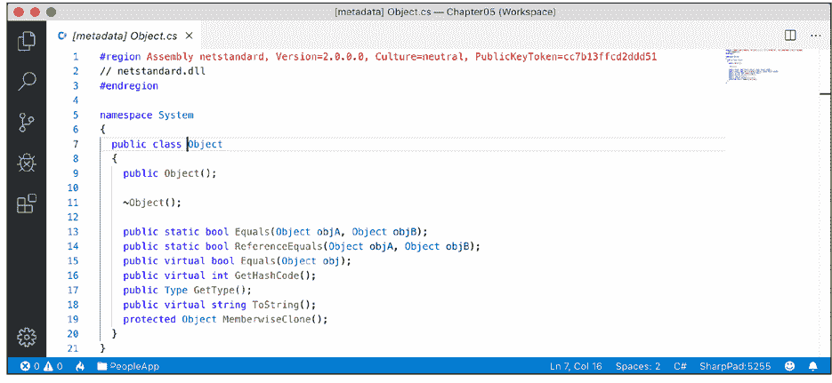

图 5.1：System.Object 类定义

> Good Practice: 假设其他程序员知道如果未指定继承，类将继承自 System.Object。

## 在字段中存储数据

在本节中，我们将在类中定义一组字段以存储有关人员的信息。

## 定义字段

假设我们决定一个人由姓名和出生日期组成。我们将把这两个值封装在一个人内部，并且这些值在外部可见。


在 Person 类内部，编写语句声明两个公共字段用于存储一个人的姓名和出生日期，如以下代码所示：

```
public class Person : object
{
    // fields
    public string Name;
    public DateTime DateOfBirth;
}
```

你可以使用任何类型作为字段，包括数组和集合，如列表和字典。如果需要在一个命名字段中存储多个值，就会使用它们。在此示例中，一个人只有一个姓名和一个出生日期。

## 理解访问修饰符

封装的一部分是选择成员的可见性。

请注意，正如我们对类所做的那样，我们明确地将 public 关键字应用于这些字段。如果没有这样做，它们将隐式地对类私有，这意味着它们只能在类内部访问。

有四个访问修饰符关键字，以及两个可以应用于类成员（如字段或方法）的访问修饰符关键字组合，如下表所示：

| 访问修饰符 | 说明 |
|---|---|
| private | 成员只能在类型内部访问。这是默认值。 |
| internal | 成员可在类型内部以及同一程序集中的任何类型中访问。 |
| protected | 成员可在类型内部以及继承自该类型的任何类型中访问。 |
| public | 成员可在任何地方访问。 |
| internal protected | 成员可在类型内部、同一程序集中的任何类型以及继承自该类型的任何类型中访问。等效于名为 internal_or_protected 的虚构访问修饰符。 |
| private protected | 成员可在类型内部以及继承自该类型且位于同一程序集中的任何类型中访问。等效于名为 internal_and_protected 的虚构访问修饰符。此组合仅在 C# 7.2 或更高版本中可用。 |

> 良好实践：显式地将其中一个访问修饰符应用于所有类型成员，即使你想使用成员的隐式访问修饰符，即 private。此外，字段通常应为 private 或 protected，然后你应创建公共属性来获取或设置字段值。这是因为它控制访问。你将在本章后面执行此操作。

## 设置和输出字段值

现在我们将在你的代码中使用这些字段：

- 1. 在 Program.cs 顶部，确保导入了 System 命名空间。我们需要这样做才能使用 DateTime 类型。
- 2. 在实例化 bob 之后，添加语句设置他的姓名和出生日期，然后以漂亮的格式输出这些字段，如以下代码所示：
- 3. 运行代码并查看结果，如以下输出所示：
- 4. 在现有代码下方添加语句以创建另一个名为 Alice 的新人员。注意在将她写入控制台时出生日期的格式代码不同，如以下代码所示：
- 5. 运行代码并查看结果，如以下输出所示：

```
bob.Name = "Bob Smith";
bob.DateOfBirth = new DateTime(1965, 12, 22); // C# 1.0 or later

WriteLine(format: "{0} was born on {1:dddd, d MMMM yyyy}",
    arg0: bob.Name,
    arg1: bob.DateOfBirth);
```

我们也可以使用字符串插值，但对于长字符串，它会在多行上换行，这在印刷书籍中可能更难阅读。在本书的代码示例中，请记住 {0} 是 arg0 的占位符，以此类推。

```
Bob Smith was born on Wednesday, 22 December 1965
```

你的输出可能因你的区域设置（即语言和文化）而有所不同。

arg1 的格式代码由几个部分组成。dddd 表示星期几的名称。d 表示月份中的日期数字。MMMM 表示月份的名称。小写 m 用于时间值中的分钟。yyyy 表示年份的完整数字。yy 表示两位数的年份。

你也可以使用花括号的简写对象初始值设定项语法来初始化字段。我们来看看如何操作。

```
Person alice = new()
{
    Name = "Alice Jones",
    DateOfBirth = new(1998, 3, 7) // C# 9.0 or later
};

WriteLine(format: "{0} was born on {1:dd MMM yy}",
    arg0: alice.Name,
    arg1: alice.DateOfBirth);
```

```
Alice Jones was born on 07 Mar 98
```

## 使用枚举类型存储值

有时，一个值需要是有限选项集中的一个。例如，世界上有七大奇迹，一个人可能有一个最喜欢的。有时，一个值需要是有限选项集的组合。例如，一个人可能有一个想去参观的古代世界奇迹清单。我们可以通过定义枚举类型来存储此数据。

枚举类型是存储一个或多个选择非常有效的方式，因为在内部，它使用整数值结合字符串描述的查找表：

- 1. 在 PacktLibrary 项目中添加一个名为 `WondersOfTheAncientWorld.cs` 的新文件。
- 2. 修改 `WondersOfTheAncientWorld.cs` 文件，如以下代码所示：
- 3. 在 Person 类中，将以下语句添加到你的字段列表中：
- 4. 在 Program.cs 中，添加以下语句：

```csharp
namespace Packt.Shared
{
    public enum WondersOfTheAncientWorld
    {
        GreatPyramidOfGiza,
        HangingGardensOfBabylon,
        StatueOfZeusAtOlympia,
        TempleOfArtemisAtEphesus,
        MausoleumAtHalicarnassus,
        ColossusOfRhodes,
        LighthouseOfAlexandria
    }
}
```

> **良好实践：** 如果你正在 .NET Interactive 笔记本中编写代码，那么包含枚举的代码单元必须位于定义 Person 类的代码单元之上。

```csharp
public WondersOfTheAncientWorld FavoriteAncientWonder;
```

```csharp
bob.FavoriteAncientWonder = WondersOfTheAncientWorld.StatueOfZeusAtOlympia;

WriteLine(
    format: "{0}'s favorite wonder is {1}. Its integer is {2}.",
    arg0: bob.Name,
    arg1: bob.FavoriteAncientWonder,
    arg2: (int)bob.FavoriteAncientWonder);
```

- 5. 运行代码并查看结果，如以下输出所示：

```
Bob Smith's favorite wonder is StatueOfZeusAtOlympia. Its integer is 2.
```

枚举值在内部以 int 存储以提高效率。int 值会自动从 0 开始分配，因此我们枚举中的第三个世界奇迹的值为 2。你可以分配枚举中未列出的 int 值。它们将作为 int 值输出而不是名称，因为找不到匹配项。

## 使用枚举类型存储多个值

对于清单，我们可以创建一个枚举实例的数组或集合，集合将在本章后面解释，但有更好的方法。我们可以使用枚举标志将多个选择组合成一个值：

- 1. 通过用 [System.Flags] 属性装饰枚举来修改它，并显式为每个奇迹设置一个表示不同位列的字节值，如以下代码中突出显示的那样：

```
namespace Packt.Shared
{
    [System.Flags]
    public enum WondersOfTheAncientWorld : byte
    {
        None = 0b_0000_0000, // i.e. 0
        GreatPyramidOfGiza = 0b_0000_0001, // i.e. 1
        HangingGardensOfBabylon = 0b_0000_0010, // i.e. 2
        StatueOfZeusAtOlympia = 0b_0000_0100, // i.e. 4
        TempleOfArtemisAtEphesus = 0b_0000_1000, // i.e. 8
        MausoleumAtHalicarnassus = 0b_0001_0000, // i.e. 16
        ColossusOfRhodes = 0b_0010_0000, // i.e. 32
        LighthouseOfAlexandria = 0b_0100_0000 // i.e. 64
    }
}
```

我们为每个选择分配显式值，以便在查看内存中存储的位时不会重叠。我们还应使用 System.Flags 属性装饰枚举类型，以便在返回该值时，它可以自动与多个值匹配为逗号分隔的字符串，而不是返回 int 值。

通常，枚举类型在内部使用 int 变量，但由于我们不需要那么大的值，我们可以通过告诉它使用字节变量，将内存需求减少 75%，即每个值 1 字节而不是 4 字节。

如果我们想表示我们的清单包括巴比伦空中花园和哈利卡纳苏斯陵墓古代世界奇迹，那么我们希望 16 和 2 位设置为 1。换句话说，我们将存储值 18：


| 64 | 32 | 16 | 8 | 4 | 2 | 1 |
|---|---|---|---|---|---|---|
| 0 | 0 | 1 | 0 | 0 | 1 | 0 |

2. 在 Person 类中，添加以下语句到你的字段列表中，如以下代码所示：

```
public WondersOfTheAncientWorld BucketList;
```

3. 在 Program.cs 中，添加语句使用 | 运算符（按位逻辑或）来组合枚举值设置桶列表。我们也可以使用数字 18 强制转换为枚举类型来设置值，如注释所示，但我们不应该这样做，因为那样会使代码更难理解，如以下代码所示：

```
bob.BucketList =
    WondersOfTheAncientWorld.HangingGardensOfBabylon
  | WondersOfTheAncientWorld.MausoleumAtHalicarnassus;

// bob.BucketList = (WondersOfTheAncientWorld)18;

WriteLine($"{bob.Name}'s bucket list is {bob.BucketList}");
```

4. 运行代码并查看结果，如以下输出所示：

```
Bob Smith's bucket list is HangingGardensOfBabylon,
MausoleumAtHalicarnassus
```


> **Good Practice:** 使用枚举值来存储离散选项的组合。如果选项最多为八个，则从 byte 派生枚举类型；如果最多为 16 个，则从 ushort 派生；如果最多为 32 个，则从 uint 派生；如果最多为 64 个，则从 ulong 派生。

## 使用集合存储多个值

现在让我们添加一个字段来存储一个人的孩子。这是一个聚合的示例，因为孩子是与当前人相关的类的实例，但不是人本身的一部分。我们将使用一个通用的 List<T> 集合类型，它可以存储任何类型的有序集合。你将在第 8 章《使用常见的 .NET 类型》中了解更多关于集合的内容。现在，只需跟随操作：

1. 在 Person.cs 中，导入 System.Collections.Generic 命名空间，如以下代码所示：

```
using System.Collections.Generic; // List<T>
```

2. 在 Person 类中声明一个新字段，如以下代码所示：

```
public List<Person> Children = new List<Person>();
```

List<Person> 读作“Person 的列表”，例如，“名为 Children 的属性的类型是 Person 实例的列表。”我们明确将类库更改为以 .NET Standard 2.0 为目标（使用 C# 7 编译器），因此我们不能使用目标类型 new 来初始化 Children 字段。如果我们将其保持为以 .NET 6.0 为目标，则可以使用目标类型 new，如以下代码所示：

```
public List<Person> Children = new();
```

我们必须确保在向其中添加项目之前将集合初始化为 Person 列表的新实例，否则该字段将为 null，并且在尝试使用其成员（如 Add）时将抛出运行时异常。

## 理解泛型集合

List<T> 类型中的尖括号是 C# 的一个特性，称为泛型，于 2005 年随 C# 2.0 引入。这是一个花哨的术语，用于使集合强类型化，即编译器知道可以存储在集合中的对象的具体类型。泛型可以提高代码的性能和正确性。

强类型与静态类型具有不同的含义。旧的 System.Collections 类型是静态类型化以包含弱类型的 System.Object 项。新的 System.Collections.Generic 类型是静态类型化以包含强类型的 <T> 实例。

具有讽刺意味的是，泛型这个术语意味着我们可以使用更具体的静态类型！

- 1. 在 Program.cs 中，添加语句为 Bob 添加两个孩子，然后显示他有多少个孩子以及他们的名字，如以下代码所示：

```
bob.Children.Add(new Person { Name = "Alfred" }); // C# 3.0 and Later
bob.Children.Add(new() { Name = "Zoe" }); // C# 9.0 and Later

WriteLine(
    $"{bob.Name} has {bob.Children.Count} children:");

for (int childIndex = 0; childIndex < bob.Children.Count; childIndex++)
{
    WriteLine($"    {bob.Children[childIndex].Name}");
}
```

我们也可以使用 foreach 语句来枚举集合。作为额外挑战，将 for 语句更改为使用 foreach 输出相同的信息。

- 2. 运行代码并查看结果，如以下输出所示：

```
Bob Smith has 2 children:
    Alfred
    Zoe
```

## 使字段为静态

到目前为止我们创建的所有字段都是实例成员，这意味着为创建的类的每个实例创建每个字段的不同值。alice 和 bob 变量具有不同的 Name 值。

有时，你希望定义一个字段，该字段只有一个值在所有实例之间共享。

这些称为静态成员，因为字段并不是唯一可以是静态的成员。让我们看看使用静态字段可以实现什么：

- 1. 在 PacktLibrary 项目中，添加一个名为 BankAccount.cs 的新类文件。
- 2. 修改类以赋予它三个字段，两个实例字段和一个静态字段，如以下代码所示：

```
namespace Packt.Shared
{
    public class BankAccount
    {
        public string AccountName; // instance member
        public decimal Balance; // instance member
        public static decimal InterestRate; // shared member
    }
}
```

BankAccount 的每个实例将拥有自己的 AccountName 和 Balance 值，但所有实例将共享单个 InterestRate 值。

- 3. 在 Program.cs 中，添加语句来设置共享利率，然后创建 BankAccount 类型的两个实例，如以下代码所示：

```
BankAccount.InterestRate = 0.012M; // store a shared value

BankAccount jonesAccount = new(); // C# 9.0 and later
jonesAccount.AccountName = "Mrs. Jones";
jonesAccount.Balance = 2400;

WriteLine(format: "{0} earned {1:C} interest.",
    arg0: jonesAccount.AccountName,
    arg1: jonesAccount.Balance * BankAccount.InterestRate);

BankAccount gerrierAccount = new();
gerrierAccount.AccountName = "Ms. Gerrier";
gerrierAccount.Balance = 98;

WriteLine(format: "{0} earned {1:C} interest.",
    arg0: gerrierAccount.AccountName,
    arg1: gerrierAccount.Balance * BankAccount.InterestRate);
```

:C 是一个格式代码，告诉 .NET 对数字使用货币格式。在第 8 章《使用常见的 .NET 类型》中，你将学习如何控制决定货币符号的区域性。对于现在，它将使用操作系统安装的默认值。我住在英国伦敦，因此我的输出显示英镑 (£)。

4. 运行代码并查看额外输出：

```
Mrs. Jones earned £28.80 interest.
Ms. Gerrier earned £1.18 interest.
```

> 字段并不是唯一可以是静态的成员。构造函数、方法、属性和其他成员也可以是静态的。

## 使字段成为常量

如果字段的值永远不会改变，你可以使用 const 关键字并在编译时分配字面值：

- 1. 在 Person.cs 中，添加以下代码：
- 2. 要获取常量字段的值，你必须写类的名称，而不是类的实例的名称。在 Program.cs 中，添加一条语句将 Bob 的姓名和物种写入控制台，如以下代码所示：
- 3. 运行代码并查看结果，如以下输出所示：

```
// constants
public const string Species = "Homo Sapien";
```

```
WriteLine($"{bob.Name} is a {Person.Species}");
```

```
Bob Smith is a Homo Sapien
```

Microsoft 类型中 const 字段的示例包括 System.Int32.MaxValue 和 System.Math.PI，因为这两个值永远不会改变，如图 5.2 所示：

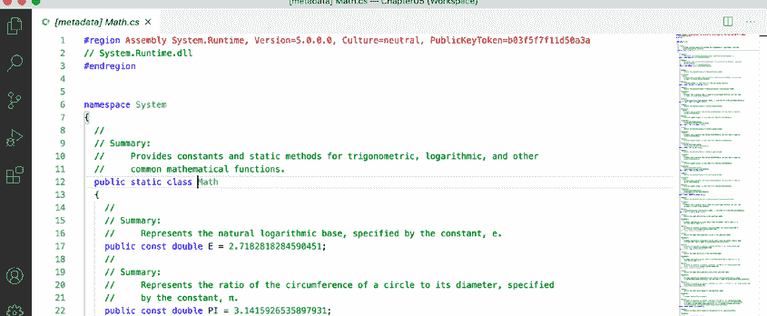

图 5.2：常量示例


> Good Practice: 常量并不总是最佳选择，原因有两个重要原因：值必须在编译时已知，并且必须能够表示为字面字符串、布尔值或数值。const 字段的每个引用在编译时都会被字面值替换，因此，如果值在将来版本中发生变化，并且你没有重新编译引用它的任何程序集以获取新值，则不会反映该变化。

## 使字段只读

通常，更好的选择是为不应更改的字段标记为只读：

- 1. 在 Person.cs 中，添加一条语句来声明一个实例只读字段以存储个人的家乡星球，如以下代码所示：
- 2. 在 Program.cs 中，添加一条语句将 Bob 的姓名和家乡星球写入控制台，如以下代码所示：
- 3. 运行代码并查看结果，如以下输出所示：

```
// read-only fields
public readonly string HomePlanet = "Earth";
```

```
WriteLine($"{bob.Name} was born on {bob.HomePlanet}");
```

Bob Smith was born on Earth


> **良好实践：** 相对于常量字段，使用只读字段有两个重要原因：值可以在运行时计算或加载，并且可以使用任何可执行语句表达。因此，只读字段可以通过构造函数或字段赋值来设置。对该字段的每次引用都是实时引用，因此任何未来更改都将由调用代码正确反映。


你还可以声明 static readonly 字段，其值将在该类型的所有实例之间共享。

## 使用构造函数初始化字段

字段通常需要在运行时进行初始化。你在构造函数中执行此操作，该构造函数将在使用 new 关键字创建类的实例时被调用。构造函数在使用者代码设置任何字段之前执行。

- 1. 在 Person.cs 中，在现有的只读 HomePlanet 字段之后添加语句，以定义第二个只读字段，然后在构造函数中设置 Name 和 Instantiated 字段，如以下代码中突出显示所示：
- 2. 在 Program.cs 中，添加语句以实例化一个新的人，然后输出其初始字段值，如以下代码所示：
- 3. 运行代码并查看结果，如以下输出所示：

// read-only fields
public readonly string HomePlanet = "Earth";
public readonly DateTime Instantiated;

// constructors
public Person()
{
    // set default values for fields
    // including read-only fields
    Name = "Unknown";
    Instantiated = DateTime.Now;
}
```
Person blankPerson = new();

WriteLine(format:
    "{0} of {1} was created at {2:hh:mm:ss} on a {2:dddd}.",
    arg0: blankPerson.Name,
    arg1: blankPerson.HomePlanet,
    arg2: blankPerson.Instantiated);
```
```
Unknown of Earth was created at 11:58:12 on a Sunday
```

## 定义多个构造函数

你可以在一个类型中拥有多个构造函数。这对于鼓励开发人员为字段设置初始值特别有用：

- 1. 在 Person.cs 中，添加语句以定义第二个构造函数，允许开发人员为个人的姓名和家乡星球设置初始值，如以下代码所示：
- 2. 在 Program.cs 中，添加语句以使用带两个参数的构造函数创建另一个人，如以下代码所示：
- 3. 运行代码并查看结果：
```
public Person(string initialName, string homePlanet)
{
    Name = initialName;
    HomePlanet = homePlanet;
    Instantiated = DateTime.Now;
}
```
```
Person gunny = new(initialName: "Gunny", homePlanet: "Mars");

WriteLine(format:
    "{0} of {1} was created at {2:hh:mm:ss} on a {2:dddd}.",
    arg0: gunny.Name,
    arg1: gunny.HomePlanet,
    arg2: gunny.Instantiated);
```

Gunny 来自火星，于星期日 11:59:25 创建

构造函数是一种特殊类别的方法。让我们更详细地了解方法。

## 编写和调用方法

方法是执行语句块的类型成员。它们属于类型的函数。

## 从方法返回值

方法可以返回单个值或不返回任何值：

- 执行某些操作但不返回值的方法使用方法名称前的 void 类型来表示这一点。
- 执行某些操作并返回值的方法使用方法名称前的返回值类型来表示这一点。

例如，在下一个任务中，你将创建两个方法：

- WriteToConsole：这将执行一个操作（向控制台写入一些文本），但不会从方法返回任何内容，由 void 关键字表示。
- GetOrigin：这将返回一个文本值，由 string 关键字表示。

让我们编写代码：

- 1. 在 Person.cs 中，添加语句以定义我之前描述的两个方法，如以下代码所示：
// methods
public void WriteToConsole()
{
    WriteLine($"{Name} was born on a {DateOfBirth:dddd}.");
}

public string GetOrigin()
{
    return $"{Name} was born on {HomePlanet}.";
}
```
- 2. 在 Program.cs 中，添加语句以调用这两个方法，如以下代码所示：
```
bob.WriteToConsole();
WriteLine(bob.GetOrigin());
```
- 3. 运行代码并查看结果，如以下输出所示：
```
Bob Smith was born on a Wednesday.
Bob Smith was born on Earth.
```

## 使用元组组合多个返回值

每个方法只能返回具有单个类型的单个值。该类型可以是简单类型，例如前一个示例中的 string，也可以是复杂类型，例如 Person，或集合类型，例如 List<Person>。

假设我们想要定义一个名为 GetTheData 的方法，该方法需要同时返回一个 string 值和一个 int 值。我们可以定义一个名为 TextAndNumber 的新类，其中包含一个 string 字段和一个 int 字段，并返回该复杂类型的实例，如以下代码所示：
```
public class TextAndNumber
{
    public string Text;
    public int Number;
}
```
```
public class LifeTheUniverseAndEverything
{
    public TextAndNumber GetTheData()
    {
        return new TextAndNumber
        {
            Text = "What's the meaning of life?",
            Number = 42
        };
    }
}
```

但仅仅为了组合两个值而定义一个类是不必要的，因为在现代版本的 C# 中，我们可以使用元组。元组是将两个或多个值高效组合成单个单元的一种方式。我读作 tuh-ples，但我听说其他开发人员读作 too-ples。To-may-toe，to-mah-toe，po-tay-toe，po-tah-toe，我想。

元组自第一版以来就是某些语言（如 F#）的一部分，但 .NET 直到 2010 年随 .NET 4.0 使用 System.Tuple 类型才添加了对它们的支持。

## 元组的语言支持

直到 2017 年的 C# 7.0，C# 才使用括号字符 () 添加了元组的语言语法支持，同时，.NET 添加了一个新的 System.ValueTuple 类型，在某些常见场景下比旧的 .NET 4.0 System.Tuple 类型更高效。C# 元组语法使用的是更高效的那一个。

让我们探索元组：

- 1. 在 Person.cs 中，添加语句以定义一个返回组合 string 和 int 的元组的方法，如以下代码所示：
- 2. 在 Program.cs 中，添加语句以调用 GetFruit 方法，然后输出自动命名为 Item1 和 Item2 的元组字段，如以下代码所示：
- 3. 运行代码并查看结果，如以下输出所示：
```
public (string, int) GetFruit()
{
    return ("Apples", 5);
}
```
```
(string, int) fruit = bob.GetFruit();

WriteLine($"{fruit.Item1}, {fruit.Item2} there are.");
```
```
Apples, 5 there are.
```

## 为元组字段命名

要访问元组的字段，默认名称为 Item1、Item2，依此类推。

你可以显式指定字段名称：

- 1. 在 Person.cs 中，添加语句以定义一个返回具有命名字段的元组的方法，如以下代码所示：
- 2. 在 Program.cs 中，添加语句以调用该方法并输出元组的命名字段，如以下代码所示：
- 3. 运行代码并查看结果，如以下输出所示：
```
public (string Name, int Number) GetNamedFruit()
{
    return (Name: "Apples", Number: 5);
}
```
```
var fruitNamed = bob.GetNamedFruit();

WriteLine($"There are {fruitNamed.Number} {fruitNamed.Name}.");
```
```
There are 5 Apples.
```

## 推断元组名称

如果你是从另一个对象构造元组，可以使用 C# 7.1 中引入的名为元组名称推断的功能。

在 Program.cs 中，创建两个元组，每个元组由一个 string 和 int 值组成，如以下代码所示：
```
var thing1 = ("Neville", 4);
WriteLine($"{thing1.Item1} has {thing1.Item2} children.");

var thing2 = (bob.Name, bob.Children.Count);
WriteLine($"{thing2.Name} has {thing2.Count} children.");
```

在 C# 7.0 中，两个事物都将使用 Item1 和 Item2 命名方案。在 C# 7.1 及更高版本中，thing2 可以推断出名称 Name 和 Count。

## 解构元组

你还可以将元组解构为单独的变量。解构声明的语法与命名字段元组相同，但没有为元组命名变量，如以下代码所示：

// store return value in a tuple variable with two fields
(string TheName, int TheNumber) tupleWithNamedFields = bob.GetNamedFruit();
// tupleWithNamedFields.TheName
// tupleWithNamedFields.TheNumber

// deconstruct return value into two separate variables
(string name, int number) = GetNamedFruit();
// name
// number

这会将元组拆分为其各个部分并将这些部分分配给新的变量。

- 1. 在 Program.cs 中，添加语句以解构 GetFruit 方法返回的元组，如以下代码所示：
```csharp
(string fruitName, int fruitNumber) = bob.GetFruit();

WriteLine($"Deconstructed: {fruitName}, {fruitNumber}");
```
- 2. 运行代码并查看结果，如以下输出所示：
```
Deconstructed: Apples, 5
```

## 解构类型

元组并不是唯一可以解构的类型。任何类型都可以拥有名为 Deconstruct 的特殊方法来将对象分解为各个部分。让我们为 Person 类实现一些：

- 1. 在 Person.cs 中，添加两个 Deconstruct 方法，使用 out 参数定义我们想要解构成的各个部分，如以下代码所示：
```csharp
// deconstructors
public void Deconstruct(out string name, out DateTime dob)
{
    name = Name;
    dob = DateOfBirth;
}

public void Deconstruct(out string name,
    out DateTime dob, out WondersOfTheAncientWorld fav)
{
    name = Name;
    dob = DateOfBirth;
    fav = FavoriteAncientWonder;
}
```

- 2. 在 Program.cs 中，添加语句以解构 bob，如以下代码所示：
```csharp
// Deconstructing a Person

var (name1, dob1) = bob;
WriteLine($"Deconstructed: {name1}, {dob1}");

var (name2, dob2, fav2) = bob;
WriteLine($"Deconstructed: {name2}, {dob2}, {fav2}");
```

- 3. 运行代码并查看结果，如以下输出所示：
```
Deconstructed: Bob Smith, 22/12/1965 00:00:00
Deconstructed: Bob Smith, 22/12/1965 00:00:00, StatueOfZeusAtOlympia B
```

## 定义和向方法传递参数

方法可以接收参数来改变其行为。参数的定义有点像变量声明，但位于方法的括号内，就像本章前面构造函数中看到的那样。让我们看更多示例：

- 1. 在 Person.cs 中，添加语句以定义两个方法，第一个没有参数，第二个有一个参数，如以下代码所示：
```csharp
public string SayHello()
{
    return $"{Name} says 'Hello!'";
}

public string SayHelloTo(string name)
{
    return $"{Name} says 'Hello {name}!'";
}
```
- 2. 在 Program.cs 中，添加语句以调用这两个方法并将返回值写入控制台，如以下代码所示：
```csharp
WriteLine(bob.SayHello());
WriteLine(bob.SayHelloTo("Emily"));
```
- 3. 运行代码并查看结果：
```
Bob Smith says 'Hello!'
Bob Smith says 'Hello Emily!'
```

当键入调用方法的语句时，IntelliSense 会显示一个工具提示，其中包含任何参数的名称和类型，以及方法的返回类型，如图 5.3 所示：

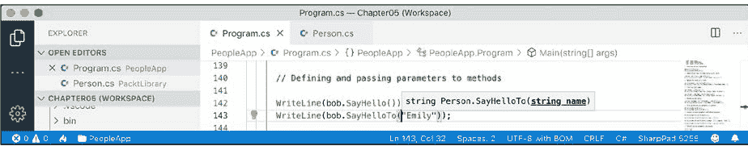

Figure 5.3: 无重载的方法的 IntelliSense 工具提示

## 重载方法

而不是使用两个不同的方法名，我们可以给两个方法相同的名字。这是可以的，因为每个方法都有不同的签名。

方法签名是可以传递给方法调用的参数类型的列表。重载方法不能仅在返回类型上有所不同。

- 1. 在 Person.cs 中，将 SayHelloTo 方法的名称更改为 SayHello。
- 2. 在 Program.cs 中，将方法调用更改为使用 SayHello 方法，并注意该方法的快速信息告诉你它有一个额外的重载，1/2，以及 2/2，如图 5.4 所示：

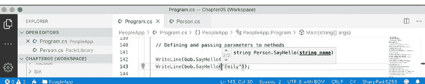

Figure 5.4: 重载方法的 IntelliSense 工具提示

> 良好实践：使用重载方法来简化你的类，使其看起来拥有更少的方法。

## 传递可选和命名参数

简化方法的另一种方法是使参数可选。你可以通过在方法参数列表中为其分配默认值来使参数可选。可选参数必须始终位于参数列表的最后。

我们现在将创建一个具有三个可选参数的方法：

- 1. 在 Person.cs 中，添加语句以定义该方法，如以下代码所示：
```csharp
public string OptionalParameters(
    string command = "Run!",
    double number = 0.0,
    bool active = true)
{
    return string.Format(
        format: "command is {0}, number is {1}, active is {2}",
        arg0: command,
        arg1: number,
        arg2: active);
}
```
- 2. 在 Program.cs 中，添加语句以调用该方法并将返回值写入控制台，如以下代码所示：
```csharp
WriteLine(bob.OptionalParameters());
```
- 3. 在键入代码时观察 IntelliSense 的出现。你将看到一个工具提示，显示三个可选参数及其默认值，如图 5.5 所示：
- 4. 运行代码并查看结果，如以下输出所示：
```
command is Run!, number is 0, active is True
```
- 5. 在 Program.cs 中，添加语句以传递 command 参数的字符串值和 number 参数的 double 值，如以下代码所示：
```csharp
WriteLine(bob.OptionalParameters("Jump!", 98.5));
```
- 6. 运行代码并查看结果，如以下输出所示：
```
command is Jump!, number is 98.5, active is True
```

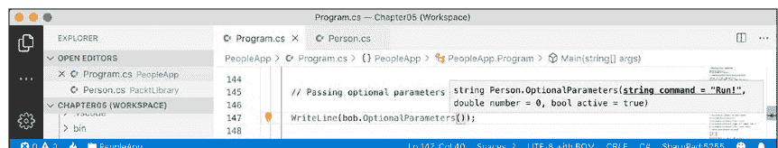

command 和 number 参数的默认值已被替换，但 active 的默认值仍为 true。

## 调用方法时命名参数值

可选参数通常与命名参数结合使用来调用方法，因为命名参数允许以与声明顺序不同的顺序传递值。

- 1. 在 Program.cs 中，添加语句以传递 command 参数的字符串值和 number 参数的 double 值，但使用命名参数，以便可以交换传递的顺序，如以下代码所示：
- 2. 运行代码并查看结果，如以下输出所示：
- 3. 在 Program.cs 中，添加语句以使用位置顺序传递 command 参数的字符串值，跳过 number 参数，并使用命名 active 参数，如以下代码所示：
- 4. 运行代码并查看结果，如以下输出所示：

```
WriteLine(bob.OptionalParameters(
    number: 52.7, command: "Hide!"));
```

```
command is Hide!, number is 52.7, active is True
```

你甚至可以使用命名参数跳过可选参数。

```
WriteLine(bob.OptionalParameters("Poke!", active: false));
```

```
command is Poke!, number is 0, active is False
```

## 控制参数的传递方式

当参数传递给方法时，可以以三种方式之一传递：

- 按 **值**（这是默认值）：可将其视为 *仅输入*。
- 按 **引用** 作为 ref 参数：可将其视为 *输入输出*。
- 作为 out 参数：可将其视为 *仅输出*。

让我们看一些传递参数进出的方法示例：

- 1. 在 Person.cs 中，添加语句以定义一个具有三个参数的方法，一个输入参数，一个 ref 参数和一个 out 参数，如以下方法所示：
```csharp
public void PassingParameters(int x, ref int y, out int z)
{
    // out parameters cannot have a default
    // AND must be initialized inside the method
    z = 99;
    // increment each parameter
    x++;
    y++;
    z++;
}
```

- 2. 在 Program.cs 中，添加语句以声明一些 int 变量并将它们传递给方法，如以下代码所示：
```csharp
int a = 10;
int b = 20;
int c = 30;

WriteLine($"Before: a = {a}, b = {b}, c = {c}");
bob.PassingParameters(a, ref b, out c);
WriteLine($"After: a = {a}, b = {b}, c = {c}");
```

- 3. 运行代码并查看结果，如以下输出所示：
```
Before: a = 10, b = 20, c = 30
After: a = 10, b = 21, c = 100
```

- 按默认值将变量作为参数传递时，传递的是其当前值，而不是变量本身。因此，x 拥有 a 变量值的副本。a 变量保留其原始值 10。
- 将变量作为 ref 参数传递时，变量的引用被传递给方法。因此，y 是对 b 的引用。当 y 参数递增时，b 变量也会递增。
- 将变量作为 out 参数传递时，变量的引用被传递给方法。因此，z 是对 c 的引用。c 变量的值会被方法内部执行的代码替换。我们可以通过不在 Main 方法中为 c 变量分配值 30 来简化代码，因为它无论如何都会被替换。

## 简化的 out 参数

在 C# 7.0 及更高版本中，我们可以简化使用 out 变量的代码。

在 Program.cs 中，添加语句以声明更多变量，包括内联声明的名为 f 的 out 参数，如以下代码所示：
```csharp
int d = 10;
int e = 20;

WriteLine($"Before: d = {d}, e = {e}, f doesn't exist yet!");
```

// simplified C# 7.0 or Later syntax for the out parameter
bob.PassingParameters(d, ref e, out int f);
WriteLine($"After: d = {d}, e = {e}, f = {f}");

## 理解 ref 返回

在 C# 7.0 或更高版本中，ref 关键字不仅仅用于将参数传递给方法；它还可以应用于返回值。这允许外部变量引用内部变量并在方法调用后修改其值。这在高级场景中可能很有用，例如将占位符传递到大型数据结构中，但这超出了本书的范围。

## 使用 partial 分割类

在大型项目中与多个团队成员协作，或处理特别庞大和复杂的类实现时，能够将类的定义拆分到多个文件中非常有用。你可以使用 partial 关键字来实现这一点。

假设我们想要向 Person 类添加由像对象关系映射器这样的工具自动生成的语句，该工具从数据库读取模式信息。如果类被定义为 partial，那么我们可以将类拆分为自动生成的代码文件和手动编辑的代码文件。

让我们编写一些代码来模拟此示例：

- 1. 在 Person.cs 中，添加 partial 关键字，如以下代码中突出显示的那样：
- 2. 在 PacktLibrary 项目/文件夹中，添加一个名为 PersonAutoGen.cs 的新类文件。
- 3. 向新文件添加语句，如以下代码所示：

```
namespace Packt.Shared
{
    public partial class Person
    {
```

```
namespace Packt.Shared
{
    public partial class Person
    {
    }
}
```

本章我们编写的其余代码将写入 PersonAutoGen.cs 文件中。

## 使用属性和索引器控制访问

之前，你创建了一个名为 GetOrigin 的方法，它返回一个包含人员姓名和来源的字符串。Java 等语言经常这样做。C# 有更好的方法：属性。

属性只是一个（或一对）方法，当你想要获取或设置值时，它的行为和外观就像一个字段，从而简化了语法。

### 定义只读属性

只读属性只有 get 实现。

- 1. 在 PersonAutoGen.cs 中，在 Person 类中，添加语句以定义三个属性：
  - 1. 第一个属性将使用适用于所有 C# 版本的属性语法执行与 GetOrigin 方法相同的角色（尽管它使用了 C# 6 及更高版本中的字符串插值语法）。
  - 2. 第二个属性将使用 C# 6 及更高版本中的 lambda 表达式主体 => 语法返回问候消息。
  - 3. 第三个属性将计算人员的年龄。

这是代码：

```csharp
// a property defined using C# 1 - 5 syntax
public string Origin
{
    get
    {
        return $"{Name} was born on {HomePlanet}";
    }
}

// two properties defined using C# 6+ lambda expression body syntax
public string Greeting => $"{Name} says 'Hello!'";

public int Age => System.DateTime.Today.Year - DateOfBirth.Year;
```

> **良好实践：** 这不是计算某人年龄的最佳方法，但我们没有学习如何从出生日期计算年龄。如果你需要正确地执行此操作，请阅读以下链接中的讨论：https://stackoverflow.com/questions/9/how-do-i-calculate-someones-age-in-c

- 2. 在 Program.cs 中，添加语句以获取属性，如以下代码所示：

```
Person sam = new()
{
    Name = "Sam",
    DateOfBirth = new(1972, 1, 27)
};

WriteLine(sam.Origin);
WriteLine(sam.Greeting);
WriteLine(sam.Age);
```

- 3. 运行代码并查看结果，如以下输出所示：

```
Sam was born on Earth
Sam says 'Hello!'
49
```

输出显示 49，因为我在 2021 年 8 月 15 日运行控制台应用程序时，Sam 49 岁。

### 定义可设置属性

要创建可设置属性，你必须使用旧语法并提供一对方法——不仅仅是 get 部分，还要有 set 部分：

- 1. 在 PersonAutoGen.cs 中，添加语句以定义一个同时具有 get 和 set 方法（也称为 getter 和 setter）的字符串属性，如以下代码所示：

```
public string FavoriteIceCream { get; set; } // auto-syntax
```

尽管你没有手动创建字段来存储人员的喜爱的冰淇淋，但它确实存在，是编译器为你自动创建的。

有时，你需要更多地控制属性被设置时发生的情况。在这种情况下，你必须使用更详细的语法并手动创建一个私有字段来存储属性的值。

- 2. 在 PersonAutoGen.cs 中，添加语句以定义一个字符串字段和一个同时具有 get 和 set 的字符串属性，如以下代码所示：

```
private string favoritePrimaryColor;

public string FavoritePrimaryColor
{
    get
    {
        return favoritePrimaryColor;
    }
}
```

```
set
{
    switch (value.ToLower())
    {
        case "red":
        case "green":
        case "blue":
            favoritePrimaryColor = value;
            break;
        default:
            throw new System.ArgumentException(
                $"{value} is not a primary color. " +
                "Choose from: red, green, blue.");
    }
}
```

> **良好实践：** 避免在 getter 和 setter 中添加太多代码。这可能表明你的设计存在问题。考虑添加私有方法，然后在 setter 和 getter 中调用它们以简化实现。

- 3. 在 Program.cs 中，添加语句以设置 Sam 的最爱冰淇淋和颜色，然后将其写出，如以下代码所示：

```
sam.FavoriteIceCream = "Chocolate Fudge";

WriteLine($"Sam's favorite ice-cream flavor is {sam.FavoriteIceCream}.");

sam.FavoritePrimaryColor = "Red";

WriteLine($"Sam's favorite primary color is {sam.FavoritePrimaryColor}.");
```

- 4. 运行代码并查看结果，如以下输出所示：

```
Sam's favorite ice-cream flavor is Chocolate Fudge.
Sam's favorite primary color is Red.
```

如果你尝试将颜色设置为红色、绿色或蓝色以外的任何值，则代码将抛出异常。然后调用代码可以使用 try 语句来显示错误消息。

> **良好实践：** 当你想要验证可以存储的值时使用属性而不是字段，当你想要在 XAML 中进行数据绑定时，我们将在 *第19章，使用 .NET MAUI 构建移动和桌面应用程序* 中介绍，以及当你想要在不使用像 GetAge 和 SetAge 这样的方法对的情况下读取和写入字段时。

## 要求在实例化期间设置属性

C# 10 引入了 required 修饰符。如果你将其用于属性，编译器将确保你在实例化时将属性设置为值，如以下代码所示：

```
public class Book
{
    public required string Isbn { get; set; }
    public string Title { get; set; }
}
```

如果你尝试在不设置 Isbn 属性的情况下实例化 Book，你将看到编译器错误，如以下代码所示：

```
Book novel = new();
```

> required 关键字可能不会进入 .NET 6 的最终发布版本，因此请将本节视为理论性的。

## 定义索引器

索引器允许调用代码使用数组语法访问属性。例如，string 类型定义了索引器，以便调用代码可以访问字符串中的单个字符。

我们将定义一个索引器以简化对人员子女的访问：

- 1. 在 PersonAutoGen.cs 中，添加语句以定义一个索引器，使用子项的索引来获取和设置子项，如以下代码所示：

```
// indexers
public Person this[int index]
{
    get
    {
        return Children[index]; // pass on to the List<T> indexer
    }
    set
    {
        Children[index] = value;
    }
}
```

你可以重载索引器，以便为其参数使用不同的类型。例如，除了传递 int 值之外，你还可以传递 string 值。


2. 在 Program.cs 中，添加语句为 Sam 添加两个子项，然后使用较长的 Children 字段和较短的索引器语法访问第一个和第二个子项，如以下代码所示：

```
sam.Children.Add(new() { Name = "Charlie" });
sam.Children.Add(new() { Name = "Ella" });

WriteLine($"Sam's first child is {sam.Children[0].Name}");
WriteLine($"Sam's second child is {sam.Children[1].Name}");

WriteLine($"Sam's first child is {sam[0].Name}");
WriteLine($"Sam's second child is {sam[1].Name}");
```

3. 运行代码并查看结果，如以下输出所示：

```
Sam's first child is Charlie
Sam's second child is Ella
Sam's first child is Charlie
Sam's second child is Ella
```

## 使用对象的模式匹配

在第 3 章《控制流、转换类型和处理异常》中，您已了解基本的模式匹配。在本节中，我们将更详细地探讨模式匹配。

## 创建和引用 .NET 6 类库

增强的模式匹配功能仅在支持 C# 9 或更高版本的现代 .NET 类库中可用。

- 1. 使用您偏好的编码工具，在名为 Chapter05 的工作区/解决方案中添加一个名为 PacktLibraryModern 的新类库。
- 2. 在 PeopleApp 项目中，添加对 PacktLibraryModern 类库的引用，如以下标记中突出显示所示：

```
<Project Sdk="Microsoft.NET.Sdk">

  <PropertyGroup>
    <OutputType>Exe</OutputType>
    <TargetFramework>net6.0</TargetFramework>
    <Nullable>enable</Nullable>
    <ImplicitUsings>enable</ImplicitUsings>
  </PropertyGroup>

  <ItemGroup>
    <ProjectReference Include="../PacktLibrary/PacktLibrary.csproj" />
  </ItemGroup>
</Project>
```

```
<ProjectReference
    Include="../PacktLibraryModern/PacktLibraryModern.csproj" />
</ItemGroup>
</Project>
```

3. 构建 PeopleApp 项目。

## 定义航班乘客

在本示例中，我们将定义一些表示航班上各种类型乘客的类，然后使用带模式匹配的 switch 表达式来确定他们的航班费用。

- 1. 在 PacktLibraryModern 项目/文件夹中，将文件 Class1.cs 重命名为 FlightPatterns.cs。
- 2. 在 FlightPatterns.cs 中，添加语句定义三种具有不同属性的乘客类型，如以下代码所示：

```
namespace Packt.Shared; // C# 10 file-scoped namespace

public class BusinessClassPassenger
{
    public override string ToString()
    {
        return $"Business Class";
    }
}

public class FirstClassPassenger
{
    public int AirMiles { get; set; }

    public override string ToString()
    {
        return $"First Class with {AirMiles:N0} air miles";
    }
}

public class CoachClassPassenger
{
    public double CarryOnKG { get; set; }

    public override string ToString()
    {
        return $"Coach Class with {CarryOnKG:N2} KG carry on";
    }
}
```

3. 在 Program.cs 中，添加语句定义一个包含五名不同类型和属性值的乘客的对象数组，然后枚举它们，输出其航班费用，如以下代码所示：

```
object[] passengers = {
    new FirstClassPassenger { AirMiles = 1_419 },
    new FirstClassPassenger { AirMiles = 16_562 },
    new BusinessClassPassenger(),
    new CoachClassPassenger { CarryOnKG = 25.7 },
    new CoachClassPassenger { CarryOnKG = 0 },
};

foreach (object passenger in passengers)
{
    decimal flightCost = passenger switch
    {
        FirstClassPassenger p when p.AirMiles > 35000 => 1500M,
        FirstClassPassenger p when p.AirMiles > 15000 => 1750M,
        FirstClassPassenger _ => 2000M,
        BusinessClassPassenger _ => 1000M,
        CoachClassPassenger p when p.CarryOnKG < 10.0 => 500M,
        CoachClassPassenger _ => 650M,
        _ => 800M
    };

    WriteLine($"Flight costs {flightCost:C} for {passenger}");
}
```

在审阅前述代码时，请注意以下几点：

- 要对对象的属性进行模式匹配，您必须命名一个局部变量，然后可以在像 p 这样的表达式中使用它。
- 仅对类型进行模式匹配时，可以使用 _ 来丢弃局部变量。
- switch 表达式也使用 _ 来表示其默认分支。

4. 运行代码并查看结果，如以下输出所示：

```
Flight costs £2,000.00 for First Class with 1,419 air miles
Flight costs £1,750.00 for First Class with 16,562 air miles
Flight costs £1,000.00 for Business Class
Flight costs £650.00 for Coach Class with 25.70 KG carry on
Flight costs £500.00 for Coach Class with 0.00 KG carry on
```

## C# 9 或更高版本中模式匹配的增强

之前的示例适用于 C# 8。现在我们将查看 C# 9 及更高版本中的一些增强功能。首先，在进行类型匹配时，您不再需要使用下划线来丢弃：

1. 在 Program.cs 中，注释掉 C# 8 语法并添加 C# 9 及更高版本的语法，以修改头等舱乘客的分支，使用嵌套 switch 表达式和对 > 等条件的新支持，如以下代码所示：

```
decimal flightCost = passenger switch
{
    /* C# 8 syntax
    FirstClassPassenger p when p.AirMiles > 35000 => 1500M,
    FirstClassPassenger p when p.AirMiles > 15000 => 1750M,
    FirstClassPassenger                         => 2000M, */

    // C# 9 or Later syntax
    FirstClassPassenger p => p.AirMiles switch
    {
        > 35000 => 1500M,
        > 15000 => 1750M,
                => 2000M
    },

    BusinessClassPassenger                     => 1000M,
    CoachClassPassenger p when p.CarryOnKG < 10.0 => 500M,
    CoachClassPassenger                        => 650M,
                                             => 800M
};
```

2. 运行代码查看结果，注意它们与之前相同。

您也可以将关系模式与属性模式结合使用，以避免嵌套 switch 表达式，如以下代码所示：

```
FirstClassPassenger { AirMiles: > 35000 } => 1500,
FirstClassPassenger { AirMiles: > 15000 } => 1750M,
FirstClassPassenger => 2000M,
```

## 使用记录

在深入了解 C# 9 及更高版本的新 records 语言功能之前，让我们先看看一些相关的其他新功能。

### 仅初始化属性

在本章中，您一直使用对象初始化语法来实例化对象并设置初始属性。实例化后这些属性也可以被更改。

有时您希望将属性视为只读字段，以便在实例化期间设置，但在之后不能更改。新的 init 关键字使此操作成为可能。它可以替代 set 关键字使用：

- 1. 在 PacktLibraryModern 项目/文件夹中，添加一个名为 Records.cs 的新文件。
- 2. 在 Records.cs 中，定义一个不可变的人员类，如以下代码所示：
- 3. 在 Program.cs 中，添加语句实例化一个新的不可变人员，然后尝试更改其一个属性，如以下代码所示：
- 4. 编译控制台应用程序并注意编译错误，如以下输出所示：
- 5. 注释掉实例化后设置 FirstName 属性的尝试。

```csharp
namespace Packt.Shared; // C# 10 file-scoped namespace

public class ImmutablePerson
{
    public string? FirstName { get; init; }
    public string? LastName { get; init; }
}
```

```csharp
ImmutablePerson jeff = new()
{
    FirstName = "Jeff",
    LastName = "Winger"
};

jeff.FirstName = "Geoff";
```

```
Program.cs(254,7): error CS8852: Init-only property or indexer 'ImmutablePerson.FirstName' can only be assigned in an object initializer, or on 'this' or 'base' in an instance constructor or an 'init' accessor.
[/Users/markjprice/Code/Chapter05/PeopleApp/PeopleApp.csproj]
```

### 理解记录

仅初始化属性为 C# 提供了一些不可变性。您可以通过使用记录进一步扩展这一概念。记录是通过使用 record 关键字而不是 class 关键字来定义的。这可以使整个对象不可变，并且在比较时表现得像值。我们将在第 6 章《实现接口和继承类》中更详细地讨论类、记录和值类型的相等性和比较。

记录不应具有在实例化后发生变化的任何状态（属性和字段）。相反，其思想是您从现有记录创建具有任何更改状态的新记录。这称为非破坏性突变。为此，C# 9 引入了 with 关键字：

1. 在 Records.cs 中，添加一个名为 ImmutableVehicle 的记录，如以下代码所示：

```
public record ImmutableVehicle
{
    public int Wheels { get; init; }
    public string? Color { get; init; }
    public string? Brand { get; init; }
}
```

2. 在 Program.cs 中，添加语句以创建一个汽车，然后创建其突变副本，如以下代码所示：

```
ImmutableVehicle car = new()
{
    Brand = "Mazda MX-5 RF",
    Color = "Soul Red Crystal Metallic",
    Wheels = 4
};

ImmutableVehicle repaintedCar = car
    with { Color = "Polymetal Grey Metallic" };

WriteLine($"Original car color was {car.Color}.");
WriteLine($"New car color is {repaintedCar.Color}.");
```

3. 运行代码查看结果，并注意突变副本中汽车颜色的变化，如以下输出所示：

```
Original car color was Soul Red Crystal Metallic.
New car color is Polymetal Grey Metallic.
```

## 记录中的位置数据成员

定义记录的语法可以使用位置数据成员大幅简化。

## 简化记录中的数据成员

而不是使用带大括号的对象初始化语法，有时你可能更喜欢提供一个带位置参数的构造函数，就像本章前面看到的那样。你也可以将它与解构器结合起来，以便将对象拆分为各个部分，如以下代码所示：

```
public record ImmutableAnimal
{
    public string Name { get; init; }
    public string Species { get; init; }
}
```

```
public ImmutableAnimal(string name, string species)
{
    Name = name;
    Species = species;
}

public void Deconstruct(out string name, out string species)
{
    name = Name;
    species = Species;
}
```

属性、构造函数和解构器可以为你生成：

- 1. 在 Records.cs 中，添加语句以使用称为位置记录的简化语法定义另一个记录，如以下代码所示：
- 2. 在 Program.cs 中，添加语句以构造和解构不可变动物，如以下代码所示：
- 3. 运行应用程序并查看结果，如以下输出所示：

// simpler way to define a record
// auto-generates the properties, constructor, and deconstructor
public record ImmutableAnimal(string Name, string Species);
```

```
ImmutableAnimal oscar = new("Oscar", "Labrador");
var (who, what) = oscar; // calls Deconstruct method
WriteLine($"{who} is a {what}.");
```

```
Oscar is a Labrador.
```


当我们查看第 6 章《实现接口和继承类》中关于 C# 10 对创建结构体记录的支持时，你将再次看到记录。

## 练习与探索

通过回答一些问题来测试你的知识和理解，进行一些实践操作，并通过更深入的研究探索本章主题。

## 练习 5.1 – 测试你的知识

回答以下问题：

- 1. 六种访问修饰符关键字的组合是什么，它们的作用是什么？
- 2. 将 static、const 和 readonly 关键字应用于类型成员时有什么区别？
- 3. 构造函数做什么？
- 4. 当你想存储组合值时，为什么应该将 [Flags] 属性应用于枚举类型？
- 5. partial 关键字有什么用处？
- 6. 元组是什么？
- 7. record 关键字做什么？
- 8. 重载是什么意思？
- 9. 字段和属性有什么区别？
- 10. 如何使方法参数可选？

## 练习 5.2 – 探索主题

使用以下页面上的链接了解本章涵盖主题的更多详细信息：

```
https://github.com/markjprice/cs10dotnet6/blob/main/book-links.md#chapter-5---building-your-own-types-with-object-oriented-programming
```

## 摘要

在本章中，你学习了如何使用 OOP 创建自己的类型。你了解了类型可以拥有的不同类别的成员，包括用于存储数据的字段和用于执行操作的方法，并且你使用了 OOP 概念，例如聚合和封装。你看到了如何使用现代 C# 功能的示例，如关系和属性模式匹配增强、仅初始化属性和记录。

在下一章中，你将通过定义委托和事件、实现接口以及从现有类继承来进一步扩展这些概念。
