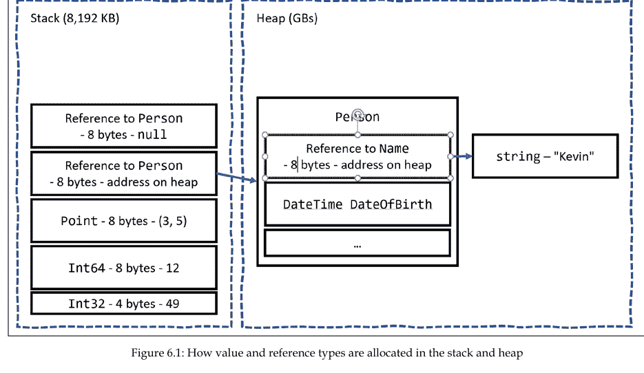
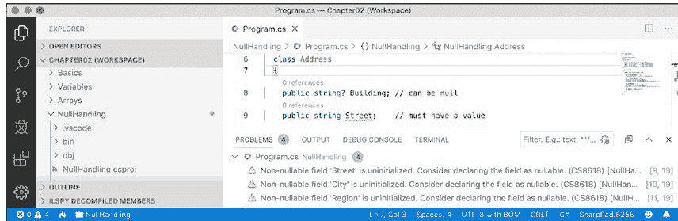
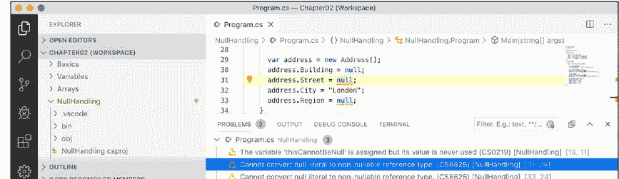
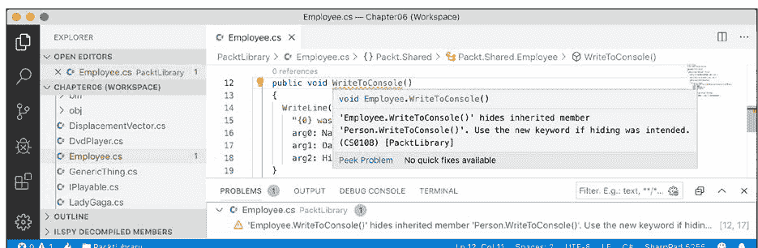
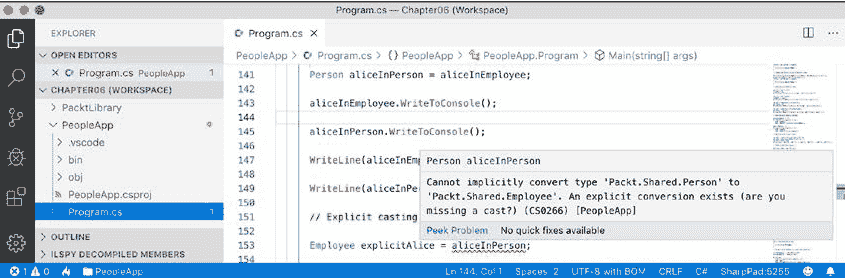
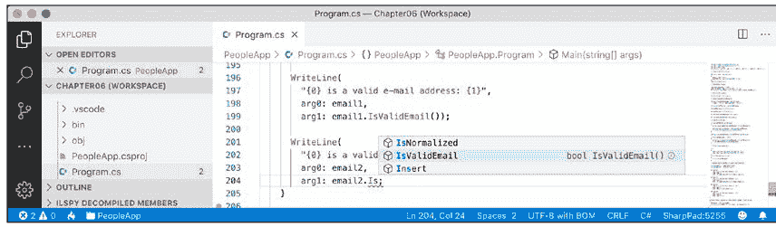
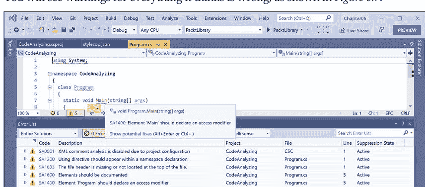

## 06

## 实现接口和继承类

本章是关于使用 **面向对象编程 (OOP)** 从现有类型派生新类型。你将学习关于定义运算符和局部函数以执行简单操作以及委托和事件以在类型之间交换消息。你将实现接口以实现通用功能。你将学习关于泛型以及引用类型和值类型之间的区别。你将创建一个派生类以从基类继承以重用功能，重写继承的类型成员，并使用多态。最后，你将学习如何创建扩展方法以及如何在继承层次结构中进行类型转换。

本章涵盖以下主题：

- 设置类库和控制台应用程序
- 关于方法的更多内容
- 引发和处理事件
- 使用泛型使类型安全可重用
- 实现接口
- 使用引用类型和值类型管理内存
- 处理空值
- 从类继承
- 在继承层次结构中进行类型转换
- 继承和扩展 .NET 类型
- 使用分析器编写更好的代码

## 设置类库和控制台应用程序

我们将从定义一个工作区/解决方案开始，其中包含两个项目，就像在第 5 章《使用面向对象编程构建自己的类型》中创建的那样。即使你完成了该章的所有练习，也请遵循以下说明，因为我们将在类库中使用 C# 10 功能，因此它需要以 .NET 6.0 为目标，而不是 .NET Standard 2.0：

- 1. 使用你喜欢的编码工具创建一个名为 Chapter06 的新工作区/解决方案。
- 2. 添加一个类库项目，如以下列表中定义：
  - 1. 项目模板：类库 / classlib
  - 2. 工作区/解决方案文件和文件夹：Chapter06
  - 3. 项目文件和文件夹：PacktLibrary
- 3. 添加一个控制台应用程序项目，如以下列表中定义：
  - 1. 项目模板：控制台应用程序 / console
  - 2. 工作区/解决方案文件和文件夹：Chapter06
  - 3. 项目文件和文件夹：PeopleApp
- 4. 在 PacktLibrary 项目中，将名为 Class1.cs 的文件重命名为 Person.cs。
- 5. 修改 Person.cs 文件内容，如以下代码所示：

```
using static System.Console;

namespace Packt.Shared;

public class Person : object
{
    // fields
    public string? Name; // ? allows null
    public DateTime DateOfBirth;
    public List<Person> Children = new(); // C# 9 or later

    // methods
    public void WriteToConsole()
    {
        WriteLine($"{Name} was born on a {DateOfBirth:dddd}.");
    }
}
```

- 6. 在 PeopleApp 项目中，添加对 PacktLibrary 的项目引用，如以下标记中突出显示的那样：

```
<Project Sdk="Microsoft.NET.Sdk">

  <PropertyGroup>
    <OutputType>Exe</OutputType>
    <TargetFramework>net6.0</TargetFramework>
    <Nullable>enable</Nullable>
    <ImplicitUsings>enable</ImplicitUsings>
  </PropertyGroup>

  <ItemGroup>
    <ProjectReference Include="..\PacktLibrary\PacktLibrary.csproj" />
  </ItemGroup>

</Project>
```

- 7. 构建 PeopleApp 项目并注意输出，指示两个项目都已成功构建。

## 关于方法的更多内容

我们可能希望两个 Person 实例能够繁殖。我们可以通过编写方法来实现这一点。实例方法是对象对自身执行的操作；静态方法是类型执行的操作。

选择哪一个取决于对该操作最有意义的方式。

> **良好实践：** 为执行类似操作同时拥有静态方法和实例方法通常是有意义的。例如，`string` 既有 `Compare` 静态方法也有 `CompareTo` 实例方法。这使得使用你的类型的程序员可以自行选择如何使用该功能，从而提供更大的灵活性。

## 使用方法实现功能

让我们开始通过同时使用静态方法和实例方法来实现一些功能：

- 1. 向 Person 类添加一个实例方法和一个静态方法，以便两个 Person 对象能够繁殖，如以下代码所示：

```
// static method to "multiply"
public static Person Procreate(Person p1, Person p2)
{
```

```
Person baby = new()
{
    Name = $"Baby of {p1.Name} and {p2.Name}"
};

p1.Children.Add(baby);
p2.Children.Add(baby);

return baby;
}

// instance method to "multiply"
public Person ProcreateWith(Person partner)
{
    return Procreate(this, partner);
}
```

请注意以下事项：

- 在名为 Procreate 的静态方法中，用于繁衍的 Person 对象作为名为 p1 和 p2 的参数传递。
- 创建了一个名为 baby 的新 Person 实例，其名称由繁衍的两个人的组合组成。这可以通过设置返回的 baby 变量的 Name 属性稍后更改。
- baby 对象被添加到两个父母的 Children 集合中，然后返回。类是引用类型，这意味着添加的是存储在内存中的 baby 对象的引用，而不是 baby 对象的克隆。你将在本章后面学习引用类型和值类型之间的区别。
- 在名为 ProcreateWith 的实例方法中，要与之繁衍的 Person 对象作为名为 partner 的参数传递，并且它连同 this 一起传递给静态 Procreate 方法以重用方法实现。this 是一个引用类当前实例的关键字。


**良好实践：** 创建新对象或修改现有对象的 方法应返回对该对象的引用，以便调用方可以访问结果。

2. 在 PeopleApp 项目中，在 Program.cs 文件顶部，删除注释并导入我们 Person 类的命名空间，并静态导入 Console 类型，如以下代码所示：

```
using Packt.Shared;
using static System.Console;
```

3. 在 Program.cs 中，创建三个人并让他们相互繁衍，注意要在字符串中添加双引号字符，必须用反斜杠字符前缀，如此 \", 如以下代码所示：

```
Person harry = new() { Name = "Harry" };
Person mary = new() { Name = "Mary" };
Person jill = new() { Name = "Jill" };

// call instance method
Person baby1 = mary.ProcreateWith(harry);
baby1.Name = "Gary";

// call static method
Person baby2 = Person.Procreate(harry, jill);

WriteLine($"{harry.Name} has {harry.Children.Count} children.");
WriteLine($"{mary.Name} has {mary.Children.Count} children.");
WriteLine($"{jill.Name} has {jill.Children.Count} children.");
WriteLine(
    format: "{0}'s first child is named \"{1}\".",
    arg0: harry.Name,
    arg1: harry.Children[0].Name);
```

4. 运行代码并查看结果，如以下输出所示：

```
Harry has 2 children.
Mary has 1 children.
Jill has 1 children.
Harry's first child is named "Gary".
```

## 使用运算符实现功能

System.String 类有一个名为 Concat 的静态方法，它连接两个字符串值并返回结果，如以下代码所示：

```
string s1 = "Hello ";
string s2 = "World!";
string s3 = string.Concat(s1, s2);
WriteLine(s3); // Hello World!
```

调用像 Concat 这样的方法是可行的，但程序员可能更自然地使用 + 符号运算符来“添加”两个字符串值，如以下代码所示：

```
string s3 = s1 + s2;
```

一个众所周知的圣经短语是 Go forth and multiply，意思是繁衍。让我们编写代码，使 *（乘法） 符号能够让两个 Person 对象进行繁衍。

我们通过为 * 符号定义一个静态运算符来实现这一点。语法与方法很相似，因为本质上运算符就是一种方法，但它使用符号而不是方法名，这使得语法更简洁。

1. 在 Person.cs 中，为 * 符号创建一个静态运算符，如以下代码所示：
2. 在 Program.cs 中，在调用 Procreate 方法之后、在写入控制台的语句之前，使用 * 运算符再制造一个婴儿，如以下代码高亮所示：
3. 运行代码并查看结果，如以下输出所示：

```
// operator to "multiply"
public static Person operator *(Person p1, Person p2)
{
    return Person.Procreate(p1, p2);
}
```


> **良好实践：** 与方法不同，运算符不会出现在类型的 IntelliSense 列表中。对于你定义的每个运算符，也请同时创建一个方法，因为程序员可能并不明显该运算符可用。运算符的实现随后可以调用该方法，重用你编写的代码。提供方法的第二个原因是并非所有语言编译器都支持运算符；例如，虽然 Visual Basic 和 F# 支持像 * 这样的算术运算符，但并不要求其他语言支持 C# 支持的所有运算符。

```
// call static method
Person baby2 = Person.Procreate(harry, jill);

// call an operator
Person baby3 = harry * mary;
```

```
Harry has 3 children.
Mary has 2 children.
Jill has 1 children.
Harry's first child is named "Gary".
```

## 使用局部函数实现功能

在 C# 7.0 中引入的一项语言特性是可以定义局部函数。

局部函数是局部变量的方法等价物。换句话说，它们是只能从定义它们的包含方法内部访问的方法。在其他语言中，它们有时被称为嵌套函数或内部函数。

局部函数可以在方法内部的任何位置定义：顶部、底部，甚至中间！

我们将使用局部函数来实现阶乘计算：

1. 在 Person.cs 中，添加语句定义一个 Factorial 函数，该函数在内部使用局部函数来计算结果，如以下代码所示：
2. 在 Program.cs 中，添加一条语句调用 Factorial 函数并将返回值写入控制台，如以下代码所示：
3. 运行代码并查看结果，如以下输出所示：

```
// method with a local function
public static int Factorial(int number)
{
    if (number < 0)
    {
        throw new ArgumentException(
            $"{nameof(number)} cannot be less than zero.");
    }
    return localFactorial(number);

    int localFactorial(int localNumber) // local function
    {
        if (localNumber < 1) return 1;
        return localNumber * localFactorial(localNumber - 1);
    }
}
```

```
WriteLine($"5! is {Person.Factorial(5)}");
```

```
5! is 120
```

## 引发和处理事件

方法通常被描述为对象可以执行的操作，无论是对自身还是对相关对象。例如，List<T> 可以向自身添加项目或清空自身，而 File 可以在文件系统中创建或删除文件。

事件通常被描述为发生在对象上的动作。例如，在用户界面中，Button 有一个 Click 事件，点击是发生在按钮上的事情，而 FileSystemWatcher 监听文件系统的更改通知，并在目录或文件更改时引发 Created 和 Deleted 等事件。

另一种思考事件的方式是它们提供了一种在两个对象之间交换消息的方式。

事件基于委托构建，因此让我们先看看委托是什么以及它们如何工作。

## 使用委托调用方法

你已经看到了调用或执行方法最常见的方式：使用 . 运算符通过其名称访问方法。例如，Console.WriteLine 告诉 Console 类型访问其 WriteLine 方法。

调用或执行方法的另一种方式是使用委托。如果你使用过支持函数指针的语言，那么可以将委托视为类型安全的方法指针。

换句话说，委托包含与委托具有相同签名的方法的内存地址，以便可以用正确的参数类型安全地调用它。

例如，假设 Person 类中有一个方法，其唯一参数必须是 string 类型，并且返回 int 类型，如以下代码所示：

```csharp
public int MethodIWantToCall(string input)
{
    return input.Length; // it doesn't matter what the method does
}
```

我可以像这样在名为 p1 的 Person 实例上调用此方法：

```csharp
int answer = p1.MethodIWantToCall("Frog");
```

或者，我可以定义一个具有匹配签名的委托来间接调用方法。请注意，参数的名称不必匹配。只有参数类型和返回值类型必须匹配，如以下代码所示：

```csharp
delegate int DelegateWithMatchingSignature(string s);
```

现在，我可以创建一个委托实例，将其指向该方法，最后调用委托（它会调用该方法），如以下代码所示：

```csharp
// create a delegate instance that points to the method
DelegateWithMatchingSignature d = new(p1.MethodIWantToCall);

// call the delegate, which calls the method
int answer2 = d("Frog");
```

你可能在想，“这有什么意义？”好吧，它提供了灵活性。

例如，我们可以使用委托来创建需要按顺序调用的方法队列。在服务中排队需要执行的操作很常见，以提供更好的可扩展性。


另一个示例是允许多个操作并行执行。委托内置支持在不同线程上运行的异步操作，从而可以提高响应能力。你将在第 12 章《使用多任务提高性能和可扩展性》中学习如何做到这一点。

最重要的示例是委托允许我们实现事件，以便在彼此不需要了解的不同对象之间发送消息。事件是组件松耦合的示例，因为组件不需要了解彼此，它们只需要知道事件签名。

委托和事件是 C# 中最令人困惑的两个特性之一，可能需要几次尝试才能理解，所以如果你感到迷失也不用担心！

## 定义和处理委托

Microsoft 为用作事件提供了两个预定义的委托。它们的签名简单但灵活，如以下代码所示：

```
public delegate void EventHandler(
    object? sender, EventArgs e);

public delegate void EventHandler<TEventArgs>(
    object? sender, TEventArgs e);
```


良好实践：当你想在自己的类型中定义事件时，应使用这两个预定义委托之一。

让我们探索委托和事件：

- 1. 在 Person 类中添加语句并注意以下几点，如以下代码所示：
  - 它定义了一个名为 Shout 的 EventHandler 委托字段。
  - 它定义了一个 int 字段来存储 AngerLevel。
  - 它定义了一个名为 Poke 的方法。
  - 每次有人被戳时，其 AngerLevel 递增。一旦 AngerLevel 达到三，就会引发 Shout 事件，但前提是至少有一个事件委托指向代码中其他地方定义的方法；也就是说，它不为 null：

```
// delegate field
public EventHandler? Shout;
```

```
// data field
public int AngerLevel;

// method
public void Poke()
{
    AngerLevel++;

    if (AngerLevel >= 3)
    {
        // if something is listening...
        if (Shout != null)
        {
            // ...then call the delegate
            Shout(this, EventArgs.Empty);
        }
    }
}
```

在调用对象的方法之前检查对象是否不为 null 非常常见。C# 6.0 及更高版本允许使用 ? 符号在 . 运算符之前内联简化空检查，如以下代码所示：

```
Shout?.Invoke(this, EventArgs.Empty);
```

- 2. 在 Program.cs 底部添加一个具有匹配签名的方法，该方法从 sender 参数获取对 Person 对象的引用并输出有关其的一些信息，如以下代码所示：

```
static void Harry_Shout(object? sender, EventArgs e)
{
    if (sender is null) return;
    Person p = (Person)sender;
    WriteLine($"{p.Name} is this angry: {p.AngerLevel}.");
}
```

Microsoft 处理事件的方法命名约定为 ObjectName_EventName。

- 3. 在 Program.cs 中添加语句将方法分配给委托字段，如以下代码所示：

```
harry.Shout = Harry_Shout;
```

- 4. 在将方法分配给 Shout 事件后，添加语句调用 Poke 方法四次，如以下代码中突出显示的那样：

```
harry.Shout = Harry_Shout;
harry.Poke();
harry.Poke();
harry.Poke();
harry.Poke();
```

- 5. 运行代码并查看结果，注意 Harry 在被戳前两次时什么也不说，只有在被戳至少三次后才生气到足以大喊，如以下输出所示：

```
Harry is this angry: 3.
Harry is this angry: 4.
```

## 定义和处理事件

你现在已经看到了委托如何实现事件的最重要功能：能够为可由完全不同的代码实现的方法定义签名，然后调用该方法和连接到委托字段的任何其他方法。

那事件呢？它们比你想象的要少。

将方法分配给委托字段时，不应使用我们在前一个示例中使用的简单赋值运算符。

委托是多播的，这意味着你可以将多个委托分配给单个委托字段。除了 = 赋值之外，我们本可以使用 += 运算符，以便将更多方法添加到同一个委托字段。当委托被调用时，所有已分配的方法都会被调用，尽管你无法控制它们被调用的顺序。

如果 Shout 委托字段已经引用了一个或多个方法，通过分配一个方法，它将替换所有其他方法。对于用作事件的委托，我们通常希望确保程序员只使用 += 运算符或 -= 运算符来分配和移除方法：

- 1. 为强制执行此操作，在 Person.cs 中，将 event 关键字添加到委托字段声明中，如以下代码中突出显示的那样：

```
public event EventHandler? Shout;
```

- 2. 构建 PeopleApp 项目并注意编译器错误消息，如以下输出所示：

```
Program.cs(41,13): error CS0079: The event 'Person.Shout' can only appear on the left hand side of += or -=
```

这（几乎）就是 event 关键字所做的全部！如果你永远不会将多个方法分配给委托字段，那么从技术上讲你不需要“事件”，但仍然是良好实践来表明你的含义并期望委托字段用作事件。

- 3. 修改方法分配以使用 +=，如以下代码所示：

```
harry.Shout += Harry_Shout;
```

- 4. 运行代码并注意它与之前的行为相同。

## 使用泛型使类型安全可重用

2005 年，随着 C# 2.0 和 .NET Framework 2.0 的发布，Microsoft 引入了名为 **泛型** 的功能，它使你的类型更安全地可重用且更高效。它通过允许程序员将类型作为参数传递来实现这一点，类似于你可以将对象作为参数传递的方式。

### 使用非泛型类型

首先，让我们看一个使用非泛型类型的示例，以便你了解泛型旨在解决的问题，例如弱类型参数和值，以及使用 System.Object 导致的性能问题。

System.Collections.Hashtable 可用于存储多个值，每个值都有一个唯一的键，可稍后用于快速查找其值。键和值可以是任何对象，因为它们被声明为 System.Object。虽然这在存储整数等值类型时提供了灵活性，但速度很慢，并且由于在添加项目时不进行类型检查，因此更容易引入错误。

让我们写一些代码：

- 1. 在 Program.cs 中，创建非泛型集合 System.Collections.Hashtable 的实例，然后向其添加四项，如以下代码所示：
  ```
  // non-generic lookup collection
  System.Collections.Hashtable lookupObject = new();
  
  lookupObject.Add(key: 1, value: "Alpha");
  lookupObject.Add(key: 2, value: "Beta");
  lookupObject.Add(key: 3, value: "Gamma");
  lookupObject.Add(key: harry, value: "Delta");
  ```
- 2. 添加语句定义值为 2 的键并使用它在哈希表中查找其值，如以下代码所示：
  ```
  int key = 2; // Lookup the value that has 2 as its key
  WriteLine(format: "Key {0} has value: {1}",
      arg0: key,
      arg1: lookupObject[key]);
  ```
- 3. 添加语句使用 harry 对象查找其值，如以下代码所示：
  ```
  // Lookup the value that has harry as its key
  WriteLine(format: "Key {0} has value: {1}",
      arg0: harry,
      arg1: lookupObject[harry]);
  ```
- 4. 运行代码并注意它有效，如以下输出所示：

```
Key 2 has value: Beta
Key Packt.Shared.Person has value: Delta
```

尽管代码有效，但存在出错的可能性，因为字面上任何类型都可用于键或值。如果另一位开发人员使用你的查找对象并期望所有项目都是某种类型，他们可能会将它们强制转换为该类型并得到异常，因为某些值可能属于不同类型。包含大量项目的查找对象也会导致性能不佳。

> 良好实践：避免使用 System.Collections 命名空间中的类型。

### 使用泛型类型

System.Collections.Generic.Dictionary<TKey, TValue> 可用于存储多个值，每个值都有一个唯一的键，可稍后用于快速查找其值。键和值可以是任何对象，但你必须在首次实例化集合时告诉编译器键和值的类型。你通过在尖括号 <> 中为泛型参数 TKey 和 TValue 指定类型来实现这一点。

> 良好实践：当泛型类型有一个可定义的类型时，它应命名为 T，例如 List<T>，其中 T 是存储在列表中的类型。当泛型类型有多个可定义的类型时，它们应使用 T 作为名称前缀并具有有意义的名称，例如 Dictionary<TKey, TValue>。

这提供了灵活性，速度更快，并且由于在添加项目时进行类型检查，因此更容易避免错误。

让我们写一些代码来通过使用泛型解决这个问题：

- 1. 在 Program.cs 中，创建泛型查找集合 Dictionary<TKey, TValue> 的实例，然后向其添加四项，如以下代码所示：

```
// generic lookup collection
Dictionary<int, string> lookupIntString = new();

lookupIntString.Add(key: 1, value: "Alpha");
lookupIntString.Add(key: 2, value: "Beta");
lookupIntString.Add(key: 3, value: "Gamma");
lookupIntString.Add(key: harry, value: "Delta");
```

- 2. 注意使用 harry 作为键时的编译错误，如以下输出所示：

```
/Users/markjprice/Code/Chapter06/PeopleApp/Program.cs(98,32): error
CS1503: Argument 1: cannot convert from 'Packt.Shared.Person' to 'int' [/Users/markjprice/Code/Chapter06/PeopleApp/PeopleApp.csproj]
```

- 3. 用 4 替换 harry。
- 4. 添加语句将键设置为 3 并使用它在字典中查找其值，如以下代码所示：
- 5. 运行代码并注意它能正常工作，如以下输出所示：

```
key = 3;
WriteLine(format: "Key {0} has value: {1}",
    arg0: key,
    arg1: lookupIntString[key]);
```

```
Key 3 has value: Gamma
```

## 实现接口

接口是连接不同类型以创建新事物的途径。可以把它们想象成 LEGO™ 积木顶部的凸点，使其能够“粘”在一起，或是插头和插座的电气标准。

如果一个类型实现了接口，那么它就向 .NET 的其余部分承诺它支持特定的功能。这就是为什么它们有时被称为契约。

## 常见接口

以下是你的类型可能需要实现的某些常见接口：

| 接口 | 方法 | 描述 |
|---|---|---|
| IComparable | CompareTo(other) | 这定义了一个比较方法，类型实现它来排序或对实例进行排序。 |
| IComparer | Compare(first, second) | 这定义了一个比较方法，辅助类型实现它来排序或对主要类型的实例进行排序。 |
| IDisposable | Dispose() | 这定义了一个释放方法，用于比等待终结器更有效地释放非托管资源（有关更多详细信息，请参阅本章后面“释放非托管资源”部分）。 |
| IFormattable | ToString(format, culture) | 这定义了一个感知文化的格式化方法，用于将对象的值格式化为字符串表示形式。 |
| IFormatter | Serialize(stream, object)<br>Deserialize(stream) | 这定义了方法，用于将对象转换为字节流以进行存储或传输，以及从字节流还原。 |
| IFormatProvider | GetFormat(type) | 这定义了一个基于语言和区域格式化输入的方法。 |

## 比较对象以进行排序

你最常想要实现的最常见接口之一是 IComparable。它有一个名为 CompareTo 的方法。它有两个变体，一个使用可空对象类型，另一个使用可空泛型类型 T，如以下代码所示：

```
namespace System
{
    public interface IComparable
    {
        int CompareTo(object? obj);
    }

    public interface IComparable<in T>
    {
        int CompareTo(T? other);
    }
}
```

例如，string 类型通过返回 -1（如果字符串小于正在比较的字符串）或 1（如果大于）来实现 IComparable。int 类型通过返回 -1（如果 int 小于正在比较的 int）或 1（如果大于）来实现 IComparable。

如果一个类型实现了 IComparable 接口之一，那么数组和集合可以对其进行排序。

在为 Person 类实现 IComparable 接口及其 CompareTo 方法之前，让我们看看尝试对 Person 实例数组进行排序时会发生什么：

- 1. 在 Program.cs 中，添加语句创建 Person 实例数组并将项目写入控制台，然后尝试对数组进行排序并再次将项目写入控制台，如以下代码所示：

```
Person[] people =
{
    new() { Name = "Simon" },
    new() { Name = "Jenny" },
    new() { Name = "Adam" },
    new() { Name = "Richard" }
};

WriteLine("Initial list of people:");
foreach (Person p in people)
{
    WriteLine($" {p.Name}");
}

WriteLine("Use Person's IComparable implementation to sort:");
Array.Sort(people);
```

```
foreach (Person p in people)
{
    WriteLine($" {p.Name}");
}
```

- 2. 运行代码将抛出异常。正如消息所解释的那样，为了解决问题，我们的类型必须实现 IComparable，如以下输出所示：

```
Unhandled Exception: System.InvalidOperationException: Failed to compare two elements in the array. ---> System.ArgumentException: At least one object must implement IComparable.
```

- 3. 在 Person.cs 中，在继承自 object 之后，添加一个逗号并输入 IComparable<Person>，如以下代码所示：

```
public class Person : object, IComparable<Person>
```

你的代码编辑器将在新代码下方画一条红色波浪线，警告你尚未实现已承诺的方法。如果单击灯泡并选择“实现接口”选项，代码编辑器可以为你编写骨架实现。

- 4. 滚动到 Person 类的底部，找到为你编写的方法并删除抛出 NotImplementedException 错误的语句，如以下代码中突出显示所示：

```
public int CompareTo(Person? other)
{
    throw new NotImplementedException();
}
```

- 5. 添加语句调用 Name 字段的 CompareTo 方法，该方法使用 string 类型的 CompareTo 实现并返回结果，如以下代码中突出显示所示：

```
public int CompareTo(Person? other)
{
    if (Name is null) return 0;
    return Name.CompareTo(other?.Name);
}
```

我们选择通过比较它们的 Name 字段来比较两个 Person 实例。因此，Person 实例将按其名称按字母顺序排序。为简单起见，我在这些示例中没有在整个过程中添加空值检查。

- 6. 运行代码并注意这次它按预期工作，如以下输出所示：

```
Initial list of people:
    Simon
    Jenny
```

```
Adam
Richard
Use Person's IComparable implementation to sort:
Adam
Jenny
Richard
Simon
```


> **良好实践：** 如果任何人想要对你的类型的实例数组或集合进行排序，则实现 IComparable 接口。

## 使用单独的类比较对象

有时，你可能无法访问类型的源代码，并且它可能未实现 IComparable 接口。幸运的是，还有另一种方法可以对类型的实例进行排序。你可以创建一个实现略有不同的接口的单独类型，名为 IComparer：

- 1. 在 PacktLibrary 项目中，添加一个名为 PersonComparer.cs 的新类文件，其中包含一个实现 IComparer 接口的类，该接口将比较两个人，即两个 Person 实例。通过比较它们的 Name 字段的长度来实现它，或者如果名称长度相同，则按字母顺序比较名称，如以下代码所示：

```
```csharp
namespace Packt.Shared;

public class PersonComparer : IComparer<Person>
{
    public int Compare(Person? x, Person? y)
    {
        if (x is null || y is null)
        {
            return 0;
        }
        // Compare the Name Lengths...
        int result = x.Name.Length.CompareTo(y.Name.Length);

        // ...if they are equal...
        if (result == 0)
        {
            // ...then compare by the Names...
            return x.Name.CompareTo(y.Name);
        }
    }
}
```
```

```
else // result will be -1 or 1
{
    // ...otherwise compare by the lengths.
    return result;
}
}
```

- 2. 在 Program.cs 中，添加语句使用此替代实现对数组进行排序，如以下代码所示：

```
WriteLine("Use PersonComparer’s IComparer implementation to sort:");
Array.Sort(people, new PersonComparer());
foreach (Person p in people)
{
    WriteLine($" {p.Name}");
}
```

- 3. 运行代码并查看结果，如以下输出所示：

```
Use PersonComparer’s IComparer implementation to sort:
    Adam
    Jenny
    Simon
    Richard
```

这次，当我们对 people 数组进行排序时，我们明确要求排序算法改用 PersonComparer 类型，以便人们按最短名称先排序，例如 Adam，最长名称后排序，例如 Richard；并且当两个或多个名称的长度相等时，按字母顺序排序，例如 Jenny 和 Simon。

## 隐式和显式接口实现

接口可以隐式或显式实现。隐式实现更简单、更常见。显式实现只有在类型必须具有多个同名和相同签名的 方法时才有必要。

例如，IGamePlayer 和 IKeyHolder 都可能有一个名为 Lose 的方法，参数相同，因为游戏和钥匙都可能丢失。在必须实现这两个接口的类型中，只有一种 Lose 实现可以是隐式方法。如果两个接口可以共享相同的实现，那就行，但如果不能，则另一个 Lose 方法必须以不同的方式实现并显式调用，如以下代码所示：

```
public interface IGamePlayer
{
    void Lose();
}
```

public interface IKeyHolder
{
    void Lose();
}

public class Person : IGamePlayer, IKeyHolder
{
    public void Lose() // implicit implementation
    {
        // implement losing a key
    }

    void IGamePlayer.Lose() // explicit implementation
    {
        // implement losing a game
    }
}

// calling implicit and explicit implementations of Lose
Person p = new();
p.Lose(); // calls implicit implementation of losing a key

((IGamePlayer)p).Lose(); // calls explicit implementation of losing a game

IGamePlayer player = p as IGamePlayer;
player.Lose(); // calls explicit implementation of losing a game

## 定义带有默认实现的接口

C# 8.0 中引入的一个语言特性是接口的 **默认实现**。让我们来看一下它的实际效果：

- 1. 在 PacktLibrary 项目中，添加一个名为 IPlayable.cs 的新文件。
- 2. 修改语句以定义一个公共的 IPlayable 接口，其中包含 Play 和 Pause 两个方法，如以下代码所示：

```
namespace Packt.Shared;

public interface IPlayable
{
    void Play();
    void Pause();
}
```

- 3. 在 PacktLibrary 项目中，添加一个名为 DvdPlayer.cs 的新类文件。
- 4. 修改文件中语句以实现 IPlayable 接口，如以下代码所示：

```
using static System.Console;

namespace Packt.Shared;

public class DvdPlayer : IPlayable
{
    public void Pause()
    {
        WriteLine("DVD player is pausing.");
    }

    public void Play()
    {
        WriteLine("DVD player is playing.");
    }
}
```

这很有用，但如果我们决定添加一个名为 Stop 的第三个方法怎么办？在 C# 8.0 之前，一旦至少有一个类型实现了原始接口，这是不可能的。接口的主要要点之一是它是一个固定的契约。

C# 8.0 允许接口在发布后添加新成员，只要它们具有默认实现。C# 纯粹主义者不喜欢这个想法，但出于实际原因，例如避免破坏性更改或不得不定义全新的接口，它是有用的，而且 Java 和 Swift 等其他语言也支持类似技术。

对默认接口实现的支持需要对底层平台进行一些根本性更改，因此仅在目标框架为 .NET 5.0 或更高版本、.NET Core 3.0 或更高版本或 .NET Standard 2.1 时才支持 C#。因此它们不被 .NET Framework 支持。

- 5. 修改 IPlayable 接口以添加一个带有默认实现的 Stop 方法，如以下代码中突出显示所示：

```
using static System.Console;

namespace Packt.Shared;

public interface IPlayable
{
    void Play();
    void Pause();

    void Stop() // default interface implementation
    {
        WriteLine("Default implementation of Stop.");
    }
}
```

- 6. 构建 PeopleApp 项目并注意，尽管 DvdPlayer 类未实现 Stop，项目仍能成功编译。将来，我们可以通过在 DvdPlayer 类中实现它来覆盖 Stop 的默认实现。

## 使用引用类型和值类型管理内存

我已经多次提到引用类型。让我们更详细地了解一下。

内存分为两类：栈内存和堆内存。在现代操作系统中，栈和堆可以在物理或虚拟内存中的任何位置。

栈内存使用起来更快（因为它由 CPU 直接管理，并且由于它使用后进先出机制，更有可能将数据保留在 L1 或 L2 缓存中），但大小有限，而堆内存速度较慢但要丰富得多。

例如，在 macOS 终端中，我可以输入命令 ulimit -a 来发现栈大小限制为 8,192 KB，而其他内存是“无限”的。栈内存的这种有限量正是很容易填满并导致“栈溢出”的原因。

## 定义引用类型和值类型

有三个 C# 关键字可用于定义对象类型：class、record 和 struct。它们都可以具有相同的成员，例如字段和方法。它们之间的一个区别是内存分配方式。

当你使用 record 或 class 定义类型时，你是在定义引用类型。这意味着对象本身的内存分配在堆上，而只有对象的内存地址（以及少量开销）存储在栈上。

当你使用 record struct 或 struct 定义类型时，你是在定义值类型。这意味着对象本身的内存分配在栈上。

如果 struct 使用的字段类型不是 struct 类型，那么这些字段将被存储在堆上，这意味着该对象的数据同时存储在栈和堆中！

最常见的 struct 类型有：

- **数值系统类型**：byte、sbyte、short、ushort、int、uint、long、ulong、float、double 和 decimal
- **其他系统类型**：char、DateTime 和 bool
- **System.Drawing 类型**：Color、Point 和 Rectangle

几乎所有其他类型都是类类型，包括 string。

除了类型数据在内存中存储位置的差异外，另一个主要区别是不能从 struct 继承。

## 引用类型和值类型在内存中的存储方式

假设你有一个控制台应用程序声明了一些变量，如以下代码所示：

```
int number1 = 49;
long number2 = 12;
System.Drawing.Point location = new(x: 4, y: 5);
Person kevin = new() { Name = "Kevin",
    DateOfBirth = new(year: 1988, month: 9, day: 23) };
Person sally;
```

让我们回顾一下执行这些语句时栈和堆上分配了什么内存，如图 6.1 所示，并在以下列表中描述：

- number1 变量是值类型（也称为 struct），因此它分配在栈上，并且使用 4 字节内存，因为它是一个 32 位整数。其值 49 直接存储在变量中。
- number2 变量也是值类型，因此也分配在栈上，并且使用 8 字节，因为它是一个 64 位整数。
- location 变量也是值类型，因此分配在栈上，并且使用 8 字节，因为它由两个 32 位整数 x 和 y 组成。
- kevin 变量是引用类型（也称为 class），因此为 64 位内存地址分配 8 字节（假设是 64 位操作系统）存储在栈上，并在堆上分配足够的字节来存储一个 Person 实例。
- sally 变量是引用类型，因此为 64 位内存地址分配 8 字节存储在栈上。它当前为 null，这意味着尚未为其在堆上分配内存。



图 6.1：值类型和引用类型在栈和堆中的分配方式

引用类型分配的所有内存都存储在堆上。如果像 DateTime 这样的值类型用于 Person 等引用类型的字段，则 DateTime 值存储在堆上。

如果值类型有一个引用类型的字段，那么值类型的该部分存储在堆上。Point 是一个值类型，由两个字段组成，这两个字段本身也是值类型，因此整个对象可以分配在栈上。如果 Point 值类型有一个引用类型的字段，如 string，则 string 字节将存储在堆上。

## 类型的相等性

使用 == 和 != 运算符比较两个变量是很常见的。这两个运算符的行为对于引用类型和值类型是不同的。

当你检查两个值类型变量的相等性时，.NET 会直接比较栈上这两个变量的值，如果相等则返回 true，如以下代码所示：

```
int a = 3;
int b = 3;
WriteLine($"a == b: {(a == b)}"); // true
```

当你检查两个引用类型变量的相等性时，.NET 会比较这两个变量的内存地址，如果相等则返回 true，如以下代码所示：

```
Person a = new() { Name = "Kevin" };
Person b = new() { Name = "Kevin" };
WriteLine($"a == b: {(a == b)}"); // false
```

这是因为它们不是同一个对象。如果两个变量实际上指向堆上的同一个对象，那么它们将相等，如以下代码所示：

```
Person a = new() { Name = "Kevin" };
Person b = a;
WriteLine($"a == b: {(a == b)}"); // true
```

这种行为的唯一例外是 string 类型。它是引用类型，但相等运算符已被重写，使其表现得像值类型一样，如以下代码所示：

```
string a = "Kevin";
string b = "Kevin";
WriteLine($"a == b: {(a == b)}"); // true
```

你可以在自己的类中做类似的事情，使相等运算符即使它们不是同一个对象（堆上的相同内存地址）也能返回 true，而是当它们的字段具有相同值时返回 true，但这超出了本书的范围。或者，使用 record 类，因为它们的好处之一是为你实现了这种行为。

## 定义 struct 类型

让我们探索定义自己的值类型：

- 1. 在 PacktLibrary 项目中，添加一个名为 DisplacementVector.cs 的文件。
- 2. 修改文件，如以下代码所示，并注意以下几点：
  - 该类型使用 struct 而不是 class 声明。
  - 它有两个 int 字段，名为 X 和 Y。
  - 它有一个用于设置 X 和 Y 初始值的构造函数。
  - 它有一个用于将两个实例相加的运算符，返回一个新实例，其中 X 加到 X，Y 加到 Y。

```
namespace Packt.Shared;

public struct DisplacementVector
{
    public int X;


```
public int Y;

public DisplacementVector(int initialX, int initialY)
{
    X = initialX;
    Y = initialY;
}

public static DisplacementVector operator +(
    DisplacementVector vector1,
    DisplacementVector vector2)
{
    return new(
        vector1.X + vector2.X,
        vector1.Y + vector2.Y);
}
}
```

3. 在 Program.cs 中，添加语句以创建两个新的 DisplacementVector 实例，将它们相加并输出结果，如以下代码所示：

```
DisplacementVector dv1 = new(3, 5);
DisplacementVector dv2 = new(-2, 7);
DisplacementVector dv3 = dv1 + dv2;

WriteLine($"({dv1.X}, {dv1.Y}) + ({dv2.X}, {dv2.Y}) = ({dv3.X}, {dv3.Y})");
```

4. 运行代码并查看结果，如以下输出所示：

```
(3, 5) + (-2, 7) = (1, 12)
```

> 良好实践：如果你的类型中所有字段使用的总字节数在 16 字节或以下，你的类型仅使用值类型作为其字段，并且你永远不想从你的类型派生，那么 Microsoft 建议你使用 struct。如果你的类型使用超过 16 字节的栈内存，如果它使用引用类型作为其字段，或者如果你可能想要继承它，那么使用 class。

## 使用 record struct 类型

C# 10 引入了能够将 record 关键字与 struct 类型以及 class 类型一起使用的功能。

我们可以按以下代码所示定义 DisplacementVector 类型：

```
public record struct DisplacementVector(int X, int Y);
```

随着这一变化，即使 class 关键字是可选的，Microsoft 也建议在想要定义 record class 时显式指定 class，如以下代码所示：

```
public record class ImmutableAnimal(string Name);
```

## 释放非托管资源

在上一章中，我们看到构造函数可用于初始化字段，并且一个类型可能有多个构造函数。假设构造函数分配了一个非托管资源；也就是说，任何不受 .NET 控制的东西，例如由操作系统控制的文件或互斥锁。非托管资源必须手动释放，因为 .NET 不能使用其自动垃圾回收功能为我们完成此操作。

垃圾回收是一个高级主题，因此对于本主题，我将展示一些代码示例，但你不需要自己编写代码。

每个类型可以有一个终结器，当需要释放资源时，.NET 运行时会调用它。终结器的名称与构造函数相同；也就是说，类型名称，但前面加上波浪号 ~。

不要将终结器（也称为析构函数）与 Deconstruct 方法混淆。析构函数释放资源；也就是说，它销毁内存中的对象。Deconstruct 方法返回拆分为其组成部分的对象，并使用 C# 解构语法，例如在处理元组时：

```
public class Animal
{
    public Animal() // constructor
    {
        // allocate any unmanaged resources
    }

    ~Animal() // Finalizer aka destructor
    {
        // deallocate any unmanaged resources
    }
}
```

前面的代码示例是在处理非托管资源时应做的最小操作。但仅提供终结器的問題在于，.NET 垃圾回收器需要两次垃圾回收才能完全释放该类型的已分配资源。

虽然是可选的，但建议还提供一种方法，允许使用你的类型的开发人员显式释放资源，以便垃圾回收器可以立即且确定性地释放非托管资源（如文件）的托管部分，然后在一次垃圾回收中释放对象的托管内存部分，而不是两次垃圾回收。

通过实现 IDisposable 接口，有一种标准机制可以做到这一点，如以下示例所示：

```csharp
public class Animal : IDisposable
{
    public Animal()
    {
        // allocate unmanaged resource
    }

    ~Animal() // Finalizer
    {
        Dispose(false);
    }

    bool disposed = false; // have resources been released?

    public void Dispose()
    {
        Dispose(true);

        // tell garbage collector it does not need to call the finalizer
        GC.SuppressFinalize(this);
    }

    protected virtual void Dispose(bool disposing)
    {
        if (disposed) return;

        // deallocate the *unmanaged* resource
        // ...

        if (disposing)
        {
            // deallocate any other *managed* resources
            // ...
        }
        disposed = true;
    }
}
```

有两个 Dispose 方法，一个是 public，一个是 protected：

- public void Dispose 方法将由使用你的类型的开发人员调用。调用时，需要释放非托管和托管资源。
- 带 bool 参数的 protected virtual void Dispose 方法在内部用于实现资源的释放。它需要检查 disposing 参数和 disposed 字段，因为如果终结器线程已经运行并且它调用了 ~Animal 方法，则只需要释放非托管资源。

对 GC.SuppressFinalize(this) 的调用会通知垃圾回收器它不再需要运行终结器，并消除了第二次垃圾回收的需求。

## 确保调用 Dispose

当有人使用实现 IDisposable 的类型时，他们可以使用 using 语句确保调用 public Dispose 方法，如以下代码所示：

```
using (Animal a = new())
{
    // code that uses the Animal instance
}
```

编译器会将你的代码转换为如下所示的内容，这保证即使发生异常，Dispose 方法仍会被调用：

```
Animal a = new();
try
{
    // code that uses the Animal instance
}
finally
{
    if (a != null) a.Dispose();
}
```

你将在第 9 章《使用文件、流和序列化》中看到使用 IDisposable、using 语句和 try...finally 块释放非托管资源的实际示例。

## 处理空值

你已经了解如何将像数字这样的原始值存储在 struct 变量中。但如果一个变量还没有值怎么办？我们如何表示这一点？C# 有 null 值的概念，可用于表示变量尚未设置。

## 使值类型可空

默认情况下，像 int 和 DateTime 这样的值类型必须始终具有值，因此得名。有时，例如在读取存储在允许空值、缺失值或 null 值的数据库中的值时，允许值类型为 null 很方便。我们称之为可空值类型。

你可以通过在声明变量时将问号作为类型后缀添加来启用此功能。

我们来看一个示例：

- 1. 使用你偏好的编码工具在 Chapter06 工作区/解决方案中添加一个新的控制台应用程序，命名为 NullHandling。本节需要一个带有项目文件完整应用程序，因此你将无法使用 .NET Interactive 笔记本。
- 2. 在 Visual Studio Code 中，选择 NullHandling 作为活动的 OmniSharp 项目。在 Visual Studio 中，将 NullHandling 设置为启动项目。
- 3. 在 Program.cs 中，输入语句以声明并为 int 变量分配值，包括 null，如以下代码所示：
- 4. 注释掉导致编译错误的语句。
- 5. 运行代码并查看结果，如以下输出所示：

```
int thisCannotBeNull = 4;
thisCannotBeNull = null; // compile error!

int? thisCouldBeNull = null;
WriteLine(thisCouldBeNull);
WriteLine(thisCouldBeNull.GetValueOrDefault());

thisCouldBeNull = 7;
WriteLine(thisCouldBeNull);
WriteLine(thisCouldBeNull.GetValueOrDefault());
```


第一行是空白的，因为它输出的是 null 值！

## 理解可空引用类型

null 值的用法在如此多的语言中如此常见，以至于许多经验丰富的程序员从未质疑其存在的必要性。但在许多场景中，如果变量不允许具有 null 值，我们可以编写更好、更简单的代码。

C# 8 中对语言最重大的更改是引入了可空和不可空引用类型。“等等！”你可能在想，“引用类型本来就可空！”

你说得对，但在 C# 8 及更高版本中，引用类型可以通过设置文件级或项目级选项来启用这个有用的新功能，从而配置为不再允许 null 值。由于这是 C# 的一个重大更改，Microsoft 决定将该功能设为 opt-in。


这个新的 C# 语言特性要产生影响需要多年时间，因为成千上万的现有库包和应用程序仍期望旧的行为。即使是微软，也直到 .NET 6 才有时间在所有主要 .NET 包中完全实现此新特性。

过渡期间，您可以为自己的项目在以下几种方法中选择：

- **默认**：无需更改。不支持可空引用类型。
- **项目级选择加入，文件级选择退出**：在项目级别启用该功能，对于需要保持与旧行为兼容的任何文件，选择退出。微软在更新自己的包以使用此新功能时内部使用的方法就是这种方法。
- **文件级选择加入**：仅为单个文件启用该功能。

## 启用可空和不可空引用类型

要在项目级别启用该功能，请在项目文件中添加以下内容：

```xml
<PropertyGroup>
  ...
  <Nullable>enable</Nullable>
</PropertyGroup>
```

现在在以 .NET 6.0 为目标的项目模板中默认执行此操作。

要在文件级别禁用该功能，请在代码文件顶部添加以下内容：

```
#nullable disable
```

要在文件级别启用该功能，请在代码文件顶部添加以下内容：

```
#nullable enable
```

## 声明不可空变量和参数

如果启用可空引用类型并且您希望引用类型被赋值为 null，则必须使用与使值类型可空相同的语法，即在类型声明后添加 ? 符号。

那么，可空引用类型是如何工作的？让我们看一个例子。在存储地址信息时，您可能希望强制为街道、城市和地区提供值，但建筑物可以留空，即为 null：

1. 在 NullHandling.csproj 中，在 Program.cs 文件底部，添加语句声明一个包含四个字段的 Address 类，如以下代码所示：

```csharp
class Address
{
    public string? Building;
    public string Street;
    public string City;
    public string Region;
}
```

2. 经过几秒钟，注意关于不可空字段的警告，例如 Street 未初始化，如图 6.2 所示：



图 6.2：PROBLEMS 窗口中关于不可空字段的警告消息

3. 将空字符串值分配给这三个不可空字段，如以下代码所示：

```csharp
public string Street = string.Empty;
public string City = string.Empty;
public string Region = string.Empty;
```

4. 在 Program.cs 文件顶部静态导入 Console，然后添加语句实例化 Address 并设置其属性，如以下代码所示：

```csharp
Address address = new();
address.Building = null;
address.Street = null;
address.City = "London";
address.Region = null;
```

5. 注意警告，如图 6.3 所示：



图 6.3：关于将 null 分配给不可空字段的警告消息

因此，这个新语言特性被称为可空引用类型。从 C# 8.0 开始，未修饰的引用类型可以变为不可空，并且使引用类型可空使用的语法与用于值类型的语法相同。

## 检查 null

检查可空引用类型或可空值类型变量当前是否包含 null 很重要，因为如果不检查，可能会抛出 NullReferenceException，导致错误。在使用可空变量之前，您应该检查 null 值，如以下代码所示：

```csharp
// check that the variable is not null before using it
if (thisCouldBeNull != null)
{
    // access a member of thisCouldBeNull
    int length = thisCouldBeNull.Length; // could throw exception
    ...
}
```

C# 7 引入了 is 与 !（非）运算符结合作为 != 的替代方案，如以下代码所示：

```csharp
if (!(thisCouldBeNull is null))
{
```

C# 9 引入了 is not 作为更清晰的替代方案，如以下代码所示：

```csharp
if (thisCouldBeNull is not null)
{
```

如果您尝试使用可能为 null 的变量的成员，请使用空条件运算符 ?., 如以下代码所示：

```csharp
string authorName = null;

// the following throws a NullReferenceException
int x = authorName.Length;

// instead of throwing an exception, null is assigned to y
int? y = authorName?.Length;
```

有时您希望将变量赋值为结果，或者如果变量为 null 则使用替代值，例如 3。您使用空合并运算符 ?? 来实现此操作，如以下代码所示：

```csharp
// result will be 3 if authorName?.Length is null
int result = authorName?.Length ?? 3;
Console.WriteLine(result);
```

> 良好实践：即使启用可空引用类型，您仍应检查不可空参数是否为 null 并抛出 ArgumentNullException。

## 在方法参数中检查 null

在定义带参数的方法时，检查 null 值是良好的实践。

在 C# 的早期版本中，您必须编写 if 语句来检查 null 参数值，然后为任何为 null 的参数抛出 ArgumentNullException，如以下代码所示：

```csharp
public void Hire(Person manager, Person employee)
{
    if (manager == null)
    {
        throw new ArgumentNullException(nameof(manager));
    }
    if (employee == null)
    {
        throw new ArgumentNullException(nameof(employee));
    }
    ...
}
```

C# 11 可能会引入新的 !! 后缀为您执行此操作，如以下代码所示：

```csharp
public void Hire(Person manager!!, Person employee!!)
{
    ...
}
```

if 语句和异常抛出由系统为您完成。

## 从类继承

我们之前创建的 Person 类型派生（继承）自 object，即 System.Object 的别名。现在，我们将创建一个继承自 Person 的子类：

1. 在 PacktLibrary 项目中，添加一个名为 Employee.cs 的新类文件。
2. 修改其内容以定义一个名为 Employee 的类，该类派生自 Person，如以下代码所示：
3. 在 Program.cs 中，添加语句以创建 Employee 类的实例，如以下代码所示：
4. 运行代码并查看结果，如以下输出所示：

```csharp
using System;

namespace Packt.Shared;

public class Employee : Person
{
}
```

```csharp
Employee john = new()
{
    Name = "John Jones",
    DateOfBirth = new(year: 1990, month: 7, day: 28)
};
john.WriteToConsole();
```

John Jones 出生于星期六。

请注意，Employee 类已继承 Person 的所有成员。

## 扩展类以添加功能

现在，我们将添加一些特定于员工的成员来扩展该类。

1. 在 Employee.cs 中，添加语句定义员工代码和入职日期的两个属性，如以下代码所示：

```csharp
public string? EmployeeCode { get; set; }
public DateTime HireDate { get; set; }
```

2. 在 Program.cs 中，添加语句设置 John 的员工代码和入职日期，如以下代码所示：

```csharp
john.EmployeeCode = "JJ001";
john.HireDate = new(year: 2014, month: 11, day: 23);
WriteLine($"{john.Name} was hired on {john.HireDate:dd/MM/yy}");
```

3. 运行代码并查看结果，如以下输出所示：

```
John Jones was hired on 23/11/14
```

## 隐藏成员

到目前为止，WriteToConsole 方法是从 Person 继承的，它仅输出员工的姓名和出生日期。我们可能希望更改此方法对员工的操作：

1. 在 Employee.cs 中，添加语句重新定义 WriteToConsole 方法，如以下代码高亮所示：

```csharp
using static System.Console;

namespace Packt.Shared;

public class Employee : Person
{
    public string? EmployeeCode { get; set; }
    public DateTime HireDate { get; set; }

    public void WriteToConsole()
    {
        WriteLine(format:
            "{0} was born on {1:dd/MM/yy} and hired on {2:dd/MM/yy}",
            arg0: Name,
            arg1: DateOfBirth,
            arg2: HireDate);
    }
}
```

2. 运行代码并查看结果，如以下输出所示：

```
John Jones was born on 28/07/90 and hired on 01/01/01
John Jones was hired on 23/11/14
```


你的编码工具会警告你，你的方法现在隐藏了来自 Person 的方法，它会在方法名下画一条波浪线，PROBLEMS / Error List 窗口包含更多详细信息，并且编译器在你构建并运行控制台应用程序时会输出该警告，如图 6.4 所示：



图 6.4：隐藏方法警告

根据警告的描述，你可以通过对方法应用 new 关键字来隐藏此消息，以表明你是有意替换旧方法，如以下代码中突出显示所示：

```
public new void WriteToConsole()
```

## 重写成员

与其隐藏方法，通常最好重写它。只有当基类选择允许重写时才可以重写，通过对应该允许重写的方法应用 virtual 关键字。

让我们看一个示例：

- 1. 在 Program.cs 中，添加一条语句，使用其字符串表示形式将 john 变量的值写入控制台，如以下代码所示：
- 2. 运行代码并注意 ToString 方法是从 System.Object 继承的，因此实现返回命名空间和类型名称，如以下输出所示：
- 3. 在 Person.cs 中，通过添加 ToString 方法来重写此行为，以输出人员的姓名以及类型名称，如以下代码所示：

```
WriteLine(john.ToString());
```

```
Packt.Shared.Employee
```

```
// overridden methods
public override string ToString()
{
    return $"{Name} is a {base.ToString()}";
}
```

base 关键字允许子类访问其超类的成员；即它继承或派生自的 **base class**。

- 4. 运行代码并查看结果。现在，当调用 ToString 方法时，它会输出人员的姓名，并返回基类的 ToString 实现，如以下输出所示：

```
John Jones is a Packt.Shared.Employee
```

> **Good Practice:** 许多现实世界的 API，例如 Microsoft 的 Entity Framework Core、Castle 的 DynamicProxy 和 Episerver 的内容模型，要求你在类中定义的属性被标记为 virtual，以便可以被重写。仔细决定哪些方法和属性成员应该标记为 virtual。

## 从抽象类继承

本章前面，你学习了接口可以定义一组成员，类型必须具有这些成员才能满足基本功能级别。这些非常有用，但其主要限制是直到 C# 8 之前它们不能提供自己的任何实现。

如果仍需要创建可在 .NET Framework 和不支持 .NET Standard 2.1 的其他平台上工作的类库，这就是一个特别的问题。

在那些较早的平台中，你可以使用抽象类作为纯接口和完全实现的类之间的某种中间体。

当一个类被标记为 abstract 时，这意味着它不能被实例化，因为你表明该类是不完整的。在实例化之前它需要更多的实现。

例如，System.IO.Stream 类是抽象的，因为它实现了所有流都需要但不完整的通用功能，因此你不能使用 new Stream() 实例化它。

让我们比较两种类型的接口和两种类型的类，如以下代码所示：

```
public interface INoImplementation // C# 1.0 and later
{
    void Alpha(); // must be implemented by derived type
}

public interface ISomeImplementation // C# 8.0 and later
{
    void Alpha(); // must be implemented by derived type
    void Beta()
    {
        // default implementation; can be overridden
    }
}

public abstract class PartiallyImplemented // C# 1.0 and Later
{
    public abstract void Gamma(); // must be implemented by derived type

    public virtual void Delta() // can be overridden
    {
        // implementation
    }
}

public class FullyImplemented : PartiallyImplemented, ISomeImplementation
{
    public void Alpha()
    {
        // implementation
    }

    public override void Gamma()
    {
        // implementation
    }
}

// you can only instantiate the fully implemented class
FullyImplemented a = new();

// all the other types give compile errors
PartiallyImplemented b = new(); // compile error!
ISomeImplementation c = new(); // compile error!
INoImplementation d = new(); // compile error!
```

## 防止继承和重写

你可以通过对其定义应用 sealed 关键字来防止其他开发人员继承你的类。没有人可以从 Scrooge McDuck 继承，如以下代码所示：

```
public sealed class ScroogeMcDuck
{
}
```

.NET 中 sealed 的一个例子是 string 类。Microsoft 在 string 类内部实现了一些极端的优化，这些优化可能会因你的继承而受到负面影响，因此 Microsoft 阻止了这一点。

你可以通过对方法应用 sealed 关键字来防止有人进一步重写你类中的虚方法。没有人可以改变 Lady Gaga 唱歌的方式，如以下代码所示：

```
using static System.Console;

namespace Packt.Shared;

public class Singer
{
    // virtual allows this method to be overridden
    public virtual void Sing()
    {
        WriteLine("Singing...");
    }
}

public class LadyGaga : Singer
{
    // sealed prevents overriding the method in subclasses
    public sealed override void Sing()
    {
        WriteLine("Singing with style...");
    }
}
```

你只能密封一个被重写的方法。

## 理解多态

你现在已经看到了两种改变继承方法行为的方式。我们可以使用 new 关键字隐藏它（称为非多态继承），或重写它（称为多态继承）。

这两种方式都可以通过使用 base 关键字访问基类或超类的成员，那么区别是什么？

这一切都取决于持有对象引用的变量的类型。例如，Person 类型的变量可以持有对 Person 类的引用，或派生自 Person 的任何类型的引用。

让我们看看这如何影响你的代码：

- 1. 在 Employee.cs 中，添加语句重写 ToString 方法，使其将员工的姓名和代码写入控制台，如以下代码所示：
- 2. 在 Program.cs 中，编写语句创建一个名为 Alice 的新员工，将其存储在 Person 类型的变量中，并调用两个变量的 WriteToConsole 和 ToString 方法，如以下代码所示：
- 3. 运行代码并查看结果，如以下输出所示：

```
public override string ToString()
{
    return $"{Name}'s code is {EmployeeCode}";
}
```

```
Employee aliceInEmployee = new()
{ Name = "Alice", EmployeeCode = "AA123" };

Person aliceInPerson = aliceInEmployee;
aliceInEmployee.WriteToConsole();
aliceInPerson.WriteToConsole();
WriteLine(aliceInEmployee.ToString());
WriteLine(aliceInPerson.ToString());
```

```
Alice was born on 01/01/01 and hired on 01/01/01
Alice was born on a Monday
Alice's code is AA123
Alice's code is AA123
```

当方法使用 new 隐藏时，编译器不够智能，无法知道该对象是 Employee，因此它调用 Person 中的 WriteToConsole 方法。

当方法使用 virtual 和 override 重写时，编译器足够智能，知道尽管变量声明为 Person 类，但对象本身是 Employee 类，因此调用 Employee 的 ToString 实现。

成员修饰符及其效果总结在下表中：

| 变量类型 | 成员修饰符 | 执行的方法 | 在类中 |
|---|---|---|---|
| Person |  | WriteToConsole | Person |
| Employee | new | WriteToConsole | Employee |
| Person | virtual | ToString | Employee |
| Employee | override | ToString | Employee |

在我看来，多态对大多数程序员来说是学术性的。如果你理解了这个概念，很酷；但如果没有，我建议你不要担心它。有些人喜欢说理解多态对所有 C# 程序员学习都很重要，从而让他人感到自卑，但在我看来并非如此。


你可以用 C# 拥有成功的职业生涯，而永远不需要能够解释多态性，就像赛车手不需要能够解释燃油喷射背后的工程原理一样。

> 良好实践：只要可能，就应使用 virtual 和 override 而不是 new 来更改继承方法的实现。

## 继承层次结构中的类型转换

类型之间的转换与类型之间的转换略有不同。转换是在相似类型之间进行的，例如 16 位整数和 32 位整数之间，或超类与其子类之一之间。转换是在不相似的类型之间进行的，例如文本和数字之间。

## 隐式转换

在前面的示例中，你看到了如何将派生类型的一个实例存储在基类型（或其基类型的基类型，等等）的变量中。当我们这样做时，这称为隐式转换。

## 显式转换

反过来是显式转换，你必须使用括号将要转换成的类型作为前缀来执行它：

- 1. 在 Program.cs 中，添加一条语句将 aliceInPerson 变量赋给一个新的 Employee 变量，如以下代码所示：

```
Employee explicitAlice = aliceInPerson;
```

- 2. 你的编码工具会显示红色波浪线和编译错误，如图 6.5 所示：



图 6.5：缺少显式转换的编译错误

- 3. 将语句更改为在赋值的变量名前加上对 Employee 类型的转换，如以下代码所示：

```
Employee explicitAlice = (Employee)aliceInPerson;
```

## 避免转换异常

编译器现在很满意；但是，由于 aliceInPerson 可能是不同的派生类型，例如 Student 而不是 Employee，我们需要小心。在具有更复杂代码的实际应用程序中，此变量的当前值可能已设置为 Student 实例，然后此语句将抛出 InvalidCastException 错误。

我们可以通过编写 try 语句来处理这个问题，但有更好的方法。我们可以使用 is 关键字检查对象的类型：

- 1. 将显式转换语句包装在 if 语句中，如以下代码高亮所示：

```
if (aliceInPerson is Employee)
{
    WriteLine($"{nameof(aliceInPerson)} IS an Employee");
    Employee explicitAlice = (Employee)aliceInPerson;
    // safely do something with explicitAlice
}
```

- 2. 运行代码并查看结果，如以下输出所示：

```
aliceInPerson IS an Employee
```

你可以使用声明模式进一步简化代码，这将避免需要执行显式转换，如以下代码所示：

```
if (aliceInPerson is Employee explicitAlice)
{
    WriteLine($"{nameof(aliceInPerson)} IS an Employee");
    // safely do something with explicitAlice
}
```

另外，你可以使用 as 关键字进行转换。与抛出异常不同，如果类型无法转换，as 关键字会返回 null。

- 3. 在 Main 中，添加使用 as 关键字转换 Alice 的语句，然后检查返回值是否不为 null，如以下代码所示：

```
Employee? aliceAsEmployee = aliceInPerson as Employee; // could be null

if (aliceAsEmployee != null)
{
    WriteLine($"{nameof(aliceInPerson)} AS an Employee");
    // safely do something with aliceAsEmployee
}
```

由于访问 null 变量的成员会抛出 NullReferenceException 错误，因此在使用结果之前应始终检查是否为 null。

- 4. 运行代码并查看结果，如以下输出所示：

```
aliceInPerson AS an Employee
```

如果你想在 Alice 不是员工时执行一段语句怎么办？

以前，你必须使用 !（not）运算符，如以下代码所示：

```
if (!(aliceInPerson is Employee))
```

从 C# 9 及更高版本开始，你可以使用 not 关键字，如以下代码所示：

```
if (aliceInPerson is not Employee)
```

> 良好实践：使用 is 和 as 关键字在派生类型之间转换时避免抛出异常。如果不这样做，你必须为 InvalidCastException 编写 try-catch 语句。

## 继承和扩展 .NET 类型

.NET 具有包含数十万种类型的预建类库。与创建完全自己的新类型相比，你通常可以通过从 Microsoft 的类型派生来继承其部分或全部行为，然后覆盖或扩展它，从而获得先机。

## 继承异常

作为继承的示例，我们将派生一种新的异常类型：

- 1. 在 PacktLibrary 项目中，添加一个名为 PersonException.cs 的新类文件。
- 2. 修改文件内容以定义一个名为 PersonException 的类，该类具有三个构造函数，如以下代码所示：

```
namespace Packt.Shared;

public class PersonException : Exception
{
    public PersonException() : base() { }

    public PersonException(string message) : base(message) { }

    public PersonException(string message, Exception innerException)
        : base(message, innerException) { }
}
```

与普通方法不同，构造函数不会被继承，因此我们必须显式声明并显式调用 System.Exception 中的基构造函数实现，以便希望使用这些构造函数与我们的自定义异常的程序员可以使用它们。

- 3. 在 Person.cs 中，添加语句来定义一个方法，如果日期/时间参数早于某人的出生日期，则抛出异常，如以下代码所示：

```
public void TimeTravel(DateTime when)
{
    if (when <= DateOfBirth)
    {
        throw new PersonException("If you travel back in time to a date earlier than your own birth, then the universe will explode!");
    }
    else
    {
        WriteLine($"Welcome to {when:yyyy}!");
    }
}
```

- 4. 在 Program.cs 中，添加语句来测试当员工 John Jones 尝试回溯时间太远时会发生什么，如以下代码所示：

```
try
{
    john.TimeTravel(when: new(1999, 12, 31));
    john.TimeTravel(when: new(1950, 12, 25));
}
catch (PersonException ex)
{
    WriteLine(ex.Message);
}
```

- 5. 运行代码并查看结果，如以下输出所示：

```
Welcome to 1999!
If you travel back in time to a date earlier than your own birth, then the universe will explode!
```


**良好实践：** 在定义自己的异常时，请为其提供显式调用内置构造函数的相同三个构造函数。

## 当无法继承时扩展类型

之前，我们看到了 sealed 修饰符如何用于防止继承。

Microsoft 已将 sealed 关键字应用于 System.String 类，以便任何人都无法继承并可能破坏字符串的行为。

我们仍然可以向字符串添加新方法吗？可以，如果我们使用名为扩展方法（extension methods）的语言特性，该特性是在 C# 3.0 中引入的。

## 使用静态方法重用功能

自 C# 的第一个版本以来，我们就能够创建静态方法来重用功能，例如验证字符串是否包含电子邮件地址的能力。实现将使用正则表达式，你将在第 8 章《使用常见的 .NET 类型》中了解更多信息。

让我们编写一些代码：

- 1. 在 PacktLibrary 项目中，添加一个名为 StringExtensions 的新类，如以下代码所示，并注意以下几点：
  - 该类导入用于处理正则表达式的命名空间。
  - IsValidEmail 方法是静态的，它使用 Regex 类型检查与简单电子邮件模式的匹配，该模式查找 @ 符号前后有效字符。
- 2. 在 Program.cs 中，添加语句来验证两个电子邮件地址示例，如以下代码所示：

```
using System.Text.RegularExpressions;

namespace Packt.Shared;

public class StringExtensions
{
    public static bool IsValidEmail(string input)
    {
        // use simple regular expression to check
        // that the input string is a valid email
        return Regex.IsMatch(input,
            @"[a-zA-Z0-9\.-_]+@[a-zA-Z0-9\.-_]+"
        );
    }
}
```

```
string email1 = "pamela@test.com";
string email2 = "ian&test.com";
```


```
WriteLine("{0} is a valid e-mail address: {1}",
    arg0: email1,
    arg1: StringExtensions.IsValidEmail(email1));

WriteLine("{0} is a valid e-mail address: {1}",
    arg0: email2,
    arg1: StringExtensions.IsValidEmail(email2));
```

- 3. 运行代码并查看结果，如以下输出所示：

```
pamela@test.com is a valid e-mail address: True
ian@test.com is a valid e-mail address: False
```

这样可行，但扩展方法可以减少我们必须输入的代码量并简化此函数的使用。

## 使用扩展方法重用功能

将静态方法转换为扩展方法很容易：

- 1. 在 StringExtensions.cs 中，在类前添加 static 修饰符，并在 string 类型前添加 this 修饰符，如以下代码中突出显示的那样：

```
public static class StringExtensions
{
    public static bool IsValidEmail(this string input)
    {
```

这两个更改告诉编译器应将其视为扩展 string 类型的方法。

- 2. 在 Program.cs 中，添加语句以对需要检查有效电子邮件地址的字符串值使用扩展方法，如以下代码所示：

```
WriteLine("{0} is a valid e-mail address: {1}",
    arg0: email1,
    arg1: email1.IsValidEmail());

WriteLine("{0} is a valid e-mail address: {1}",
    arg0: email2,
    arg1: email2.IsValidEmail());
```

注意调用 IsValidEmail 方法的语法上的细微简化。较旧的、更长的语法仍然有效。

- 3. IsValidEmail 扩展方法现在看起来就像 string 类型的所有实际实例方法一样，例如 IsNormalized 和 Insert，如图 6.6 所示：



图 6.6：扩展方法会与实例方法一起出现在 IntelliSense 中

4. 运行代码并查看结果，结果将与之前相同。

> **良好实践：** 扩展方法不能替换或覆盖现有的实例方法。例如，你不能重新定义 `Insert` 方法。扩展方法将在 IntelliSense 中显示为重载，但具有相同名称和签名的扩展方法将优先调用实例方法。

虽然扩展方法可能看起来没有带来很大的好处，但在 *第 11 章，使用 LINQ 查询和操作数据* 中，你将看到扩展方法的一些极其强大的用法。

## 使用分析器编写更好的代码

.NET 分析器查找潜在问题并为其建议修复方法。**StyleCop** 是常用的分析器，可帮助你编写更好的 C# 代码。

让我们看看它在实际操作中的表现，说明如何改进针对 .NET 5.0 的控制台应用程序项目模板中的代码，以便控制台应用程序已经具有带有 `Program` 类的 `Main` 方法：

- 1. 使用你喜欢的代码编辑器添加控制台应用程序项目，如以下列表中定义：
-      1. 项目模板：**控制台应用程序** / `console -f net5.0`
-      2. 工作区/解决方案文件和文件夹：Chapter06
-      3. 项目文件和文件夹：CodeAnalyzing
-      4. 目标框架：**.NET 5.0 (当前)**
- 2. 在 `CodeAnalyzing` 项目中，为 StyleCop.Analyzers 添加包引用。
- 3. 在项目中添加一个名为 `stylecop.json` 的 JSON 文件以控制 StyleCop 设置。

4. 修改其内容，如以下标记所示：

```json
{
  "$schema": "https://raw.githubusercontent.com/DotNetAnalyzers/StyleCopAnalyzers/master/StyleCop.Analyzers/StyleCop.Analyzers/Settings/stylecop.schema.json",
  "settings": {
  }
}
```


> $schema 条目在代码编辑器中编辑 stylecop.json 文件时启用 IntelliSense。

5. 编辑项目文件，将目标框架更改为 net6.0，添加条目以配置名为 stylecop.json 的文件，使其不包含在已发布的部署中，并将其启用为开发期间处理的附加文件，如以下标记中突出显示所示：

```xml
<Project Sdk="Microsoft.NET.Sdk">
  <PropertyGroup>
    <OutputType>Exe</OutputType>
    <TargetFramework>net6.0</TargetFramework>
  </PropertyGroup>
  <ItemGroup>
    <None Remove="stylecop.json" />
  </ItemGroup>
  <ItemGroup>
    <AdditionalFiles Include="stylecop.json" />
  </ItemGroup>
  <ItemGroup>
    <PackageReference Include="StyleCop.Analyzers" Version="1.2.0-*">
      <PrivateAssets>all</PrivateAssets>
      <IncludeAssets>runtime; build; native; contentfiles; analyzers</IncludeAssets>
    </PackageReference>
  </ItemGroup>
</Project>
```

6. 构建你的项目。

7. 你将看到它认为所有错误内容的警告，如图 6.7 所示：



图 6.7：StyleCop 代码分析器警告

8. 例如，它希望 using 指令放在命名空间声明内，如以下输出所示：

```
C:\Code\Chapter06\CodeAnalyzing\Program.cs(1,1): warning SA1200: Using directive should appear within a namespace declaration [C:\Code\Chapter06\CodeAnalyzing\CodeAnalyzing.csproj]
```

## 抑制警告

要抑制警告，你有几个选项，包括添加代码和设置配置。

要使用属性抑制，如以下代码所示：

```
[assembly:SuppressMessage("StyleCop.CSharp.OrderingRules", "SA1200:UsingDirectivesMustBePlacedWithinNamespace", Justification = "Reviewed.")]
```

要使用指令抑制，如以下代码所示：

```
#pragma warning disable SA1200 // UsingDirectivesMustBePlacedWithinNamespace
using System;
#pragma warning restore SA1200 // UsingDirectivesMustBePlacedWithinNamespace
```

让我们通过修改 stylecop.json 文件来抑制警告：

- 1. 在 stylecop.json 中，添加配置选项以将 using 语句设置为允许在命名空间之外，如以下标记中突出显示所示：
- 2. 构建项目并注意警告 SA1200 已消失。
- 3. 在 stylecop.json 中，将 using 指令的放置设置为 preserve，这允许 using 语句同时位于命名空间内部和外部，如以下标记所示：

```
{
  "$schema": "https://raw.githubusercontent.com/DotNetAnalyzers/StyleCopAnalyzers/master/StyleCop.Analyzers/StyleCop.Analyzers/Settings/stylecop.schema.json",
  "settings": {
    "orderingRules": {
      "usingDirectivesPlacement": "outsideNamespace"
    }
  }
}
```

```
"orderingRules": {
  "usingDirectivesPlacement": "preserve"
}
```

## 修复代码

现在，让我们修复所有其他警告：

- 1. 在 CodeAnalyzing.csproj 中，添加元素以自动生成用于文档的 XML 文件，如以下标记中突出显示所示：
- 2. 在 stylecop.json 中，添加配置选项以为文档提供公司名称和版权文本的值，如以下标记中突出显示所示：

```
<Project Sdk="Microsoft.NET.Sdk">
  <PropertyGroup>
    <OutputType>Exe</OutputType>
    <TargetFramework>net6.0</TargetFramework>
    <GenerateDocumentationFile>true</GenerateDocumentationFile>
  </PropertyGroup>
</Project>
```

```
{
  "$schema": "https://raw.githubusercontent.com/DotNetAnalyzers/StyleCopAnalyzers/master/StyleCop.Analyzers/StyleCop.Analyzers/Settings/stylecop.schema.json",
  "settings": {
```

```
"orderingRules": {
    "usingDirectivesPlacement": "preserve"
},
    "documentationRules": {
        "companyName": "Packt",
        "copyrightText": "Copyright (c) Packt. All rights reserved."
    }
}
```

3. 在 Program.cs 中，为文件头添加公司和版权文本的注释，将 using System; 声明移入命名空间，并为类和方法设置显式访问修饰符和 XML 注释，如以下代码所示：

```
// <copyright file="Program.cs" company="Packt">
// Copyright (c) Packt. All rights reserved.
// </copyright>

namespace CodeAnalyzing
{
    using System;

    /// <summary>
    /// The main class for this console app.
    /// </summary>
    public class Program
    {
        /// <summary>
        /// The main entry point for this console app.
        /// </summary>
        /// <param name="args">A string array of arguments passed to the console app.</param>
        public static void Main(string[] args)
        {
            Console.WriteLine("Hello World!");
        }
    }
}
```

4. 构建项目。

5. 展开 bin/Debug/net6.0 文件夹并注意自动生成的文件名为 CodeAnalyzing.xml，如以下标记所示：

```
<?xml version="1.0"?>
<doc>
    <assembly>
```

```
<name>CodeAnalyzing</name>
</assembly>
<members>
    <member name="T:CodeAnalyzing.Program">
        <summary>
        The main class for this console app.
        </summary>
    </member>
    <member name="M:CodeAnalyzing.Program.Main(System.String[])">
        <summary>
        The main entry point for this console app.
        </summary>
        <param name="args">A string array of arguments passed to the console app.</param>
    </member>
</members>
</doc>
```

## Understanding common StyleCop recommendations

Inside a code file, you should order the contents, as shown in the following list:

- 1. External alias directives
- 2. Using directives
- 3. Namespaces
- 4. Delegates
- 5. Enums
- 6. Interfaces
- 7. Structs
- 8. Classes

Within a class, record, struct, or interface, you should order the contents, as shown in the following list:

- 1. Fields
- 2. Constructors
- 3. Destructors (finalizers)
- 4. Delegates
- 5. Events
- 6. Enums
- 7. Interfaces
- 8. Properties
- 9. Indexers
- 10. Methods
- 11. Structs
- 12. Nested classes and records

**Good Practice:** You can learn about all the StyleCop rules at the following link: https://github.com/DotNetAnalyzers/StyleCopAnalyzers/blob/master/DOCUMENTATION.md.

## Practicing and exploring

Test your knowledge and understanding by answering some questions. Get some hands-on practice and explore this chapter's topics with more in-depth research.

## Exercise 6.1 – Test your knowledge

Answer the following questions:

- 1. What is a delegate?
- 2. What is an event?
- 3. How are a base class and a derived class related, and how can the derived class access the base class?
- 4. What is the difference between is and as operators?
- 5. Which keyword is used to prevent a class from being derived from or a method from being further overridden?
- 6. Which keyword is used to prevent a class from being instantiated with the new keyword?
- 7. Which keyword is used to allow a member to be overridden?
- 8. What's the difference between a destructor and a deconstruct method?
- 9. What are the signatures of the constructors that all exceptions should have?
- 10. What is an extension method, and how do you define one?

## Exercise 6.2 – Practice creating an inheritance hierarchy

Explore inheritance hierarchies by following these steps:

- 1. Add a new console application named Exercise02 to your Chapter06 solution/workspace.
- 2. Create a class named Shape with properties named Height, Width, and Area.
- 3. Add three classes that derive from it—Rectangle, Square, and Circle—with any additional members you feel are appropriate and that override and implement the Area property correctly.
- 4. In Main, add statements to create one instance of each shape, as shown in the following code:

```
Rectangle r = new(height: 3, width: 4.5);
WriteLine($"Rectangle H: {r.Height}, W: {r.Width}, Area: {r.Area}");

Square s = new(5);
WriteLine($"Square H: {s.Height}, W: {s.Width}, Area: {s.Area}");

Circle c = new(radius: 2.5);
WriteLine($"Circle H: {c.Height}, W: {c.Width}, Area: {c.Area}");
```

- 5. Run the console application and ensure that the result looks like the following output:

```
Rectangle H: 3, W: 4.5, Area: 13.5
Square H: 5, W: 5, Area: 25
Circle H: 5, W: 5, Area: 19.6349540849362
```

## Exercise 6.3 – Explore topics

Use the links on the following page to learn more about the topics covered in this chapter:

https://github.com/markjprice/cs10dotnet6/blob/main/book-links.md#chapter-6---implementing-interfaces-and-inheriting-classes

## Summary

In this chapter, you learned about local functions and operators, delegates and events, implementing interfaces, generics, and deriving types using inheritance and OOP. You also learned about base and derived classes, and how to override a type member, use polymorphism, and cast between types.

In the next chapter, you will learn how .NET is packaged and deployed, and, in subsequent chapters, the types that it provides you with to implement common functionality such as file handling, database access, encryption, and multitasking.
