## 07

## Packaging and Distributing .NET Types

This chapter is about how C# keywords are related to .NET types, and about the relationship between namespaces and assemblies. You'll also become familiar with how to package and publish your .NET apps and libraries for cross-platform use, how to use legacy .NET Framework libraries in .NET libraries, and the possibility of porting legacy .NET Framework code bases to modern .NET.

This chapter covers the following topics:

- The road to .NET 6
- Understanding .NET components
- Publishing your applications for deployment
- Decompiling .NET assemblies
- Packaging your libraries for NuGet distribution
- Porting from .NET Framework to modern .NET
- Working with preview features

## The road to .NET 6

This part of the book is about the functionality in the **Base Class Library (BCL)** APIs provided by .NET and how to reuse functionality across all the different .NET platforms using .NET Standard.

First, we will review the route to this point and why it is important to understand the past.

.NET Core 2.0 and later's support for a minimum of .NET Standard 2.0 is important because it provides many of the APIs that were missing from the first version of .NET Core. The 15 years' worth of libraries and applications that .NET Framework developers had available to them that are relevant for modern development have now been migrated to .NET and can run cross-platform on macOS and Linux variants, as well as on Windows.

.NET Standard 2.1 added about 3,000 new APIs. Some of those APIs need runtime changes that would break backward compatibility, so .NET Framework 4.8 only implements .NET Standard 2.0. .NET Core 3.0, Xamarin, Mono, and Unity implement .NET Standard 2.1.

.NET 6 removes the need for .NET Standard if all your projects can use .NET 6. Since you might still need to create class libraries for legacy .NET Framework projects or legacy Xamarin mobile apps, there is still a need to create .NET Standard 2.0 and 2.1 class libraries. In March 2021, I surveyed professional developers, and half still needed to create .NET Standard 2.0 compliant class libraries.

Now that .NET 6 has been released with preview support for mobile and desktop apps built using .NET MAUI, the need for .NET Standard has been further reduced.

To summarize the progress that .NET has made over the past five years, I have compared the major .NET Core and modern .NET versions with the equivalent .NET Framework versions in the following list:

- .NET Core 1.x: much smaller API compared to .NET Framework 4.6.1, which was the current version in March 2016.
- .NET Core 2.x: reached API parity with .NET Framework 4.7.1 for modern APIs because they both implement .NET Standard 2.0.
- .NET Core 3.x: larger API compared to .NET Framework for modern APIs because .NET Framework 4.8 does not implement .NET Standard 2.1.
- .NET 5: even larger API compared to .NET Framework 4.8 for modern APIs, with much-improved performance.
- .NET 6: final unification with the support for mobile apps in .NET MAUI, expected by May 2022.

## .NET Core 1.0

.NET Core 1.0 was released in June 2016 and focused on implementing an API suitable for building modern cross-platform apps, including web and cloud applications and services for Linux using ASP.NET Core.

## .NET Core 1.1

.NET Core 1.1 was released in November 2016 and focused on fixing bugs, increasing the number of Linux distributions supported, supporting .NET Standard 1.6, and improving performance, especially with ASP.NET Core for web apps and services.

## .NET Core 2.0

.NET Core 2.0 was released in August 2017 and focused on implementing .NET Standard 2.0, the ability to reference .NET Framework libraries, and more performance improvements.

The third edition of this book was published in November 2017, so it covered up to .NET Core 2.0 and .NET Core for Universal Windows Platform (UWP) apps.

## .NET Core 2.1

.NET Core 2.1 was released in May 2018 and focused on an extendable tooling system, adding new types like Span<T>, new APIs for cryptography and compression, a Windows Compatibility Pack with an additional 20,000 APIs to help port old Windows applications, Entity Framework Core value conversions, LINQ GroupBy conversions, data seeding, query types, and even more performance improvements, including the topics listed in the following table:

| Feature | Chapter | Topic |
|---|---|---|
| Spans | 8 | Working with spans, indexes, and ranges |
| Brotli compression | 9 | Compressing with the Brotli algorithm |
| Cryptography | 20 | What's new in cryptography? |
| EF Core Lazy loading | 10 | Enabling lazy loading |
| EF Core Data seeding | 10 | Understanding data seeding |

## .NET Core 2.2

.NET Core 2.2 was released in December 2018 and focused on diagnostic improvements for the runtime, optional tiered compilation, and adding new features to ASP.NET Core and Entity Framework Core like spatial data support using types from the NetTopologySuite (NTS) library, query tags, and collections of owned entities.

## .NET Core 3.0

.NET Core 3.0 was released in September 2019 and focused on adding support for building Windows desktop applications using Windows Forms (2001), Windows Presentation Foundation (WPF; 2006), and Entity Framework 6.3, side-by-side and app-local deployments, a fast JSON reader, serial port access and other pinout access for Internet of Things (IoT) solutions, and tiered compilation by default, including the topics listed in the following table:

| Feature | Chapter | Topic |
|---|---|---|
| Embedding .NET in-app | 7 | Publishing your applications for deployment |
| Index and Range | 8 | Working with spans, indexes, and ranges |
| System.Text.Json | 9 | High-performance JSON processing |
| Async streams | 12 | Working with async streams |


本书第四版于 2019 年 10 月出版，因此涵盖了到 .NET Core 3.0 为止后续版本中添加的一些新 API。

## .NET Core 3.1

.NET Core 3.1 于 2019 年 12 月发布，重点在于错误修复和改进，以便成为长期支持（LTS）版本，直至 2022 年 12 月仍受支持。

## .NET 5.0

.NET 5.0 于 2020 年 11 月发布，重点在于统一除移动平台外的各种 .NET 平台，完善平台并提升性能，包括以下表格中列出的主题：

| 功能 | 章节 | 主题 |
|---|---|---|
| Half 类型 | 8 | 使用数字 |
| 正则表达式性能改进 | 8 | 正则表达式性能改进 |
| System.Text.Json 改进 | 9 | 高性能 JSON 处理 |
| EF Core 生成的 SQL | 10 | 获取生成的 SQL |
| EF Core Filtered Include | 10 | 过滤包含的实体 |
| EF Core Scaffold-DbContext 现在使用 Humanizer 进行单数化 | 10 | 使用现有数据库生成模型 |

## .NET 6.0

.NET 6.0 于 2021 年 11 月发布，重点在于与移动平台统一，为 EF Core 数据管理添加更多功能，并提升性能，包括以下表格中列出的主题：

| 功能 | 章节 | 主题 |
|---|---|---|
| 检查 .NET SDK 状态 | 7 | 检查您的 .NET SDK 更新 |
| 支持 Apple Silicon | 7 | 创建要发布的控制台应用程序 |
| 默认使用链接修剪模式 | 7 | 使用应用修剪减小应用大小 |
| DateOnly 和 TimeOnly | 8 | 指定日期和时间值 |
| List<T> 的 EnsureCapacity | 8 | 通过确保集合的容量来提升性能 |
| EF Core 配置约定 | 10 | 配置约定前模型 |
| 新的 LINQ 方法 | 11 | 使用 Enumerable 类构建 LINQ 表达式 |

## 从 .NET Core 2.0 到 .NET 5 的性能改进

Microsoft 在过去几年中对性能进行了重大改进。您可以在以下链接阅读详细的博文：https://devblogs.microsoft.com/dotnet/performance-improvements-in-net-5/。

## 检查您的 .NET SDK 更新

在 .NET 6 中，Microsoft 添加了一个命令来检查您已安装的 .NET SDK 和运行时版本，并在需要更新时发出警告。例如，您输入以下命令：

```
dotnet sdk check
```

然后您将看到结果，包括可用更新的状态，如以下部分输出所示：

```
.NET SDKs:
Version              Status
------------------------------------------------------------
3.1.412              Up to date.
5.0.202              Patch 5.0.206 is available.
...
```

## 了解 .NET 组件

.NET 由多个部分组成，如下列表所示：

- **语言编译器**：这些将使用 C#、F# 和 Visual Basic 等语言编写的源代码转换为存储在程序集中的 **中间语言 (IL)** 代码。从 C# 6.0 及更高版本开始，Microsoft 切换到一个名为 Roslyn 的开源重写编译器，该编译器也用于 Visual Basic。
- **通用语言运行时 (CoreCLR)**：该运行时加载程序集，将其中存储的 IL 代码编译为计算机 CPU 的本机代码指令，并在管理线程和内存等资源的环境中执行代码。
- **基类库 (BCL 或 CoreFX)**：这些是使用 NuGet 打包和分发的预构建类型程序集，用于在构建应用程序时执行常见任务。您可以使用它们快速构建任何想要的东西，就像组合 LEGO™ 积木一样。.NET Core 2.0 实现了 .NET Standard 2.0，它是所有先前 .NET Standard 版本的超集，并使 .NET Core 与 .NET Framework 和 Xamarin 达到同等水平。.NET Core 3.0 实现了 .NET Standard 2.1，它增加了新功能并使性能改进超越 .NET Framework 可用的范围。.NET 6 在所有类型的应用中实现统一的 BCL，包括移动。

## 了解程序集、NuGet 包和命名空间

一个 **程序集** 是类型在文件系统中的存储位置。程序集是部署代码的机制。例如，System.Data.dll 程序集包含用于管理数据的类型。要在其他程序集中使用类型，必须引用它们。程序集可以是静态的（预先创建）或动态的（在运行时生成）。动态程序集是我们不会在本書中介绍的高级功能。程序集可以编译为单个文件作为 DLL（类库）或 EXE（控制台应用）。

程序集作为 **NuGet 包** 分发，这些文件可从公共在线源下载，可包含多个程序集和其他资源。您还会听到有关 **项目 SDK**、**工作负载** 和 **平台** 的内容，它们是 NuGet 包的组合。

Microsoft 的 NuGet 源可以在此处找到：https://www.nuget.org/。

## 什么是命名空间？

命名空间是类型的地址。命名空间是通过要求完整地址而不是仅短名称来唯一标识类型的机制。在现实世界中，*Bob of 34 Sycamore Street* 与 *Bob of 12 Willow Drive* 不同。

在 .NET 中，System.Web.Mvc 命名空间的 IActionFilter 接口与 System.Web.Http.Filters 命名空间的 IActionFilter 接口不同。

## 了解依赖程序集

如果程序集作为类库编译并为其他程序集提供类型，则其文件扩展名为 .dll（**动态链接库**），并且不能独立执行。

同样，如果程序集作为应用程序编译，则其文件扩展名为 .exe（**可执行文件**）并且可以独立执行。在 .NET Core 3.0 之前，控制台应用编译为 .dll 文件，必须通过 dotnet run 命令或主机可执行文件执行。

任何程序集都可以引用一个或多个类库程序集作为依赖项，但不能有循环引用。因此，如果程序集 A 已引用程序集 B，则程序集 B 不能引用程序集 A。编译器会在您尝试添加会导致循环引用的依赖项引用时发出警告。循环引用通常是代码设计不佳的警告信号。如果您确定需要循环引用，请使用接口来解决它。

## 了解 Microsoft .NET 项目 SDK

默认情况下，控制台应用程序对 Microsoft .NET 项目 SDK 有依赖引用。该平台包含数千种几乎所有应用程序都需要 NuGet 包中的类型，例如 System.Int32 和 System.String 类型。

使用 .NET 时，您在项目文件中引用应用程序所需的依赖程序集、NuGet 包和平台。

让我们探索程序集和命名空间之间的关系：

- 1. 使用您喜欢的代码编辑器创建一个名为 Chapter07 的新解决方案/工作区。
- 2. 添加控制台应用项目，如以下列表中定义：
  - 1. 项目模板：**控制台应用程序** / `console`
  - 2. 工作区/解决方案文件和文件夹：Chapter07
  - 3. 项目文件和文件夹：AssembliesAndNamespaces
- 3. 打开 AssembliesAndNamespaces.csproj 并注意它是一个典型的 .NET 6 应用程序项目文件，如以下标记所示：

```
<Project Sdk="Microsoft.NET.Sdk">

  <PropertyGroup>
    <OutputType>Exe</OutputType>
    <TargetFramework>net6.0</TargetFramework>
    <Nullable>enable</Nullable>
    <ImplicitUsings>enable</ImplicitUsings>
  </PropertyGroup>

</Project>
```

## 了解程序集中的命名空间和类型

许多常见的 .NET 类型位于 System.Runtime.dll 程序集中。程序集和命名空间之间并不总是存在一一映射。单个程序集可以包含多个命名空间，而命名空间可以在多个程序集中定义。您可以看到某些程序集与其提供的类型的命名空间之间的关系，如下表所示：

| 程序集 | 示例命名空间 | 示例类型 |
|---|---|---|
| System.Runtime.dll | System, System.Collections, System.Collections.Generic | Int32, String, IEnumerable<T> |
| System.Console.dll | System | Console |
| System.Threading.dll | System.Threading | Interlocked, Monitor, Mutex |
| System.Xml.XDocument.dll | System.Xml.Linq | XDocument, XElement, XNode |


## 理解 NuGet 包

.NET 被拆分为一组包，使用名为 NuGet 的 Microsoft 支持的包管理技术进行分发。每个包代表同名的一个程序集。例如，`System.Collections` 包包含 `System.Collections.dll` 程序集。

以下是包的好处：

- 包可以轻松地在公共源上分发。
- 包可以被重用。
- 包可以按自己的时间表发布。
- 包可以独立于其他包进行测试。
- 包可以通过包含为不同操作系统和 CPU 构建的同一程序集的多个版本来支持不同的操作系统和 CPU。
- 包可以具有特定于单个库的依赖项。
- 应用更小，因为未引用的包不属于分发。 下表列出了一些更重要的包及其重要类型：

| 包 | 重要类型 |
|---|---|
| System.Runtime | Object, String, Int32, Array |
| System.Collections | List<T>, Dictionary<TKey, TValue> |
| System.Net.Http | HttpClient, HttpResponseMessage |
| System.IO.FileSystem | File, Directory |
| System.Reflection | Assembly, TypeInfo, MethodInfo |

## 理解框架

框架和包之间存在双向关系。包定义 API，而框架对包进行分组。没有包的框架不会定义任何 API。

.NET 包各自支持一组框架。例如，`System.IO.FileSystem` 包版本 4.3.0 支持以下框架：

- .NET Standard，版本 1.3 或更高。
- .NET Framework，版本 4.6 或更高。
- 六个 Mono 和 Xamarin 平台（例如 Xamarin.iOS 1.0）。


**更多信息：** 你可以在以下链接阅读详细信息： https://www.nuget.org/packages/System.IO.FileSystem/.

## 导入命名空间以使用类型

让我们探讨命名空间与程序集和类型之间的关系：

1. 在 AssembliesAndNamespaces 项目中，在 Program.cs 中，输入以下代码：

```
XDocument doc = new();
```

2. 构建项目并注意编译器错误消息，如以下输出所示：

```
The type or namespace name 'XDocument' could not be found (are you missing a using directive or an assembly reference?)
```

XDocument 类型未被识别，因为我们没有告诉编译器该类型的命名空间是什么。尽管该项目已引用包含该类型的程序集，但我们还需要将类型名称与其命名空间一起作为前缀，或者导入命名空间。

3. 在 XDocument 类名内部单击。 你的代码编辑器会显示一个灯泡，表明它识别了该类型并且可以自动为你修复问题。

4. 单击灯泡，并从菜单中选择 using System.Xml.Linq;。

这将通过在文件顶部添加 using 语句来导入命名空间。一旦在代码文件顶部导入了命名空间，那么该命名空间内的所有类型都可以在该代码文件中使用，只需键入其名称即可，而无需通过在其命名空间前加上前缀来完全限定类型名称。

有时我在导入命名空间后喜欢添加一个带有类型名称的注释，以提醒我为什么需要导入该命名空间，如以下代码所示：

```
using System.Xml.Linq; // XDocument
```

## 将 C# 关键字与 .NET 类型关联

我从新的 C# 程序员那里得到的一个常见问题是，“string 小写 s 和 String 大写 S 有什么区别？”

简短的回答很简单：没有区别。 长话短说，所有 C# 类型关键字如 string 或 int 都是类库程序集中 .NET 类型的别名。

当你使用 string 关键字时，编译器将其识别为 System.String 类型。 当你使用 int 类型时，编译器将其识别为 System.Int32 类型。

让我们通过一些代码来实际操作：

1. 在 Program.cs 中，声明两个变量来保存字符串值，一个使用小写的 string，一个使用大写的 String，如以下代码所示：

```
string s1 = "Hello";
String s2 = "World";
```

```
WriteLine($"{s1} {s2}");
```

2. 运行代码，注意目前它们都同样有效，并且字面意思相同。

3. 在 AssembliesAndNamespaces.csproj 中，添加条目以防止 System 命名空间被全局导入，如以下标记所示：

```
<ItemGroup>
  <Using Remove="System" />
</ItemGroup>
```

4. 在 Program.cs 中注意编译器错误消息，如以下输出所示：

```
The type or namespace name 'String' could not be found (are you missing a using directive or an assembly reference?)
```

5. 在 Program.cs 顶部，使用 using 语句导入 System 命名空间以修复错误，如以下代码所示：

```
using System; // String
```

> **良好实践：** 当你有选择时，使用 C# 关键字而不是实际类型，因为关键字不需要导入命名空间。

## 将 C# 别名映射到 .NET 类型

下表显示了 18 个 C# 类型关键字及其实际的 .NET 类型：

| 关键字 | .NET 类型 | 关键字 | .NET 类型 |
|---|---|---|---|
| string | System.String | char | System.Char |
| sbyte | System.SByte | byte | System.Byte |
| short | System.Int16 | ushort | System.UInt16 |
| int | System.Int32 | uint | System.UInt32 |
| long | System.Int64 | ulong | System.UInt64 |
| nint | System.IntPtr | nuint | System.UIntPtr |
| float | System.Single | double | System.Double |
| decimal | System.Decimal | bool | System.Boolean |
| object | System.Object | dynamic | System.Dynamic.DynamicObject |

其他 .NET 编程语言编译器也可以这样做。 例如，Visual Basic .NET 语言有一个名为 Integer 的类型，它是 System.Int32 的别名。

## 理解本机大小的整数

C# 9 引入了 nint 和 nuint 关键字别名用于本机大小的整数，这意味着整数值的存储大小是平台特定的。它们在 32 位进程中存储 32 位整数，sizeof() 返回 4 字节；它们在 64 位进程中存储 64 位整数，sizeof() 返回 8 字节。别名表示内存中整数值的指针，这就是为什么它们的 .NET 名称是 IntPtr 和 UIntPtr。 实际存储类型将根据进程是 System.Int32 还是 System.Int64。

在 64 位进程中，以下代码：

```csharp
WriteLine($"int.MaxValue = {int.MaxValue:N0}");
WriteLine($"nint.MaxValue = {nint.MaxValue:N0}");
```

生成以下输出：

```
int.MaxValue = 2,147,483,647
nint.MaxValue = 9,223,372,036,854,775,807
```

## 揭示类型的所在位置

代码编辑器为 .NET 类型提供内置文档。让我们探索：

1. 在 XDocument 内右键单击并选择 转到定义。
2. 导航到代码文件顶部并注意程序集文件名是 System.Xml.XDocument.dll，但类位于 System.Xml.Linq 命名空间中，如图 7.1 所示：
3. 关闭 XDocument [from metadata] 选项卡。
4. 在 string 或 String 内右键单击并选择 转到定义。
5. 导航到代码文件顶部并注意程序集文件名是 System.Runtime.dll 但类位于 System 命名空间中。

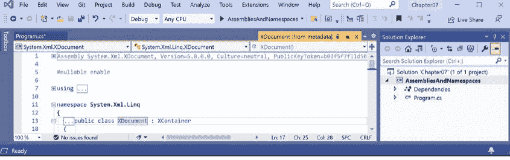

图 7.1：包含 XDocument 类型的程序集和命名空间

实际上，你的代码编辑器在技术上是在欺骗你。 如果你还记得我们在第 2 章 Speaking C# 中编写代码时，当我们揭示 C# 词汇的范围时，我们发现 System.Runtime.dll 程序集不包含任何类型。

它包含的是类型转发器。 这些是特殊类型，看起来存在于程序集中，但实际上在其他地方实现。 在这种情况下，它们是在 .NET 运行时内部使用高度优化的代码实现的。

## 使用 .NET Standard 与旧版平台共享代码

在 .NET Standard 之前，有便携类库 (PCL)。 使用 PCL，你可以创建代码库并明确指定希望库支持的平台，例如 Xamarin、Silverlight 和 Windows 8。 然后你的库可以使用指定平台支持的 API 的交集。

Microsoft 意识到这不可持续，因此创建了 .NET Standard —— 所有未来 .NET 平台都将支持的单一 API。 .NET Standard 有较旧的版本，但 .NET Standard 2.0 试图统一所有重要的最新 .NET 平台。 .NET Standard 2.1 于 2019 年底发布，但只有 .NET Core 3.0 和当年版本的 Xamarin 支持其新功能。 在本书的其余部分，我将使用术语 .NET Standard 指代 .NET Standard 2.0。

.NET Standard 与 HTML5 相似，因为它们都是平台应支持的标准。 正如 Google 的 Chrome 浏览器和 Microsoft 的 Edge 浏览器实现 HTML5 标准一样，.NET Core、.NET Framework 和 Xamarin 都实现 .NET Standard。 如果你想创建可在旧版 .NET 变体之间工作的类型库，最简单的方法是使用 .NET Standard。


> 良好实践：由于 .NET Standard 2.1 中的许多 API 添加需要运行时更改，而 .NET Framework 是 Microsoft 需要尽可能保持不变的旧版平台，因此 .NET Framework 4.8 保留在 .NET Standard 2.0 上，而不是实现 .NET Standard 2.1。 如果你需要支持 .NET Framework 客户，那么你应该在 .NET Standard 2.0 上创建类库，即使它不是最新的并且不支持所有最近的语言和 BCL 新功能。

你选择的 .NET Standard 版本取决于在最大化平台支持和可用功能之间取得平衡。较低的版本支持更多平台，但 API 集合较小。较高的版本支持更少的平台，但 API 集合更大。 通常，你应该选择支持你所需所有 API 的最低版本。

## 理解使用不同 SDK 的类库的默认值

使用 dotnet SDK 工具创建类库时，了解默认情况下将使用哪个目标框架可能会很有用，如下表所示：

| SDK | 新类库的默认目标框架 |
|---|---|
| .NET Core 3.1 | netstandard2.0 |
| .NET 5 | net5.0 |
| .NET 6 | net6.0 |

当然，仅因为类库在默认情况下针对特定版本的 .NET 并不意味着在创建类库项目使用默认模板后就无法更改它。

你可以手动将目标框架设置为支持需要引用该库的项目的值，如下表所示：

| 类库目标框架 | 可被以下目标的项目使用 |
|---|---|
| netstandard2.0 | .NET Framework 4.6.1 或更高版本, .NET Core 2.0 或更高版本, .NET 5.0 或更高版本, Mono 5.4 或更高版本, Xamarin.Android 8.0 或更高版本, Xamarin.iOS 10.14 或更高版本 |
| netstandard2.1 | .NET Core 3.0 或更高版本, .NET 5.0 或更高版本, Mono 6.4 或更高版本, Xamarin.Android 10.0 或更高版本, Xamarin.iOS 12.16 或更高版本 |
| net5.0 | .NET 5.0 或更高版本 |
| net6.0 | .NET 6.0 或更高版本 |


> **良好实践：** 始终检查类库的目标框架，然后在必要时手动将其更改为更合适的框架。应有意识地决定它应该是什么，而不是接受默认值。

## 创建 .NET Standard 2.0 类库

我们将使用 .NET Standard 2.0 创建一个类库，以便它可以在所有重要的 .NET 旧版平台上使用，并在 Windows、macOS 和 Linux 操作系统上跨平台运行，同时还能访问广泛的 .NET API：

-   1. 使用您喜欢的代码编辑器向 Chapter07 解决方案/工作区添加一个名为 SharedLibrary 的新类库。
-   2. 如果您使用 Visual Studio 2022，在提示选择目标框架时，选择 .NET Standard 2.0，然后将解决方案的启动项目设置为当前选择。
-   3. 如果您使用 Visual Studio Code，请包含一个开关以将目标设为 .NET Standard 2.0，如以下命令所示：
-   4. 如果您使用 Visual Studio Code，请将 SharedLibrary 选择为活动的 OmniSharp 项目。

```
dotnet new classlib -f netstandard2.0
```

> **良好实践：** 如果您需要创建使用 .NET 6.0 中新功能的类型，以及仅使用 .NET Standard 2.0 功能的类型，那么您可以创建两个单独的类库：一个以 .NET Standard 2.0 为目标，另一个以 .NET 6.0 为目标。您将在 *第 10 章，使用 Entity Framework Core 操作数据* 中看到实际应用。

手动创建两个类库的替代方案是创建一个支持多目标的类库。如果您希望我在下一版中添加有关多目标的章节，请告诉我。您可以在此处阅读有关多目标的信息： https://docs.microsoft.com/en-us/dotnet/standard/library-guidance/cross-platform-targeting#multi-targeting.

## 控制 .NET SDK

默认情况下，执行 dotnet 命令会使用最新安装的 .NET SDK。可能有时候您想要控制使用哪个 SDK。

例如，第四版的一位读者希望他们的体验与书中使用 .NET Core 3.1 SDK 的步骤相匹配。但他们也安装了 .NET 5.0 SDK，并且默认使用的是该 SDK。如前一节所述，创建新类库时的行为已更改为以 .NET 5.0 为目标，而不是 .NET Standard 2.0，这让读者感到困惑。

您可以通过使用 global.json 文件来控制默认使用的 .NET SDK。dotnet 命令会在当前文件夹和祖先文件夹中搜索 global.json 文件。

-   1. 在 Chapter07 文件夹中创建一个名为 ControlSDK 的子目录/文件夹。
-   2. 在 Windows 上，启动 **命令提示符** 或 **Windows 终端**。在 macOS 上，启动 **终端**。如果您使用的是 Visual Studio Code，则可以使用集成终端。
-   3. 在 ControlSDK 文件夹中，在命令提示符或终端中，输入命令创建 global.json 文件以强制使用最新的 .NET Core 3.1 SDK，如以下命令所示：
-   4. 打开 global.json 文件并查看其内容，如以下标记所示：

```
dotnet new globaljson --sdk-version 3.1.412
```

```
{
  "sdk": {
    "version": "3.1.412"
  }
}
```

> 您可以在以下链接的表格中查找最新 .NET SDK 的版本号： https://dotnet.microsoft.com/download/visual-studio-sdks

5. 在 ControlSDK 文件夹中，在命令提示符或终端中，输入命令创建类库项目，如以下命令所示：

```
dotnet new classlib
```

6. 如果您未安装 .NET Core 3.1 SDK，则会看到错误，如以下输出所示：

```
Could not execute because the application was not found or a compatible .NET SDK is not installed.
```

7. 如果您已安装 .NET Core 3.1 SDK，则将创建一个默认以 .NET Standard 2.0 为目标的类库项目。

您无需完成上述步骤，但如果您想尝试并且尚未安装 .NET Core 3.1 SDK，则可以从以下链接安装：

https://dotnet.microsoft.com/download/dotnet/3.1

## 发布您的代码以进行部署

如果您写了一本小说并希望其他人阅读它，您必须发布它。

大多数开发人员编写代码供其他开发人员在其自己的代码中使用，或供用户作为应用程序运行。为此，您必须将代码作为打包的类库或可执行应用程序发布。

发布和部署 .NET 应用程序有三种方式，它们是：

-   1. 基于框架的部署 (FDD)。
-   2. 基于框架的可执行文件 (FDEs)。
-   3. 自包含。

如果您选择部署应用程序及其包依赖项，但不部署 .NET 本身，那么您依赖于目标计算机上已存在 .NET。这对于部署到服务器的 Web 应用程序效果很好，因为服务器上可能已经存在 .NET 和许多其他 Web 应用程序。

基于框架的部署 (FDD) 意味着您部署一个必须由 dotnet 命令行工具执行的 DLL。基于框架的可执行文件 (FDE) 意味着您部署一个可以直接从命令行运行的 EXE。两者都要求系统上已安装 .NET。

有时，您希望能够给某人一个包含应用程序的 USB 驱动器，并知道它可以在他们的计算机上执行。您希望执行自包含部署。虽然部署文件的大小会更大，但您会知道它会正常工作。

## 创建要发布的控制台应用程序

让我们探索如何发布控制台应用程序：

-   1. 使用您喜欢的代码编辑器向 Chapter07 解决方案/工作区添加一个名为 DotNetEverywhere 的新控制台应用。
-   2. 在 Visual Studio Code 中，将 DotNetEverywhere 选择为活动的 OmniSharp 项目。当您看到弹出警告消息说缺少必需的资源时，单击“是”以添加它们。
-   3. 在 Program.cs 中，删除注释并静态导入 Console 类。
-   4. 在 Program.cs 中，添加语句输出一条消息，说明控制台应用可以在任何地方运行以及有关操作系统的一些信息，如以下代码所示：
-   5. 打开 DotNetEverywhere.csproj 并在 <PropertyGroup> 元素内添加运行时标识符以针对三个操作系统，如以下标记中突出显示所示：

```csharp
WriteLine("I can run everywhere!");

WriteLine($"OS Version is {Environment.OSVersion}.");

if (OperatingSystem.IsMacOS())
{
    WriteLine("I am macOS.");
}
else if (OperatingSystem.IsWindowsVersionAtLeast(major: 10))
{
    WriteLine("I am Windows 10 or 11.");
}
else
{
    WriteLine("I am some other mysterious OS.");
}

WriteLine("Press ENTER to stop me.");
ReadLine();
```

```
<Project Sdk="Microsoft.NET.Sdk">

  <PropertyGroup>
    <OutputType>Exe</OutputType>
    <TargetFramework>net6.0</TargetFramework>
    <Nullable>enable</Nullable>
    <ImplicitUsings>enable</ImplicitUsings>
    <RuntimeIdentifiers>
      win10-x64;osx-x64;osx.11.0-arm64;linux-x64;linux-arm64
    </RuntimeIdentifiers>
  </PropertyGroup>

</Project>
```

-   - win10-x64 RID 值表示 Windows 10 或 Windows Server 2016 64 位。您也可以使用 win10-arm64 RID 值部署到 Microsoft Surface Pro X。
-   - osx-x64 RID 值表示 macOS Sierra 10.12 或更高版本。您还可以指定特定版本的 RID 值，如 osx.10.15-x64（Catalina）、osx.11.0-x64（Intel 上的 Big Sur）或 osx.11.0-arm64（Apple Silicon 上的 Big Sur）。
-   - linux-x64 RID 值表示大多数 Linux 桌面发行版，如 Ubuntu、CentOS、Debian 或 Fedora。使用 linux-arm 用于 Raspbian 或 Raspberry Pi OS 32 位。使用 linux-arm64 用于运行 Ubuntu 64 位的 Raspberry Pi。

## 了解 dotnet 命令

当您安装 .NET SDK 时，它包含一个名为 dotnet 的命令行界面 (CLI)。

## 创建新项目

.NET CLI 具有在当前文件夹上工作的命令，可使用模板创建新项目：

-   1. 在 Windows 上，启动命令提示符或 Windows 终端。在 macOS 上，启动终端。如果您使用的是 Visual Studio Code，则可以使用集成终端。


2. 输入 dotnet new --list 或 dotnet new -l 命令以列出当前已安装的模板，如图 7.2 所示：

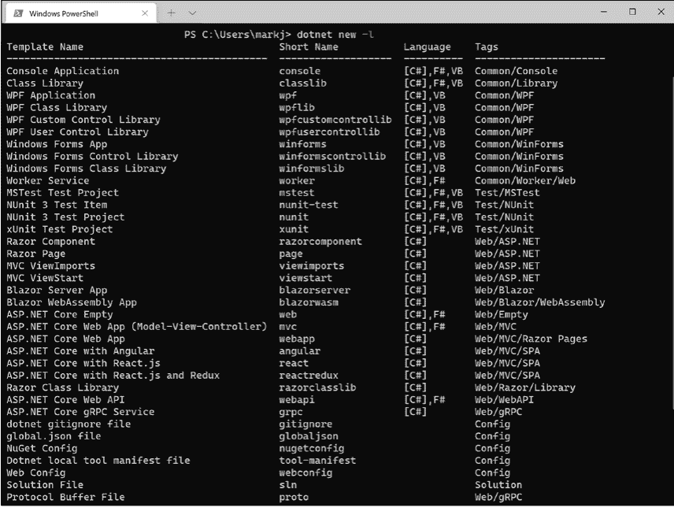

图 7.2：已安装的 dotnet new 项目模板列表

大多数 dotnet 命令行开关都有长版本和短版本。例如，--list 或 -l。短版本输入更快，但更可能被你或其他人误解。有时多输入一些字符会更清晰。

## 获取 .NET 及其环境的信息

查看当前已安装的 .NET SDK 和运行时，以及操作系统信息很有用，如以下命令所示：

```
dotnet --info
```

请注意结果，如以下部分输出所示：

```
.NET SDK (reflecting any global.json):
  Version:    6.0.100
  Commit:     22d70b47bc

Runtime Environment:
  OS Name:      Windows
  OS Version:   10.0.19043
  OS Platform:  Windows
  RID:          win10-x64
  Base Path:    C:\Program Files\dotnet\sdk\6.0.100\

Host (useful for support):
  Version: 6.0.0
  Commit:  91ba01788d

.NET SDKs installed:
  3.1.412 [C:\Program Files\dotnet\sdk]
  5.0.400 [C:\Program Files\dotnet\sdk]
  6.0.100 [C:\Program Files\dotnet\sdk]

.NET runtimes installed:
  Microsoft.AspNetCore.All 2.1.29 [...\dotnet\shared\Microsoft.AspNetCore.All]
  ...
```

## 管理项目

.NET CLI 具有以下可在当前文件夹中的项目上使用的命令，以管理项目：

- dotnet restore：这会为项目下载依赖项。
- dotnet build：这会构建，即编译项目。
- dotnet test：这会构建然后运行项目的单元测试。
- dotnet run：这会构建然后运行项目。
- dotnet pack：这会为项目创建 NuGet 包。
- dotnet publish：这会构建然后发布项目，可以带依赖项或作为自包含应用程序。
- dotnet add：这会向项目添加对包或类库的引用。
- dotnet remove：这会从项目中移除对包或类库的引用。
- dotnet list：这会列出项目的包或类库引用。

## 发布自包含应用程序

现在你已经看到了一些 dotnet 工具命令的示例，我们可以发布我们的跨平台控制台应用程序：

- 1. 在命令行中，确保你位于 DotNetEverywhere 文件夹中。
- 2. 输入命令以构建并发布 Windows 10 的控制台应用程序的发行版本，如以下命令所示：
- 3. 请注意构建引擎会还原所需的任何包，将项目源代码编译为程序集 DLL，并创建发布文件夹，如以下输出所示：
- 4. 输入命令以构建并发布 macOS 和 Linux 变体的发行版本，如以下命令所示：
- 5. 打开 macOS Finder 窗口或 Windows 文件资源管理器，导航到 DotNetEverywhere\bin\Release\net6.0，并注意各种操作系统的输出文件夹。
- 6. 在 win10-x64 文件夹中，选择发布文件夹，注意所有支持程序集，如 Microsoft.CSharp.dll。
- 7. 选择 DotNetEverywhere 可执行文件，并注意其大小为 161 KB，如图 7.3 所示：

```
dotnet publish -c Release -r win10-x64
```

```
Microsoft (R) Build Engine version 17.0.0+073022eb4 for .NET
Copyright (C) Microsoft Corporation. All rights reserved.

Determining projects to restore...
Restored C:\Code\Chapter07\DotNetEverywhere\DotNetEverywhere.csproj (in 46.89 sec).
DotNetEverywhere -> C:\Code\Chapter07\DotNetEverywhere\bin\Release\
net6.0\win10-x64\DotNetEverywhere.dll
DotNetEverywhere -> C:\Code\Chapter07\DotNetEverywhere\bin\Release\
net6.0\win10-x64\publish\
```

```
dotnet publish -c Release -r osx-x64
dotnet publish -c Release -r osx.11.0-arm64
dotnet publish -c Release -r linux-x64
dotnet publish -c Release -r linux-arm64
```


良好实践：你可以使用 PowerShell 等脚本语言来自动化这些命令，并在任何操作系统上使用跨平台的 PowerShell Core 执行它。只需创建一个扩展名为 .ps1 的文件，并在其中写入这五个命令。然后执行该文件。了解有关 PowerShell 的更多信息，请访问以下链接：https://github.com/markjprice/cs10dotnet6/tree/main/docs/powershell

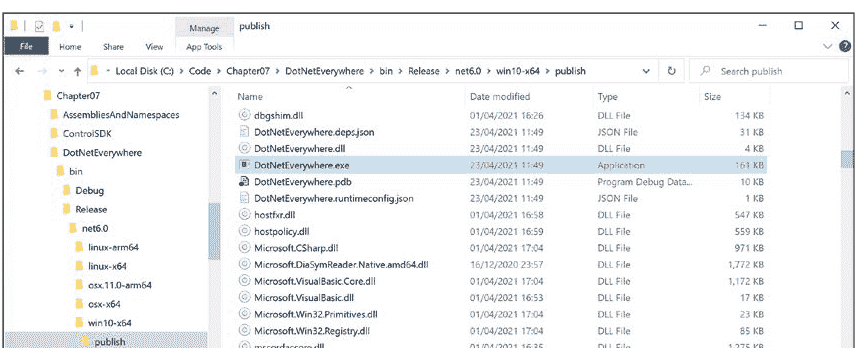

图 7.3：Windows 10 64 位的 DotNetEverywhere 可执行文件

- 8. 如果你使用的是 Windows，则双击执行程序并注意结果，如以下输出所示：

```
I can run everywhere!
OS Version is Microsoft Windows NT 10.0.19042.0.
I am Windows 10.
Press ENTER to stop me.
```

- 9. 请注意发布文件夹及其所有文件的总大小为 64.8 MB。

- 10. 在 osx.11.0-arm64 文件夹中，选择发布文件夹，注意所有支持程序集，然后选择 DotNetEverywhere 可执行文件，并注意可执行文件大小为 126 KB，发布文件夹为 71.8 MB。

如果你将这些发布文件夹中的任何一个复制到相应的操作系统，控制台应用程序将运行；这是因为它是一个自包含的可部署 .NET 应用程序。例如，在搭载 Intel 的 macOS 上，如以下输出所示：

```
I can run everywhere!
OS Version is Unix 11.2.3
I am macOS.
Press ENTER to stop me.
```

此示例使用了控制台应用程序，但你同样可以轻松创建 ASP.NET Core 网站或 Web 服务，或 Windows Forms 或 WPF 应用程序。当然，你只能将 Windows 桌面应用程序部署到 Windows 计算机，而不能部署到 Linux 或 macOS。

## 发布单文件应用程序

要作为“单”文件发布，你可以在发布时指定标志。在 .NET 5 中，单文件应用程序主要针对 Linux，因为 Windows 和 macOS 都存在限制，导致真正的单文件发布在技术上不可行。在 .NET 6 中，你现在可以在 Windows 上创建适当的单文件应用程序。

如果你可以假设要在其上运行应用程序的计算机上已安装 .NET 6，那么你可以在发布应用程序的发行版本时使用额外的标志，表明它不需要是自包含的，并且你希望将其作为单文件发布（如有可能），如下所示的命令（必须在一行中输入）：

```
dotnet publish -r win10-x64 -c Release --self-contained=false
/p:PublishSingleFile=true
```

这将生成两个文件：DotNetEverywhere.exe 和 DotNetEverywhere.pdb。.exe 是可执行文件。.pdb 文件是程序调试数据库文件，存储调试信息。


> 在 macOS 上发布的应用程序没有 .exe 文件扩展名，因此如果在上面的命令中使用 osx-x64，文件名将没有扩展名。

如果你希望 .pdb 文件嵌入到 .exe 文件中，则在 .csproj 文件的 <PropertyGroup> 元素中添加 <DebugType> 元素并将其设置为 embedded，如以下标记中突出显示所示：

```
<PropertyGroup>

    <OutputType>Exe</OutputType>
    <TargetFramework>net6.0</TargetFramework>
    <Nullable>enable</Nullable>
    <ImplicitUsings>enable</ImplicitUsings>
    <RuntimeIdentifiers>
        win10-x64;osx-x64;osx.11.0-arm64;linux-x64;linux-arm64
    </RuntimeIdentifiers>
    <DebugType>embedded</DebugType>

</PropertyGroup>
```

如果你不能假设计算机上已安装 .NET 6，那么尽管 Linux 也只生成两个文件，但对于 Windows 预计会出现以下额外文件：coreclr.dll、clrjit.dll、clrcompression.dll 和 mscordaccore.dll。

让我们看一个 Windows 的示例：

- 1. 在命令行中，输入命令以构建 Windows 10 的控制台应用程序的发行版本，如以下命令所示：
- 2. 导航到 DotNetEverywhere\bin\Release\net6.0\win10-x64\publish 文件夹，选择 DotNetEverywhere 可执行文件，并注意可执行文件现在为 58.3 MB，并且还有一个大小为 10 KB 的 .pdb 文件。你的系统上的大小会有所不同。

```
dotnet publish -c Release -r win10-x64 /p:PublishSingleFile=true
```


## 使用应用修剪减小应用大小

将 .NET 应用作为自包含应用部署时的问题之一是 .NET 库占用大量空间。需要减小大小的最大需求之一是 Blazor WebAssembly 组件，因为所有 .NET 库都需要下载到浏览器。

好在，你可以通过不在部署中打包未使用的程序集来减小此大小。随 .NET Core 3.0 引入的应用修剪系统可以识别代码所需的程序集并移除不需要的程序集。

在 .NET 5 中，修剪进一步扩展，通过移除程序集中未使用的单个类型，甚至像方法这样的成员。例如，对于一个 Hello World 控制台应用，System.Console.dll 程序集从 61.5 KB 修剪到 31.5 KB。对于 .NET 5，这是一个实验性功能，因此默认情况下处于禁用状态。

在 .NET 6 中，Microsoft 在其库中添加了注释以指示如何安全地进行修剪，因此对类型和成员的修剪成为默认设置。这被称为链接修剪模式。

问题在于修剪识别未使用程序集、类型和成员的准确性。如果你的代码是动态的，也许使用反射，那么它可能无法正确工作，因此 Microsoft 也允许手动控制。

### 启用程序集级修剪

启用程序集级修剪有两种方法。

第一种方法是在项目文件中添加一个元素，如以下标记所示：

```
<PublishTrimmed>true</PublishTrimmed>
```

第二种方法是在发布时添加一个标志，如以下命令中突出显示的那样：

```
dotnet publish ... -p:PublishTrimmed=True
```

### 启用类型级和成员级修剪

启用类型级和成员级修剪有两种方法。

第一种方法是在项目文件中添加两个元素，如以下标记所示：

```
<PublishTrimmed>true</PublishTrimmed>
<TrimMode>Link</TrimMode>
```

第二种方法是在发布时添加两个标志，如以下命令中突出显示的那样：

```
dotnet publish ... -p:PublishTrimmed=True -p:TrimMode=Link
```

对于 .NET 6，链接修剪模式是默认设置，因此只有在想要设置像 copyused 这样的替代修剪模式时才需要指定开关，这意味着程序集级修剪。

### 反编译 .NET 程序集

学习如何为 .NET 编码的最佳方法之一是看看专业人士是如何做的。


> **Good Practice:** 你可以出于非学习目的反编译他人的程序集，例如复制其代码用于自己的生产库或应用程序，但请记住你正在查看其知识产权，请尊重这一点。

### 使用 Visual Studio 2022 的 ILSpy 扩展进行反编译

出于学习目的，你可以使用 ILSpy 等工具反编译任何 .NET 程序集。

- 1. 在 Windows 版 Visual Studio 2022 中，导航到 **Extensions** | **Manage Extensions**。
- 2. 在搜索框中输入 ilspy。
- 3. 对于 **ILSpy** 扩展，点击 **Download**。
- 4. 点击 **Close**。
- 5. 关闭 Visual Studio 以允许扩展安装。
- 6. 重新启动 Visual Studio 并重新打开 Chapter07 解决方案。
- 7. 在 **Solution Explorer** 中，右键单击 **DotNetEverywhere** 项目并选择 **Open output in ILSpy**。
- 8. 导航到 **File** | **Open...**。
- 9. 导航到以下文件夹：
   `Code/Chapter07/DotNetEverywhere/bin/Release/net6.0/linux-x64`
- 10. 选择 System.IO.FileSystem.dll 程序集并点击 **Open**。
- 11. 在 **Assemblies** 树中，展开 **System.IO.FileSystem** 程序集，展开 **System.IO** 命名空间，选择 **Directory** 类，并等待其反编译。
- 12. 在 Directory 类中，点击 **[+]** 展开 GetParent 方法，如图 7.4 所示：

```
Code/Chapter07/DotNetEverywhere/bin/Release/net6.0/linux-x64
```

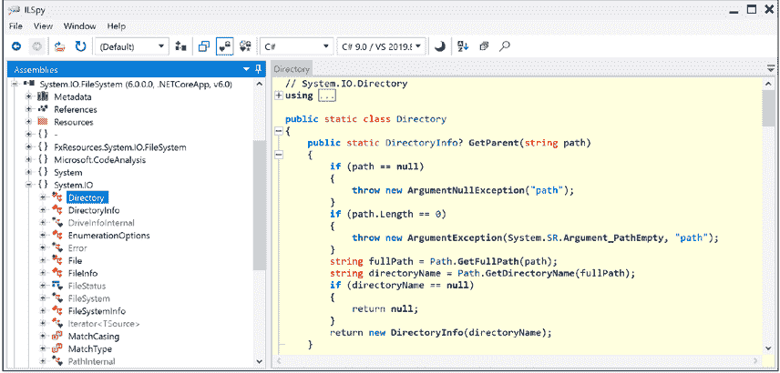

图 7.4：Windows 上 Directory 类的反编译 GetParent 方法

- 13. 注意检查 path 参数的良好实践，如果它为 null 则抛出 ArgumentNullException，如果长度为零则抛出 ArgumentException。
- 14. 关闭 ILSpy。

### 使用 Visual Studio Code 的 ILSpy 扩展进行反编译

类似的功能作为 Visual Studio Code 的扩展跨平台可用。

- 1. 如果你尚未安装 Visual Studio Code 的 ILSpy .NET 反编译器扩展，请搜索并立即安装。
- 2. 在 macOS 或 Linux 上，该扩展依赖于 Mono，因此你还需要从以下链接安装 Mono：https://www.mono-project.com/download/stable/。
- 3. 在 Visual Studio Code 中，导航到 View | Command Palette....。
- 4. 输入 ilspy 然后选择 ILSpy: Decompile IL Assembly (pick file)。
- 5. 导航到以下文件夹：

```
Code/Chapter07/DotNetEverywhere/bin/Release/net6.0/linux-x64
```

- 6. 选择 System.IO.FileSystem.dll 程序集并点击 Select assembly。似乎不会发生任何事情，但你可以通过查看 Output 窗口，在下拉列表中选择 ilspy-vscode 并查看处理过程来确认 ILSpy 正在工作，如图 7.5 所示：

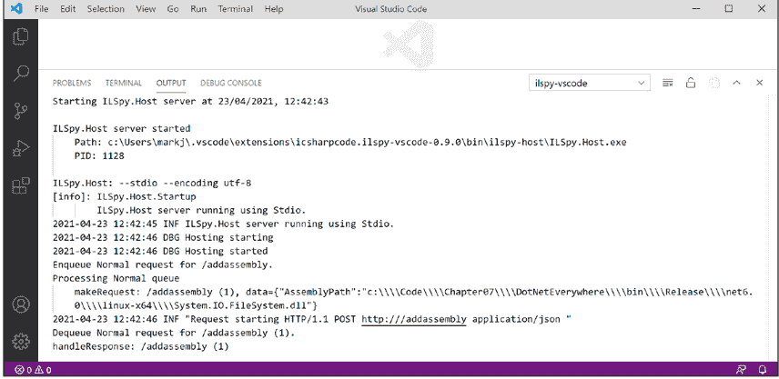

图 7.5：选择程序集进行反编译时 ILSpy 扩展的输出

- 7. 在 EXPLORER 中，展开 ILSpy DECOMPILED MEMBERS，选择程序集，关闭 Output 窗口，并注意打开的两个编辑窗口，显示使用 C# 代码的程序集属性以及使用 IL 代码的外部 DLL 和程序集引用，如图 7.6 所示：

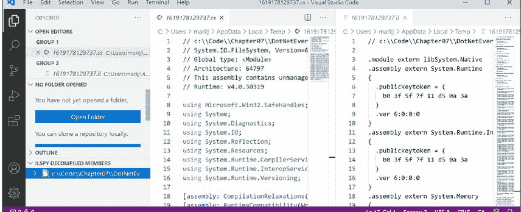

图 7.6：展开 ILSpy DECOMPILED MEMBERS

- 8. 在右侧的 IL 代码中，注意对 System.Runtime 程序集的引用，包括版本号，如以下代码所示：

```
.module extern libSystem.Native
.assembly extern System.Runtime
{
    .publickeytoken = (
        b0 3f 5f 7f 11 d5 0a 3a
    )
    .ver 6:0:0:0
}
```

.module extern libSystem.Native 表示此程序集会像与文件系统交互的代码所期望的那样向 Linux 系统 API 发出函数调用。如果我们反编译了此程序集的 Windows 等效版本，它将使用 .module extern kernel32.dll 代替，这是一个 Win32 API。

- 9. 在 EXPLORER 中，在 ILSpy DECOMPILED MEMBERS 下展开程序集，展开 System.IO 命名空间，选择 Directory，并注意打开的两个编辑窗口，左侧使用 C# 代码显示反编译的 Directory 类，右侧显示 IL 代码，如图 7.7 所示：

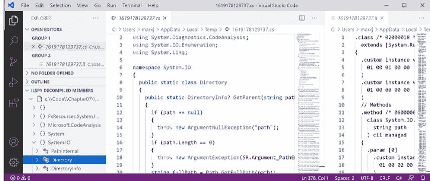

图 7.7：C# 和 IL 代码中的反编译 Directory 类

- 10. 比较以下代码中显示的 GetParent 方法的 C# 源代码：

```csharp
public static DirectoryInfo? GetParent(string path)
{
    if (path == null)
    {
        throw new ArgumentNullException("path");
    }
    if (path.Length == 0)
    {
        throw new ArgumentException(SR.Argument_PathEmpty, "path");
    }
    string fullPath = Path.GetFullPath(path);
    string directoryName = Path.GetDirectoryName(fullPath);
    if (directoryName == null)
    {
        return null;
    }
    return new DirectoryInfo(directoryName);
}
```

- 11. 使用以下代码中显示的 GetParent 方法的等效 IL 源代码：

```il
.method /* 06000067 */ public hidebysig static
    class System.IO.DirectoryInfo GetParent (
        string path
    ) cil managed
{
    .param [0]
    .custom instance void System.Runtime.CompilerServices.NullableAttribute::.ctor(uint8) = (
        01 00 02 00 00
    )
    // Method begins at RVA 0x62d4
    // Code size 64 (0x40)
    .maxstack 2
    .locals /* 1100000E */ (
        [0] string,
        [1] string
    )

    IL_0000: ldarg.0
    IL_0001: brtrue.s IL_000e

    IL_0003: ldstr "path" /* 700005CB */
    IL_0008: newobj instance void [System.Runtime] System.ArgumentNullException::.ctor(string) /* 0A000035 */
    IL_000d: throw

    IL_000e: ldarg.0
    IL_000f: callvirt instance int32 [System.Runtime] System.String::get_Length() /* 0A000022 */
    IL_0014: brtrue.s IL_0026
    IL_0016: call string System.SR::get_Argument_PathEmpty() /* 0600004C */
    IL_001b: ldstr "path" /* 700005CB */
    IL_0020: newobj instance void [System.Runtime] System.ArgumentException::.ctor(string, string) /* 0A000036 */
    IL_0025: throw
    IL_0026: ldarg.0
```

```
IL_0027: call string [System.Runtime.Extensions]
    System.IO.Path::GetFullPath(string) /* 0A000037 */
IL_002c: stloc.0
IL_002d: ldloc.0
IL_002e: call string [System.Runtime.Extensions]
    System.IO.Path::GetDirectoryName(string) /* 0A000038 */
IL_0033: stloc.1
IL_0034: ldloc.1
IL_0035: brtrue.s IL_0039
IL_0037: ldnull
IL_0038: ret
IL_0039: ldloc.1
IL_003a: newobj instance void
    System.IO.DirectoryInfo::.ctor(string) /* 06000097 */
IL_003f: ret
} // end of method Directory::GetParent
```


**良好实践：** IL 代码编辑窗口除非你对 C# 和 .NET 开发非常深入，了解 C# 编译器如何将源代码翻译成 IL 代码很重要，否则并不特别有用。更有用的编辑窗口包含由微软专家编写的等效 C# 源代码。你可以通过查看专业人士如何实现类型来学习很多良好实践。例如，GetParent 方法展示了如何检查参数是否为 null 以及其他参数异常。

- 12. 不保存更改的情况下关闭编辑窗口。
- 13. 在 **资源管理器** 中，在 **ILSPY 反编译成员** 中，右键单击程序集并选择 **卸载程序集**。

## 不，你在技术上无法阻止反编译

我有时会被问到是否有办法保护编译后的代码以防止反编译。简短的回答是否定的，如果你想想，你会明白为什么必须如此。你可以使用像 **Dotfuscator** 这样的混淆工具使其更困难，但最终你无法完全阻止它。

所有编译后的应用程序都包含对运行它的平台、操作系统和硬件的指令。这些指令在功能上必须与原始源代码相同，只是对人类来说更难阅读。这些指令必须可读才能执行你的代码；因此它们也必须可读才能被反编译。如果你使用某种自定义技术来保护代码不被反编译，那么你也会阻止你的代码运行！

虚拟机模拟硬件，因此可以捕获正在运行的应用程序与其认为正在运行的软件和硬件之间的所有交互。

如果你能保护你的代码，那么你也无法附加调试器并逐步执行它。如果编译后的应用程序有 pdb 文件，那么你可以附加调试器并逐行逐步执行语句。即使没有 pdb 文件，你仍然可以附加调试器并对代码的工作方式有所了解。

这适用于所有编程语言。不仅仅是 .NET 语言如 C#、Visual Basic 和 F#，也包括 C、C++、Delphi、汇编语言：所有这些都可以附加调试器或被反汇编或反编译。专业人士使用的一些工具显示在下表中：

| 类型 | 产品 | 描述 |
|---|---|---|
| 虚拟机 | VMware | 专业人员如恶意软件分析师总是会在虚拟机内部运行软件。 |
| 调试器 | SoftICE | 通常在虚拟机中在操作系统下方运行。 |
| 调试器 | WinDbg | 对于理解 Windows 内部结构很有用，因为它比其他调试器更了解 Windows 数据结构。 |
| 反汇编器 | IDA Pro | 由专业恶意软件分析师使用。 |
| 反编译器 | HexRays | 反编译 C 应用。IDA Pro 的插件。 |
| 反编译器 | DeDe | 反编译 Delphi 应用。 |
| 反编译器 | dotPeek | 来自 JetBrains 的 .NET 反编译器。 |


> **良好实践：** 调试、反汇编和反编译别人的软件很可能违反其许可协议，并且在许多司法管辖区是非法的。与其试图用技术解决方案来保护你的知识产权，有时法律是你唯一的救济途径。

## 为 NuGet 分发打包你的库

在学习如何创建和打包我们自己的库之前，我们将回顾项目如何使用现有包。

## 引用 NuGet 包

假设你想添加由第三方开发者创建的包，例如 Newtonsoft.Json，这是一个用于 JavaScript Object Notation（JSON）序列化格式的流行包：

- 1. 在 `AssembliesAndNamespaces` 项目中，添加对 `Newtonsoft.Json` NuGet 包的引用，要么使用 Visual Studio 2022 的 GUI，要么使用 Visual Studio Code 的 `dotnet add package` 命令。
- 2. 打开 `AssembliesAndNamespaces.csproj` 文件并注意已添加包引用，如以下标记所示：

```xml
<ItemGroup>
  <PackageReference Include="newtonsoft.json" Version="13.0.1" />
</ItemGroup>
```

如果你有更新版本的 newtonsoft.json 包，那么自本书编写以来它已被更新。

## 修复依赖项

为了始终如一地还原包并编写可靠的代码，修复依赖项很重要。修复依赖项意味着你使用的是为特定版本的 .NET 发布的一系列包，例如 .NET 6.0 的 SQLite，如以下标记中突出显示所示：

```xml
<Project Sdk="Microsoft.NET.Sdk">

  <PropertyGroup>
    <OutputType>Exe</OutputType>
    <TargetFramework>net6.0</TargetFramework>
  </PropertyGroup>

  <ItemGroup>
    <PackageReference
      Include="Microsoft.EntityFrameworkCore.Sqlite"
      Version="6.0.0" />
  </ItemGroup>

</Project>
```

要修复依赖项，每个包都应具有单一版本且没有附加限定符。附加限定符包括测试版（beta1）、发布候选版（rc4）和通配符（*）。

通配符允许自动引用和使用未来版本，因为它们始终代表最新发布。但通配符因此很危险，因为它们可能导致使用未来不兼容的包，从而破坏你的代码。

在编写书籍时这可能是值得冒的风险，因为新预览版本每月发布，你不想不断更新包引用，就像我在 2021 年所做的那样，如以下标记所示：

```xml
<PackageReference
  Include="Microsoft.EntityFrameworkCore.Sqlite"
  Version="6.0.0-preview.*" />
```

如果你使用 dotnet add package 命令或 Visual Studio 的管理 NuGet 包，那么它默认会使用包的最新特定版本。但如果你从博客文章复制粘贴配置或手动添加引用，你可能会包含通配符限定符。

以下依赖项是未修复的 NuGet 包引用的示例，因此除非你了解其影响，否则应避免：

```xml
<PackageReference Include="System.Net.Http" Version="4.1.0-*" />
<PackageReference Include="Newtonsoft.Json" Version="12.0.3-beta1" />
```

> 良好实践：微软保证如果你将依赖项修复为随特定版本的 .NET 发行的一起发布的，例如 6.0.0，这些包将全部协同工作。几乎总是修复你的依赖项。

## 为 NuGet 打包库

现在，让我们打包你之前创建的 SharedLibrary 项目：

- 1. 在 SharedLibrary 项目中，将 Class1.cs 文件重命名为 StringExtensions.cs。
- 2. 修改其内容以提供一些使用正则表达式验证各种文本值的有用扩展方法，如以下代码所示：

```
using System.Text.RegularExpressions;

namespace Packt.Shared
{
    public static class StringExtensions
    {
        public static bool IsValidXmlTag(this string input)
        {
            return Regex.IsMatch(input, @"^<([a-z]+)([^<>]+)(?:>(.*)</\1>|\s+/>)$");
        }

        public static bool IsValidPassword(this string input)
        {
            // minimum of eight valid characters
            return Regex.IsMatch(input, "^[a-zA-Z0-9_-]{8,}$");
        }

        public static bool IsValidHex(this string input)
        {
            // three or six valid hex number characters
            return Regex.IsMatch(input, "^#?([a-fA-F0-9]{3}|[a-fA-F0-9]{6})$");
        }
    }
}
```


您将在第 8 章《使用常见的 .NET 类型》中学习如何编写正则表达式。

3. 在 SharedLibrary.csproj 中，修改其内容，如以下标记中突出显示所示，并注意以下事项：

- PackageId 必须在全球范围内唯一，因此如果您想将此 NuGet 包发布到 https://www.nuget.org/ 公共源供他人引用和下载，则必须使用不同的值。
- PackageLicenseExpression 必须取自以下链接的值：https://spdx.org/licenses/ 或您可以指定自定义许可证。
- 其他所有元素都是自解释的：

```xml
<Project Sdk="Microsoft.NET.Sdk">
  <PropertyGroup>
    <TargetFramework>netstandard2.0</TargetFramework>
    <GeneratePackageOnBuild>true</GeneratePackageOnBuild>
    <PackageId>Packt.CSdotNet.SharedLibrary</PackageId>
    <PackageVersion>6.0.0.0</PackageVersion>
    <Title>C# 10 and .NET 6 Shared Library</Title>
    <Authors>Mark J Price</Authors>
    <PackageLicenseExpression>
      MS-PL
    </PackageLicenseExpression>
    <PackageProjectUrl>
      https://github.com/markjprice/cs10dotnet6
    </PackageProjectUrl>
    <PackageIcon>packt-csdotnet-sharedlibrary.png</PackageIcon>
    <PackageRequireLicenseAcceptance>true</PackageRequireLicenseAcceptance>
    <PackageReleaseNotes>
      Example shared library packaged for NuGet.
    </PackageReleaseNotes>
    <Description>
      Three extension methods to validate a string value.
    </Description>
    <Copyright>
      Copyright © 2016-2021 Packt Publishing Limited
    </Copyright>
    <PackageTags>string extensions packt csharp dotnet</PackageTags>
  </PropertyGroup>
  <ItemGroup>
    <None Include="packt-csdotnet-sharedlibrary.png">
      <Pack>True</Pack>
      <PackagePath></PackagePath>
    </None>
  </ItemGroup>
</Project>
```

良好实践：配置属性值为 true 或 false 的值不能包含任何空白，因此 <PackageRequireLicenseAcceptance> 条目不能像前面的标记中所示那样有回车和缩进。

4. 从以下链接下载图标文件并将其保存到 SharedLibrary 文件夹中：https://github.com/markjprice/cs10dotnet6/blob/main/vs4win/Chapter07/SharedLibrary/packt-csdotnet-sharedlibrary.png。
5. 构建发布程序集：
   1. 在 Visual Studio 中，在工具栏中选择 Release，然后导航到 Build | Build SharedLibrary。
   2. 在 Visual Studio Code 中，在 Terminal 中输入 dotnet build -c Release
6. 如果我们在项目文件中未将 <GeneratePackageOnBuild> 设置为 true，则必须使用以下额外步骤手动创建 NuGet 包：
   1. 在 Visual Studio 中，导航到 Build | Pack SharedLibrary。
   2. 在 Visual Studio Code 中，在 Terminal 中输入 dotnet pack -c Release。

## 将包发布到公共 NuGet 源

如果您希望每个人都能下载和使用您的 NuGet 包，则必须将其上传到像 Microsoft 这样的公共 NuGet 源：

- 1. 启动您喜欢的浏览器并导航到以下链接：https://www.nuget.org/packages/manage/upload。
- 2. 如果您想上传 NuGet 包供其他开发人员作为依赖包引用，则需要在 https://www.nuget.org/ 使用 Microsoft 帐户登录。
- 3. 单击 Browse... 并选择通过生成 NuGet 包创建的 .nupkg 文件。文件夹路径应为 Code\Chapter07\SharedLibrary\bin\Release，文件名为 Packt.CSdotNet.SharedLibrary.6.0.0.nupkg。
- 4. 验证 SharedLibrary.csproj 文件中输入的信息是否已正确填写，然后单击 Submit。
- 5. 等待几秒钟，您将看到成功消息显示您的包已上传，如图 7.8 所示：

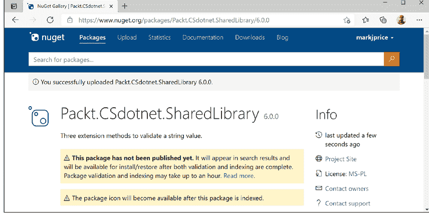

图 7.8：NuGet 包上传消息

良好实践：如果您收到错误，请检查项目文件中的错误，或在 https://docs.microsoft.com/en-us/nuget/reference/msbuild-targets 阅读有关 PackageReference 格式的更多信息。

## 将包发布到私有 NuGet 源

组织可以托管自己的私有 NuGet 源。这可以成为许多开发团队共享工作的便捷方式。您可以在以下链接阅读更多信息：

https://docs.microsoft.com/en-us/nuget/hosting-packages/overview

## 使用工具探索 NuGet 包

Uno Platform 创建了一个名为 NuGet Package Explorer 的便捷工具，用于打开和查看有关 NuGet 包的更多详细信息。除了作为网站之外，它还可以作为跨平台应用安装。让我们看看它能做什么：

- 1. 启动您喜欢的浏览器并导航到以下链接：https://nuget.info。
- 2. 在搜索框中输入 Packt.CSdotnet.SharedLibrary。
- 3. 选择由 Mark J Price 发布 的 v6.0.0 包，然后单击 Open 按钮。
- 4. 在 Contents 部分，展开 lib 文件夹和 netstandard2.0 文件夹。

5. 选择 **SharedLibrary.dll**，并注意详细信息，如图 7.9 所示：

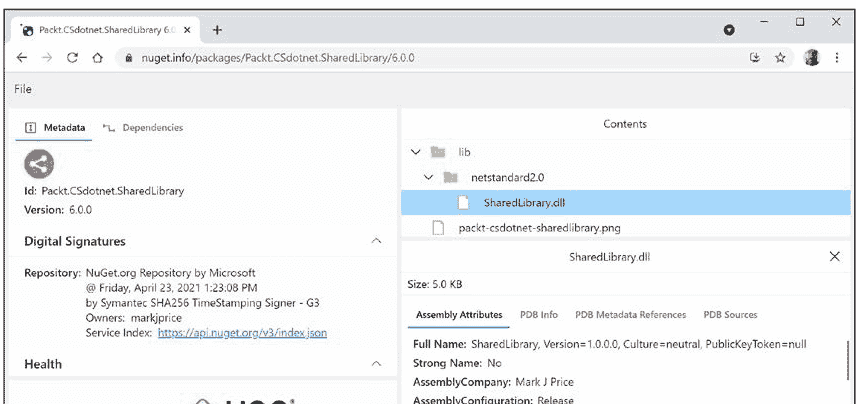

图 7.9：使用 Uno Platform 的 NuGet Package Explorer 探索我的包

6. 如果您以后想在本地使用此工具，请在浏览器中单击 install 按钮。

7. 关闭浏览器。

> 并非所有浏览器都支持以这种方式安装网络应用。我建议使用 Chrome 进行测试和开发。

## 测试您的类库包

您现在将通过在 AssembliesAndNamespaces 项目中引用它来测试您上传的包：

1. 在 AssembliesAndNamespaces 项目中，添加对您（或我的）包的引用，如以下标记中突出显示所示：

```xml
<ItemGroup>
  <PackageReference Include="newtonsoft.json" Version="13.0.1" />
  <PackageReference Include="packt.csdotnet.sharedlibrary" Version="6.0.0" />
</ItemGroup>
```

2. 构建控制台应用。

3. 在 Program.cs 中，导入 Packt.Shared 命名空间。

4. 在 Program.cs 中，提示用户输入一些字符串值，然后使用包中的扩展方法验证它们，如以下代码所示：

```csharp
Write("Enter a color value in hex: ");
string? hex = ReadLine(); // or "00ffc8"
WriteLine("Is {0} a valid color value? {1}",
    arg0: hex, arg1: hex.IsValidHex());

Write("Enter a XML element: ");
string? xmlTag = ReadLine(); // or "<h1 class=\"<\" />"
WriteLine("Is {0} a valid XML element? {1}",
    arg0: xmlTag, arg1: xmlTag.IsValidXmlTag());

Write("Enter a password: ");
string? password = ReadLine(); // or "secretsauce"
WriteLine("Is {0} a valid password? {1}",
    arg0: password, arg1: password.IsValidPassword());
```

5. 运行代码，按提示输入一些值，并查看结果，如以下输出所示：

```
Enter a color value in hex: 00ffc8
Is 00ffc8 a valid color value? True
Enter an XML element: <h1 class="<" />
Is <h1 class="<" /> a valid XML element? False
Enter a password: secretsauce
Is secretsauce a valid password? True
```

## 从 .NET Framework 移植到现代 .NET

如果您是现有的 .NET Framework 开发人员，那么您可能有现有的应用程序认为应该移植到现代 .NET。但您应仔细考虑移植是否是代码的正确选择，因为有时最好的选择是不移植。

例如，您可能有一个在 .NET Framework 4.8 上运行的复杂网站项目，但只有少数用户访问。如果它能正常工作并在最少的硬件上处理访客流量，那么花费数月时间将其移植到 .NET 6 可能是浪费时间。但如果网站目前需要许多昂贵的 Windows 服务器，那么移植的成本最终可能会得到回报，如果您可以迁移到更少、成本更低的 Linux 服务器。

### 您能移植吗？

现代 .NET 在 Windows、macOS 和 Linux 上对以下类型的应用程序有很好的支持，因此它们是移植的良好候选者：

- ASP.NET Core MVC 网站。
- ASP.NET Core Web API Web 服务（REST/HTTP）。


- **ASP.NET Core SignalR** 服务。
- **控制台应用程序** 命令行接口。

现代 .NET 在 Windows 上对以下类型的应用程序有不错的支持，因此它们是移植的潜在候选者：

- **Windows Forms** 应用程序。
- **Windows Presentation Foundation (WPF)** 应用程序。

现代 .NET 对跨平台桌面和移动设备上的以下类型应用程序有良好的支持：

- **Xamarin** 用于移动 iOS 和 Android 的应用。
- **.NET MAUI** 用于桌面 Windows 和 macOS，或移动 iOS 和 Android。

现代 .NET 不支持以下类型的旧版 Microsoft 项目：

- **ASP.NET Web Forms** 网站。这些最好使用 **ASP.NET Core Razor Pages** 或 **Blazor** 重新实现。
- **Windows Communication Foundation (WCF)** 服务（但有一个名为 **CoreWCF** 的开源项目，您可以根据需求使用）。WCF 服务最好使用 **ASP.NET Core gRPC** 服务重新实现。
- **Silverlight** 应用程序。这些最好使用 **.NET MAUI** 重新实现。

Silverlight 和 ASP.NET Web Forms 应用程序永远无法移植到现代 .NET，但现有的 Windows Forms 和 WPF 应用程序可以移植到 Windows 上的 .NET，以便受益于新的 API 和更快的性能。

目前在 .NET Framework 上的旧版 ASP.NET MVC Web 应用程序和 ASP.NET Web API Web 服务可以移植到现代 .NET，然后托管在 Windows、Linux 或 macOS 上。

## Should you port?

即使你 *可以* 移植，*应该* 移植吗？你能获得什么好处？一些常见的好处包括以下内容：

- **部署到 Linux、Docker 或 Kubernetes 用于网站和 Web 服务**：这些操作系统作为网站和 Web 服务平台轻量且经济高效，尤其与更昂贵的 Windows Server 相比。
- **移除对 IIS 和 System.Web.dll 的依赖**：即使你继续部署到 Windows Server，ASP.NET Core 也可以托管在轻量级、更高性能的 Kestrel（或其他）Web 服务器上。
- **命令行工具**：开发人员和管理员用于自动化任务的工具通常构建为控制台应用程序。能够跨平台运行单个工具非常有用。

## Differences between .NET Framework and modern .NET

以下是三个关键区别，如下表所示：

| Modern .NET | .NET Framework |
|---|---|
| 以 NuGet 包形式分发，因此每个应用程序都可以与其所需的 .NET 版本的应用程序本地副本一起部署。 | 以系统范围共享的程序集集合形式分发（字面上在全局程序集缓存 (GAC) 中）。 |
| 拆分为小型分层组件，因此可以执行最小化部署。 | 单一、整体式部署。 |
| 移除了旧技术，例如 ASP.NET Web Forms，以及非跨平台功能，例如 AppDomains、.NET Remoting 和二进制序列化。 | 除了与现代 .NET 中类似的一些技术（如 ASP.NET Core MVC）外，它还保留了一些旧技术，例如 ASP.NET Web Forms。 |

## Understanding the .NET Portability Analyzer

Microsoft 有一个有用的工具，您可以针对现有应用程序运行它以生成移植报告。您可以在以下链接观看该工具的演示：https://channel19.msdn.com/Blogs/Seth-Juarez/A-Brief-Look-at-the-NET-Portability-Analyzer。

## Understanding the .NET Upgrade Assistant

Microsoft 将遗留项目升级到现代 .NET 的最新工具是 .NET Upgrade Assistant。

就我本职工作而言，我在一家名为 Optimizely 的公司工作。我们有一个基于 .NET Framework 的企业级数字体验平台 (DXP)，包含内容管理系统 (CMS) 和用于构建数字商务网站的功能。Microsoft 需要一个具有挑战性的迁移项目来设计和测试 .NET Upgrade Assistant，因此我们与他们合作构建了这个很棒的工具。

目前，它支持以下 .NET Framework 项目类型，之后还将添加更多类型：

- ASP.NET MVC
- Windows Forms
- WPF
- Console Application
- Class Library

它作为全局 dotnet 工具安装，如以下命令所示：

```
dotnet tool install -g upgrade-assistant
```

您可以在以下链接阅读有关此工具的更多信息以及如何使用它：

https://docs.microsoft.com/en-us/dotnet/core/porting/upgrade-assistant-overview

## Using non-.NET Standard libraries

大多数现有 NuGet 包都可以用现代 .NET 使用，即使它们不是为 .NET Standard 或像 .NET 6 这样的现代版本编译的。如果您发现某个包在 nuget.org 网页上未正式支持 .NET Standard，您不必放弃。您应该尝试一下，看看是否有效。

例如，有一个由 Dialect Software LLC 创建的用于处理矩阵的自定义集合包，记录在以下链接：

https://www.nuget.org/packages/DialectSoftware.Collections.Matrix/

该包最后更新于 2013 年，那时远在 .NET Core 或 .NET 6 之前，因此该包是为 .NET Framework 构建的。只要像这样的程序集包仅使用 .NET Standard 中可用的 API，它就可以在现代 .NET 项目中使用。

让我们尝试使用它，看看是否有效：

- 1. 在 AssembliesAndNamespaces 项目中，添加 Dialect Software 包的包引用，如以下标记所示：
- 2. 构建 AssembliesAndNamespaces 项目以还原包。
- 3. 在 Program.cs 中，添加语句以导入 DialectSoftware.Collections 和 DialectSoftware.Collections.Generics 命名空间。
- 4. 添加语句以创建 Axis 和 Matrix<T> 的实例，为其填充值并输出它们，如以下代码所示：

```
<PackageReference
    Include="dialectsoftware.collections.matrix"
    Version="1.0.0" />
```

```
Axis x = new("x", 0, 10, 1);
Axis y = new("y", 0, 4, 1);

Matrix<long> matrix = new(new[] { x, y });

for (int i = 0; i < matrix.Axes[0].Points.Length; i++)
{
    matrix.Axes[0].Points[i].Label = "x" + i.ToString();
}

for (int i = 0; i < matrix.Axes[1].Points.Length; i++)
{
    matrix.Axes[1].Points[i].Label = "y" + i.ToString();
}

foreach (long[] c in matrix)
{
    matrix[c] = c[0] + c[1];
}

foreach (long[] c in matrix)
{
    WriteLine("{0},{1} ({2},{3}) = {4}",
        matrix.Axes[0].Points[c[0]].Label,
        matrix.Axes[1].Points[c[1]].Label,
        c[0], c[1], matrix[c]);
}
```

- 5. 运行代码，注意警告消息和结果，如以下输出所示：

```
warning NU1701: Package 'DialectSoftware.Collections.Matrix 1.0.0' was restored using '.NETFramework,Version=v4.6.1, .NETFramework,Version=v4.6.2, .NETFramework,Version=v4.7, .NETFramework,Version=v4.7.1, .NETFramework,Version=v4.7.2, .NETFramework,Version=v4.8' instead of the project target framework 'net6.0'. This package may not be fully compatible with your project.
x0,y0 (0,0) = 0
x0,y1 (0,1) = 1
x0,y2 (0,2) = 2
x0,y3 (0,3) = 3
...
```

即使该包是在 .NET 6 之前创建的，编译器和运行时也无法知道它是否有效，因此会显示警告，但由于它恰好只调用 .NET Standard 兼容的 API，所以它可以工作。

## Working with preview features

对于 Microsoft 来说，提供一些对 .NET 的许多部分都有跨领域影响的新功能，例如运行时、语言编译器和 API 库，是一项挑战。这是一个经典的先有鸡还是先有蛋的问题。你先做什么？

从实际角度来看，这意味着虽然 Microsoft 可能已完成了功能所需的大部分工作，但整个功能可能要到其现在年度的 .NET 发布周期非常晚的时候才准备就绪，太晚了，无法在“野外”进行适当的测试。

因此，从 .NET 6 开始，Microsoft 将在通用可用性 (GA) 版本中包含预览功能。开发人员可以启用这些预览功能并向 Microsoft 提供反馈。在以后的 GA 版本中，它们可以对所有人启用。

> **良好实践：** 预览功能不支持在生产代码中使用。
> 预览功能在最终发布前可能会有破坏性更改。
> 自行承担风险启用预览功能。

## Requiring preview features

[RequiresPreviewFeatures] 属性用于指示使用并且因此需要有关预览功能警告的程序集、类型或成员。然后代码分析器会扫描该程序集并在需要时生成警告。如果您的代码不使用任何预览功能，您将看不到任何警告。如果您使用任何预览功能，那么您的代码应该警告您的代码的消费者您使用预览功能。

## Enabling preview features

让我们看一个 .NET 6 中可用的预览功能的示例，即能够定义具有静态抽象方法的接口：

- 1. 使用您喜欢的代码编辑器在 Chapter07 解决方案/工作区中添加一个名为 `UsingPreviewFeatures` 的新控制台应用。
- 2. 在 Visual Studio Code 中，将 UsingPreviewFeatures 选择为活动的 OmniSharp 项目。当您看到弹出警告消息说缺少所需资源时，单击 **是** 以添加它们。
- 3. 在项目文件中，添加一个元素以启用预览功能，并添加一个元素以启用预览语言功能，如以下标记中突出显示所示：

```
<Project Sdk="Microsoft.NET.Sdk">
  <PropertyGroup>
    <OutputType>Exe</OutputType>
    <TargetFramework>net6.0</TargetFramework>
    <Nullable>enable</Nullable>
    <ImplicitUsings>enable</ImplicitUsings>
    <EnablePreviewFeatures>true</EnablePreviewFeatures>
    <LangVersion>preview</LangVersion>
  </PropertyGroup>
</Project>
```

- 4. 在 Program.cs 中，删除注释并静态导入 Console 类。


5. 添加语句以定义一个具有静态抽象方法的接口、实现它的类，然后在顶层程序中调用该方法，如以下代码所示：

```
using static System.Console;

Doer.DoSomething();

public interface IWithStaticAbstract
{
    static abstract void DoSomething();
}

public class Doer : IWithStaticAbstract
{
    public static void DoSomething()
    {
        WriteLine("I am an implementation of a static abstract method.");
    }
}
```

6. 运行控制台应用程序并注意它正确输出。

## 泛型数学

为什么 Microsoft 添加了定义静态抽象方法的能力？它们有什么用？

很长一段时间以来，开发人员一直要求 Microsoft 能够在泛型类型上使用像 * 这样的运算符。这将使开发人员能够定义数学方法来对任何泛型类型执行加法、平均值等操作，而不必为他们想要支持的所有数字类型创建数十个重载方法。接口中对静态抽象方法的支持是一个基础功能，可实现泛型数学。

如果您感兴趣，可以在以下链接阅读更多相关信息：

https://devblogs.microsoft.com/dotnet/preview-features-in-net-6-generic-math/

## 练习与探索

通过回答一些问题、进行一些实践操作，并对本章主题进行更深入的研究来测试您的知识和理解。

## 练习 7.1 – 测试你的知识

回答以下问题：

-   1. 命名空间和程序集有什么区别？
-   2. 如何在 .csproj 文件中引用另一个项目？
-   3. ILSpy 之类的工具有什么好处？
-   4. C# float 别名代表哪个 .NET 类型？
-   5. 将应用程序从 .NET Framework 移植到 .NET 6 时，移植前应运行什么工具，以及可以运行什么工具来完成大部分移植工作？
-   6. .NET 应用程序的框架依赖部署和自包含部署有什么区别？
-   7. RID 是什么？
-   8. dotnet pack 和 dotnet publish 命令有什么区别？
-   9. 为 .NET Framework 编写的哪些类型的应用程序可以移植到现代 .NET？
-   10. 可以使用为 .NET Framework 编写的包与现代 .NET 吗？

## 练习 7.2 – 探索主题

使用以下页面上的链接了解本章涵盖主题的更多详细信息：

```
https://github.com/markjprice/cs10dotnet6/blob/main/book-links.md#chapter-7---understanding-and-packaging-net-types
```

## 练习 7.3 – 探索 PowerShell

PowerShell 是 Microsoft 用于在每个操作系统上自动化任务的脚本语言。Microsoft 建议使用带有 PowerShell 扩展的 Visual Studio Code 来编写 PowerShell 脚本。

由于 PowerShell 是一种独立的庞大语言，本书中没有空间涵盖它。相反，我在书籍的 GitHub 仓库中创建了一些补充页面，向您介绍一些关键概念并展示一些示例：

```
https://github.com/markjprice/cs10dotnet6/tree/main/docs/powershell
```

## 总结

在本章中，我们回顾了通往 .NET 6 的历程，我们探索了程序集和命名空间之间的关系，我们看到了为在多个操作系统上分发而发布应用程序的选项，封装和分发了一个类库，并讨论了移植现有 .NET Framework 代码库的选项。

在下一章中，您将了解现代 .NET 中包含的一些常见基类库类型。

## 08

## 使用常见的 .NET 类型

本章介绍 .NET 中包含的一些常见类型。这些包括用于操作数字、文本、集合、网络访问、反射和属性的类型；改进使用 spans、索引和范围的工作；操作图像；以及国际化。

本章涵盖以下主题：

-   - 使用数字
-   - 使用文本
-   - 使用日期和时间
-   - 使用正则表达式进行模式匹配
-   - 在集合中存储多个对象
-   - 使用 spans、索引和范围
-   - 使用网络资源
-   - 使用反射和属性
-   - 使用图像
-   - 使您的代码国际化

## 使用数字

数据中最常见的类型之一是数字。用于在 .NET 中处理数字的最常见类型如以下表格所示：

| 命名空间 | 示例类型(s) | 描述 |
|---|---|---|
| System | SByte, Int16, Int32, Int64 | 整数；即零、正负整数 |
| System | Byte, UInt16, UInt32, UInt64 | 基数；即零和正整数 |
| System | Half, Single, Double | 实数；即浮点数 |
| System | Decimal | 精确实数；即用于科学、工程或金融场景 |
| System.Numerics | BigInteger, Complex, Quaternion | 任意大整数、复数和四元数 |

.NET 自 .NET Framework 1.0 以来就拥有 32 位 float 和 64 位 double 类型。IEEE 754 规范还定义了 16 位浮点标准。机器学习和其他算法将受益于这种更小、精度更低的数字类型，因此 Microsoft 在 .NET 5 及更高版本中引入了 System.Half 类型。

目前 C# 语言未定义 half 别名，因此必须使用 .NET 类型 System.Half。这将来可能会改变。

## 使用大整数

在具有 C# 别名的 .NET 类型中可以存储的最大整数约为十八点五千万亿，存储在无符号长整数中。但如果您需要存储更大的数字怎么办？

让我们探索数值：

-   1. 使用您喜欢的代码编辑器创建一个名为 `Chapter08` 的新解决方案/工作区。
-   2. 添加控制台应用程序项目，如以下列表中定义：
-      1. 项目模板：**控制台应用程序** / `console`
-      2. 工作区/解决方案文件和文件夹：`Chapter08`
-      3. 项目文件和文件夹：`WorkingWithNumbers`
-   3. 在 `Program.cs` 中，删除现有语句并添加导入 `System.Numerics` 的语句，如以下代码所示：
-   4. 添加语句以输出 `ulong` 类型的最大值，以及使用 `BigInteger` 的 30 位数字，如以下代码所示：

```
using System.Numerics;
```

```
WriteLine("Working with large integers:");
WriteLine("---------------------------------");

ulong big = ulong.MaxValue;
WriteLine($"{big,40:N0}");

BigInteger bigger =
    BigInteger.Parse("123456789012345678901234567890");

WriteLine($"{bigger,40:N0}");
```

格式代码中的 40 表示右对齐 40 个字符，因此两个数字都对齐到右边缘。N0 表示使用千位分隔符和零个小数位。

-   5. 运行代码并查看结果，如以下输出所示：

```
Working with large integers:
---------------------------------
                18,446,744,073,709,551,615
123,456,789,012,345,678,901,234,567,890
```

## 使用复数

复数可以表示为 a + bi，其中 a 和 b 是实数，i 是虚数单位，其中 i² = -1。如果实部 a 为零，则为纯虚数。如果虚部 b 为零，则为实数。

复数在许多 STEM（科学、技术、工程和数学）研究领域有实际应用。此外，它们是通过分别相加加数的实部和虚部来相加的；考虑以下情况：

```
(a + bi) + (c + di) = (a + c) + (b + d)i
```

让我们探索复数：

-   1. 在 Program.cs 中，添加语句以相加两个复数，如以下代码所示：

```
WriteLine("Working with complex numbers:");
Complex c1 = new(real: 4, imaginary: 2);
Complex c2 = new(real: 3, imaginary: 7);
Complex c3 = c1 + c2;

// output using default ToString implementation
WriteLine($"{c1} added to {c2} is {c3}");

// output using custom format
```


```
WriteLine("{0} + {1}i added to {2} + {3}i is {4} + {5}i",
  c1.Real, c1.Imaginary,
  c2.Real, c2.Imaginary,
  c3.Real, c3.Imaginary);
```

2. 运行代码并查看结果，如以下输出所示：

```
Working with complex numbers:
(4, 2) added to (3, 7) is (7, 9)
4 + 2i added to 3 + 7i is 7 + 9i
```

## 理解四元数

四元数是一种扩展复数的数系。它们构成了实数上的四维结合赋范除代数，因此也是一个域。

哈？是的，我知道。我也不懂。别担心；我们不会用它们写任何代码！就说它们擅长描述空间旋转，所以视频游戏引擎使用它们，许多计算机模拟和飞行控制系统也是如此。

## 处理文本

其中一种最常见的数据类型是文本。在 .NET 中用于处理文本的最常见类型如下表所示：

| 命名空间 | 类型 | 描述 |
|---|---|---|
| System | Char | 存储单个文本字符 |
| System | String | 存储多个文本字符 |
| System.Text | StringBuilder | 高效操作字符串 |
| System.Text.RegularExpressions | Regex | 高效模式匹配字符串 |

## 获取字符串的长度

让我们探索处理文本时的一些常见任务；例如，有时你需要找出存储在字符串变量中的一段文本的长度：

- 1. 使用你偏好的代码编辑器在 Chapter08 解决方案/工作区中添加一个名为 WorkingWithText 的新控制台应用：
  - 1. 在 Visual Studio 中，将解决方案的启动项目设置为当前选择。
  - 2. 在 Visual Studio Code 中，选择 WorkingWithText 作为活动的 OmniSharp 项目。

2. 在 WorkingWithText 项目中，在 Program.cs 中，添加语句定义一个变量来存储城市伦敦的名称，然后将其名称和长度写入控制台，如以下代码所示：

```
string city = "London";
WriteLine($"{city} is {city.Length} characters long.");
```

3. 运行代码并查看结果，如以下输出所示：

```
London is 6 characters long.
```

## 获取字符串的字符

string 类在内部使用 char 数组来存储文本。它还有一个索引器，这意味着我们可以使用数组语法读取其字符。数组索引从零开始，因此第三个字符位于索引 2。

让我们看看实际效果：

1. 添加一条语句来写入字符串变量中第一个和第三个位置的字符，如以下代码所示：

```
WriteLine($"First char is {city[0]} and third is {city[2]}.");
```

2. 运行代码并查看结果，如以下输出所示：

```
First char is L and third is n.
```

## 分割字符串

有时，你需要在出现某个字符的地方分割一些文本，例如逗号：

1. 添加语句定义一个包含逗号分隔城市名称的单个字符串变量，然后使用 Split 方法并指定要将逗号视为分隔符，然后枚举返回的字符串值数组，如以下代码所示：

```
string cities = "Paris,Tehran,Chennai,Sydney,New York,Medellin";

string[] citiesArray = cities.Split(',');

WriteLine($"There are {citiesArray.Length} items in the array.");
foreach (string item in citiesArray)
{
    WriteLine(item);
}
```

2. 运行代码并查看结果，如以下输出所示：

```
There are 6 items in the array.
Paris
Tehran
Chennai
Sydney
New York
Medellin
```

本章后面你将学习如何处理更复杂的场景。

## 获取字符串的一部分

有时，你需要获取部分文本。IndexOf 方法有九个重载，返回字符串中指定 char 或字符串的索引位置。Substring 方法有两个重载，如下列表所示：

- Substring(startIndex, length)：返回从 startIndex 开始并包含接下来 length 个字符的子字符串。
- Substring(startIndex)：返回从 startIndex 开始并包含到字符串末尾所有字符的子字符串。

让我们探索一个简单示例：

1. 添加语句将一个人的全名存储在字符串变量中，名字和姓氏之间有一个空格字符，找到空格的位置，然后将名字和姓氏作为两个部分提取出来，以便以不同的顺序重新组合，如以下代码所示：

```csharp
string fullName = "Alan Jones";
int indexOfTheSpace = fullName.IndexOf(' ');

string firstName = fullName.Substring(
    startIndex: 0, length: indexOfTheSpace);

string lastName = fullName.Substring(
    startIndex: indexOfTheSpace + 1);

WriteLine($"Original: {fullName}");
WriteLine($"Swapped: {lastName}, {firstName}");
```

2. 运行代码并查看结果，如以下输出所示：

```
Original: Alan Jones
Swapped: Jones, Alan
```

如果初始全名的格式不同，例如 "LastName, FirstName"，则代码需要不同。作为可选练习，尝试编写一些语句将输入 "Jones, Alan" 更改为 "Alan Jones"。

## 检查字符串内容

有时，你需要检查一段文本是否以某些字符开头或结尾，或是否包含某些字符。你可以使用名为 StartsWith、EndsWith 和 Contains 的方法来实现：

- 1. 添加语句存储一个字符串值，然后检查它是否以或包含几个不同的字符串值开头，如以下代码所示：
- 2. 运行代码并查看结果，如以下输出所示：

```
string company = "Microsoft";
bool startsWithM = company.StartsWith("M");
bool containsN = company.Contains("N");
WriteLine($"Text: {company}");
WriteLine($"Starts with M: {startsWithM}, contains an N: {containsN}");
```

```
Text: Microsoft
Starts with M: True, contains an N: False
```

## 连接、格式化和其他字符串成员

还有许多其他字符串成员，如下表所示：

| 成员 | 描述 |
|---|---|
| Trim, TrimStart, TrimEnd | 这些方法从开头和/或结尾修剪空白字符，如空格、制表符和回车符。 |
| ToUpper, ToLower | 这些将所有字符转换为大写或小写。 |
| Insert, Remove | 这些方法插入或删除一些文本。 |
| Replace | 这用其他文本替换一些文本。 |
| string.Empty | 这可以代替每次使用空的一对双引号 (") 作为字面字符串值时分配内存。 |
| string.Concat | 这连接两个字符串变量。+ 运算符在字符串操作数之间使用时执行等效操作。 |
| string.Join | 这用一个字符在每个之间连接一个或多个字符串变量。 |
| string.IsNullOrEmpty | 这检查字符串变量是否为空或空。 |
| string.IsNullOrWhitespace | 这检查字符串变量是否为空或空白；即任意数量的水平和垂直间距字符的混合，例如制表符、空格、回车符、换行符等。 |
| string.Format | 这是字符串插值的替代方法，用于输出格式化的字符串值，使用位置参数而不是命名参数。 |

其中一些前面提到的方法是静态方法。这意味着该方法只能从类型调用，不能从变量实例调用。在前面的表中，我通过在它们前面加上 string. 来表示静态方法，如 string.Format。

让我们探索其中一些方法：

1. 添加语句使用 Join 方法将字符串值数组重新组合成一个带分隔符的单个字符串变量，如以下代码所示：

```
string recombined = string.Join(" => ", citiesArray);
WriteLine(recombined);
```

2. 运行代码并查看结果，如以下输出所示：

```
Paris => Tehran => Chennai => Sydney => New York => Medellín
```

3. 添加语句使用位置参数和插值字符串格式化语法输出相同的三个变量两次，如以下代码所示：

```
string fruit = "Apples";
decimal price = 0.39M;
DateTime when = DateTime.Today;

WriteLine($"Interpolated: {fruit} cost {price:C} on {when:dddd}.");

WriteLine(string.Format("string.Format: {0} cost {1:C} on {2:dddd}.",
    arg0: fruit, arg1: price, arg2: when));
```

4. 运行代码并查看结果，如以下输出所示：

```
Interpolated:  Apples cost £0.39 on Thursday.
string.Format: Apples cost £0.39 on Thursday.
```

请注意，我们本可以简化第二个语句，因为 WriteLine 支持与 string.Format 相同的格式代码，如以下代码所示：

```
WriteLine("WriteLine: {0} cost {1:C} on {2:dddd}.",
    arg0: fruit, arg1: price, arg2: when);
```

## 高效构建字符串

你可以使用 String.Concat 方法或简单地使用 + 运算符将两个字符串连接起来形成一个新字符串。但这两种选择都是不良做法，因为 .NET 必须在内存中创建一个完全新的字符串。

如果只是添加两个字符串值，可能不会明显，但如果在具有多次迭代的循环中连接，则会对性能和内存使用产生显著的负面影响。在第 12 章《使用多任务提高性能和可扩展性》中，你将学习如何使用 StringBuilder 类型高效地连接字符串变量。


## 使用日期和时间

在数字和文本之后，最受欢迎的数据类型就是日期和时间。两种主要类型如下：

- DateTime：表示某个固定时间点的组合日期和时间值。
- TimeSpan：表示一段时间的持续时间。

这两种类型经常一起使用。例如，如果你从一个 DateTime 值中减去另一个 DateTime 值，结果就是一个 TimeSpan。如果将一个 TimeSpan 加到一个 DateTime 上，结果就是一个 DateTime 值。

## 指定日期和时间值

创建日期和时间值的常见方法是通过指定日期和时间组件的单个值，如日和小时，如下表所述：

| 日期/时间参数 | 值范围 |
|---|---|
| year | 1 to 9999 |
| month | 1 to 12 |
| day | 1 to the number of days in that month |
| hour | 0 to 23 |
| minute | 0 to 59 |
| second | 0 to 59 |

另一种方法是提供一个字符串以供解析，但这可能会根据线程的默认文化而被误解。例如，在英国，日期指定为日/月/年，而在美国，日期指定为月/日/年。

让我们看看你可能想用日期和时间做什么：

1. 使用你喜欢的代码编辑器，在 Chapter08 解决方案/工作区中添加一个名为 WorkingWithTime 的新控制台应用。
2. 在 Visual Studio Code 中，将 WorkingWithTime 选择为活动的 OmniSharp 项目。
3. 在 Program.cs 中，删除现有语句，然后添加语句以初始化一些特殊的日期/时间值，如以下代码所示：

```
WriteLine("Earliest date/time value is: {0}",
    arg0: DateTime.MinValue);

WriteLine("UNIX epoch date/time value is: {0}",
    arg0: DateTime.UnixEpoch);

WriteLine("Date/time value Now is: {0}",
    arg0: DateTime.Now);

WriteLine("Date/time value Today is: {0}",
    arg0: DateTime.Today);
```

4. 运行代码并注意结果，如以下输出所示：

```
Earliest date/time value is: 01/01/0001 00:00:00
UNIX epoch date/time value is: 01/01/1970 00:00:00
Date/time value Now is: 23/04/2021 14:14:54
Date/time value Today is: 23/04/2021 00:00:00
```

5. 添加语句来定义 2021 年的圣诞节（如果这是过去的年份则使用未来的年份）并以各种方式显示它，如以下代码所示：

```
DateTime christmas = new(year: 2021, month: 12, day: 25);

WriteLine("Christmas: {0}",
    arg0: christmas); // default format

WriteLine("Christmas: {0:dddd, dd MMMM yyyy}",
    arg0: christmas); // custom format

WriteLine("Christmas is in month {0} of the year.",
    arg0: christmas.Month);

WriteLine("Christmas is day {0} of the year.",
    arg0: christmas.DayOfYear);

WriteLine("Christmas {0} is on a {1}.",
    arg0: christmas.Year,
    arg1: christmas.DayOfWeek);
```

6. 运行代码并注意结果，如以下输出所示：

```
Christmas: 25/12/2021 00:00:00
Christmas: Saturday, 25 December 2021
Christmas is in month 12 of the year.
Christmas is day 359 of the year.
Christmas 2021 is on a Saturday.
```

7. 添加语句对圣诞节执行加法和减法，如以下代码所示：

```
DateTime beforeXmas = christmas.Subtract(TimeSpan.FromDays(12));
DateTime afterXmas = christmas.AddDays(12);

WriteLine("12 days before Christmas is: {0}",
    arg0: beforeXmas);

WriteLine("12 days after Christmas is: {0}",
    arg0: afterXmas);

TimeSpan untilChristmas = christmas - DateTime.Now;

WriteLine("There are {0} days and {1} hours until Christmas.",
    arg0: untilChristmas.Days,
    arg1: untilChristmas.Hours);

WriteLine("There are {0:N0} hours until Christmas.",
    arg0: untilChristmas.TotalHours);
```

8. 运行代码并注意结果，如以下输出所示：

```
12 days before Christmas is: 13/12/2021 00:00:00
12 days after Christmas is: 06/01/2022 00:00:00
There are 245 days and 9 hours until Christmas.
There are 5,890 hours until Christmas.
```

9. 添加语句来定义圣诞节当天孩子们可能起床开礼物的时间，并以各种方式显示它，如以下代码所示：

```
DateTime kidsWakeUp = new(
    year: 2021, month: 12, day: 25,
    hour: 6, minute: 30, second: 0);

WriteLine("Kids wake up on Christmas: {0}",
    arg0: kidsWakeUp);

WriteLine("The kids woke me up at {0}",
    arg0: kidsWakeUp.ToShortTimeString());
```

10. 运行代码并注意结果，如以下输出所示：

```
Kids wake up on Christmas: 25/12/2021 06:30:00
The kids woke me up at 06:30
```

## 日期和时间的全球化

当前文化控制日期和时间的解析方式：

1. 在 Program.cs 顶部，导入 System.Globalization 命名空间。
2. 添加语句以显示用于显示日期和时间值的当前文化，然后解析美国独立日并以各种方式显示它，如以下代码所示：

```
WriteLine("Current culture is: {0}",
    arg0: CultureInfo.CurrentCulture.Name);

string textDate = "4 July 2021";
DateTime independenceDay = DateTime.Parse(textDate);

WriteLine("Text: {0}, DateTime: {1:d MMMM}",
    arg0: textDate,
    arg1: independenceDay);

textDate = "7/4/2021";
independenceDay = DateTime.Parse(textDate);

WriteLine("Text: {0}, DateTime: {1:d MMMM}",
    arg0: textDate,
    arg1: independenceDay);

independenceDay = DateTime.Parse(textDate,
    provider: CultureInfo.GetCultureInfo("en-US"));

WriteLine("Text: {0}, DateTime: {1:d MMMM}",
    arg0: textDate,
    arg1: independenceDay);
```

3. 运行代码并注意结果，如以下输出所示：

```
Current culture is: en-GB
Text: 4 July 2021, DateTime: 4 July
Text: 7/4/2021, DateTime: 7 April
Text: 7/4/2021, DateTime: 4 July
```

在我的电脑上，当前文化是英式英语。如果日期以 4 July 2021 给出，则无论当前文化是英式还是美式，都能正确解析。但如果日期以 7/4/2021 给出，则会被错误解析为 7 月 4 日。你可以通过在解析时指定正确的文化作为提供者来覆盖当前文化，如上第三个示例所示。

4. 添加语句从 2020 年循环到 2025 年，显示年份是否为闰年以及二月有多少天，然后显示圣诞节和独立日是否在夏令时期间，如以下代码所示：

```
for (int year = 2020; year < 2026; year++)
{
    Write($"{year} is a leap year: {DateTime.IsLeapYear(year)}. ");
    WriteLine("There are {0} days in February {1}.",
        arg0: DateTime.DaysInMonth(year: year, month: 2), arg1: year);
}

WriteLine("Is Christmas daylight saving time? {0}",
    arg0: christmas.IsDaylightSavingTime());

WriteLine("Is July 4th daylight saving time? {0}",
    arg0: independenceDay.IsDaylightSavingTime());
```

5. 运行代码并注意结果，如以下输出所示：

```
2020 is a leap year: True. There are 29 days in February 2020.
2021 is a leap year: False. There are 28 days in February 2021.
2022 is a leap year: False. There are 28 days in February 2022.
2023 is a leap year: False. There are 28 days in February 2023.
2024 is a leap year: True. There are 29 days in February 2024.
2025 is a leap year: False. There are 28 days in February 2025.
Is Christmas daylight saving time? False
Is July 4th daylight saving time? True
```

## 仅使用日期或时间

.NET 6 引入了一些新的类型，用于仅处理日期值或仅处理时间值，名为 DateOnly 和 TimeOnly。这些类型比使用带有零时间的 DateTime 值来存储仅日期值更好，因为它是类型安全的并且避免了误用。DateOnly 也能更好地映射到数据库列类型，例如 SQL Server 中的日期列。TimeOnly 适用于设置闹钟和安排定期会议或活动，并且它映射到 SQL Server 中的时间列。

让我们用它们来为英国女王计划一个派对：

1. 添加语句来定义女王的生日，以及她派对开始的时间，然后将这两个值组合起来制作一个日历条目，以便我们不会错过她的派对，如以下代码所示：

```
DateOnly queensBirthday = new(year: 2022, month: 4, day: 21);
WriteLine($"The Queen's next birthday is on {queensBirthday}.");

TimeOnly partyStarts = new(hour: 20, minute: 30);
WriteLine($"The Queen's party starts at {partyStarts}.");

DateTime calendarEntry = queensBirthday.ToDateTime(partyStarts);
WriteLine($"Add to your calendar: {calendarEntry}.");
```

2. 运行代码并注意结果，如以下输出所示：

```
The Queen's next birthday is on 21/04/2022.
The Queen's party starts at 20:30.
Add to your calendar: 21/04/2022 20:30:00.
```


## 使用正则表达式进行模式匹配

正则表达式对于验证用户输入非常有用。它们非常强大，也可能变得非常复杂。几乎所有编程语言都支持正则表达式，并使用一组通用的特殊字符来定义它们。

让我们尝试一些正则表达式示例：

- 1. 使用你喜欢的代码编辑器，在 Chapter08 解决方案/工作区中添加一个名为 WorkingWithRegularExpressions 的新控制台应用。
- 2. 在 Visual Studio Code 中，将 WorkingWithRegularExpressions 选择为活动的 OmniSharp 项目。
- 3. 在 Program.cs 中，导入以下命名空间：

```
using System.Text.RegularExpressions;
```

### 检查作为文本输入的数字

我们将从实现验证数字输入的常见示例开始：

- 1. 添加语句提示用户输入年龄，然后使用查找数字字符的正则表达式检查其是否有效，如以下代码所示：

```
Write("Enter your age: ");
string? input = ReadLine();

Regex ageChecker = new(@"\d");

if (ageChecker.IsMatch(input))
{
    WriteLine("Thank you!");
}
else
{
    WriteLine($"This is not a valid age: {input}");
}
```

请注意代码的以下内容：

- @ 字符会关闭在字符串中使用转义字符的功能。转义字符以反斜杠为前缀。例如，\t 表示制表符，\n 表示换行符。编写正则表达式时，我们需要禁用此功能。借用电视剧《白宫风云》的话来说，“Let backslash be backslash.”

使用 @ 禁用转义字符后，它们就可以由正则表达式解释。例如，\d 表示数字。你将在本主题后面学习更多以反斜杠为前缀的正则表达式。

- 2. 运行代码，输入例如 34 这样的整数作为年龄，并查看结果，如以下输出所示：

```
Enter your age: 34
Thank you!
```

- 3. 再次运行代码，输入 carrots，并查看结果，如以下输出所示：

```
Enter your age: carrots
This is not a valid age: carrots
```

- 4. 再次运行代码，输入 bob30smith，并查看结果，如以下输出所示：

```
Enter your age: bob30smith
Thank you!
```

我们使用的正则表达式是 \d，表示一个数字。然而，它没有指定该数字前后可以输入什么。这个正则表达式可以用英语描述为“Enter any characters you want as long as you enter at least one digit character.”

在正则表达式中，你使用插入符号 ^ 表示输入的开始，使用美元符号 $ 表示输入的结束。让我们使用这些符号来表示我们期望输入的开始和结束之间除了数字外没有其他内容。

- 5. 将正则表达式更改为 ^\d$，如以下代码中突出显示的那样：

```
Regex ageChecker = new(@"^\d$");
```

- 6. 再次运行代码，注意它会拒绝除单个数字之外的任何输入。我们希望允许一个或多个数字。为此，我们在 \d 表达式后添加一个 +，将其含义修改为一个或多个。

- 7. 更改正则表达式，如以下代码中突出显示的那样：

```
Regex ageChecker = new(@"^\d+$");
```

- 8. 再次运行代码，注意正则表达式只允许任意长度的零或正整数。

### 正则表达式性能改进

用于处理正则表达式的 .NET 类型在整个 .NET 平台以及使用它构建的许多应用程序中都被使用。因此，它们对性能有重大影响，但直到现在，微软对其优化关注度并不高。

从 .NET 5 及更高版本开始，System.Text.RegularExpressions 命名空间已重写内部实现以获得最大性能。使用 IsMatch 等方法进行的常见正则表达式基准测试现在快了五倍。最好的事情是，你无需更改代码即可获得这些好处！

### 理解正则表达式的语法

以下是可在正则表达式中使用的一些常见正则表达式符号：

| Symbol | Meaning | Symbol | Meaning |
|---|---|---|---|
| ^ | 输入开始 | $ | 输入结束 |
| \d | 一个数字 | \D | 一个非数字 |
| \s | 空白字符 | \S | 非空白字符 |
| \w | 单词字符 | \W | 非单词字符 |
| [A-Za-z0-9] | 字符范围 | \^ | ^（插入符号）字符 |
| [aeiou] | 字符集合 | [^aeiou] | 不在字符集合中 |
| . | 任意单个字符 | \. | .（点）字符 |

此外，这里还有一些正则表达式量词会影响正则表达式中前面的符号：

| Symbol | Meaning | Symbol | Meaning |
|---|---|---|---|
| + | 一个或多个 | ? | 一个或无 |
| {3} | 恰好三个 | {3,5} | 三到五个 |
| {3,} | 至少三个 | {,3} | 最多三个 |

### 正则表达式示例

以下是一些正则表达式示例及其含义的描述：

| Expression | Meaning |
|---|---|
| \d | 输入中某处的单个数字 |
| a | 输入中某处的字符 a |
| Bob | 输入中某处的单词 Bob |
| ^Bob | 输入开始处的单词 Bob |
| Bob$ | 输入末尾的单词 Bob |
| ^\d{2}$ | 恰好两位数字 |
| ^[0-9]{2}$ | 恰好两位数字 |
| ^[A-Z]{4,}$ | 仅 ASCII 字符集中的至少四个大写英文字母 |
| ^[A-Za-z]{4,}$ | 仅 ASCII 字符集中的至少四个大写或小写英文字母 |
| ^[A-Z]{2}\d{3}$ | 仅 ASCII 字符集中的两个大写英文字母和三位数字 |
| ^[A-Za-z\u00c0-\u017e]+$ | 至少一个 ASCII 字符集中的大写或小写英文字母，或 Unicode 字符集中的欧洲字母，如以下列表所示：
ĀÂÃÄÅÆÇÈÉÊËÌÍÎÏÐÑÒÓÔÕÖ×ØÙÚÛÜÝ
ßàáâãäåæçèéêëìíîïðñòóôõö÷øùúûüýÿĈĖŠŜŸ Žž |
| ^d.g$ | 字母 d，然后是任意字符，然后是字母 g，因此它会匹配 dig 和 dog 或 d 和 g 之间的任何单个字符 |
| ^d\.g$ | 字母 d，然后是一个点 (.)，然后是字母 g，因此它只会匹配 d.g |


**Good Practice:** 使用正则表达式验证用户输入。相同的正则表达式可以在 JavaScript 和 Python 等其他语言中重复使用。

### 分割复杂的逗号分隔字符串

本章前面，你学习了如何分割简单的逗号分隔字符串变量。但对于以下电影标题示例呢？

```
"Monsters, Inc.","I, Tonya","Lock, Stock and Two Smoking Barrels"
```

字符串值在每个电影标题周围使用双引号。我们可以利用这些引号来确定是否需要在逗号处分割（或不分割）。Split 方法不够强大，因此我们可以使用正则表达式代替。


**Good Practice:** 你可以在以下链接中阅读启发此任务的 Stack Overflow 文章中的更完整解释：https://stackoverflow.com/questions/18144431/regex-to-split-a-csv

要在字符串值中包含双引号，我们在它们前面加上反斜杠：

- 1. 添加语句存储一个复杂的逗号分隔字符串变量，然后使用 Split 方法以愚蠢的方式分割它，如以下代码所示：

```
string films = "\"Monsters, Inc.\" ,\"I, Tonya\" ,\"Lock, Stock and Two Smoking Barrels\"";

WriteLine($"Films to split: {films}");

string[] filmsDumb = films.Split(',');

WriteLine("Splitting with string.Split method:");
```

```
foreach (string film in filmsDumb)
{
    WriteLine(film);
}
```

- 2. 添加语句定义正则表达式以智能方式分割并写入电影标题，如以下代码所示：

```
WriteLine();

Regex csv = new(
    "(?:^|,)(?:[^\"]|\"(?:[^\"]*|[^",])*\")?(?:,|$)");

MatchCollection filmsSmart = csv.Matches(films);

WriteLine("Splitting with regular expression:");
foreach (Match film in filmsSmart)
{
    WriteLine(film.Groups[2].Value);
}
```

- 3. 运行代码并查看结果，如以下输出所示：

```
Splitting with string.Split method:
"Monsters
Inc."
"I
Tonya"
"Lock
Stock and Two Smoking Barrels"

Splitting with regular expression:
Monsters, Inc.
I, Tonya
Lock, Stock and Two Smoking Barrels
```

### 在集合中存储多个对象

另一种最常见的数据类型是集合。如果需要在变量中存储多个值，则可以使用集合。

集合是内存中的数据结构，可以以不同的方式管理多个项目，尽管所有集合都有一些共享功能。


.NET 中用于处理集合的最常见类型如下表所示：

| 命名空间 | 示例类型 | 描述 |
|---|---|---|
| System.Collections | IEnumerable, IEnumerable<T> | 用于集合的接口和基类。 |
| System.Collections.Generic | List<T>, Dictionary<T>, Queue<T>, Stack<T> | 在 C# 2.0 和 .NET Framework 2.0 中引入。这些集合允许您使用泛型类型参数指定要存储的类型（更安全、更快、更高效）。 |
| System.Collections.Concurrent | BlockingCollection, ConcurrentDictionary, ConcurrentQueue | 这些集合在多线程场景中是安全的。 |
| System.Collections.Immutable | ImmutableArray, ImmutableDictionary, ImmutableList, ImmutableQueue | 设计用于原始集合内容永远不会更改的场景，尽管它们可以作为新实例创建修改后的集合。 |

## 所有集合的通用功能

所有集合都实现 ICollection 接口；这意味着它们必须具有 Count 属性来告诉您其中包含多少个对象，如以下代码所示：

```
namespace System.Collections
{
    public interface ICollection : IEnumerable
    {
        int Count { get; }
        bool IsSynchronized { get; }
        object SyncRoot { get; }
        void CopyTo(Array array, int index);
    }
}
```

例如，如果我们有一个名为 passengers 的集合，我们可以这样做：

```
int howMany = passengers.Count;
```

所有集合都实现 IEnumerable 接口，这意味着它们可以使用 foreach 语句进行迭代。它们必须具有 GetEnumerator 方法，该方法返回实现 IEnumerator 的对象；这意味着返回的对象必须具有用于在集合中导航的 MoveNext 和 Reset 方法，以及包含集合中当前项的 Current 属性，如以下代码所示：

```
namespace System.Collections
{
    public interface IEnumerable
    {
        IEnumerator GetEnumerator();
    }
}
```
```
namespace System.Collections
{
    public interface IEnumerator
    {
        object Current { get; }
        bool MoveNext();
        void Reset();
    }
}
```

例如，要对 passengers 集合中的每个对象执行操作，我们可以编写以下代码：

```
foreach (Passenger p in passengers)
{
    // perform an action on each passenger
}
```

除了基于对象的集合接口外，还有泛型接口和类，其中泛型类型定义存储在集合中的类型，如以下代码所示：

```
namespace System.Collections.Generic
{
    public interface ICollection<T> : IEnumerable<T>, IEnumerable
    {
        int Count { get; }
        bool IsReadOnly { get; }
        void Add(T item);
        void Clear();
        bool Contains(T item);
        void CopyTo(T[] array, int index);
        bool Remove(T item);
    }
}
```

## 通过确保集合的容量来提高性能

自 .NET 1.1 以来，像 StringBuilder 这样的类型就有一个名为 EnsureCapacity 的方法，可以将内部存储数组预先调整为字符串的预期最终大小。这提高了性能，因为在追加更多字符时无需反复增加数组的大小。

自 .NET Core 2.1 以来，像 Dictionary<T> 和 HashSet<T> 这样的类型也具有 EnsureCapacity。

在 .NET 6 及更高版本中，像 List<T>、Queue<T> 和 Stack<T> 这样的集合现在也具有 EnsureCapacity 方法，如以下代码所示：

```
List<string> names = new();
names.EnsureCapacity(10_000);
// Load ten thousand names into the list
```

## 了解集合选择

根据不同的用途，您可以选择多种不同的集合：列表、字典、堆栈、队列、集合，以及许多其他更专业的集合。

## 列表

列表，即实现 IList<T> 的类型，是有序集合，如以下代码所示：

```
namespace System.Collections.Generic
{
    [DefaultMember("Item")] // aka this indexer
    public interface IList<T> : ICollection<T>, IEnumerable<T>, IEnumerable
    {
        T this[int index] { get; set; }
        int IndexOf(T item);
        void Insert(int index, T item);
        void RemoveAt(int index);
    }
}
```

IList<T> 派生自 ICollection<T>，因此它具有 Count 属性，以及一个 Add 方法用于将项目放在集合末尾，还有一个 Insert 方法用于将项目放在列表的指定位置，以及 RemoveAt 用于删除指定位置的项目。

当您想要手动控制集合中项目的顺序时，列表是一个不错的选择。列表中的每个项目都有一个唯一的索引（或位置），该索引会自动分配。项目可以是 T 定义的任何类型，并且项目可以重复。索引是 int 类型，从 0 开始，因此列表中的第一个项目位于索引 0，如下表所示：

| 索引 | 项目 |
|-------|------|
| 0 | London |
| 1 | Paris |
| 2 | London |
| 3 | Sydney |

如果在 London 和 Sydney 之间插入一个新项目（例如 Santiago），则 Sydney 的索引会自动递增。因此，您必须注意，在插入或删除项目后，项目的索引可能会发生变化，如下表所示：

| 索引 | 项目 |
|---|---|
| 0 | London |
| 1 | Paris |
| 2 | London |
| 3 | Santiago |
| 4 | Sydney |

## 字典

当每个值（或对象）都有一个唯一的子值（或人为创建的值）可作为键，以便以后快速在集合中找到该值时，字典是一个不错的选择。键必须是唯一的。例如，如果您存储人员列表，可以选择使用政府颁发的身份号码作为键。

将键想象成现实世界字典中的索引条目。它允许您快速找到单词的定义，因为单词（例如键）按排序顺序保存，如果我们知道要查找 manatee 的定义，我们会跳到字典中间开始查找，因为字母 M 在字母表的中间。

编程中的字典在查找时同样很智能。它们必须实现 IDictionary<TKey, TValue> 接口，如以下代码所示：

```
namespace System.Collections.Generic
{
    [DefaultMember("Item")] // aka this indexer
    public interface IDictionary<TKey, TValue>
        : ICollection<KeyValuePair<TKey, TValue>>,
          IEnumerable<KeyValuePair<TKey, TValue>>, IEnumerable
    {
        TValue this[TKey key] { get; set; }
        ICollection<TKey> Keys { get; }
        ICollection<TValue> Values { get; }
        void Add(TKey key, TValue value);
        bool ContainsKey(TKey key);
        bool Remove(TKey key);
        bool TryGetValue(TKey key, [MaybeNullWhen(false)] out TValue value);
    }
}
```

字典中的项目是 struct 的实例，即值类型 KeyValuePair<TKey, TValue>，其中 TKey 是键的类型，TValue 是值的类型，如以下代码所示：

```
namespace System.Collections.Generic
{
    public readonly struct KeyValuePair<TKey, TValue>
    {
        public KeyValuePair(TKey key, TValue value);
        public TKey Key { get; }
        public TValue Value { get; }
        [EditorBrowsable(EditorBrowsableState.Never)]
        public void Deconstruct(out TKey key, out TValue value);
        public override string ToString();
    }
}
```

例如，Dictionary<string, Person> 使用字符串作为键，使用 Person 实例作为值。Dictionary<string, string> 对两者都使用字符串值，如下表所示：

| 键 | 值 |
|---|---|
| BSA | Bob Smith |
| MW | Max Williams |
| BSB | Bob Smith |
| AM | Amir Mohammed |

## 堆栈

当您想要实现后进先出（LIFO）行为时，堆栈是一个不错的选择。使用堆栈，您只能直接访问或移除堆栈顶部的那一个项目，尽管您可以通过枚举读取整个堆栈中的项目。例如，您不能直接访问堆栈中的第二个项目。

例如，文字处理器使用堆栈来记住您最近执行的操作序列，然后当您按下 Ctrl + Z 时，它会撤消堆栈中的最后一个操作，然后是倒数第二个操作，依此类推。

## 队列

当您想要实现先进先出（FIFO）行为时，队列是一个不错的选择。使用队列，您只能直接访问或移除队列前端的那一个项目，尽管您可以通过枚举读取整个队列中的项目。例如，您不能直接访问队列中的第二个项目。

例如，后台进程使用队列按到达顺序处理工作项，就像人们在邮局排队一样。

.NET 6 引入了 PriorityQueue，其中队列中的每个项目除了其在队列中的位置外，还分配有一个优先级值。


## 集合

集合是一个不错的选择，当你想要在两个集合之间执行集合操作时。例如，你可能有两个城市名称的集合，并想知道哪些名称同时出现在两个集合中（称为集合之间的交集）。集合中的项必须是唯一的。

## 集合方法摘要

每个集合都有不同的添加和删除项的方法，如下表所示：

| 集合 | 添加方法 | 删除方法 | 描述 |
|---|---|---|---|
| 列表 | Add, Insert | Remove, RemoveAt | 列表是有序的，因此项具有整数索引位置。Add 会在列表末尾添加新项。Insert 会在指定索引位置添加新项。 |
| 字典 | Add | Remove | 字典无序，因此项没有整数索引位置。可以通过调用 ContainsKey 方法来检查是否已使用某个键。 |
| 栈 | Push | Pop | 栈始终使用 Push 方法在栈顶添加新项。第一个项在底部。项始终使用 Pop 方法从栈顶移除。调用 Peek 方法可在不移除的情况下查看该值。 |
| 队列 | Enqueue | Dequeue | 队列始终使用 Enqueue 方法在队列末尾添加新项。第一个项在队列前端。项始终使用 Dequeue 方法从队列前端移除。调用 Peek 方法可在不移除的情况下查看该值。 |

## 使用列表

让我们探索列表：

- 1. 使用你喜欢的代码编辑器，在 Chapter08 解决方案/工作区中添加一个名为 WorkingWithCollections 的新控制台应用。
- 2. 在 Visual Studio Code 中，将 WorkingWithCollections 选择为活动的 OmniSharp 项目。
- 3. 在 Program.cs 中，删除现有语句，然后定义一个函数来输出带有标题的字符串值集合，如以下代码所示：

```
static void Output(string title, IEnumerable<string> collection)
{
    WriteLine(title);
    foreach (string item in collection)
    {
        WriteLine($"  {item}");
    }
}
```

- 4. 定义一个名为 WorkingWithLists 的静态方法，以说明定义和使用列表的一些常见方法，如以下代码所示：

```
static void WorkingWithLists()
{
    // Simple syntax for creating a List and adding three items
    List<string> cities = new();
    cities.Add("London");
    cities.Add("Paris");
    cities.Add("Milan");

    /* Alternative syntax that is converted by the compiler into
        the three Add method calls above
    List<string> cities = new()
        { "London", "Paris", "Milan" };
    */

    /* Alternative syntax that passes an
        array of string values to AddRange method
    List<string> cities = new();
    cities.AddRange(new[] { "London", "Paris", "Milan" });
    */

    Output("Initial list", cities);

    WriteLine($"The first city is {cities[0]}.");
    WriteLine($"The last city is {cities[cities.Count - 1]}.");

    cities.Insert(0, "Sydney");

    Output("After inserting Sydney at index 0", cities);

    cities.RemoveAt(1);
    cities.Remove("Milan");

    Output("After removing two cities", cities);
}
```

- 5. 在 Program.cs 顶部，在命名空间导入之后，调用 WorkingWithLists 方法，如以下代码所示：

```
WorkingWithLists();
```

- 6. 运行代码并查看结果，如以下输出所示：

```
Initial list
  London
  Paris
  Milan
The first city is London.
The last city is Milan.
After inserting Sydney at index 0
  Sydney
  London
  Paris
  Milan
After removing two cities
  Sydney
  Paris
```

## 使用字典

让我们探索字典：

- 1. 在 Program.cs 中，定义一个名为 WorkingWithDictionaries 的静态方法，以说明使用字典的一些常见方法，例如查找单词定义，如以下代码所示：

```
static void WorkingWithDictionaries()
{
    Dictionary<string, string> keywords = new();

    // add using named parameters
    keywords.Add(key: "int", value: "32-bit integer data type");

    // add using positional parameters
    keywords.Add("long", "64-bit integer data type");
    keywords.Add("float", "single precision floating point number");

    /* Alternative syntax; compiler converts this to calls to Add method
    Dictionary<string, string> keywords = new()
    {
        { "int", "32-bit integer data type" },
        { "long", "64-bit integer data type" },
        { "float", "Single precision floating point number" },
    }; */

    /* Alternative syntax; compiler converts this to calls to Add method
    Dictionary<string, string> keywords = new()
    {
        ["int"] = "32-bit integer data type",
        ["long"] = "64-bit integer data type",
        ["float"] = "Single precision floating point number", // Last comma is optional
    }; */

    Output("Dictionary keys:", keywords.Keys);
    Output("Dictionary values:", keywords.Values);

    WriteLine("Keywords and their definitions");
    foreach (KeyValuePair<string, string> item in keywords)
    {
        WriteLine($" {item.Key}: {item.Value}");
    }

    // Lookup a value using a key
    string key = "long";
    WriteLine($"The definition of {key} is {keywords[key]}");
}
```

- 2. 在 Program.cs 顶部，注释掉之前的方法调用，然后调用 WorkingWithDictionaries 方法，如以下代码所示：

```
// WorkingWithLists();
WorkingWithDictionaries();
```

- 3. 运行代码并查看结果，如以下输出所示：

```
Dictionary keys:
    int
    long
    float
Dictionary values:
    32-bit integer data type
    64-bit integer data type
    Single precision floating point number
Keywords and their definitions
    int: 32-bit integer data type
    long: 64-bit integer data type
    float: Single precision floating point number
The definition of long is 64-bit integer data type
```

## 使用队列

让我们探索队列：

- 1. 在 Program.cs 中，定义一个名为 WorkingWithQueues 的静态方法，以说明使用队列的一些常见方法，例如处理排队买咖啡的顾客，如以下代码所示：
- 2. 在 Program.cs 顶部，注释掉之前的方法调用并调用 WorkingWithQueues 方法。
- 3. 运行代码并查看结果，如以下输出所示：

```
static void WorkingWithQueues()
{
    Queue<string> coffee = new();

    coffee.Enqueue("Damir"); // front of queue
    coffee.Enqueue("Andrea");
    coffee.Enqueue("Ronald");
    coffee.Enqueue("Amin");
    coffee.Enqueue("Irina"); // back of queue

    Output("Initial queue from front to back", coffee);

    // server handles next person in queue
    string served = coffee.Dequeue();
    WriteLine($"Served: {served}.");

    // server handles next person in queue
    served = coffee.Dequeue();
    WriteLine($"Served: {served}.");

    Output("Current queue from front to back", coffee);

    WriteLine($"{coffee.Peek()} is next in line.");

    Output("Current queue from front to back", coffee);
}
```

```
Initial queue from front to back
    Damir
    Andrea
    Ronald
    Amin
    Irina
Served: Damir.
Served: Andrea.
Current queue from front to back
  Ronald
  Amin
  Irina
Ronald is next in line.
Current queue from front to back
  Ronald
  Amin
  Irina
```

- 4. 定义一个名为 OutputPQ 的静态方法，如以下代码所示：

```
static void OutputPQ<TElement, TPriority>(string title,
    IEnumerable<(TElement Element, TPriority Priority)> collection)
{
    WriteLine(title);
    foreach ((TElement, TPriority) item in collection)
    {
        WriteLine($"  {item.Item1}: {item.Item2}");
    }
}
```

请注意 OutputPQ 方法是泛型的。你可以指定作为 collection 传入的元组中使用的两种类型。

- 5. 定义一个名为 WorkingWithPriorityQueues 的静态方法，如以下代码所示：

```
static void WorkingWithPriorityQueues()
{
    PriorityQueue<string, int> vaccine = new();

    // add some people
    // 1 = high priority people in their 70s or poor health
    // 2 = medium priority e.g. middle aged
    // 3 = low priority e.g. teens and twenties
    vaccine.Enqueue("Pamela", 1);  // my mum (70s)
    vaccine.Enqueue("Rebecca", 3); // my niece (teens)
    vaccine.Enqueue("Juliet", 2);  // my sister (40s)
    vaccine.Enqueue("Ian", 1);     // my dad (70s)

    OutputPQ("Current queue for vaccination:", vaccine.UnorderedItems);

    WriteLine($"{vaccine.Dequeue()} has been vaccinated.");
    WriteLine($"{vaccine.Dequeue()} has been vaccinated.");

    OutputPQ("Current queue for vaccination:", vaccine.UnorderedItems);
}
```


```
WriteLine($"{vaccine.Dequeue()} has been vaccinated.");

vaccine.Enqueue("Mark", 2); // me (40s)
WriteLine($"{vaccine.Peek()} will be next to be vaccinated.");

OutputPQ("Current queue for vaccination:", vaccine.UnorderedItems);
}
```

- 6. 在 Program.cs 顶部，注释掉之前的方法调用并调用 WorkingWithPriorityQueues 方法。
- 7. 运行代码并查看结果，如以下输出所示：

```
Current queue for vaccination:
  Pamela: 1
  Rebecca: 3
  Juliet: 2
  Ian: 1
Pamela has been vaccinated.
Ian has been vaccinated.
Current queue for vaccination:
  Juliet: 2
  Rebecca: 3
Juliet has been vaccinated.
Mark will be next to be vaccinated.
Current queue for vaccination:
  Mark: 2
  Rebecca: 3
```

## 排序集合

List<T> 类可以通过手动调用其 Sort 方法进行排序（但请记住每个项目的索引会发生变化）。手动对字符串值或其他内置类型的列表进行排序无需您额外费力，但如果您创建自己的类型的集合，则该类型必须实现名为 IComparable 的接口。您在第 6 章《实现接口和继承类》中学习了如何做到这一点。

Stack<T> 或 Queue<T> 集合无法排序，因为您通常不需要该功能；例如，您可能永远不会对入住酒店的客人队列进行排序。但有时，您可能希望对字典或集合进行排序。

有时拥有一个自动排序的集合会很有用，即在添加和删除项目时保持项目按排序顺序排列的集合。

可供选择的自动排序集合有多种。这些排序集合之间的差异通常很微妙，但可能会影响应用程序的内存需求和性能，因此值得花时间选择最适合您需求的选项。

以下表格显示了一些常见的自动排序集合：

| Collection | Description |
|---|---|
| SortedDictionary<TKey, TValue> | 这表示按键排序的键/值对集合。 |
| SortedList<TKey, TValue> | 这表示按键排序的键/值对集合。 |
| SortedSet<T> | 这表示保持排序顺序的唯一对象集合。 |

## 更专业的集合

还有一些用于特殊情况的其他集合。

## 使用紧凑的位值数组

System.Collections.BitArray 集合管理一个紧凑的位值数组，这些位值表示为布尔值，其中 true 表示位为开（值为 1），false 表示位为关（值为 0）。

## 使用高效的列表

System.Collections.Generic.LinkedList<T> 集合表示一个双向链表，其中每个项目都有对前一个和后一个项目的引用。与 List<T> 相比，在频繁从列表中间插入和删除项目的场景中，它们提供了更好的性能。在 LinkedList<T> 中，项目不需要在内存中重新排列。

## 使用不可变集合

有时您需要使集合不可变，这意味着其成员不能更改；也就是说，您无法添加或删除它们。

如果您导入 System.Collections.Immutable 命名空间，则实现 IEnumerable<T> 的任何集合都会获得六个扩展方法，可将其转换为不可变列表、字典、哈希集等。

让我们看一个简单的示例：

- 1. 在 WorkingWithCollections 项目中，在 Program.cs 中导入 System.Collections.Immutable 命名空间。
- 2. 在 WorkingWithLists 方法中，在方法末尾添加语句，将 cities 列表转换为不可变列表，然后向其添加一个新城市，如以下代码所示：

```
ImmutableList<string> immutableCities = cities.ToImmutableList();
ImmutableList<string> newList = immutableCities.Add("Rio");
```

```
Output("Immutable list of cities:", immutableCities);
Output("New list of cities:", newList);
```

- 3. 在 Program.cs 顶部，注释掉之前的方法调用并取消注释对 WorkingWithLists 方法的调用。

- 4. 运行代码，查看结果，并注意当您在其上调用 Add 方法时，不可变的城市列表不会被修改；相反，它会返回一个包含新添加城市的新列表，如以下输出所示：

```
Immutable list of cities:
  Sydney
  Paris
New list of cities:
  Sydney
  Paris
  Rio
```


Good Practice: 为了提高性能，许多应用程序会在中央缓存中存储常用对象的共享副本。为了安全地允许多个线程在知道这些对象不会更改的情况下使用它们，您应该使它们不可变或使用并发集合类型，您可以在以下链接中阅读相关内容：https://docs.microsoft.com/en-us/dotnet/api/system.collections.concurrent

## 集合的最佳实践

假设您需要创建一个处理集合的方法。为了最大程度地提高灵活性，您可以将输入参数声明为 IEnumerable<T> 并使方法通用，如以下代码所示：

```
void ProcessCollection<T>(IEnumerable<T> collection)
{
    // process the items in the collection,
    // perhaps using a foreach statement
}
```

我可以将数组、列表、队列、堆栈或实现 IEnumerable<T> 的任何其他内容传递给此方法，它将处理这些项目。然而，将任何集合传递给此方法的灵活性会带来性能成本。

IEnumerable<T> 的性能问题之一也是其优点之一：延迟执行，也称为延迟加载。实现此接口的类型不必实现延迟执行，但许多类型确实实现了。

但 IEnumerable<T> 最严重的性能问题是迭代必须在堆上分配一个对象。为了避免这种内存分配，您应该使用具体类型定义方法，如以下代码中突出显示的那样：

```
void ProcessCollection<T>(List<T> collection)
{
    // process the items in the collection,
    // perhaps using a foreach statement
}
```

这将使用返回结构体的 List<T>.Enumerator GetEnumerator() 方法，而不是返回引用类型的 IEnumerable<T> GetEnumerator() 方法。您的代码将快两到三倍，并且需要更少的内存。与所有与性能相关的建议一样，您应该通过在产品环境中对实际代码运行性能测试来确认其益处。您将在第 12 章《使用多任务提高性能和可扩展性》中学习如何做到这一点。

## 使用跨度、索引和范围

Microsoft 在 .NET Core 2.1 中的目标之一是提高性能和资源使用率。实现这一目标的关键 .NET 功能是 Span<T> 类型。

## 使用跨度高效使用内存

在操作数组时，您经常会创建现有数组子集的新副本，以便仅处理该子集。这效率不高，因为必须在内存中创建重复对象。

如果您需要处理数组的子集，请使用 span，因为它就像原始数组的一个窗口。这在内存使用方面更高效，并提高了性能。跨度仅适用于数组，而不适用于集合，因为内存必须是连续的。

在更详细地了解跨度之前，我们需要了解一些相关对象：索引和范围。

## 使用 Index 类型标识位置

C# 8.0 引入了两个用于使用两个索引标识数组中项目的索引和项目范围的功能。

您在前一主题中了解到，可以通过将整数传递给其索引器来访问列表中的对象，如以下代码所示：

```
int index = 3;
Person p = people[index]; // fourth person in array
char letter = name[index]; // fourth letter in name
```

Index 值类型是标识位置的更正式方式，并支持从末尾计数，如以下代码所示：

```
// two ways to define the same index, 3 in from the start
Index i1 = new(value: 3); // counts from the start
Index i2 = 3; // using implicit int conversion operator

// two ways to define the same index, 5 in from the end
Index i3 = new(value: 5, fromEnd: true);
Index i4 = ^5; // using the caret operator
```

## 使用 Range 类型标识范围

Range 值类型使用 Index 值来指示其范围的开始和结束，使用其构造函数、C# 语法或其静态方法，如以下代码所示：

```
Range r1 = new(start: new Index(3), end: new Index(7));
Range r2 = new(start: 3, end: 7); // using implicit int conversion
Range r3 = 3..7; // using C# 8.0 or later syntax
Range r4 = Range.StartAt(3); // from index 3 to last index
Range r5 = 3..; // from index 3 to last index
Range r6 = Range.EndAt(3); // from index 0 to index 3
Range r7 = ..3; // from index 0 to index 3
```

已向字符串值（内部使用 char 数组）、int 数组和跨度添加了扩展方法，以使范围更易于使用。这些扩展方法接受范围作为参数并返回 Span<T>。这使它们非常节省内存。

## 使用索引、范围和跨度

让我们探索使用索引和范围返回跨度：

- 1. 使用您喜欢的代码编辑器向 Chapter08 解决方案/工作区添加一个名为 WorkingWithRanges 的新控制台应用程序。
- 2. 在 Visual Studio Code 中，选择 WorkingWithRanges 作为活动的 OmniSharp 项目。
- 3. 在 Program.cs 中，键入语句以比较使用字符串类型的 Substring 方法使用范围提取某人姓名的一部分，如以下代码所示：

```
string name = "Samantha Jones";

// Using Substring

int lengthOfFirst = name.IndexOf(' ');
int lengthOfLast = name.Length - lengthOfFirst - 1;

string firstName = name.Substring(
    startIndex: 0,
    length: lengthOfFirst);
```


```
string lastName = name.Substring(
    startIndex: name.Length - lengthOfLast,
    length: lengthOfLast);

WriteLine($"First name: {firstName}, Last name: {lastName}");

// Using spans

ReadOnlySpan<char> nameAsSpan = name.AsSpan();
ReadOnlySpan<char> firstNameSpan = nameAsSpan[0..lengthOfFirst];
ReadOnlySpan<char> lastNameSpan = nameAsSpan[^lengthOfLast..^0];

WriteLine("First name: {0}, Last name: {1}",
    arg0: firstNameSpan.ToString(),
    arg1: lastNameSpan.ToString());
```

4. 运行代码并查看结果，如以下输出所示：

```
First name: Samantha, Last name: Jones
First name: Samantha, Last name: Jones
```

## 使用网络资源

有时您需要处理网络资源。 在 .NET 中用于处理网络资源的最常见类型如下表所示：

| 命名空间 | 示例类型 | 描述 |
|---|---|---|
| System.Net | Dns, Uri, Cookie, WebClient, IPAddress | 这些用于处理 DNS 服务器、URI、IP地址等。 |
| System.Net | FtpStatusCode, FtpWebRequest, FtpWebResponse | 这些用于处理 FTP 服务器。 |
| System.Net | HttpStatusCode, HttpWebRequest, HttpWebResponse | 这些用于处理 HTTP 服务器；即网站和服务。 System.Net.Http 中的类型更容易使用。 |
| System.Net.Http | HttpClient, HttpMethod, HttpRequestMessage, HttpResponseMessage | 这些用于处理 HTTP 服务器；即网站和服务。您将在第 16 章《构建和使用 Web 服务》中学习如何使用它们。 |
| System.Net.Mail | Attachment, MailAddress, MailMessage, SmtpClient | 这些用于处理 SMTP 服务器；即发送电子邮件。 |
| System.Net.NetworkInformation | IPStatus, NetworkChange, Ping, TcpStatistics | 这些用于处理低级网络协议。 |

## 使用 URL、DNS 和 IP 地址

让我们探索一些用于处理网络资源的常见类型：

- 1. 使用您喜欢的代码编辑器在 Chapter08 解决方案/工作区中添加一个名为 `WorkingWithNetworkResources` 的新控制台应用。
- 2. 在 Visual Studio Code 中，选择 `WorkingWithNetworkResources` 作为活动的 OmniSharp 项目。
- 3. 在 Program.cs 顶部，导入用于处理网络的命名空间，如以下代码所示：
- 4. 输入语句提示用户输入网站地址，然后使用 Uri 类型将其分解为各个部分，包括方案（HTTP、FTP 等）、端口号和主机，如以下代码所示：
- 5. 运行代码，输入有效的网站地址或按 ENTER，然后查看结果，如以下输出所示：

```
using System.Net; // IPEndPoint, Dns, IPAddress
```

```
Write("Enter a valid web address: ");
string? url = ReadLine();

if (string.IsNullOrWhiteSpace(url))
{
    url = "https://stackoverflow.com/search?q=securestring";
}

Uri uri = new(url);

WriteLine($"URL: {url}");
WriteLine($"Scheme: {uri.Scheme}");
WriteLine($"Port: {uri.Port}");
WriteLine($"Host: {uri.Host}");
WriteLine($"Path: {uri.AbsolutePath}");
WriteLine($"Query: {uri.Query}");
```

为方便起见，代码还允许用户按 ENTER 使用示例 URL。

```
Enter a valid web address:
URL: https://stackoverflow.com/search?q=securestring
Scheme: https
Port: 443
Host: stackoverflow.com
Path: /search
Query: ?q=securestring
```

6. 添加语句以获取输入网站的 IP 地址，如以下代码所示：

```
IPHostEntry entry = Dns.GetHostEntry(uri.Host);
WriteLine($"{entry.HostName} has the following IP addresses:");
foreach (IPAddress address in entry.AddressList)
{
    WriteLine($"   {address} ({address.AddressFamily})");
}
```

7. 运行代码，输入有效的网站地址或按 ENTER，然后查看结果，如以下输出所示：

```
stackoverflow.com has the following IP addresses:
    151.101.193.69 (InterNetwork)
    151.101.129.69 (InterNetwork)
    151.101.1.69 (InterNetwork)
    151.101.65.69 (InterNetwork)
```

## Ping 服务器

现在您将添加代码以 ping Web 服务器来检查其健康状况：

1. 导入命名空间以获取有关网络的更多信息，如以下代码所示：

```
using System.Net.NetworkInformation; // Ping, PingReply, IPStatus
```

2. 添加语句以 ping 输入的网站，如以下代码所示：

```
try
{
    Ping ping = new();
    WriteLine("Pinging server. Please wait...");
    PingReply reply = ping.Send(uri.Host);

    WriteLine($"{uri.Host} was pinged and replied: {reply.Status}.");
    if (reply.Status == IPStatus.Success)
    {
        WriteLine("Reply from {0} took {1:N0}ms",
            arg0: reply.Address,
            arg1: reply.RoundtripTime);
    }
}
catch (Exception ex)
{
    WriteLine($"{ex.GetType().ToString()} says {ex.Message}");
}
```

3. 运行代码，按 ENTER，然后查看结果，如 macOS 上的以下输出所示：

```
Pinging server. Please wait...
stackoverflow.com was pinged and replied: Success.
Reply from 151.101.193.69 took 18ms took 136ms
```

4. 再次运行代码，但这次输入 http://google.com，如以下输出所示：

```
Enter a valid web address: http://google.com
URL: http://google.com
Scheme: http
Port: 80
Host: google.com
Path: /
Query:
google.com has the following IP addresses:
  2a00:1450:4009:807::200e (InterNetworkV6)
  216.58.204.238 (InterNetwork)
Pinging server. Please wait...
google.com was pinged and replied: Success.
Reply from 2a00:1450:4009:807::200e took 24ms
```

## 使用反射和属性

反射是一种编程功能，允许代码理解和操作自身。程序集最多由四个部分组成：

- **程序集元数据和清单**：名称、程序集和文件版本、引用的程序集等。
- **类型元数据**：有关类型及其成员的信息等。
- **IL 代码**：方法、属性、构造函数等的实现。
- **嵌入资源**（可选）：图像、字符串、JavaScript 等。

元数据包含有关代码的信息项。元数据是从代码自动生成的（例如有关类型和成员的信息）或使用属性应用于代码。

属性可以应用于多个级别：程序集、类型及其成员，如以下代码所示：

```
// an assembly-level attribute
[assembly: AssemblyTitle("Working with Reflection")]

// a type-level attribute
```

```
[Serializable]
public class Person
{
    // a member-level attribute
    [Obsolete("Deprecated: use Run instead.")]
    public void Walk()
    {
        ...
    }
```

基于属性的编程在 ASP.NET Core 等应用模型中被广泛使用，以实现路由、安全性和缓存等功能。

## 程序集版本控制

.NET 中的版本号由三个数字组合而成，并可加上两个可选项。如果遵循语义化版本控制的规则，这三个数字表示如下：

- **Major**：破坏性更改。
- **Minor**：非破坏性更改，包括新功能，通常还包括错误修复。
- **Patch**：非破坏性错误修复。


> Good Practice: 当更新项目中已使用的 NuGet 包时，为安全起见，您应指定一个可选标志，以确保仅升级到最高次要版本以避免破坏性更改，或升级到最高补丁版本（如果您格外谨慎，只想接收错误修复），如下所示命令：Update-Package Newtonsoft.Json -ToHighestMinor or Update-Package Newtonsoft.Json -ToHighestPatch。

可选地，版本可以包括以下内容：

- **Prerelease**：不受支持的预览版。
- **Build number**：夜间构建。


> Good Practice: 遵循语义化版本控制的规则，如以下链接所述：http://semver.org

## 读取程序集元数据

让我们探索使用属性：

- 1. 使用您喜欢的代码编辑器在 Chapter08 解决方案/工作区中添加一个名为 WorkingWithReflection 的新控制台应用。


2. 在 Visual Studio Code 中，选择 WorkingWithReflection 作为活动的 OmniSharp 项目。

3. 在 Program.cs 顶部，导入反射的命名空间，如以下代码所示：

```
using System.Reflection; // Assembly
```

4. 添加语句以获取控制台应用程序的程序集，输出其名称和位置，并获取所有程序集级属性并输出其类型，如以下代码所示：

```
WriteLine("Assembly metadata:");
Assembly? assembly = Assembly.GetEntryAssembly();
if (assembly is null)
{
    WriteLine("Failed to get entry assembly.");
    return;
}

WriteLine($"  Full name: {assembly.FullName}");
WriteLine($"  Location: {assembly.Location}");

IEnumerable<Attribute> attributes = assembly.GetCustomAttributes();

WriteLine($"  Assembly-level attributes:");
foreach (Attribute a in attributes)
{
    WriteLine($"    {a.GetType()}");
}
```

5. 运行代码并查看结果，如以下输出所示：

```
Assembly metadata:
    Full name: WorkingWithReflection, Version=1.0.0.0, Culture=neutral,
PublicKeyToken=null
    Location: /Users/markjprice/Code/Chapter08/WorkingWithReflection/bin/
Debug/net6.0/WorkingWithReflection.dll
    Assembly-level attributes:
    System.Runtime.CompilerServices.CompilationRelaxationsAttribute
    System.Runtime.CompilerServices.RuntimeCompatibilityAttribute
    System.Diagnostics.DebuggableAttribute
    System.Runtime.Versioning.TargetFrameworkAttribute
    System.Reflection.AssemblyCompanyAttribute
    System.Reflection.AssemblyConfigurationAttribute
    System.Reflection.AssemblyFileVersionAttribute
    System.Reflection.AssemblyInformationalVersionAttribute
    System.Reflection.AssemblyProductAttribute
    System.Reflection.AssemblyTitleAttribute
```

请注意，因为程序集的全名必须唯一标识程序集，所以它是由以下内容组合而成的：

- **名称**，例如，`WorkingWithReflection`
- **版本**，例如，`1.0.0.0`
- **区域性**，例如，`neutral`
- **公钥令牌**，尽管它可以为 `null`

现在我们知道了装饰程序集的一些属性，可以具体查询它们。

6. 添加语句以获取 AssemblyInformationalVersionAttribute 和 AssemblyCompanyAttribute 类，然后输出它们的值，如以下代码所示：

```
AssemblyInformationalVersionAttribute? version = assembly
    .GetCustomAttribute<AssemblyInformationalVersionAttribute>();

WriteLine($"  Version: {version?.InformationalVersion}");

AssemblyCompanyAttribute? company = assembly
    .GetCustomAttribute<AssemblyCompanyAttribute>();

WriteLine($"  Company: {company?.Company}");
```

7. 运行代码并查看结果，如以下输出所示：

```
Version: 1.0.0
Company: WorkingWithReflection
```

嗯，除非设置版本，否则默认为 1.0.0，除非设置公司，否则默认为程序集的名称。让我们显式设置此信息。旧版 .NET Framework 设置这些值的方式是在 C# 源代码文件中添加属性，如以下代码所示：

```
[assembly: AssemblyCompany("Packt Publishing")]
[assembly: AssemblyInformationalVersion("1.3.0")]
```

.NET 使用的 Roslyn 编译器会自动设置这些属性，因此我们不能使用旧方法。相反，它们必须在项目文件中设置。

8. 编辑 WorkingWithReflection.csproj 项目文件以添加版本和公司的元素，如以下标记中突出显示所示：

```
<Project Sdk="Microsoft.NET.Sdk">

    <PropertyGroup>
        <OutputType>Exe</OutputType>
        <TargetFramework>net6.0</TargetFramework>
<Nullable>enable</Nullable>
<ImplicitUsings>enable</ImplicitUsings>
<Version>6.3.12</Version>
<Company>Packt Publishing</Company>
</PropertyGroup>

</Project>
```

9. 运行代码并查看结果，如以下输出所示：

```
Version: 6.3.12
Company: Packt Publishing
```

## 创建自定义属性

你可以通过继承 Attribute 类来定义自己的属性：

1. 在项目中添加一个名为 CoderAttribute.cs 的类文件。

2. 定义一个属性类，该属性类可以用两个属性装饰类或方法，以存储编码人员的姓名和他们上次修改代码的日期，如以下代码所示：

```
namespace Packt.Shared;

[AttributeUsage(AttributeTargets.Class | AttributeTargets.Method, AllowMultiple = true)]
public class CoderAttribute : Attribute
{
    public string Coder { get; set; }
    public DateTime LastModified { get; set; }

    public CoderAttribute(string coder, string lastModified)
    {
        Coder = coder;
        LastModified = DateTime.Parse(lastModified);
    }
}
```

3. 在 Program.cs 中，导入一些命名空间，如以下代码所示：

```
using System.Runtime.CompilerServices; // CompilerGeneratedAttribute
using Packt.Shared; // CoderAttribute
```

4. 在 Program.cs 底部，添加一个包含方法的类，并使用有关两位编码人员的数据用 Coder 属性装饰该方法，如以下代码所示：

```
class Animal
{
    [Coder("Mark Price", "22 August 2021")]
    [Coder("Johnni Rasmussen", "13 September 2021")]
    public void Speak()
    {
        WriteLine("Woof...");
    }
}
```

5. 在 Program.cs 中，在 Animal 类上方，添加代码以获取类型，枚举其成员，读取这些成员上的任何 Coder 属性并输出信息，如以下代码所示：

```
WriteLine();
WriteLine($"** Types:");
Type[] types = assembly.GetTypes();

foreach (Type type in types)
{
    WriteLine();
    WriteLine($"Type: {type.FullName}");
    MemberInfo[] members = type.GetMembers();

    foreach (MemberInfo member in members)
    {
        WriteLine("{0}: {1} ({2})",
            arg0: member.MemberType,
            arg1: member.Name,
            arg2: member.DeclaringType?.Name);

        IOrderedEnumerable<CoderAttribute> coders =
            member.GetCustomAttributes<CoderAttribute>()
            .OrderByDescending(c => c.LastModified);

        foreach (CoderAttribute coder in coders)
        {
            WriteLine("-> Modified by {0} on {1}",
                coder.Coder, coder.LastModified.ToShortDateString());
        }
    }
}
```

6. 运行代码并查看结果，如以下部分输出所示：

```
* Types:
...
```

```
Type: Animal
Method: Speak (Animal)
-> Modified by Johnni Rasmussen on 13/09/2021
-> Modified by Mark Price on 22/08/2021
Method: GetType (Object)
Method: ToString (Object)
Method: Equals (Object)
Method: GetHashCode (Object)
Constructor: .ctor (Program)
...
Type: <Program>$+<>c
Method: GetType (Object)
Method: ToString (Object)
Method: Equals (Object)
Method: GetHashCode (Object)
Constructor: .ctor (<<>c)
Field: <>9 (<<>c)
Field: <>9__0_0 (<<>c)
```

<Program>$+<>c 类型是什么？

它是一个编译器生成的显示类。<> 表示编译器生成，c 表示显示类。它们是编译器的未记录实现细节，可能会随时更改。你可以忽略它们，因此作为可选挑战，添加语句到你的控制台应用程序中，通过跳过用 CompilerGeneratedAttribute 装饰的类型来过滤编译器生成的类型。

## 使用反射做更多事情

这只是反射所能实现的功能的冰山一角。我们仅使用反射从代码中读取元数据。反射还可以执行以下操作：

- **动态加载当前未引用的程序集：** https://docs.microsoft.com/en-us/dotnet/standard/assembly/unloadability
- **动态执行代码：** https://docs.microsoft.com/en-us/dotnet/api/system.reflection.methodbase.invoke
- **动态生成新的代码和程序集：** https://docs.microsoft.com/en-us/dotnet/api/system.reflection.emit.assemblybuilder

## 处理图像

ImageSharp 是一个第三方跨平台 2D 图形库。在 .NET Core 1.0 开发期间，社区对缺少用于处理 2D 图像的 System.Drawing 命名空间提出了负面反馈。


The **ImageSharp** project was started to fill that gap for modern .NET applications.

In their official documentation for System.Drawing, Microsoft says, "The System.Drawing namespace is not recommended for new development due to not being supported within a Windows or ASP.NET service, and it is not cross-platform. ImageSharp and SkiaSharp are recommended as alternatives."

Let us see what can be achieved with ImageSharp:

- 1. Use your preferred code editor to add a new console app named `WorkingWithImages` to the `Chapter08` solution/workspace.
- 2. In Visual Studio Code, select `WorkingWithImages` as the active OmniSharp project.
- 3. Create an `images` folder and download the nine images from the following link: https://github.com/markjprice/cs10dotnet6/tree/master/Assets/Categories
- 4. Add a package reference for `SixLabors.ImageSharp`, as shown in the following markup:
- 5. Build the `WorkingWithImages` project.
- 6. At the top of `Program.cs`, import some namespaces for working with images, as shown in the following code:
- 7. In `Program.cs`, enter statements to convert all the files in the images folder into grayscale thumbnails at one-tenth size, as shown in the following code:

```
<ItemGroup>
    <PackageReference Include="SixLabors.ImageSharp" Version="1.0.3" />
</ItemGroup>
```

```
using SixLabors.ImageSharp;
using SixLabors.ImageSharp.Processing;
```

```
string imagesFolder = Path.Combine(
    Environment.CurrentDirectory, "images");

IEnumerable<string> images =
    Directory.EnumerateFiles(imagesFolder);

foreach (string imagePath in images)
{
    string thumbnailPath = Path.Combine(
        Environment.CurrentDirectory, "images",
        Path.GetFileNameWithoutExtension(imagePath)
        + "-thumbnail" + Path.GetExtension(imagePath));

    using (Image image = Image.Load(imagePath))
    {
```

```
image.Mutate(x => x.Resize(image.Width / 10, image.Height / 10));
image.Mutate(x => x.Grayscale());
image.Save(thumbnailPath);
}
}
WriteLine("Image processing complete. View the images folder.");
```

- 8. Run the code.
- 9. In the filesystem, open the images folder and note the much-smaller-in-bytes grayscale thumbnails, as shown in Figure 8.1:


Figure 8.1: Images after processing

ImageSharp also has NuGet packages for programmatically drawing images and working with images on the web, as shown in the following list:

- SixLabors.ImageSharp.Drawing
- SixLabors.ImageSharp.Web

## Internationalizing your code

Internationalization is the process of enabling your code to run correctly all over the world. It has two parts: globalization and localization.

Globalization is about writing your code to accommodate multiple languages and region combinations. The combination of a language and a region is known as a culture. It is important for your code to know both the language and region because, for example, the date and currency formats are different in Quebec and Paris, despite them both using the French language.

There are International Organization for Standardization (ISO) codes for all culture combinations. For example, in the code da-DK, da indicates the Danish language and DK indicates the Denmark region, and in the code fr-CA, fr indicates the French language and CA indicates the Canada region.

ISO is not an acronym. ISO is a reference to the Greek word *isos* (which means equal).

Localization is about customizing the user interface to support a language, for example, changing the label of a button to be Close (en) or Fermer (fr). Since localization is more about the language, it doesn't always need to know about the region, although ironically enough, standardization (en-US) and standardisation (en-GB) suggest otherwise.

### Detecting and changing the current culture

Internationalization is a huge topic on which several thousand-page books have been written. In this section, you will get a brief introduction to the basics using the `CultureInfo` type in the `System.Globalization` namespace.

Let's write some code:

- 1. Use your preferred code editor to add a new console app named `Internationalization` to the `Chapter08` solution/workspace.
- 2. In Visual Studio Code, select `Internationalization` as the active OmniSharp project.
- 3. At the top of `Program.cs`, import the namespace for using globalization types, as shown in the following code:
- 4. Add statements to get the current globalization and localization cultures and output some information about them, and then prompt the user to enter a new culture code and show how that affects the formatting of common values such as dates and currency, as shown in the following code:

```
using System.Globalization; // CultureInfo
```

```
CultureInfo globalization = CultureInfo.CurrentCulture;
CultureInfo localization = CultureInfo.CurrentUICulture;

WriteLine("The current globalization culture is {0}: {1}",
    globalization.Name, globalization.DisplayName);

WriteLine("The current localization culture is {0}: {1}",
    localization.Name, localization.DisplayName);

WriteLine();

WriteLine("en-US: English (United States)");
WriteLine("da-DK: Danish (Denmark)");
WriteLine("fr-CA: French (Canada)");

Write("Enter an ISO culture code: ");
string? newCulture = ReadLine();

if (!string.IsNullOrEmpty(newCulture))
```

```
{
    CultureInfo ci = new(newCulture);
    
    // change the current cultures
    CultureInfo.CurrentCulture = ci;
    CultureInfo.CurrentUICulture = ci;
}
WriteLine();

Write("Enter your name: ");
string? name = ReadLine();

Write("Enter your date of birth: ");
string? dob = ReadLine();

Write("Enter your salary: ");
string? salary = ReadLine();

DateTime date = DateTime.Parse(dob);
int minutes = (int)DateTime.Today.Subtract(date).TotalMinutes;
decimal earns = decimal.Parse(salary);

WriteLine(
    "{0} was born on a {1:dddd}, is {2:N0} minutes old, and earns {3:C}",
    name, date, minutes, earns);
```

When you run an application, it automatically sets its thread to use the culture of the operating system. I am running my code in London, UK, so the thread is set to English (United Kingdom).

The code prompts the user to enter an alternative ISO code. This allows your applications to replace the default culture at runtime.

The application then uses standard format codes to output the day of the week using format code dddd; the number of minutes with thousand separators using format code N0; and the salary with the currency symbol. These adapt automatically, based on the thread's culture.

- 5. Run the code and enter en-GB for the ISO code and then enter some sample data including a date in a format valid for British English, as shown in the following output:

```
Enter an ISO culture code: en-GB
Enter your name: Alice
Enter your date of birth: 30/3/1967
Enter your salary: 23500
Alice was born on a Thursday, is 25,469,280 minutes old, and earns
£23,500.00
```

If you enter en-US instead of en-GB, then you must enter the date using month/day/year.

- 6. Rerun the code and try a different culture, such as Danish in Denmark, as shown in the following output:

```
Enter an ISO culture code: da-DK
Enter your name: Mikkel
Enter your date of birth: 12/3/1980
Enter your salary: 340000
Mikkel was born on a onsdag, is 18.656.640 minutes old, and earns
340.000,00 kr.
```

In this example, only the date and salary are globalized into Danish. The rest of the text is hardcoded as English. This book does not currently include how to translate text from one language to another. If you would like me to include that in the next edition, please let me know.

**Good Practice:** Consider whether your application needs to be internationalized and plan for that before you start coding! Write down all the pieces of text in the user interface that will need to be localized. Think about all the data that will need to be globalized (date formats, number formats, and sorting text behavior).

## Practicing and exploring

Test your knowledge and understanding by answering some questions, get some hands-on practice, and explore with deeper research into the topics in this chapter.

### Exercise 8.1 – Test your knowledge

Use the web to answer the following questions:

- 1. What is the maximum number of characters that can be stored in a string variable?
- 2. When and why should you use a SecureString type?
- 3. When is it appropriate to use a StringBuilder class?
- 4. When should you use a LinkedList<T> class?
- 5. When should you use a SortedDictionary<T> class rather than a SortedList<T> class?


- 6. 威尔士语的 ISO 文化代码是什么？
- 7. 本地化、全球化和国际化之间有什么区别？
- 8. 在正则表达式中，$ 表示什么？
- 9. 在正则表达式中，如何表示数字？
- 10. 为什么不应该使用电子邮件地址的官方标准来创建正则表达式以验证用户的电子邮件地址？

## 练习 8.2 – 练习正则表达式

在 Chapter08 解决方案/工作区中，创建一个名为 Exercise02 的控制台应用程序，该应用程序提示用户输入正则表达式，然后提示用户输入一些输入并将两者进行匹配比较，直到用户按下 Esc 为止，如以下输出所示：

```
The default regular expression checks for at least one digit.
Enter a regular expression (or press ENTER to use the default): ^[a-z]+$
Enter some input: apples
apples matches ^[a-z]+$? True
Press ESC to end or any key to try again.
Enter a regular expression (or press ENTER to use the default): ^[a-z]+$
Enter some input: abc123xyz
abc123xyz matches ^[a-z]+$? False
Press ESC to end or any key to try again.
```

## 练习 8.3 – 练习编写扩展方法

在 Chapter08 解决方案/工作区中，创建一个名为 Exercise03 的类库，定义扩展方法以扩展 BigInteger 和 int 等数字类型的方法名为 ToWords，该方法返回描述数字的字符串；例如，18,000,000 为 eighteen million，而 18,456,002,032,011,000,007 为 eighteen quintillion, four hundred and fifty-six quadrillion, two trillion, thirty-two billion, eleven million, and seven。

你可以在以下链接阅读更多关于大数字名称的信息：https://en.wikipedia.org/wiki/Names_of_large_numbers

## 练习 8.4 – 探索主题

使用以下页面上的链接了解本章涵盖主题的更多详细信息：

https://github.com/markjprice/cs10dotnet6/blob/main/book-links.md#chapter-8---working-with-common-net-types

## 摘要

在本章中，你探索了一些用于存储和操作数字、日期和时间以及包括正则表达式在内的文本的类型选择，以及用于存储多项的集合；使用索引、范围和跨度；使用了某些网络资源；反思了代码和属性；使用 Microsoft 推荐的第三方库操作图像；并学习了如何使你的代码国际化。

在下一章中，我们将管理文件和流，编码和解码文本，并执行序列化。

## 09

## 使用文件、流和序列化

本章内容是关于向文件和流读写、文本编码和序列化。

我们将涵盖以下主题：

- 管理文件系统
- 使用流进行读写
- 编码和解码文本
- 序列化对象图
- 控制 JSON 处理

## 管理文件系统

你的应用程序通常需要在不同环境中对文件和目录执行输入和输出操作。System 和 System.IO 命名空间包含用于此目的的类。

## 处理跨平台环境和文件系统

让我们探索如何处理跨平台环境，例如 Windows、Linux 或 macOS 之间的差异。Windows、macOS 和 Linux 的路径不同，因此我们将首先探索 .NET 如何处理这个问题：

- 1. 使用你喜欢的代码编辑器创建一个名为 Chapter09 的新解决方案/工作区。

- 2. 添加控制台应用程序项目，如以下列表中定义：
  - 1. 项目模板：**Console Application**/console
  - 2. 工作区/解决方案文件和文件夹：Chapter09
  - 3. 项目文件和文件夹：WorkingWithFileSystems

- 3. 在 Program.cs 中，添加语句以静态导入 System.Console、System.IO.Directory、System.Environment 和 System.IO.Path 类型，如以下代码所示：

```
using static System.Console;
using static System.IO.Directory;
using static System.IO.Path;
using static System.Environment;
```

- 4. 在 Program.cs 中，创建一个静态 OutputFileSystemInfo 方法，并在其中编写语句执行以下操作：
  - 输出路径和目录分隔字符。
  - 输出当前目录的路径。
  - 输出系统文件、临时文件和文档的一些特殊路径。

```
static void OutputFileSystemInfo()
{
    WriteLine("{0,-33} {1}", arg0: "Path.PathSeparator", arg1: PathSeparator);
    WriteLine("{0,-33} {1}", arg0: "Path.DirectorySeparatorChar", arg1: DirectorySeparatorChar);
    WriteLine("{0,-33} {1}", arg0: "Directory.GetCurrentDirectory()", arg1: GetCurrentDirectory());
    WriteLine("{0,-33} {1}", arg0: "Environment.CurrentDirectory", arg1: CurrentDirectory);
    WriteLine("{0,-33} {1}", arg0: "Environment.SystemDirectory", arg1: SystemDirectory);
    WriteLine("{0,-33} {1}", arg0: "Path.GetTempPath()", arg1: GetTempPath());

    WriteLine("GetFolderPath(SpecialFolder)");
    WriteLine("{0,-33} {1}", arg0: "SpecialFolder.System)", arg1: GetFolderPath(SpecialFolder.System));
    WriteLine("{0,-33} {1}", arg0: "SpecialFolder.ApplicationData)", arg1: GetFolderPath(SpecialFolder.ApplicationData));
    WriteLine("{0,-33} {1}", arg0: "SpecialFolder.MyDocuments)", arg1: GetFolderPath(SpecialFolder.MyDocuments));
    WriteLine("{0,-33} {1}", arg0: "SpecialFolder.Personal)", arg1: GetFolderPath(SpecialFolder.Personal));
}
```

Environment 类型还有许多我们在此代码中未使用的其他有用成员，包括 GetEnvironmentVariables 方法以及 OSVersion 和 ProcessorCount 属性。

- 5. 在 Program.cs 中，在函数上方调用 OutputFileSystemInfo 方法，如以下代码所示：

```
OutputFileSystemInfo();
```

- 6. 运行代码并查看结果，如图 9.1 所示：

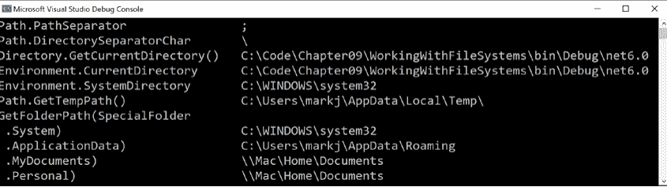

图 9.1：在 Windows 上运行你的应用程序以显示文件系统信息

使用 Visual Studio Code 通过 dotnet run 运行控制台应用程序时，CurrentDirectory 将是项目文件夹，而不是 bin 内部的文件夹。

良好实践：Windows 使用反斜杠 \ 作为目录分隔字符。macOS 和 Linux 使用正斜杠 / 作为目录分隔字符。在组合路径时，不要在代码中假设使用什么字符。

## 管理驱动器

要管理驱动器，请使用 DriveInfo 类型，它有一个静态方法返回连接到计算机的所有驱动器的信息。每个驱动器都有一个驱动器类型。

让我们探索驱动器：

- 1. 创建一个 WorkWithDrives 方法，并编写语句获取所有驱动器并输出其名称、类型、大小、可用空闲空间和格式，但仅当驱动器已准备就绪时，如以下代码所示：

```
static void WorkWithDrives()
{
WriteLine("{0,-30} | {1,-10} | {2,-7} | {3,18} | {4,18}",
    "NAME", "TYPE", "FORMAT", "SIZE (BYTES)", "FREE SPACE");

foreach (DriveInfo drive in DriveInfo.GetDrives())
{
    if (drive.IsReady)
    {
        WriteLine(
            "{0,-30} | {1,-10} | {2,-7} | {3,18:N0} | {4,18:N0}",
            drive.Name, drive.DriveType, drive.DriveFormat,
            drive.TotalSize, drive.AvailableFreeSpace);
    }
    else
    {
        WriteLine("{0,-30} | {1,-10}", drive.Name, drive.DriveType);
    }
}
```

**良好实践：** 在读取 TotalSize 等属性之前检查驱动器是否已准备就绪，否则在可移动驱动器上会看到异常抛出。

- 2. 在 Program.cs 中，注释掉之前的方法调用并添加对 WorkWithDrives 的调用，如以下代码高亮所示：

```
// OutputFileSystemInfo();
WorkWithDrives();
```

- 3. 运行代码并查看结果，如图 9.2 所示：

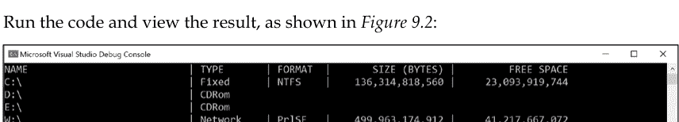

图 9.2：在 Windows 上显示驱动器信息

## 管理目录

要管理目录，请使用 Directory、Path 和 Environment 静态类。这些类型包含许多用于操作文件系统的成员。


构造自定义路径时，必须小心编写代码，使其不对平台做出任何假设，例如目录分隔符字符应使用什么：

- 1. 创建一个 WorkWithDirectories 方法，并编写语句执行以下操作：
  - 在用户主目录下定义一个自定义路径，通过为目录名称创建字符串数组，然后使用 Path 类型的 Combine 方法正确组合它们。
  - 使用 Directory 类的 Exists 方法检查自定义目录路径是否存在。
  - 使用 Directory 类的 CreateDirectory 和 Delete 方法创建然后删除目录，包括其中的文件和子目录：

```
static void WorkWithDirectories()
{
    // define a directory path for a new folder
    // starting in the user's folder
    string newFolder = Combine(
        GetFolderPath(SpecialFolder.Personal),
        "Code", "Chapter09", "NewFolder");

    WriteLine($"Working with: {newFolder}");

    // check if it exists
    WriteLine($"Does it exist? {Exists(newFolder)}");

    // create directory
    WriteLine("Creating it...");
    CreateDirectory(newFolder);
    WriteLine($"Does it exist? {Exists(newFolder)}");
    Write("Confirm the directory exists, and then press ENTER: ");
    ReadLine();

    // delete directory
    WriteLine("Deleting it...");
    Delete(newFolder, recursive: true);
    WriteLine($"Does it exist? {Exists(newFolder)}");
}
```

- 2. 在 Program.cs 中注释掉之前的方法调用，并添加对 WorkWithDirectories 的调用。

- 3. 运行代码并查看结果，并在按 Enter 删除之前使用你喜欢的文件管理工具确认目录已创建，如以下输出所示：

```
Working with: /Users/markjprice/Code/Chapter09/NewFolder
Does it exist?
False
Creating it...
Does it exist? True
Confirm the directory exists, and then press ENTER:
Deleting it...
Does it exist? False
```

## 管理文件

处理文件时，你可以像我们对目录类型所做的那样静态导入文件类型，但对于下一个示例，我们不会这样做，因为它与目录类型具有一些相同的方法，它们会冲突。在这种情况下，文件类型的名称足够短，不会造成问题。步骤如下：

- 1. 创建一个 WorkWithFiles 方法，并编写语句执行以下操作：
  - 1. 检查文件是否存在。
  - 2. 创建一个文本文件。
  - 3. 向文件写入一行文本。
  - 4. 关闭文件以释放系统资源和文件锁（这通常应在 try-finally 语句块内完成，以确保即使在写入时发生异常，文件也会被关闭）。
  - 5. 将文件复制到备份。
  - 6. 删除原始文件。
  - 7. 读取备份文件的内容然后关闭它：

```
static void WorkWithFiles()
{
    // define a directory path to output files
    // starting in the user's folder
    string dir = Combine(
        GetFolderPath(SpecialFolder.Personal),
        "Code", "Chapter09", "OutputFiles");

    CreateDirectory(dir);

    // define file paths
    string textFile = Combine(dir, "Dummy.txt");
    string backupFile = Combine(dir, "Dummy.bak");
    WriteLine($"Working with: {textFile}");

    // check if a file exists
    WriteLine($"Does it exist? {File.Exists(textFile)}");

    // create a new text file and write a line to it
    StreamWriter textWriter = File.CreateText(textFile);
    textWriter.WriteLine("Hello, C#!");
    textWriter.Close(); // close file and release resources
    WriteLine($"Does it exist? {File.Exists(textFile)}");

    // copy the file, and overwrite if it already exists
    File.Copy(sourceFileName: textFile,
        destFileName: backupFile, overwrite: true);
    WriteLine(
        $"Does {backupFile} exist? {File.Exists(backupFile)}");
    Write("Confirm the files exist, and then press ENTER: ");
    ReadLine();

    // delete file
    File.Delete(textFile);
    WriteLine($"Does it exist? {File.Exists(textFile)}");

    // read from the text file backup
    WriteLine($"Reading contents of {backupFile}:");
    StreamReader textReader = File.OpenText(backupFile);
    WriteLine(textReader.ReadToEnd());
    textReader.Close();
}
```

- 2. 在 Program.cs 中注释掉之前的方法调用，并添加对 WorkWithFiles 的调用。

- 3. 运行代码并查看结果，如以下输出所示：

```
Working with: /Users/markjprice/Code/Chapter09/OutputFiles/Dummy.txt
Does it exist? False
Does it exist? True
Does /Users/markjprice/Code/Chapter09/OutputFiles/Dummy.bak exist? True
Confirm the files exist, and then press ENTER:
Does it exist? False
Reading contents of /Users/markjprice/Code/Chapter09/OutputFiles/Dummy.bak:
Hello, C#!
```

## 管理路径

有时，你需要处理路径的各个部分；例如，你可能只想提取文件夹名称、文件名或扩展名。有时，你需要生成临时文件夹和文件名。你可以使用 Path 类的静态方法来完成此操作：

- 1. 在 WorkWithFiles 方法末尾添加以下语句：

```
WriteLine($"Folder Name: {GetDirectoryName(textFile)}");
WriteLine($"File Name: {GetFileName(textFile)}");
WriteLine("File Name without Extension: {0}",
    GetFileNameWithoutExtension(textFile));
WriteLine($"File Extension: {GetExtension(textFile)}");
WriteLine($"Random File Name: {GetRandomFileName()}");
WriteLine($"Temporary File Name: {GetTempFileName()}");
```

- 2. 运行代码并查看结果，如以下输出所示：

```
Folder Name: /Users/markjprice/Code/Chapter09/OutputFiles
File Name: Dummy.txt
File Name without Extension: Dummy
File Extension: .txt
Random File Name: u45w1zki.co3
Temporary File Name:
/var/folders/tz/xx0y_wld5sx0nv0fjtq4tnpc0000gn/T/tmpyqrepP.tmp
```

GetTempFileName 创建一个零字节文件并返回其名称，准备供你使用。
GetRandomFileName 仅返回一个文件名；它不会创建文件。

## 获取文件信息

要获取有关文件或目录的更多信息，例如其大小或上次访问时间，你可以创建 FileInfo 或 DirectoryInfo 类的实例。

FileInfo 和 DirectoryInfo 都继承自 FileSystemInfo，因此它们都具有 LastAccessTime 和 Delete 等成员，以及各自特有的额外成员，如下表所示：

| 类 | 成员 |
|---|---|
| FileSystemInfo | 字段： FullPath, OriginalPath

属性： Attributes, CreationTime, CreationTimeUtc, Exists, Extension, FullName, LastAccessTime, LastAccessTimeUtc, LastWriteTime, LastWriteTimeUtc, Name

方法： Delete, GetObjectData, Refresh |
| DirectoryInfo | 属性： Parent, Root

方法： Create, CreateSubdirectory, EnumerateDirectories, EnumerateFiles, EnumerateFileSystemInfos, GetAccessControl, GetDirectories, GetFiles, GetFileSystemInfos, MoveTo, SetAccessControl |
| FileInfo | 属性： Directory, DirectoryName, IsReadOnly, Length

方法： AppendText, CopyTo, Create, CreateText, Decrypt, Encrypt, GetAccessControl, MoveTo, Open, OpenRead, OpenText, OpenWrite, Replace, SetAccessControl |

让我们编写一些代码，使用 FileInfo 实例高效地对文件执行多个操作：

- 1. 在 WorkWithFiles 方法末尾添加语句，为备份文件创建 FileInfo 实例并将有关其信息写入控制台，如以下代码所示：

```
FileInfo info = new(backupFile);
WriteLine($"{backupFile}:");
WriteLine($"Contains {info.Length} bytes");
WriteLine($"Last accessed {info.LastAccessTime}");
WriteLine($"Has readonly set to {info.IsReadOnly}");
```

- 2. 运行代码并查看结果，如以下输出所示：

```
/Users/markjprice/Code/Chapter09/OutputFiles/Dummy.bak:
Contains 11 bytes
Last accessed 26/10/2021 09:08:26
Has readonly set to False
```

字节数在你的操作系统上可能不同，因为操作系统可以使用不同的行结束符。

## 控制文件操作方式

处理文件时，你通常需要控制它们如何打开。File.Open 方法具有重载，可使用枚举值指定其他选项。

枚举类型如下：

- FileMode：这控制你想要对文件执行的操作，如 CreateNew、OpenOrCreate 或 Truncate。
- FileAccess：这控制你需要的访问级别，如 ReadWrite。
- FileShare：这控制文件的锁，以允许其他进程具有指定的访问级别，如 Read。

你可能想要打开文件并从中读取，同时允许其他进程也读取它，如以下代码所示：

```
FileStream file = File.Open(pathToFile,
    FileMode.Open, FileAccess.Read, FileShare.Read);
```

还有一个用于文件属性的枚举如下：

- FileAttributes：这用于检查派生自 FileSystemInfo 的类型的 Attributes 属性的值，如 Archive 和 Encrypted。


你可以检查文件或目录的属性，如以下代码所示：

```
FileInfo info = new(backupFile);
WriteLine("Is the backup file compressed? {0}",
    info.Attributes.HasFlag(FileAttributes.Compressed));
```

## 使用流进行读写

流是一系列可以读取和写入的字节。虽然文件可以像数组一样处理，通过知道文件中字节的位置提供随机访问，但将文件作为流处理以按顺序访问字节会很有用。

流还可以用于处理终端输入和输出以及套接字和端口等网络资源，这些资源不提供随机访问并且无法 seek（即移动）到某个位置。你可以编写代码来处理一些任意字节，而无需知道或关心其来源。你的代码只需从流中读取或写入，而另一段代码负责处理字节实际存储的位置。

## 理解抽象流和具体流

有一个名为 Stream 的抽象类，表示任何类型的流。请记住，抽象类不能使用 new 实例化；它们只能被继承。

有许多具体类继承自该基类，包括 FileStream、MemoryStream、BufferedStream、GZipStream 和 SslStream，因此它们的工作方式都相同。所有流都实现了 IDisposable，因此它们都有 Dispose 方法来释放非托管资源。

Stream 类的一些常用成员在下表中描述：

| Member | Description |
|---|---|
| CanRead, CanWrite | 这些属性决定是否可以从流中读取和写入。 |
| Length, Position | 这些属性决定流中的总字节数和当前位置。对于某些类型的流，这些属性可能会抛出异常。 |
| Dispose | 此方法关闭流并释放其资源。 |
| Flush | 如果流具有缓冲区，则此方法将缓冲区中的字节写入流并清空缓冲区。 |
| CanSeek | 此属性决定是否可以使用 Seek 方法。 |
| Seek | 此方法将当前位置移动到其参数指定的位置。 |
| Read, ReadAsync | 这些方法从流中读取指定数量的字节到字节数组中并推进位置。 |
| ReadByte | 此方法从流中读取下一个字节并推进位置。 |
| Write, WriteAsync | 这些方法将字节数组的内容写入流。 |
| WriteByte | 此方法将字节写入流。 |

## 理解存储流

代表字节将被存储的位置的一些存储流在下表中描述：

| Namespace | Class | Description |
|---|---|
| System.IO | FileStream | 存储在文件系统中的字节。 |
| System.IO | MemoryStream | 存储在当前进程内存中的字节。 |
| System.Net.Sockets | NetworkStream | 存储在网络位置的字节。 |

FileStream 已在 .NET 6 中重写，以在 Windows 上获得更高的性能和可靠性。

## 理解功能流

一些不能独立存在，只能“插入”到其他流上以添加功能的函数流在下表中描述：

| Namespace | Class | Description |
|---|---|
| System.Security.Cryptography | CryptoStream | 这会加密和解密流。 |
| System.IO.Compression | GZipStream, DeflateStream | 这些会压缩和解压缩流。 |
| System.Net.Security | AuthenticatedStream | 这会在流中发送凭据。 |

## 理解流助手

虽然有时你需要在低级别处理流，但大多数情况下，你可以将助手类插入链中以简化操作。所有流的助手类型都实现了 IDisposable，因此它们都有 Dispose 方法来释放非托管资源。

处理常见场景的一些助手类在下表中描述：

| Namespace | Class | Description |
|---|---|
| System.IO | StreamReader | 这以纯文本形式从底层流中读取。 |
| System.IO | StreamWriter | 这以纯文本形式向底层流写入。 |
| System.IO | BinaryReader | 这以 .NET 类型从流中读取。例如，ReadDecimal 方法从底层流中读取下一个 16 个字节作为 decimal 值，ReadInt32 方法读取下一个 4 个字节作为 int 值。 |
| System.IO | BinaryWriter | 这以 .NET 类型向流写入。例如，带有 decimal 参数的 Write 方法向底层流写入 16 个字节，带有 int 参数的 Write 方法写入 4 个字节。 |

| System.Xml | XmlReader | 这使用 XML 格式从底层流中读取。 |
| System.Xml | XmlWriter | 这使用 XML 格式向底层流写入。 |

## 向文本流写入

让我们输入一些代码向流写入文本：

-   1. 使用你喜欢的代码编辑器在 `Chapter09` 解决方案/工作区中添加一个名为 `WorkingWithStreams` 的新控制台应用：
-      1. 在 Visual Studio 中，将解决方案的启动项目设置为当前选择。
-      2. 在 Visual Studio Code 中，选择 `WorkingWithStreams` 作为活动的 OmniSharp 项目。
-   2. 在 `WorkingWithStreams` 项目中，在 `Program.cs` 中导入 `System.Xml` 命名空间并静态导入 `System.Console`、`System.Environment` 和 `System.IO.Path` 类型。
-   3. 在 `Program.cs` 底部，定义一个名为 `Viper` 的静态类，其中包含一个名为 `Callsigns` 的静态字符串值数组，如以下代码所示：
-   4. 在 `Viper` 类上方，定义一个 `WorkWithText` 方法，该方法枚举 Viper 呼号，将每个呼号写入单个文本文件中的单独一行，如以下代码所示：

```csharp
static class Viper
{
    // define an array of Viper pilot call signs
    public static string[] Callsigns = new[]
    {
        "Husker", "Starbuck", "Apollo", "Boomer",
        "Bulldog", "Athena", "Helo", "Racetrack"
    };
}
```

```csharp
static void WorkWithText()
{
    // define a file to write to
    string textFile = Combine(CurrentDirectory, "streams.txt");

    // create a text file and return a helper writer
    StreamWriter text = File.CreateText(textFile);

    // enumerate the strings, writing each one
    // to the stream on a separate line
    foreach (string item in Viper.Callsigns)
    {
        text.WriteLine(item);
    }
}
```

```
}
text.Close(); // release resources

// output the contents of the file
WriteLine("{0} contains {1:N0} bytes.",
    arg0: textFile,
    arg1: new FileInfo(textFile).Length);

WriteLine(File.ReadAllText(textFile));
}
```

-   5. 在命名空间导入下方，调用 WorkWithText 方法。
-   6. 运行代码并查看结果，如以下输出所示：
-   7. 打开创建的文件并检查它是否包含呼号列表。

```
/Users/markjprice/Code/Chapter09/WorkingWithStreams/streams.txt contains
60 bytes.
Husker
Starbuck
Apollo
Boomer
Bulldog
Athena
Helo
Racetrack
```

## 向 XML 流写入

有两种方法写入 XML 元素，如下所示：

-   - WriteStartElement 和 WriteEndElement：当元素可能有子元素时使用此对。
-   - WriteElementString：当元素没有子元素时使用此方法。

现在，让我们尝试将 Viper 飞行员呼号字符串值数组存储在 XML 文件中：

-   1. 创建一个 WorkWithXml 方法，该方法枚举呼号，将每个呼号作为元素写入单个 XML 文件，如以下代码所示：

```csharp
static void WorkWithXml()
{
    // define a file to write to
    string xmlFile = Combine(CurrentDirectory, "streams.xml");

    // create a file stream
    FileStream xmlFileStream = File.Create(xmlFile);
```

```
// wrap the file stream in an XML writer helper
// and automatically indent nested elements
XmlWriter xml = XmlWriter.Create(xmlFileStream,
    new XmlWriterSettings { Indent = true });

// write the XML declaration
xml.WriteStartDocument();

// write a root element
xml.WriteStartElement("callsigns");

// enumerate the strings writing each one to the stream
foreach (string item in Viper.Callsigns)
{
    xml.WriteElementString("callsign", item);
}

// write the close root element
xml.WriteEndElement();

// close helper and stream
xml.Close();
xmlFileStream.Close();

// output all the contents of the file
WriteLine("{0} contains {1:N0} bytes.",
    arg0: xmlFile,
    arg1: new FileInfo(xmlFile).Length);

WriteLine(File.ReadAllText(xmlFile));
}
```

-   2. 在 Program.cs 中，注释掉之前的方法调用，并添加对 WorkWithXml 方法的调用。
-   3. 运行代码并查看结果，如以下输出所示：

/Users/markjprice/Code/Chapter09/WorkingWithStreams/streams.xml contains
310 bytes.
<?xml version="1.0" encoding="utf-8"?>
<callsigns>
    <callsign>Husker</callsign>
    <callsign>Starbuck</callsign>
    <callsign>Apollo</callsign>
    <callsign>Boomer</callsign>
    <callsign>Bulldog</callsign>


```
<callsign>Athena</callsign>
<callsign>Helo</callsign>
<callsign>Racetrack</callsign>
</callsigns>
```

## 释放文件资源

当你打开一个文件进行读取或写入时，你正在使用 .NET 之外的资源。这些被称为 **非托管资源**，在使用完毕后必须释放。为了确定性地控制它们的释放时间，我们可以在 finally 块中调用 Dispose 方法。

让我们改进之前处理 XML 的代码，以正确释放其非托管资源：

- 1. 修改 WorkWithXml 方法，如以下代码中突出显示所示：

```
static void WorkWithXml()
{
    FileStream? xmlFileStream = null;
    XmlWriter? xml = null;

    try
    {
        // define a file to write to
        string xmlFile = Combine(CurrentDirectory, "streams.xml");

        // create a file stream
        xmlFileStream = File.Create(xmlFile);

        // wrap the file stream in an XML writer helper
        // and automatically indent nested elements
        xml = XmlWriter.Create(xmlFileStream,
            new XmlWriterSettings { Indent = true });

        // write the XML declaration
        xml.WriteStartDocument();

        // write a root element
        xml.WriteStartElement("callsigns");

        // enumerate the strings writing each one to the stream
        foreach (string item in Viper.Callsigns)
        {
            xml.WriteElementString("callsign", item);
        }
    // write the close root element
    xml.WriteEndElement();

    // close helper and stream
    xml.Close();
    xmlFileStream.Close();

    // output all the contents of the file
    WriteLine($"{0} contains {1:N0} bytes.",
        arg0: xmlFile,
        arg1: new FileInfo(xmlFile).Length);

    WriteLine(File.ReadAllText(xmlFile));
}
catch (Exception ex)
{
    // if the path doesn't exist the exception will be caught
    WriteLine($"{ex.GetType()} says {ex.Message}");
}
finally
{
    if (xml != null)
    {
        xml.Dispose();
        WriteLine("The XML writer's unmanaged resources have been disposed.");
        if (xmlFileStream != null)
        {
            xmlFileStream.Dispose();
            WriteLine("The file stream's unmanaged resources have been disposed.");
        }
    }
}
}
```

你也可以返回去修改之前创建的其他方法，但我将把它作为一个可选练习留给你。

- 2. 运行代码并查看结果，如以下输出所示：

```
The XML writer's unmanaged resources have been disposed.
The file stream's unmanaged resources have been disposed.
```


**良好实践：** 在调用 Dispose 方法之前，检查对象是否不为 null。

## 通过 using 语句简化释放

你可以使用 using 语句简化需要检查空对象然后调用其 Dispose 方法的代码。一般来说，我建议使用 using 而不是手动调用 Dispose，除非你需要更高的控制级别。

令人困惑的是，using 关键字有两个用途：导入命名空间以及生成在实现 IDisposable 的对象上调用 Dispose 的 finally 语句。

编译器会将 using 语句块更改为没有 catch 语句的 try-finally 语句。你可以使用嵌套的 try 语句；因此，如果你确实想要捕获任何异常，可以这样做，如以下代码示例所示：

```
using (FileStream file2 = File.OpenWrite(
    Path.Combine(path, "file2.txt")))
{
    using (StreamWriter writer2 = new StreamWriter(file2))
    {
        try
        {
            writer2.WriteLine("Welcome, .NET!");
        }
        catch(Exception ex)
        {
            WriteLine($"{ex.GetType()} says {ex.Message}");
        }
    } // automatically calls Dispose if the object is not null
} // automatically calls Dispose if the object is not null
```

你甚至可以通过不显式指定 using 语句的大括号和缩进来进一步简化代码，如以下代码所示：

```
using FileStream file2 = File.OpenWrite(
    Path.Combine(path, "file2.txt"));

using StreamWriter writer2 = new(file2);

try
{
    writer2.WriteLine("Welcome, .NET!");
}
catch(Exception ex)
{
    WriteLine($"{ex.GetType()} says {ex.Message}");
}
```

## 压缩流

XML 相对冗长，因此它占用的字节数比纯文本更多。让我们看看如何使用一种称为 GZIP 的常见压缩算法来压缩 XML：

- 1. 在 Program.cs 顶部导入用于处理压缩的命名空间，如以下代码所示：
- 2. 添加一个 WorkWithCompression 方法，该方法使用 GZipStream 的实例创建包含与之前相同的 XML 元素的压缩文件，然后在读取时对其进行解压缩并输出到控制台，如以下代码所示：

```
using System.IO.Compression; // BrotliStream, GZipStream, CompressionMode
```

```
static void WorkWithCompression()
{
    string fileExt = "gzip";

    // compress the XML output
    string filePath = Combine(
        CurrentDirectory, $"streams.{fileExt}");

    FileStream file = File.Create(filePath);

    Stream compressor = new GZipStream(file, CompressionMode.Compress);

    using (compressor)
    {
        using (XmlWriter xml = XmlWriter.Create(compressor))
        {
            xml.WriteStartDocument();
            xml.WriteStartElement("callsigns");

            foreach (string item in Viper.Callsigns)
            {
                xml.WriteElementString("callsign", item);
            }

            // the normal call to WriteEndElement is not necessary
        }
    }
}
// because when the XmlWriter disposes, it will
// automatically end any elements of any depth
} // also closes the underlying stream

// output all the contents of the compressed file
WriteLine("{0} contains {1:N0} bytes.",
    filePath, new FileInfo(filePath).Length);

WriteLine($"The compressed contents:");
WriteLine(File.ReadAllText(filePath));

// read a compressed file
WriteLine("Reading the compressed XML file:");
file = File.Open(filePath, FileMode.Open);

Stream decompressor = new GZipStream(file,
    CompressionMode.Decompress);

using (decompressor)
{
    using (XmlReader reader = XmlReader.Create(decompressor))
    {
        while (reader.Read()) // read the next XML node
        {
            // check if we are on an element node named callsign
            if ((reader.NodeType == XmlNodeType.Element)
                && (reader.Name == "callsign"))
            {
                reader.Read(); // move to the text inside element
                WriteLine($"({reader.Value})"); // read its value
            }
        }
    }
}
```

- 3. 在 Program.cs 中保留对 WorkWithXml 的调用，并添加对 WorkWithCompression 的调用，如以下代码中突出显示所示：

```
// WorkWithText();
WorkWithXml();
WorkWithCompression();
```

- 4. 运行代码并比较 XML 文件和压缩 XML 文件的大小。它小于未压缩的相同 XML 的一半大小，如以下编辑后的输出所示：

```
/Users/markjprice/Code/Chapter09/WorkingWithStreams/streams.xml contains
310 bytes.
/Users/markjprice/Code/Chapter09/WorkingWithStreams/streams.gz contains
150 bytes.
```

## 使用 Brotli 算法压缩

在 .NET Core 2.1 中，Microsoft 引入了 Brotli 压缩算法的实现。在性能方面，Brotli 与 DEFLATE 和 GZIP 中使用的算法类似，但输出大约密集 20%。步骤如下：

- 1. 修改 WorkWithCompression 方法，使其具有一个可选参数来指示是否使用 Brotli 并默认使用 Brotli，如以下代码中突出显示所示：

```
static void WorkWithCompression(bool useBrotli = true)
{
    string fileExt = useBrotli ? "brotli" : "gzip";

    // compress the XML output
    string filePath = Combine(
        CurrentDirectory, $"streams.{fileExt}");

    FileStream file = File.Create(filePath);

    Stream compressor;

    if (useBrotli)
    {
        compressor = new BrotliStream(file, CompressionMode.Compress);
    }
    else
    {
        compressor = new GZipStream(file, CompressionMode.Compress);
    }

    using (compressor)
    {
        using (XmlWriter xml = XmlWriter.Create(compressor))
        {
            xml.WriteStartDocument();
            xml.WriteStartElement("callsigns");
            foreach (string item in Viper.Callsigns)
```


```
{
    xml.WriteElementString("callsign", item);
}
}
} // also closes the underlying stream

// output all the contents of the compressed file
WriteLine("{0} contains {1:N0} bytes.",
    filePath, new FileInfo(filePath).Length);

WriteLine($"The compressed contents:");
WriteLine(File.ReadAllText(filePath));

// read a compressed file
WriteLine("Reading the compressed XML file:");
file = File.Open(filePath, FileMode.Open);

Stream decompressor;
if (useBrotli)
{
    decompressor = new BrotliStream(
        file, CompressionMode.Decompress);
}
else
{
    decompressor = new GZipStream(
        file, CompressionMode.Decompress);
}

using (decompressor)
{
    using (XmlReader reader = XmlReader.Create(decompressor))
    {
        while (reader.Read())
        {
            // check if we are on an element node named callsign
            if ((reader.NodeType == XmlNodeType.Element)
                && (reader.Name == "callsign"))
            {
                reader.Read(); // move to the text inside element
                WriteLine($"{reader.Value}"); // read its value
            }
        }
    }
}
```

2. 在 Program.cs 顶部附近，调用 WorkWithCompression 两次，一次使用默认的 Brotli，一次使用 GZIP，如以下代码所示：

```
WorkWithCompression();
WorkWithCompression(useBrotli: false);
```

3. 运行代码并比较两个压缩 XML 文件的大小。Brotli 的密度比高出 21% 以上，如以下编辑后的输出所示：

```
/Users/markjprice/Code/Chapter09/WorkingWithStreams/streams.brotli contains 118 bytes.
/Users/markjprice/Code/Chapter09/WorkingWithStreams/streams.gz contains 150 bytes.
```

## 编码和解码文本

文本字符可以用不同的方式表示。例如，字母表可以使用摩尔斯电码编码为一系列点和划，以便通过电报线路传输。

同样，计算机内部的文本以位（0 和 1）的形式存储，表示代码空间中的一个代码点。大多数代码点代表单个字符，但它们也可以具有其他含义，如格式。

例如，ASCII 具有包含 128 个代码点的代码空间。.NET 使用名为 Unicode 的标准在内部编码文本。Unicode 拥有超过一百万个代码点。

有时，您需要将文本移出 .NET 以供不使用 Unicode 或使用 Unicode 变体的系统使用，因此学习如何在编码之间转换非常重要。

下表列出了计算机常用的一些替代文本编码：

| 编码 | 描述 |
|---|---|
| ASCII | 这使用字节的低七位对有限范围的字符进行编码。 |
| UTF-8 | 这将每个 Unicode 代码点表示为一到四个字节的序列。 |
| UTF-7 | 这旨在比 UTF-8 在 7 位通道上更高效，但它存在安全性和健壮性问题，因此建议使用 UTF-8 而非 UTF-7。 |
| UTF-16 | 这将每个 Unicode 代码点表示为一个或两个 16 位整数的序列。 |
| UTF-32 | 这将每个 Unicode 代码点表示为 32 位整数，因此是一种定长编码，而与其他所有 Unicode 编码（均为变长编码）不同。 |
| ANSI/ISO 编码 | 这提供了对多种代码页的支持，这些代码页用于支持特定语言或语言组。 |

**Good Practice:** 在大多数情况下，今天 UTF-8 是一个不错的默认值，这就是为什么它实际上是默认编码，即 Encoding.Default。

## 将字符串编码为字节数组

让我们探索文本编码：

- 1. 使用您喜欢的代码编辑器，在 `Chapter09` 解决方案/工作区中添加一个名为 `WorkingWithEncodings` 的新控制台应用。
- 2. 在 Visual Studio Code 中，将 `WorkingWithEncodings` 选择为活动的 OmniSharp 项目。
- 3. 在 `Program.cs` 中，导入 `System.Text` 命名空间并静态导入 `Console` 类。
- 4. 添加语句，使用用户选择的编码对字符串进行编码，遍历每个字节，然后将其解码回 `string` 并输出，如以下代码所示：

```
WriteLine("Encodings");
WriteLine("[1] ASCII");
WriteLine("[2] UTF-7");
WriteLine("[3] UTF-8");
WriteLine("[4] UTF-16 (Unicode)");
WriteLine("[5] UTF-32");
WriteLine("[any other key] Default");

// choose an encoding
Write("Press a number to choose an encoding: ");
ConsoleKey number = ReadKey(intercept: false).Key;
WriteLine();
WriteLine();

Encoding encoder = number switch
{
    ConsoleKey.D1 => Encoding.ASCII,
    ConsoleKey.D2 => Encoding.UTF7,
    ConsoleKey.D3 => Encoding.UTF8,
    ConsoleKey.D4 => Encoding.Unicode,
    ConsoleKey.D5 => Encoding.UTF32,
    _ => Encoding.Default
};

// define a string to encode
string message = "Café cost: £4.39";
```

```
// encode the string into a byte array
byte[] encoded = encoder.GetBytes(message);

// check how many bytes the encoding needed
WriteLine("{0} uses {1:N0} bytes.",
    encoder.GetType().Name, encoded.Length);
WriteLine();

// enumerate each byte
WriteLine("$BYTE HEX CHAR");
foreach (byte b in encoded)
{
    WriteLine($"{b,4} {b.ToString("X"),4} {(char)b,5}");
}

// decode the byte array back into a string and display it
string decoded = encoder.GetString(encoded);
WriteLine(decoded);
```

- 5. 运行代码并注意避免使用 Encoding.UTF7 的警告，因为它不安全。当然，如果您需要为与另一系统兼容而使用该编码生成文本，它需要在 .NET 中仍然是一个选项。
- 6. 按 1 选择 ASCII 并注意在输出字节时，英镑符号 (£) 和带重音的 e (é) 不能在 ASCII 中表示，因此它使用问号代替。

```
BYTE  HEX  CHAR
   67   43   C
   97   61   a
  102   66   f
   63   3F   ?
   32   20
  111   6F   o
  115   73   s
  116   74   t
   58   3A   :
   32   20
   63   3F   ?
   52   34   4
   46   2E   .
   51   33   3
   57   39   9
Caf? cost: ?4.39
```

7. 重新运行代码并按 3 选择 UTF-8 并注意 UTF-8 需要为每个需要 2 个字节的两个字符额外使用两个字节（总共 18 个字节而不是 16 个字节），但它可以编码和解码 é 和 £ 字符。

```
UTF8EncodingSealed uses 18 bytes.

BYTE HEX CHAR
  67  43  C
  97  61  a
 102  66  f
 195  C3  Ã
 169  A9  ©
  32  20
 111  6F  o
 115  73  s
 116  74  t
  58  3A  :
  32  20
 194  C2  Â
 163  A3  £
  52  34  4
  46  2E  .
  51  33  3
  57  39  9
Café cost: £4.39
```

8. 重新运行代码并按 4 选择 Unicode (UTF-16) 并注意 UTF-16 为每个字符需要两个字节，因此总共 32 个字节，并且它可以编码和解码 é 和 £ 字符。此编码由 .NET 在内部用于存储 char 和 string 值。

## 在文件中编码和解码文本

在使用 StreamReader 和 StreamWriter 等流助手类时，您可以指定要使用的编码。当您向助手写入时，文本将自动编码，而当您从助手读取时，字节将自动解码。

要指定编码，请将编码作为第二个参数传递给助手类型的构造函数，如以下代码所示：

```
StreamReader reader = new(stream, Encoding.UTF8);
StreamWriter writer = new(stream, Encoding.UTF8);
```

> **Good Practice:** 通常，您没有选择编码的余地，因为您将为另一系统使用而生成文件。但是，如果您有选择，请选择使用最少字节数但能存储所需每个字符的编码。

## 序列化对象图

序列化是将实时对象使用指定格式转换为字节序列的过程。反序列化是反向过程。您会这样做以保存实时对象的当前状态，以便将来可以重新创建它。例如，保存游戏的当前状态，以便明天可以继续在同一位置。序列化对象通常存储在文件或数据库中。

您可以指定的格式有几十种，但最常见的两种是可扩展标记语言 (XML) 和 JavaScript 对象表示法 (JSON)。


> **Good Practice:** JSON 更紧凑，最适合 Web 和移动应用。XML 更冗长，但在更多旧系统中的支持更好。使用 JSON 以最小化序列化对象图的大小。JSON 也是向 Web 应用和移动应用发送对象图时不错的选择，因为 JSON 是 JavaScript 的原生序列化格式，而且移动应用通常通过有限带宽进行调用，因此字节数很重要。

.NET 有多个类可将数据序列化为 XML 和 JSON 以及反序列化。我们将从 XmlSerializer 和 JsonSerializer 开始。

## 作为 XML 序列化

让我们从 XML 开始，可能是目前世界上使用最广泛的序列化格式（到目前为止）。为了展示一个典型的示例，我们将定义一个自定义类来存储有关人员的信息，然后使用包含嵌套的 Person 实例列表创建对象图：

- 1. 使用您喜欢的代码编辑器，在 Chapter09 解决方案/工作区中添加一个名为 WorkingWithSerialization 的新控制台应用。
- 2. 在 Visual Studio Code 中，将 WorkingWithSerialization 选择为活动的 OmniSharp 项目。
- 3. 添加一个名为 Person 的类，其中 Salary 属性受保护，这意味着它只能由其自身和派生类访问。为了填充薪水，该类有一个带单个参数的构造函数来设置初始薪水，如以下代码所示：

```
namespace Packt.Shared;

public class Person
{
    public Person(decimal initialSalary)
    {
        Salary = initialSalary;
    }
}
```


```
public string? FirstName { get; set; }
public string? LastName { get; set; }
public DateTime DateOfBirth { get; set; }
public HashSet<Person>? Children { get; set; }
protected decimal Salary { get; set; }
}
```

4. 在 Program.cs 中，导入用于 XML 序列化的命名空间，并静态导入 Console、Environment 和 Path 类，如以下代码所示：

```
using System.Xml.Serialization; // XmlSerializer
using Packt.Shared; // Person

using static System.Console;
using static System.Environment;
using static System.IO.Path;
```

5. 添加语句以创建 Person 实例的对象图，如以下代码所示：

// create an object graph
List<Person> people = new()
{
    new(30000M)
    {
        FirstName = "Alice",
        LastName = "Smith",
        DateOfBirth = new(1974, 3, 14)
    },
    new(40000M)
    {
        FirstName = "Bob",
        LastName = "Jones",
        DateOfBirth = new(1969, 11, 23)
    },
    new(20000M)
    {
        FirstName = "Charlie",
        LastName = "Cox",
        DateOfBirth = new(1984, 5, 4),
        Children = new()
        {
            new(0M)
            {
                FirstName = "Sally",
                LastName = "Cox",
```
```
DateOfBirth = new(2000, 7, 12)
}
}
}
};

// create object that will format a List of Persons as XML
XmlSerializer xs = new(people.GetType());

// create a file to write to
string path = Combine(CurrentDirectory, "people.xml");

using (FileStream stream = File.Create(path))
{
    // serialize the object graph to the stream
    xs.Serialize(stream, people);
}

WriteLine("Written {0:N0} bytes of XML to {1}",
    arg0: new FileInfo(path).Length,
    arg1: path);
WriteLine();

// Display the serialized object graph
WriteLine(File.ReadAllText(path));
```

6. 运行代码，查看结果，并注意会抛出异常，如以下输出所示：

```
Unhandled Exception: System.InvalidOperationException: Packt.Shared.Person cannot be serialized because it does not have a parameterless constructor.
```

7. 在 Person 中，添加语句以定义无参数构造函数，如以下代码所示：

```
public Person() { }
```

构造函数无需执行任何操作，但必须存在，以便 XmlSerializer 在反序列化过程中调用它来实例化新的 Person 实例。

8. 重新运行代码并查看结果，注意对象图被序列化为类似 <FirstName>Bob</FirstName> 的 XML 元素，并且 Salary 属性未包含在内，因为它不是公共属性，如以下输出所示：

```
Written 752 bytes of XML to
/Users/markjprice/Code/Chapter09/WorkingWithSerialization/people.xml
<?xml version="1.0"?>
```
```xml
<ArrayOfPerson xmlns:xsi="http://www.w3.org/2001/XMLSchema-instance" xmlns:xsd="http://www.w3.org/2001/XMLSchema">
  <Person>
    <FirstName>Alice</FirstName>
    <LastName>Smith</LastName>
    <DateOfBirth>1974-03-14T00:00:00</DateOfBirth>
  </Person>
  <Person>
    <FirstName>Bob</FirstName>
    <LastName>Jones</LastName>
    <DateOfBirth>1969-11-23T00:00:00</DateOfBirth>
  </Person>
  <Person>
    <FirstName>Charlie</FirstName>
    <LastName>Cox</LastName>
    <DateOfBirth>1984-05-04T00:00:00</DateOfBirth>
    <Children>
      <Person>
        <FirstName>Sally</FirstName>
        <LastName>Cox</LastName>
        <DateOfBirth>2000-07-12T00:00:00</DateOfBirth>
      </Person>
    </Children>
  </Person>
</ArrayOfPerson>
```
```

## 生成紧凑的 XML

我们可以通过对某些字段使用属性而不是元素来使 XML 更紧凑：

- 1. 在 Person 中，导入 System.Xml.Serialization 命名空间，以便您可以使用 [XmlAttribute] 属性装饰某些属性。
- 2. 使用 [XmlAttribute] 属性装饰名字、姓氏和出生日期属性，并为每个属性设置简短名称，如以下代码中突出显示所示：

```
```csharp
[XmlAttribute("fname")]
public string FirstName { get; set; }

[XmlAttribute("lname")]
public string LastName { get; set; }

[XmlAttribute("dob")]
public DateTime DateOfBirth { get; set; }
```
```

3. 运行代码并注意，通过将属性值作为 XML 属性输出，文件大小已从 752 字节减少到 462 字节，节省了三分之一以上的空间，如以下输出所示：

```
Written 462 bytes of XML to /Users/markjprice/Code/Chapter09/
WorkingWithSerialization/people.xml
<?xml version="1.0"?>
<ArrayOfPerson xmlns:xsi="http://www.w3.org/2001/XMLSchema-instance" xmlns:xsd="http://www.w3.org/2001/XMLSchema">
  <Person fname="Alice" lname="Smith" dob="1974-03-14T00:00:00" />
  <Person fname="Bob" lname="Jones" dob="1969-11-23T00:00:00" />
  <Person fname="Charlie" lname="Cox" dob="1984-05-04T00:00:00">
    <Children>
      <Person fname="Sally" lname="Cox" dob="2000-07-12T00:00:00" />
    </Children>
  </Person>
</ArrayOfPerson>
```

## 反序列化 XML 文件

现在让我们尝试将 XML 文件反序列化回内存中的实时对象：

1. 添加语句以打开 XML 文件然后反序列化它，如以下代码所示：

```
using (FileStream xmlLoad = File.Open(path, FileMode.Open))
{
    // deserialize and cast the object graph into a List of Person
    List<Person>? loadedPeople =
        xs.Deserialize(xmlLoad) as List<Person>;

    if (loadedPeople is not null)
    {
        foreach (Person p in loadedPeople)
        {
            WriteLine("{0} has {1} children.",
                p.LastName, p.Children?.Count ?? 0);
        }
    }
}
```

2. 运行代码并注意，人们已成功从 XML 文件加载然后枚举，如以下输出所示：

```
Smith has 0 children.
Jones has 0 children.
Cox has 1 children.
```

可以用来控制生成的 XML 的其他属性还有很多。

如果不使用任何注释，XmlSerializer 在反序列化时将使用属性名称执行不区分大小写的匹配。

> 良好实践：使用 XmlSerializer 时，请记住只有公共字段和属性会被包含，并且类型必须具有无参数构造函数。您可以使用属性来自定义输出。

## 使用 JSON 序列化

用于处理 JSON 序列化格式的最受欢迎的 .NET 库之一是 Newtonsoft.Json，称为 Json.NET。它成熟且功能强大。让我们看看它的实际效果：

- 1. 在 WorkingWithSerialization 项目中，添加对 Newtonsoft.Json 最新版本的包引用，如以下标记所示：
- 2. 构建 WorkingWithSerialization 项目以还原包。
- 3. 在 Program.cs 中，添加语句以创建文本文件然后将人员序列化为 JSON 到文件中，如以下代码所示：

```
<ItemGroup>
    <PackageReference Include="Newtonsoft.Json" Version="13.0.1" />
</ItemGroup>
```

```
// create a file to write to
string jsonPath = Combine(CurrentDirectory, "people.json");

using (StreamWriter jsonStream = File.CreateText(jsonPath))
{
    // create an object that will format as JSON
    Newtonsoft.Json.JsonSerializer jss = new();

    // serialize the object graph into a string
    jss.Serialize(jsonStream, people);
}
WriteLine();
WriteLine("Written {0:N0} bytes of JSON to: {1}",
    arg0: new FileInfo(jsonPath).Length,
    arg1: jsonPath);

// Display the serialized object graph
WriteLine(File.ReadAllText(jsonPath));
```

4. 运行代码并注意，与使用元素的 XML 相比，JSON 所需的字节数不到一半。它甚至比使用属性的 XML 文件还要小，如以下输出所示：

```
Written 366 bytes of JSON to: /Users/markjprice/Code/Chapter09/WorkingWithSerialization/people.json [{"FirstName":"Alice","LastName":"Smith","DateOfBirth":"1974-03-14T00:00:00","Children":null},{"FirstName":"Bob","LastName":"Jones","DateOfBirth":"1969-11-23T00:00:00","Children":null},{"FirstName":"Charlie","LastName":"Cox","DateOfBirth":"1984-05-04T00:00:00","Children":[{"FirstName":"Sally","LastName":"Cox","DateOfBirth":"2000-07-12T00:00:00","Children":null}]}]
```

## 高性能 JSON 处理

.NET Core 3.0 引入了一个用于处理 JSON 的新命名空间 System.Text.Json，它通过利用 Span<T> 等 API 针对性能进行了优化。

此外，像 Json.NET 这样的旧库是通过读取 UTF-16 实现的。使用 UTF-8 读取和写入 JSON 文档会更高效，因为大多数网络协议，包括 HTTP，都使用 UTF-8，并且您可以避免在 Json.NET 的 Unicode 字符串值之间进行 UTF-8 的转码。

使用新的 API，Microsoft 在不同场景下实现了 1.3 倍到 5 倍的改进。

Json.NET 的原始作者 James Newton-King 加入了 Microsoft，并一直在与他们合作开发新的 JSON 类型。正如他在讨论新的 JSON API 的评论中所说，“Json.NET 不会消失”，如图 9.3 所示：


图 9.3：Json.NET 原始作者的评论

让我们看看如何使用新的 JSON API 来反序列化 JSON 文件：

- 1. 在 WorkingWithSerialization 项目中，在 Program.cs 中，使用别名导入新的 JSON 类以执行序列化，以避免与之前使用的 Json.NET 的名称冲突，如以下代码所示：

```
using NewJson = System.Text.Json.JsonSerializer;
```


2. 添加语句以打开 JSON 文件，对其进行反序列化，并输出人员的子女姓名和数量，如以下代码所示：

```
using (FileStream jsonLoad = File.Open(jsonPath, FileMode.Open))
{
    // deserialize object graph into a List of Person
    List<Person>? loadedPeople =
        await NewJson.DeserializeAsync(utf8Json: jsonLoad,
            returnType: typeof(List<Person>)) as List<Person>;

    if (loadedPeople is not null)
    {
        foreach (Person p in loadedPeople)
        {
            WriteLine("{0} has {1} children.",
                p.LastName, p.Children?.Count ?? 0);
        }
    }
}
```

3. 运行代码并查看结果，如以下输出所示：

```
Smith has 0 children.
Jones has 0 children.
Cox has 1 children.
```


最佳实践：选择 Json.NET 以获得开发人员生产力和丰富的特性集，或选择 System.Text.Json 以获得性能。

## 控制 JSON 处理

有许多选项可以控制 JSON 的处理方式，如下列表所示：

- 包含和排除字段。
- 设置大小写策略。
- 选择大小写敏感策略。
- 在紧凑和美化后的空白之间进行选择。

让我们看看实际应用：

1. 使用你喜欢的代码编辑器，在 Chapter09 解决方案/工作区中添加一个名为 WorkingWithJson 的新控制台应用程序。

2. 在 Visual Studio Code 中，将 WorkingWithJson 选择为活动的 OmniSharp 项目。

3. 在 WorkingWithJson 项目中，在 Program.cs 中删除现有代码，导入用于处理 JSON 的两个主要命名空间，然后静态导入 System.Console、System.Environment 和 System.IO.Path 类型，如以下代码所示：

```
using System.Text.Json; // JsonSerializer
using System.Text.Json.Serialization; // [JsonInclude]

using static System.Console;
using static System.Environment;
using static System.IO.Path;
```

4. 在 Program.cs 底部，定义一个名为 Book 的类，如以下代码所示：

```
public class Book
{
    // constructor to set non-nullable property
    public Book(string title)
    {
        Title = title;
    }

    // properties

    public string Title { get; set; }
    public string? Author { get; set; }

    // fields

    [JsonInclude] // include this field
    public DateOnly PublishDate;

    [JsonInclude] // include this field
    public DateTimeOffset Created;

    public ushort Pages;
}
```

5. 在 Book 类上方，添加语句以创建 Book 类的实例并将其序列化为 JSON，如以下代码所示：

```
Book csharp10 = new(title:
    "C# 10 and .NET 6 - Modern Cross-platform Development")
{
    Author = "Mark J Price",
    PublishDate = new(year: 2021, month: 11, day: 9),
    Pages = 823,
    Created = DateTimeOffset.UtcNow,
};

JsonSerializerOptions options = new()
{
    IncludeFields = true, // includes all fields
    PropertyNameCaseInsensitive = true,
    WriteIndented = true,
    PropertyNamingPolicy = JsonNamingPolicy.CamelCase,
};

string filePath = Combine(CurrentDirectory, "book.json");

using (Stream fileStream = File.Create(filePath))
{
    JsonSerializer.Serialize<Book>(
        utf8Json: fileStream, value: csharp10, options);
}

WriteLine("Written {0:N0} bytes of JSON to {1}",
    arg0: new FileInfo(filePath).Length,
    arg1: filePath);

WriteLine();

// Display the serialized object graph
WriteLine(File.ReadAllText(filePath));
```

6. 运行代码并查看结果，如以下输出所示：

```
Written 315 bytes of JSON to C:\Code\Chapter09\WorkingWithJson\bin\Debug\net6.0\book.json

{
    "title": "C# 10 and .NET 6 - Modern Cross-platform Development",
    "author": "Mark J Price",
    "publishDate": {
        "year": 2021,
        "month": 11,
        "day": 9,
        "dayOfWeek": 2,
        "dayOfYear": 313,
        "dayNumber": 738102
    },
    "created": "2021-08-20T08:07:02.3191648+00:00",
    "pages": 823
}
```

注意以下几点：

- JSON 文件为 315 字节。
- 成员名称使用驼峰命名法，例如 publishDate。这对于在浏览器中使用 JavaScript 进行后续处理是最理想的。
- 由于设置了选项，所有字段都被包含在内，包括 pages。
- JSON 已被美化，以便人类更易读。
- DateTimeOffset 值以单一标准字符串格式存储。
- DateOnly 值以对象形式存储，具有 year 和 month 等日期部分的 子属性。

7. 在 Program.cs 中设置 JsonSerializerOptions 时，注释掉大小写策略、缩进写入和包含字段的设置。

8. 运行代码并查看结果，如以下输出所示：

```
Written 230 bytes of JSON to C:\Code\Chapter09\WorkingWithJson\bin\Debug\net6.0\book.json

{"Title":"C# 10 and .NET 6 - Modern Cross-platform Development","Author":"Mark J Price","PublishDate":{"Year":2021,"Month":11,"Day":9,"DayOfWeek":2,"DayOfYear":313,"DayNumber":738102},"Created":"2021-08-20T08:12:31.6852484+00:00"}
```

注意以下几点：

- JSON 文件为 230 字节，减少了超过 25%。
- 成员名称使用常规大小写，例如 PublishDate。
- Pages 字段丢失。其他字段由于 PublishDate 和 Created 字段上的 [JsonInclude] 属性而被包含。
- JSON 紧凑，空白最少，以节省传输或存储的带宽。

## 用于处理 HTTP 响应的新 JSON 扩展方法

在 .NET 5 中，Microsoft 对 System.Text.Json 命名空间中的类型进行了改进，例如为 HttpResponse 添加了扩展方法，你将在第 16 章《构建和消费 Web 服务》中看到这些内容。

## 从 Newtonsoft 迁移到新 JSON

如果您有使用 Newtonsoft Json.NET 库的现有代码，并且想要迁移到新的 System.Text.Json 命名空间，那么 Microsoft 提供了专门的文档，您可以在以下链接中找到：

https://docs.microsoft.com/en-us/dotnet/standard/serialization/system-text-json-migrate-from-newtonsoft-how-to

## 练习和探索

通过回答一些问题来测试你的知识和理解，进行一些实践操作，并通过更深入的研究探索本章主题。

### 练习 9.1 – 测试你的知识

回答以下问题：

- 1. 使用 File 类和使用 FileInfo 类有什么区别？
- 2. 流的 ReadByte 方法和 Read 方法有什么区别？
- 3. 在什么情况下会使用 StringReader、TextReader 和 StreamReader 类？
- 4. DeflateStream 类型做什么？
- 5. UTF-8 编码每个字符使用多少字节？
- 6. 什么是对象图？
- 7. 为了最小化空间需求，应选择哪种最佳序列化格式？
- 8. 为了跨平台兼容性，应选择哪种最佳序列化格式？
- 9. 为什么使用像 "\Code\Chapter01" 这样的字符串值来表示路径是不好的，应该怎么做？
- 10. 在哪里可以找到有关 NuGet 包及其依赖项的信息？

### 练习 9.2 – 练习 XML 序列化

在 Chapter09 解决方案/工作区中，创建一个名为 Exercise02 的控制台应用程序，该应用程序创建一个形状列表，使用序列化通过 XML 将其保存到文件系统，然后再反序列化：

```
// create a List of Shapes to serialize
List<Shape> listOfShapes = new()
{
    new Circle { Colour = "Red", Radius = 2.5 },
    new Rectangle { Colour = "Blue", Height = 20.0, Width = 10.0 },
    new Circle { Colour = "Green", Radius = 8.0 },
    new Circle { Colour = "Purple", Radius = 12.3 },
    new Rectangle { Colour = "Blue", Height = 45.0, Width = 18.0 }
};
```

Shapes 应具有一个只读属性 Area，以便在反序列化时可以输出形状列表，包括它们的面积，如下所示：

```
List<Shape> loadedShapesXml =
    serializerXml.Deserialize(fileXml) as List<Shape>;

foreach (Shape item in loadedShapesXml)
{
    WriteLine("{0} is {1} and has an area of {2:N2}",
        item.GetType().Name, item.Colour, item.Area);
}
```

运行控制台应用程序时，你的输出应如下所示：

```
Loading shapes from XML:
Circle is Red and has an area of 19.63
Rectangle is Blue and has an area of 200.00
Circle is Green and has an area of 201.06
Circle is Purple and has an area of 475.29
Rectangle is Blue and has an area of 810.00
```

### 练习 9.3 – 探索主题

使用以下页面上的链接了解本章涵盖主题的更多详细信息：

https://github.com/markjprice/cs10dotnet6/blob/main/book-links.md#chapter-9---working-with-files-streams-and-serialization

## 总结

在本章中，你学习了如何从文本文件和 XML 文件读取和写入，如何压缩和解压缩文件，如何编码和解码文本，以及如何将对象序列化为 JSON 和 XML（并再次反序列化）。

在下一章中，你将学习如何使用 Entity Framework Core 工作数据库。


