## 10 使用 Entity Framework Core 处理数据

本章介绍如何使用名为 **实体框架 Core (EF Core)** 的对象到数据存储映射技术，通过 Microsoft SQL Server、SQLite 和 Azure Cosmos DB 等数据存储进行读写。

本章将涵盖以下主题：

- 了解现代数据库
- 设置 EF Core
- 定义 EF Core 模型
- 查询 EF Core 模型
- EF Core 中的加载模式
- 使用 EF Core 操作数据
- 处理事务
- Code First EF Core 模型

### 了解现代数据库

存储数据的两个最常见位置是在 **关系数据库管理系统 (RDBMS)** 中，例如 Microsoft SQL Server、PostgreSQL、MySQL 和 SQLite，或在 **NoSQL** 数据库中，例如 Microsoft Azure Cosmos DB、Redis、MongoDB 和 Apache Cassandra。

### 了解旧版 Entity Framework

Entity Framework (EF) 最早于 2008 年底作为 .NET Framework 3.5 Service Pack 1 的一部分发布。此后，随着 Microsoft 观察到程序员在现实世界中使用对象关系映射 (ORM) 工具的方式，Entity Framework 不断发展。

ORM 使用映射定义将表中的列与类中的属性关联起来。然后，程序员可以以熟悉的方式与不同类型的对象交互，而不必处理如何将值存储在关系表或 NoSQL 数据存储提供的其他结构中。

随 .NET Framework 包含的 EF 版本是 Entity Framework 6 (EF6)。它成熟、稳定，并支持使用 EDMX（XML 文件）定义模型以及复杂继承模型和一些其他高级功能。

EF 6.3 及更高版本已从 .NET Framework 中提取为单独的包，以便可在 .NET Core 3.0 及更高版本上受支持。这使得现有的项目（如 Web 应用程序和服务）可以移植并跨平台运行。然而，EF6 应被视为遗留技术，因为它在跨平台运行时存在一些限制，并且不会再添加新功能。

### 使用旧版 Entity Framework 6.3 或更高版本

若要在 .NET Core 3.0 或更高版本的项目中使用旧版 Entity Framework，必须在项目文件中添加对其的包引用，如以下标记所示：

```
<PackageReference Include="EntityFramework" Version="6.4.4" />
```


> 良好实践：只有在必须使用时才使用旧版 EF6，例如在迁移使用它的 WPF 应用时。本书关于现代跨平台开发，因此在本章剩余部分，我只会介绍现代的 Entity Framework Core。在本章的项目中，您无需引用上面所示的旧版 EF6 包。

### 了解 Entity Framework Core

真正的跨平台版本 EF Core 与旧版 Entity Framework 不同。虽然 EF Core 名称相似，但您应了解它与 EF6 的不同之处。最新的 EF Core 版本为 6.0，以匹配 .NET 6.0。

EF Core 5 及更高版本仅支持 .NET 5 及更高版本。EF Core 3.0 及更高版本仅在支持 .NET Standard 2.1 的平台上运行，即 .NET Core 3.0 及更高版本。它不支持 .NET Standard 2.0 平台，如 .NET Framework 4.8。

除了传统的 RDBMS 外，EF Core 还支持现代基于云的非关系型、无模式数据存储，例如 Microsoft Azure Cosmos DB 和 MongoDB，有时使用第三方提供程序。

EF Core 的改进如此之多，本章无法全部涵盖。我将重点介绍所有 .NET 开发人员应了解的基础知识以及一些更酷的新功能。

使用 EF Core 有两种方法：

- 1. **数据库优先**：数据库已存在，因此您构建一个与其结构和功能相匹配的模型。
- 2. **代码优先**：不存在数据库，因此您构建一个模型，然后使用 EF Core 创建一个与其结构和功能相匹配的数据库。

我们将从使用 EF Core 与现有数据库开始。

### 为使用 EF Core 创建控制台应用

首先，我们将为本章创建一个控制台应用项目：

- 1. 使用您喜欢的代码编辑器创建一个名为 `Chapter10` 的新解决方案/工作区。
- 2. 添加控制台应用项目，如以下列表中定义：
  - 1. 项目模板：**控制台应用** / `console`
  - 2. 工作区/解决方案文件和文件夹：`Chapter10`
  - 3. 项目文件和文件夹：`WorkingWithEFCore`

### 使用示例关系数据库

为了学习如何使用 .NET 管理 RDBMS，有一个示例数据库会很有用，这样您就可以在具有中等复杂度和相当数量示例记录的数据库上练习。Microsoft 提供了多个示例数据库，其中大多数对于我们的需求来说过于复杂，因此我们将使用一个名为 **Northwind** 的数据库，该数据库首次创建于 1990 年代初。

让我们花一点时间查看 Northwind 数据库的图表。您可以在本书编写代码和查询时参考以下图表：

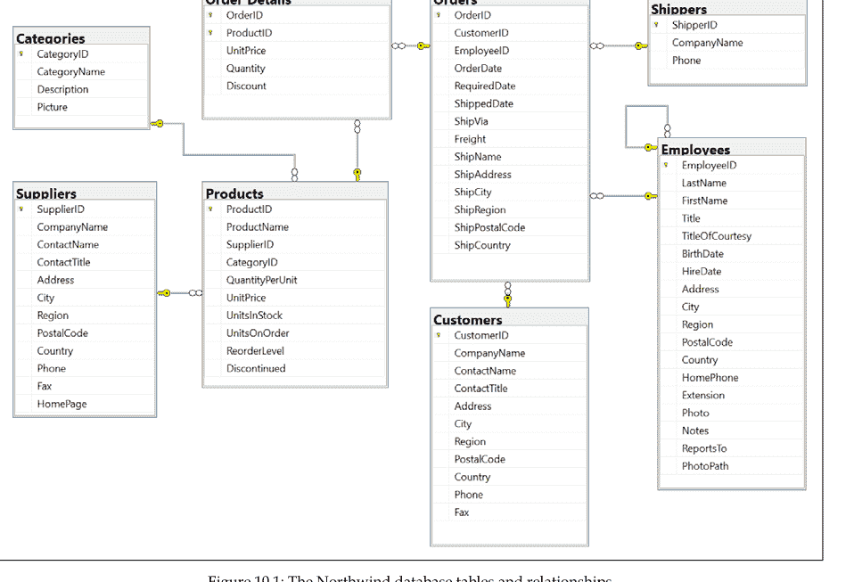

图 10.1：Northwind 数据库表及关系

您将在本章后面编写代码来处理 Categories 和 Products 表，并在后续章节中处理其他表。但在这样做之前，请注意：

- 每个类别都有唯一的标识符、名称、描述和图片。
- 每个产品都有唯一的标识符、名称、单价、库存单位和其他字段。
- 每个产品通过存储类别的唯一标识符与类别关联。
- Categories 和 Products 之间的关系是一对多，这意味着每个类别可以有零个或多个产品。

### 在 Windows 上使用 Microsoft SQL Server

Microsoft 为 Windows、Linux 和 Docker 容器提供其流行且功能强大的 SQL Server 产品的各种版本。我们将使用一个可独立运行的免费版本，即 SQL Server Developer Edition。您也可以使用 Express 版本或可随 Visual Studio for Windows 安装的免费 SQL Server LocalDB 版本。

如果您没有 Windows 计算机或想要使用跨平台数据库系统，则可以跳到 *使用 SQLite* 主题。

### 下载和安装 SQL Server

您可以通过以下链接下载 SQL Server 版本：

```
https://www.microsoft.com/en-us/sql-server/sql-server-downloads
```

- 1. 下载 **Developer** 版本。
- 2. 运行安装程序。
- 3. 选择 **Custom** 安装类型。
- 4. 选择安装文件的文件夹，然后单击 **Install**。
- 5. 等待 1.5 GB 的安装程序文件下载完成。
- 6. 在 **SQL Server Installation Center** 中，单击 **Installation**，然后单击 **New SQL Server stand-alone installation or add features to an existing installation**。
- 7. 选择 **Developer** 作为免费版本，然后单击 **Next**。
- 8. 接受许可条款，然后单击 **Next**。
- 9. 查看安装规则，修复任何问题，然后单击 **Next**。
- 10. 在 **Feature Selection** 中，选择 **Database Engine Services**，然后单击 **Next**。
- 11. 在 **Instance Configuration** 中，选择 **Default instance**，然后单击 **Next**。如果您已配置默认实例，则可以创建命名实例，也许称为 cs10dotnet6。
- 12. 在 **Server Configuration** 中，注意 **SQL Server Database Engine** 已配置为自动启动。将 **SQL Server Browser** 设置为自动启动，然后单击 **Next**。
- 13. 在 **Database Engine Configuration** 中，在 **Server Configuration** 选项卡上，将 **Authentication Mode** 设置为 **Mixed**，将 sa 账户密码设置为强密码，单击 **Add Current User**，然后单击 **Next**。
- 14. 在 **Ready to Install** 中，查看将要执行的操作，然后单击 **Install**。
- 15. 在 **Complete** 中，注意已成功执行的操作，然后单击 **Close**。
- 16. 在 **SQL Server Installation Center** 中，在 **Installation** 下，单击 **Install SQL Server Management Tools**。
- 17. 在浏览器窗口中，单击下载最新版本的 SSMS。
- 18. 运行安装程序并单击 **Install**。
- 19. 安装程序完成后，如有需要单击 **Restart** 或 **Close**。


## 为 SQL Server 创建 Northwind 示例数据库

现在我们可以运行一个数据库脚本来创建 Northwind 示例数据库：

- 1. 如果你之前尚未下载或克隆本书的 GitHub 仓库，请现在使用以下链接进行操作：https://github.com/markjprice/cs10dotnet6/。
- 2. 从本地 Git 仓库中的以下路径复制用于为 SQL Server 创建 Northwind 数据库的脚本：/sql-scripts/Northwind4SQLServer.sql 到 WorkingWithEFCore 文件夹中。
- 3. 启动 SQL Server Management Studio。
- 4. 在“连接到服务器”对话框中，对于“服务器名称”，输入 .（一个点）表示本地计算机名称，然后单击“连接”。
- 5. 导航到 文件 | 打开 | 文件....。
- 6. 浏览以选择 Northwind4SQLServer.sql 文件，然后单击“打开”。
- 7. 在工具栏中，单击“执行”，并注意“命令执行成功”消息。
- 8. 在“对象资源管理器”中，展开 Northwind 数据库，然后展开“表”。
- 9. 右键单击 Products，单击“选择前 1000 行”，并注意返回的结果，如图 10.2 所示：

> 如果你必须创建命名实例，例如 cs10dotnet6，则输入 .\cs10dotnet6

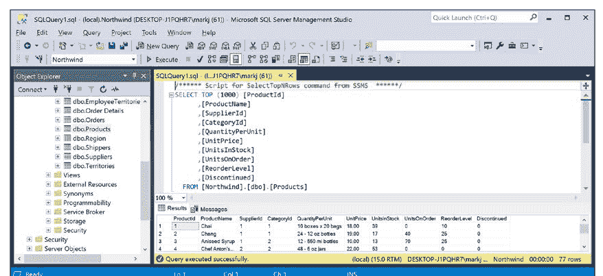

图 10.2：SQL Server Management Studio 中的 Products 表

- 10. 在“对象资源管理器”工具栏中，单击“断开连接”按钮。
- 11. 退出 SQL Server Management Studio。

## 使用 Server Explorer 管理 Northwind 示例数据库

我们不必使用 SQL Server Management Studio 来执行数据库脚本。我们还可以使用 Visual Studio 中的工具，包括 SQL Server 对象资源管理器和 Server Explorer：

- 1. 在 Visual Studio 中，选择 查看 | Server Explorer。
- 2. 在 Server Explorer 窗口中，右键单击“数据连接”并选择“添加连接...”。
- 3. 如果看到“选择数据源”对话框，如图 10.3 所示，选择 Microsoft SQL Server 然后单击“继续”：

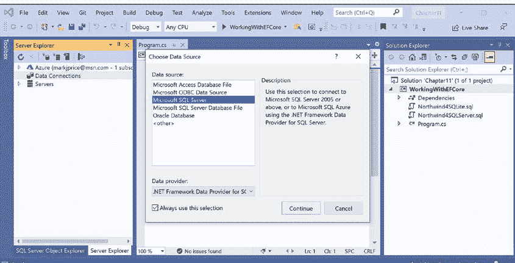

图 10.3：选择 SQL Server 作为数据源

- 4. 在“添加连接”对话框中，将服务器名称输入为 .，将数据库名称输入为 Northwind，然后单击“确定”。
- 5. 在 Server Explorer 中，展开数据连接及其表。你应该会看到 13 个表，包括 Categories 和 Products 表。
- 6. 右键单击 Products 表，选择“显示表数据”，并注意返回了 77 行产品。
- 7. 要查看 Products 表列和类型的详细信息，右键单击 Products 并选择“打开表定义”，或在 Server Explorer 中双击该表。

## 使用 SQLite

SQLite 是一个小型、跨平台、自包含的关系数据库管理系统，可在公共领域获得。它是 iOS（iPhone 和 iPad）和 Android 等移动平台上最常见的 RDBMS。即使你使用 Windows 并在上一节中设置了 SQL Server，你可能也想设置 SQLite。我们编写的代码适用于两者，比较细微差异也很有趣。

### 为 macOS 设置 SQLite

SQLite 已包含在 macOS 的 /usr/bin/ 目录中，作为名为 sqlite3 的命令行应用程序。

### 为 Windows 设置 SQLite

在 Windows 上，我们需要将 SQLite 文件夹添加到系统路径中，以便在命令提示符或终端中输入命令时可以找到它：

- 1. 启动你喜欢的浏览器并导航到以下链接：https://www.sqlite.org/download.html。
- 2. 向下滚动页面到 **Windows 预编译二进制文件** 部分。
- 3. 单击 **sqlite-tools-win32-x86-3360000.zip**。请注意，本书出版后该文件可能具有更高的版本号。
- 4. 将 ZIP 文件解压到名为 `C:\Sqlite\` 的文件夹中。
- 5. 导航到 **Windows 设置**。
- 6. 搜索环境并选择 **编辑系统环境变量**。在非英语版本的 Windows 上，请搜索你本地语言中的等效词以找到该设置。
- 7. 单击 **环境变量** 按钮。
- 8. 在 **系统变量** 中，在列表中选择 **路径**，然后单击 **编辑...**。
- 9. 单击 **新建**，输入 `C:\Sqlite`，并按 *Enter*。
- 10. 单击 **确定**。
- 11. 单击 **确定**。
- 12. 单击 **确定**。
- 13. 关闭 **Windows 设置**。

### 为其他操作系统设置 SQLite

SQLite 可以从以下链接下载并安装到其他操作系统：https://www.sqlite.org/download.html。

## 为 SQLite 创建 Northwind 示例数据库

现在我们可以使用 SQL 脚本来为 SQLite 创建 Northwind 示例数据库：

- 1. 如果你之前尚未克隆本书的 GitHub 仓库，请现在使用以下链接进行操作：https://github.com/markjprice/cs10dotnet6/。
- 2. 从本地 Git 仓库中的以下路径复制用于为 SQLite 创建 Northwind 数据库的脚本：/sql-scripts/Northwind4SQLite.sql 到 WorkingWithEFCore 文件夹中。
- 3. 在 WorkingWithEFCore 文件夹中启动命令行：
  - 1. 在 Windows 上，启动文件资源管理器，右键单击 WorkingWithEFCore 文件夹，并选择“在此文件夹中打开命令提示符”或“在 Windows 终端中打开”。
  - 2. 在 macOS 上，启动 Finder，右键单击 WorkingWithEFCore 文件夹，并选择“在此文件夹中新建终端”。
- 4. 输入命令使用 SQLite 执行 SQL 脚本并创建 Northwind.db 数据库，如以下命令所示：
- 5. 请耐心等待，因为此命令可能需要一段时间来创建数据库结构。最终，你将看到 SQLite 命令提示符，如以下输出所示：
- 6. 在 Windows 上按 Ctrl + C 或在 macOS 上按 Ctrl + D 退出 SQLite 命令模式。
- 7. 保持终端或命令提示符窗口打开，因为你很快会再次使用它。

```
sqlite3 Northwind.db --init Northwind4SQLite.sql
```

```
-- Loading resources from Northwind4SQLite.sql
SQLite version 3.36.0 2021-08-24 15:20:15
Enter ".help" for usage hints.
sqlite>
```

## 使用 SQLiteStudio 管理 Northwind 示例数据库

你可以使用名为 SQLiteStudio 的跨平台图形数据库管理器轻松管理 SQLite 数据库：

- 1. 导航到以下链接 https://sqlitestudio.pl，下载并解压应用程序到你喜欢的位置。
- 2. 启动 SQLiteStudio。
- 3. 在“数据库”菜单上，选择“添加数据库”。
- 4. 在“数据库”对话框中，在“文件”部分，单击黄色文件夹按钮浏览本地计算机上的现有数据库文件，选择 WorkingWithEFCore 文件夹中的 Northwind.db 文件，然后单击“确定”。
- 5. 右键单击 Northwind 数据库并选择“连接到数据库”。你将看到脚本创建的 10 个表。（SQLite 的脚本比 SQL Server 的简单；它不会创建那么多表或其他数据库对象。）
- 6. 右键单击 Products 表并选择“编辑表”。
- 7. 在表编辑器窗口中，注意 Products 表的结构，包括列名、数据类型、键和约束，如图 10.4 所示：

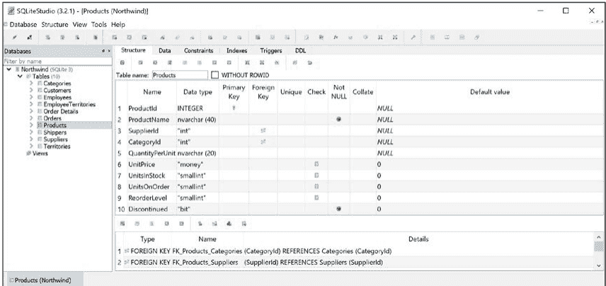

图 10.4：SQLiteStudio 中的表编辑器显示 Products 表的结构

- 8. 在表编辑器窗口中，单击“数据”选项卡，你将看到 77 个产品，如图 10.5 所示：

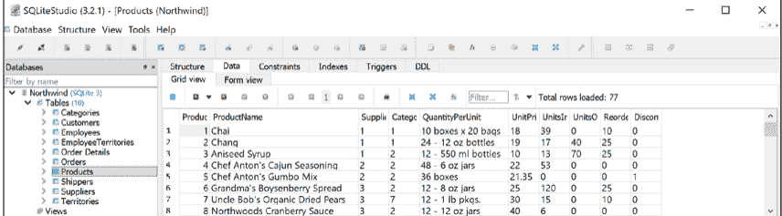

图 10.5：数据选项卡显示 Products 表中的行

- 9. 在“数据库”窗口中，右键单击 Northwind 并选择“从数据库断开连接”。
- 10. 退出 SQLiteStudio。

## 设置 EF Core

在深入探讨使用 EF Core 管理数据的实际操作之前，让我们简要谈谈 EF Core 数据提供程序之间的选择。

### 选择 EF Core 数据库提供程序

要管理特定数据库中的数据，我们需要能够高效地与该数据库通信的类。

EF Core 数据库提供程序是一组针对特定数据存储优化的类。甚至还有一个提供程序用于将数据存储在当前进程的内存中，这对于高性能单元测试很有用，因为它避免了访问外部系统。

它们作为 NuGet 包分发，如下表所示：

| 要管理的数据存储 | 安装此 NuGet 包 |
|---|---|
| Microsoft SQL Server 2012 或更高版本 | Microsoft.EntityFrameworkCore.SqlServer |
| SQLite 3.7 或更高版本 | Microsoft.EntityFrameworkCore.SQLite |
| MySQL | MySQL.Data.EntityFrameworkCore |
| 内存中 | Microsoft.EntityFrameworkCore.InMemory |
| Azure Cosmos DB SQL API | Microsoft.EntityFrameworkCore.Cosmos |
| Oracle DB 11.2 | Oracle.EntityFrameworkCore |

你可以根据需要在一个项目中安装任意多个 EF Core 数据库提供程序。每个包都包含共享类型以及提供程序特定的类型。

### 连接到数据库

要连接到 SQLite 数据库，我们只需要知道数据库文件名，使用参数 Filename 设置。

要连接到 SQL Server 数据库，我们需要知道多个信息，如下列表所示：

- 服务器名称（如果有实例则包括实例）。
- 数据库名称。
- 安全信息，例如用户名和密码，或是否应自动传递当前登录用户的凭据。

我们在连接字符串中指定这些信息。

为了向后兼容，我们可以在 SQL Server 连接字符串中使用多个可能的关键字来指定各种参数，如下列表所示：

-   **数据源或服务器或地址**：这些关键字是服务器的名称（以及可选的实例）。你可以使用点 `.` 表示本地服务器。
-   **初始目录或数据库**：这些关键字是数据库的名称。
-   **集成安全性或受信任连接**：这些关键字设置为 true 或 SSPI 以传递线程的当前用户凭据。
-   **多活动结果集**：此关键字设置为 true 以启用单个连接同时处理多个表以提高效率。它用于从相关表中延迟加载行。

如上列表所述，当你编写代码连接到 SQL Server 数据库时，你需要知道其服务器名称。服务器名称取决于你要连接的 SQL Server 的版本和版本，如下表所示：

| SQL Server 版本 | 服务器名称 \ 实例名称 |
|---|---|
| LocalDB 2012 | `(localdb)\v11.0` |
| LocalDB 2016 或更高版本 | `(localdb)\mssqllocaldb` |
| Express | `.\sqlexpress` |
| Full/Developer (默认实例) | `.` |
| Full/Developer (命名实例) | `.\cs10dotnet6` |

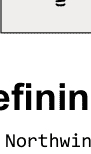

> **良好实践**：使用点 `.` 作为本地计算机名称的简写。
> 请记住，SQL Server 的服务器名称由两部分组成：计算机的名称和 SQL Server 实例的名称。你在自定义安装期间提供实例名称。

## 定义 Northwind 数据库上下文类

Northwind 类将用于表示数据库。要使用 EF Core，类必须继承自 DbContext。此类了解如何与数据库通信并动态生成用于查询和操作数据的 SQL 语句。

你的 DbContext 派生类应具有一个重写的方法名为 OnConfiguring，它将设置数据库连接字符串。

为了让你轻松尝试 SQLite 和 SQL Server，我们将创建一个同时支持两者的项目，并使用一个字符串字段在运行时控制使用哪一个：

1.  在 `WorkingWithEFCore` 项目中，添加对 EF Core 数据提供程序的包引用，同时针对 SQL Server 和 SQLite，如以下标记所示：

```
<ItemGroup>
  <PackageReference
    Include="Microsoft.EntityFrameworkCore.Sqlite"
    Version="6.0.0" />
  <PackageReference
    Include="Microsoft.EntityFrameworkCore.SqlServer"
    Version="6.0.0" />
</ItemGroup>
```

2.  构建项目以还原包。

3.  添加一个名为 ProjectConstants.cs 的类文件。

4.  在 ProjectConstants.cs 中，定义一个类，其中包含一个公共字符串常量来存储你想要使用的数据库提供程序名称，如以下代码所示：

```
namespace Packt.Shared;

public class ProjectConstants
{
    public const string DatabaseProvider = "SQLite"; // or "SQLServer"
}
```

5.  在 Program.cs 中，导入 Packt.Shared 命名空间并输出数据库提供程序，如以下代码所示：

```
WriteLine($"Using {ProjectConstants.DatabaseProvider} database provider.");
```

6.  添加一个名为 Northwind.cs 的类文件。

7.  在 Northwind.cs 中，定义一个名为 Northwind 的类，导入 EF Core 的主命名空间，使类继承自 DbContext，并在 OnConfiguring 方法中检查提供程序字段以使用 SQLite 或 SQL Server，如以下代码所示：

```
using Microsoft.EntityFrameworkCore; // DbContext, DbContextOptionsBuilder

using static System.Console;

namespace Packt.Shared;

// this manages the connection to the database
public class Northwind : DbContext
{
    protected override void OnConfiguring(
        DbContextOptionsBuilder optionsBuilder)
    {
        if (ProjectConstants.DatabaseProvider == "SQLite")
        {
            string path = Path.Combine(
                Environment.CurrentDirectory, "Northwind.db");

            WriteLine($"Using {path} database file.");

            optionsBuilder.UseSqlite($"Filename={path}");
        }
        else
        {
            string connection = "Data Source=.;" +
                "Initial Catalog=Northwind;" +
                "Integrated Security=true;" +
                "MultipleActiveResultSets=true;";

            optionsBuilder.UseSqlServer(connection);
        }
    }
}
```

如果你使用 Windows 版 Visual Studio，则编译后的应用程序在 WorkingWithEFCore\bin\Debug\net6.0 文件夹中执行，因此找不到数据库文件。

8.  在解决方案资源管理器中，右键单击 Northwind.db 文件并选择属性。

9.  在属性中，将复制到输出目录设置为始终复制。

10. 打开 WorkingWithEFCore.csproj 并注意新的元素，如以下标记所示：

```
<ItemGroup>
    <None Update="Northwind.db">
        <CopyToOutputDirectory>Always</CopyToOutputDirectory>
    </None>
</ItemGroup>
```

如果你使用 Visual Studio Code，则编译后的应用程序在 WorkingWithEFCore 文件夹中执行，因此无需复制即可找到数据库文件。

11. 运行控制台应用程序并注意输出，显示你选择使用的数据库提供程序。

## 定义 EF Core 模型

EF Core 使用约定、注释属性和 Fluent API 语句的组合在运行时构建实体模型，以便对类执行的操作之后可以自动转换为对实际数据库执行的操作。实体类表示表的结构，类的实例表示该表中的一行。

首先，我们将回顾三种定义模型的方法，并附带代码示例，然后我们将创建一些实现这些技术的类。

### 使用 EF Core 约定定义模型

我们将编写的代码将使用以下约定：

-   假设表的名称与 DbContext 类中 DbSet<T> 属性的名称匹配，例如 Products。
-   假设列的名称与实体模型类中属性的名称匹配，例如 ProductId。
-   假设 string .NET 类型在数据库中为 nvarchar 类型。
-   假设 int .NET 类型在数据库中为 int 类型。
-   假设主键是一个名为 Id 或 ID 的属性，或者当实体模型类名为 Product 时，属性可以命名为 ProductId 或 ProductID。如果此属性是整数类型或 Guid 类型，则还假设它是一个 IDENTITY 列（一种在插入时自动分配值的列类型）。

> **良好实践：** 还有许多其他约定你应该知道，你甚至可以定义自己的约定，但这超出了本书的范围。你可以在以下链接阅读有关它们的信息：https://docs.microsoft.com/en-us/ef/core/modeling/

### 使用 EF Core 注释属性定义模型

约定通常不足以完全映射类到数据库对象。向模型添加更多智能的简单方法是应用注释属性。

一些常见属性显示在下表中：

| 属性 | 描述 |
|---|---|
| [Required] | 确保值不为空。 |
| [StringLength(50)] | 确保值长度最多为 50 个字符。 |
| [RegularExpression(expression)] | 确保值匹配指定的正则表达式。 |
| [Column(TypeName = "money", Name = "UnitPrice")] | 指定表中使用列类型和列名。 |

例如，在数据库中，产品名称的最大长度为 40，且值不能为空，如以下突出显示的数据定义语言 (DDL) 代码所示，该代码定义了如何创建名为 Products 的表及其列、数据类型、键和其他约束：

```
CREATE TABLE Products (
    ProductId    INTEGER    PRIMARY KEY,
    ProductName  NVARCHAR (40) NOT NULL,
    SupplierId   "INT",
    CategoryId    "INT",
    QuantityPerUnit NVARCHAR (20),
    UnitPrice    "MONEY"    CONSTRAINT DF_Products_UnitPrice DEFAULT (0),
    UnitsInStock "SMALLINT" CONSTRAINT DF_Products_UnitsInStock DEFAULT (0),
    UnitsOnOrder "SMALLINT" CONSTRAINT DF_Products_UnitsOnOrder DEFAULT (0),
    ReorderLevel "SMALLINT" CONSTRAINT DF_Products_ReorderLevel DEFAULT (0),
    Discontinued "BIT"      NOT NULL
                CONSTRAINT DF_Products_Discontinued DEFAULT (0),
CONSTRAINT FK_Products_Categories FOREIGN KEY (
    CategoryId
)
REFERENCES Categories (CategoryId),
CONSTRAINT FK_Products_Suppliers FOREIGN KEY (
    SupplierId
)
REFERENCES Suppliers (SupplierId),
CONSTRAINT CK_Products_UnitPrice CHECK (UnitPrice >= 0),
CONSTRAINT CK_ReorderLevel CHECK (ReorderLevel >= 0),
CONSTRAINT CK_UnitsInStock CHECK (UnitsInStock >= 0),
CONSTRAINT CK_UnitsOnOrder CHECK (UnitsOnOrder >= 0)
);
```

在 Product 类中，我们可以应用属性来指定此项，如以下代码所示：

```
[Required]
[StringLength(40)]
public string ProductName { get; set; }
```

当 .NET 类型与数据库类型之间没有明显的映射时，可以使用属性。

例如，在数据库中，Products 表的 UnitPrice 列类型为 money。.NET 没有 money 类型，因此应改用 decimal，如以下代码所示：

```
[Column(TypeName = "money")]
public decimal? UnitPrice { get; set; }
```

另一个示例是 Categories 表，如以下 DDL 代码所示：

```
CREATE TABLE Categories (
    CategoryId    INTEGER    PRIMARY KEY,
    CategoryName NVARCHAR (15) NOT NULL,
    Description   "NTEXT",
    Picture       "IMAGE"
);
```


The Description column can be longer than the maximum 8,000 characters that can be stored in a nvarchar variable, so it needs to map to ntext instead, as shown in the following code:

```
[Column(TypeName = "ntext")]
public string Description { get; set; }
```

## 使用 EF Core Fluent API 定义模型

The last way that the model can be defined is by using the Fluent API. This API can be used instead of attributes, as well as being used in addition to them. For example, to define the ProductName property, instead of decorating the property with two attributes, an equivalent Fluent API statement could be written in the OnModelCreating method of the database context class, as shown in the following code:

```
modelBuilder.Entity<Product>()
    .Property(product => product.ProductName)
    .IsRequired()
    .HasMaxLength(40);
```

This keeps the entity model class simpler.

## 使用 Fluent API 理解数据种子

Another benefit of the Fluent API is to provide initial data to populate a database. EF Core automatically works out what insert, update, or delete operations must be executed.

For example, if we wanted to make sure that a new database has at least one row in the Product table, then we would call the HasData method, as shown in the following code:

```
modelBuilder.Entity<Product>()
    .HasData(new Product
    {
        ProductId = 1,
        ProductName = "Chai",
        UnitPrice = 8.99M
    });
```

Our model will map to an existing database that is already populated with data so we will not need to use this technique in our code.

## 为 Northwind 表构建 EF Core 模型

Now that you've learned about ways to define an EF Core model, let's build a model to represent two tables in the Northwind database.

The two entity classes will refer to each other, so to avoid compiler errors, we will create the classes without any members first:

- 1. In the WorkingWithEFCore project, add two class files named Category.cs and Product.cs.
- 2. In Category.cs, define a class named Category, as shown in the following code:
- 3. In Product.cs, define a class named Product, as shown in the following code:

```
namespace Packt.Shared;

public class Category
{
}
```

```
namespace Packt.Shared;

public class Product
{
}
```

## 定义 Category 和 Product 实体类

The Category class, also known as an entity model, will be used to represent a row in the Categories table. This table has four columns, as shown in the following DDL:

```
CREATE TABLE Categories (
    CategoryId    INTEGER    PRIMARY KEY,
    CategoryName  NVARCHAR (15) NOT NULL,
    Description   NTEXT,
    Picture       IMAGE
);
```

We will use conventions to define:

- - Three of the four properties (we will not map the Picture column).
- - The primary key.
- - The one-to-many relationship to the Products table.

To map the Description column to the correct database type, we will need to decorate the string property with the Column attribute.

Later in this chapter, we will use the Fluent API to define that CategoryName cannot be null and is limited to a maximum of 15 characters.

Let's go:

- 1. Modify the Category entity model class, as shown in the following code:

```
using System.ComponentModel.DataAnnotations.Schema; // [Column]

namespace Packt.Shared;
```

```
public class Category
{
    // these properties map to columns in the database
    public int CategoryId { get; set; }
    public string? CategoryName { get; set; }

    [Column(TypeName = "ntext")]
    public string? Description { get; set; }

    // defines a navigation property for related rows
    public virtual ICollection<Product> Products { get; set; }

    public Category()
    {
        // to enable developers to add products to a Category we must
        // initialize the navigation property to an empty collection
        Products = new HashSet<Product>();
    }
}
```

The Product class will be used to represent a row in the Products table, which has ten columns.

You do not need to include all columns from a table as properties of a class. We will only map six properties: ProductId, ProductName, UnitPrice, UnitsInStock, Discontinued, and CategoryId.

Columns that are not mapped to properties cannot be read or set using the class instances. If you use the class to create a new object, then the new row in the table will have NULL or some other default value for the unmapped column values in that row. You must make sure that those missing columns are optional or have default values set by the database or an exception will be thrown at runtime. In this scenario, the rows already have data values and I have decided that I do not need to read those values in this application.

We can rename a column by defining a property with a different name, like Cost, and then decorating the property with the [Column] attribute and specifying its column name, like UnitPrice.

The final property, CategoryId, is associated with a Category property that will be used to map each product to its parent category.

- 2. Modify the Product class, as shown in the following code:

```
using System.ComponentModel.DataAnnotations; // [Required], [StringLength]
using System.ComponentModel.DataAnnotations.Schema; // [Column]

namespace Packt.Shared;
```

```csharp
public class Product
{
    public int ProductId { get; set; } // primary key

    [Required]
    [StringLength(40)]
    public string ProductName { get; set; } = null!;

    [Column("UnitPrice", TypeName = "money")]
    public decimal? Cost { get; set; } // property name != column name

    [Column("UnitsInStock")]
    public short? Stock { get; set; }

    public bool Discontinued { get; set; }

    // these two define the foreign key relationship
    // to the Categories table
    public int CategoryId { get; set; }
    public virtual Category Category { get; set; } = null!;
}
```

The two properties that relate the two entities, Category.Products and Product.Category, are both marked as virtual. This allows EF Core to inherit and override the properties to provide extra features, such as lazy loading.

## 向 Northwind 数据库上下文类添加表

Inside your DbContext-derived class, you must define at least one property of the DbSet<T> type. These properties represent the tables. To tell EF Core what columns each table has, the DbSet<T> properties use generics to specify a class that represents a row in the table. That entity model class has properties that represent its columns.

The DbContext-derived class can optionally have an overridden method named OnModelCreating. This is where you can write Fluent API statements as an alternative to decorating your entity classes with attributes.

Let's write some code:

- 1. Modify the Northwind class to add statements to define two properties for the two tables and an OnModelCreating method, as shown highlighted in the following code:

```csharp
public class Northwind : DbContext
{
    // these properties map to tables in the database
    public DbSet<Category>? Categories { get; set; }
    public DbSet<Product>? Products { get; set; }

    protected override void OnConfiguring(
        DbContextOptionsBuilder optionsBuilder)
    {
        ...
    }

    protected override void OnModelCreating(
        ModelBuilder modelBuilder)
    {
        // example of using Fluent API instead of attributes
        // to limit the length of a category name to 15
        modelBuilder.Entity<Category>()
            .Property(category => category.CategoryName)
            .IsRequired() // NOT NULL
            .HasMaxLength(15);

        if (ProjectConstants.DatabaseProvider == "SQLite")
        {
            // added to "fix" the lack of decimal support in SQLite
            modelBuilder.Entity<Product>()
                .Property(product => product.Cost)
                .HasConversion<double>();
        }
    }
}
```


> In EF Core 3.0 and later, the decimal type is not supported by the SQLite database provider for sorting and other operations. We can fix this by telling the model that decimal values can be converted to double values when using the SQLite database provider. This does not actually perform any conversion at runtime.

Now that you have seen some examples of defining an entity model manually, let's see a tool that can do some of the work for you.

## 设置 dotnet-ef 工具

.NET has a command-line tool named dotnet. It can be extended with capabilities useful for working with EF Core. It can perform design-time tasks like creating and applying migrations from an older model to a newer model and generating code for a model from an existing database.


dotnet ef 命令行工具不会自动安装。您必须将此包作为全局工具或本地工具安装。如果您已经安装了旧版本的工具，则应卸载任何现有版本：

- 1. 在命令提示符或终端中，检查是否已将 dotnet-ef 作为全局工具安装，如以下命令所示：
- 2. 在列表中检查是否已安装旧版本的工具，例如 .NET Core 3.1 的版本，如以下输出所示：
- 3. 如果已安装旧版本，则卸载该工具，如以下命令所示：
- 4. 安装最新版本，如以下命令所示：
- 5. 如有必要，请按照安装 dotnet-ef 工具输出中所述的任何特定于操作系统的说明，将 dotnet 工具目录添加到您的 PATH 环境变量中。

```
dotnet tool list --global
```

| 包 ID | 版本 | 命令 |
|------------|---------|----------|
| dotnet-ef | 3.1.0 | dotnet-ef |

```
dotnet tool uninstall --global dotnet-ef
```

```
dotnet tool install --global dotnet-ef --version 6.0.0
```

## 使用现有数据库生成模型

模型生成是使用工具通过逆向工程创建表示现有数据库模型的类的过程。好的模型生成工具允许您扩展自动生成的类，然后在不丢失扩展类的情况下重新生成这些类。

如果您知道永远不会使用该工具重新生成类，那么您可以随意更改自动生成的类的代码。工具生成的代码只是最佳近似值。

> **良好实践**：当您知道得更好时，不要害怕推翻工具。

让我们看看工具生成的模型是否与我们手动创建的相同：

- 1. 将 Microsoft.EntityFrameworkCore.Design 包添加到 WorkingWithEFCore 项目中。
- 2. 在 WorkingWithEFCore 文件夹中的命令提示符或终端中，为 Categories 和 Products 表生成模型到名为 AutoGenModels 的新文件夹中，如以下命令所示：

```
dotnet ef dbcontext scaffold "Filename=Northwind.db" Microsoft.EntityFrameworkCore.Sqlite --table Categories --table Products --output-dir AutoGenModels --namespace WorkingWithEFCore.AutoGen --data-annotations --context Northwind
```

请注意以下事项：

- 命令操作：dbcontext scaffold
- 连接字符串："Filename=Northwind.db"
- 数据库提供程序：Microsoft.EntityFrameworkCore.Sqlite
- 要生成模型的表：--table Categories --table Products
- 输出文件夹：--output-dir AutoGenModels
- 命名空间：--namespace WorkingWithEFCore.AutoGen
- 同时使用数据注释和 Fluent API：--data-annotations
- 将上下文从 [database_name]Context 重命名：--context Northwind

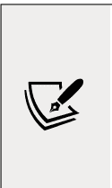

对于 SQL Server，请更改数据库提供程序和连接字符串，如以下命令所示：

```
dotnet ef dbcontext scaffold "Data Source=.;Initial Catalog=Northwind;Integrated Security=true;" Microsoft.EntityFrameworkCore.SqlServer --table Categories --table Products --output-dir AutoGenModels --namespace WorkingWithEFCore.AutoGen --data-annotations --context Northwind
```

- 3. 请注意构建消息和警告，如以下输出所示：

```
Build started...
Build succeeded.
To protect potentially sensitive information in your connection string, you should move it out of source code. You can avoid scaffolding the connection string by using the Name= syntax to read it from configuration - see https://go.microsoft.com/fwlink/?linkid=2131148. For more guidance on storing connection strings, see http://go.microsoft.com/fwlink/?LinkId=723263.
Skipping foreign key with identity '0' on table 'Products' since principal table 'Suppliers' was not found in the model. This usually happens when the principal table was not included in the selection set.
```

- 4. 打开 AutoGenModels 文件夹并注意自动生成的三个类文件：Category.cs、Northwind.cs 和 Product.cs。
- 5. 打开 Category.cs 并注意与您手动创建的相比的差异，如以下代码所示：

```csharp
using System;
using System.Collections.Generic;
using System.ComponentModel.DataAnnotations;
using System.ComponentModel.DataAnnotations.Schema;
using Microsoft.EntityFrameworkCore;

namespace WorkingWithEFCore.AutoGen
{
    [Index(nameof(CategoryName), Name = "CategoryName")]
    public partial class Category
    {
        public Category()
        {
            Products = new HashSet<Product>();
        }

        [Key]
        public long CategoryId { get; set; }

        [Required]
        [Column(TypeName = "nvarchar (15)")] // SQLite
        [StringLength(15)] // SQL Server
        public string CategoryName { get; set; }

        [Column(TypeName = "ntext")]
        public string? Description { get; set; }

        [Column(TypeName = "image")]
        public byte[]? Picture { get; set; }

        [InverseProperty(nameof(Product.Category))]
        public virtual ICollection<Product> Products { get; set; }
    }
}
```

请注意以下事项：

- 它使用在 EF Core 5.0 中引入的 [Index] 属性装饰实体类。这表示应具有索引的属性。在早期版本中，仅支持 Fluent API 来定义索引。由于我们正在使用现有数据库，因此不需要此信息。但如果我们想从代码重新创建新的空数据库，则需要此信息。
- 数据库中的表名为 Categories，但 dotnet-ef 工具使用 Humanizer 第三方库自动将类名单数化为 Category，这是在创建单个实体时更自然的名称。
- 实体类使用 partial 关键字声明，以便您可以创建匹配的 partial 类以添加额外代码。这允许您重新运行工具并重新生成实体类，而不会丢失额外代码。
- CategoryId 属性使用 [Key] 属性装饰，以指示它是此实体的主键。该属性的数据类型对于 SQL Server 为 int，对于 SQLite 为 long。
- Products 属性使用 [InverseProperty] 属性定义到 Product 实体类上的 Category 属性的外键关系。

- 6. 打开 Product.cs 并注意与您手动创建的相比的差异。
- 7. 打开 Northwind.cs 并注意与您手动创建的相比的差异，如以下为节省空间而编辑的代码所示：

```csharp
using Microsoft.EntityFrameworkCore;

namespace WorkingWithEFCore.AutoGen
{
    public partial class Northwind : DbContext
    {
        public Northwind()
        {
        }

        public Northwind(DbContextOptions<Northwind> options)
            : base(options)
        {
        }

        public virtual DbSet<Category> Categories { get; set; } = null!;
        public virtual DbSet<Product> Products { get; set; } = null!;

        protected override void OnConfiguring(
            DbContextOptionsBuilder optionsBuilder)
        {
            if (!optionsBuilder.IsConfigured)
            {
#warning To protect potentially sensitive information in your connection string, you should move it out of source code. You can avoid scaffolding the connection string by using the Name= syntax to read it from configuration - see https://go.microsoft.com/fwlink/?linkid=2131148. For more guidance on storing connection strings, see http://go.microsoft.com/fwlink/?LinkId=723263.
                optionsBuilder.UseSqlite("Filename=Northwind.db");
            }
        }
    }
}
```

```
protected override void OnModelCreating(ModelBuilder modelBuilder)
{
    modelBuilder.Entity<Category>(entity =>
    {
        ...
    });

    modelBuilder.Entity<Product>(entity =>
    {
        ...
    });

    OnModelCreatingPartial(modelBuilder);
}
    partial void OnModelCreatingPartial(ModelBuilder modelBuilder);
}
```

请注意以下事项：

- Northwind 数据上下文类是 partial，以便您可以扩展它并在将来重新生成它。
- 它有两个构造函数：一个默认无参数的构造函数和一个允许传入选项的构造函数。这在您希望在运行时指定连接字符串的应用程序中很有用。
- 表示 Categories 和 Products 表的两个 DbSet<T> 属性被设置为 null 容错值，以防止在编译时出现静态编译器分析警告。它在运行时没有影响。
- 在 OnConfiguring 方法中，如果在构造函数中未指定选项，则默认使用查找当前文件夹中数据库文件的连接字符串。它有一个编译器警告，提醒您不应在此连接字符串中硬编码安全信息。
- 在 OnModelCreating 方法中，使用 Fluent API 配置两个实体类，然后调用名为 OnModelCreatingPartial 的 partial 方法。这允许您在自己的 partial Northwind 类中实现该 partial 方法，以添加自己的 Fluent API 配置，如果重新生成模型类也不会丢失。

- 8. 关闭自动生成的类文件。

## 配置预约定模型

除支持使用 SQLite 数据库提供程序的 DateOnly 和 TimeOnly 类型外，EF Core 6 引入的新功能之一是配置预约定模型。


随着模型变得越来越复杂，依赖约定来发现实体类型及其属性并成功将其映射到表和列变得越来越困难。如果能在用于分析和构建模型之前配置约定本身，那就很有用。

例如，你可能想要定义一个约定，说明所有字符串属性默认应具有最大长度 50 个字符，或者任何实现自定义接口的属性类型都不应被映射，如以下代码所示：

```
protected override void ConfigureConventions(
    ModelConfigurationBuilder configurationBuilder)
{
    configurationBuilder.Properties<string>().HaveMaxLength(50);
    configurationBuilder.IgnoreAny<IDoNotMap>();
}
```

本章剩余部分，我们将使用你手动创建的类。

## 查询 EF Core 模型

现在我们有一个映射到 Northwind 数据库及其两个表的模型，我们可以编写一些简单的 LINQ 查询来获取数据。你将在第 11 章《使用 LINQ 查询和操作数据》中学习更多关于编写 LINQ 查询的内容。

现在，只需编写代码并查看结果：

- 1. 在 Program.cs 顶部，导入主要的 EF Core 命名空间以启用 Include 扩展方法来预取相关表的数据：
- 2. 在 Program.cs 底部，定义一个 QueryingCategories 方法，并添加语句执行以下任务，如以下代码所示：
  - 创建 Northwind 类的实例来管理数据库。数据库上下文实例设计为在工作单元中具有较短的生命周期。它们应尽快被释放，因此我们将使用 using 语句将其包装起来。在第 14 章《使用 ASP.NET Core Razor Pages 构建网站》中，你将学习如何使用依赖注入获取数据库上下文。
  - 为所有包含其相关产品的类别创建查询。
  - 遍历类别，输出每个类别的名称和产品数量：

```
using Microsoft.EntityFrameworkCore; // Include extension method
```

```
static void QueryingCategories()
{
    using (Northwind db = new())
    {
        WriteLine("Categories and how many products they have:");
// a query to get all categories and their related products
IQueryable<Category>? categories = db.Categories?
    .Include(c => c.Products);

if (categories is null)
{
    WriteLine("No categories found.");
    return;
}

// execute query and enumerate results
foreach (Category c in categories)
{
    WriteLine($"{c.CategoryName} has {c.Products.Count} products.");
}
}
}
```

- 3. 在 Program.cs 顶部，在输出数据库提供程序名称后，调用 QueryingCategories 方法，如以下代码高亮所示：

```
WriteLine($"Using {ProjectConstants.DatabaseProvider} database provider.");
QueryingCategories();
```

- 4. 运行代码并查看结果（如果使用 Visual Studio 2022 for Windows 并使用 SQLite 数据库提供程序运行），如下输出所示：

```
Using SQLite database provider.
Categories and how many products they have:
Using C:\Code\Chapter10\WorkingWithEFCore\bin\Debug\net6.0\Northwind.db database file.
Beverages has 12 products.
Condiments has 12 products.
Confections has 13 products.
Dairy Products has 10 products.
Grains/Cereals has 7 products.
Meat/Poultry has 6 products.
Produce has 5 products.
Seafood has 12 products.
```


如果使用 Visual Studio Code 并使用 SQLite 数据库提供程序运行，则路径将为 WorkingWithEFCore 文件夹。如果使用 SQL Server 数据库提供程序运行，则不会输出数据库文件路径。


**警告！** 如果在使用 SQLite 与 Visual Studio 2022 时看到以下异常，最可能的问题是 Northwind.db 文件未被复制到输出目录。请确保 **复制到输出目录** 设置为 **始终复制**：

Unhandled exception. Microsoft.Data.Sqlite.SqliteException (0x80004005): SQLite Error 1: 'no such table: Categories'.

## 过滤包含的实体

EF Core 5.0 引入了 **过滤包含**，这意味着你可以在 Include 方法调用中指定 lambda 表达式来过滤结果中返回的实体：

- 1. 在 Program.cs 底部，定义一个 FilteredIncludes 方法，并添加语句执行以下任务，如以下代码所示：
  - 创建 Northwind 类的实例来管理数据库。
  - 提示用户输入库存单位的最小值。
  - 为具有该最小库存单位数量的产品的类别创建查询。
  - 遍历类别和产品，输出每个的名称和库存单位：

```
static void FilteredIncludes()
{
    using (Northwind db = new())
    {
        Write("Enter a minimum for units in stock: ");
        string unitsInStock = ReadLine() ?? "10";
        int stock = int.Parse(unitsInStock);

        IQueryable<Category>? categories = db.Categories?
            .Include(c => c.Products.Where(p => p.Stock >= stock));

        if (categories is null)
        {
            WriteLine("No categories found.");
            return;
        }

        foreach (Category c in categories)
        {
            WriteLine($"{c.CategoryName} has {c.Products.Count} products with a minimum of {stock} units in stock.");

            foreach(Product p in c.Products)
            {

WriteLine($" {p.ProductName} has {p.Stock} units in stock.");
}
}
}
}
```

- 2. 在 Program.cs 中，注释掉 QueryingCategories 方法并调用 FilteredIncludes 方法，如以下代码高亮所示：

```
WriteLine($"Using {ProjectConstants.DatabaseProvider} database provider.");
// QueryingCategories();
FilteredIncludes();
```

- 3. 运行代码，输入库存单位的最小值如 100，并查看结果，如下输出所示：

```
Enter a minimum for units in stock: 100
Beverages has 2 products with a minimum of 100 units in stock.
  Sasquatch Ale has 111 units in stock.
  Rhönbräu Klosterbier has 125 units in stock.
Condiments has 2 products with a minimum of 100 units in stock.
  Grandma's Boysenberry Spread has 120 units in stock.
  Sirop d'érable has 113 units in stock.
Confections has 0 products with a minimum of 100 units in stock.
Dairy Products has 1 products with a minimum of 100 units in stock.
  Geitost has 112 units in stock.
Grains/Cereals has 1 products with a minimum of 100 units in stock.
  Gustaf's Knäckebröd has 104 units in stock.
Meat/Poultry has 1 products with a minimum of 100 units in stock.
  Pâté chinois has 115 units in stock.
Produce has 0 products with a minimum of 100 units in stock.
Seafood has 3 products with a minimum of 100 units in stock.
  Inlagd Sill has 112 units in stock.
  Boston Crab Meat has 123 units in stock.
  Röd Kaviar has 101 units in stock.
```

## Windows 控制台中的 Unicode 字符

在 Windows 10 Fall Creators Update 之前的 Windows 版本中，微软提供的控制台存在限制。默认情况下，控制台无法显示 Unicode 字符，例如名称 Rhönbräu 中的字符。

如果你遇到此问题，则可以在运行应用程序之前在提示符下输入以下命令，临时将控制台中的代码页（也称为字符集）更改为 Unicode UTF-8：

```
chcp 65001
```

## 过滤和排序产品

让我们探索一个更复杂的查询，它将过滤和排序数据：

- 1. 在 Program.cs 底部，定义一个 QueryingProducts 方法，并添加语句执行以下操作，如以下代码所示：
  - 创建 Northwind 类的实例来管理数据库。
  - 提示用户输入产品的价格。与之前的代码示例不同，我们将循环直到输入有效价格。
  - 使用 LINQ 创建一个查询，查找价格高于该价格的产品。
  - 遍历结果，输出 Id、名称、成本（以美元格式）和库存单位数量：

```
static void QueryingProducts()
{
    using (Northwind db = new())
    {
        WriteLine("Products that cost more than a price, highest at top.");
        string? input;
        decimal price;

        do
        {
            Write("Enter a product price: ");
            input = ReadLine();
        } while (!decimal.TryParse(input, out price));

        IQueryable<Product>? products = db.Products?
            .Where(product => product.Cost > price)
            .OrderByDescending(product => product.Cost);

        if (products is null)
        {
            WriteLine("No products found.");
            return;
        }

        foreach (Product p in products)
        {
            WriteLine(
                "{0}: {1} costs {2:$#,##0.00} and has {3} in stock.",
                p.ProductId, p.ProductName, p.Cost, p.Stock);
        }
    }
}
```


- 2. 在 Program.cs 中，注释掉之前的方法，并调用 QueryingProducts 方法
- 3. 运行代码，在提示输入产品价格时输入 50，并查看结果，如以下输出所示：

```
Products that cost more than a price, highest at top.
Enter a product price: 50
38: Côte de Blaye costs $263.50 and has 17 in stock.
29: Thüringer Rostbratwurst costs $123.79 and has 0 in stock.
9: Mishi Kobe Niku costs $97.00 and has 29 in stock.
20: Sir Rodney's Marmalade costs $81.00 and has 40 in stock.
18: Carnarvon Tigers costs $62.50 and has 42 in stock.
59: Raclette Courdavault costs $55.00 and has 79 in stock.
51: Manjimup Dried Apples costs $53.00 and has 20 in stock.
```

## 获取生成的 SQL

你可能想知道我们编写的 C# 查询生成的 SQL 语句写得有多好。EF Core 5.0 引入了一种快速简便的方法来查看生成的 SQL：

- 1. 在 FilteredIncludes 方法中，在使用 foreach 语句枚举查询之前，添加一条语句来输出生成的 SQL，如以下代码高亮所示：
- 2. 在 Program.cs 中，注释掉对 QueryingProducts 方法的调用并取消注释对 FilteredIncludes 方法的调用。
- 3. 运行代码，输入如 99 的库存单位最小值，并查看结果（使用 SQLite 运行时的情况），如以下输出所示：

```
WriteLine($"ToQueryString: {categories.ToQueryString()}");

foreach (Category c in categories)
```

```
Enter a minimum for units in stock: 99
Using SQLite database provider.
ToQueryString: .param set @_stock_0 99

SELECT "c"."CategoryId", "c"."CategoryName", "c"."Description",
"t"."ProductId", "t"."CategoryId", "t"."UnitPrice", "t"."Discontinued",
"t"."ProductName", "t"."UnitsInStock"
FROM "Categories" AS "c"
LEFT JOIN (
    SELECT "p"."ProductId", "p"."CategoryId", "p"."UnitPrice",
    "p"."Discontinued", "p"."ProductName", "p"."UnitsInStock"
    FROM "Products" AS "p"
    WHERE ("p"."UnitsInStock" >= @_stock_0)
) AS "t" ON "c"."CategoryId" = "t"."CategoryId"
ORDER BY "c"."CategoryId", "t"."ProductId"
Beverages has 2 products with a minimum of 99 units in stock.
  Sasquatch Ale has 111 units in stock.
  Rhönbräu Klosterbier has 125 units in stock.
  ...
```

请注意，SQL 参数 @_stock_0 已被设置为最小库存值 99。

对于 SQL Server，生成的 SQL 有细微不同，例如它使用方括号而不是双引号括起对象名称，如以下输出所示：

```
Enter a minimum for units in stock: 99
Using SqlServer database provider.
ToQueryString: DECLARE @__stock_0 smallint = CAST(99 AS smallint);

SELECT [c].[CategoryId], [c].[CategoryName], [c].[Description], [t].[ProductId],
[t].[CategoryId], [t].[UnitPrice], [t].[Discontinued], [t].[ProductName], [t].
[UnitsInStock]
FROM [Categories] AS [c]
LEFT JOIN (
    SELECT [p].[ProductId], [p].[CategoryId], [p].[UnitPrice], [p].
[Discontinued], [p].[ProductName], [p].[UnitsInStock]
    FROM [Products] AS [p]
    WHERE [p].[UnitsInStock] >= @__stock_0
) AS [t] ON [c].[CategoryId] = [t].[CategoryId]
ORDER BY [c].[CategoryId], [t].[ProductId]
```

## 使用自定义日志提供程序记录 EF Core

为了监控 EF Core 与数据库之间的交互，我们可以启用日志记录。这需要以下两个任务：

- 注册日志提供程序。
- 实现记录器。

让我们看一个实际示例：

- 1. 在项目中添加一个名为 ConsoleLogger.cs 的文件。
- 2. 修改该文件以定义两个类，一个实现 ILoggerProvider，一个实现 ILogger，如以下代码所示，并注意以下几点：
  - ConsoleLoggerProvider 返回 ConsoleLogger 的一个实例。它不需要任何非托管资源，因此 Dispose 方法不执行任何操作，但它必须存在。
  - ConsoleLogger 对于日志级别 None、Trace 和 Information 是禁用的。对于所有其他日志级别它是启用的。
- ConsoleLogger 通过写入 Console 实现其 Log 方法：

```csharp
using Microsoft.Extensions.Logging; // ILoggerProvider, ILogger, LogLevel

using static System.Console;

namespace Packt.Shared;

public class ConsoleLoggerProvider : ILoggerProvider
{
    public ILogger CreateLogger(string categoryName)
    {
        // we could have different logger implementations for
        // different categoryName values but we only have one
        return new ConsoleLogger();
    }

    // if your logger uses unmanaged resources,
    // then you can release them here
    public void Dispose() { }
}

public class ConsoleLogger : ILogger
{
    // if your logger uses unmanaged resources, you can
    // return the class that implements IDisposable here
    public IDisposable BeginScope<TState>(TState state)
    {
        return null;
    }

    public bool IsEnabled(LogLevel logLevel)
    {
        // to avoid overlogging, you can filter on the log level
        switch(logLevel)
        {
            case LogLevel.Trace:
            case LogLevel.Information:
            case LogLevel.None:
                return false;
            case LogLevel.Debug:
            case LogLevel.Warning:
            case LogLevel.Error:
            case LogLevel.Critical:
            default:
                return true;
        }
    }
}
```

```
};
}

public void Log<TState>(LogLevel logLevel,
    EventId eventId, TState state, Exception? exception,
    Func<TState, Exception, string> formatter)
{
    // Log the level and event identifier
    Write($"Level: {logLevel}, Event Id: {eventId.Id}");

    // only output the state or exception if it exists
    if (state != null)
    {
        Write($", State: {state}");
    }

    if (exception != null)
    {
        Write($", Exception: {exception.Message}");
    }
    WriteLine();
}
}
```

- 3. 在 Program.cs 顶部，添加导入日志记录所需命名空间的语句，如以下代码所示：

```
using Microsoft.EntityFrameworkCore.Infrastructure;
using Microsoft.Extensions.DependencyInjection;
using Microsoft.Extensions.Logging;
```

- 4. 我们已经使用 ToQueryString 方法获取了 FilteredIncludes 的 SQL，因此无需为该方法添加日志记录。在 QueryingCategories 和 QueryingProducts 方法中，在 Northwind 数据库上下文的 using 块内部立即添加语句以获取日志工厂并注册自定义控制台记录器，如以下代码高亮所示：

```
using (Northwind db = new())
{
    ILoggerFactory loggerFactory = db.GetService<ILoggerFactory>();
    loggerFactory.AddProvider(new ConsoleLoggerProvider());
}
```

- 5. 在 Program.cs 顶部，注释掉对 FilteredIncludes 方法的调用并取消注释对 QueryingProducts 方法的调用。

- 6. 运行代码并查看日志，其中部分内容显示在以下输出中：

```
...
Level: Debug, Event Id: 20000, State: Opening connection to database 'main' on server '/Users/markjprice/Code/Chapter10/WorkingWithEFCore/Northwind.db'.
Level: Debug, Event Id: 20001, State: Opened connection to database 'main' on server '/Users/markjprice/Code/Chapter10/WorkingWithEFCore/Northwind.db'.
Level: Debug, Event Id: 20100, State: Executing DbCommand [Parameters=[@__price_0='?'], CommandType='Text', CommandTimeout='30']
SELECT "p"."ProductId", "p"."CategoryId", "p"."UnitPrice",
"p"."Discontinued", "p"."ProductName", "p"."UnitsInStock"
FROM "Products" AS "p"
WHERE "p"."UnitPrice" > @__price_0
ORDER BY "product"."UnitPrice" DESC
...
```


你的日志可能会根据你选择的数据库提供程序和代码编辑器以及 EF Core 的未来改进而与上面显示的内容有所不同。目前，请注意像打开连接或执行命令这样的不同事件具有不同的事件 ID。

## 按提供程序特定值过滤日志

事件 ID 的值及其含义将特定于 .NET 数据提供程序。如果我们想知道 LINQ 查询是如何被翻译成 SQL 语句并正在执行的，那么要输出的事件 ID 的 Id 值为 20100：

- 1. 修改 ConsoleLogger 中的 Log 方法，使其仅输出 Id 为 20100 的事件，如以下代码高亮所示：

```
public void Log<TState>(LogLevel logLevel, EventId eventId,
    TState state, Exception? exception,
    Func<TState, Exception, string> formatter)
{
    if (eventId.Id == 20100)
    {
        // Log the level and event identifier
        Write("Level: {0}, Event Id: {1}, Event: {2}",
            logLevel, eventId.Id, eventId.Name);

        // only output the state or exception if it exists
        if (state != null)
        {
            Write($", State: {state}");
        }
    }
```


```
if (exception != null)
{
    Write($"Exception: {exception.Message}");
}
WriteLine();
}
}
```

- 2. 在 Program.cs 中，取消注释 QueryingCategories 方法并注释掉其他方法，以便我们可以监视在连接两个表时生成的 SQL 语句。
- 3. 运行代码，并注意以下已记录的 SQL 语句，如以下为节省空间而编辑过的输出所示：

```
Using SQLServer database provider.
Categories and how many products they have:
Level: Debug, Event Id: 20100, State: Executing DbCommand [Parameters=[], CommandType='Text', CommandTimeout='30']
SELECT [c].[CategoryId], [c].[CategoryName], [c].[Description], [p].[ProductId], [p].[CategoryId], [p].[UnitPrice], [p].[Discontinued], [p].[ProductName], [p].[UnitsInStock]
FROM [Categories] AS [c]
LEFT JOIN [Products] AS [p] ON [c].[CategoryId] = [p].[CategoryId]
ORDER BY [c].[CategoryId], [p].[ProductId]
Beverages has 12 products.
Condiments has 12 products.
Confections has 13 products.
Dairy Products has 10 products.
Grains/Cereals has 7 products.
Meat/Poultry has 6 products.
Produce has 5 products.
Seafood has 12 products.
```

## 使用查询标签记录日志

在记录 LINQ 查询时，在复杂场景中关联日志消息可能很棘手。EF Core 2.2 引入了查询标签功能来帮助解决此问题，允许您向日志添加 SQL 注释。

您可以使用 TagWith 方法来注释 LINQ 查询，如以下代码所示：

```
IQueryable<Product> products = db.Products
    .TagWith("Products filtered by price and sorted.")
    .Where(product => product.Cost > price)
    .OrderByDescending(product => product.Cost);
```

这将在日志中添加一条 SQL 注释，如以下输出所示：

```
-- Products filtered by price and sorted.
```

## 使用 Like 进行模式匹配

EF Core 支持常见的 SQL 语句，包括用于模式匹配的 Like：

1. 在 Program.cs 底部添加一个名为 QueryingWithLike 的方法，如以下代码所示，并注意：
- 我们已启用日志记录。
- 我们提示用户输入产品名称的一部分，然后使用 EF.Functions.Like 方法在 ProductName 属性中任意位置进行搜索。
- 对于每个匹配的产品，我们输出其名称、库存以及是否已停产：

```csharp
static void QueryingWithLike()
{
    using (Northwind db = new())
    {
        ILoggerFactory loggerFactory = db.GetService<ILoggerFactory>();
        loggerFactory.AddProvider(new ConsoleLoggerProvider());

        Write("Enter part of a product name: ");
        string? input = ReadLine();

        IQueryable<Product> products = db.Products
            .Where(p => EF.Functions.Like(p.ProductName, $"%{input}%"));

        if (products is null)
        {
            WriteLine("No products found.");
            return;
        }

        foreach (Product p in products)
        {
            WriteLine("{0} has {1} units in stock. Discontinued? {2}",
                p.ProductName, p.Stock, p.Discontinued);
        }
    }
}
```

2. 在 Program.cs 中注释掉现有方法，并调用 QueryingWithLike。

3. 运行代码，输入部分产品名称，例如 che，并查看结果，如以下输出所示：

```
Using SQLServer database provider.
Enter part of a product name: che
Level: Debug, Event Id: 20100, State: Executing DbCommand [Parameters=[@__Format_1='?' (Size = 40)], CommandType='Text', CommandTimeout='30']
SELECT "p"."ProductId", "p"."CategoryId", "p"."UnitPrice",
"p"."Discontinued", "p"."ProductName", "p"."UnitsInStock" FROM "Products"
AS "p"
WHERE "p"."ProductName" LIKE @__Format_1
Chef Anton's Cajun Seasoning has 53 units in stock. Discontinued? False
Chef Anton's Gumbo Mix has 0 units in stock. Discontinued? True
Queso Manchego La Pastora has 86 units in stock. Discontinued? False
Gumbär Gummibärchen has 15 units in stock. Discontinued? False
```

> EF Core 6.0 引入了另一个有用的函数 EF.Functions.Random，它映射到一个数据库函数，该函数返回 0 到 1 之间的伪随机数（不包含边界）。例如，您可以将随机数乘以表中行的计数来从该表中选择一行随机行。

## 定义全局筛选器

Northwind 产品可能已停产，因此可能需要确保已停产的产品永远不会在结果中返回，即使程序员在查询中未使用 where 过滤它们也是如此：

1. 在 Northwind.cs 中修改 OnModelCreating 方法以添加一个全局筛选器来移除已停产的产品，如以下代码中突出显示所示：

```
protected override void OnModelCreating(ModelBuilder modelBuilder)
{
...
// global filter to remove discontinued products
modelBuilder.Entity<Product>()
.HasQueryFilter(p => !p.Discontinued);
}
```

2. 运行代码，输入部分产品名称 che，查看结果，并注意 Chef Anton's Gumbo Mix 现在不见了，因为生成的 SQL 语句包含对 Discontinued 列的筛选器，如以下输出中突出显示所示：

```
SELECT "p"."ProductId", "p"."CategoryId", "p"."UnitPrice",
"p"."Discontinued", "p"."ProductName", "p"."UnitsInStock"
```

```
FROM "Products" AS "p"
WHERE ("p"."Discontinued" = 0) AND "p"."ProductName" LIKE @__Format_1
Chef Anton's Cajun Seasoning has 53 units in stock. Discontinued? False
Queso Manchego La Pastora has 86 units in stock. Discontinued? False
Gumbär Gummibärchen has 15 units in stock. Discontinued? False
```

## EF Core 中的加载模式

EF Core 中常用的有三种加载模式：

- **预先加载：** 提前加载数据。
- **延迟加载：** 在需要数据之前立即自动加载数据。
- **显式加载：** 手动加载数据。

在本节中，我们将介绍它们各自。

### 预先加载实体

在 QueryingCategories 方法中，代码当前使用 Categories 属性遍历每个类别，输出类别名称和该类别中的产品数量。

这是因为在编写查询时，我们通过为相关产品调用 Include 方法启用了预先加载。

让我们看看如果不调用 Include 会发生什么：

- 1. 修改查询以注释掉 Include 方法调用，如以下代码所示：
- 2. 在 Program.cs 中注释掉 QueryingCategories 之外的所有方法。
- 3. 运行代码并查看结果，如以下部分输出所示：

```
IQueryable<Category> categories =
    db.Categories; //.Include(c => c.Products);
```

```
Beverages has 0 products.
Condiments has 0 products.
Confections has 0 products.
Dairy Products has 0 products.
Grains/Cereals has 0 products.
Meat/Poultry has 0 products.
Produce has 0 products.
Seafood has 0 products.
```

foreach 中的每个项都是 Category 类的一个实例，该类有一个名为 Products 的属性，即该类别中的产品列表。由于原始查询仅从 Categories 表中选择，因此此属性对每个类别都是空的。

### 启用延迟加载

延迟加载在 EF Core 2.1 中引入，可以自动加载缺失的相关数据。要启用延迟加载，开发人员必须：

- 引用代理的 NuGet 包。
- 配置延迟加载以使用代理。

让我们在实践中看看：

1. 在 WorkingWithEFCore 项目中添加 EF Core 代理的包引用，如以下标记所示：

```
<PackageReference
  Include="Microsoft.EntityFrameworkCore.Proxies"
  Version="6.0.0" />
```

2. 构建项目以还原包。

3. 打开 Northwind.cs，并在 OnConfiguring 方法顶部调用一个扩展方法以使用延迟加载代理，如以下代码中突出显示所示：

```
protected override void OnConfiguring(
  DbContextOptionsBuilder optionsBuilder)
{
  optionsBuilder.UseLazyLoadingProxies();
}
```

现在，每次循环枚举时，并且尝试读取 Products 属性时，延迟加载代理将检查它们是否已加载。如果没有，它将通过执行 SELECT 语句为我们“延迟”加载它们，以仅加载当前类别的产品集，然后正确的计数将返回到输出。

4. 运行代码并注意产品计数现在是正确的。但您会看到延迟加载的问题是需要多次往返数据库服务器才能最终获取所有数据，如以下部分输出所示：

```
Categories and how many products they have:
Level: Debug, Event Id: 20100, State: Executing DbCommand [Parameters=[]],
CommandType='Text', CommandTimeout='30']
SELECT "c"."CategoryId", "c"."CategoryName", "c"."Description" FROM
"Categories" AS "c"
Level: Debug, Event Id: 20100, State: Executing DbCommand [Parameters=[@p_0='?']], CommandType='Text', CommandTimeout='30']
SELECT "p"."ProductId", "p"."CategoryId", "p"."UnitPrice",
"p"."Discontinued", "p"."ProductName", "p"."UnitsInStock"
```

FROM "Products" AS "p"
WHERE ("p"."Discontinued" = 0) AND ("p"."CategoryId" = @p_0)
Beverages 有 11 个产品。
Level: Debug, Event ID: 20100, State: Executing DbCommand [Parameters=[@p_0='?'], CommandType='Text', CommandTimeout='30']
SELECT "p"."ProductId", "p"."CategoryId", "p"."UnitPrice",
"p"."Discontinued", "p"."ProductName", "p"."UnitsInStock"
FROM "Products" AS "p"
WHERE ("p"."Discontinued" = 0) AND ("p"."CategoryId" = @p_0)
Condiments 有 11 个产品。

## 显式加载实体

另一种加载类型是显式加载。它的工作方式与延迟加载类似，不同之处在于您可以完全控制加载哪些相关数据以及何时加载：

1. 在 Program.cs 顶部，导入更改跟踪命名空间以便我们可以使用 CollectionEntry 类手动加载相关实体，如以下代码所示：

```
using Microsoft.EntityFrameworkCore.ChangeTracking; // CollectionEntry
```

2. 在 QueryingCategories 方法中，修改语句以禁用延迟加载，然后提示用户是否要启用急切加载和显式加载，如以下代码所示：

```
IQueryable<Category>? categories;
    // = db.Categories;
    // .Include(c => c.Products);

db.ChangeTracker.LazyLoadingEnabled = false;

Write("Enable eager loading? (Y/N): ");
bool eagerloading = (ReadKey().Key == ConsoleKey.Y);
bool explicitloading = false;
WriteLine();

if (eagerloading)
{
    categories = db.Categories?.Include(c => c.Products);
}
else
{
    categories = db.Categories;

    Write("Enable explicit loading? (Y/N): ");
    explicitloading = (ReadKey().Key == ConsoleKey.Y);
    WriteLine();
}
```

3. 在 foreach 循环中，在 WriteLine 方法调用之前，添加语句以检查是否启用了显式加载，如果启用，则提示用户是否要显式加载每个单独的类别，如以下代码所示：

```csharp
if (explicitloading)
{
    Write($"Explicitly load products for {c.CategoryName}? (Y/N): ");
    ConsoleKeyInfo key = ReadKey();
    WriteLine();
    if (key.Key == ConsoleKey.Y)
    {
        CollectionEntry<Category, Product> products =
            db.Entry(c).Collection(c2 => c2.Products);
        if (!products.IsLoaded) products.Load();
    }
}
WriteLine($"{c.CategoryName} has {c.Products.Count} products.");
```

4. 运行代码：

- 按 N 禁用急切加载。
- 然后按 Y 启用显式加载。
- 对于每个类别，按 Y 或 N 按需加载其产品。


> > 我选择仅为八个类别中的两个类别 Beverages 和 Seafood 加载产品，如以下为节省空间而编辑的输出所示：

```
Categories and how many products they have:
Enable eager loading? (Y/N): n
Enable explicit loading? (Y/N): y
Level: Debug, Event Id: 20100, State: Executing DbCommand [Parameters=[], CommandType='Text', CommandTimeout='30']
SELECT "c"."CategoryId", "c"."CategoryName", "c"."Description" FROM "Categories" AS "c"
Explicitly load products for Beverages? (Y/N): y
Level: Debug, Event Id: 20100, State: Executing DbCommand [Parameters=[@p_0='?'], CommandType='Text', CommandTimeout='30']
SELECT "p"."ProductId", "p"."CategoryId", "p"."UnitPrice", "p"."Discontinued", "p"."ProductName", "p"."UnitsInStock" FROM "Products" AS "p" WHERE ("p"."Discontinued" = 0) AND ("p"."CategoryId" = @p_0)
Beverages has 11 products.
Explicitly load products for Condiments? (Y/N): n
Condiments has 0 products.
Explicitly load products for Confections? (Y/N): n
Confections has 0 products.
Explicitly load products for Dairy Products? (Y/N): n
Dairy Products has 0 products.
Explicitly load products for Grains/Cereals? (Y/N): n
Grains/Cereals has 0 products.
Explicitly load products for Meat/Poultry? (Y/N): n
Meat/Poultry has 0 products.
Explicitly load products for Produce? (Y/N): n
Produce has 0 products.
Explicitly load products for Seafood? (Y/N): y
Level: Debug, Event ID: 20100, State: Executing DbCommand [Parameters=[@p_0='?'], CommandType='Text', CommandTimeout='30']
SELECT "p"."ProductId", "p"."CategoryId", "p"."UnitPrice",
"p"."Discontinued", "p"."ProductName", "p"."UnitsInStock"
FROM "Products" AS "p"
WHERE ("p"."Discontinued" = 0) AND ("p"."CategoryId" = @p_0)
Seafood has 12 products.
```

**良好实践：** 仔细考虑哪种加载模式最适合您的代码。延迟加载可能会让您成为一个懒惰的数据库开发人员！请在以下链接阅读有关加载模式的更多信息：https://docs.microsoft.com/en-us/ef/core/querying/related-data

## 使用 EF Core 操作数据

使用 EF Core 插入、更新和删除实体是一项容易完成的任务。

DbContext 会自动维护更改跟踪，因此本地实体可以跟踪多个更改，包括添加新实体、修改现有实体和删除实体。当您准备好将这些更改发送到底层数据库时，调用 SaveChanges 方法。成功更改的实体数量将被返回。

### 插入实体

让我们先看看如何向表中添加新行：

1. 在 Program.cs 中，创建一个名为 AddProduct 的新方法，如以下代码所示：

```
static bool AddProduct(
    int categoryId, string productName, decimal? price)
{
    using (Northwind db = new())
    {
        Product p = new()
        {
            CategoryId = categoryId,
            ProductName = productName,
            Cost = price
        };

        // mark product as added in change tracking
        db.Products.Add(p);

        // save tracked change to database
        int affected = db.SaveChanges();
        return (affected == 1);
    }
}
```

2. 在 Program.cs 中，创建一个名为 ListProducts 的新方法，该方法按成本最高者优先的顺序输出每个产品的 Id、名称、成本、库存和停产属性，如以下代码所示：

```
static void ListProducts()
{
    using (Northwind db = new())
    {
        WriteLine("{0,-3} {1,-35} {2,8} {3,5} {4}",
            "Id", "Product Name", "Cost", "Stock", "Disc.");

        foreach (Product p in db.Products
            .OrderByDescending(product => product.Cost))
        {
            WriteLine("{0:000} {1,-35} {2,8:$#,##0.00} {3,5} {4}",
                p.ProductId, p.ProductName, p.Cost, p.Stock, p.Discontinued);
        }
    }
}
```

请记住，1,-35 表示在宽度为 35 个字符的列中左对齐参数 1，而 3,5 表示在宽度为 5 个字符的列中右对齐参数 3。

3. 在 Program.cs 中，注释掉之前的方法调用，然后调用 AddProduct 和 ListProducts，如以下代码所示：

```
// QueryingCategories();
// FilteredIncludes();
// QueryingProducts();
// QueryingWithLike();

if (AddProduct(categoryId: 6,
    productName: "Bob's Burgers", price: 500M))
{
  WriteLine("Add product successful.");
}

ListProducts();
```

4. 运行代码，查看结果，并注意新产品已添加，如以下部分输出所示：

```
Add product successful.
Id  Product Name          Cost Stock Disc.
078 Bob's Burgers         $500.00       False
038 Côte de Blaye         $263.50 17 False
020 Sir Rodney's Marmalade $81.00 40 False
...
```

### 更新实体

现在，让我们修改表中的现有行：

1. 在 Program.cs 中，添加一个方法以将名称以指定值开头（我们将在示例中使用 Bob）的第一个产品的价格增加指定金额，例如 $20，如以下代码所示：

```
static bool IncreaseProductPrice(
    string productNameStartsWith, decimal amount)
{
    using (Northwind db = new())
    {
        // get first product whose name starts with name
        Product updateProduct = db.Products.First(
            p => p.ProductName.StartsWith(productNameStartsWith));

        updateProduct.Cost += amount;

        int affected = db.SaveChanges();
        return (affected == 1);
    }
}
```

2. 在 Program.cs 中，注释掉调用 AddProduct 的整个 if 块，并在调用列出产品的代码之前添加对 IncreaseProductPrice 的调用，如以下代码中突出显示的那样：

/*
if (AddProduct(categoryId: 6,
    productName: "Bob's Burgers", price: 500M))
{

```
WriteLine("Add product successful.");
}
*/

if (IncreaseProductPrice(
    productNameStartsWith: "Bob", amount: 20M))
{
    WriteLine("Update product price successful.");
}

ListProducts();
```

3. 运行代码，查看结果，并注意 Bob's Burgers 的现有实体价格已上涨 $20，如以下部分输出所示：

```
Update product price successful.
Id  Product Name               Cost Stock Disc.
078 Bob's Burgers             $520.00      False
038 Côte de Blaye             $263.50 17 False
020 Sir Rodney's Marmalade    $81.00 40 False
...
```

## 删除实体

你可以使用 Remove 方法删除单个实体。当想要删除多个实体时，RemoveRange 更高效。

现在让我们看看如何从表中删除行：

- 1. 在 Program.cs 底部，添加一个方法来删除名称以指定值开头的所有产品（我们的示例中使用 Bob），如下所示的代码：

```
static int DeleteProducts(string productNameStartsWith)
{
    using (Northwind db = new())
    {
        IQueryable<Product>? products = db.Products?.Where(
            p => p.ProductName.StartsWith(productNameStartsWith));

        if (products is null)
        {
            WriteLine("No products found to delete.");
            return 0;
        }
        else
        {
            db.Products.RemoveRange(products);
```
```
}
    int affected = db.SaveChanges();
    return affected;
}
}
```

- 2. 在 Program.cs 中，注释掉调用 IncreaseProductPrice 的整个 if 语句块，并添加对 DeleteProducts 的调用，如下所示的代码：

```
int deleted = DeleteProducts(productNameStartsWith: "Bob");
WriteLine($"{deleted} product(s) were deleted.");
```

- 3. 运行代码并查看结果，如以下输出所示：

```
1 product(s) were deleted.
```

如果多个产品名称以 Bob 开头，则全部会被删除。作为可选挑战，修改语句以添加三个以 Bob 开头的新产品，然后删除它们。

## 池化数据库上下文

DbContext 类是可释放的，并遵循单一工作单元原则设计。在之前的代码示例中，我们在 using 块中创建了所有派生自 DbContext 的 Northwind 实例，以便在每个工作单元结束时正确调用 Dispose。

ASP.NET Core 的一个与 EF Core 相关的功能是，在构建网站和服务时通过池化数据库上下文使你的代码更高效。这允许你创建和释放任意数量的 DbContext 派生对象，同时确信你的代码仍然尽可能高效。

## 使用事务

每次调用 SaveChanges 方法时，都会启动一个隐式事务，因此如果出现问题，它会自动回滚所有更改。如果事务中的多个更改成功，则事务及所有更改将被提交。

事务通过应用锁来维护数据库的完整性，以防止在更改序列发生期间进行读取和写入。

事务是 ACID，其缩写在以下列表中解释：

- - **A 代表原子性。** 事务中的所有操作要么全部提交，要么全部不提交。
- - **C 代表一致性。** 事务前后数据库的状态是一致的。这取决于你的代码逻辑；例如，在银行账户之间转账时，业务逻辑必须确保如果你从一个账户扣减 $100，就必须在另一个账户中增加 $100。
- - **I 代表隔离性。** 在事务期间，更改对其他进程是隐藏的。你可以从多个隔离级别中选择（请参阅下表）。级别越强，数据完整性越好。然而，必须应用更多锁，这会负面影响其他进程。快照是一种特殊情况，因为它创建行的多个副本以避免锁，但这会在事务发生期间增加数据库的大小。
- - **D 代表持久性。** 如果事务期间发生故障，可以恢复。这通常以两阶段提交和事务日志实现。一旦事务提交，即使后续出现错误，也保证会持久存在。持久性的相反是易失性。

## 使用隔离级别控制事务

开发人员可以通过设置隔离级别来控制事务，如下表所述：

| 隔离级别 | 锁 | 允许的完整性问题 |
|---|---|---|
| ReadUncommitted | 无 | 脏读、不可重复读和幻影数据 |
| ReadCommitted | 编辑时，它会应用读锁以阻止其他用户在事务结束前读取记录 | 不可重复读和幻影数据 |
| RepeatableRead | 读取时，它会应用编辑锁以阻止其他用户在事务结束前编辑记录 | 幻影数据 |
| Serializable | 应用键范围锁以防止任何会影响结果的操作，包括插入和删除 | 无 |
| Snapshot | 无 | 无 |

## 定义显式事务

你可以使用数据库上下文的 Database 属性来控制显式事务：

- 1. 在 Program.cs 中，导入 EF Core 存储命名空间以使用 IDbContextTransaction 接口，如下所示的代码：
- 2. 在 DeleteProducts 方法中，在 db 变量实例化之后，添加语句以启动显式事务并输出其隔离级别。在方法底部，提交事务并关闭大括号，如以下代码高亮所示：

```
using Microsoft.EntityFrameworkCore.Storage; // IDbContextTransaction
```

```
static int DeleteProducts(string name)
{
```
```
using (Northwind db = new())
{
    using (IDbContextTransaction t = db.Database.BeginTransaction())
    {
        WriteLine("Transaction isolation level: {0}",
            arg0: t.GetDbTransaction().IsolationLevel);

        IQueryable<Product>? products = db.Products?.Where(
            p => p.ProductName.StartsWith(name));

        if (products is null)
        {
            WriteLine("No products found to delete.");
            return 0;
        }
        else
        {
            db.Products.RemoveRange(products);
        }

        int affected = db.SaveChanges();
        t.Commit();
        return affected;
    }
}
```

- 3. 使用 SQL Server 运行代码并查看结果，如以下输出所示：

```
Transaction isolation level: ReadCommitted
```

- 4. 使用 SQLite 运行代码并查看结果，如以下输出所示：

```
Transaction isolation level: Serializable
```

## Code First EF Core 模型

有时你不会有现有的数据库。相反，你将 EF Core 模型定义为 Code First，然后 EF Core 可以使用创建和删除 API 生成匹配的数据库。


> **良好实践：** 创建和删除 API 仅应在开发期间使用。一旦发布应用，你就不希望它删除生产数据库！

例如，我们可能需要为学院创建管理学生和课程的应用。一个学生可以报名参加多门课程。一门课程可以被多个学生参加。这是学生和课程之间多对多关系的一个示例。

让我们对这个示例进行建模：

- 1. 使用你喜欢的代码编辑器，在 Chapter10 解决方案/工作区中添加一个名为 CoursesAndStudents 的新控制台应用。
- 2. 在 Visual Studio 中，将解决方案的启动项目设置为当前选择。
- 3. 在 Visual Studio Code 中，将 CoursesAndStudents 选择为活动的 OmniSharp 项目。
- 4. 在 CoursesAndStudents 项目中，为以下包添加包引用：
- - Microsoft.EntityFrameworkCore.Sqlite
- - Microsoft.EntityFrameworkCore.SqlServer
- - Microsoft.EntityFrameworkCore.Design
- 5. 构建 CoursesAndStudents 项目以恢复包。
- 6. 添加名为 Academy.cs、Student.cs 和 Course.cs 的类。
- 7. 修改 Student.cs，并注意它是一个 POCO（普通旧 CLR 对象），类上没有任何属性装饰，如下所示的代码：
- 8. 修改 Course.cs，并注意我们已使用一些属性装饰 Title 属性以向模型提供更多信息，如下所示的代码：

```
```csharp
namespace CoursesAndStudents;

public class Student
{
    public int StudentId { get; set; }
    public string? FirstName { get; set; }
    public string? LastName { get; set; }

    public ICollection<Course>? Courses { get; set; }
}
```
```

```
```csharp
using System.ComponentModel.DataAnnotations;

namespace CoursesAndStudents;

public class Course
{
    public int CourseId { get; set; }
```


```
[Required]
[StringLength(60)]
public string? Title { get; set; }

public ICollection<Student>? Students { get; set; }
}
```

### 9. 修改 Academy.cs，如以下代码所示：

```
using Microsoft.EntityFrameworkCore;

using static System.Console;

namespace CoursesAndStudents;

public class Academy : DbContext
{
    public DbSet<Student>? Students { get; set; }
    public DbSet<Course>? Courses { get; set; }

    protected override void OnConfiguring(
        DbContextOptionsBuilder optionsBuilder)
    {
        string path = Path.Combine(
            Environment.CurrentDirectory, "Academy.db");

        WriteLine($"Using {path} database file.");

        optionsBuilder.UseSqlite($"Filename={path}");

        // optionsBuilder.UseSqlServer(@"Data Source=.;Initial Catalog=Academy;Integrated Security=true;MultipleActiveResultSets=true;");
    }

    protected override void OnModelCreating(ModelBuilder modelBuilder)
    {
        // Fluent API validation rules

        modelBuilder.Entity<Student>()
            .Property(s => s.LastName).HasMaxLength(30).IsRequired();

        // populate database with sample data

        Student alice = new() { StudentId = 1,
            FirstName = "Alice", LastName = "Jones" };

Student bob = new() { StudentId = 2,
    FirstName = "Bob", LastName = "Smith" };

Student cecilia = new() { StudentId = 3,
    FirstName = "Cecilia", LastName = "Ramirez" };

Course csharp = new()
{
    CourseId = 1,
    Title = "C# 10 and .NET 6",
};

Course webdev = new()
{
    CourseId = 2,
    Title = "Web Development",
};

Course python = new()
{
    CourseId = 3,
    Title = "Python for Beginners",
};

modelBuilder.Entity<Student>()
    .HasData(alice, bob, cecilia);

modelBuilder.Entity<Course>()
    .HasData(csharp, webdev, python);

modelBuilder.Entity<Course>()
    .HasMany(c => c.Students)
    .WithMany(s => s.Courses)
    .UsingEntity(e => e.HasData(
        // all students signed up for C# course
        new { CoursesCourseId = 1, StudentsStudentId = 1 },
        new { CoursesCourseId = 1, StudentsStudentId = 2 },
        new { CoursesCourseId = 1, StudentsStudentId = 3 },
        // only Bob signed up for Web Dev
        new { CoursesCourseId = 2, StudentsStudentId = 2 },
        // only Cecilia signed up for Python
        new { CoursesCourseId = 3, StudentsStudentId = 3 }
    ));
}
}
```

**良好实践：** 使用匿名类型为多对多关系中的中间表提供数据。属性名称遵循命名约定 NavigationPropertyNamePropertyName，例如，Courses 是导航属性名称，CourseId 是属性名称，因此 CoursesCourseId 将是匿名类型的属性名称。

### 10. 在 Program.cs 文件顶部导入 EF Core 命名空间和用于处理任务的命名空间，并静态导入 Console，如以下代码所示：

```
using Microsoft.EntityFrameworkCore; // for GenerateCreateScript()
using CoursesAndStudents; // Academy

using static System.Console;
```

### 11. 在 Program.cs 中添加语句以创建 Academy 数据库上下文的实例并使用它在存在时删除数据库，从模型创建数据库并输出其使用的 SQL 脚本，然后枚举学生及其课程，如以下代码所示：

```
using (Academy a = new())
{
    bool deleted = await a.Database.EnsureDeletedAsync();
    WriteLine($"Database deleted: {deleted}");

    bool created = await a.Database.EnsureCreatedAsync();
    WriteLine($"Database created: {created}");

    WriteLine("SQL script used to create database:");
    WriteLine(a.Database.GenerateCreateScript());

    foreach (Student s in a.Students.Include(s => s.Courses))
    {
        WriteLine("{0} {1} attends the following {2} courses:",
            s.FirstName, s.LastName, s.Courses.Count);

        foreach (Course c in s.Courses)
        {
            WriteLine($"  {c.Title}");
        }
    }
}
```

### 12. 运行代码，并注意第一次运行代码时它不需要删除数据库，因为数据库尚不存在，如以下输出所示：

```
Using C:\Code\Chapter10\CoursesAndStudents\bin\Debug\net6.0\Academy.db
database file.
```

```
Database deleted: False
Database created: True
SQL script used to create database:
CREATE TABLE "Courses" (
    "CourseId" INTEGER NOT NULL CONSTRAINT "PK_Courses" PRIMARY KEY AUTOINCREMENT,
    "Title" TEXT NOT NULL
);

CREATE TABLE "Students" (
    "StudentId" INTEGER NOT NULL CONSTRAINT "PK_Students" PRIMARY KEY AUTOINCREMENT,
    "FirstName" TEXT NULL,
    "LastName" TEXT NOT NULL
);

CREATE TABLE "CourseStudent" (
    "CoursesCourseId" INTEGER NOT NULL,
    "StudentsStudentId" INTEGER NOT NULL,
    CONSTRAINT "PK_CourseStudent" PRIMARY KEY ("CoursesCourseId",
    "StudentsStudentId"),
    CONSTRAINT "FK_CourseStudent_Courses_CoursesCourseId" FOREIGN KEY ("CoursesCourseId") REFERENCES "Courses" ("CourseId") ON DELETE CASCADE,
    CONSTRAINT "FK_CourseStudent_Students_StudentsStudentId" FOREIGN KEY ("StudentsStudentId") REFERENCES "Students" ("StudentId") ON DELETE CASCADE
);

INSERT INTO "Courses" ("CourseId", "Title")
VALUES (1, 'C# 10 and .NET 6');

INSERT INTO "Courses" ("CourseId", "Title")
VALUES (2, 'Web Development');

INSERT INTO "Courses" ("CourseId", "Title")
VALUES (3, 'Python for Beginners');

INSERT INTO "Students" ("StudentId", "FirstName", "LastName")
VALUES (1, 'Alice', 'Jones');

INSERT INTO "Students" ("StudentId", "FirstName", "LastName")
VALUES (2, 'Bob', 'Smith');

INSERT INTO "Students" ("StudentId", "FirstName", "LastName")
VALUES (3, 'Cecilia', 'Ramirez');

INSERT INTO "CourseStudent" ("CoursesCourseId", "StudentsStudentId")
VALUES (1, 1);

INSERT INTO "CourseStudent" ("CoursesCourseId", "StudentsStudentId")
VALUES (1, 2);

INSERT INTO "CourseStudent" ("CoursesCourseId", "StudentsStudentId")
VALUES (2, 2);

INSERT INTO "CourseStudent" ("CoursesCourseId", "StudentsStudentId")
VALUES (1, 3);

INSERT INTO "CourseStudent" ("CoursesCourseId", "StudentsStudentId")
VALUES (3, 3);

CREATE INDEX "IX_CourseStudent_StudentsStudentId" ON "CourseStudent"
("StudentsStudentId");

Alice Jones attends the following 1 course(s):
  C# 10 and .NET 6
Bob Smith attends the following 2 course(s):
  C# 10 and .NET 6
  Web Development
Cecilia Ramirez attends the following 2 course(s):
  C# 10 and .NET 6
  Python for Beginners
```

注意以下事项：

- Title 列为 NOT NULL，因为模型使用了 [Required] 装饰。
- LastName 列为 NOT NULL，因为模型使用了 IsRequired()。
- 创建了一个名为 CourseStudent 的中间表来保存有关哪些学生参加哪些课程的信息。

### 13. 使用 Visual Studio Server Explorer 或 SQLiteStudio 连接到 Academy 数据库并查看表，如图 10.6 所示：

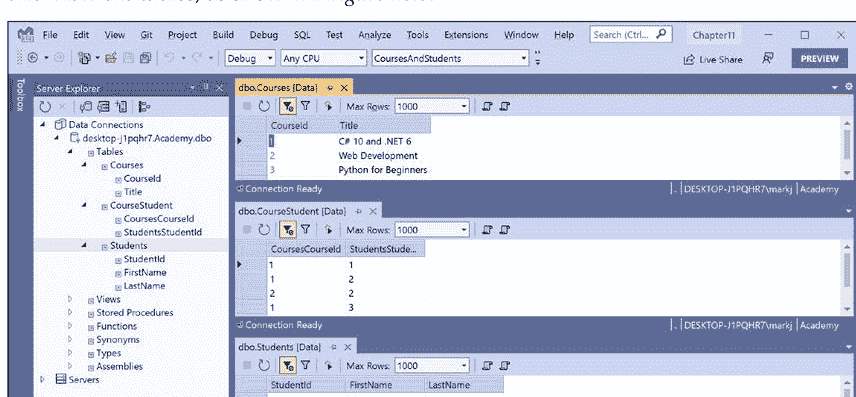

图 10.6：使用 Visual Studio 2022 Server Explorer 在 SQL Server 中查看 Academy 数据库

## 理解迁移

发布使用数据库的项目后，您很可能以后需要更改实体数据模型，从而更改数据库结构。此时，您不应使用 Ensure 方法。相反，您需要使用一种系统，该系统允许您在保留数据库中现有数据的同时逐步更新数据库模式。EF Core 迁移就是该系统。

迁移很快就会变得复杂，因此超出了本书的范围。您可以在以下链接中阅读有关它们的信息：https://docs.microsoft.com/en-us/ef/core/managing-schemas/migrations/

## 练习与探索

通过回答问题测试你的知识和理解，进行一些实践操作，并通过更深入的研究探索本章主题。

### 练习 10.1 – 测试你的知识

回答以下问题：

- 1. 你会为表示表的属性使用什么类型，例如数据库上下文的 Products 属性？
- 2. 你会为表示一对多关系的属性使用什么类型，例如 Category 实体的 Products 属性？
- 3. EF Core 对主键的约定是什么？
- 4. 在实体类中可能在什么情况下使用注解属性？
- 5. 为什么你可能会选择 Fluent API 而不是注解属性？
- 6. 事务隔离级别 Serializable 的含义是什么？
- 7. DbContext.SaveChanges() 方法返回什么？
- 8. 预先加载和显式加载有什么区别？
- 9. 应如何定义 EF Core 实体类以匹配以下表？

```
CREATE TABLE Employees(
    EmpId INT IDENTITY,
    FirstName NVARCHAR(40) NOT NULL,
    Salary MONEY
)
```

- 10. 将实体导航属性声明为 virtual 有什么好处？

### 练习 10.2 – 练习使用不同序列化格式导出数据

在 Chapter10 解决方案/工作区中，创建一个名为 Exercise02 的控制台应用程序，查询 Northwind 数据库中所有类别和产品，然后使用 .NET 可用的至少三种序列化格式序列化数据。哪种序列化格式使用最少的字节数？

### 练习 10.3 – 探索主题

使用以下页面上的链接了解本章涵盖主题的更多详细信息：

https://github.com/markjprice/cs10dotnet6/blob/main/book-links.md#chapter-10---working-with-data-using-entity-framework-core

## 练习 10.4 – 探索 NoSQL 数据库

本章重点介绍了 SQL Server 和 SQLite 等关系型数据库管理系统（RDBMS）。如果您想了解更多关于 NoSQL 数据库（如 Cosmos DB 和 MongoDB）以及如何将其与 EF Core 一起使用，那么我推荐以下链接：

- **欢迎使用 Azure Cosmos DB**: https://docs.microsoft.com/en-us/azure/cosmos-db/introduction
- **将 NoSQL 数据库用作持久化基础设施**: https://docs.microsoft.com/en-us/dotnet/standard/microservices-architecture/microservice-ddd-cqrs-patterns/nosql-database-persistence-infrastructure
- **Entity Framework Core 的文档数据库提供程序**: https://github.com/BlueshiftSoftware/EntityFrameworkCore

## 摘要

本章中，您学习了如何连接到现有数据库、如何执行简单的 LINQ 查询并处理结果、如何使用筛选的 Include、如何添加、修改和删除数据，以及如何为现有数据库（如 Northwind）构建实体数据模型。您还学习了如何定义 Code First 模型并使用它创建新数据库并填充数据。

在下一章中，您将学习如何编写更高级的 LINQ 查询以进行选择、筛选、排序、连接和分组。

## 11

### 使用 LINQ 查询和操作数据

本章介绍 **语言集成查询 (LINQ)** 表达式。LINQ 是一组语言扩展，增加了处理项目序列然后对其进行筛选、排序并投影到不同输出的能力。

本章将涵盖以下主题：

- 编写 LINQ 表达式
- 使用 LINQ 操作集合
- 使用 LINQ 与 EF Core
- 使用语法糖美化 LINQ 语法
- 使用并行 LINQ 使用多线程
- 创建自己的 LINQ 扩展方法
- 使用 LINQ to XML

### 编写 LINQ 表达式

尽管我们在 *第 10 章，使用 Entity Framework Core 操作数据* 中编写了一些 LINQ 表达式，但它们并不是重点，因此我没有正确解释 LINQ 的工作原理，现在让我们花时间正确理解它们。

### LINQ 的构成

LINQ 有多个部分；有些是必需的，有些是可选的：

- **扩展方法（必需）**：包括示例 such as `Where`、`OrderBy` 和 `Select`。它们提供了 LINQ 的功能。
- **LINQ 提供程序（必需）**：包括用于处理内存中对象的 LINQ to Objects、用于处理存储在外部数据库中并使用 EF Core 建模的数据的 LINQ to Entities，以及用于处理存储为 XML 的数据的 LINQ to XML。这些提供程序以特定于不同数据类型的方式执行 LINQ 表达式。
- **Lambda 表达式（可选）**：可替代命名方法以简化 LINQ 查询，例如用于 where 方法筛选的条件逻辑。
- **LINQ 查询理解语法（可选）**：包括 from、in、where、orderby、descending 和 select 等 C# 关键字。它们是某些 LINQ 扩展方法的别名，使用它们可以简化您编写的查询，特别是如果您已有其他查询语言（如 **结构化查询语言（SQL）**）的经验。

当程序员首次接触 LINQ 时，他们经常认为 LINQ 查询理解语法就是 LINQ，但具有讽刺意味的是，这正是 LINQ 中可选的部分之一！

### 使用 Enumerable 类构建 LINQ 表达式

LINQ 扩展方法（如 where 和 Select）由 Enumerable 静态类附加到实现 IEnumerable<T> 的任何类型，即所谓的序列。

例如，任何类型的数组都实现 IEnumerable<T> 类，其中 T 是数组中项目的类型。这意味着所有数组都支持 LINQ 进行查询和操作。

所有泛型集合，如 List<T>、Dictionary<TKey, TValue>、Stack<T> 和 Queue<T>，都实现 IEnumerable<T>，因此也可以使用 LINQ 进行查询和操作。

Enumerable 定义了 50 多个扩展方法，如下表所示：

| Method(s) | Description |
|---|---|
| First, FirstOrDefault, Last, LastOrDefault | 获取序列中的第一个或最后一个项目，或抛出异常；如果没有第一个或最后一个项目，则返回该类型的默认值，例如 int 的 0 和引用类型的 null。 |
| Where | 返回匹配指定筛选器的项目序列。 |
| Single, SingleOrDefault | 返回匹配特定筛选器的项目或抛出异常；如果没有恰好一个匹配项，则返回该类型的默认值。 |
| ElementAt, ElementAtOrDefault | 返回指定索引位置的项目或抛出异常；如果该位置没有项目，则返回该类型的默认值。.NET 6 中新增了可传入 Index 而非 int 的重载，在处理 Span<T> 序列时更高效。 |
| Select, SelectMany | 将项目投影到不同的形状，即不同的类型，并展平嵌套的项目层次结构。 |
| OrderBy, OrderByDescending, ThenBy, ThenByDescending | 按指定的字段或属性对项目进行排序。 |
| Reverse | 反转项目的顺序。 |
| GroupBy, GroupJoin, Join | 对序列进行分组和/或连接两个序列。 |
| Skip, SkipWhile | 跳过一定数量的项目；或在表达式为 true 时跳过。 |
| Take, TakeWhile | 获取一定数量的项目；或在表达式为 true 时获取。.NET 6 中新增了可传入 Range 的 Take 重载，例如 Take(range: 3..^5) 表示获取从开头起第 3 个项目开始到从末尾起第 5 个项目结束的子集，或者代替 Skip(4) 可使用 Take(4..)。 |
| Aggregate, Average, Count, LongCount, Max, Min, Sum | 计算聚合值。 |
| TryGetNonEnumeratedCount | Count() 检查序列是否实现了 Count 属性并返回其值，否则枚举整个序列以计数其项目。.NET 6 中新增了此方法，它仅检查 Count，如果缺失则返回 false 并将 out 参数设为 0，以避免可能性能不佳的操作。 |
| All, Any, Contains | 如果所有或任意项目匹配筛选器，或序列包含指定项目，则返回 true。 |
| Cast | 将项目转换为指定类型。在编译器否则会抱怨的场景中，将非泛型对象转换为泛型类型时很有用。 |
| OfType | 移除不匹配指定类型的项目。 |
| Distinct | 移除重复项目。 |
| Except, Intersect, Union | 执行返回集合的操作。集合不能有重复项目。虽然输入可以是任何序列，因此输入可能有重复，但结果始终是集合。 |
| Chunk | 将序列划分为大小批次。 |
| Append, Concat, Prepend | 执行序列组合操作。 |
| Zip | 基于项目位置对两个序列执行匹配操作，例如第一个序列中位置 1 的项目与第二个序列中位置 1 的项目匹配。.NET 6 中新增了对三个序列的匹配操作。之前您需要两次运行两个序列的重载才能达到相同目标。 |
| ToArray, ToList, ToDictionary, ToHashSet, ToLookup | 将序列转换为数组或集合。这些是唯一执行 LINQ 表达式的扩展方法。 |
| DistinctBy, ExceptBy, IntersectBy, UnionBy, MinBy, MaxBy | .NET 6 中新增了 By 扩展方法。它们允许在项目的子集上进行比较而不是整个项目。例如，代替通过比较整个 Person 对象来移除重复项，您可以通过仅比较其 LastName 和 DateOfBirth 来移除重复项。 |

Enumerable 类还具有一些不是扩展方法的方法，如下表所示：

| Method | Description |
|---|---|
| Empty<T> | 返回指定类型 T 的空序列。它可用于将空序列传递给需要 IEnumerable<T> 的方法。 |
| Range | 返回从起始值开始包含 count 个项目的整数序列。例如，Enumerable.Range(start: 5, count: 3) 将包含整数 5、6 和 7。 |
| Repeat | 返回包含相同元素重复 count 次的序列。例如，Enumerable.Repeat(element: "5", count: 3) 将包含字符串值 "5"、"5" 和 "5"。 |

### 理解延迟执行

LINQ 使用延迟执行。重要的是要理解，调用这些扩展方法中的大多数并不会执行查询并获取结果。这些扩展方法中的大多数返回一个 LINQ 表达式，表示一个问题，而不是答案。让我们探索一下：

- 1. 使用您喜欢的代码编辑器创建一个名为 Chapter11 的新解决方案/工作区。
- 2. 添加控制台应用程序项目，如以下列表中定义：
  1. 项目模板：Console Application / console
  2. 工作区/解决方案文件和文件夹：Chapter11
  3. 项目文件和文件夹：LinqWithObjects
- 3. 在 Program.cs 中，删除现有代码并静态导入 Console。
- 4. 添加语句以定义在办公室工作的人员的字符串值序列，如以下代码所示：
- 5. 要提出问题并获得答案，即执行查询，您必须通过调用其中一个 "To" 方法（如 ToArray 或 ToLookup）或枚举查询来将其具体化，如以下代码所示：

// a string array is a sequence that implements IEnumerable<string>
string[] names = new[] { "Michael", "Pam", "Jim", "Dwight",
"Angela", "Kevin", "Toby", "Creed" };

WriteLine("Deferred execution");

// Question: Which names end with an M?
// (written using a LINQ extension method)
var query1 = names.Where(name => name.EndsWith("m"));

// Question: Which names end with an M?
// (written using LINQ query comprehension syntax)
var query2 = from name in names where name.EndsWith("m") select name;


// Answer returned as an array of strings containing Pam and Jim
string[] result1 = query1.ToArray();

// Answer returned as a list of strings containing Pam and Jim
List<string> result2 = query2.ToList();

// Answer returned as we enumerate over the results
foreach (string name in query1)
{
    WriteLine(name); // outputs Pam
    names[2] = "Jimmy"; // change Jim to Jimmy
    // on the second iteration Jimmy does not end with an M
}

- 6. 运行控制台应用程序并注意结果，如以下输出所示：

```
Deferred execution
Pam
```

由于延迟执行，在输出第一个结果 Pam 之后，如果原始数组值发生变化，那么当我们再次循环时，就没有更多匹配项，因为 Jim 已变成 Jimmy 且不以 M 结尾，因此只输出 Pam。

在深入细节之前，让我们放慢脚步，逐一查看一些常见的 LINQ 扩展方法以及如何使用它们。

## 使用 Where 过滤实体

使用 LINQ 最常见的原因是使用 Where 扩展方法过滤序列中的项。让我们通过定义一个名称序列然后对其应用 LINQ 操作来探索过滤：

- 1. 在项目文件中，注释掉启用隐式 using 的元素，如以下标记中突出显示所示：

```
<Project Sdk="Microsoft.NET.Sdk">
    <PropertyGroup>
        <OutputType>Exe</OutputType>
        <TargetFramework>net6.0</TargetFramework>
        <Nullable>enable</Nullable>
        <!-- <ImplicitUsings>enable</ImplicitUsings> -->
    </PropertyGroup>
</Project>
```

## 使用 LINQ 查询和操作数据

2. 在 Program.cs 中，尝试在名称数组上调用 Where 扩展方法，如以下代码所示：

```
WriteLine("Writing queries");

var query = names.W
```

3. 当你尝试输入 Where 方法时，请注意它在字符串数组成员的 IntelliSense 列表中缺失，如图 11.1 所示：

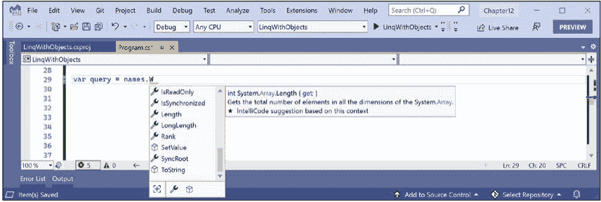

图 11.1：IntelliSense 中缺少 Where 扩展方法

这是因为 Where 是一个扩展方法。它不存在于数组类型上。要使 Where 扩展方法可用，我们必须导入 System.Linq 命名空间。这在新的 .NET 6 项目中默认隐式导入，但我们已将其禁用。

4. 在项目文件中，取消注释启用隐式 using 的元素。

5. 重新输入 Where 方法并注意 IntelliSense 列表现在包含 Enumerable 类添加的扩展方法，如图 11.2 所示：

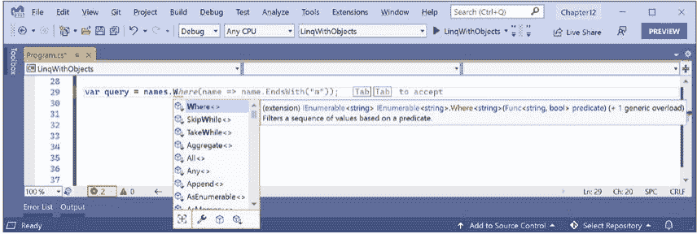

图 11.2：IntelliSense 现在显示 LINQ Enumerable 扩展方法

6. 当你为 Where 方法输入括号时，IntelliSense 告诉我们要调用 Where，我们必须传入一个 Func<string, bool> 委托的实例。

7. 输入一个表达式来创建 Func<string, bool> 委托的新实例，并且目前请注意我们尚未提供方法名称，因为我们将在下一步中定义它，如以下代码所示：

```
var query = names.Where(new Func<string, bool>( ))
```

Func<string, bool> 委托告诉我们，对于传递给该方法的每个字符串变量，该方法必须返回一个 bool 值。如果方法返回 true，则表示我们应将该字符串包含在结果中，如果方法返回 false，则表示我们应将其排除。

## 指向命名方法

让我们定义一个方法，该方法仅包含长度超过四个字符的名称：

1. 在 Program.cs 底部，定义一个方法，该方法仅包含长度超过四个字符的名称，如以下代码所示：

```
static bool NameLongerThanFour(string name)
{
    return name.Length > 4;
}
```

2. 在 NameLongerThanFour 方法之上，将方法名称传递给 Func<string, bool> 委托，然后遍历查询项，如以下代码中突出显示所示：

```
var query = names.Where(
    new Func<string, bool>(NameLongerThanFour));

foreach (string item in query)
{
    WriteLine(item);
}
```

3. 运行代码并查看结果，注意只有长度超过四个字母的名称被列出，如以下输出所示：

```
Writing queries
Michael
Dwight
Angela
Kevin
Creed
```

## 通过移除显式的委托实例化来简化代码

我们可以通过删除 Func<string, bool> 委托的显式实例化来简化代码，因为 C# 编译器可以为我们实例化委托：

- 1. 为了通过查看逐步改进的代码来帮助你学习，请复制并粘贴查询
- 2. 注释掉第一个示例，如以下代码所示：
- 3. 修改副本以删除委托的显式实例化，如以下代码所示：
- 4. 运行代码并注意其行为相同。

```
// var query = names.Where(
//   new Func<string, bool>(NameLongerThanFour));
```

```
var query = names.Where(NameLongerThanFour);
```

## 指向 lambda 表达式

我们可以使用 lambda 表达式代替命名方法进一步简化代码。

虽然乍一看可能很复杂，但 lambda 表达式只是一个无名函数。它使用 =>（读作“ goes to ”）符号来表示返回值：

- 1. 复制并粘贴查询，注释第二个示例，并修改查询，如以下代码所示：

```
var query = names.Where(name => name.Length > 4);
```

请注意，lambda 表达式的语法包含 NameLongerThanFour 方法中的所有重要部分，但没有更多内容。lambda 表达式只需要定义以下内容：

- - 输入参数的名称：name
- - 返回值表达式：name.Length > 4

name 输入参数的类型从序列包含 string 值这一事实推断出来，并且返回类型必须是 bool 值，因为 Where 的委托如此定义，因此 => 符号后的表达式必须返回 bool 值。

编译器为我们做了大部分工作，因此我们的代码可以尽可能简洁。

- 2. 运行代码并注意其行为相同。

## 排序实体

其他常用的扩展方法是 OrderBy 和 ThenBy，用于对序列进行排序。

如果前一个方法返回另一个序列，即实现 IEnumerable<T> 接口的类型，则可以链接扩展方法。

## 使用 OrderBy 按单个属性排序

让我们继续使用当前项目来探索排序：

1. 在现有查询末尾追加对 OrderBy 的调用，如以下代码所示：

```
var query = names
.Where(name => name.Length > 4)
.OrderBy(name => name.Length);
```

> **Good Practice:** 格式化 LINQ 语句，使每个扩展方法调用都发生在自己的行上，以便更易于阅读。

2. 运行代码并注意名称现在按最短者优先排序，如以下输出所示：

```
Kevin
Creed
Dwight
Angela
Michael
```

要将最长名称放在前面，你将使用 OrderByDescending。

## 使用 ThenBy 按后续属性排序

我们可能希望按多个属性排序，例如按相同长度的名称按字母顺序排序：

1. 在现有查询末尾添加对 ThenBy 方法的调用，如以下代码中突出显示所示：

```
var query = names
.Where(name => name.Length > 4)
.OrderBy(name => name.Length)
.ThenBy(name => name);
```

2. 运行代码并注意以下排序顺序的细微差异。在相同长度的名称组内，名称按字符串的完整值按字母顺序排序，因此 Creed 在 Kevin 之前，Angela 在 Dwight 之前，如以下输出所示：

```
Creed
Kevin
Angela
Dwight
Michael
```

## 使用 var 或指定类型声明查询

在编写 LINQ 表达式时，使用 var 声明查询对象很方便。这是因为随着你对 LINQ 表达式的工作，类型经常发生变化。例如，我们的查询最初是 IEnumerable<string>，目前是 IOrderedEnumerable<string>：

- 1. 将鼠标悬停在 var 关键字上并注意其类型为 IOrderedEnumerable<string>
- 2. 将 var 替换为实际类型，如以下代码中突出显示所示：

```
IOrderedEnumerable<string> query = names
.Where(name => name.Length > 4)
.OrderBy(name => name.Length)
.ThenBy(name => name);
```

> **Good Practice:** 一旦完成对查询的工作，你可以将声明的类型从 var 更改为实际类型，以使其更清楚类型是什么。这很容易，因为你的代码编辑器可以告诉你它是什么。

## 按类型过滤

Where 扩展方法非常适合按值过滤，例如文本和数字。但如果序列包含多种类型，并且你想按特定类型过滤并尊重任何继承层次结构怎么办？

假设你有一个异常序列。有数百种异常类型形成复杂的层次结构，如图 11.3 部分所示：

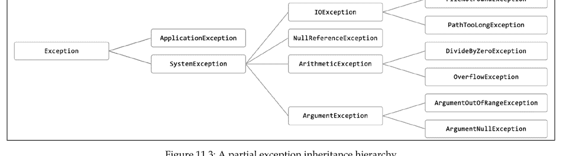

图 11.3：部分异常继承层次结构

让我们探索按类型过滤：

- 1. 在 Program.cs 中，定义一个异常派生对象的列表，如以下代码所示：

```
WriteLine("Filtering by type");

List<Exception> exceptions = new()
{
    new ArgumentException(),
    new SystemException(),
    new IndexOutOfRangeException(),
    new InvalidOperationException(),
    new NullReferenceException(),
    new InvalidCastException(),
    new OverflowException(),
    new DivideByZeroException(),
    new ApplicationException()
};
```

- 2. 使用 OfType<T> 扩展方法编写语句，以移除非算术异常并仅将算术异常写入控制台，如以下代码所示：

```
IEnumerable<ArithmeticException> arithmeticExceptionsQuery =
    exceptions.OfType<ArithmeticException>();

foreach (ArithmeticException exception in arithmeticExceptionsQuery)
{
    WriteLine(exception);
}
```

- 3. 运行代码并注意结果仅包含 ArithmeticException 类型或其派生类型的异常，如以下输出所示：

```
System.OverflowException: Arithmetic operation resulted in an overflow.
System.DivideByZeroException: Attempted to divide by zero.
```

## 使用 LINQ 处理集合和包

集合是数学中最基本的概念之一。集合是一个包含一个或多个唯一对象的集合。多重集合，又称包，是一个包含一个或多个可能重复的对象的集合。

你可能还记得在学校学习过文氏图。常见的集合操作包括集合之间的交集或并集。

让我们创建一个控制台应用程序，它将为学徒的队列定义三个字符串值数组，然后对它们执行一些常见的集合和多重集合操作：

- 1. 使用你喜欢的代码编辑器向 Chapter11 解决方案/工作区添加一个名为 LinqWithSets 的新控制台应用程序：
  - 1. 在 Visual Studio 中，将解决方案的启动项目设置为当前选择。
  - 2. 在 Visual Studio Code 中，将 LinqWithSets 选择为活动的 OmniSharp 项目。
- 2. 在 Program.cs 中，删除现有代码并静态导入 Console 类型，如以下代码所示：
- 3. 在 Program.cs 底部添加以下方法，该方法将任何字符串变量序列作为逗号分隔的单个字符串输出到控制台输出，并附带可选描述，如以下代码所示：
- 4. 在 Output 方法上方添加语句来定义三个名称数组，输出它们，然后对它们执行各种集合操作，如以下代码所示：

```
using static System.Console;
```

```
static void Output(IEnumerable<string> cohort, string description = "")
{
    if (!string.IsNullOrEmpty(description))
    {
        WriteLine(description);
    }
    Write(" ");
    WriteLine(string.Join(", ", cohort.ToArray()));
    WriteLine();
}
```

```
string[] cohort1 = new[]
{ "Rachel", "Gareth", "Jonathan", "George" };
```

```
string[] cohort2 = new[]
{ "Jack", "Stephen", "Daniel", "Jack", "Jared" };

string[] cohort3 = new[]
{ "Declan", "Jack", "Jack", "Jasmine", "Conor" };

Output(cohort1, "Cohort 1");
Output(cohort2, "Cohort 2");
Output(cohort3, "Cohort 3");

Output(cohort2.Distinct(), "cohort2.Distinct()");
Output(cohort2.DistinctBy(name => name.Substring(0, 2)),
    "cohort2.DistinctBy(name => name.Substring(0, 2)):");
Output(cohort2.Union(cohort3), "cohort2.Union(cohort3)");
Output(cohort2.Concat(cohort3), "cohort2.Concat(cohort3)");
Output(cohort2.Intersect(cohort3), "cohort2.Intersect(cohort3)");
Output(cohort2.Except(cohort3), "cohort2.Except(cohort3)");
Output(cohort1.Zip(cohort2,(c1, c2) => $"{c1} matched with {c2}"),
    "cohort1.Zip(cohort2)");
```

- 5. 运行代码并查看结果，如以下输出所示：

```
Cohort 1
    Rachel, Gareth, Jonathan, George

Cohort 2
    Jack, Stephen, Daniel, Jack, Jared

Cohort 3
    Declan, Jack, Jack, Jasmine, Conor

cohort2.Distinct()
    Jack, Stephen, Daniel, Jared

cohort2.DistinctBy(name => name.Substring(0, 2)):
    Jack, Stephen, Daniel

cohort2.Union(cohort3)
    Jack, Stephen, Daniel, Jared, Declan, Jasmine, Conor

cohort2.Concat(cohort3)
    Jack, Stephen, Daniel, Jack, Jared, Declan, Jack, Jack, Jasmine, Conor

cohort2.Intersect(cohort3)
    Jack
```

```
cohort2.Except(cohort3)
  Stephen, Daniel, Jared

cohort1.Zip(cohort2)
  Rachel matched with Jack, Gareth matched with Stephen, Jonathan matched with Daniel, George matched with Jack
```

使用 Zip 时，如果两个序列中的项目数量不相等，则某些项目将没有匹配的伙伴。没有伙伴的项目，如 Jared，将不会包含在结果中。

对于 DistinctBy 示例，我们不是通过比较整个名称来删除重复项，而是定义一个 lambda 键选择器，通过比较前两个字符来删除重复项，因此 Jared 被删除，因为 Jack 已经是一个以 Ja 开头的名称。

到目前为止，我们使用 LINQ to Objects 提供程序来处理内存中的对象。接下来，我们将使用 LINQ to Entities 提供程序来处理存储在数据库中的实体。

## 使用 LINQ 与 EF Core

我们已经查看了过滤和排序的 LINQ 查询，但没有改变序列中项目形状的查询。这称为投影，因为它涉及将一种形状的项目投影到另一种形状。为了学习投影，最好使用更复杂的类型，因此在下一个项目中，我们将不使用字符串序列，而是使用来自 Northwind 示例数据库的实体序列。

> 我将给出使用 SQLite 的说明，因为它跨平台，但如果你更喜欢使用 SQL Server，也可以随意使用。我已包含一些注释代码，如果你选择，可以启用 SQL Server。

## 构建 EF Core 模型

我们必须定义一个 EF Core 模型来表示我们将要工作的数据库和表。我们将手动定义模型以完全控制，并防止在 Categories 和 Products 表之间自动定义关系。稍后，你将使用 LINQ 来连接这两个实体集：

- 1. 使用你喜欢的代码编辑器向 Chapter11 解决方案/工作区添加一个名为 LinqWithEFCore 的新控制台应用程序。
- 2. 在 Visual Studio Code 中，将 LinqWithEFCore 选择为活动的 OmniSharp 项目。
- 3. 在 LinqWithEFCore 项目中，添加对 SQLite 和/或 SQL Server 的 EF Core 提供程序的程序包引用，如以下标记所示：

```
<ItemGroup>
```

```
<PackageReference
    Include="Microsoft.EntityFrameworkCore.Sqlite"
    Version="6.0.0" />
<PackageReference
    Include="Microsoft.EntityFrameworkCore.SqlServer"
    Version="6.0.0" />
</ItemGroup>
```

- 4. 构建项目以还原程序包。

- 5. 将 Northwind4Sqlite.sql 文件复制到 LinqWithEFCore 文件夹中。

- 6. 在命令提示符或终端中，通过执行以下命令创建 Northwind 数据库：

```
sqlite3 Northwind.db -init Northwind4Sqlite.sql
```

- 7. 请耐心等待，因为此命令可能需要一段时间来创建数据库结构。最终你将看到 SQLite 命令提示符，如以下输出所示：

```
-- Loading resources from Northwind.sql
SQLite version 3.36.0 2021-08-02 15:20:15
Enter ".help" for usage hints.
sqlite>
```

- 8. 在 macOS 上按 cmd + D 或在 Windows 上按 Ctrl + C 退出 SQLite 命令模式。

- 9. 向项目添加三个类文件，命名为 Northwind.cs、Category.cs 和 Product.cs。

- 10. 修改名为 Northwind.cs 的类文件，如以下代码所示：

```
using Microsoft.EntityFrameworkCore; // DbContext, DbSet<T>

namespace Packt.Shared;

// this manages the connection to the database
public class Northwind : DbContext
{
    // these properties map to tables in the database
    public DbSet<Category>? Categories { get; set; }
    public DbSet<Product>? Products { get; set; }

    protected override void OnConfiguring(
        DbContextOptionsBuilder optionsBuilder)
    {
        string path = Path.Combine(
            Environment.CurrentDirectory, "Northwind.db");

        optionsBuilder.UseSqlite($"Filename={path}");
    }
}
```


```
/*
    string connection = "Data Source=.;" +
        "Initial Catalog=Northwind;" +
        "Integrated Security=true;" +
        "MultipleActiveResultSets=true;";
    
    optionsBuilder.UseSqlServer(connection);
*/
}

protected override void OnModelCreating(
    ModelBuilder modelBuilder)
{
    modelBuilder.Entity<Product>()
        .Property(product => product.UnitPrice)
        .HasConversion<double>();
}
}
```

11. 修改名为 Category.cs 的类文件，如以下代码所示：

```
using System.ComponentModel.DataAnnotations;

namespace Packt.Shared;

public class Category
{
    public int CategoryId { get; set; }

    [Required]
    [StringLength(15)]
    public string CategoryName { get; set; } = null!;

    public string? Description { get; set; }
}
```

12. 修改名为 Product.cs 的类文件，如以下代码所示：

```
using System.ComponentModel.DataAnnotations;
using System.ComponentModel.DataAnnotations.Schema;

namespace Packt.Shared;

public class Product
{
    public int ProductId { get; set; }
    [Required]
    [StringLength(40)]
    public string ProductName { get; set; } = null!;

    public int? SupplierId { get; set; }
    public int? CategoryId { get; set; }

    [StringLength(20)]
    public string? QuantityPerUnit { get; set; }

    [Column(TypeName = "money")] // required for SQL Server provider
    public decimal? UnitPrice { get; set; }
    public short? UnitsInStock { get; set; }
    public short? UnitsOnOrder { get; set; }
    public short? ReorderLevel { get; set; }
    public bool Discontinued { get; set; }
}
```

- 13. 构建项目并修复任何编译错误。
- 如果你使用的是 Windows 版 Visual Studio 2022，则编译后的应用程序在 LinqWithEFcore\bin\Debug\net6.0 文件夹中执行，因此除非我们指示它始终复制到输出目录，否则它找不到数据库文件。
- 14. 在解决方案资源管理器中，右键单击 Northwind.db 文件并选择属性。
- 15. 在属性中，将复制到输出目录设置为始终复制。

## 过滤和排序序列

现在让我们编写语句来过滤和排序表中的行序列：

- 1. 在 Program.cs 中，静态导入 Console 类型以及用于使用 LINQ 工作于 EF Core 和你的实体模型的命名空间，如以下代码所示：
- 2. 在 Program.cs 底部，编写一个用于过滤和排序产品的方法，如以下代码所示：

```
using Packt.Shared; // Northwind, Category, Product
using Microsoft.EntityFrameworkCore; // DbSet<T>

using static System.Console;
```

```
static void FilterAndSort()
{
    using (Northwind db = new())
    {
        DbSet<Product> allProducts = db.Products;

        IQueryable<Product> filteredProducts =
            allProducts.Where(product => product.UnitPrice < 10M);

        IOrderedQueryable<Product> sortedAndFilteredProducts =
            filteredProducts.OrderByDescending(product => product.UnitPrice);

        WriteLine("Products that cost less than $10:");
        foreach (Product p in sortedAndFilteredProducts)
        {
            WriteLine("{0}: {1} costs {2:$#,##0.00}",
                p.ProductId, p.ProductName, p.UnitPrice);
        }
        WriteLine();
    }
}
```

DbSet<T> 实现 IEnumerable<T>，因此 LINQ 可用于查询和操作为 EF Core 构建的模型中的实体集合。（实际上，我应该说 TEntity 而不是 T，但此泛型类型的名称没有功能上的影响。唯一的要求是该类型是一个类。名称只是表示预期该类是一个实体模型。）

你可能还注意到，这些序列实现的是 IQueryable<T>（在调用排序 LINQ 方法后为 IOrderedQueryable<T>），而不是 IEnumerable<T> 或 IOrderedEnumerable<T>。

这表明我们正在使用一个 LINQ 提供程序，它使用表达式树在内存中构建查询。它们以树状数据结构表示代码，并使动态查询的创建成为可能，这对于为 SQLite 等外部数据提供程序构建 LINQ 查询非常有用。

LINQ 表达式将被转换为另一种查询语言，例如 SQL。使用 foreach 枚举查询或调用诸如 ToArray 之类的方法将强制执行查询并物化结果。

- 3. 在 Program.cs 中的命名空间导入之后，调用 FilterAndSort 方法。
- 4. 运行代码并查看结果，如以下输出所示：

```
Products that cost less than $10:
41: Jack's New England Clam Chowder costs $9.65
45: Rogede sild costs $9.50
47: Zaanse koeken costs $9.50
19: Teatime Chocolate Biscuits costs $9.20
23: Tunnbröd costs $9.00
75: Rhönbräu Klosterbier costs $7.75
54: Tourtière costs $7.45
52: Filo Mix costs $7.00
13: Konbu costs $6.00
24: Guaraná Fantástica costs $4.50
33: Geitost costs $2.50
```

尽管此查询输出了我们想要的信息，但它效率低下，因为它从 Products 表获取所有列，而不是我们需要的三个列，这相当于以下 SQL 语句：

```
SELECT * FROM Products;
```

在第 10 章《使用 Entity Framework Core 工作于数据》中，你学习了如何记录针对 SQLite 执行的 SQL 命令，以便你自己可以看到这一点。

## 将序列投影到新类型

在查看投影之前，我们需要回顾对象初始化语法。如果定义了一个类，则可以使用类名、new() 和大括号来实例化对象，以为字段和属性设置初始值，如以下代码所示：

```
public class Person
{
    public string Name { get; set; }
    public DateTime DateOfBirth { get; set; }
}

Person knownTypeObject = new()
{
    Name = "Boris Johnson",
    DateOfBirth = new(year: 1964, month: 6, day: 19)
};
```

C# 3.0 及更高版本允许使用 var 关键字实例化匿名类型的实例，如以下代码所示：

```
var anonymouslyTypedObject = new
{
    Name = "Boris Johnson",
    DateOfBirth = new DateTime(year: 1964, month: 6, day: 19)
};
```

尽管我们没有指定类型，但编译器可以根据名为 Name 和 DateOfBirth 的两个属性的设置推断出匿名类型。编译器可以根据分配的值推断出这两个属性的类型：一个字符串字面量和一个日期/时间值的新实例。

此功能在编写 LINQ 查询以将现有类型投影到新类型而无需显式定义新类型时特别有用。由于类型是匿名的，因此这只能与使用 var 声明的局部变量一起使用。

让我们通过添加对 Select 方法的调用，使针对数据库表执行的 SQL 命令更高效，将 Product 类的实例投影到仅包含三个属性的新匿名类型的实例：

- 1. 在 FilterAndSort 中，添加一条语句来扩展 LINQ 查询以使用 Select 方法仅返回我们需要的三个属性（即表列），并修改 foreach 语句以使用 var 关键字和投影 LINQ 表达式，如以下代码中突出显示所示：

```
IOrderedQueryable<Product> sortedAndFilteredProducts =
    filteredProducts.OrderByDescending(product => product.UnitPrice);

var projectedProducts = sortedAndFilteredProducts
    .Select(product => new // anonymous type
    {
        product.ProductId,
        product.ProductName,
        product.UnitPrice
    });

WriteLine("Products that cost less than $10:");
foreach (var p in projectedProducts)
{
```

- 2. 将鼠标悬停在 Select 方法调用中的 new 关键字和 foreach 语句中的 var 关键字上，并注意它是一个匿名类型，如图 11.4 所示：

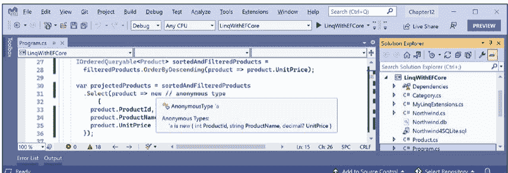

图 11.4：LINQ 投影期间使用的匿名类型

- 3. 运行代码并确认输出与之前相同。

## 连接和分组序列

有两种用于连接和分组的扩展方法：

- **Join**：此方法有四个参数：要连接的序列、左序列上用于匹配的属性或属性、右序列上用于匹配的属性或属性，以及一个投影。


GroupJoin：此方法具有相同的参数，但它将匹配项组合成一个组对象，其中包含用于匹配值的 Key 属性以及用于多个匹配项的 IEnumerable<T> 类型。

## 加入序列

让我们在处理两个表 Categories 和 Products 时探索这些方法：

- 1. 在 Program.cs 底部，创建一个方法来选择类别和产品，将它们连接并输出，如以下代码所示：

```
static void JoinCategoriesAndProducts()
{
    using (Northwind db = new())
    {
        // join every product to its category to return 77 matches
        var queryJoin = db.Categories.Join(
            inner: db.Products,
            outerKeySelector: category => category.CategoryId,
            innerKeySelector: product => product.CategoryId,
            resultSelector: (c, p) =>
                new { c.CategoryName, p.ProductName, p.ProductId });

        foreach (var item in queryJoin)
        {
            WriteLine("{0}: {1} is in {2}.",
                arg0: item.ProductId,
                arg1: item.ProductName,
                arg2: item.CategoryName);
        }
    }
}
```

在连接中，有两个序列，外层和内层。在前面的示例中，categories 是外层序列，products 是内层序列。

- 2. 在 Program.cs 顶部，注释掉对 FilterAndSort 的调用并调用 JoinCategoriesAndProducts。

- 3. 运行代码并查看结果。请注意，每个 77 个产品都有单行输出，如以下输出所示（已编辑，仅包含前 10 项）：

```
1: Chai is in Beverages.
2: Chang is in Beverages.
3: Aniseed Syrup is in Condiments.
4: Chef Anton's Cajun Seasoning is in Condiments.
5: Chef Anton's Gumbo Mix is in Condiments.
6: Grandma's Boysenberry Spread is in Condiments.
7: Uncle Bob's Organic Dried Pears is in Produce.
8: Northwoods Cranberry Sauce is in Condiments.
9: Mishi Kobe Niku is in Meat/Poultry.
10: Ikura is in Seafood.
...
```

- 4. 在现有查询的末尾，调用 OrderBy 方法按 CategoryName 排序，如以下代码所示：

```
.OrderBy(cp => cp.CategoryName);
```

- 5. 运行代码并查看结果。请注意，每个 77 个产品都有单行输出，结果首先显示 Beverages 类别中的所有产品，然后是 Condiments 类别，依此类推，如以下部分输出所示：

```
1: Chai is in Beverages.
2: Chang is in Beverages.
24: Guaraná Fantástica is in Beverages.
34: Sasquatch Ale is in Beverages.
35: Steeleye Stout is in Beverages.
38: Côte de Blaye is in Beverages.
39: Chartreuse verte is in Beverages.
43: Ipoh Coffee is in Beverages.
67: Laughing Lumberjack Lager is in Beverages.
70: Outback Lager is in Beverages.
75: Rhönbräu Klosterbier is in Beverages.
76: Lakkalikööri is in Beverages.
3: Aniseed Syrup is in Condiments.
4: Chef Anton's Cajun Seasoning is in Condiments.
...
```

## 分组连接序列

- 1. 在 Program.cs 底部，创建一个方法来分组并连接，显示组名，然后显示每个组内的所有项目，如以下代码所示：

```
static void GroupJoinCategoriesAndProducts()
{
    using (Northwind db = new())
    {
        // group all products by their category to return 8 matches
        var queryGroup = db.Categories.AsEnumerable().GroupJoin(
            inner: db.Products,
            outerKeySelector: category => category.CategoryId,
            innerKeySelector: product => product.CategoryId,
            resultSelector: (c, matchingProducts) => new
            {
                c.CategoryName,
                Products = matchingProducts.OrderBy(p => p.ProductName)
            });

        foreach (var category in queryGroup)
        {
            WriteLine("{0} has {1} products.",
                arg0: category.CategoryName,
                arg1: category.Products.Count());

            foreach (var product in category.Products)
            {
                WriteLine($" {product.ProductName}");
            }
        }
    }
}
```

如果我们没有调用 AsEnumerable 方法，则会抛出运行时异常，如以下输出所示：

```
Unhandled exception. System.ArgumentException: Argument type 'System.Linq.IOrderedQueryable`1[Packt.Shared.Product]' does not match the corresponding member type 'System.Linq.IOrderedEnumerable`1[Packt.Shared.Product]' (Parameter 'arguments[1]')
```

这是因为并非所有 LINQ 扩展方法都可以从表达式树转换为 SQL 等其他查询语法。在这些情况下，我们可以通过调用 AsEnumerable 方法将 IQueryable<T> 转换为 IEnumerable<T>，这会强制查询处理使用 LINQ to EF Core 仅将数据带入应用程序，然后使用 LINQ to Objects 在内存中执行更复杂的处理。但通常效率较低。

- 2. 在 Program.cs 顶部，注释掉之前的方法调用并调用 GroupJoinCategoriesAndProducts。

- 3. 运行代码，查看结果，并注意每个类别内的产品已按其名称排序，如查询中定义并如下部分输出所示：

```
Beverages has 12 products.
  Chai
  Chang
  Chartreuse verte
  Côte de Blaye
  Guaraná Fantástica
  Ipoh Coffee
  Lakkalikööri
  Laughing Lumberjack Lager
  Outback Lager
  Rhönbräu Klosterbier
  Sasquatch Ale
Steeleye Stout
Condiments has 12 products.
Aniseed Syrup
Chef Anton's Cajun Seasoning
Chef Anton's Gumbo Mix
...
```

## 聚合序列

有 LINQ 扩展方法可执行聚合函数，例如 Average 和 Sum。让我们编写一些代码来查看这些方法在聚合 Products 表信息时的实际效果：

- 1. 在 Program.cs 底部，创建一个方法来展示聚合扩展方法的使用，如以下代码所示：

```
static void AggregateProducts()
{
    using (Northwind db = new())
    {
        WriteLine("{0,-25} {1,10}",
            arg0: "Product count:",
            arg1: db.Products.Count());

        WriteLine("{0,-25} {1,10:$#,##0.00}",
            arg0: "Highest product price:",
            arg1: db.Products.Max(p => p.UnitPrice));

        WriteLine("{0,-25} {1,10:N0}",
            arg0: "Sum of units in stock:",
            arg1: db.Products.Sum(p => p.UnitsInStock));

        WriteLine("{0,-25} {1,10:N0}",
            arg0: "Sum of units on order:",
            arg1: db.Products.Sum(p => p.UnitsOnOrder));

        WriteLine("{0,-25} {1,10:$#,##0.00}",
            arg0: "Average unit price:",
            arg1: db.Products.Average(p => p.UnitPrice));

        WriteLine("{0,-25} {1,10:$#,##0.00}",
            arg0: "Value of units in stock:",
            arg1: db.Products
                .Sum(p => p.UnitPrice * p.UnitsInStock));
    }
}
```

- 2. 在 Program.cs 顶部，注释掉之前的方法并调用 AggregateProducts

- 3. 运行代码并查看结果，如以下输出所示：

```
Product count:                  77
Highest product price:          $263.50
Sum of units in stock:          3,119
Sum of units on order:          780
Average unit price:             $28.87
Value of units in stock:        $74,050.85
```

## 使用语法糖改善 LINQ 语法

C# 3.0 在 2008 年引入了一些新的语言关键字，使具有 SQL 经验的程序员更容易编写 LINQ 查询。这种语法糖有时称为 LINQ 查询理解语法。

考虑以下字符串值数组：

```
string[] names = new[] { "Michael", "Pam", "Jim", "Dwight",
"Angela", "Kevin", "Toby", "Creed" };
```

要过滤和排序名称，您可以使用扩展方法和 lambda 表达式，如以下代码所示：

```
var query = names
.Where(name => name.Length > 4)
.OrderBy(name => name.Length)
.ThenBy(name => name);
```

或者您可以使用查询理解语法实现相同的结果，如以下代码所示：

```
var query = from name in names
where name.Length > 4
orderby name.Length, name
select name;
```

编译器会将查询理解语法更改为您等效的扩展方法和 lambda 表达式。

select 关键字对于 LINQ 查询理解语法始终是必需的。使用扩展方法和 lambda 表达式时，Select 扩展方法是可选的，因为如果不调用 Select，则整个项目会被隐式选择。

并非所有扩展方法都有 C# 关键字等价物，例如 Skip 和 Take 扩展方法，它们通常用于实现大量数据的分页。


无法仅使用查询表达式语法编写跳过并获取的查询，因此我们可以使用全部扩展方法来编写查询，如以下代码所示：

```
var query = names
    .Where(name => name.Length > 4)
    .Skip(80)
    .Take(10);
```

或者可以将查询表达式语法用括号括起来，然后切换到使用扩展方法，如以下代码所示：

```
var query = (from name in names
    where name.Length > 4
    select name)
    .Skip(80)
    .Take(10);
```

> **良好实践：** 学习使用 lambda 表达式的扩展方法以及查询表达式语法编写 LINQ 查询的两种方式，因为你很可能会需要维护同时使用这两种方式的代码。

## 使用并行 LINQ 进行多线程

默认情况下，执行 LINQ 查询仅使用一个线程。**并行 LINQ (PLINQ)** 是一种轻松启用多个线程执行 LINQ 查询的方法。

> **良好实践：** 不要假设使用并行线程会提高应用程序的性能。始终测量实际的运行时间和资源使用情况。

## 创建受益于多线程的应用程序

为了实际演示，我们将从一段仅使用单线程为 45 个整数计算斐波那契数的代码开始。我们将使用 Stopwatch 类型来衡量性能变化。

我们将使用操作系统工具来监控 CPU 和 CPU 核心的使用情况。如果您没有多个 CPU 或至少多个核心，那么这个练习不会显示太多内容！

- 1. 使用您喜欢的代码编辑器，在 Chapter11 解决方案/工作区中添加一个名为 LinqInParallel 的新控制台应用程序。
- 2. 在 Visual Studio Code 中，将 LinqInParallel 选择为活动的 OmniSharp 项目。
- 3. 在 Program.cs 中，删除现有语句，然后导入 System.Diagnostics 命名空间以便我们可以使用 Stopwatch 类型，并静态导入 System.Console 类型。
- 4. 添加语句以创建秒表记录时间，在启动计时器前等待按键，创建 45 个整数，计算每个整数的最后一个斐波那契数，停止计时器并显示经过的毫秒数，如以下代码所示：
- 5. 运行代码，但不要立即按 Enter 启动秒表，因为我们需要确保监控工具正在显示处理器活动。

```
Stopwatch watch = new();
Write("Press ENTER to start. ");
ReadLine();
watch.Start();

int max = 45;

IEnumerable<int> numbers = Enumerable.Range(start: 1, count: max);

WriteLine($"Calculating Fibonacci sequence up to {max}. Please wait...");

int[] fibonacciNumbers = numbers
    .Select(number => Fibonacci(number)).ToArray();

watch.Stop();
WriteLine("{0:#,##0} elapsed milliseconds.",
    arg0: watch.ElapsedMilliseconds);

Write("Results:");
foreach (int number in fibonacciNumbers)
{
    Write($" {number}");
}

static int Fibonacci(int term) =>
    term switch
    {
        1 => 0,
        2 => 1,
        _ => Fibonacci(term - 1) + Fibonacci(term - 2)
    };
```

## 使用 Windows

- 1. 如果您使用的是 Windows，则右键单击 Windows 开始按钮或按 Ctrl + Alt + Delete，然后单击任务管理器。
- 2. 在任务管理器窗口底部，单击“显示更多详细信息”。
- 3. 在任务管理器窗口顶部，单击“性能”选项卡。
- 4. 右键单击 CPU 利用率图表，选择“更改图表为”，然后选择“逻辑处理器”。

## 使用 macOS

- 1. 如果您使用的是 macOS，则启动“活动监视器”。
- 2. 导航至 视图 | 更新频率 非常频繁（1 秒）。
- 3. 要查看 CPU 图表，请导航至 窗口 | CPU 历史记录。

## 适用于所有操作系统

- 1. 重新排列您的监控工具和代码编辑器，使其并排显示。
- 2. 等待 CPU 稳定后，然后按 Enter 启动秒表并运行查询。结果应为经过的毫秒数，如以下输出所示：
- 3. 在 Program.cs 中，修改查询以调用 AsParallel 扩展方法并对结果序列进行排序，因为并行处理时结果可能会乱序，如以下代码高亮所示：

```
Press ENTER to start.
Calculating Fibonacci sequence up to 45. Please wait...
17,624 elapsed milliseconds.
Results: 0 1 1 2 3 5 8 13 21 34 55 89 144 233 377 610 987 1597 2584 4181
6765 10946 17711 28657 46368 75025 121393 196418 317811 514229 832040
1346269 2178309 3524578 5702887 9227465 14930352 24157817 39088169
63245986 102334155 165580141 267914296 433494437 701408733
```

监控工具很可能会显示一两个 CPU 使用最多，并且会随时间交替。其他任务也可能同时执行后台任务，例如垃圾回收器，因此其他 CPU 或核心不会完全平稳，但工作显然没有在所有可能的 CPU 或核心之间均匀分配。此外，请注意某些逻辑处理器已达到 100% 的峰值。

```
int[] fibonacciNumbers = numbers.AsParallel()
    .Select(number => Fibonacci(number))
    .OrderBy(number => number)
    .ToArray();
```

> **良好实践：** 切勿在查询末尾调用 AsParallel。这没有任何作用。您必须在调用 AsParallel 之后至少执行一个操作，以便该操作能够并行化。.NET 6 引入了一个代码分析器，它会警告这种类型的误用。

- 4. 运行代码，等待监控工具中的 CPU 图表稳定，然后按 *Enter* 启动秒表并运行查询。这次，应用程序应该在更短的时间内完成（尽管可能没有您希望的那么少——管理这些多个线程需要额外的工作！）：

```
Press ENTER to start.
Calculating Fibonacci sequence up to 45. Please wait...
9,028 elapsed milliseconds.
Results: 0 1 1 2 3 5 8 13 21 34 55 89 144 233 377 610 987 1597 2584 4181
6765 10946 17711 28657 46368 75025 121393 196418 317811 514229 832040
1346269 2178309 3524578 5702887 9227465 14930352 24157817 39088169
63245986 102334155 165580141 267914296 433494437 701408733
```

- 5. 监控工具应显示所有 CPU 都被平等地用于执行 LINQ 查询，并且请注意没有任何逻辑处理器达到 100% 的峰值，因为工作分配得更均匀。

您将在第 12 章 *使用多任务提高性能和可扩展性* 中了解更多关于管理多个线程的内容。

## 创建自己的 LINQ 扩展方法

在第 6 章 *实现接口和继承类* 中，您学习了如何创建自己的扩展方法。要创建 LINQ 扩展方法，您所需要做的就是扩展 IEnumerable<T> 类型。

> **良好实践：** 将您自己的扩展方法放在单独的类库中，以便可以轻松地作为自己的程序集或 NuGet 包部署。

我们将以 Average 扩展方法为例进行改进。一个受过良好教育的孩子会告诉你，*平均值* 可能有三种含义：

- **均值：** 将数字求和并除以计数。
- **众数：** 最常见的数字。
- **中位数：** 排序后位于数字中间的数字。

Microsoft 对 Average 扩展方法的实现计算的是均值。我们可能想要为 Mode 和 Median 定义自己的扩展方法：

- 1. 在 LinqWithEFCore 项目中，添加一个名为 MyLinqExtensions.cs 的新类文件。
- 2. 修改该类，如以下代码所示：

```
namespace System.Linq; // extend Microsoft's namespace

public static class MyLinqExtensions
{
    // this is a chainable LINQ extension method
    public static IEnumerable<T> ProcessSequence<T>(
        this IEnumerable<T> sequence)
    {
        // you could do some processing here
        return sequence;
    }

    public static IQueryable<T> ProcessSequence<T>(
        this IQueryable<T> sequence)
    {
        // you could do some processing here
        return sequence;
    }

    // these are scalar LINQ extension methods
    public static int? Median(
        this IEnumerable<int?> sequence)
    {
        var ordered = sequence.OrderBy(item => item);
        int middlePosition = ordered.Count() / 2;
        return ordered.ElementAt(middlePosition);
    }

    public static int? Median<T>(
        this IEnumerable<T> sequence, Func<T, int?> selector)
    {
        return sequence.Select(selector).Median();
    }

    public static decimal? Median(
        this IEnumerable<decimal?> sequence)
    {
        var ordered = sequence.OrderBy(item => item);
        int middlePosition = ordered.Count() / 2;
        return ordered.ElementAt(middlePosition);
    }
}
```


```
public static decimal? Median<T>(
    this IEnumerable<T> sequence, Func<T, decimal?> selector)
{
    return sequence.Select(selector).Median();
}

public static int? Mode(
    this IEnumerable<int?> sequence)
{
    var grouped = sequence.GroupBy(item => item);
    var orderedGroups = grouped.OrderByDescending(
        group => group.Count());
    return orderedGroups.FirstOrDefault()?.Key;
}

public static int? Mode<T>(
    this IEnumerable<T> sequence, Func<T, int?> selector)
{
    return sequence.Select(selector).Mode();
}

public static decimal? Mode(
    this IEnumerable<decimal?> sequence)
{
    var grouped = sequence.GroupBy(item => item);
    var orderedGroups = grouped.OrderByDescending(
        group => group.Count());
    return orderedGroups.FirstOrDefault()?.Key;
}

public static decimal? Mode<T>(
    this IEnumerable<T> sequence, Func<T, decimal?> selector)
{
    return sequence.Select(selector).Mode();
}
}
```

如果这个类位于单独的类库中，要使用你的 LINQ 扩展方法，只需引用类库程序集即可，因为 System.Linq 命名空间已经隐式导入。


> **警告！** 上述扩展方法中除一个之外都不能与 IQueryable 序列一起使用，例如 LINQ to SQLite 或 LINQ to SQL Server 使用的序列，因为我们尚未实现将代码翻译为底层查询语言（如 SQL）的方法。

## 尝试可链式扩展方法

首先，我们将尝试将 ProcessSequence 方法与其他扩展方法链接起来：

- 1. 在 Program.cs 中，在 FilterAndSort 方法中，修改 Products 的 LINQ 查询以调用你的自定义可链式扩展方法，如以下代码中突出显示所示：
- 2. 在 Program.cs 中，取消注释 FilterAndSort 方法并注释掉对其他方法的任何调用。
- 3. 运行代码并注意你看到的输出与之前相同，因为你的方法不会修改序列。但你现在知道如何用自己的功能扩展 LINQ 表达式。

```
DbSet<Product>? allProducts = db.Products;

if (allProducts is null)
{
    WriteLine("No products found.");
    return;
}

IQueryable<Product> processedProducts = allProducts.ProcessSequence();

IQueryable<Product> filteredProducts = processedProducts
.Where(product => product.UnitPrice < 10M);
```

## 尝试众数和中位数方法

其次，我们将尝试使用 Mode 和 Median 方法来计算其他类型的平均值：

- 1. 在 Program.cs 底部，创建一个方法来输出产品的 UnitsInStock 和 UnitPrice 的平均值、中位数和众数，使用你的自定义扩展方法和内置的 Average 扩展方法，如以下代码所示：

```
static void CustomExtensionMethods()
{
    using (Northwind db = new())
    {
        WriteLine("Mean units in stock: {0:N0}",
            db.Products.Average(p => p.UnitsInStock));

        WriteLine("Mean unit price: {0:$#,##0.00}",
            db.Products.Average(p => p.UnitPrice));

        WriteLine("Median units in stock: {0:N0}",
            db.Products.Median(p => p.UnitsInStock));

        WriteLine("Median unit price: {0:$#,##0.00}",
            db.Products.Median(p => p.UnitPrice));

        WriteLine("Mode units in stock: {0:N0}",
            db.Products.Mode(p => p.UnitsInStock));

        WriteLine("Mode unit price: {0:$#,##0.00}",
            db.Products.Mode(p => p.UnitPrice));
    }
}
```

- 2. 在 Program.cs 中，注释任何先前的[content]
```
public static decimal? Median<T>(
    this IEnumerable<T> sequence, Func<T, decimal?> selector)
{
    return sequence.Select(selector).Median();
}

public static int? Mode(
    this IEnumerable<int?> sequence)
{
    var grouped = sequence.GroupBy(item => item);
    var orderedGroups = grouped.OrderByDescending(
        group => group.Count());
    return orderedGroups.FirstOrDefault()?.Key;
}

public static int? Mode<T>(
    this IEnumerable<T> sequence, Func<T, int?> selector)
{
    return sequence.Select(selector).Mode();
}

public static decimal? Mode(
    this IEnumerable<decimal?> sequence)
{
    var grouped = sequence.GroupBy(item => item);
    var orderedGroups = grouped.OrderByDescending(
        group => group.Count());
    return orderedGroups.FirstOrDefault()?.Key;
}

public static decimal? Mode<T>(
    this IEnumerable<T> sequence, Func<T, decimal?> selector)
{
    return sequence.Select(selector).Mode();
}
}
```

如果这个类位于单独的类库中，要使用你的 LINQ 扩展方法，只需引用类库程序集即可，因为 System.Linq 命名空间已经隐式导入。


> **警告！** 上述扩展方法中除一个之外都不能与 IQueryable 序列一起使用，例如 LINQ to SQLite 或 LINQ to SQL Server 使用的序列，因为我们尚未实现将代码翻译为底层查询语言（如 SQL）的方法。

## 尝试可链式扩展方法

首先，我们将尝试将 ProcessSequence 方法与其他扩展方法链接起来：

- 1. 在 Program.cs 中，在 FilterAndSort 方法中，修改 Products 的 LINQ 查询以调用你的自定义可链式扩展方法，如以下代码中突出显示所示：
- 2. 在 Program.cs 中，取消注释 FilterAndSort 方法并注释掉对其他方法的任何调用。
- 3. 运行代码并注意你看到的输出与之前相同，因为你的方法不会修改序列。但你现在知道如何用自己的功能扩展 LINQ 表达式。

```
DbSet<Product>? allProducts = db.Products;

if (allProducts is null)
{
    WriteLine("No products found.");
    return;
}

IQueryable<Product> processedProducts = allProducts.ProcessSequence();

IQueryable<Product> filteredProducts = processedProducts
.Where(product => product.UnitPrice < 10M);
```

## 尝试众数和中位数方法

其次，我们将尝试使用 Mode 和 Median 方法来计算其他类型的平均值：

- 1. 在 Program.cs 底部，创建一个方法来输出产品的 UnitsInStock 和 UnitPrice 的平均值、中位数和众数，使用你的自定义扩展方法和内置的 Average 扩展方法，如以下代码所示：

```
static void CustomExtensionMethods()
{
    using (Northwind db = new())
    {
        WriteLine("Mean units in stock: {0:N0}",
            db.Products.Average(p => p.UnitsInStock));

        WriteLine("Mean unit price: {0:$#,##0.00}",
            db.Products.Average(p => p.UnitPrice));

        WriteLine("Median units in stock: {0:N0}",
            db.Products.Median(p => p.UnitsInStock));

        WriteLine("Median unit price: {0:$#,##0.00}",
            db.Products.Median(p => p.UnitPrice));

        WriteLine("Mode units in stock: {0:N0}",
            db.Products.Mode(p => p.UnitsInStock));

        WriteLine("Mode unit price: {0:$#,##0.00}",
            db.Products.Mode(p => p.UnitPrice));
    }
}
```

- 2. 在 Program.cs 中，注释任何先前的[content]
```
public static decimal? Median<T>(
    this IEnumerable<T> sequence, Func<T, decimal?> selector)
{
    return sequence.Select(selector).Median();
}

public static int? Mode(
    this IEnumerable<int?> sequence)
{
    var grouped = sequence.GroupBy(item => item);
    var orderedGroups = grouped.OrderByDescending(
        group => group.Count());
    return orderedGroups.FirstOrDefault()?.Key;
}

public static int? Mode<T>(
    this IEnumerable<T> sequence, Func<T, int?> selector)
{
    return sequence.Select(selector).Mode();
}

public static decimal? Mode(
    this IEnumerable<decimal?> sequence)
{
    var grouped = sequence.GroupBy(item => item);
    var orderedGroups = grouped.OrderByDescending(
        group => group.Count());
    return orderedGroups.FirstOrDefault()?.Key;
}

public static decimal? Mode<T>(
    this IEnumerable<T> sequence, Func<T, decimal?> selector)
{
    return sequence.Select(selector).Mode();
}
}
```

如果这个类位于单独的类库中，要使用你的 LINQ 扩展方法，只需引用类库程序集即可，因为 System.Linq 命名空间已经隐式导入。


> **警告！** 上述扩展方法中除一个之外都不能与 IQueryable 序列一起使用，例如 LINQ to SQLite 或 LINQ to SQL Server 使用的序列，因为我们尚未实现将代码翻译为底层查询语言（如 SQL）的方法。

## 尝试可链式扩展方法

首先，我们将尝试将 ProcessSequence 方法与其他扩展方法链接起来：

- 1. 在 Program.cs 中，在 FilterAndSort 方法中，修改 Products 的 LINQ 查询以调用你的自定义可链式扩展方法，如以下代码中突出显示所示：
- 2. 在 Program.cs 中，取消注释 FilterAndSort 方法并注释掉对其他方法的任何调用。
- 3. 运行代码并注意你看到的输出与之前相同，因为你的方法不会修改序列。但你现在知道如何用自己的功能扩展 LINQ 表达式。

```
DbSet<Product>? allProducts = db.Products;

if (allProducts is null)
{
    WriteLine("No products found.");
    return;
}

IQueryable<Product> processedProducts = allProducts.ProcessSequence();

IQueryable<Product> filteredProducts = processedProducts
.Where(product => product.UnitPrice < 10M);
```

## 尝试众数和中位数方法

其次，我们将尝试使用 Mode 和 Median 方法来计算其他类型的平均值：

- 1. 在 Program.cs 底部，创建一个方法来输出产品的 UnitsInStock 和 UnitPrice 的平均值、中位数和众数，使用你的自定义扩展方法和内置的 Average 扩展方法，如以下代码所示：

```
static void CustomExtensionMethods()
{
    using (Northwind db = new())
    {
        WriteLine("Mean units in stock: {0:N0}",
            db.Products.Average(p => p.UnitsInStock));

        WriteLine("Mean unit price: {0:$#,##0.00}",
            db.Products.Average(p => p.UnitPrice));

        WriteLine("Median units in stock: {0:N0}",
            db.Products.Median(p => p.UnitsInStock));

        WriteLine("Median unit price: {0:$#,##0.00}",
            db.Products.Median(p => p.UnitPrice));

        WriteLine("Mode units in stock: {0:N0}",
            db.Products.Mode(p => p.UnitsInStock));

        WriteLine("Mode unit price: {0:$#,##0.00}",
            db.Products.Mode(p => p.UnitPrice));
    }
}
```

- 2. 在 Program.cs 中，注释任何先前的[content]
```
public static decimal? Median<T>(
    this IEnumerable<T> sequence, Func<T, decimal?> selector)
{
    return sequence.Select(selector).Median();
}

public static int? Mode(
    this IEnumerable<int?> sequence)
{
    var grouped = sequence.GroupBy(item => item);
    var orderedGroups = grouped.OrderByDescending(
        group => group.Count());
    return orderedGroups.FirstOrDefault()?.Key;
}

public static int? Mode<T>(
    this IEnumerable<T> sequence, Func<T, int?> selector)
{
    return sequence.Select(selector).Mode();
}

public static decimal? Mode(
    this IEnumerable<decimal?> sequence)
{
    var grouped = sequence.GroupBy(item => item);
    var orderedGroups = grouped.OrderByDescending(
        group => group.Count());
    return orderedGroups.FirstOrDefault()?.Key;
}

public static decimal? Mode<T>(
    this IEnumerable<T> sequence, Func<T, decimal?> selector)
{
    return sequence.Select(selector).Mode();
}
}
```

如果这个类位于单独的类库中，要使用你的 LINQ 扩展方法，只需引用类库程序集即可，因为 System.Linq 命名空间已经隐式导入。


> **警告！** 上述扩展方法中除一个之外都不能与 IQueryable 序列一起使用，例如 LINQ to SQLite 或 LINQ to SQL Server 使用的序列，因为我们尚未实现将代码翻译为底层查询语言（如 SQL）的方法。

## 尝试可链式扩展方法

首先，我们将尝试将 ProcessSequence 方法与其他扩展方法链接起来：

- 1. 在 Program.cs 中，在 FilterAndSort 方法中，修改 Products 的 LINQ 查询以调用你的自定义可链式扩展方法，如以下代码中突出显示所示：
- 2. 在 Program.cs 中，取消注释 FilterAndSort 方法并注释掉对其他方法的任何调用。
- 3. 运行代码并注意你看到的输出与之前相同，因为你的方法不会修改序列。但你现在知道如何用自己的功能扩展 LINQ 表达式。

```
DbSet<Product>? allProducts = db.Products;

if (allProducts is null)
{
    WriteLine("No products found.");
    return;
}

IQueryable<Product> processedProducts = allProducts.ProcessSequence();

IQueryable<Product> filteredProducts = processedProducts
.Where(product => product.UnitPrice < 10M);
```

## 尝试众数和中位数方法

其次，我们将尝试使用 Mode 和 Median 方法来计算其他类型的平均值：

- 1. 在 Program.cs 底部，创建一个方法来输出产品的 UnitsInStock 和 UnitPrice 的平均值、中位数和众数，使用你的自定义扩展方法和内置的 Average 扩展方法，如以下代码所示：

```
static void CustomExtensionMethods()
{
    using (Northwind db = new())
    {
        WriteLine("Mean units in stock: {0:N0}",
            db.Products.Average(p => p.UnitsInStock));

        WriteLine("Mean unit price: {0:$#,##0.00}",
            db.Products.Average(p => p.UnitPrice));

        WriteLine("Median units in stock: {0:N0}",
            db.Products.Median(p => p.UnitsInStock));

        WriteLine("Median unit price: {0:$#,##0.00}",
            db.Products.Median(p => p.UnitPrice));

        WriteLine("Mode units in stock: {0:N0}",
            db.Products.Mode(p => p.UnitsInStock));

        WriteLine("Mode unit price: {0:$#,##0.00}",
            db.Products.Mode(p => p.UnitPrice));
    }
}
```

- 2. 在 Program.cs 中，注释任何先前的[content]
```
public static decimal? Median<T>(
    this IEnumerable<T> sequence, Func<T, decimal?> selector)
{
    return sequence.Select(selector).Median();
}

public static int? Mode(
    this IEnumerable<int?> sequence)
{
    var grouped = sequence.GroupBy(item => item);
    var orderedGroups = grouped.OrderByDescending(
        group => group.Count());
    return orderedGroups.FirstOrDefault()?.Key;
}

public static int? Mode<T>(
    this IEnumerable<T> sequence, Func<T, int?> selector)
{
    return sequence.Select(selector).Mode();
}

public static decimal? Mode(
    this IEnumerable<decimal?> sequence)
{
    var grouped = sequence.GroupBy(item => item);
    var orderedGroups = grouped.OrderByDescending(
        group => group.Count());
    return orderedGroups.FirstOrDefault()?.Key;
}

public static decimal? Mode<T>(
    this IEnumerable<T> sequence, Func<T, decimal?> selector)
{
    return sequence.Select(selector).Mode();
}
}
```

如果这个类位于单独的类库中，要使用你的 LINQ 扩展方法，只需引用类库程序集即可，因为 System.Linq 命名空间已经隐式导入。


> **警告！** 上述扩展方法中除一个之外都不能与 IQueryable 序列一起使用，例如 LINQ to SQLite 或 LINQ to SQL Server 使用的序列，因为我们尚未实现将代码翻译为底层查询语言（如 SQL）的方法。

## 尝试可链式扩展方法

首先，我们将尝试将 ProcessSequence 方法与其他扩展方法链接起来：

- 1. 在 Program.cs 中，在 FilterAndSort 方法中，修改 Products 的 LINQ 查询以调用你的自定义可链式扩展方法，如以下代码中突出显示所示：
- 2. 在 Program.cs 中，取消注释 FilterAndSort 方法并注释掉对其他方法的任何调用。
- 3. 运行代码并注意你看到的输出与之前相同，因为你的方法不会修改序列。但你现在知道如何用自己的功能扩展 LINQ 表达式。

```
DbSet<Product>? allProducts = db.Products;

if (allProducts is null)
{
    WriteLine("No products found.");
    return;
}

IQueryable<Product> processedProducts = allProducts.ProcessSequence();

IQueryable<Product> filteredProducts = processedProducts
.Where(product => product.UnitPrice < 10M);
```

## 尝试众数和中位数方法

其次，我们将尝试使用 Mode 和 Median 方法来计算其他类型的平均值：

- 1. 在 Program.cs 底部，创建一个方法来输出产品的 UnitsInStock 和 UnitPrice 的平均值、中位数和众数，使用你的自定义扩展方法和内置的 Average 扩展方法，如以下代码所示：

```
static void CustomExtensionMethods()
{
    using (Northwind db = new())
    {
        WriteLine("Mean units in stock: {0:N0}",
            db.Products.Average(p => p.UnitsInStock));

        WriteLine("Mean unit price: {0:$#,##0.00}",
            db.Products.Average(p => p.UnitPrice));

        WriteLine("Median units in stock: {0:N0}",
            db.Products.Median(p => p.UnitsInStock));

        WriteLine("Median unit price: {0:$#,##0.00}",
            db.Products.Median(p => p.UnitPrice));

        WriteLine("Mode units in stock: {0:N0}",
            db.Products.Mode(p => p.UnitsInStock));

        WriteLine("Mode unit price: {0:$#,##0.00}",
            db.Products.Mode(p => p.UnitPrice));
    }
}
```

- 2. 在 Program.cs 中，注释任何先前的[content]
```
public static decimal? Median<T>(
    this IEnumerable<T> sequence, Func<T, decimal?> selector)
{
    return sequence.Select(selector).Median();
}

public static int? Mode(
    this IEnumerable<int?> sequence)
{
    var grouped = sequence.GroupBy(item => item);
    var orderedGroups = grouped.OrderByDescending(
        group => group.Count());
    return orderedGroups.FirstOrDefault()?.Key;
}

public static int? Mode<T>(
    this IEnumerable<T> sequence, Func<T, int?> selector)
{
    return sequence.Select(selector).Mode();
}

public static decimal? Mode(
    this IEnumerable<decimal?> sequence)
{
    var grouped = sequence.GroupBy(item => item);
    var orderedGroups = grouped.OrderByDescending(
        group => group.Count());
    return orderedGroups.FirstOrDefault()?.Key;
}

public static decimal? Mode<T>(
    this IEnumerable<T> sequence, Func<T, decimal?> selector)
{
    return sequence.Select(selector).Mode();
}
}
```

如果这个类位于单独的类库中，要使用你的 LINQ 扩展方法，只需引用类库程序集即可，因为 System.Linq 命名空间已经隐式导入。


> **警告！** 上述扩展方法中除一个之外都不能与 IQueryable 序列一起使用，例如 LINQ to SQLite 或 LINQ to SQL Server 使用的序列，因为我们尚未实现将代码翻译为底层查询语言（如 SQL）的方法。

## 尝试可链式扩展方法

首先，我们将尝试将 ProcessSequence 方法与其他扩展方法链接起来：

- 1. 在 Program.cs 中，在 FilterAndSort 方法中，修改 Products 的 LINQ 查询以调用你的自定义可链式扩展方法，如以下代码中突出显示所示：
- 2. 在 Program.cs 中，取消注释 FilterAndSort 方法并注释掉对其他方法的任何调用。
- 3. 运行代码并注意你看到的输出与之前相同，因为你的方法不会修改序列。但你现在知道如何用自己的功能扩展 LINQ 表达式。

```
DbSet<Product>? allProducts = db.Products;

if (allProducts is null)
{
    WriteLine("No products found.");
    return;
}

IQueryable<Product> processedProducts = allProducts.ProcessSequence();

IQueryable<Product> filteredProducts = processedProducts
.Where(product => product.UnitPrice < 10M);
```

## 尝试众数和中位数方法

其次，我们将尝试使用 Mode 和 Median 方法来计算其他类型的平均值：

- 1. 在 Program.cs 底部，创建一个方法来输出产品的 UnitsInStock 和 UnitPrice 的平均值、中位数和众数，使用你的自定义扩展方法和内置的 Average 扩展方法，如以下代码所示：

```
static void CustomExtensionMethods()
{
    using (Northwind db = new())
    {
        WriteLine("Mean units in stock: {0:N0}",
            db.Products.Average(p => p.UnitsInStock));

        WriteLine("Mean unit price: {0:$#,##0.00}",
            db.Products.Average(p => p.UnitPrice));

        WriteLine("Median units in stock: {0:N0}",
            db.Products.Median(p => p.UnitsInStock));

        WriteLine("Median unit price: {0:$#,##0.00}",
            db.Products.Median(p => p.UnitPrice));

        WriteLine("Mode units in stock: {0:N0}",
            db.Products.Mode(p => p.UnitsInStock));

        WriteLine("Mode unit price: {0:$#,##0.00}",
            db.Products.Mode(p => p.UnitPrice));
    }
}
```

- 2. 在 Program.cs 中，注释任何先前的[content]
```
public static decimal? Median<T>(
    this IEnumerable<T> sequence, Func<T, decimal?> selector)
{
    return sequence.Select(selector).Median();
}
public static int? Mode(
    this IEnumerable<int?> sequence)
{
    var grouped = sequence.GroupBy(item => item);
    var orderedGroups = grouped.OrderByDescending(
        group => group.Count());
    return orderedGroups.FirstOrDefault()?.Key;
}
public static int? Mode<T>(
    this IEnumerable<T> sequence, Func<T, int?> selector)
{
    return sequence.Select(selector).Mode();
}
public static decimal? Mode(
    this IEnumerable<decimal?> sequence)
{
    var grouped = sequence.GroupBy(item => item);
    var orderedGroups = grouped.OrderByDescending(
        group => group.Count());
    return orderedGroups.FirstOrDefault()?.Key;
}
public static decimal? Mode<T>(
    this IEnumerable<T> sequence, Func<T, decimal?> selector)
{
    return sequence.Select(selector).Mode();
}
}
```
如果这个类位于单独的类库中，要使用你的 LINQ 扩展方法，只需引用类库程序集即可，因为 System.Linq 命名空间已经隐式导入。

> **警告！** 上述扩展方法中除一个之外都不能与 IQueryable 序列一起使用，例如 LINQ to SQLite 或 LINQ to SQL Server 使用的序列，因为我们尚未实现将代码翻译为底层查询语言（如 SQL）的方法。
## 尝试可链式扩展方法
首先，我们将尝试将 ProcessSequence 方法与其他扩展方法链接起来：
- 1. 在 Program.cs 中，在 FilterAndSort 方法中，修改 Products 的 LINQ 查询以调用你的自定义可链式扩展方法，如以下代码中突出显示所示：
- 2. 在 Program.cs 中，取消注释 FilterAndSort 方法并注释掉对其他方法的任何调用。
- 3. 运行代码并注意你看到的输出与之前相同，因为你的方法不会修改序列。但你现在知道如何用自己的功能扩展 LINQ 表达式。
```
DbSet<Product>? allProducts = db.Products;
if (allProducts is null)
{
    WriteLine("No products found.");
    return;
}
IQueryable<Product> processedProducts = allProducts.ProcessSequence();
IQueryable<Product> filteredProducts = processedProducts
.Where(product => product.UnitPrice < 10M);
```
## 尝试众数和中位数方法
其次，我们将尝试使用 Mode 和 Median 方法来计算其他类型的平均值：
- 1. 在 Program.cs 底部，创建一个方法来输出产品的 UnitsInStock 和 UnitPrice 的平均值、中位数和众数，使用你的自定义扩展方法和内置的 Average 扩展方法，如以下代码所示：
```
static void CustomExtensionMethods()
{
    using (Northwind db = new())
    {
        WriteLine("Mean units in stock: {0:N0}",
            db.Products.Average(p => p.UnitsInStock));
        WriteLine("Mean unit price: {0:$#,##0.00}",
            db.Products.Average(p => p.UnitPrice));
        WriteLine("Median units in stock: {0:N0}",
            db.Products.Median(p => p.UnitsInStock));
        WriteLine("Median unit price: {0:$#,##0.00}",
            db.Products.Median(p => p.UnitPrice));
        WriteLine("Mode units in stock: {0:N0}",
            db.Products.Mode(p => p.UnitsInStock));
        WriteLine("Mode unit price: {0:$#,##0.00}",
            db.Products.Mode(p => p.UnitPrice));
    }
}
```
- 2. 在 Program.cs 中，注释之前的[content]
```
public static decimal? Median<T>(
    this IEnumerable<T> sequence, Func<T, decimal?> selector)
{
    return sequence.Select(selector).Median();
}

public static int? Mode(
    this IEnumerable<int?> sequence)
{
    var grouped = sequence.GroupBy(item => item);
    var orderedGroups = grouped.OrderByDescending(
        group => group.Count());
    return orderedGroups.FirstOrDefault()?.Key;
}

public static int? Mode<T>(
    this IEnumerable<T> sequence, Func<T, int?> selector)
{
    return sequence.Select(selector).Mode();
}

public static decimal? Mode(
    this IEnumerable<decimal?> sequence)
{
    var grouped = sequence.GroupBy(item => item);
    var orderedGroups = grouped.OrderByDescending(
        group => group.Count());
    return orderedGroups.FirstOrDefault()?.Key;
}

public static decimal? Mode<T>(
    this IEnumerable<T> sequence, Func<T, decimal?> selector)
{
    return sequence.Select(selector).Mode();
}
}
```

如果这个类位于单独的类库中，要使用你的 LINQ 扩展方法，只需引用类库程序集即可，因为 System.Linq 命名空间已经隐式导入。


> **警告！** 上述扩展方法中除一个之外都不能与 IQueryable 序列一起使用，例如 LINQ to SQLite 或 LINQ to SQL Server 使用的序列，因为我们尚未实现将代码翻译为底层查询语言（如 SQL）的方法。

## 尝试可链式扩展方法

首先，我们将尝试将 ProcessSequence 方法与其他扩展方法链接起来：

- 1. 在 Program.cs 中，在 FilterAndSort 方法中，修改 Products 的 LINQ 查询以调用你的自定义可链式扩展方法，如以下代码中突出显示所示：
- 2. 在 Program.cs 中，取消注释 FilterAndSort 方法并注释掉对其他方法的任何调用。
- 3. 运行代码并注意你看到的输出与之前相同，因为你的方法不会修改序列。但你现在知道如何用自己的功能扩展 LINQ 表达式。

```
DbSet<Product>? allProducts = db.Products;

if (allProducts is null)
{
    WriteLine("No products found.");
    return;
}

IQueryable<Product> processedProducts = allProducts.ProcessSequence();

IQueryable<Product> filteredProducts = processedProducts
.Where(product => product.UnitPrice < 10M);
```

## 尝试众数和中位数方法

其次，我们将尝试使用 Mode 和 Median 方法来计算其他类型的平均值：

- 1. 在 Program.cs 底部，创建一个方法来输出产品的 UnitsInStock 和 UnitPrice 的平均值、中位数和众数，使用你的自定义扩展方法和内置的 Average 扩展方法，如以下代码所示：

```
static void CustomExtensionMethods()
{
    using (Northwind db = new())
    {
        WriteLine("Mean units in stock: {0:N0}",
            db.Products.Average(p => p.UnitsInStock));

        WriteLine("Mean unit price: {0:$#,##0.00}",
            db.Products.Average(p => p.UnitPrice));

        WriteLine("Median units in stock: {0:N0}",
            db.Products.Median(p => p.UnitsInStock));

        WriteLine("Median unit price: {0:$#,##0.00}",
            db.Products.Median(p => p.UnitPrice));

        WriteLine("Mode units in stock: {0:N0}",
            db.Products.Mode(p => p.UnitsInStock));

        WriteLine("Mode unit price: {0:$#,##0.00}",
            db.Products.Mode(p => p.UnitPrice));
    }
}
```

- 2. 在 Program.cs 中，注释先前的方法调用并调用 CustomExtensionMethods。
- 3. 运行代码并查看结果，如以下输出所示：

```
Mean units in stock: 41
Mean unit price: $28.87
Median units in stock: 26
Median unit price: $19.50
Mode units in stock: 0
Mode unit price: $18.00
```

有四个产品的单价为 $18.00。有五个产品的库存为 0。

## 使用 LINQ to XML

LINQ to XML 是一个 LINQ 提供程序，允许你查询和操作 XML。

## 使用 LINQ to XML 生成 XML

让我们创建一个方法将 Products 表转换为 XML：

- 1. 在 LinqWithEFCore 项目中，在 Program.cs 顶部导入 System.Xml.Linq 命名空间。
- 2. 在 Program.cs 底部，创建一个方法以 XML 格式输出产品，如以下代码所示：

```
static void OutputProductsAsXml()
{
    using (Northwind db = new())
    {
        Product[] productsArray = db.Products.ToArray();

        XElement xml = new("products",
            from p in productsArray
            select new XElement("product",
                new XAttribute("id", p.ProductId),
                new XAttribute("price", p.UnitPrice),
                new XElement("name", p.ProductName)));

        WriteLine(xml.ToString());
    }
}
```

- 3. 在 Program.cs 中，注释先前的方法调用并调用 OutputProductsAsXml。
- 4. 运行代码，查看结果并注意生成的 XML 的结构与前述代码中 LINQ to XML 语句声明性描述的元素和属性相匹配，如以下部分输出所示：

```
<products>
    <product id="1" price="18">
        <name>Chai</name>
    </product>
    <product id="2" price="19">
        <name>Chang</name>
    </product>
    ...
```

## 使用 LINQ to XML 读取 XML

你可能希望使用 LINQ to XML 轻松查询或处理 XML 文件：

- 1. 在 LinqWithEFCore 项目中，添加一个名为 settings.xml 的文件。
- 2. 修改其内容，如以下标记所示：

```
<?xml version="1.0" encoding="utf-8" ?>
<appSettings>
    <add key="color" value="red" />
    <add key="size" value="large" />
    <add key="price" value="23.99" />
</appSettings>
```

如果你使用 Visual Studio 2022 for Windows，则编译后的应用程序在 LinqWithEFCore\bin\Debug\net6.0 文件夹中执行，因此除非我们指示它始终复制到输出目录，否则它找不到 settings.xml 文件。

- 3. 在解决方案资源管理器中，右键单击 settings.xml 文件并选择属性。
- 4. 在属性中，将复制到输出目录设置为始终复制。

5. 在 Program.cs 底部，创建一个方法来完成以下任务，如以下代码所示：
- - 加载 XML 文件。
- - 使用 LINQ to XML 搜索名为 appSettings 的元素及其名为 add 的后代。
- - 将 XML 投影到具有 Key 和 Value 属性的匿名类型的数组中。
- - 遍历数组以显示结果：

```
static void ProcessSettings()
{
    XDocument doc = XDocument.Load("settings.xml");

    var appSettings = doc.Descendants("appSettings")
        .Descendants("add")
        .Select(node => new
        {
            Key = node.Attribute("key")?.Value,
            Value = node.Attribute("value")?.Value
        }).ToArray();

    foreach (var item in appSettings)
    {
        WriteLine($"{item.Key}: {item.Value}");
    }
}
```

6. 在 Program.cs 中，注释先前的方法调用并调用 ProcessSettings。

7. 运行代码并查看结果，如以下输出所示：

```
color: red
size: large
price: 23.99
```

## 练习和探索

通过回答一些问题来测试你的知识和理解，进行一些实践，并对本章涵盖的主题进行更深入的研究探索。

## 练习 11.1 – 测试你的知识

回答以下问题：

- 1. LINQ 的两个必需部分是什么？
- 2. 你会使用哪个 LINQ 扩展方法来返回类型的一个属性子集？
- 3. 你会使用哪个 LINQ 扩展方法来过滤序列？
- 4. 列出五个执行聚合的 LINQ 扩展方法。
- 5. Select 和 SelectMany 扩展方法有什么区别？
- 6. IEnumerable<T> 和 IQueryable<T> 有什么区别？以及如何在它们之间切换？
- 7. 泛型 Func 委托如 Func<T1, T2, T> 中的最后一个类型参数 T 代表什么？
- 8. 以 OrDefault 结尾的 LINQ 扩展方法的好处是什么？
- 9. 为什么查询 comprehension 语法是可选的？
- 10. 你如何创建自己的 LINQ 扩展方法？

## 练习 11.2 – 使用 LINQ 进行查询练习

在 Chapter11 解决方案/工作区中，创建一个名为 Exercise02 的控制台应用程序，提示用户输入一个城市，然后列出该城市中 Northwind 客户的公司名称，如以下输出所示：

```
Enter the name of a city: London
There are 6 customers in London:
Around the Horn
B's Beverages
Consolidated Holdings
Eastern Connection
North/South
Seven Seas Imports
```

然后，通过在用户输入首选城市之前显示客户已居住的所有唯一城市列表来增强应用程序，如以下输出所示：

```
Aachen, Albuquerque, Anchorage, Århus, Barcelona, Barquisimeto, Bergamo, Berlin, Bern, Boise, Bräcke, Brandenburg, Bruxelles, Buenos Aires, Butte, Campinas, Caracas, Charleroi, Cork, Cowes, Cunewalde, Elgin, Eugene, Frankfurt a.M., Genève, Graz, Helsinki, I. de Margarita, Kirkland, København, Köln, Lander, Leipzig, Lille, Lisboa, London, Luleå, Lyon, Madrid, Mannheim, Marseille, México D.F., Montréal, München, Münster, Nantes, Oulu, Paris, Portland, Reggio Emilia, Reims, Resende, Rio de Janeiro, Salzburg, San Cristóbal, San Francisco, Sao Paulo, Seattle, Sevilla, Stavern, Strasbourg, Stuttgart, Torino, Toulouse, Tsawassen, Vancouver, Versailles, Walla Walla, Warszawa
```


## 练习 11.3 – 探索主题

使用以下页面上的链接了解本章涵盖主题的更多详细信息：

https://github.com/markjprice/cs10dotnet6/blob/main/book-links.md#chapter-11---querying-and-manipulating-data-using-linq

## 摘要

本章中，您学习了如何编写 LINQ 查询以选择、投影、过滤、排序、连接和分组多种不同格式的数据，包括 XML，这些都是您每天会执行的任务。

下一章中，您将使用 Task 类型来提高应用程序的性能。

## 12

## 改进性能和可扩展性，使用多任务处理

本章介绍如何允许多个操作同时发生，以提高您构建的应用程序的性能、可扩展性和用户生产力。

本章将涵盖以下主题：

- 理解进程、线程和任务
- 监控性能和资源使用情况
- 异步运行任务
- 同步访问共享资源
- 理解 async 和 await

## 理解进程、线程和任务

**进程**，例如我们创建的每个控制台应用程序，都分配有内存和线程等资源。

**线程**按语句执行您的代码。默认情况下，每个进程只有一个线程，当我们需要同时执行多个任务时，这可能会导致问题。线程还负责跟踪诸如当前经过身份验证的用户以及应为当前语言和区域遵循的任何国际化规则等事项。

Windows 和大多数其他现代操作系统使用 **抢占式多任务处理**，它模拟任务的并行执行。它将处理器时间分配给线程，依次为每个线程分配一个 **时间片**。当前线程的时间片结束时会被挂起。然后处理器允许另一个线程运行一个时间片。

当 Windows 从一个线程切换到另一个线程时，它会保存该线程的上下文并重新加载线程队列中下一个线程的先前保存的上下文。这需要时间和资源来完成。

作为开发人员，如果您有一小部分复杂的工作并且想要完全控制它们，那么您可以创建和管理单独的 Thread 实例。如果您有一个主线程和多个可以在后台执行的较小的任务，那么您可以使用 ThreadPool 类将指向作为方法实现的这些任务的委托实例添加到队列中，它们将被自动分配给线程池中的线程。

在本章中，我们将使用 Task 类型在更高抽象级别上管理线程。

线程可能需要竞争并等待访问共享资源，例如变量、文件和数据库对象。本章后面您将看到用于管理此操作的类型的实际应用。

根据任务的不同，将执行任务的线程（工作线程）数量加倍并不会使完成该任务所需的时间减半。事实上，它可能会增加任务的持续时间。


**良好实践**：切勿假设更多的线程会提高性能！在没有多线程的基线代码实现上运行性能测试，然后在具有多线程的代码实现上再次运行。您还应在尽可能接近生产环境的暂存环境中执行性能测试。

## 监控性能和资源使用情况

在改进任何代码的性能之前，我们需要能够监控其速度和效率，以便记录基线，然后以此衡量改进情况。

## 评估类型的效率

对于特定场景，最佳类型是什么？要回答这个问题，我们需要仔细考虑我们所说的“最佳”是什么意思，并在此过程中考虑以下因素：

- **功能**：可以通过检查该类型是否提供您需要的功能来决定。
- **内存大小**：可以通过该类型占用的内存字节数来决定。
- **性能**：可以通过该类型的速度来决定。
- **未来需求**：取决于需求变化和可维护性。

在存储数字等场景中，多个类型可能具有相同的功能，因此我们需要考虑内存和性能来做出选择。

如果我们需要存储数百万个数字，那么最佳类型是占用内存字节最少的类型。但如果我们只需要存储几个数字，却需要对其进行大量计算，那么最佳类型是在特定 CPU 上运行最快的类型。

您已经看到 sizeof() 函数的使用，它显示单个类型实例在内存中使用的字节数。当我们在更复杂的数据结构（如数组和列表）中存储大量值时，我们需要更好的方法来衡量内存使用情况。

您可以在网上和书籍中阅读大量建议，但要确定代码的最佳类型，唯一的方法就是自己比较这些类型。

在下一节中，您将学习如何编写代码来监控使用不同类型时的实际内存需求和性能。

今天 short 变量可能是最佳选择，但即使它在内存中占用两倍的空间，使用 int 变量也可能是更好的选择。这是因为将来我们可能需要存储更宽范围的值。

有一个开发人员经常忘记的重要指标：维护。这是指另一个程序员理解和修改您的代码所需付出的努力的衡量标准。如果您在没有用有用的注释解释该选择的情况下做出不明显的类型选择，那么后来需要修复错误或添加功能的程序员可能会感到困惑。

## 使用诊断监控性能和内存

System.Diagnostics 命名空间有很多用于监控代码的有用类型。我们将要查看的第一个有用类型是 Stopwatch 类型：

1. 使用您首选的编码工具创建一个名为 `Chapter12` 的新工作区/解决方案。
2. 添加类库项目，如以下列表中定义：
   1. 项目模板：**类库** / `classlib`
   2. 工作区/解决方案文件和文件夹：`Chapter12`
   3. 项目文件和文件夹：`MonitoringLib`
3. 添加控制台应用程序项目，如以下列表中定义：
   1. 项目模板：**控制台应用程序** / `console`
   2. 工作区/解决方案文件和文件夹：`Chapter12`
   3. 项目文件和文件夹：`MonitoringApp`
4. 在 Visual Studio 中，将解决方案的启动项目设置为当前选择。
5. 在 Visual Studio Code 中，选择 `MonitoringApp` 作为活动的 OmniSharp 项目。

6. 在 MonitoringLib 项目中，将 Class1.cs 文件重命名为 Recorder.cs。

7. 在 MonitoringApp 项目中，添加对 MonitoringLib 类库的项目引用，如以下标记所示：

```
<ItemGroup>
  <ProjectReference
    Include="..\MonitoringLib\MonitoringLib.csproj" />
</ItemGroup>
```

8. 构建 MonitoringApp 项目。

## Stopwatch 和 Process 类型的有用成员

Stopwatch 类型有一些有用的成员，如下表所示：

| 成员 | 描述 |
|---|---|
| Restart 方法 | 这会将经过的时间重置为零然后启动计时器。 |
| Stop 方法 | 这会停止计时器。 |
| Elapsed 属性 | 这是以 TimeSpan 格式存储的经过时间（例如，小时:分钟:秒） |
| ElapsedMilliseconds 属性 | 这是以 Int64 值存储的以毫秒为单位的经过时间。 |

Process 类型有一些有用的成员，如下表所示：

| 成员 | 描述 |
|---|---|
| VirtualMemorySize64 | 这显示为进程分配的虚拟内存量，以字节为单位。 |
| WorkingSet64 | 这显示为进程分配的物理内存量，以字节为单位。 |

## 实现 Recorder 类

我们将创建一个 Recorder 类，使监控时间和内存资源使用变得容易。要实现我们的 Recorder 类，我们将使用 Stopwatch 和 Process 类：

1. 在 Recorder.cs 中，修改其内容以使用 Stopwatch 实例记录时间，使用当前 Process 实例记录内存使用情况，如以下代码所示：

```
using System.Diagnostics; // Stopwatch

using static System.Console;
using static System.Diagnostics.Process; // GetCurrentProcess()

namespace Packt.Shared;
```

```csharp
public static class Recorder
{
    private static Stopwatch timer = new();

    private static long bytesPhysicalBefore = 0;
    private static long bytesVirtualBefore = 0;

    public static void Start()
    {
        // force two garbage collections to release memory that is
        // no longer referenced but has not been released yet
        GC.Collect();
        GC.WaitForPendingFinalizers();
        GC.Collect();

        // store the current physical and virtual memory use
        bytesPhysicalBefore = GetCurrentProcess().WorkingSet64;
        bytesVirtualBefore = GetCurrentProcess().VirtualMemorySize64;
        timer.Restart();
    }

    public static void Stop()
    {
        timer.Stop();
        long bytesPhysicalAfter =
            GetCurrentProcess().WorkingSet64;

        long bytesVirtualAfter =
            GetCurrentProcess().VirtualMemorySize64;

        WriteLine("{0:N0} physical bytes used.",
            bytesPhysicalAfter - bytesPhysicalBefore);

        WriteLine("{0:N0} virtual bytes used.",
            bytesVirtualAfter - bytesVirtualBefore);

        WriteLine("{0} time span elapsed.", timer.Elapsed);

        WriteLine("{0:N0} total milliseconds elapsed.",
            timer.ElapsedMilliseconds);
    }
}
```

Recorder 类的 Start 方法使用 GC 类型（垃圾回收器）来确保在记录已使用内存量之前，收集任何当前已分配但未被引用的内存。这是你在应用程序代码中几乎永远不应该使用的高级技术。

- 2. 在 Program.cs 中，编写语句在生成 10,000 个整数的数组时启动和停止 Recorder，如以下代码所示：

```csharp
using Packt.Shared; // Recorder

using static System.Console;

WriteLine("Processing. Please wait...");
Recorder.Start();

// simulate a process that requires some memory resources...
int[] largeArrayOfInts = Enumerable.Range(
    start: 1, count: 10_000).ToArray();

// ...and takes some time to complete
Thread.Sleep(new Random().Next(5, 10) * 1000);

Recorder.Stop();
```

- 3. 运行代码并查看结果，如以下输出所示：

```
Processing. Please wait...
655,360 physical bytes used.
536,576 virtual bytes used.
00:00:09.0038702 time span elapsed.
9,003 total milliseconds elapsed.
```

请记住，耗时在 5 到 10 秒之间随机变化。你的结果会有所不同。例如，在我的 Mac mini M1 上运行，使用的物理内存更少但虚拟内存更多，如以下输出所示：

```
Processing. Please wait...
294,912 physical bytes used.
10,485,760 virtual bytes used.
00:00:06.0074221 time span elapsed.
6,007 total milliseconds elapsed.
```

## 测量字符串处理的效率

现在你已经了解 Stopwatch 和 Process 类型如何用于监控代码，我们将使用它们来评估处理字符串变量的最佳方式。

- 1. 在 Program.cs 中，通过用多行注释字符 /* */ 将其包裹来注释掉之前的语句。
- 2. 编写语句创建 50,000 个 int 变量的数组，然后使用 string 和 StringBuilder 类用逗号作为分隔符将它们连接起来，如以下代码所示：

```csharp
int[] numbers = Enumerable.Range(
    start: 1, count: 50_000).ToArray();

WriteLine("Using string with +");
Recorder.Start();
string s = string.Empty; // i.e. ""
for (int i = 0; i < numbers.Length; i++)
{
    s += numbers[i] + ", ";
}
Recorder.Stop();

WriteLine("Using StringBuilder");
Recorder.Start();
System.Text.StringBuilder builder = new();
for (int i = 0; i < numbers.Length; i++)
{
    builder.Append(numbers[i]);
    builder.Append(", ");
}
Recorder.Stop();
```

- 3. 运行代码并查看结果，如以下输出所示：

```
Using string with +
14,883,072 physical bytes used.
3,609,728 virtual bytes used.
00:00:01.6220879 time span elapsed.
1,622 total milliseconds elapsed.
Using StringBuilder
12,288 physical bytes used.
0 virtual bytes used.
00:00:00.0006038 time span elapsed.
0 total milliseconds elapsed.
```

我们可以总结结果如下：

- - 使用 + 运算符的字符串类使用了约 14 MB 的物理内存、1.5 MB 的虚拟内存，并且耗时 1.5 秒。
- - StringBuilder 类使用了 12 KB 的物理内存、零虚拟内存，并且耗时不到 1 毫秒。

在此场景中，StringBuilder 在连接文本时速度快 1,000 倍以上，内存效率高约 10,000 倍！这是因为字符串连接每次使用时都会创建一个新字符串，因为字符串值是不可变的，所以可以安全地池化以供重用。StringBuilder 在追加更多字符时创建一个单一缓冲区。

> **良好实践**：避免在循环内部使用 String.Concat 方法或 + 运算符。改用 StringBuilder。

现在你已经学会如何使用 .NET 内置的类型来衡量代码的性能和资源效率，让我们学习一个提供更复杂的性能测量的 NuGet 包。

## 使用 Benchmark.NET 监控性能和内存

有一个流行的 .NET 基准测试 NuGet 包，微软在关于性能改进的博客文章中使用它，因此 .NET 开发者了解其工作原理并将其用于自己的性能测试是很有益的。让我们看看如何使用它来比较字符串连接和 StringBuilder 之间的性能：

- 1. 使用你喜欢的代码编辑器在 Chapter12 解决方案/工作区中添加一个名为 Benchmarking 的新控制台应用。
- 2. 在 Visual Studio Code 中，将 Benchmarking 选择为活动的 OmniSharp 项目。
- 3. 添加对 Benchmark.NET 的包引用，请记住你可以查找到最新版本并使用它来代替我使用的版本，如以下标记所示：
- 4. 构建项目以恢复包。
- 5. 在 Program.cs 中，删除现有语句，然后导入用于运行基准测试的命名空间，如以下代码所示：
- 6. 添加一个名为 StringBenchmarks.cs 的新类文件。
- 7. 在 StringBenchmarks.cs 中，添加语句定义一个类，其中包含要运行的每个基准测试的方法，在本例中，两个方法都使用字符串连接或 StringBuilder 将二十个数合并为以逗号分隔，如以下代码所示：

```xml
<ItemGroup>
  <PackageReference Include="BenchmarkDotNet" Version="0.13.1" />
</ItemGroup>
```

```csharp
using BenchmarkDotNet.Running;
```

```csharp
using BenchmarkDotNet.Attributes; // [Benchmark]

public class StringBenchmarks
{
    int[] numbers;

    public StringBenchmarks()
    {
        numbers = Enumerable.Range(
            start: 1, count: 20).ToArray();
    }

    [Benchmark(Baseline = true)]
    public string StringConcatenationTest()
    {
        string s = string.Empty; // e.g. ""
        for (int i = 0; i < numbers.Length; i++)
        {
            s += numbers[i] + ", ";
        }
        return s;
    }

    [Benchmark]
    public string StringBuilderTest()
    {
        System.Text.StringBuilder builder = new();
        for (int i = 0; i < numbers.Length; i++)
        {
            builder.Append(numbers[i]);
            builder.Append(", ");
        }
        return builder.ToString();
    }
}
```

- 8. 在 Program.cs 中，添加一条语句来运行基准测试，如以下代码所示：

```csharp
BenchmarkRunner.Run<StringBenchmarks>();
```

- 9. 在 Visual Studio 2022 中，在工具栏中将解决方案配置设置为 Release。
- 10. 在 Visual Studio Code 中，在终端中使用 dotnet run --configuration Release 命令。
- 11. 运行控制台应用并记录结果，包括一些工件如报告文件，以及最重要的，摘要表显示字符串连接的平均值为 412.990 ns，StringBuilder 的平均值为 275.082 ns，如以下部分输出和图 12.1 所示：

// ***** BenchmarkRunner: Finish *****

// * Export *
BenchmarkDotNet.Artifacts\results\StringBenchmarks-report.csv
BenchmarkDotNet.Artifacts\results\StringBenchmarks-report-github.md

BenchmarkDotNet.Artifacts\results\StringBenchmarks-report.html

// * 详细结果 *
StringBenchmarks.StringConcatenationTest: DefaultJob
Runtime = .NET 6.0.0 (6.0.21.37719), X64 RyuJIT; GC = Concurrent
Workstation
Mean = 412.990 ns, StdErr = 2.353 ns (0.57%), N = 46, StdDev = 15.957 ns
Min = 373.636 ns, Q1 = 413.341 ns, Median = 417.665 ns, Q3 = 420.775 ns,
Max = 434.504 ns
IQR = 7.433 ns, LowerFence = 402.191 ns, UpperFence = 431.925 ns
ConfidenceInterval = [404.708 ns; 421.273 ns] (CI 99.9%), Margin = 8.282
ns (2.01% of Mean)
Skewness = -1.51, Kurtosis = 4.09, MValue = 2
--------------------- Histogram ---------------------
[370.520 ns ; 382.211 ns) | @@@@@@
[382.211 ns ; 394.583 ns) | @
[394.583 ns ; 411.300 ns) | @@
[411.300 ns ; 422.990 ns) | @@@@@@@@@@@@@@@@@@@@@@@@@@@@@@@@@@@@@@@@
[422.990 ns ; 436.095 ns) | @@@@@
-----------------------------------------------------

StringBenchmarks.StringBuilderTest: DefaultJob
Runtime = .NET 6.0.0 (6.0.21.37719), X64 RyuJIT; GC = Concurrent
Workstation
Mean = 275.082 ns, StdErr = 0.558 ns (0.20%), N = 15, StdDev = 2.163 ns
Min = 271.059 ns, Q1 = 274.495 ns, Median = 275.403 ns, Q3 = 276.553 ns,
Max = 278.030 ns
IQR = 2.058 ns, LowerFence = 271.409 ns, UpperFence = 279.639 ns
ConfidenceInterval = [272.770 ns; 277.394 ns] (CI 99.9%), Margin = 2.312
ns (0.84% of Mean)
Skewness = -0.69, Kurtosis = 2.2, MValue = 2
--------------------- Histogram ---------------------
[269.908 ns ; 278.682 ns) | @@@@@@@@@@@@@@@@
-----------------------------------------------------

// * 摘要 *

BenchmarkDotNet=v0.13.1, OS=Windows 10.0.19043.1165 (21H1/May2021Update)
11th Gen Intel Core i7-1165G7 2.80GHz, 1 CPU, 8 logical and 4 physical
cores
.NET SDK=6.0.100
    [Host]      : .NET 6.0.0 (6.0.21.37719), X64 RyuJIT
    DefaultJob  : .NET 6.0.0 (6.0.21.37719), X64 RyuJIT

| Method | Mean | Error | StdDev | Ratio | RatioSD |
|---|---|---|---|---|---|
| StringConcatenationTest | 413.0 ns | 8.28 ns | 15.96 ns | 1.00 | 0.00 |
| StringBuilderTest | 275.1 ns | 2.31 ns | 2.16 ns | 0.69 | 0.04 |

// * 提示 *
Outliers
  StringBenchmarks.StringConcatenationTest: Default -> 7 outliers were removed, 14 outliers were detected (376.78 ns..391.88 ns, 440.79 ns..506.41 ns)
  StringBenchmarks.StringBuilderTest: Default -> 2 outliers were detected (274.68 ns, 274.69 ns)

// * 图例 *
  Mean : Arithmetic mean of all measurements
  Error : Half of 99.9% confidence interval
  StdDev : Standard deviation of all measurements
  Ratio : Mean of the ratio distribution ([Current]/[Baseline])
  RatioSD : Standard deviation of the ratio distribution ([Current]/[Baseline])
  1 ns : 1 Nanosecond (0.000000001 sec)

// ***** BenchmarkRunner: End *****
// ** 剩余 0 个基准测试待运行 **
运行时间: 00:01:13 (73.35 sec), executed benchmarks: 2

全局总时间: 00:01:29 (89.71 sec), executed benchmarks: 2
// * 清理产物 *

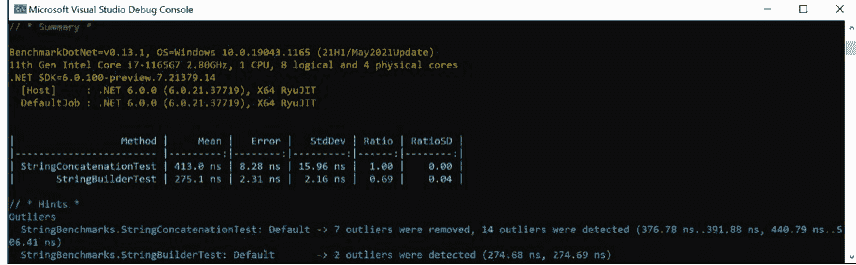

图 12.1：摘要表显示 StringBuilder 所用时间是字符串连接的 69%

异常值部分尤其有趣，因为它显示字符串连接不仅比 StringBuilder 慢，而且花费的时间也更不一致。你的结果当然会有所不同。

你现在已经看到了两种测量性能的方法。现在让我们看看如何异步运行任务以 potentially 提高性能。

## 异步运行任务

要了解如何同时（同时）运行多个任务，我们将创建一个需要执行三个方法的控制台应用程序。

需要执行的三个方法：第一个需要 3 秒，第二个需要 2 秒，第三个需要 1 秒。为了模拟该工作，我们可以使用 Thread 类告诉当前线程在指定的毫秒数内进入睡眠。

## 同步运行多个操作

在使任务同时运行时，我们将先同步运行它们，即一个接一个地运行。

- 1. 使用您喜欢的代码编辑器在 Chapter12 解决方案/工作区中添加一个名为 WorkingWithTasks 的新控制台应用程序。
- 2. 在 Visual Studio Code 中，将 WorkingWithTasks 选择为活动的 OmniSharp 项目。
- 3. 在 Program.cs 中，导入用于使用秒表的命名空间（用于线程和任务的命名空间已隐式导入），并静态导入 Console，如以下代码所示：
- 4. 在 Program.cs 底部，创建一个用于输出当前线程信息的方法，如以下代码所示：
- 5. 在 Program.cs 底部，添加三个模拟工作的方法，如以下代码所示：

```
using System.Diagnostics; // Stopwatch

using static System.Console;
```

```
static void OutputThreadInfo()
{
    Thread t = Thread.CurrentThread;

    WriteLine(
        "Thread Id: {0}, Priority: {1}, Background: {2}, Name: {3}",
        t.ManagedThreadId, t.Priority,
        t.IsBackground, t.Name ?? "null");
}
```

```
static void MethodA()
{
    WriteLine("Starting Method A...");
    OutputThreadInfo();
    Thread.Sleep(3000); // simulate three seconds of work
    WriteLine("Finished Method A.");
}
```

```
static void MethodB()
{
    WriteLine("Starting Method B...");
    OutputThreadInfo();
    Thread.Sleep(2000); // simulate two seconds of work
    WriteLine("Finished Method B.");
}
```

```
static void MethodC()
{
    WriteLine("Starting Method C...");
    OutputThreadInfo();
    Thread.Sleep(1000); // simulate one second of work
    WriteLine("Finished Method C.");
}
```

6. 在 Program.cs 顶部，添加语句以调用输出线程信息的方法，定义并启动秒表，调用三个模拟工作方法，然后输出经过的毫秒数，如以下代码所示：

```
OutputThreadInfo();
Stopwatch timer = Stopwatch.StartNew();

WriteLine("Running methods synchronously on one thread.");
MethodA();
MethodB();
MethodC();

WriteLine($"{timer.ElapsedMilliseconds:#,##0}ms elapsed.");
```

7. 运行代码，查看结果，并注意当只有一个未命名的前台线程执行工作时，所需要的总时间略超过 6 秒，如以下输出所示：

```
Thread Id: 1, Priority: Normal, Background: False, Name: null
Running methods synchronously on one thread.
Starting Method A...
Thread Id: 1, Priority: Normal, Background: False, Name: null
Finished Method A.
Starting Method B...
Thread Id: 1, Priority: Normal, Background: False, Name: null
Finished Method B.
Starting Method C...
Thread Id: 1, Priority: Normal, Background: False, Name: null
Finished Method C.
6,017ms elapsed.
```

## 使用任务异步运行多个操作

Thread 类自 .NET 的第一个版本以来就可用，可用于创建新线程并管理它们，但直接使用它可能很棘手。

.NET Framework 4.0 于 2010 年引入了 Task 类，它是线程的包装器，可实现更轻松的创建和管理。管理封装在任务中的多个线程将允许我们的代码同时执行，即异步执行。

每个 Task 都有一个 Status 属性和一个 CreationOptions 属性。Task 具有 ContinueWith 方法，可以使用 TaskContinuationOptions 枚举进行自定义，并且可以使用 TaskFactory 类进行管理。

## 启动任务

我们将查看三种使用 Task 实例启动方法的方法。GitHub 仓库中的链接指向讨论优缺点的文章。每种方法语法略有不同，但它们都定义了一个 Task 并启动它：

- 1. 注释掉对三个方法及其相关控制台消息的调用，并添加语句为每个方法创建并启动三个任务，如以下代码高亮所示：

```
OutputThreadInfo();
Stopwatch timer = Stopwatch.StartNew();

/*
WriteLine("Running methods synchronously on one thread.");
MethodA();
MethodB();
MethodC();
*/

WriteLine("Running methods asynchronously on multiple threads.");

Task taskA = new(MethodA);
taskA.Start();

Task taskB = Task.Factory.StartNew(MethodB);

Task taskC = Task.Run(MethodC);
```


```
WriteLine($"{timer.ElapsedMilliseconds:#,##0}ms elapsed.");
```

2. 运行代码，查看结果，并注意经过的毫秒数几乎立即出现。这是因为三个方法现在分别由线程池分配的三个新的后台工作线程执行，如以下输出所示：

```
Thread Id: 1, Priority: Normal, Background: False, Name: null
Running methods asynchronously on multiple threads.
Starting Method A...
Thread Id: 4, Priority: Normal, Background: True, Name: .NET ThreadPool Worker
Starting Method C...
Thread Id: 7, Priority: Normal, Background: True, Name: .NET ThreadPool Worker
Starting Method B...
Thread Id: 6, Priority: Normal, Background: True, Name: .NET ThreadPool Worker
6ms elapsed.
```

甚至可能在其中一个或多个任务有机会启动并写入控制台之前，控制台应用程序就会结束！

## 等待任务

有时，您需要在继续之前等待任务完成。为此，您可以在 Task 实例上使用 Wait 方法，或在任务数组上使用 WaitAll 或 WaitAny 静态方法，如下表所述：

| 方法 | 描述 |
|---|---|
| t.Wait() | 这会等待名为 t 的任务实例完成执行。 |
| Task.WaitAny(Task[]) | 这会等待数组中的任意任务完成执行。 |
| Task.WaitAll(Task[]) | 这会等待数组中的所有任务完成执行。 |

## 使用任务的等待方法

让我们看看如何使用这些等待方法来解决控制台应用程序的问题。

1. 在 Program.cs 中，在创建三个任务之后、在输出经过时间之前添加语句，将三个任务的引用合并到一个数组中并将其传递给 WaitAll 方法，如以下代码所示：

```
Task[] tasks = { taskA, taskB, taskC };
Task.WaitAll(tasks);
```

2. 运行代码并查看结果，注意原始线程将在对 WaitAll 的调用处暂停，等待所有三个任务完成后再输出经过的时间，大约为 3 秒多，如以下输出所示：

```
Id: 1, Priority: Normal, Background: False, Name: null
Running methods asynchronously on multiple threads.
Starting Method A...
Id: 6, Priority: Normal, Background: True, Name: .NET ThreadPool Worker
Starting Method B...
Id: 7, Priority: Normal, Background: True, Name: .NET ThreadPool Worker
Starting Method C...
Id: 4, Priority: Normal, Background: True, Name: .NET ThreadPool Worker
Finished Method C.
Finished Method B.
Finished Method A.
3,013ms elapsed.
```

这三个新线程同时执行其代码，并且可能以任何顺序启动。MethodC 应该最先完成，因为它只花费 1 秒，然后是花费 2 秒的 MethodB，最后是花费 3 秒的 MethodA。

然而，实际使用的 CPU 对结果有很大影响。CPU 会为每个进程分配时间片以允许它们执行线程。您无法控制方法何时运行。

## 继续执行另一个任务

如果三个任务可以同时执行，那么等待所有任务完成就是我们需要做的全部。然而，通常一个任务依赖于另一个任务的输出。为处理此场景，我们需要定义延续任务。

我们将创建一些方法来模拟对 Web 服务的调用，该服务返回一个货币金额，然后需要使用该金额从数据库中检索价格高于该金额的产品数量。第一个方法返回的结果需要输入到第二个方法的输入中。这次，我们不会等待固定的时间，而是使用 Random 类为每次方法调用等待 2 到 4 秒之间的随机间隔来模拟工作。

1. 在 Program.cs 底部添加两个模拟调用 Web 服务和数据库存储过程的方法，如以下代码所示：

```
static decimal CallWebService()
{
    WriteLine("Starting call to web service...");
    OutputThreadInfo();
    Thread.Sleep((new Random()).Next(2000, 4000));
    WriteLine("Finished call to web service.");
    return 89.99M;
}

static string CallStoredProcedure(decimal amount)
{
    WriteLine("Starting call to stored procedure...");
    OutputThreadInfo();
    Thread.Sleep((new Random()).Next(2000, 4000));
    WriteLine("Finished call to stored procedure.");
    return $"12 products cost more than {amount:C}.";
}
```

2. 通过用多行注释字符 /* */ 将其包裹来注释掉之前三个任务的调用。保留输出经过毫秒数的语句。

3. 在输出总时间的现有语句之前添加语句，如以下代码所示：

```
WriteLine("Passing the result of one task as an input into another.");

Task<string> taskServiceThenSProc = Task.Factory
    .StartNew(CallWebService) // returns Task<decimal>
    .ContinueWith(previousTask => // returns Task<string>
        CallStoredProcedure(previousTask.Result));

WriteLine($"Result: {taskServiceThenSProc.Result}");
```

4. 运行代码并查看结果，如以下输出所示：

```
Thread Id: 1, Priority: Normal, Background: False, Name: null
Passing the result of one task as an input into another.
Starting call to web service...
Thread Id: 4, Priority: Normal, Background: True, Name: .NET ThreadPool Worker
Finished call to web service.
Starting call to stored procedure...
Thread Id: 6, Priority: Normal, Background: True, Name: .NET ThreadPool Worker
Finished call to stored procedure.
Result: 12 products cost more than £89.99.
5,463ms elapsed.
```

您可能会看到与上述输出中不同的线程运行 Web 服务和存储过程调用（线程 4 和 6），或者由于线程不再繁忙，可能会重用同一个线程。

## 嵌套和子任务

除了定义任务之间的依赖关系之外，您还可以定义嵌套任务和子任务。**嵌套任务**是在另一个任务内部创建的任务。**子任务**是嵌套任务，其必须在父任务被允许完成之前完成。

让我们探索这些类型的任务的工作方式：

1. 使用您喜欢的代码编辑器在 Chapter12 解决方案/工作区中添加一个名为 NestedAndChildTasks 的新控制台应用程序。
2. 在 Visual Studio Code 中，将 NestedAndChildTasks 选择为活动的 OmniSharp 项目。
3. 在 Program.cs 中，删除现有语句，静态导入 Console，然后添加两个方法，其中一个启动任务以运行另一个，如以下代码所示：
4. 在方法上方添加语句以启动任务运行外部方法，并在停止之前等待其完成，如以下代码所示：
5. 运行代码并查看结果，如以下输出所示：

```
static void OuterMethod()
{
    WriteLine("Outer method starting...");
    Task innerTask = Task.Factory.StartNew(InnerMethod);
    WriteLine("Outer method finished.");
}

static void InnerMethod()
{
    WriteLine("Inner method starting...");
    Thread.Sleep(2000);
    WriteLine("Inner method finished.");
}
```

```
Task outerTask = Task.Factory.StartNew(OuterMethod);
outerTask.Wait();
WriteLine("Console app is stopping.");
```

```
Outer method starting...
Inner method starting...
Outer method finished.
Console app is stopping.
```

请注意，虽然我们等待外部任务完成，但其内部任务不必也完成。事实上，外部任务可能在内部任务甚至开始之前就完成，并且控制台应用程序可能会结束！

要将这些嵌套任务链接为父子关系，我们必须使用一个特殊选项。

6. 修改定义内部任务的现有代码以添加 TaskCreationOption 值 AttachedToParent，如以下代码中突出显示所示：

```
Task innerTask = Task.Factory.StartNew(InnerMethod,
    TaskCreationOptions.AttachedToParent);
```

7. 运行代码，查看结果，并注意内部任务必须在外部任务之前完成，如以下输出所示：

```
Outer method starting...
Inner method starting...
Outer method finished.
Inner method finished.
Console app is stopping.
```

OuterMethod 可以在 InnerMethod 之前完成，这一点可以从它写入控制台看出，但其任务必须等待，这一点可以从控制台在外部和内部任务都完成之前不会停止看出。

## 将任务包装在其他对象周围

有时您可能有一个想要异步的方法，但要返回的结果本身不是任务。您可以使用下表中显示的方法之一将返回值包装在成功完成的任务中、返回异常，或指示任务已取消：

| 方法 | 描述 |
|---|---|
| FromResult<TResult>(TResult) | 创建一个 Task<TResult> 对象，其 Result 属性为非任务结果，其 Status 属性为 RanToCompletion。 |
| FromException<TResult>(Exception) | 创建一个使用指定异常完成的 Task<TResult>。 |
| FromCanceled<TResult>(CancellationToken) | 创建一个由于指定取消令牌而完成取消的 Task<TResult>。 |

这些方法在以下情况下很有用：

- 实现具有异步方法的接口，但您的实现是同步的。这对于网站和服务很常见。
- 在单元测试期间模拟异步实现。

在第 7 章《打包和分发 .NET 类型》中，我们创建了一个类库，其中包含用于检查有效 XML、密码和十六进制代码的函数。


如果我们希望使这些方法符合要求返回 Task<T> 的接口，我们可以使用这些有用的方法，如以下代码所示：

```
using System.Text.RegularExpressions;

namespace Packt.Shared;

public static class StringExtensions
{
    public static Task<bool> IsValidXmlTagAsync(this string input)
    {
        if (input == null)
        {
            return Task.FromException<bool>(
                new ArgumentNullException("Missing input parameter"));
        }
        if (input.Length == 0)
        {
            return Task.FromException<bool>(
                new ArgumentException("input parameter is empty."));
        }
        return Task.FromResult(Regex.IsMatch(input,
            @"^<([a-z]+)([^<>]+)*(?:>(.*)</\1>|\s+/>)$"));
    }

    // other methods
}
```

如果你需要实现的方法返回一个 Task（相当于同步方法中的 void），那么你可以返回一个预定义的已完成 Task 对象，如以下代码所示：

```
public Task DeleteCustomerAsync()
{
    // ...
    return Task.CompletedTask;
}
```

## 对共享资源的访问同步

当有多个线程同时执行时，可能有两个或多个线程同时访问同一个变量或其他资源，从而导致问题。因此，你应仔细考虑如何使你的代码线程安全。

实现线程安全的最简单机制是使用一个对象变量作为标志或交通灯，以指示共享资源是否已应用独占锁。

在威廉·戈尔丁的《蝇王》中，皮吉和拉尔夫发现一只鹦鹉螺贝并用它来召集会议。男孩们给自己施加了“贝壳规则”，决定除非持有贝壳，否则任何人不得发言。

我喜欢将用于实现线程安全代码的对象变量命名为“conch”。当一个线程持有 conch 时，其他线程不应访问该 conch 所代表的共享资源（们）。请注意我说的是，应该。只有尊重 conch 的代码才能实现同步访问。conch 并不是锁。

我们将探讨几种可用于同步对共享资源访问的类型：

- Monitor: An object that can be used by multiple threads to check if they should access a shared resource within the same process.
- Interlocked: An object for manipulating simple numeric types at the CPU level.

## 从多个线程访问资源

1. 使用你喜欢的代码编辑器，在 Chapter12 解决方案/工作区中添加一个新的控制台应用，命名为 SynchronizingResourceAccess。
2. 在 Visual Studio Code 中，将 SynchronizingResourceAccess 选择为活动的 OmniSharp 项目。
3. 在 Program.cs 中，删除现有语句，然后添加语句执行以下操作：
   - 导入用于诊断类型如 Stopwatch 的命名空间。
   - 静态导入 Console 类型。
   - 在 Program.cs 底部，创建一个包含两个字段的静态类：
     - 用于生成随机等待时间的字段。
     - 用于存储消息的字符串字段（这是一个共享资源）。
   - 在该类上方，创建两个静态方法，在循环中五次向共享字符串添加字母 A 或 B，并在每次迭代中等待最多 2 秒的随机间隔：

```
static void MethodA()
{
    for (int i = 0; i < 5; i++)
    {
        Thread.Sleep(SharedObjects.Random.Next(2000));
        SharedObjects.Message += "A";
        Write(".");
    }
}

static void MethodB()
{
    for (int i = 0; i < 5; i++)
    {
        Thread.Sleep(SharedObjects.Random.Next(2000));
        SharedObjects.Message += "B";
        Write(".");
    }
}

static class SharedObjects
{
    public static Random Random = new();
    public static string? Message; // a shared resource
}
```

4. 在命名空间导入之后，编写语句使用一对任务在单独的线程上执行两个方法，并在它们完成前等待，然后输出经过的毫秒数，如以下代码所示：

```
WriteLine("Please wait for the tasks to complete.");
Stopwatch watch = Stopwatch.StartNew();

Task a = Task.Factory.StartNew(MethodA);
Task b = Task.Factory.StartNew(MethodB);

Task.WaitAll(new Task[] { a, b });

WriteLine();
WriteLine($"Results: {SharedObjects.Message}.");
WriteLine($"{watch.ElapsedMilliseconds:N0} elapsed milliseconds.");
```

5. 运行代码并查看结果，如以下输出所示：

```
Please wait for the tasks to complete.
..........
Results: BABABAABBA.
5,753 elapsed milliseconds.
```

这表明两个线程并发修改了消息。在实际应用中，这可能是一个问题。但我们可以通过对 conch 对象应用互斥锁并对两个方法添加代码，在修改共享资源前自愿检查 conch 来防止并发访问，我们将在下一节中这样做。

## 对 conch 应用互斥锁

现在，让我们使用 conch 来确保一次只有一个线程访问共享资源。

1. 在 SharedObjects 中，声明并实例化一个对象变量作为 conch，如以下代码所示：

```
public static object Conch = new();
```

2. 在 MethodA 和 MethodB 中，都在 for 语句周围添加针对 conch 的 lock 语句，如以下代码高亮所示：

```
lock (SharedObjects.Conch)
{
    for (int i = 0; i < 5; i++)
    {
        Thread.Sleep(SharedObjects.Random.Next(2000));
        SharedObjects.Message += "A";
        Write(".");
    }
}
```


良好实践：请注意，由于检查 conch 是自愿的，如果你只在两个方法中的一个中使用 lock 语句，共享资源仍会被两个方法访问。请确保所有访问共享资源的方法都尊重 conch。

3. 运行代码并查看结果，如以下输出所示：

```
Please wait for the tasks to complete.
..........
Results: BBBBAAAAA.
10,345 elapsed milliseconds.
```

尽管经过的时间更长，但一次只有一个方法可以访问共享资源。MethodA 或 MethodB 都可以先开始。一旦某个方法完成了对共享资源的工作，则 conch 会被释放，另一个方法就有机会进行工作。

## 理解 lock 语句

你可能会想知道 lock 语句在“锁定”对象变量时做了什么（提示：它并不锁定对象！），如以下代码所示：

```
lock (SharedObjects.Conch)
{
    // work with shared resource
}
```

C# 编译器会将 lock 语句更改为使用 Monitor 类进入和退出 conch 对象（我喜欢将其视为获取和释放 conch 对象）的 try-finally 语句，如以下代码所示：

```
try
{
    Monitor.Enter(SharedObjects.Conch);

    // work with shared resource
}
finally
{
    Monitor.Exit(SharedObjects.Conch);
}
```

当一个线程在任何对象，即引用类型上调用 Monitor.Enter 时，它会检查是否已有其他线程已获取 conch。如果已获取，线程会等待。如果未获取，线程会获取 conch 并继续处理共享资源的工作。一旦线程完成工作，它会调用 Monitor.Exit，释放 conch。如果有其他线程在等待，它现在可以获取 conch 并进行工作。这要求所有线程通过适当调用 Monitor.Enter 和 Monitor.Exit 来尊重 conch。

## 避免死锁

了解编译器如何将 lock 语句翻译为 Monitor 类的方法调用也很重要，因为使用 lock 语句可能会导致死锁。

当存在两个或多个共享资源（每个都有一个 conch 来监控哪个线程当前正在对每个共享资源进行工作）时，如果发生以下事件序列，就会发生死锁：

- Thread X "locks" conch A and starts working on shared resource A.
- Thread Y "locks" conch B and starts working on shared resource B.
- While still working on resource A, thread X needs to also work with resource B, and so it attempts to "lock" conch B but is blocked because thread Y already has conch B.
- While still working on resource B, thread Y needs to also work with resource A, and so it attempts to "lock" conch A but is blocked because thread X already has conch A.

防止死锁的一种方法是指定在尝试获取锁时的时间限制。为此，你必须手动使用 Monitor 类而不是使用 lock 语句。

1. 修改你的代码，用尝试以超时方式进入 conch 并输出错误然后退出监视器以允许其他线程进入监视器的代码替换 lock 语句，如以下代码高亮所示：

```
try
{
```


```
if (Monitor.TryEnter(SharedObjects.Conch, TimeSpan.FromSeconds(15)))
{
    for (int i = 0; i < 5; i++)
    {
        Thread.Sleep(SharedObjects.Random.Next(2000));
        SharedObjects.Message += "A";
        Write(".");
    }
}
else
{
    WriteLine("Method A timed out when entering a monitor on conch.");
}
finally
{
    Monitor.Exit(SharedObjects.Conch);
}
```

2. 运行代码并查看结果，结果应与之前相同（尽管 A 或 B 可能先获取 conch），但代码更好，因为它可以防止潜在的死锁。


**良好实践：** 只有在能够编写代码以避免潜在死锁时才使用 lock 关键字。如果无法避免潜在死锁，则始终使用 Monitor.TryEnter 方法代替 lock，并结合 try-finally 语句，以便您可以提供超时时间，如果发生死锁，其中一个线程将退出死锁。您可以在以下链接阅读有关良好线程实践的更多信息： https://docs.microsoft.com/en-us/dotnet/standard/threading/managed-threading-best-practices

## 同步事件

在第 6 章《实现接口和继承类》中，您学习了如何引发和处理事件。但 .NET 事件不是线程安全的，因此您应避免在多线程场景中使用它们，并遵循我之前向您展示的标准事件引发代码。

在得知 .NET 事件不是线程安全后，一些开发人员尝试在使用独占锁添加和删除事件处理程序或引发事件时，如以下代码所示：

```
// event delegate field
public event EventHandler Shout;

// conch
```

```
private object eventLock = new object();

// method
public void Poke()
{
    lock (eventLock) // bad idea
    {
        // if something is listening...
        if (Shout != null)
        {
            // ...then call the delegate to raise the event
            Shout(this, EventArgs.Empty);
        }
    }
}
```


> **良好实践：** 您可以在以下链接阅读有关事件和线程安全性的更多信息： https://docs.microsoft.com/en-us/archive/blogs/cburrows/field-like-events-considered-harmful
> 
> 但它很复杂，正如 Stephen Cleary 在以下博客文章中所解释的那样： https://blog.stephencleary.com/2009/06/threadsafe-events.html

## 使 CPU 操作原子化

Atomic 源自希腊语 **atomos**，意为 *不可分割*。 在多线程中了解哪些操作是原子的非常重要，因为如果它们不是原子的，则可能在操作中途被另一个线程中断。 C# 递增运算符是原子的吗，如以下代码所示？

```
int x = 3;
x++; // is this an atomic CPU operation?
```

它不是原子的！递增一个整数需要以下三个 CPU 操作：

- 1. 将实例变量中的值加载到寄存器中。
- 2. 递增该值。
- 3. 将该值存储在实例变量中。

一个线程可能在执行前两个步骤后被中断。然后第二个线程可以执行全部三个步骤。当第一个线程恢复执行时，它将覆盖变量中的值，并且第二个线程执行的递增或递减效果将会丢失！

有一个名为 Interlocked 的类型可以对值类型（如整数和浮点数）执行原子操作。让我们看看它的实际效果：

1. 在 SharedObjects 类中声明另一个字段，用于计数已发生的次数，如以下代码所示：

```
public static int Counter; // another shared resource
```

2. 在方法 A 和 B 中，在 for 语句内部且在修改字符串值之后，添加一条语句以安全地递增计数器，如以下代码所示：

```
Interlocked.Increment(ref SharedObjects.Counter);
```

3. 在输出经过时间后，将计数器的当前值写入控制台，如以下代码所示：

```
WriteLine($"{SharedObjects.Counter} string modifications.");
```

4. 运行代码并查看结果，如以下输出中突出显示的那样：

```
Please wait for the tasks to complete.
..........
Results: BBBBAAAAA.
13,531 elapsed milliseconds.
10 string modifications.
```

细心的读者会意识到现有的 conch 对象保护了在 conch 锁定的代码块内访问的所有共享资源，因此在这种特定示例中实际上不需要使用 Interlocked。但如果我们没有已经保护另一个像 Message 这样的共享资源，那么使用 Interlocked 就是必要的。

## 应用其他类型的同步

Monitor 和 Interlocked 是互斥锁，简单有效，但有时您需要更高级的选项来同步对共享资源的访问，如下表所示：

| 类型 | 描述 |
|---|---|
| ReaderWriterLock and ReaderWriterLockSlim | 这些允许多个线程处于读模式，一个线程以独占所有权的方式处于写模式，并且一个具有读访问权限的线程处于可升级读模式，从该模式线程可以在不必放弃对资源的读访问权限的情况下升级到写模式。 |
| Mutex | 与 Monitor 类似，这提供了对共享资源的独占访问，只是它用于进程间同步。 |
| Semaphore and SemaphoreSlim | 这些通过定义槽位来限制可以并发访问资源或资源池的线程数。这被称为资源节流而不是资源锁定。 |
| AutoResetEvent and ManualResetEvent | 事件等待句柄允许线程通过相互信号通知并等待彼此的信号来同步活动。 |

## 理解 async 和 await

C# 5 在使用 Task 类型时引入了两个 C# 关键字。它们对于以下情况特别有用：

- 为图形用户界面（GUI）实现多任务处理。
- 提高 Web 应用程序和 Web 服务的可扩展性。

在第 15 章《使用模型-视图-控制器模式构建网站》中，我们将看到 async 和 await 关键字如何提高网站的可扩展性。

在第 19 章《使用 .NET MAUI 构建移动和桌面应用程序》中，我们将看到 async 和 await 关键字如何为 GUI 实现多任务处理。

但现在，让我们学习为什么引入这两个 C# 关键字的理论，然后稍后您将看到它们在实践中的应用。

## 提高控制台应用程序的响应能力

控制台应用程序的一个限制是您只能在标记为 async 的方法内部使用 await 关键字，但 C# 7 及更早版本不允许将 Main 方法标记为 async！幸运的是，C# 7.1 中引入的一项新功能是对 Main 中的 async 的支持：

1. 使用您喜欢的代码编辑器向 Chapter12 解决方案/工作区添加一个名为 AsyncConsole 的新控制台应用程序。
2. 在 Visual Studio Code 中，将 AsyncConsole 选择为活动的 OmniSharp 项目。
3. 在 Program.cs 中，删除现有语句并静态导入 Console，如以下代码所示：
4. 添加语句以创建 HttpClient 实例，请求 Apple 的主页，并输出其字节数，如以下代码所示：
5. 构建项目并注意它成功构建。在 .NET 5 及更早版本中，您会看到错误消息，如以下输出所示：

```
using static System.Console;
```

```
HttpClient client = new();

HttpResponseMessage response =
    await client.GetAsync("http://www.apple.com/");

WriteLine("Apple's home page has {0:N0} bytes.",
    response.Content.Headers.ContentLength);
```

```
Program.cs(14,9): error CS4033: The 'await' operator can only be used within an async method. Consider marking this method with the 'async' modifier and changing its return type to 'Task'. [/Users/markjprice/Code/Chapter12/AsyncConsole/AsyncConsole.csproj]
```


6. 你之前需要为 Main 方法添加 async 关键字并将其返回类型更改为 Task。自 .NET 6 及更高版本起，控制台应用项目模板使用顶级程序功能自动为你定义带有异步 Main 方法的 Program 类。

7. 运行代码并查看结果，由于 Apple 经常更改其主页，因此字节数可能不同，如以下输出所示：

```
Apple's home page has 40,252 bytes.
```

## 提高 GUI 应用的响应性

迄今为止，本书中我们仅构建了控制台应用程序。当构建 Web 应用程序、Web 服务以及具有 GUI 的应用程序（如 Windows 桌面和移动应用）时，程序员的生活变得更加复杂。

其中一个原因是，对于 GUI 应用而言，存在一个特殊线程：用户界面（UI）线程。

在 GUI 中工作有两条规则：

- 不要在 UI 线程上执行长时间运行的任务。
- 不要在 UI 线程以外的任何线程上访问 UI 元素。

为处理这些规则，程序员过去必须编写复杂的代码以确保长时间运行的任务由非 UI 线程执行，但在完成后，任务的结果会安全地传递给 UI 线程以向用户展示。很快就会变得混乱！

幸运的是，从 C# 5 及更高版本开始，你可以使用 async 和 await。它们允许你继续像编写同步代码一样编写代码，这使代码保持干净且易于理解，但在底层，C# 编译器会创建一个复杂的 state machine 并跟踪运行中的线程。某种程度上很神奇！

让我们看一个示例。我们将使用 WPF 构建一个 Windows 桌面应用，该应用使用 SqlConnection、SqlCommand 和 SqlDataReader 等低级类型从 SQL Server 数据库中的 Northwind 数据库获取员工。只有在你拥有 Windows 且 Northwind 数据库存储在 SQL Server 中时，才能完成此任务。这是本书中唯一不是跨平台且现代的部分（WPF 已有 16 年历史！）。

此时，我们专注于使 GUI 应用具有响应性。你将在第 19 章《使用 .NET MAUI 构建移动和桌面应用》中学习 XAML 和构建跨平台 GUI 应用。由于本书在其他地方没有介绍 WPF，我认为此任务将是一个很好的机会，至少可以看到一个使用 WPF 构建的示例应用，即使我们不详细查看它。

开始吧！

1. 如果你使用的是适用于 Windows 的 Visual Studio 2022，请向 Chapter12 解决方案添加一个名为 WpfResponsive 的新 WPF Application [C#] 项目。如果你使用的是 Visual Studio Code，请使用以下命令：dotnet new wpf。

2. 在项目文件中，注意输出类型为 Windows EXE，目标框架为适用于 Windows 的 .NET 6（它不会在 macOS 和 Linux 等其他平台上运行），并且项目使用 WPF。

3. 向项目添加 Microsoft.Data.SqlClient 的包引用，如以下标记中突出显示所示：

```
<Project Sdk="Microsoft.NET.Sdk">

  <PropertyGroup>
    <OutputType>WinExe</OutputType>
    <TargetFramework>net6.0-windows</TargetFramework>
    <Nullable>enable</Nullable>
    <UseWPF>true</UseWPF>
  </PropertyGroup>

  <ItemGroup>
    <PackageReference Include="Microsoft.Data.SqlClient" Version="3.0.0" />
  </ItemGroup>

</Project>
```

4. 构建项目以还原包。

5. 在 MainWindow.xaml 中，在 <Grid> 元素中，添加元素以定义两个按钮、一个文本框和一个列表框，按垂直方向在堆栈面板中布局，如以下标记中突出显示所示：

```
<Grid>
  <StackPanel>
    <Button Name="GetEmployeesSyncButton" Click="GetEmployeesSyncButton_Click">
      Get Employees Synchronously</Button>
    <Button Name="GetEmployeesAsyncButton" Click="GetEmployeesAsyncButton_Click">
      Get Employees Asynchronously</Button>
    <TextBox HorizontalAlignment="Stretch" Text="Type in here" />
    <ListBox Name="EmployeesListBox" Height="400" />
  </StackPanel>
</Grid>
```

> 适用于 Windows 的 Visual Studio 2022 对构建 WPF 应用有良好的支持，并在你编辑代码和 XAML 标记时提供 IntelliSense。Visual Studio Code 不提供。

6. 在 MainWindow.xaml.cs 中，在 MainWindow 类中，导入 System.Diagnostics 和 Microsoft.Data.SqlClient 命名空间，然后为数据库连接字符串和 SQL 语句创建两个字符串常量，并为点击两个按钮创建事件处理程序，这些处理程序使用这些字符串常量打开到 Northwind 数据库的连接并使用所有员工的 id 和姓名填充列表框，如以下代码所示：

```
private const string connectionString =
    "Data Source=;" +
    "Initial Catalog=Northwind;" +
    "Integrated Security=true;" +
    "MultipleActiveResultSets=true;";

private const string sql =
    "WAITFOR DELAY '00:00:05';" +
    "SELECT EmployeeId, FirstName, LastName FROM Employees";

private void GetEmployeesSyncButton_Click(object sender, RoutedEventArgs e)
{
    Stopwatch timer = Stopwatch.StartNew();
    using (SqlConnection connection = new(connectionString))
    {
        connection.Open();
        SqlCommand command = new(sql, connection);
        SqlDataReader reader = command.ExecuteReader();

        while (reader.Read())
        {
            string employee = string.Format("{0}: {1} {2}",
                reader.GetInt32(0), reader.GetString(1), reader.GetString(2));

            EmployeesListBox.Items.Add(employee);
        }
        reader.Close();
        connection.Close();
    }
    EmployeesListBox.Items.Add($"Sync: {timer.ElapsedMilliseconds:N0}ms");
}

private async void GetEmployeesAsyncButton_Click(
    object sender, RoutedEventArgs e)
{
    Stopwatch timer = Stopwatch.StartNew();
    using (SqlConnection connection = new(connectionString))
    {
        await connection.OpenAsync();
        SqlCommand command = new(sql, connection);
        SqlDataReader reader = await command.ExecuteReaderAsync();

        while (await reader.ReadAsync())
        {
            string employee = string.Format("{0}: {1} {2}",
                await reader.GetFieldValueAsync<int>(0),
                await reader.GetFieldValueAsync<string>(1),
                await reader.GetFieldValueAsync<string>(2));

            EmployeesListBox.Items.Add(employee);
        }
        await reader.CloseAsync();
        await connection.CloseAsync();
    }
    EmployeesListBox.Items.Add($"Async: {timer.ElapsedMilliseconds:N0}ms");
}
```

注意以下内容：

- SQL 语句使用 SQL Server 命令 WAITFOR DELAY 来模拟耗时五秒的处理。然后它从 Employees 表中选择三列。
- GetEmployeesSyncButton_Click 事件处理程序使用同步方法打开连接并获取员工行。
- GetEmployeesAsyncButton_Click 事件处理程序标记为 async，并使用带有 await 关键字的异步方法打开连接并获取员工行。
- 两个事件处理程序都使用秒表记录操作花费的毫秒数并将其添加到列表框。

7. 在不调试的情况下启动 WPF 应用。
8. 在文本框中点击，输入一些文本，并注意 GUI 具有响应性。
9. 点击 **Get Employees Synchronously** 按钮。
10. 尝试在文本框中点击，并注意 GUI 没有响应。
11. 等待至少五秒钟，直到列表框填满员工。
12. 在文本框中点击，输入一些文本，并注意 GUI 再次具有响应性。
13. 点击 **Get Employees Asynchronously** 按钮。
14. 在文本框中点击，输入一些文本，并注意在执行操作时 GUI 仍然具有响应性。继续输入，直到列表框填满员工。

15. 注意两次操作的时差。在同步获取数据时 UI 会被阻塞，而在异步获取数据时 UI 保持响应。

16. 关闭 WPF 应用。

## 提高 Web 应用程序和 Web 服务的可扩展性

async 和 await 关键字也可以在构建网站、应用程序和服务时应用于服务器端。从客户端应用程序的角度来看，什么都没有改变（或者他们甚至可能会注意到请求返回所需的时间略有增加）。因此，从单个客户端的角度来看，使用 async 和 await 在服务器端实现多任务处理会使他们的体验变差！

在服务器端，会创建额外的、更便宜的工作线程来等待长时间运行的任务完成，以便昂贵的 I/O 线程可以处理其他客户端请求而不是被阻塞。这提高了 Web 应用程序或服务整体的可扩展性。可以同时支持更多客户端。

## 支持多任务的常见类型

有许多常见类型具有你可以等待的异步方法，如下表所示：

| 类型 | 方法 |
|---|---|
| DbContext<T> | AddAsync, AddRangeAsync, FindAsync, and SaveChangesAsync |
| DbSet<T> | AddAsync, AddRangeAsync, ForEachAsync, SumAsync, ToListAsync, ToDictionaryAsync, AverageAsync, and CountAsync |
| HttpClient | GetAsync, PostAsync, PutAsync, DeleteAsync, and SendAsync |
| StreamReader | ReadAsync, ReadLineAsync, and ReadToEndAsync |
| StreamWriter | WriteAsync, WriteLineAsync, and FlushAsync |


> **良好实践：** 任何时候你看到以后缀 Async 结尾的方法，请检查它是否返回 Task 或 Task<T>。如果是，那么你就可以改用它而不是同步的非 Async 后缀方法。记住使用 await 调用它并用 async 装饰你的方法。

## 在 catch 块中使用 await

当 async 和 await 最初在 C# 5 中引入时，只能在 try 块中使用 await 关键字，而不能在 catch 块中使用。在 C# 6 及更高版本中，现在可以在 try 和 catch 块中都使用 await。


## 使用异步流

在 .NET Core 3.0 中，Microsoft 引入了流的异步处理。

你可以在以下链接完成关于异步流的教程：https://docs.microsoft.com/en-us/dotnet/csharp/tutorials/generate-consume-asynchronous-stream

在 C# 8.0 和 .NET Core 3.0 之前，await 关键字仅适用于返回标量值的任务。.NET Standard 2.1 中的异步流支持允许异步方法返回一系列值。

让我们看一个模拟示例，该示例将三个随机整数作为异步流返回。

- 1. 使用你喜欢的代码编辑器在 Chapter12 解决方案/工作区中添加一个名为 AsyncEnumerable 的新控制台应用程序。
- 2. 在 Visual Studio Code 中，将 AsyncEnumerable 选择为活动的 OmniSharp 项目。
- 3. 在 Program.cs 中，删除现有语句并静态导入 Console，如以下代码所示：
- 4. 在 Program.cs 底部，创建一个使用 yield 关键字异步返回三个随机数字序列的方法，如以下代码所示：
- 5. 在 GetNumbersAsync 上方，添加枚举数字序列的语句，如以下代码所示：

```
using static System.Console; // WriteLine()
```

```
async static IAsyncEnumerable<int> GetNumbersAsync()
{
    Random r = new();
    
    // simulate work
    await Task.Delay(r.Next(1500, 3000));
    yield return r.Next(0, 1001);
    
    await Task.Delay(r.Next(1500, 3000));
    yield return r.Next(0, 1001);
    
    await Task.Delay(r.Next(1500, 3000));
    yield return r.Next(0, 1001);
}
```

```
await foreach (int number in GetNumbersAsync())
{
    WriteLine($"Number: {number}");
}
```

- 6. 运行代码并查看结果，如以下输出所示：

```
Number: 509
Number: 813
Number: 307
```

## 练习与探索

通过回答一些问题来测试你的知识和理解，进行一些实践操作，并通过更深入的研究探索本章主题。

## 练习 12.1 – 测试你的知识

回答以下问题：

- 1. 你可以了解到进程的哪些信息？
- 2. Stopwatch 类的准确度如何？
- 3. 根据惯例，返回 Task 或 Task<T> 的方法应使用什么后缀？
- 4. 要在方法内部使用 await 关键字，方法声明必须应用什么关键字？
- 5. 如何创建子任务？
- 6. 为什么应避免使用 lock 关键字？
- 7. 何时应使用 Interlocked 类？
- 8. 何时应使用 Mutex 类而不是 Monitor 类？
- 9. 在网站或 Web 服务中使用 async 和 await 的好处是什么？
- 10. 你可以取消任务吗？如果可以，如何取消？

## 练习 12.2 – 探索主题

使用以下网页上的链接了解本章涵盖主题的更多详细信息：

https://github.com/markjprice/cs10dotnet6/blob/main/book-links.md#chapter-12---improving-performance-and-scalability-using-multitasking

## 摘要

在本章中，你不仅学习了如何定义和启动任务，还学习了如何等待一个或多个任务完成以及如何控制任务完成顺序。你还学习了如何同步对共享资源的访问以及 async 和 await 背后的原理。

在接下来的七章中，你将学习如何为 .NET 支持的 **app models**，即 **workloads** 创建应用程序，例如网站和服务，以及跨平台桌面和移动应用程序。

## 13

## 介绍 C# 和 .NET 的实用应用

本书的第三部分也是最后一部分是关于 C# 和 .NET 的实用应用。你将学习如何构建跨平台项目，例如网站、服务以及移动和桌面应用程序。

Microsoft 将用于构建应用程序的平台称为 app models 或 workloads。

在第 1 章至第 18 章和第 20 章中，你可以使用特定于操作系统的 Visual Studio 或跨平台的 Visual Studio Code 和 JetBrains Rider 来构建所有应用程序。在第 19 章《使用 .NET MAUI 构建移动和桌面应用程序》中，虽然你可以使用 Visual Studio Code 来构建移动和桌面应用程序，但并不容易。Visual Studio 2022 for Windows 对 .NET MAUI 的支持比 Visual Studio Code 更好（目前如此）。

我建议你按顺序学习本章及后续章节，因为后面的章节会引用前面章节中的项目，并且你将积累足够的知识和技能来应对后面章节中更棘手的问题。

在本章中，我们将涵盖以下主题：

- 了解 C# 和 .NET 的 app models
- ASP.NET Core 的新功能
- 项目结构
- 使用其他项目模板
- 为 Northwind 构建实体数据模型

## 了解 C# 和 .NET 的 app models

由于本书是关于 C# 10 和 .NET 6，我们将学习使用它们来构建本书剩余章节中将遇到的实用应用程序的 app models。


**Learn More:** Microsoft 在其 .NET Application Architecture Guidance 文档中提供了大量关于实现 app models 的指导，你可以在以下链接阅读：https://www.microsoft.com/net/learn/architecture

## 使用 ASP.NET Core 构建网站

网站由多个网页组成，这些网页可以从文件系统静态加载，也可以由 ASP.NET Core 等服务器端技术动态生成。Web 浏览器使用 **Uniform Resource Locators (URLs)** 发出 GET 请求来标识每个页面，并可以使用 POST、PUT 和 DELETE 请求操作服务器上存储的数据。

对于许多网站，Web 浏览器被视为表示层，几乎所有的处理都在服务器端执行。客户端可能会使用一些 JavaScript 来实现一些表示功能，例如轮播。

ASP.NET Core 提供了多种构建网站的技术：

- **ASP.NET Core Razor Pages** 和 **Razor class libraries** 是为简单网站动态生成 HTML 的方法。你将在 *第 14 章，使用 ASP.NET Core Razor Pages 构建网站* 中详细了解它们。
- **ASP.NET Core MVC** 是 **Model-View-Controller (MVC)** 设计模式的实现，流行于开发复杂网站。你将在 *第 15 章，使用模型-视图-控制器模式构建网站* 中详细了解它。
- **Blazor** 让你可以使用 C# 和 .NET 而不是 Angular、React 和 Vue 等基于 JavaScript 的 UI 框架来构建用户界面组件。**Blazor WebAssembly** 在浏览器中运行你的代码，就像基于 JavaScript 的框架一样。**Blazor Server** 在服务器上运行你的代码并动态更新网页。你将在 *第 17 章，使用 Blazor 构建用户界面* 中详细了解 Blazor。Blazor 不仅用于构建网站，还可用于创建混合移动和桌面应用程序。

## 使用内容管理系统构建网站

大多数网站都有大量内容，如果每次需要更改内容时都需要开发人员参与，那将无法很好地扩展。**Content Management System (CMS)** 使开发人员能够定义内容结构和模板，以提供一致性和良好的设计，同时使非技术内容所有者能够轻松管理实际内容。他们可以创建新的页面或内容块，并更新现有内容，确保以最少的努力就能为访客呈现出色的效果。

对于所有 Web 平台都有大量 CMS 可用，例如 PHP 的 WordPress 或 Python 的 Django CMS。支持现代 .NET 的 CMS 包括 Optimizely Content Cloud、Piranha CMS 和 Orchard Core。

使用 CMS 的主要好处是它提供了友好的内容管理用户界面。内容所有者登录网站并自行管理内容。然后，内容使用 ASP.NET Core MVC 控制器和视图呈现并返回给访客，或通过 Web 服务端点（称为无头 CMS）提供该内容，以供作为移动或桌面应用程序、店内触点或使用 JavaScript 框架或 Blazor 构建的客户端实现的“前端”使用。

本书不涵盖 .NET CMS，因此我在 GitHub 仓库中包含了可以了解更多信息的链接：

```
https://github.com/markjprice/cs10dotnet6/blob/main/book-links.md#net-content-management-systems
```

## 使用 SPA 框架构建 Web 应用程序

Web 应用程序，也称为单页应用程序（SPAs），由单个网页组成，该网页使用 Blazor WebAssembly、Angular、React、Vue 或专有 JavaScript 库等前端技术构建，可以在需要时向后端 Web 服务请求更多数据，并使用 XML 和 JSON 等常见序列化格式发布更新的数据。典型示例是 Google 的 Web 应用程序，如 Gmail、Maps 和 Docs。

对于 Web 应用程序，客户端使用 JavaScript 框架或 Blazor WebAssembly 实现复杂的用户交互，但由于 Web 浏览器对本地系统资源的访问有限，大多数重要的处理和数据访问仍发生在服务器端。

JavaScript 是松散类型的，并不适用于复杂项目，因此如今大多数 JavaScript 库都使用 Microsoft TypeScript，它为 JavaScript 添加了强类型，并设计了许多现代语言特性来处理复杂实现。

.NET SDK 具有 JavaScript 和 TypeScript 基于 SPA 的项目模板，但我们不会在本书中花费任何时间学习如何构建基于 JavaScript 和 TypeScript 的 SPA，即使这些通常与 ASP.NET Core 作为后端一起使用，因为本书是关于 C# 的，而不是其他语言。


总之，C# 和 .NET 都可用于服务器端和客户端来构建网站，如图 13.1 所示：

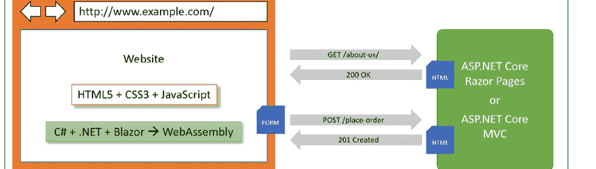

Figure 13.1: C# 和 .NET 在服务器端和客户端构建网站的使用

## 构建 Web 及其他服务

尽管我们不会学习基于 JavaScript 和 TypeScript 的 SPA，但我们将学习如何使用 ASP.NET Core Web API 构建 Web 服务，然后从 ASP.NET Core 网站中的服务器端代码调用该 Web 服务，之后，我们还将从 Blazor WebAssembly 组件以及跨平台移动和桌面应用中调用该 Web 服务。

没有正式定义，但服务有时会根据其复杂性进行描述：

-   **Service**：客户端应用所需的所有功能都集中在一个单体服务中。
-   **Microservice**：多个服务，每个服务专注于较小的功能集。
-   **Nanoservice**：作为服务提供的一个单一函数。与 24/7/365 托管的服务和微服务不同，纳米服务通常在被调用前保持非活动状态，以减少资源和成本。

除使用 HTTP 作为底层通信技术和 API 设计原则的 Web 服务外，我们还将学习如何使用其他技术和设计理念构建服务，包括：

-   **gRPC** 用于构建高效且性能优异的服务，并支持几乎任何平台。
-   **SignalR** 用于在组件之间构建实时通信。
-   **OData** 用于使用 Web API 封装 Entity Framework Core 和其他数据模型。
-   **GraphQL** 用于让客户端控制从多个数据源检索的数据。
-   **Azure Functions** 用于在云中托管无服务器纳米服务。

## 构建移动和桌面应用

存在两个主要移动平台：Apple 的 iOS 和 Google 的 Android，每个平台都有自己的编程语言和平台 API。还有两个主要桌面平台：Apple 的 macOS 和 Microsoft 的 Windows，每个平台也有自己的编程语言和平台 API，如下列表所示：

-   **iOS**：Objective-C 或 Swift 和 UIKit。
-   **Android**：Java 或 Kotlin 和 Android API。
-   **macOS**：Objective-C 或 Swift 和 AppKit 或 Catalyst。
-   **Windows**：C、C++ 或许多其他语言以及 Win32 API 或 Windows App SDK。

由于本书是关于使用 C# 和 .NET 进行现代跨平台开发，因此不包括使用 Windows Forms、Windows Presentation Foundation (WPF) 或 Universal Windows Platform (UWP) 应用构建桌面应用的内容，因为它们仅限 Windows。

跨平台移动和桌面应用可以一次性为 .NET 多平台应用用户界面 (MAUI) 平台构建，然后可在许多移动和桌面平台上运行。

.NET MAUI 通过共享用户界面组件以及业务逻辑使开发这些应用变得简单。它们可以定位与控制台应用、网站和 Web 服务相同的 .NET API。应用将在移动设备上由 Mono 运行时执行，在桌面设备上由 CoreCLR 运行时执行。与普通的 .NET CoreCLR 运行时相比，Mono 运行时针对移动设备进行了更好的优化。Blazor WebAssembly 也使用 Mono 运行时，因为与移动应用一样，它受资源限制。

这些应用可以独立存在，但它们通常会调用服务，以提供跨所有计算设备的体验，从服务器和笔记本电脑到手机和游戏系统。

.NET MAUI 的未来更新将支持现有的 MVVM 和 XAML 模式，以及使用 C# 的 Model-View-Update (MVU) 等模式，这类似于 Apple 的 Swift UI。

第六版的倒数第二章是第 19 章《使用 .NET MAUI 构建移动和桌面应用》，介绍了使用 .NET MAUI 构建跨平台移动和桌面应用。

## .NET MAUI 的替代方案

在 Microsoft 创建 .NET MAUI 之前，第三方创建了名为 Uno 和 Avalonia 的开源计划，以使 .NET 开发者能够使用 XAML 构建跨平台应用。

### 了解 Uno Platform

正如 Uno 在其网站上所述，它是“第一个也是唯一一个用于 Windows、WebAssembly、iOS、macOS、Android 和 Linux 的单代码库应用的 UI 平台”。

开发者可以在原生移动、Web 和桌面应用之间重用 99% 的业务逻辑和 UI 层。

Uno Platform 使用 Xamarin 原生平台，但不使用 Xamarin.Forms。对于 WebAssembly，Uno 使用 Mono-WASM 运行时，就像 Blazor WebAssembly 一样。对于 Linux，Uno 使用 Skia 在画布上绘制用户界面。

### 了解 Avalonia

正如 .NET Foundation 网站所述，Avalonia“是一个跨平台的基于 XAML 的 UI 框架，提供灵活的样式系统并支持 Windows、通过 Xorg 的 Linux、macOS 等广泛的操作系统。Avalonia 已准备好进行通用桌面应用开发。”

你可以将 Avalonia 视为 WPF 的精神继承者。熟悉 WPF 的 WPF、Silverlight 和 UWP 开发者可以继续受益于他们多年的既有知识和技能。

JetBrains 使用它来现代化其基于 WPF 的工具并使其跨平台。

Visual Studio 的 Avalonia 扩展和与 JetBrains Rider 的深度集成使开发更轻松、更高效。

## ASP.NET Core 的新功能

在过去几年中，Microsoft 迅速扩展了 ASP.NET Core 的功能。您应注意支持哪些 .NET 平台，如下列表所示：

-   ASP.NET Core 1.0 到 2.2 可在 .NET Core 或 .NET Framework 上运行。
-   ASP.NET Core 3.0 或更高版本仅在 .NET Core 3.0 或更高版本上运行。

### ASP.NET Core 1.0

ASP.NET Core 1.0 于 2016 年 6 月发布，重点是实现一个最小 API，适用于为 Windows、macOS 和 Linux 构建现代跨平台 Web 应用和服务。

### ASP.NET Core 1.1

ASP.NET Core 1.1 于 2016 年 11 月发布，重点是错误修复以及功能和性能的总体改进。

### ASP.NET Core 2.0

ASP.NET Core 2.0 于 2017 年 8 月发布，重点是添加新功能，例如 Razor Pages、将程序集捆绑到 Microsoft.AspNetCore.All 元包中、定位 .NET Standard 2.0、提供新的身份验证模型以及性能改进。

ASP.NET Core 2.0 引入的最大新功能是 ASP.NET Core Razor Pages，内容见第 14 章《使用 ASP.NET Core Razor Pages 构建网站》，以及 ASP.NET Core OData 支持，内容见第 18 章《构建和消费专用服务》。

### ASP.NET Core 2.1

ASP.NET Core 2.1 于 2018 年 5 月发布，是一个长期支持 (LTS) 版本，意味着它得到了为期三年的支持，直至 2021 年 8 月 21 日（LTS designation 直到 2018 年 8 月随版本 2.1.3 才正式指定）。

它重点添加了新功能，例如用于实时通信的 SignalR、用于重用 Web 组件的 Razor 类库、用于身份验证的 ASP.NET Core Identity，以及对 HTTPS 和欧盟通用数据保护条例 (GDPR) 的更好支持，包括以下表格中列出的主题：

| 功能 | 章节 | 主题 |
|---|---|---|
| Razor 类库 | 14 | 使用 Razor 类库 |
| GDPR 支持 | 15 | 创建和探索一个 ASP.NET Core MVC 网站 |
| Identity UI 库和脚手架 | 15 | 探索一个 ASP.NET Core MVC 网站 |
| 集成测试 | 15 | 测试一个 ASP.NET Core MVC 网站 |
| [ApiController], ActionResult<T> | 16 | 创建一个 ASP.NET Core Web API 项目 |
| 问题详情 | 16 | 实现一个 Web API 控制器 |
| IHttpClientFactory | 16 | 使用 HttpClientFactory 配置 HTTP 客户端 |
| ASP.NET Core SignalR | 18 | 使用 SignalR 实现实时通信 |

### ASP.NET Core 2.2

ASP.NET Core 2.2 于 2018 年 12 月发布，重点是改进 RESTful HTTP API 的构建、将项目模板更新为 Bootstrap 4 和 Angular 6、为在 Azure 中托管优化配置，以及性能改进，包括以下表格中列出的主题：

| 功能 | 章节 | 主题 |
|---|---|---|
| Kestrel 中的 HTTP/2 | 14 | 经典 ASP.NET 与现代 ASP.NET Core |
| 进程内托管模型 | 14 | 创建一个 ASP.NET Core 项目 |
| 端点路由 | 14 | 理解端点路由 |
| 健康检查 API | 16 | 实现一个健康检查 API |
| Open API 分析器 | 16 | 实现 Open API 分析器和约定 |


## ASP.NET Core 3.0

ASP.NET Core 3.0 于 2019 年 9 月发布，重点充分利用 .NET Core 3.0 和 .NET Standard 2.1，这意味着它无法支持 .NET Framework，并增加了有用的改进，包括以下表格中列出的主题：

| Feature | Chapter | Topic |
|---|---|---|
| Static assets in Razor class libraries | 14 | Using Razor class libraries |
| New options for MVC service registration | 15 | Understanding ASP.NET Core MVC startup |
| ASP.NET Core gRPC | 18 | Building services using ASP.NET Core gRPC |
| Blazor Server | 17 | Building components using Blazor Server |

## ASP.NET Core 3.1

ASP.NET Core 3.1 于 2019 年 12 月发布，是一个 LTS 版本，意味着它将支持到 2022 年 12 月 13 日。它专注于诸如 Razor 组件的部分类支持和新的 <component> 标签助手等改进。

## Blazor WebAssembly 3.2

Blazor WebAssembly 3.2 于 2020 年 5 月发布。它是一个 Current 版本，意味着项目必须在 .NET 5 发布后三个月内升级到 .NET 5 版本，即最晚到 2021 年 2 月 10 日。微软最终兑现了使用 .NET 进行全栈 Web 开发的承诺，Blazor Server 和 Blazor WebAssembly 都在第 17 章《使用 Blazor 构建用户界面》中有所涉及。

## ASP.NET Core 5.0

ASP.NET Core 5.0 于 2020 年 11 月发布，重点关注错误修复、使用缓存进行证书身份验证的性能改进、Kestrel 中 HTTP/2 响应头部的 HPACK 动态压缩、ASP.NET Core 程序集的可空注释，以及容器镜像大小的减少，包括以下表格中列出的主题：

| Feature | Chapter | Topic |
|---|---|---|
| Extension method to allow anonymous access to an endpoint | 16 | Securing web services |
| JSON extension methods for HttpRequest and HttpResponse | 16 | Getting customers as JSON in the controller |

## ASP.NET Core 6.0

ASP.NET Core 6.0 于 2021 年 11 月发布，重点关注生产力改进，例如最小化实现基本网站和服务的代码、.NET Hot Reload，以及 Blazor 的新托管选项，如使用 .NET MAUI 的混合应用，包括以下表格中列出的主题：

| Feature | Chapter | Topic |
|---|---|---|
| New empty web project template | 14 | Understanding the empty web template |
| HTTP logging middleware | 16 | Enabling HTTP logging |
| Minimal APIs | 16 | Implementing minimal Web APIs |
| Blazor error boundaries | 17 | Defining Blazor error boundaries |
| Blazor WebAssembly AOT | 17 | Enabling Blazor WebAssembly ahead-of-time compilation |
| .NET Hot Reload | 17 | Fixing code using .NET Hot Reload |
| .NET MAUI Blazor apps | 19 | Hosting Blazor components in .NET MAUI apps |

## Building Windows-only desktop apps

构建仅限 Windows 的桌面应用的技术包括：

- **Windows Forms**，2002 年。
- **Windows Presentation Foundation (WPF)**，2006 年。
- **Windows Store** 应用，2012 年。
- **Universal Windows Platform (UWP)** 应用，2015 年。
- **Windows App SDK**（前身为 **WinUI 3** 和 **Project Reunion**）应用，2021 年。

## Understanding legacy Windows application platforms

在 1985 年发布的 Microsoft Windows 1.0 中，创建 Windows 应用的唯一方法是使用 C 语言并调用名为 kernel、user 和 GDI 的三个核心 DLL 中的函数。一旦 Windows 在 Windows 95 中变为 32 位，DLL 便加上了 32 后缀，并被称为 **Win32 API**。

1991 年，微软推出了 Visual Basic，它为开发人员提供了可视化、从控件工具箱拖放的方式来构建 Windows 应用的用户界面。它非常受欢迎，Visual Basic 运行时至今仍作为 Windows 10 的一部分分发。

在 2002 年发布的 C# 和 .NET Framework 的第一个版本中，微软提供了名为 **Windows Forms** 的构建 Windows 桌面应用的技术。当时 Web 开发的等效技术名为 **Web Forms**，因此名称互补。代码可以用 Visual Basic 或 C# 语言编写。Windows Forms 也有类似的拖放可视化设计器，尽管它会生成用于定义用户界面的 C# 或 Visual Basic 代码，这对人类来说难以直接理解和编辑。

2006 年，微软发布了更强大的构建 Windows 桌面应用的技术，名为 **Windows Presentation Foundation (WPF)**，它是 .NET Framework 3.0 的关键组件，与 **Windows Communication Foundation (WCF)** 和 **Windows Workflow (WF)** 并列。

尽管 WPF 应用可以通过仅编写 C# 语句创建，它也可以使用 **eXtensible Application Markup Language (XAML)** 来指定其用户界面，这对人类和代码都易于理解。Visual Studio for Windows 部分使用 WPF 构建。

2012 年，微软发布了 Windows 8，其 Windows Store 应用在受保护的沙箱中运行。

2015 年，微软发布了 Windows 10，其更新的 Windows Store 应用概念名为 **Universal Windows Platform (UWP)**。UWP 应用可以使用 C++ 和 DirectX UI，或 JavaScript 和 HTML，或使用现代 .NET 的自定义分支（非跨平台但提供对底层 WinRT API 的完全访问）用 C# 构建。

UWP 应用只能在 Windows 10 平台上执行，不能在更早版本的 Windows 上运行，但 UWP 应用可以在 Xbox 和带运动控制器的 Windows Mixed Reality 头显上运行。

许多 Windows 开发人员拒绝 Windows Store 和 UWP 应用，因为它们对底层系统的访问有限。微软最近创建了 **Project Reunion** 和 **WinUI 3**，它们协同工作，使 Windows 开发人员能够将现代 Windows 开发的一些优势带到现有的 WPF 应用中，并使其具有与 UWP 应用相同的优势和系统集成。该计划现在被称为 **Windows App SDK**。

## Understanding modern .NET support for legacy Windows platforms

Linux 和 macOS 的 .NET SDK 磁盘大小约为 330 MB。Windows 的 .NET SDK 磁盘大小约为 440 MB。这是因为它包含了 Windows Desktop Runtime，该运行时允许在现代 .NET 上运行遗留的 Windows 应用平台 Windows Forms 和 WPF。

许多使用 Windows Forms 和 WPF 构建的企业应用需要维护或增加新功能，但直到最近它们都停留在 .NET Framework 上，而 .NET Framework 现在是一个遗留平台。借助现代 .NET 及其 Windows Desktop Pack，这些应用现在可以使用 .NET 的全部现代功能。

## Structuring projects

如何组织你的项目？到目前为止，我们构建了小型独立的控制台应用来说明语言或库功能。在本书的其余部分，我们将使用不同的技术构建多个项目，共同提供一个解决方案。

对于大型、复杂的解决方案，在所有代码中导航可能很困难。因此，组织项目的首要原因是使查找组件更轻松。最好为解决方案或工作区有一个整体名称，以反映应用程序或解决方案。

我们将为一家名为 **Northwind** 的虚构公司构建多个项目。我们将解决方案或工作区命名为 **PracticalApps**，并将名称 **Northwind** 作为所有项目名称的前缀。

有许多组织和命名项目和解决方案的方法，例如使用文件夹层次结构以及命名约定。如果你在一个团队中工作，请确保了解团队的做法。

## Structuring projects in a solution or workspace

在解决方案或工作区中为项目制定命名约定是很好的，这样任何开发人员都能立即知道每个项目的作用。常见的做法是使用项目类型，例如类库、控制台应用、网站等，如下表所示：

| Name | Description |
|---|---|
| Northwind.Common | 用于跨多个项目使用的通用类型（如接口、枚举、类、记录和结构体）的类库项目。 |
| Northwind.Common.EntityModels | 用于通用 EF Core 实体模型的类库项目。实体模型通常在服务器端和客户端都使用，因此最好将对特定数据库提供程序的依赖分离。 |
| Northwind.Common.DataContext | 用于具有对特定数据库提供程序依赖的 EF Core 数据库上下文的类库项目。 |
| Northwind.Web | 用于简单网站的 ASP.NET Core 项目，该网站使用静态 HTML 文件和动态 Razor Pages 的混合。 |
| Northwind.Razor.Component | 用于在多个项目中使用的 Razor Pages 的类库项目。 |
| Northwind.Mvc | 用于使用 MVC 模式且更易于单元测试的复杂网站的 ASP.NET Core 项目。 |
| Northwind.WebApi | 用于 HTTP API 服务的 ASP.NET Core 项目。集成到网站的良好选择，因为它们可以使用任何 JavaScript 库或 Blazor 与服务交互。 |
| Northwind.OData | 用于实现 OData 标准以使客户端控制查询的 HTTP API 服务的 ASP.NET Core 项目。 |
| Northwind.GraphQL | 用于实现 GraphQL 标准以使客户端控制查询的 HTTP API 服务的 ASP.NET Core 项目。 |
| Northwind.gRPC | 用于 gRPC 服务的 ASP.NET Core 项目。由于 gRPC 支持广泛且高效高性能，因此是集成使用任何语言和平台构建的应用的良好选择。 |
| Northwind.SignalR | 用于实时通信的 ASP.NET Core 项目。 |
| Northwind.AzureFuncs | 用于实现在 Azure Functions 中托管的无服务器纳米服务的 ASP.NET Core 项目。 |
| Northwind.BlazorServer | ASP.NET Core Blazor Server 项目。 |
| Northwind.BlazorWasm.Client | ASP.NET Core Blazor WebAssembly 客户端项目。 |
| Northwind.BlazorWasm.Server | ASP.NET Core Blazor WebAssembly 服务器端项目。 |
| Northwind.Maui | 用于跨平台桌面/移动应用的 .NET MAUI 项目。 |
| Northwind.MauiBlazor | 用于托管 Blazor 组件并与操作系统进行原生集成的 .NET MAUI 项目。 |


## 使用其他项目模板

当您安装 .NET SDK 时，其中包含许多项目模板：

```
dotnet new --list
```

- 1. 在命令提示符或终端中，输入以下命令：
- 2. 您将看到当前已安装的模板列表，如果您在 Windows 上运行，则包括 Windows 桌面开发的模板，如图 13.2 所示：
- 3. 请注意与 Web 相关的项目模板，包括使用 Blazor、Angular 和 React 创建 SPA 的模板。但另一个常见的 JavaScript SPA 库缺失了：Vue。

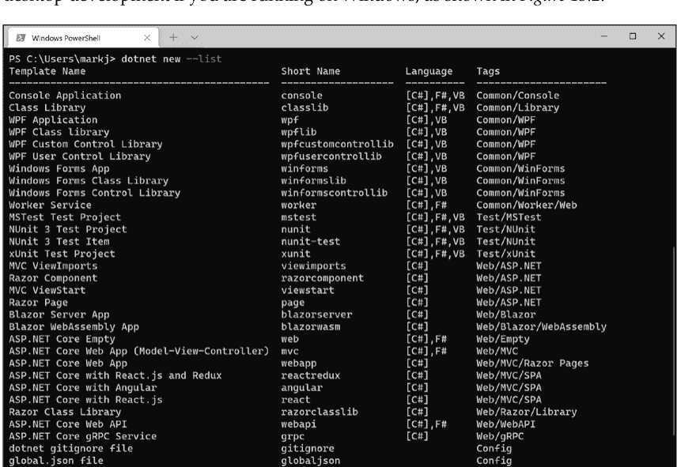

图 13.2：dotnet 项目模板列表

## 安装额外的模板包

开发人员可以安装大量额外的模板包：

- 1. 启动浏览器并导航到 http://dotnetnew.azurewebsites.net/。
- 2. 在文本框中输入 vue 并注意可用的 Vue.js 模板列表，包括微软发布的一个，如图 13.3 所示：

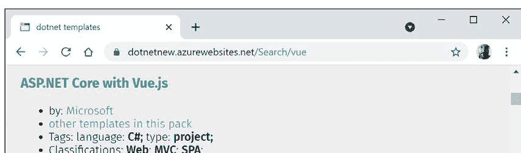

图 13.3：微软提供的 Vue.js 项目模板

- 3. 单击“由 Microsoft 提供的 ASP.NET Core with Vue.js”，并注意安装和使用此模板的说明，如以下命令所示：

```
dotnet new --install "Microsoft.AspNetCore.SpaTemplates"
dotnet new vue
```

- 4. 单击“查看此包中的其他模板”，并注意除了 Vue.js 项目模板外，它还具有 Aurelia 和 Knockout.js 的项目模板。

## 为 Northwind 数据库构建实体数据模型

实际应用程序通常需要使用关系数据库或其他数据存储中的数据。在本章中，我们将为存储在 SQL Server 或 SQLite 中的 Northwind 数据库定义实体数据模型。它将在后续章节中创建的大多数应用程序中使用。

> Northwind4SQLServer.sql 和 Northwind4SQLite.sql 脚本文件不同。SQL Server 的脚本创建了 13 个表以及相关的视图和存储过程。SQLite 的脚本是一个简化版本，仅创建 10 个表，因为 SQLite 不支持那么多功能。本书的主要项目只需要这 10 个表，因此您可以使用任一数据库完成本书中的每个任务。

安装 SQL Server 和 SQLite 的说明可在第 10 章《使用 Entity Framework Core 工作数据》中找到。在该章节中，您还将找到安装 dotnet-ef 工具的说明，您将使用它从现有数据库生成实体模型。

> 良好实践：您应该为实体数据模型创建一个单独的类库项目。这可以更轻松地在后端 Web 服务器和前端桌面、移动以及 Blazor WebAssembly 客户端之间共享。

## 使用 SQLite 创建实体模型的类库

您现在将在类库中定义实体数据模型，以便它们可以在其他类型的项目（包括客户端应用程序模型）中重复使用。如果您不使用 SQL Server，则需要为 SQLite 创建此类库。如果您使用 SQL Server，则可以同时为 SQLite 和 SQL Server 创建类库，然后根据需要在它们之间切换。

我们将使用 EF Core 命令行工具自动生成一些实体模型：

- 1. 使用您喜欢的代码编辑器创建一个名为 `PracticalApps` 的新解决方案/工作区。
- 2. 添加类库项目，如以下列表中定义：
  - 1. 项目模板：**类库** / `classlib`
  - 2. 工作区/解决方案文件和文件夹：`PracticalApps`
  - 3. 项目文件和文件夹：`Northwind.Common.EntityModels.Sqlite`
- 3. 在 `Northwind.Common.EntityModels.Sqlite` 项目中，添加 SQLite 数据库提供程序和 EF Core 设计时支持的程序包引用，如以下标记所示：
- 4. 删除 `Class1.cs` 文件。
- 5. 构建项目。
- 6. 通过将 `Northwind4SQLite.sql` 文件复制到 `PracticalApps` 文件夹来创建 SQLite 的 `Northwind.db` 文件，然后在命令提示符或终端中输入以下命令：
- 7. 请耐心等待，因为此命令可能需要一段时间来创建数据库结构，如以下输出所示：

```
<ItemGroup>
  <PackageReference Include="Microsoft.EntityFrameworkCore.Sqlite" Version="6.0.0" />
  <PackageReference Include="Microsoft.EntityFrameworkCore.Design" Version="6.0.0">
    <PrivateAssets>all</PrivateAssets>
    <IncludeAssets>runtime; build; native; contentfiles; analyzers; buildtransitive</IncludeAssets>
  </PackageReference>
</ItemGroup>
```

```
sqlite3 Northwind.db -init Northwind4SQLite.sql
```

```
-- Loading resources from Northwind4SQLite.sql
SQLite version 3.35.5 2021-04-19 14:49:49
Enter ".help" for usage hints.
sqlite>
```

- 8. 在 Windows 上按 Ctrl + C 或在 macOS 上按 Cmd + D 退出 SQLite 命令模式。
- 9. 为 Northwind.Common.EntityModels.Sqlite 文件夹打开命令提示符或终端。
- 10. 在命令行中，生成所有表的实体类模型，如以下命令所示：

```
dotnet ef dbcontext scaffold "Filename=../Northwind.db" Microsoft.EntityFrameworkCore.Sqlite --namespace Packt.Shared --data-annotations
```

请注意以下内容：

- 执行的命令：dbcontext scaffold
- 连接字符串。"Filename=../Northwind.db"
- 数据库提供程序：Microsoft.EntityFrameworkCore.Sqlite
- 命名空间：--namespace Packt.Shared
- 同时使用数据注释和 Fluent API：--data-annotations

- 11. 请注意构建消息和警告，如以下输出所示：

```
Build started...
Build succeeded.
To protect potentially sensitive information in your connection string,
you should move it out of source code. You can avoid scaffolding the
connection string by using the Name= syntax to read it from configuration
- see https://go.microsoft.com/fwlink/?linkid=2131148. For more
guidance on storing connection strings, see http://go.microsoft.com/
fwlink/?LinkId=723263.
```

## 改进类到表的映射

dotnet-ef 命令行工具为 SQL Server 和 SQLite 生成不同的代码，因为它们支持的功能级别不同。

例如，SQL Server 文本列可以限制字符数。SQLite 不支持此功能。因此，dotnet-ef 将生成验证属性，以确保 SQL Server 的字符串属性限制为指定数量的字符，而 SQLite 不会这样做，如以下代码所示：

```
// SQLite database provider-generated code
[Column(TypeName = "nvarchar (15)")]
public string CategoryName { get; set; } = null!;
```

```
// SQL Server database provider-generated code
[StringLength(15)]
public string CategoryName { get; set; } = null!;
```

两个数据库提供程序都不会将非可空字符串属性标记为必需：

```
// no runtime validation of non-nullable property
public string CategoryName { get; set; } = null!;
// nullable property
public string? Description { get; set; }

// decorate with attribute to perform runtime validation
[Required]
public string CategoryName { get; set; } = null!;
```

我们将对 SQLite 的实体模型映射和验证规则进行一些小的更改：

- 1. 打开 Customer.cs 文件并添加正则表达式以验证其主键值仅允许大写西方字符，如以下代码中突出显示所示：
- 2. 激活代码编辑器的查找和替换功能（在 Visual Studio 2022 中，导航到 编辑 | 查找和替换 | 快速替换），打开使用正则表达式，然后在搜索框中输入正则表达式，如以下表达式所示：
- 3. 在替换框中，输入替换正则表达式，如以下表达式所示：
- 4. 将查找和替换设置为在当前项目中搜索文件。
- 5. 执行搜索和替换以全部替换，如图 13.4 所示：

```
[Key]
[Column(TypeName = "nchar (5)")]
[RegularExpression("[A-Z]{5}")]
public string CustomerId { get; set; }
```

```
\[Column\(TypeName = "(nchar|nvarchar) \((.*)\)"\)\]
```

```
$&\n    [StringLength($2)]
```

> 在换行符 \n 之后，我包含了四个空格字符，以便在我使用每级缩进两个空格字符的系统上正确缩进。您可以插入任意多个。


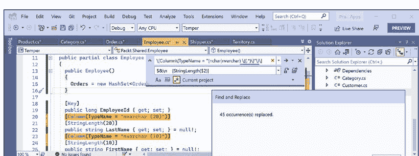

图 13.4：使用正则表达式在 Visual Studio 2022 中搜索并替换所有匹配项

6. 将任何日期/时间属性，例如在 Employee.cs 中，改为使用可空的 DateTime 而不是字节数组，如以下代码所示：

// before
[Column(TypeName = "datetime")]
public byte[] BirthDate { get; set; }

// after
[Column(TypeName = "datetime")]
public DateTime? BirthDate { get; set; }
```

> 使用代码编辑器的查找功能搜索 "datetime" 以找到所有需要更改的属性。

7. 将任何货币属性，例如在 Order.cs 中，改为使用可空的 decimal 而不是字节数组，如以下代码所示：

// before
[Column(TypeName = "money")]
public byte[] Freight { get; set; }

// after
[Column(TypeName = "money")]
public decimal? Freight { get; set; }
```

> 使用代码编辑器的查找功能搜索 "money" 以找到所有需要更改的属性。

8. 将任何位属性，例如在 Product.cs 中，改为使用 bool 而不是字节数组，如以下代码所示：

// before
[Column(TypeName = "bit")]
public byte[] Discontinued { get; set; } = null!;

// after
[Column(TypeName = "bit")]
public bool Discontinued { get; set; }
```

使用代码编辑器的查找功能搜索 "bit" 以找到所有需要更改的属性。

9. 在 Category.cs 中，将 CategoryId 属性设为 int，如以下代码中突出显示所示：

```
[Key]
public int CategoryId { get; set; }
```

10. 在 Category.cs 中，将 CategoryName 属性设为必需，如以下代码中突出显示所示：

```
[Required]
[Column(TypeName = "nvarchar(15)")]
[StringLength(15)]
public string CategoryName { get; set; }
```

11. 在 Customer.cs 中，将 CompanyName 属性设为必需，如以下代码中突出显示所示：

```
[Required]
[Column(TypeName = "nvarchar(40)")]
[StringLength(40)]
public string CompanyName { get; set; }
```

- 12. 在 Employee.cs 中，将 EmployeeId 属性改为 int 而不是 long。
- 13. 在 Employee.cs 中，将 FirstName 和 LastName 属性设为必需。
- 14. 在 Employee.cs 中，将 ReportsTo 属性改为 int? 而不是 long?。
- 15. 在 EmployeeTerritory.cs 中，将 EmployeeId 属性改为 int 而不是 long。
- 16. 在 EmployeeTerritory.cs 中，将 TerritoryId 属性设为必需。
- 17. 在 Order.cs 中，将 OrderId 属性改为 int 而不是 long。
- 18. 在 Order.cs 中，使用正则表达式装饰 CustomerId 属性以强制执行五个大写字符。
- 19. 在 Order.cs 中，将 EmployeeId 属性改为 int? 而不是 long?。

- 20. 在 Order.cs 中，将 ShipVia 属性改为 int? 而不是 long?。
- 21. 在 OrderDetail.cs 中，将 OrderId 属性改为 int 而不是 long。
- 22. 在 OrderDetail.cs 中，将 ProductId 属性改为 int 而不是 long。
- 23. 在 OrderDetail.cs 中，将 Quantity 属性改为 short 而不是 long。
- 24. 在 Product.cs 中，将 ProductId 属性改为 int 而不是 long。
- 25. 在 Product.cs 中，将 ProductName 属性设为必需。
- 26. 在 Product.cs 中，将 SupplierId 和 CategoryId 属性改为 int? 而不是 long?。
- 27. 在 Product.cs 中，将 UnitsInStock、UnitsOnOrder 和 ReorderLevel 属性改为 short? 而不是 long?。
- 28. 在 Shipper.cs 中，将 ShipperId 属性改为 int 而不是 long。
- 29. 在 Shipper.cs 中，将 CompanyName 属性设为必需。
- 30. 在 Supplier.cs 中，将 SupplierId 属性改为 int 而不是 long。
- 31. 在 Supplier.cs 中，将 CompanyName 属性设为必需。
- 32. 在 Territory.cs 中，将 RegionId 属性改为 int 而不是 long。
- 33. 在 Territory.cs 中，将 TerritoryId 和 TerritoryDescription 属性设为必需。

现在我们已经有了实体类的类库，可以为数据库上下文创建类库。

## 为 Northwind 数据库上下文创建类库

你现在将定义一个数据库上下文类库：

- 1. 添加一个类库项目到解决方案/工作区，按以下列表定义：
  - 1. 项目模板：Class Library / classlib
  - 2. 工作区/解决方案文件和文件夹：PracticalApps
  - 3. 项目文件和文件夹：Northwind.Common.DataContext.Sqlite
- 2. 在 Visual Studio 中，将解决方案的启动项目设置为当前选择。
- 3. 在 Visual Studio Code 中，选择 Northwind.Common.DataContext.Sqlite 作为活动的 OmniSharp 项目。
- 4. 在 Northwind.Common.DataContext.Sqlite 项目中，添加对 Northwind.Common.EntityModels.Sqlite 项目的项目引用，并添加对 SQLite 的 EF Core 数据提供程序的包引用，如以下标记所示：

```
<ItemGroup>
  <PackageReference
    Include="Microsoft.EntityFrameworkCore.SQLite"
    Version="6.0.0" />
</ItemGroup>
<ItemGroup>
```

```
<ProjectReference Include=
  "..\Northwind.Common.EntityModels.Sqlite\Northwind.Common
.EntityModels.Sqlite.csproj" />
</ItemGroup>
```

项目引用的路径在项目文件中不应有换行。

- 5. 在 Northwind.Common.DataContext.Sqlite 项目中，删除 Class1.cs 类文件。
- 6. 构建 Northwind.Common.DataContext.Sqlite 项目。
- 7. 将 NorthwindContext.cs 文件从 Northwind.Common.EntityModels.Sqlite 项目/文件夹移动到 Northwind.Common.DataContext.Sqlite 项目/文件夹。

在 Visual Studio 解决方案资源管理器中，如果你在项目之间拖放文件，它将被复制。如果在拖放时按住 Shift，它将被移动。在 Visual Studio Code EXPLORER 中，如果你在项目之间拖放文件，它将被移动。如果在拖放时按住 Ctrl，它将被复制。

8. 在 NorthwindContext.cs 中，在 OnConfiguring 方法中，删除关于连接字符串的编译器 #warning。

良好实践：我们将在需要使用 Northwind 数据库的任何项目（如网站）中覆盖默认数据库连接字符串，因此派生自 DbContext 的类必须具有带有 DbContextOptions 参数的构造函数才能使其工作，如以下代码所示：

```
public NorthwindContext(DbContextOptions<NorthwindContext> options)
    : base(options)
{
}
```

9. 在 OnModelCreating 方法中，删除所有调用 ValueGeneratedNever 方法的 Fluent API 语句，以配置主键属性（如 SupplierId）永不自动生成值，或调用 HasDefaultValueSql 方法，如以下代码所示：

```
modelBuilder.Entity<Supplier>(entity =>
{
    entity.Property(e => e.SupplierId).ValueGeneratedNever();
});
```

> 如果我们不删除像上述语句那样的配置，那么在添加新供应商时，SupplierId 值将始终为 0，我们只能添加一个具有该值的供应商，然后所有其他尝试都会抛出异常。

10. 对于 Product 实体，告诉 SQLite UnitPrice 可以从 decimal 转换为 double。OnModelCreating 方法现在应该大大简化，如以下代码所示：

```
protected override void OnModelCreating(ModelBuilder modelBuilder)
{
    modelBuilder.Entity<OrderDetail>(entity =>
    {
        entity.HasKey(e => new { e.OrderId, e.ProductId });

        entity.HasOne(d => d.Order)
            .WithMany(p => p.OrderDetails)
            .HasForeignKey(d => d.OrderId)
            .OnDelete(DeleteBehavior.ClientSetNull);

        entity.HasOne(d => d.Product)
            .WithMany(p => p.OrderDetails)
            .HasForeignKey(d => d.ProductId)
            .OnDelete(DeleteBehavior.ClientSetNull);
    });

    modelBuilder.Entity<Product>()
        .Property(product => product.UnitPrice)
        .HasConversion<double>();

    OnModelCreatingPartial(modelBuilder);
}
```

11. 添加一个名为 NorthwindContextExtensions.cs 的类并修改其内容，以定义一个扩展方法，将 Northwind 数据库上下文添加到依赖服务集合中，如以下代码所示：

```
using Microsoft.EntityFrameworkCore; // UseSqlite
using Microsoft.Extensions.DependencyInjection; // IServiceCollection

namespace Packt.Shared;

public static class NorthwindContextExtensions
{
    /// <summary>
    /// Adds NorthwindContext to the specified IServiceCollection. Uses the Sqlite database provider.
```


```csharp
/// </summary>
/// <param name="services"></param>
/// <param name="relativePath">Set to override the default of ".."</param>
/// <returns>An IServiceCollection that can be used to add more services.</returns>
public static IServiceCollection AddNorthwindContext(
    this IServiceCollection services, string relativePath = "..")
{
    string databasePath = Path.Combine(relativePath, "Northwind.db");

    services.AddDbContext<NorthwindContext>(options =>
        options.UseSqlite($"Data Source={databasePath}")
    );

    return services;
}
```

12. 构建两个类库并修复任何编译错误。

## 使用 SQL Server 创建实体模型的类库

要使用 SQL Server，如果您已在第 10 章《使用 Entity Framework Core 进行数据工作》中设置了 Northwind 数据库，则无需执行任何操作。但您现在将使用 dotnet-ef 工具创建实体模型：

- 1. 使用您喜欢的代码编辑器创建一个名为 PracticalApps 的新解决方案/工作区。
- 2. 添加一个类库项目，如以下列表中定义：
  - 1. 项目模板：类库 / classlib
  - 2. 工作区/解决方案文件和文件夹：PracticalApps
  - 3. 项目文件和文件夹：Northwind.Common.EntityModels.SqlServer
- 3. 在 Northwind.Common.EntityModels.SqlServer 项目中，为 SQL Server 数据库提供程序和 EF Core 设计时支持添加程序包引用，如以下标记所示：

```xml
<ItemGroup>
    <PackageReference
        Include="Microsoft.EntityFrameworkCore.SqlServer"
        Version="6.0.0" />
    <PackageReference
        Include="Microsoft.EntityFrameworkCore.Design"
Version="6.0.0">
<PrivateAssets>all</PrivateAssets>
<IncludeAssets>runtime; build; native; contentfiles; analyzers;
buildtransitive</IncludeAssets>
</PackageReference>
</ItemGroup>
```

- 4. 删除 Class1.cs 文件。
- 5. 构建项目。
- 6. 为 Northwind.Common.EntityModels.SqlServer 文件夹打开命令提示符或终端。
- 7. 在命令行生成所有表的实体类模型，如以下命令所示：

```
dotnet ef dbcontext scaffold "Data Source=.;Initial Catalog=Northwind;Integrated Security=true;" Microsoft.EntityFrameworkCore.SqlServer --namespace Packt.Shared --data-annotations
```

注意以下内容：

- 执行的命令：dbcontext scaffold
- 连接字符串。"Data Source=.;Initial Catalog=Northwind;Integrated Security=true;"
- 数据库提供程序：Microsoft.EntityFrameworkCore.SqlServer
- 命名空间：--namespace Packt.Shared
- 同时使用数据注释和 Fluent API：--data-annotations

8. 在 Customer.cs 中，添加一个正则表达式以验证其主键值仅允许大写西方字符，如以下代码中突出显示所示：

```
[Key]
[StringLength(5)]
[RegularExpression("[A-Z]{5}")]
public string CustomerId { get; set; } = null!;
```

9. 在 Customer.cs 中，使 CustomerId 和 CompanyName 属性为必需。

10. 向解决方案/工作区添加一个类库项目，如以下列表中定义：

- 1. 项目模板：类库 / classlib
- 2. 工作区/解决方案文件和文件夹：PracticalApps
- 3. 项目文件和文件夹：Northwind.Common.DataContext.SqlServer

11. 在 Visual Studio Code 中，将 Northwind.Common.DataContext.SqlServer 选择为活动的 OmniSharp 项目。

12. 在 Northwind.Common.DataContext.SqlServer 项目中，向 Northwind.Common.EntityModels.SqlServer 项目添加项目引用，并向 SQL Server 的 EF Core 数据提供程序添加程序包引用，如以下标记所示：

```
<ItemGroup>
  <PackageReference
    Include="Microsoft.EntityFrameworkCore.SqlServer"
    Version="6.0.0" />
</ItemGroup>

<ItemGroup>
  <ProjectReference Include=
    "..\Northwind.Common.EntityModels.SqlServer\Northwind.Common.EntityModels.SqlServer.csproj" />
</ItemGroup>
```

13. 在 Northwind.Common.DataContext.SqlServer 项目中，删除 Class1.cs 类文件。

14. 构建 Northwind.Common.DataContext.SqlServer 项目。

15. 将 NorthwindContext.cs 文件从 Northwind.Common.EntityModels.SqlServer 项目/文件夹移动到 Northwind.Common.DataContext.SqlServer 项目/文件夹。

16. 在 NorthwindContext.cs 中，删除有关连接字符串的编译器警告。

17. 添加一个名为 NorthwindContextExtensions.cs 的类，并修改其内容以定义一个扩展方法，该方法将 Northwind 数据库上下文添加到依赖服务集合中，如以下代码所示：

```
using Microsoft.EntityFrameworkCore; // UseSqlServer
using Microsoft.Extensions.DependencyInjection; // IServiceCollection

namespace Packt.Shared;

public static class NorthwindContextExtensions
{
    /// <summary>
    /// Adds NorthwindContext to the specified IServiceCollection. Uses the SqlServer database provider.
    /// </summary>
    /// <param name="services"></param>
    /// <param name="connectionString">Set to override the default.</param>
    /// <returns>An IServiceCollection that can be used to add more services.</returns>
    public static IServiceCollection AddNorthwindContext(
        this IServiceCollection services, string connectionString =
        "Data Source=.;Initial Catalog=Northwind;"
        + "Integrated Security=true;MultipleActiveResultsets=true;")
    {
services.AddDbContext<NorthwindContext>(options =>
    options.UseSqlServer(connectionString));

    return services;
}
}
```

18. 构建两个类库并修复任何编译错误。


良好实践：我们为 AddNorthwindContext 方法提供了可选参数，以便我们可以覆盖硬编码的 SQLite 数据库文件名路径或 SQL Server 数据库连接字符串。这将使我们更灵活，例如，可以从配置文件加载这些值。

## 练习和探索

探索本章主题，进行更深入的研究。

## 练习 13.1 – 测试你的知识

- 1. .NET 6 是跨平台的。Windows Forms 和 WPF 应用可以在 .NET 6 上运行。因此这些应用可以在 macOS 和 Linux 上运行吗？
- 2. Windows Forms 应用如何定义其用户界面，为什么这是一个潜在问题？
- 3. WPF 或 UWP 应用如何定义其用户界面，为什么这对开发人员有好处？

## 练习 13.2 – 探索主题

使用以下页面上的链接了解本章涵盖主题的更多详细信息：

https://github.com/markjprice/cs10dotnet6/blob/main/book-links.md#chapter-13---introducing-practical-applications-of-c-and-net

## 摘要

在本章中，您已了解了一些应用程序模型和工作负载，您可以使用 C# 和 .NET 构建实用应用程序。

您已创建了两个到四个类库，以使用 SQLite 或 SQL Server 或两者定义用于处理 Northwind 数据库的实体数据模型。

在接下来的六章中，您将学习如何构建以下内容的详细信息：

- 使用静态 HTML 页面和动态 Razor Pages 的简单网站。
- 使用模型-视图-控制器 (MVC) 设计模式的复杂网站。
- 可以由任何能够发出 HTTP 请求的平台调用的 Web 服务，以及调用这些 Web 服务的客户端网站。
- Blazor 用户界面组件，可以托管在 Web 服务器上、在浏览器中，或在混合 Web 原生移动和桌面应用中。
- 使用 gRPC 实现远程过程调用的服务。
- 使用 SignalR 实现实时通信的服务。
- 提供对 EF Core 模型轻松灵活访问的服务。
- 托管在 Azure Functions 中的无服务器纳米服务。
- 使用 .NET MAUI 的跨平台原生移动和桌面应用。

## 14

## 使用 ASP.NET Core Razor Pages 构建网站

本章介绍使用 Microsoft ASP.NET Core 在服务器端使用现代 HTTP 架构构建网站。您将学习使用 ASP.NET Core 2.0 引入的 ASP.NET Core Razor Pages 功能以及 ASP.NET Core 2.1 引入的 Razor 类库功能构建简单网站。

本章将涵盖以下主题：

- 了解 Web 开发
- 了解 ASP.NET Core
- 探索 ASP.NET Core Razor Pages
- 在 ASP.NET Core 中使用 Entity Framework Core
- 使用 Razor 类库
- 配置服务和 HTTP 请求管道

## 了解 Web 开发

为 Web 开发意味着使用超文本传输协议 (HTTP) 进行开发，因此我们将从回顾这一重要的基础技术开始。

## 了解 HTTP

为了与 Web 服务器通信，客户端（也称为用户代理）使用 HTTP 通过网络进行调用。因此，HTTP 是 Web 的技术基础。因此，当我们谈论网站和 Web 服务时，我们指的是它们使用 HTTP 在客户端（通常是 Web 浏览器）和服务器之间进行通信。


客户端会为某个资源（如页面）发出 HTTP 请求，该资源由 **统一资源定位符 (URL)** 唯一标识，服务器随后返回 HTTP 响应，如图 14.1 所示：

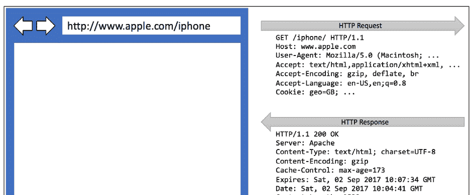

图 14.1：HTTP 请求和响应

你可以使用 Google Chrome 及其他浏览器记录请求和响应。

**良好实践：** Google Chrome 可在比任何其他浏览器更多的操作系统上使用，并且内置了功能强大的开发者工具，因此它是测试网站的首选浏览器。务必使用 Chrome 以及至少另外两种浏览器测试你的 Web 应用程序，例如 macOS 和 iPhone 上的 Firefox 和 Safari。Microsoft Edge 于 2019 年从使用 Microsoft 自家的渲染引擎切换到使用 Chromium，因此测试时的重要性较低。如果 Microsoft 的 Internet Explorer 仍在使用，通常主要在组织内部的内联网中使用。

## 理解 URL 的组成部分

URL 由多个组成部分构成：

- **方案**：http（明文）或 https（加密）。
- **域名**：对于生产环境网站或服务，**顶级域名 (TLD)** 可能是 example.com。你可能拥有诸如 www、jobs 或 extranet 之类的子域名。在开发期间，你通常对所有网站和服务都使用 localhost。
- **端口号**：对于生产环境网站或服务，http 为 `80`，https 为 `443`。这些端口号通常由方案推断得出。在开发期间，通常会使用其他端口号，例如 `5000`、`5001` 等，以区分所有使用共享域名 `localhost` 的网站和服务。
- **路径**：指向资源的相对路径，例如 `/customers/germany`。
- **查询字符串**：传递参数值的一种方式，例如 `?country=Germany&searchtext=shoes`。
- **片段**：使用其 id 引用网页上的元素，例如 `#toc`。

## 本书项目中端口号的分配

在本书中，我们将对所有网站和服务使用域名 localhost，因此当多个项目需要同时运行时，我们将使用端口号来区分项目，如下表所示：

| 项目 | 描述 | 端口号 |
|---|---|---|
| Northwind.Web | ASP.NET Core Razor Pages 网站 | `5000` HTTP, `5001` HTTPS |
| Northwind.Mvc | ASP.NET Core MVC 网站 | `5000` HTTP, `5001` HTTPS |
| Northwind.WebApi | ASP.NET Core Web API 服务 | `5002` HTTPS, `5008` HTTP |
| Minimal.WebApi | ASP.NET Core Web API（精简） | `5003` HTTPS |
| Northwind.OData | ASP.NET Core OData 服务 | `5004` HTTPS |
| Northwind.GraphQL | ASP.NET Core GraphQL 服务 | `5005` HTTPS |
| Northwind.gRPC | ASP.NET Core gRPC 服务 | `5006` HTTPS |
| Northwind.AzureFuncs | Azure Functions 迷你服务 | `7071` HTTP |

## 使用 Google Chrome 发出 HTTP 请求

让我们探索如何使用 Google Chrome 发出 HTTP 请求：

1. 启动 Google Chrome。
2. 导航到 **More tools** | **Developer tools**。
3. 点击 Network 选项卡，Chrome 应立即开始记录浏览器与任何 Web 服务器之间的网络流量（注意红色圆圈），如图 14.2 所示：

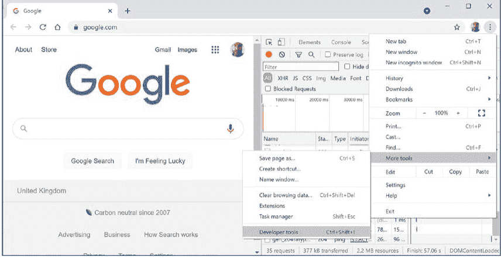

图 14.2：Chrome 开发者工具记录网络流量

4. 在 Chrome 的地址栏中，输入 Microsoft 用于学习 ASP.NET 的网站地址，如下 URL 所示：
https://dotnet.microsoft.com/learn/aspnet

5. 在开发者工具中，在记录的请求列表中，滚动到顶部并点击第一个条目，即 Type 为 document 的行，如图 14.3 所示：

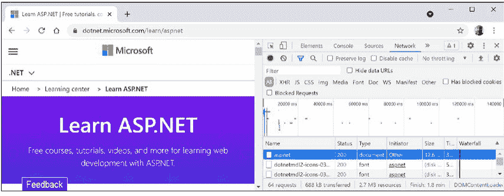

图 14.3：开发者工具中的记录请求

6. 在右侧点击 Headers 选项卡，你将看到有关 Request Headers 和 Response Headers 的详细信息，如图 14.4 所示：

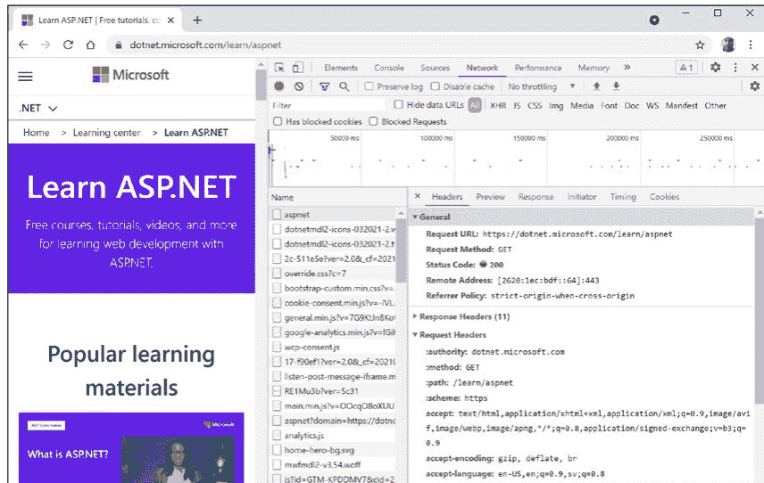

图 14.4：请求和响应头

请注意以下方面：

- **请求方法** 为 GET。此处可能看到的其他 HTTP 方法包括 POST、PUT、DELETE、HEAD 和 PATCH。
- **状态码** 为 200 OK。这意味着服务器找到了浏览器请求的资源并已在响应正文中返回。针对 GET 请求你可能会看到的其他状态码包括 301 永久移动、400 错误请求、401 未授权 和 404 未找到。
- **请求头** 浏览器发送到 Web 服务器的包括：
  - **accept**，列出浏览器接受的格式。在此情况下，浏览器表示它理解 HTML、XHTML、XML 和某些图像格式，但会接受所有其他文件 (*/*)。默认权重，也称为质量值，为 1.0。XML 指定质量值为 0.9，因此优先级低于 HTML 或 XHTML。所有其他文件类型均赋予质量值 0.8，因此优先级最低。
  - **accept-encoding**，列出浏览器理解的压缩算法，在此情况下为 GZIP、DEFLATE 和 Brotli。
  - **accept-language**，列出其希望内容使用的自然语言。在此情况下为美国英语，默认质量值为 1.0，然后是质量值明确指定为 0.9 的任何英语方言，然后是质量值明确指定为 0.8 的任何瑞典语方言。
- **响应头**，content-encoding 告诉我服务器已使用 GZIP 算法压缩 HTML 网页响应发送回来，因为它知道客户端可以解压缩该格式。（在 *图 14.4* 中不可见，因为没有足够的空间展开 **响应头** 部分。）

7. 关闭 Chrome。

## 理解客户端 Web 开发技术

构建网站时，开发人员需要了解的不仅仅是 C# 和 .NET。在客户端（即 Web 浏览器中），你将使用以下技术的组合：

- **HTML5**：用于网页的内容和结构。
- **CSS3**：用于网页元素上应用的样式。
- **JavaScript**：用于编写网页所需的任何业务逻辑，例如验证表单输入或调用 Web 服务以获取网页所需更多数据。

尽管 HTML5、CSS3 和 JavaScript 是前端 Web 开发的基础组件，但还有许多附加技术可以提高前端 Web 开发的效率，包括 Bootstrap——全球最受欢迎的前端开源工具包，以及用于样式的 CSS 预处理器如 SASS 和 LESS、用于编写更健壮代码的 Microsoft TypeScript 语言，以及 jQuery、Angular、React 和 Vue 等 JavaScript 库。所有这些更高级别的技术最终都会翻译或编译为底层三个核心技术，因此它们可在所有现代浏览器中工作。

作为构建和部署流程的一部分，你可能会使用诸如 Node.js；Node Package Manager（npm）和 Yarn——两者都是客户端包管理器；以及 webpack——一种流行的模块打包器，用于编译、转换和打包网站源文件的工具。

## 理解 ASP.NET Core

Microsoft ASP.NET Core 是 Microsoft 用于构建网站和服务的技术历史的一部分，这些技术多年来不断演进：

- **Active Server Pages (ASP)** 于 1996 年发布，是 Microsoft 首次尝试用于动态服务器端执行网站代码的平台。ASP 文件包含 HTML 和用 VBScript 语言编写的在服务器上执行的代码的混合。
- **ASP.NET Web Forms** 于 2002 年随 .NET Framework 发布，旨在使不熟悉 Web 开发的开发人员（如熟悉 Visual Basic 的开发人员）能够通过拖放视觉组件并在 Visual Basic 或 C# 中编写事件驱动代码快速创建网站。对于新的 .NET Framework Web 项目，应避免使用 Web Forms，而应使用 ASP.NET MVC。


- **Windows Communication Foundation (WCF)** 于 2006 年发布，使开发人员能够构建 SOAP 和 REST 服务。SOAP 功能强大但复杂，因此除非需要高级功能，例如分布式事务和复杂消息拓扑，否则应避免使用。
- **ASP.NET MVC** 于 2009 年发布，旨在清晰地将 Web 开发人员的关注点分离为 **models**，临时存储数据；**views**，使用各种格式在 UI 中呈现数据；以及 **controllers**，获取模型并将其传递给视图。这种分离可实现更好的复用和单元测试。
- **ASP.NET Web API** 于 2012 年发布，使开发人员能够创建 HTTP 服务（又称 REST 服务），其比 SOAP 服务更简单且更具可扩展性。
- **ASP.NET SignalR** 于 2013 年发布，通过抽象底层技术和技术，例如 WebSockets 和 Long Polling，在网站中实现实时通信。这使得网站功能例如实时聊天或对时间敏感数据的更新例如股票价格能够在各种 Web 浏览器中实现，即使它们不支持底层技术例如 WebSockets。
- **ASP.NET Core** 于 2016 年发布，结合了 .NET Framework 技术例如 MVC、Web API 和 SignalR 的现代实现，与更新的技术例如 Razor Pages、gRPC 和 Blazor，所有这些都在现代 .NET 上运行。因此，它可以跨平台执行。ASP.NET Core 提供了许多项目模板，帮助您开始使用其支持的技术。

> **良好实践：** 选择 ASP.NET Core 来开发网站和服务，因为它包含现代且跨平台的 Web 相关技术。

ASP.NET Core 2.0 至 2.2 可在 .NET Framework 4.6.1 或更高版本（仅限 Windows）以及 .NET Core 2.0 或更高版本（跨平台）上运行。ASP.NET Core 3.0 仅支持 .NET Core 3.0。ASP.NET Core 6.0 仅支持 .NET 6.0。

## 经典 ASP.NET 与现代 ASP.NET Core

直到现在，ASP.NET 都是基于 .NET Framework 中名为 System.Web.dll 的大型程序集构建的，并且与 Microsoft 仅限 Windows 的 Web 服务器名为 **Internet Information Services (IIS)** 紧密耦合。多年来，该程序集积累了大量功能，其中许多不适合现代跨平台开发。

ASP.NET Core 是 ASP.NET 的重大重新设计。它移除了对 System.Web.dll 程序集和 IIS 的依赖，并由模块化轻量级包组成，就像现代 .NET 的其余部分一样。使用 IIS 作为 Web 服务器仍然受 ASP.NET Core 支持，但有更好的选择。

您可以在 Windows、macOS 和 Linux 上跨平台开发和运行 ASP.NET Core 应用程序。Microsoft 甚至创建了一个跨平台、超高性能的 Web 服务器名为 **Kestrel**，整个堆栈都是开源的。

ASP.NET Core 2.2 或更高版本项目默认使用新的进程内托管模型。这在托管在 Microsoft IIS 中时可带来 400% 的性能提升，但 Microsoft 仍建议使用 Kestrel 以获得更好的性能。

## 创建一个空的 ASP.NET Core 项目

我们将创建一个 ASP.NET Core 项目，该项目将显示来自 Northwind 数据库的供应商列表。

dotnet 工具提供了许多项目模板，可为您完成大量工作，但很难知道哪一个最适合特定情况，因此我们将从空网站项目模板开始，然后逐步添加功能，以便您了解所有组件：

- 1. 使用您首选的代码编辑器添加新项目，如以下列表中定义：
  - 1. 项目模板：**ASP.NET Core Empty** / web
  - 2. 语言：C#
  - 3. 工作区/解决方案文件和文件夹：`PracticalApps`
  - 4. 项目文件和文件夹：`Northwind.Web`
  - 5. 对于 Visual Studio 2022，请将所有其他选项保留为默认值，例如，选择 **Configure for HTTPS**，并清除 **Enable Docker**
- 2. 在 Visual Studio Code 中，将 Northwind.Web 选择为活动的 OmniSharp 项目。
- 3. 构建 Northwind.Web 项目。
- 4. 打开 Northwind.Web.csproj 文件并注意该项目类似于类库，只是 SDK 为 Microsoft.NET.Sdk.Web，如以下标记中突出显示所示：
- 5. 如果您使用的是 Visual Studio 2022，请在 **Solution Explorer** 中切换 **Show All Files**。
- 6. 展开 obj 文件夹，展开 Debug 文件夹，展开 net6.0 文件夹，选择 Northwind.Web.GlobalUsings.g.cs 文件，并注意隐式导入的命名空间包括控制台应用程序或类库的所有命名空间，以及一些 ASP.NET Core 命名空间，例如 Microsoft.AspNetCore.Builder，如以下代码所示：

```
<Project Sdk="Microsoft.NET.Sdk.Web">
  <PropertyGroup>
    <TargetFramework>net6.0</TargetFramework>
    <Nullable>enable</Nullable>
    <ImplicitUsings>enable</ImplicitUsings>
  </PropertyGroup>
</Project>
```

```
// <autogenerated />
global using global::Microsoft.AspNetCore.Builder;
```

```
global using global::Microsoft.AspNetCore.Hosting;
global using global::Microsoft.AspNetCore.Http;
global using global::Microsoft.AspNetCore.Routing;
global using global::Microsoft.Extensions.Configuration;
global using global::Microsoft.Extensions.DependencyInjection;
global using global::Microsoft.Extensions.Hosting;
global using global::Microsoft.Extensions.Logging;
global using global::System;
global using global::System.Collections.Generic;
global using global::System.IO;
global using global::System.Linq;
global using global::System.Net.Http;
global using global::System.Net.Http.Json;
global using global::System.Threading;
global using global::System.Threading.Tasks;
```

- 7. 折叠 obj 文件夹。
- 8. 打开 Program.cs，并注意以下内容：
  - ASP.NET Core 项目类似于顶级控制台应用程序，其入口点为隐藏的 Main 方法，该方法使用名称 args 传递参数。
  - 它调用 WebApplication.CreateBuilder，该方法使用 Web 主机的默认值创建网站的主机，然后构建该主机。
  - 网站将对所有 HTTP GET 请求以纯文本响应：Hello World!。
  - 对 Run 方法的调用是阻塞调用，因此隐藏的 Main 方法不会返回，直到 Web 服务器停止运行，如以下代码所示：

```
var builder = WebApplication.CreateBuilder(args);
var app = builder.Build();

app.MapGet("/", () => "Hello World!");

app.Run();
```

- 9. 在文件底部添加一条语句，在调用 Run 方法之后因此在 Web 服务器停止后向控制台写入消息，如以下代码中突出显示所示：

```
app.Run();

Console.WriteLine("This executes after the web server has stopped!");
```

## 测试和保护网站

我们现在将测试 ASP.NET Core Empty 网站项目的功能。我们还将通过从 HTTP 切换到 HTTPS 来启用浏览器和 Web 服务器之间所有流量的加密以保护隐私。HTTPS 是 HTTP 的安全加密版本。

- 1. 对于 Visual Studio：
  - 1. 在工具栏中，确保选择的是 Northwind.Web 而不是 IIS Express 或 WSL，并将 Web 浏览器（Microsoft Edge）切换到 Google Chrome，如图 14.5 所示：

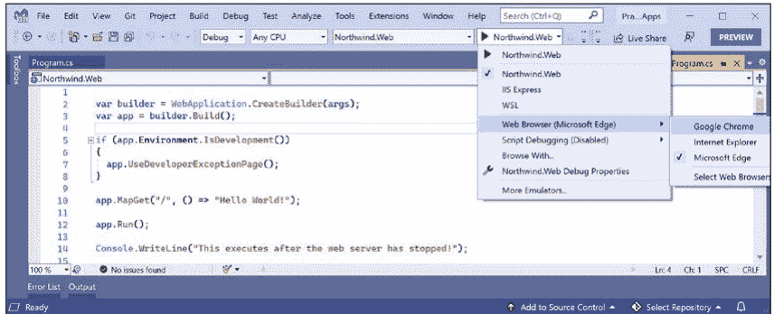

图 14.5：在 Visual Studio 中选择具有其 Kestrel Web 服务器的 Northwind.Web 配置文件
  - 2. 导航到 Debug | Start Without Debugging....
  - 3. 第一次启动安全网站时，您将被提示您的项目配置为使用 SSL，为避免浏览器中的警告，您可以选择信任 ASP.NET Core 生成的自签名证书。单击 Yes。
  - 4. 当您看到 Security Warning 对话框时，再次单击 Yes。
- 2. 对于 Visual Studio Code，在 TERMINAL 中输入 dotnet run 命令。
- 3. 在 Visual Studio 的命令提示符窗口或 Visual Studio Code 的终端中，注意 Kestrel Web 服务器已开始在随机端口上侦听 HTTP 和 HTTPS，您可以按 Ctrl + C 关闭 Kestrel Web 服务器，并且托管环境为 Development，如以下输出所示：

```
info: Microsoft.Hosting.Lifetime[14]
    Now listening on: https://localhost:5001
info: Microsoft.Hosting.Lifetime[14]
    Now listening on: http://localhost:5000
info: Microsoft.Hosting.Lifetime[0]
```


```
Application started. Press Ctrl+C to shut down.
info: Microsoft.Hosting.Lifetime[0]
Hosting environment: Development
info: Microsoft.Hosting.Lifetime[0]
Content root path: C:\Code\PracticalApps\Northwind.Web
```

Visual Studio 还会自动启动您选择的浏览器。如果您使用的是 Visual Studio Code，则需要手动启动 Chrome。

- 4. 让 Web 服务器继续运行。
- 5. 在 Chrome 中，打开开发者工具，并点击 Network 标签。
- 6. 输入地址 http://localhost:5000/，或分配给 HTTP 的任意端口号，并注意响应是来自跨平台 Kestrel Web 服务器的纯文本 Hello World!，如 图 14.6 所示：

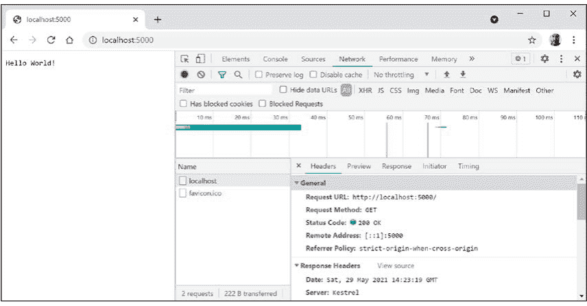

图 14.6：来自 http://localhost:5000/ 的纯文本响应

Chrome 还会自动请求 favicon.ico 文件以在浏览器标签中显示，但该文件缺失，因此显示为 404 Not Found 错误。

- 7. 输入地址 https://localhost:5001/，或分配给 HTTPS 的任意端口号，并注意如果您未使用 Visual Studio 或在提示信任 SSL 证书时点击了 No，则响应会显示隐私错误，如 图 14.7 所示：

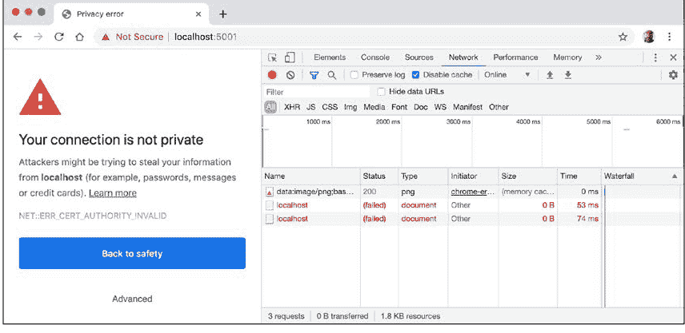

图 14.7：显示未使用证书启用 SSL 加密的隐私错误

当您未配置浏览器可信任以加密和解密 HTTPS 流量的证书时，您会看到此错误（因此如果您未看到此错误，则是因为您已配置了证书）。

在生产环境中，您希望向 Verisign 等公司付费获取 SSL 证书，因为它们提供责任保护和技术支持。

Linux 开发者： 如果您使用的是无法创建自签名证书的 Linux 变体，或您不介意每 90 天重新申请一次新证书，则可以从以下链接获取免费证书：https://letsencrypt.org

在开发期间，您可以让操作系统信任 ASP.NET Core 提供的临时开发证书。

- 8. 在命令行或在 TERMINAL 中，按 Ctrl + C 关闭 Web 服务器，并注意写入的消息，如以下输出中突出显示所示：

```
info: Microsoft.Hosting.Lifetime[0]
    Application is shutting down...
This executes after the web server has stopped!

C:\Code\PracticalApps\Northwind.Web\bin\Debug\net6.0\Northwind.Web.exe
(process 19888) exited with code 0.
```

- 9. 如果您需要信任本地自签名 SSL 证书，则在命令行或在 TERMINAL 中，输入 dotnet dev-certs https --trust 命令，并注意消息 Trusting the HTTPS development certificate was requested。系统可能会提示您输入密码，并且可能已存在有效的 HTTPS 证书。

## 启用更强的[content]
```
Application started. Press Ctrl+C to shut down.
info: Microsoft.Hosting.Lifetime[0]
Hosting environment: Development
info: Microsoft.Hosting.Lifetime[0]
Content root path: C:\Code\PracticalApps\Northwind.Web
```

Visual Studio 还会自动启动您选择的浏览器。如果您使用的是 Visual Studio Code，则需要手动启动 Chrome。

- 4. 让 Web 服务器继续运行。
- 5. 在 Chrome 中，打开开发者工具，并点击 Network 标签。
- 6. 输入地址 http://localhost:5000/，或分配给 HTTP 的任意端口号，并注意响应是来自跨平台 Kestrel Web 服务器的纯文本 Hello World!，如 图 14.6 所示：


图 14.6：来自 http://localhost:5000/ 的纯文本响应

Chrome 还会自动请求 favicon.ico 文件以在浏览器标签中显示，但该文件缺失，因此显示为 404 Not Found 错误。

- 7. 输入地址 https://localhost:5001/，或分配给 HTTPS 的任意端口号，并注意如果您未使用 Visual Studio 或在提示信任 SSL 证书时点击了 No，则响应会显示隐私错误，如 图 14.7 所示：


图 14.7：显示未使用证书启用 SSL 加密的隐私错误

当您未配置浏览器可信任以加密和解密 HTTPS 流量的证书时，您会看到此错误（因此如果您未看到此错误，则是因为您已配置了证书）。

在生产环境中，您希望向 Verisign 等公司付费获取 SSL 证书，因为它们提供责任保护和技术支持。

Linux 开发者： 如果您使用的是无法创建自签名证书的 Linux 变体，或您不介意每 90 天重新申请一次新证书，则可以从以下链接获取免费证书：https://letsencrypt.org

在开发期间，您可以让操作系统信任 ASP.NET Core 提供的临时开发证书。

- 8. 在命令行或在 TERMINAL 中，按 Ctrl + C 关闭 Web 服务器，并注意写入的消息，如以下输出中突出显示所示：

```
info: Microsoft.Hosting.Lifetime[0]
    Application is shutting down...
This executes after the web server has stopped!

C:\Code\PracticalApps\Northwind.Web\bin\Debug\net6.0\Northwind.Web.exe
(process 19888) exited with code 0.
```

- 9. 如果您需要信任本地自签名 SSL 证书，则在命令行或在 TERMINAL 中，输入 dotnet dev-certs https --trust 命令，并注意消息 Trusting the HTTPS development certificate was requested。系统可能会提示您输入密码，并且可能已存在有效的 HTTPS 证书。

## 启用更强的[content]
```
Application started. Press Ctrl+C to shut down.
info: Microsoft.Hosting.Lifetime[0]
Hosting environment: Development
info: Microsoft.Hosting.Lifetime[0]
Content root path: C:\Code\PracticalApps\Northwind.Web
```

Visual Studio 还会自动启动您选择的浏览器。如果您使用的是 Visual Studio Code，则需要手动启动 Chrome。

- 4. 让 Web 服务器继续运行。
- 5. 在 Chrome 中，打开开发者工具，并点击 Network 标签。
- 6. 输入地址 http://localhost:5000/，或分配给 HTTP 的任意端口号，并注意响应是来自跨平台 Kestrel Web 服务器的纯文本 Hello World!，如 图 14.6 所示：


图 14.6：来自 http://localhost:5000/ 的纯文本响应

Chrome 还会自动请求 favicon.ico 文件以在浏览器标签中显示，但该文件缺失，因此显示为 404 Not Found 错误。

- 7. 输入地址 https://localhost:5001/，或分配给 HTTPS 的任意端口号，并注意如果您未使用 Visual Studio 或在提示信任 SSL 证书时点击了 No，则响应会显示隐私错误，如 图 14.7 所示：


图 14.7：显示未使用证书启用 SSL 加密的隐私错误

当您未配置浏览器可信任以加密和解密 HTTPS 流量的证书时，您会看到此错误（因此如果您未看到此错误，则是因为您已配置了证书）。

在生产环境中，您希望向 Verisign 等公司付费获取 SSL 证书，因为它们提供责任保护和技术支持。

Linux 开发者： 如果您使用的是无法创建自签名证书的 Linux 变体，或您不介意每 90 天重新申请一次新证书，则可以从以下链接获取免费证书：https://letsencrypt.org

在开发期间，您可以让操作系统信任 ASP.NET Core 提供的临时开发证书。

- 8. 在命令行或在 TERMINAL 中，按 Ctrl + C 关闭 Web 服务器，并注意写入的消息，如以下输出中突出显示所示：

```
info: Microsoft.Hosting.Lifetime[0]
    Application is shutting down...
This executes after the web server has stopped!

C:\Code\PracticalApps\Northwind.Web\bin\Debug\net6.0\Northwind.Web.exe
(process 19888) exited with code 0.
```

- 9. 如果您需要信任本地自签名 SSL 证书，则在命令行或在 TERMINAL 中，输入 dotnet dev-certs https --trust 命令，并注意消息 Trusting the HTTPS development certificate was requested。系统可能会提示您输入密码，并且可能已存在有效的 HTTPS 证书。

## 启用更强的[content]
```
Application started. Press Ctrl+C to shut down.
info: Microsoft.Hosting.Lifetime[0]
Hosting environment: Development
info: Microsoft.Hosting.Lifetime[0]
Content root path: C:\Code\PracticalApps\Northwind.Web
```

Visual Studio 还会自动启动您选择的浏览器。如果您使用的是 Visual Studio Code，则需要手动启动 Chrome。

- 4. 让 Web 服务器继续运行。
- 5. 在 Chrome 中，打开开发者工具，并点击 Network 标签。
- 6. 输入地址 http://localhost:5000/，或分配给 HTTP 的任意端口号，并注意响应是来自跨平台 Kestrel Web 服务器的纯文本 Hello World!，如 图 14.6 所示：


图 14.6：来自 http://localhost:5000/ 的纯文本响应

Chrome 还会自动请求 favicon.ico 文件以在浏览器标签中显示，但该文件缺失，因此显示为 404 Not Found 错误。

- 7. 输入地址 https://localhost:5001/，或分配给 HTTPS 的任意端口号，并注意如果您未使用 Visual Studio 或在提示信任 SSL 证书时点击了 No，则响应会显示隐私错误，如 图 14.7 所示：


图 14.7：显示未使用证书启用 SSL 加密的隐私错误

当您未配置浏览器可信任以加密和解密 HTTPS 流量的证书时，您会看到此错误（因此如果您未看到此错误，则是因为您已配置了证书）。

在生产环境中，您希望向 Verisign 等公司付费获取 SSL 证书，因为它们提供责任保护和技术支持。

Linux 开发者： 如果您使用的是无法创建自签名证书的 Linux 变体，或您不介意每 90 天重新申请一次新证书，则可以从以下链接获取免费证书：https://letsencrypt.org

在开发期间，您可以让操作系统信任 ASP.NET Core 提供的临时开发证书。

- 8. 在命令行或在 TERMINAL 中，按 Ctrl + C 关闭 Web 服务器，并注意写入的消息，如以下输出中突出显示所示：

```
info: Microsoft.Hosting.Lifetime[0]
    Application is shutting down...
This executes after the web server has stopped!

C:\Code\PracticalApps\Northwind.Web\bin\Debug\net6.0\Northwind.Web.exe
(process 19888) exited with code 0.
```

- 9. 如果您需要信任本地自签名 SSL 证书，则在命令行或在 TERMINAL 中，输入 dotnet dev-certs https --trust 命令，并注意消息 Trusting the HTTPS development certificate was requested。系统可能会提示您输入密码，并且可能已存在有效的 HTTPS 证书。

## 启用更强的安全性和重定向到安全连接

启用更严格的安全性并自动将 HTTP 请求重定向到 HTTPS 是良好的做法。


> 良好做法：HTTP 严格传输安全（HSTS）是一种可选的安全增强功能，您应始终启用它。如果网站指定它并且浏览器支持它，则它会强制所有通信通过 HTTPS 进行，并防止访客使用不受信任或无效的证书。

现在就这样做：

- 1. 在 Program.cs 中，添加一个 if 语句以在非开发环境下启用 HSTS，如以下代码所示：

```
if (!app.Environment.IsDevelopment())
{
    app.UseHsts();
}
```

- 2. 在调用 app.MapGet 之前添加一条语句以将 HTTP 请求重定向到 HTTPS，如以下代码所示：

```
app.UseHttpsRedirection();
```

- 3. 启动 Northwind.Web 网站项目。
- 4. 如果 Chrome 仍在运行，请关闭并重新启动它。
- 5. 在 Chrome 中，显示开发者工具，并点击 Network 标签。
- 6. 输入地址 http://localhost:5000/，或分配给 HTTP 的任意端口号，并注意服务器如何以 307 Temporary Redirect 响应到端口 5001，并且证书现在有效且受信任，如 图 14.8 所示：

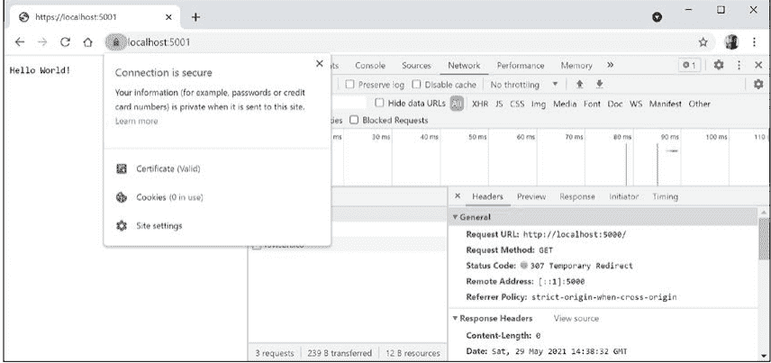

图 14.8：连接现在使用有效证书和 307 重定向得到保护

- 7. 关闭 Chrome。
- 8. 关闭 Web 服务器。

> **良好做法**：在完成网站测试后，请记得关闭 Kestrel Web 服务器。

## 控制托管环境

在 ASP.NET Core 的早期版本中，项目模板设置了一条规则，即在开发模式下，任何未处理的异常都将在浏览器窗口中显示，以便开发人员查看异常的详细信息，如以下代码所示：

```
if (app.Environment.IsDevelopment())
{
    app.UseDeveloperExceptionPage();
}
```

在 ASP.NET Core 6 及更高版本中，此代码默认自动执行，因此未包含在项目模板中。

ASP.NET Core 如何知道我们正在开发模式下运行，以便 IsDevelopment 方法返回 true？让我们来了解一下。

ASP.NET Core 可以从环境变量中读取以确定要使用的托管环境，例如 DOTNET_ENVIRONMENT 或 ASPNETCORE_ENVIRONMENT。

您可以在本地开发期间覆盖这些设置：

- 1. 在 Northwind.Web 文件夹中，展开名为 Properties 的文件夹，打开名为 launchSettings.json 的文件，并注意名为 Northwind.Web 的配置文件将托管环境设置为 Development，如以下配置中突出显示所示：
- 2. 将 HTTP 的随机分配端口号更改为 5000，将 HTTPS 更改为 5001。
- 3. 将环境更改为 Production。可选地，将 launchBrowser 更改为 false 以防止 Visual Studio 自动启动浏览器。
- 4. 启动网站并注意托管环境为 Production，如以下输出所示：

```
{
  "iisSettings": {
    "windowsAuthentication": false,
    "anonymousAuthentication": true,
    "iisExpress": {
      "applicationUrl": "http://localhost:56111",
      "sslPort": 44329
    }
  },
  "profiles": {
    "Northwind.Web": {
      "commandName": "Project",
      "dotnetRunMessages": "true",
      "launchBrowser": true,
      "applicationUrl": "https://localhost:5001;http://localhost:5000",
      "environmentVariables": {
        "ASPNETCORE_ENVIRONMENT": "Development"
      }
    },
    "IIS Express": {
      "commandName": "IISExpress",
      "launchBrowser": true,
      "environmentVariables": {
        "ASPNETCORE_ENVIRONMENT": "Development"
      }
    }
  }
}
```

```
info: Microsoft.Hosting.Lifetime[0]
  Hosting environment: Production
```

- 5. 关闭 Web 服务器。
- 6. 在 launchSettings.json 中，将环境改回 Development。

> launchSettings.json 文件还具有使用随机端口号使用 IIS 作为 Web 服务器的配置。在本书中，我们将只使用 Kestrel 作为 Web 服务器，因为它是跨平台的。

## 分离服务和管道的配置

将所有用于初始化简单 Web 项目的代码放在 Program.cs 中可能是一个好主意，尤其对于 Web 服务而言，因此我们将在第 16 章《构建和使用 Web 服务》中再次看到这种风格。

然而，对于比最基本的 Web 项目更复杂的项目，您可能更喜欢将配置分离到一个单独的 Startup 类中，该类包含两个方法：

- ConfigureServices(IServiceCollection services)：向依赖注入容器添加依赖服务，例如 Razor Pages 支持、跨源资源共享（CORS）支持，或用于操作 Northwind 数据库的数据库上下文。
- Configure(IApplicationBuilder app, IWebHostEnvironment env)：设置请求和响应流经的 HTTP 管道。在 app 参数上调用各种 Use 方法以按功能应处理的顺序构建管道。

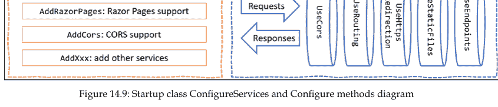

图 14.9：Startup 类 ConfigureServices 和 Configure 方法图

这两个方法都将由运行时自动调用。

现在让我们创建一个 Startup 类：

- 1. 向 Northwind.Web 项目添加一个名为 Startup.cs 的新类文件。
- 2. 修改 Startup.cs，如以下代码所示：

```
namespace Northwind.Web;

public class Startup
```


```
{
    public void ConfigureServices(IServiceCollection services)
    {
    }

    public void Configure(
        IApplicationBuilder app, IWebHostEnvironment env)
    {
        if (!env.IsDevelopment())
        {
            app.UseHsts();
        }

        app.UseRouting(); // start endpoint routing

        app.UseHttpsRedirection();

        app.UseEndpoints(endpoints =>
        {
            endpoints.MapGet("/", () => "Hello World!");
        });
    }
}
```

注意以下关于代码的说明：

- ConfigureServices 方法目前为空，因为我们目前还不需要添加任何依赖服务。
- Configure 方法设置 HTTP 请求管道并启用端点路由的使用。它配置了一个路由端点，等待使用相同的映射对根路径 / 的每个 HTTP GET 请求进行请求，并通过返回纯文本 "Hello World!" 来响应这些请求。我们将在本章末尾学习有关路由端点及其好处。

现在我们必须指定要在应用程序入口点中使用 Startup 类。

3. 修改 Program.cs，如以下代码所示：

```
using Northwind.Web; // Startup

Host.CreateDefaultBuilder(args)
    .ConfigureWebHostDefaults(webBuilder =>
    {
        webBuilder.UseStartup<Startup>();
    }).Build().Run();

Console.WriteLine("This executes after the web server has stopped!");
```

- 4. 启动网站并注意其行为与之前相同。
- 5. 关闭 Web 服务器。

> 在本书中我们创建的所有其他网站和服务项目中，我们将使用 .NET 6 项目模板创建的单个 Program.cs 文件。如果你喜欢使用 Startup.cs 的方式，那么你将在本章中看到如何使用它。

## 启用网站提供静态内容

只返回单一纯文本消息的网站并不是很有用！

至少，它应该返回静态 HTML 页面、网页用于样式的 CSS 以及任何其他静态资源，例如图像和视频。

按照惯例，这些文件应存储在名为 wwwroot 的目录中，以将其与网站项目的动态执行部分分开。

## 创建静态文件文件夹和网页

你现在将为静态网站资源创建一个文件夹，并创建一个使用 Bootstrap 进行样式设置的基本 index 页面：

- 1. 在 Northwind.Web 项目/文件夹中，创建一个名为 wwwroot 的文件夹。
- 2. 在 wwwroot 文件夹中添加一个名为 index.html 的新 HTML 页面文件。
- 3. 修改其内容以链接到 CDN 托管的 Bootstrap 用于样式设置，并使用诸如设置视口等现代良好实践，如以下标记所示：

```
<!doctype html>
<html lang="en">

<head>
    <!-- Required meta tags -->
    <meta charset="utf-8" />
    <meta name="viewport" content=
    "width=device-width, initial-scale=1 " />

    <!-- Bootstrap CSS -->
    <link href=
    "https://cdn.jsdelivr.net/npm/bootstrap@5.1.0/dist/css/bootstrap.min.css"
    rel="stylesheet" integrity="sha384-KyZXEAg3QhqLMpG8r+8fhAXLRk2vvoC2f3B09zV Xn8CA5QIVFZ0J3BCsw2P0p/We" crossorigin="anonymous">

    <title>Welcome ASP.NET Core!</title>
</head>
```

```
<body>
    <div class="container">
        <div class="jumbotron">
            <h1 class="display-3">Welcome to Northwind B2B</h1>
            <p class="lead">We supply products to our customers.</p>
            <hr />
            <h2>This is a static HTML page.</h2>
            <p>Our customers include restaurants, hotels, and cruise lines.</p>
            <p>
                <a class="btn btn-primary"
                   href="https://www.asp.net/">Learn more</a>
            </p>
        </div>
    </div>
</body>

</html>
```

> 良好实践：要获取 Bootstrap 的最新 <link> 元素，请从以下链接的文档中复制并粘贴：https://getbootstrap.com/docs/5.0/getting-started/introduction/#starter-template。

## 启用静态文件和默认文件

如果你现在启动网站并在地址栏中输入 http://localhost:5000/index.html，网站将返回 404 Not Found 错误，提示未找到网页。要使网站能够返回 index.html 等静态文件，我们必须显式配置该功能。

即使我们启用了静态文件，如果你启动网站并在地址栏中输入 http://localhost:5000/，网站仍会返回 404 Not Found 错误，因为如果未请求命名文件，Web 服务器不知道默认返回什么。

你现在将启用静态文件，显式配置默认文件，并更改注册的 URL 路径，使其返回纯文本 Hello World! 响应：

- 1. 在 Startup.cs 中，在 Configure 方法中，在启用 HTTPS 重定向后添加语句以启用静态文件和默认文件，并修改映射 GET 请求以返回 Hello World! 纯文本响应的语句，使其仅响应 URL 路径 /hello，如以下代码中突出显示所示：

```
app.UseHttpsRedirection();

app.UseDefaultFiles(); // index.html, default.html, and so on
```

```
app.UseStaticFiles();

app.UseEndpoints(endpoints =>
{
    endpoints.MapGet("/hello", () => "Hello World!");
});
```


> 对 UseDefaultFiles 的调用必须在对 UseStaticFiles 的调用之前，否则将无法工作！你将在本章末尾了解有关中间件和端点路由顺序的更多信息。

- 2. 启动网站。
- 3. 启动 **Chrome** 并显示 **开发者工具**。
- 4. 在 Chrome 中，输入 http://localhost:5000/ 并注意你被重定向到端口 5001 上的 HTTPS 地址，并且 index.html 文件现在通过该安全连接返回，因为它是该网站的可能默认文件之一。
- 5. 在 **开发者工具** 中，注意对 Bootstrap 样式表的请求。
- 6. 在 Chrome 中，输入 http://localhost:5000/hello 并注意它像之前一样返回纯文本 `Hello World!`。
- 7. 关闭 Chrome 并关闭 Web 服务器。

如果所有网页都是静态的，即它们只能由网页编辑器手动更改，那么我们的网站编程工作就完成了。但几乎所有网站都需要动态内容，这意味着通过执行代码在运行时生成的网页。

实现此目的最简单的方法是使用名为 **Razor Pages** 的 ASP.NET Core 功能。

## 探索 ASP.NET Core Razor Pages

ASP.NET Core Razor Pages 允许开发人员轻松地将 C# 代码语句与 HTML 标记混合，以使生成的网页具有动态性。这就是它们使用 .cshtml 文件扩展名的原因。

按照惯例，ASP.NET Core 会在名为 Pages 的文件夹中查找 Razor Pages。

## 启用 Razor Pages

你现在将把静态 HTML 页面复制并更改为动态 Razor 页面，然后添加并启用 Razor Pages 服务：

- 1. 在 `Northwind.Web` 项目文件夹中，创建一个名为 Pages 的文件夹。
- 2. 将 `index.html` 文件复制到 Pages 文件夹中。

3. 对于 Pages 文件夹中的文件，将文件扩展名从 .html 重命名为 .cshtml。

4. 删除说这是静态 HTML 页面的 <h2> 元素。

5. 在 Startup.cs 中，在 ConfigureServices 方法中，添加一条语句以将 ASP.NET Core Razor Pages 及其相关服务（如模型绑定、授权、防伪、视图和标记助手）添加到生成器中，如以下代码所示：

```
services.AddRazorPages();
```

6. 在 Startup.cs 中，在 Configure 方法中，在配置使用端点的部分中，添加一条语句以调用 MapRazorPages 方法，如以下代码中突出显示所示：

```
app.UseEndpoints(endpoints =>
{
    endpoints.MapRazorPages();

    endpoints.MapGet("/hello", () => "Hello World!");
});
```

## 向 Razor 页面添加代码

在网页的 HTML 标记中，Razor 语法由 @ 符号表示。Razor Pages 可以描述如下：

- 它们要求文件顶部有 @page 指令。
- 它们可以可选地具有 @functions 部分，定义以下任何内容：
  - 用于存储数据值的属性，如类定义中。名为 Model 的该类的实例会自动实例化，可以在特殊方法中设置其属性，并且可以在 HTML 中获取属性值。
  - 当发出 HTTP 请求（如 GET、POST 和 DELETE）时执行的名为 OnGet、OnPost、OnDelete 等的方法。

现在让我们将静态 HTML 页面转换为 Razor 页面：

- 1. 在 Pages 文件夹中，打开 index.cshtml。
- 2. 在文件顶部添加 @page 语句。
- 3. 在 @page 语句之后，添加一个 @functions 语句块。
- 4. 定义一个属性以将当前星期几的名称作为字符串值存储。
- 5. 定义一个在对页面发出 HTTP GET 请求时执行以设置 DayName 的方法，如以下代码所示：

```
@page

@functions
{
```


```
public string? DayName { get; set; }

public void OnGet()
{
    Model.DayName = DateTime.Now.ToString("dddd");
}
```

6. 在第二个 HTML 段落中输出星期名称，如以下标记中突出显示所示：

```
<p>It's @Model.DayName! Our customers include restaurants, hotels, and cruise lines.</p>
```

7. 启动网站。

8. 在 Chrome 中，输入 https://localhost:5001/ 并注意当前星期名称已在页面上输出，如图 14.10 所示：

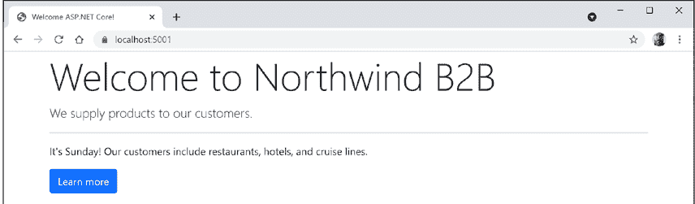

图 14.10：欢迎使用 Northwind 页面显示当前日期

9. 在 Chrome 中，输入 https://localhost:5001/index.html，这与静态文件名完全匹配，并注意它像之前一样返回静态 HTML 页面。

10. 在 Chrome 中，输入 https://localhost:5001/hello，这与返回纯文本的端点路由完全匹配，并注意它像之前一样返回 Hello World!。

11. 关闭 Chrome 并关闭 Web 服务器。

## 使用 Razor Pages 的共享布局

大多数网站都有不止一个页面。如果每个页面都必须包含 index.cshtml 中目前所有的样板标记，那将变得难以管理。因此，ASP.NET Core 提供了名为布局的功能。

要使用布局，我们必须创建一个 Razor 文件来定义所有 Razor Pages（以及所有 MVC 视图）的默认布局，并将其存储在 Shared 文件夹中，以便通过约定轻松找到。此文件的名称可以是任意的，因为我们会指定它，但 _Layout.cshtml 是良好的实践。

我们还必须创建一个特殊命名的文件来设置所有 Razor Pages（以及所有 MVC 视图）的默认布局文件。此文件必须命名为 _ViewStart.cshtml。

让我们看看布局的实际效果：

- 1. 在 Pages 文件夹中，添加一个名为 _ViewStart.cshtml 的文件。（Visual Studio 项目模板名为 **Razor 视图启动**。）
- 2. 修改其内容，如以下标记所示：
- 3. 在 Pages 文件夹中，创建一个名为 Shared 的文件夹。
- 4. 在 Shared 文件夹中，创建一个名为 _Layout.cshtml 的文件。（Visual Studio 项目模板名为 **Razor 布局**。）
- 5. 修改 _Layout.cshtml 的内容（它与 index.cshtml 相似，因此您可以从那里复制并粘贴 HTML 标记），如以下标记所示：

```
@{
    Layout = "_Layout";
}
```

```
<!doctype html>
<html lang="en">

<head>
    <!-- Required meta tags -->
    <meta charset="utf-8" />
    <meta name="viewport" content="width=device-width, initial-scale=1, shrink-to-fit=no" />

    <!-- Bootstrap CSS -->
    <link href="https://cdn.jsdelivr.net/npm/bootstrap@5.1.0/dist/css/bootstrap.min.css"
rel="stylesheet" integrity="sha384-KyZXEAg3QhqLMpg8r+8fhAXLRk2vvoC2f3B09zV Xn8CA5QIVFZ0J3BCsw2P0p/We" crossorigin="anonymous">

    <title>@ViewData["Title"]</title>
</head>

<body>
    <div class="container">
        @RenderBody()
        <hr />
        <footer>
            <p>Copyright &copy; 2021 - @ViewData["Title"]</p>
        </footer>
    </div>

    <!-- JavaScript to enable features like carousel -->
```

```
<script src="https://cdn.jsdelivr.net/npm/bootstrap@5.1.0/dist/js/bootstrap.bundle.min.js" integrity="sha384-U1DAWAzNBHeqEIlVSCgzaq+c9gqGAJ5c/t99JyeKa9xxaYpSvHU5awsuZVVIhvj" crossorigin="anonymous"></script>

@RenderSection("Scripts", required: false)

</body>
</html>
```

在回顾前面的标记时，请注意以下几点：

- - <title> 使用来自名为 ViewData 的字典的服务器端代码动态设置。这是 ASP.NET Core 网站不同部分之间传递数据的一种简单方法。在这种情况下，数据将在 Razor Page 类文件中设置，然后在共享布局中输出。
- - @RenderBody() 标记所请求视图的插入点。
- - 水平线和页脚将出现在每个页面的底部。
- - 在布局底部有一个脚本，用于实现 Bootstrap 的一些很酷的功能，我们稍后可以使用，例如图像轮播。
- - 在 Bootstrap 的 <script> 元素之后，我们定义了一个名为 Scripts 的区域，以便 Razor Page 可以选择性地注入它需要的额外脚本。

6. 修改 index.cshtml 以删除除 <div class="jumbotron"> 及其内容之外的所有 HTML 标记，并保留您之前添加的 @functions 块中的 C# 代码。

7. 在 OnGet 方法中添加一条语句以将页面标题存储在 ViewData 字典中，并修改按钮以导航到供应商页面（我们将在下一节中创建），如以下标记中突出显示所示：

```
@page

@functions
{
    public string? DayName { get; set; }

    public void OnGet()
    {
        ViewData["Title"] = "Northwind B2B";

        Model.DayName = DateTime.Now.ToString("dddd");
    }
}
<div class="jumbotron">
    <h1 class="display-3">Welcome to Northwind B2B</h1>
    <p class="lead">We supply products to our customers.</p>
```

```
<hr />
<p>It's @Model.DayName! Our customers include restaurants, hotels, and cruise lines.</p>
<p>
<a class="btn btn-primary" href="suppliers">
Learn more about our suppliers</a>
</p>
</div>
```

8. 启动网站，使用 Chrome 访问它，并注意它与之前的行为相似，尽管单击供应商按钮会给出 404 Not Found 错误，因为我们尚未创建该页面。

## 使用 Razor Pages 的代码隐藏文件

有时，最好将 HTML 标记与数据和可执行代码分离，因此 Razor Pages 允许您通过将 C# 代码放在代码隐藏类文件中来实现这一点。它们与 .cshtml 文件同名，但以 .cshtml.cs 结尾。

您现在将创建一个显示供应商列表的页面。在此示例中，我们专注于学习代码隐藏文件。在下一个主题中，我们将从数据库加载供应商列表，但现在，我们将使用硬编码的字符串值数组来模拟：

- 1. 在 Pages 文件夹中，添加两个名为 Suppliers.cshtml 和 Suppliers.cshtml.cs 的新文件。（Visual Studio 项目模板名为 Razor Page - Empty 且会创建这两个文件。）
- 2. 在名为 Suppliers.cshtml.cs 的代码隐藏文件中添加语句，如以下代码所示：

```
using Microsoft.AspNetCore.Mvc.RazorPages; // PageModel

namespace Northwind.Web.Pages;

public class SuppliersModel : PageModel
{
    public IEnumerable<string>? Suppliers { get; set; }

    public void OnGet()
    {
        ViewData["Title"] = "Northwind B2B - Suppliers";

        Suppliers = new[]
        {
            "Alpha Co", "Beta Limited", "Gamma Corp"
        };
    }
}
```

在回顾前面的标记时，请注意以下几点：

- - SuppliersModel 继承自 PageModel，因此它具有用于共享数据的 ViewData 字典等成员。您可以右键单击 PageModel 并选择转到定义，以查看它具有更多有用的功能，例如当前请求的整个 HttpContext。
- - SuppliersModel 定义了一个名为 Suppliers 的属性，用于存储字符串值集合。
- - 当对该 Razor Page 发出 HTTP GET 请求时，Suppliers 属性会从字符串值数组中填充一些示例供应商名称。稍后，我们将从 Northwind 数据库中填充它。

3. 修改 Suppliers.cshtml 的内容，如以下标记所示：

```
@page
@model Northwind.Web.Pages.SuppliersModel
<div class="row">
  <h1 class="display-2">Suppliers</h1>
  <table class="table">
    <thead class="thead-inverse">
      <tr><th>Company Name</th></tr>
    </thead>
    <tbody>
    @if (Model.Suppliers is not null)
    {
      @foreach(string name in Model.Suppliers)
      {
        <tr><td>@name</td></tr>
      }
    }
    </tbody>
  </table>
</div>
```

在回顾前面的标记时，请注意以下几点：

- - 此 Razor Page 的模型类型设置为 SuppliersModel。
- - 页面输出带有 Bootstrap 样式的 HTML 表格。
- - 表格中的数据行是通过在 Model.Suppliers 属性不为 null 时循环遍历它生成的。

4. 启动网站并使用 Chrome 访问它。

5. 单击按钮以了解有关供应商的更多信息，并注意供应商表格，如图 14.11 所示：

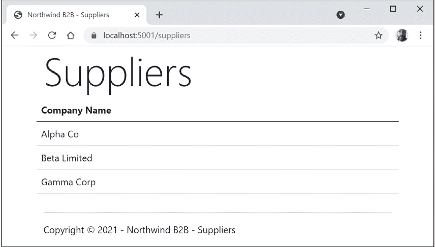

图 14.11：从字符串数组加载的供应商表

## 使用 ASP.NET Core 中的 Entity Framework Core

Entity Framework Core 是将真实数据引入网站的自然方式。在第 13 章《介绍 C# 和 .NET 的实用应用》中，你创建了两对类库：一组用于实体模型，一组用于 Northwind 数据库上下文，可用于 SQL Server 或 SQLite 或两者。你现在将在网站项目中使用它们。

## 将 Entity Framework Core 配置为服务

ASP.NET Core 所需的功能（如 Entity Framework Core 数据库上下文）必须在网站启动期间注册为服务。GitHub 仓库解决方案中的代码以及下面的代码使用 SQLite，但如果你愿意，也很容易使用 SQL Server。

我们来看看如何操作：

- 1. 在 Northwind.Web 项目中，为 SQLite 或 SQL Server 添加对 Northwind.Common.DataContext 项目的项目引用，如以下标记所示：

```
<!-- change Sqlite to SqlServer if you prefer -->
<ItemGroup>
  <ProjectReference Include="..\Northwind.Common.DataContext.Sqlite\Northwind.Common.DataContext.Sqlite.csproj" />
</ItemGroup>
```


项目引用必须全部在一行上，不能换行。

- 2. 构建 Northwind.Web 项目。

- 3. 在 Startup.cs 中，导入命名空间以使用你的实体模型类型，如以下代码所示：

```
using Packt.Shared; // AddNorthwindContext extension method
```

- 4. 在 ConfigureServices 方法中添加一条语句来注册 Northwind 数据库上下文类，如以下代码所示：

```
services.AddNorthwindContext();
```

- 5. 在 Northwind.Web 项目的 Pages 文件夹中，打开 Suppliers.cshtml.cs，并导入我们数据库上下文的命名空间，如以下代码所示：

```
using Packt.Shared; // NorthwindContext
```

- 6. 在 SuppliersModel 类中，添加一个私有字段来存储 Northwind 数据库上下文，并添加一个构造函数来设置它，如以下代码所示：

```
private NorthwindContext db;

public SuppliersModel(NorthwindContext injectedContext)
{
    db = injectedContext;
}
```

- 7. 将 Suppliers 属性更改为包含 Supplier 对象而不是字符串值。

- 8. 在 OnGet 方法中，修改语句以从数据库上下文的 Suppliers 属性设置 Suppliers 属性，按国家/地区然后按公司名称排序，如以下代码中突出显示的那样：

```
public void OnGet()
{
    ViewData["Title"] = "Northwind B2B - Suppliers";

    Suppliers = db.Suppliers
        .OrderBy(c => c.Country).ThenBy(c => c.CompanyName);
}
```

- 9. 修改 Suppliers.cshtml 的内容以导入 Packt.Shared 命名空间并为每个供应商渲染多个列，如以下标记中突出显示的那样：

```
@page
@using Packt.Shared
```

```
@model Northwind.Web.Pages.SuppliersModel
<div class="row">
    <h1 class="display-2">Suppliers</h1>
    <table class="table">
        <thead class="thead-inverse">
            <tr>
                <th>Company Name</th>
                <th>Country</th>
                <th>Phone</th>
            </tr>
        </thead>
        <tbody>
            @if (Model.Suppliers is not null)
            {
                @foreach(Supplier s in Model.Suppliers)
                {
                    <tr>
                        <td>@s.CompanyName</td>
                        <td>@s.Country</td>
                        <td>@s.Phone</td>
                    </tr>
                }
            }
        </tbody>
    </table>
</div>
```

- 10. 启动网站。
- 11. 在 Chrome 中输入 https://localhost:5001/。
- 12. 点击“了解更多关于我们的供应商”，并注意供应商表现在从数据库加载，如图 14.12 所示：

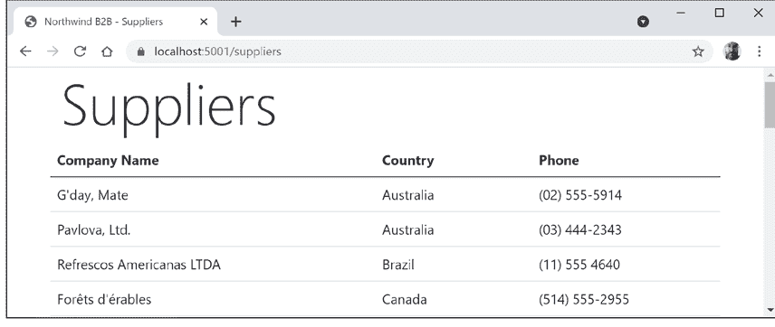

图 14.12：从 Northwind 数据库加载的供应商表

## 使用 Razor Pages 操作数据

你现在将添加插入新供应商的功能。

## 启用模型插入实体

首先，你将修改供应商模型，使其在访客提交表单以插入新供应商时响应 HTTP POST 请求：

- 1. 在 Northwind.Web 项目的 Pages 文件夹中，打开 Suppliers.cshtml.cs 并导入以下命名空间：
- 2. 在 SuppliersModel 类中，添加一个属性来存储单个供应商，并添加一个名为 OnPost 的方法，如果其模型有效，则将供应商添加到 Northwind 数据库的 Suppliers 表中，如以下代码所示：

```
using Microsoft.AspNetCore.Mvc; // [BindProperty], IActionResult
```

```
[BindProperty]
public Supplier? Supplier { get; set; }

public IActionResult OnPost()
{
    if ((Supplier is not null) && ModelState.IsValid)
    {
        db.Suppliers.Add(Supplier);
        db.SaveChanges();
        return RedirectToPage("/suppliers");
    }
    else
    {
        return Page(); // return to original page
    }
}
```

在回顾前面的代码时，请注意以下几点：

- 我们添加了一个名为 Supplier 的属性，该属性用 [BindProperty] 属性装饰，以便我们可以轻松地将网页上的 HTML 元素连接到 Supplier 类中的属性。
- 我们添加了一个响应 HTTP POST 请求的方法。它检查所有属性值是否符合 Supplier 类实体模型上的验证规则（如 [Required] 和 [StringLength]），然后将供应商添加到现有表中并将更改保存到数据库上下文中。这将生成一条 SQL 语句以在数据库中执行插入。然后它重定向到 Suppliers 页面，以便访客看到新添加的供应商。

## 定义用于插入新供应商的表单

接下来，你将修改 Razor Page 以定义一个访客可以填写并提交以插入新供应商的表单：

- 1. 在 Suppliers.cshtml 中，在 @model 声明之后添加标记助手，以便我们可以在此 Razor Page 上使用 asp-for 等标记助手，如以下标记所示：

```
@addTagHelper *, Microsoft.AspNetCore.Mvc.TagHelpers
```

- 2. 在文件底部添加一个用于插入新供应商的表单，并使用 asp-for 标记助手将 Supplier 类的 CompanyName、Country 和 Phone 属性绑定到输入框，如以下标记所示：

```
<div class="row">
  <p>Enter details for a new supplier:</p>
  <form method="POST">
    <div><input asp-for="Supplier.CompanyName" placeholder="Company Name" /></div>
    <div><input asp-for="Supplier.Country" placeholder="Country" /></div>
    <div><input asp-for="Supplier.Phone" placeholder="Phone" /></div>
    <input type="submit" />
  </form>
</div>
```

在回顾前面的标记时，请注意以下几点：

- 带有 POST 方法的 <form> 元素是普通的 HTML，因此其中的 <input type="submit" /> 元素将使用表单内任何其他元素的值向当前页面发出 HTTP POST 请求。
- 带有名为 asp-for 的标记助手的 <input> 元素可启用与 Razor Page 后面模型的数据绑定。

- 3. 启动网站。

- 4. 点击“了解更多关于我们的供应商”，滚动到页面底部，输入 Bob's Burgers、USA 和 (603) 555-4567，然后点击提交。

- 5. 注意你会看到一个已刷新的供应商表，其中包含新添加的供应商。

- 6. 关闭 Chrome 并关闭 Web 服务器。

## 向 Razor Page 注入依赖服务

如果你有一个没有代码隐藏文件的 .cshtml Razor Page，那么你可以使用 @inject 指令注入依赖服务，而不是使用构造函数参数注入，然后直接使用 Razor 语法在标记中间引用注入的数据库上下文。

我们来创建一个简单的示例：

- 1. 在 Pages 文件夹中添加一个名为 Orders.cshtml 的新文件。（Visual Studio 项目模板名为 **Razor Page - Empty**，它会创建两个文件。删除 .cs 文件。）
- 2. 在 Orders.cshtml 中编写代码以输出 Northwind 数据库中的订单数量，如以下标记所示：
- 3. 启动网站。
- 4. 导航到 /orders 并注意你会看到 Northwind 数据库中有 830 个订单。
- 5. 关闭 Chrome 并关闭 Web 服务器。

```
@page
@using Packt.Shared
@inject NorthwindContext db
@{
    string title = "Orders";
    ViewData["Title"] = $"Northwind B2B - {title}";
}
<div class="row">
    <h1 class="display-2">@title</h1>
    <p>
        There are @db.Orders.Count() orders in the Northwind database.
    </p>
</div>
```

## 使用 Razor 类库

与 Razor Page 相关的所有内容都可以编译成类库，以便在多个项目中更轻松地重用。从 ASP.NET Core 3.0 及更高版本开始，这可以包括 HTML、CSS、JavaScript 库以及图像文件等媒体资源等静态文件。网站可以使用类库中定义的 Razor Page 的视图，也可覆盖它。

## 创建 Razor 类库

我们来创建一个新的 Razor 类库：

使用你喜欢的代码编辑器添加一个新项目，如以下列表中定义：

- 1. 项目模板：**Razor Class Library** / razorclasslib
- 2. 复选框/开关：**Support pages and views** / -s
- 3. 工作区/解决方案文件和文件夹：PracticalApps
- 4. 项目文件和文件夹：Northwind.Razor.Employees


> -s 是 --support-pages-and-views 开关的简写，该开关使类库能够使用 Razor Pages 和 .cshtml 文件视图。

## 为 Visual Studio Code 禁用紧凑文件夹

在我们实现 Razor 类库之前，我想解释一个 Visual Studio Code 的功能，该功能在上一版出版后才添加，导致一些读者感到困惑。

紧凑文件夹功能意味着如果层级中的中间文件夹不包含文件，则诸如 /Areas/MyFeature/Pages/ 之类的嵌套文件夹会以紧凑形式显示，如图 14.13 所示：

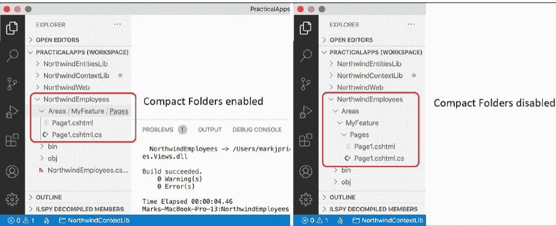

图 14.13：紧凑文件夹已启用或已禁用

如果您想禁用 Visual Studio Code 的紧凑文件夹功能，请完成以下步骤：

- 1. 在 Windows 上，导航到 文件 | 首选项 | 设置。在 macOS 上，导航到 代码 | 首选项 | 设置。
- 2. 在搜索设置框中输入 compact。
- 3. 清除 “资源管理器：紧凑文件夹” 复选框，如图 14.14 所示：

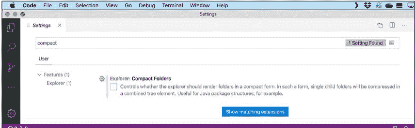

图 14.14：为 Visual Studio Code 禁用紧凑文件夹
- 4. 关闭“设置”选项卡。

## 使用 EF Core 实现 employees 功能

现在我们可以添加对实体模型的引用，以便在 Razor 类库中显示员工：

- 1. 在 Northwind.Razor.Employees 项目中，为 SQLite 或 SQL Server 添加对 Northwind.Common.DataContext 项目的项目引用，并注意 SDK 为 Microsoft.NET.Sdk.Razor，如以下标记中突出显示所示：

```
<Project Sdk="Microsoft.NET.Sdk.Razor">
  <PropertyGroup>
    <TargetFramework>net6.0</TargetFramework>
    <Nullable>enable</Nullable>
    <ImplicitUsings>enable</ImplicitUsings>
    <AddRazorSupportForMvc>true</AddRazorSupportForMvc>
  </PropertyGroup>
  <ItemGroup>
    <FrameworkReference Include="Microsoft.AspNetCore.App" />
  </ItemGroup>
  <!-- change Sqlite to SqlServer if you prefer -->
  <ItemGroup>
    <ProjectReference Include="..\Northwind.Common.DataContext.Sqlite\Northwind.Common.DataContext.Sqlite.csproj" />
  </ItemGroup>
</Project>
```

> 项目引用必须全部在一行上，不能换行。此外，不要混合我们的 SQLite 和 SQL Server 项目，否则会出现编译错误。如果您在 Northwind.Web 项目中使用了 SQL Server，那么在 Northwind.Razor.Employees 项目中也必须使用 SQL Server。

- 2. 构建 Northwind.Razor.Employees 项目。
- 3. 在 Areas 文件夹中，右键单击 MyFeature 文件夹，选择重命名，输入新名称 PacktFeatures，然后按 Enter。
- 4. 在 PacktFeatures 文件夹中，在 Pages 子文件夹中添加一个名为 _ViewStart.cshtml 的新文件。 （Visual Studio 项目模板名为 Razor 视图启动。或者直接从 Northwind.Web 项目复制。）
- 5. 修改其内容以告知此类库，任何 Razor 页面都应查找与 Northwind.Web 项目中使用的名称相同的布局，如以下标记所示：

```
@{
    Layout = "_Layout";
}
```

> 我们不需要在此项目中创建 _Layout.cshtml 文件。它将使用其宿主项目中的文件，例如 Northwind.Web 项目中的文件。

- 6. 在 Pages 子文件夹中，将 Page1.cshtml 重命名为 Employees.cshtml，并将 Page1.cshtml.cs 重命名为 Employees.cshtml.cs。
- 7. 修改 Employees.cshtml.cs 以定义一个页面模型，其中包含从 Northwind 数据库加载的 Employee 实体实例数组，如以下代码所示：

```
using Microsoft.AspNetCore.Mvc.RazorPages; // PageModel
using Packt.Shared; // Employee, NorthwindContext

namespace PacktFeatures.Pages;

public class EmployeesPageModel : PageModel
{
    private NorthwindContext db;

    public EmployeesPageModel(NorthwindContext injectedContext)
    {
        db = injectedContext;
    }

    public Employee[] Employees { get; set; } = null!;

    public void OnGet()
    {
        ViewData["Title"] = "Northwind B2B - Employees";
        Employees = db.Employees.OrderBy(e => e.LastName)
            .ThenBy(e => e.FirstName).ToArray();
    }
}
```

- 8. 修改 Employees.cshtml，如以下标记所示：

```
@page
@using Packt.Shared
@addTagHelper *, Microsoft.AspNetCore.Mvc.TagHelpers
@model PacktFeatures.Pages.EmployeesPageModel
<div class="row">
    <h1 class="display-2">Employees</h1>
</div>
<div class="row">
@foreach(Employee employee in Model.Employees)
{
    <div class="col-sm-3">
        <partial name="_Employee" model="employee" />
    </div>
}
</div>
```

在回顾上述标记时，请注意以下几点：

- 我们导入 Packt.Shared 命名空间，以便可以使用其中的类，例如 Employee。
- 我们添加对标记助手的支持，以便可以使用 <partial> 元素。
- 我们声明此 Razor 页面的 @model 类型以使用您刚刚定义的页面模型类。
- 我们遍历模型中的 Employees，使用局部视图输出每一个。

## 实现一个用于显示单个员工的局部视图

<partial> 标记助手是在 ASP.NET Core 2.1 中引入的。局部视图就像 Razor 页面的一部分。您将在接下来的几个步骤中创建一个来渲染单个员工：

- 1. 在 Northwind.Razor.Employees 项目中，在 Pages 文件夹中创建 Shared 文件夹。
- 2. 在 Shared 文件夹中创建一个名为 _Employee.cshtml 的文件。 （Visual Studio 项目模板名为 **Razor 视图 - 空白**。）
- 3. 修改 _Employee.cshtml，如以下标记所示：

```
@model Packt.Shared.Employee
<div class="card border-dark mb-3" style="max-width: 18rem;">
    <div class="card-header">@Model?.LastName, @Model?.FirstName</div>
    <div class="card-body text-dark">
        <h5 class="card-title">@Model?.Country</h5>
        <p class="card-text">@Model?.Notes</p>
    </div>
</div>
```

在回顾上述标记时，请注意以下几点：

- 根据约定，局部视图的名称以下划线开头。
- 如果您将局部视图放在 Shared 文件夹中，则可以自动找到它。
- 此局部视图的模型类型是一个单一的 Employee 实体。
- 我们使用 Bootstrap 卡片样式输出每个员工的信息。

## 使用和测试 Razor 类库

您现在将在网站项目中引用并使用 Razor 类库：

- 1. 在 Northwind.Web 项目中，添加对 Northwind.Razor.Employees 项目的项目引用，如以下标记所示：
- 2. 修改 Pages\index.cshtml 以在指向供应商页面的链接之后添加一个段落，其中包含指向 Packt 功能员工页面的链接，如以下标记所示：

```
<ProjectReference Include=
  "..\Northwind.Razor.Employees\Northwind.Razor.Employees.csproj" />
```

```
<p>
  <a class="btn btn-primary" href="packtfeatures/employees">
    Contact our employees
  </a>
</p>
```

- 3. 启动网站，使用 Chrome 访问网站，然后单击“联系我们的员工”按钮以查看员工卡片，如图 14.15 所示：

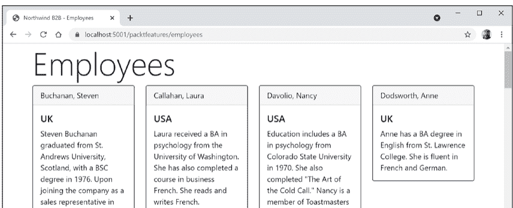

图 14.15：来自 Razor 类库功能的员工列表

## 配置服务和 HTTP 请求管道

现在我们已经构建了网站，我们可以返回 Startup 配置并更详细地回顾服务和 HTTP 请求管道的工作方式。

## 了解端点路由

在 ASP.NET Core 的早期版本中，路由系统和可扩展的中间件系统并不总是能很好地协同工作；例如，如果您想在中间件和 MVC 中同时实现 CORS 等策略。Microsoft 已投入改进路由，引入了与 ASP.NET Core 2.2 一起发布的端点路由系统。

> 良好实践：端点路由取代了 ASP.NET Core 2.1 及更早版本中使用的基于 IRouter 的路由。Microsoft 建议尽可能将所有旧的 ASP.NET Core 项目迁移到端点路由。

端点路由旨在在需要路由的框架（如 Razor Pages、MVC 或 Web API）和需要了解路由如何影响它们的中间件（如本地化、授权、CORS 等）之间实现更好的互操作性。

端点路由之所以得名，是因为它将路由表表示为可由路由系统高效遍历的端点编译树。其中最大的改进之一是路由和操作方法选择的性能。


默认情况下，如果兼容性设置为 2.2 或更高版本，则在 ASP.NET Core 2.2 或更高版本中默认启用。使用 MapRoute 方法或通过属性注册的传统路由会被映射到新系统。

新的路由系统包含一个作为依赖服务注册的链接生成服务，该服务不需要 HttpContext。

## 配置端点路由

端点路由需要对 UseRouting 和 UseEndpoints 方法进行一对调用：

- UseRouting 标记在其中做出路由决策的管道位置。
- UseEndpoints 标记所选端点被执行的管道位置。

诸如本地化之类的在这些方法之间运行的中间件可以看到所选的端点，并在必要时切换到不同的端点。

端点路由使用自 2010 年以来在 ASP.NET MVC 中使用的相同路由模板语法，以及在 2013 年随 ASP.NET MVC 5 引入的 [Route] 属性。迁移通常只需要更改 Startup 配置。

MVC 控制器、Razor Pages 以及 SignalR 等框架过去是通过调用 UseMvc 或类似方法来启用的，但现在它们是在 UseEndpoints 方法调用内部添加的，因为它们都与中间件一起集成到同一个路由系统中。

## 查看我们项目中的端点路由配置

查看 Startup.cs 类文件，如以下代码所示：

```csharp
using Packt.Shared; // AddNorthwindContext extension method

namespace Northwind.Web;

public class Startup
{
    public void ConfigureServices(IServiceCollection services)
    {
        services.AddRazorPages();

        services.AddNorthwindContext();
    }

    public void Configure(
        IApplicationBuilder app, IWebHostEnvironment env)
    {
        if (!env.IsDevelopment())
        {
            app.UseHsts();
        }

        app.UseRouting();

        app.UseHttpsRedirection();

        app.UseDefaultFiles(); // index.html, default.html, and so on
        app.UseStaticFiles();

        app.UseEndpoints(endpoints =>
        {
            endpoints.MapRazorPages();

            endpoints.MapGet("/hello", () => "Hello World!");
        });
    }
}
```

Startup 类有两个方法，会由主机自动调用来配置网站。

ConfigureServices 方法注册服务，然后当需要其提供的功能时，可以使用依赖注入检索这些服务。我们的代码注册了两个服务：Razor Pages 和一个 EF Core 数据库上下文。

## 在 ConfigureServices 方法中注册服务

常见的注册依赖服务的方法，包括组合其他注册服务的方法调用的服务，如下表所示：

| Method | Services that it registers |
|---|---|
| AddMvcCore | 路由请求和调用控制器所需的最少服务集。大多数网站需要更多的配置。 |
| AddAuthorization | 身份验证和授权服务。 |
| AddDataAnnotations | MVC 数据注释服务。 |
| AddCacheTagHelper | MVC 缓存标记助手服务。 |
| AddRazorPages | 包括 Razor 视图引擎的 Razor Pages 服务。常用于简单的网站项目。它调用以下附加方法：AddMvcCore AddAuthorization AddDataAnnotations AddCacheTagHelper |
| AddApiExplorer | Web API 资源管理器服务。 |
| AddCors | 用于增强安全性的 CORS 支持。 |
| AddFormatterMappings | URL 格式与其对应媒体类型之间的映射。 |
| AddControllers | 控制器服务，但不包括视图或页面的服务。常用于 ASP.NET Core Web API 项目。它调用以下附加方法：AddMvcCore AddAuthorization AddDataAnnotations AddCacheTagHelper AddApiExplorer AddCors AddFormatterMappings |
| AddViews | 对 .cshtml 视图的支持，包括默认约定。 |
| AddRazorViewEngine | 对 Razor 视图引擎的支持，包括处理 @ 符号。 |
| AddControllersWithViews | 控制器、视图和页面服务。常用于 ASP.NET Core MVC 网站项目。它调用以下附加方法：AddMvcCore AddAuthorization AddDataAnnotations AddCacheTagHelper AddApiExplorer AddCors AddFormatterMappings AddViews AddRazorViewEngine |
| AddMvc | 与 AddControllersWithViews 类似，但你应仅将其用于向后兼容。 |
| AddDbContext<T> | 你的 DbContext 类型及其可选的 DbContextOptions<TContext>。 |
| AddNorthwindContext | 我们创建的一个自定义扩展方法，使根据引用的项目为 SQLite 或 SQL Server 注册 NorthwindContext 类变得更容易。 |

在接下来的几章中处理 MVC 和 Web API 服务时，你将看到更多使用这些扩展方法注册服务的示例。

## 在 Configure 方法中设置 HTTP 请求管道

Configure 方法配置 HTTP 请求管道，它由一系列连接的委托组成，这些委托可以执行处理，然后决定自行返回响应或将处理传递给管道中的下一个委托。返回的响应也可以被操作。

请记住，委托定义了委托实现可以插入的方法签名。HTTP 请求管道的委托很简单，如以下代码所示：

```
public delegate Task RequestDelegate(HttpContext context);
```

你可以看到输入参数是 HttpContext。它提供了处理传入 HTTP 请求所需的一切访问权限，包括 URL 路径、查询字符串参数、Cookie 和用户代理。

这些委托通常被称为中间件，因为它们位于浏览器客户端和网站或服务之间。

中间件委托使用以下方法之一或调用它们的自定义方法进行配置：

- Run：添加一个中间件委托，该委托通过立即返回响应而不是调用下一个中间件委托来终止管道。
- Map：添加一个中间件委托，当存在匹配的请求（通常基于 URL 路径，如 /hello）时在管道中创建分支。
- Use：添加一个形成管道一部分的中间件委托，以便它可以决定是否将请求传递给管道中的下一个委托，并且可以在下一个委托之前和之后修改请求和响应。

为了方便，有许多扩展方法可以更轻松地构建管道，例如 UseMiddleware<T>，其中 T 是一个具有以下内容的类：

1. 一个具有 RequestDelegate 参数的构造函数，该参数将传递给下一个管道组件
2. 一个具有 HttpContext 参数且返回 Task 的 Invoke 方法

## 总结关键中间件扩展方法

我们代码中使用的关键中间件扩展方法包括以下内容：

- UseDeveloperExceptionPage：捕获管道中的同步和异步 System.Exception 实例并生成 HTML 错误响应。
- UseHsts：添加用于使用 HSTS 的中间件，该中间件添加 Strict-Transport-Security 标头。
- UseRouting：添加中间件，定义管道中做出路由决策的点，并且必须与 UseEndpoints 调用结合使用，在其中执行处理。这意味着对于我们的代码，任何匹配 / 或 /index 或 /suppliers 的 URL 路径都将映射到 Razor Pages，而 /hello 的匹配将映射到匿名委托。任何其他 URL 路径都将传递给下一个委托进行匹配，例如静态文件。这就是为什么尽管在管道中 Razor Pages 和 /hello 的映射看起来发生在静态文件之后，但它们实际上具有优先权，因为对 UseRouting 的调用发生在 UseStaticFiles 之前。
- UseHttpsRedirection：添加用于将 HTTP 请求重定向到 HTTPS 的中间件，因此在我们的代码中，对 http://localhost:5000 的请求将被修改为 https://localhost:5001。
- UseDefaultFiles：添加启用当前路径默认文件映射的中间件，因此在我们的代码中它会识别 index.html 等文件。
- UseStaticFiles：添加在 wwwroot 中查找要返回到 HTTP 响应的静态文件的中间件。


- **UseEndpoints**：添加中间件以执行从管道早期决策中生成响应的操作。以下子列表中添加了两个端点：
  - **MapRazorPages**：添加中间件，将诸如 `/suppliers` 这样的 URL 路径映射到 `/Pages` 文件夹中名为 `suppliers.cshtml` 的 Razor 页面文件，并将结果作为 HTTP 响应返回。
  - **MapGet**：添加中间件，将诸如 `/hello` 这样的 URL 路径映射到内联委托，该委托直接将纯文本写入 HTTP 响应。

## 可视化 HTTP 管道

HTTP 请求和响应管道可以可视化为一系列请求委托的序列，按顺序依次调用，如下简化图所示，该图排除了某些中间件委托，例如 UseHsts：

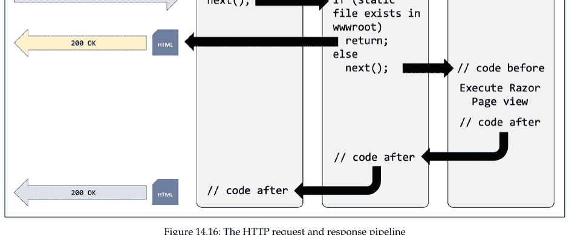

图 14.16：HTTP 请求和响应管道

如前所述，UseRouting 和 UseEndpoints 方法必须一起使用。虽然在 UseEndpoints 中编写了定义映射路由（如 /hello）的代码，但关于传入 HTTP 请求 URL 路径是否匹配以及因此执行哪个端点的决策是在管道中的 UseRouting 点做出的。

## 实现匿名内联委托作为中间件

可以将委托指定为内联匿名方法。我们将注册一个在为端点做出路由决策后插入管道的委托。

它将输出所选的端点，并处理一个特定路由：/bonjour。如果匹配该路由，它将使用纯文本响应，而不会进一步调用管道：

- 1. 在 Startup.cs 中，静态导入 Console，如以下代码所示：
- 2. 在调用 UseRouting 之后、在调用 UseHttpsRedirection 之前添加语句，以使用匿名方法作为中间件委托，如以下代码所示：
- 3. 启动网站。
- 4. 在 Chrome 中，导航到 https://localhost:5001/，查看控制台输出并注意端点路由 / 匹配成功，它被处理为 /index，并且 Index.cshtml Razor 页面被执行以返回响应，如以下输出所示：
- 5. 导航到 https://localhost:5001/suppliers 并注意可以看到端点路由 /Suppliers 匹配成功，并且 Suppliers.cshtml Razor 页面被执行以返回响应，如以下输出所示：

```
using static System.Console;
```

```
app.Use(async (HttpContext context, Func<Task> next) =>
{
    RouteEndpoint? rep = context.GetEndpoint() as RouteEndpoint;
    if (rep is not null)
    {
        WriteLine($"Endpoint name: {rep.DisplayName}");
        WriteLine($"Endpoint route pattern: {rep.RoutePattern.RawText}");
    }

    if (context.Request.Path == "/bonjour")
    {
        // in the case of a match on URL path, this becomes a terminating
        // delegate that returns so does not call the next delegate
        await context.Response.WriteAsync("Bonjour Monde!");
        return;
    }

    // we could modify the request before calling the next delegate
    await next();
    // we could modify the response after calling the next delegate
});
```

```
Endpoint name: /index
Endpoint route pattern:
```

```
Endpoint name: /Suppliers
Endpoint route pattern: Suppliers
```

- 6. 导航到 https://localhost:5001/index 并注意端点路由 /index 匹配成功，并且 Index.cshtml Razor 页面被执行以返回响应，如以下输出所示：

```
Endpoint name: /index
Endpoint route pattern: index
```

- 7. 导航到 https://localhost:5001/index.html 并注意控制台没有输出，因为没有匹配端点路由，但匹配到了静态文件，因此将其作为响应返回。

- 8. 导航到 https://localhost:5001/bonjour 并注意控制台没有输出，因为没有匹配端点路由。相反，我们的委托匹配了 /bonjour，直接写入响应流并返回，未进行进一步处理。

- 9. 关闭 Chrome 并关闭 Web 服务器。

## 练习与探索

通过回答一些问题来测试你的知识和理解，进行一些实践操作，并通过深入研究探索本章主题。

## 练习 14.1 – 测试你的知识

回答以下问题：

- 1. 列出 HTTP 请求中可以指定的六个方法名称。
- 2. 列出 HTTP 响应中可以返回的六个状态码及其描述。
- 3. 在 ASP.NET Core 中，Startup 类用于什么？
- 4. 缩写 HSTS 代表什么，它做什么？
- 5. 如何为网站启用静态 HTML 页面？
- 6. 如何将 C# 代码混合到 HTML 中间以创建动态页面？
- 7. 如何为 Razor Pages 定义共享布局？
- 8. 如何在 Razor Page 中将标记与代码隐藏分离？
- 9. 如何配置 Entity Framework Core 数据上下文以与 ASP.NET Core 网站一起使用？
- 10. 如何在 ASP.NET Core 2.2 或更高版本中重用 Razor Pages？

## 练习 14.2 – 实践构建数据驱动的网页

向 Northwind.Web 网站添加一个 Razor 页面，使用户能够按国家/地区查看分组的客户列表。当用户点击客户记录时，他们将看到显示该客户完整联系详情的页面，以及他们的订单列表。

## 练习 14.3 – 实践为控制台应用构建网页

将前面章节中的一些控制台应用重新实现为 Razor 页面，例如，来自第 4 章《编写、调试和测试函数》，提供 Web 用户界面以输出乘法表、计算税、生成阶乘和斐波那契数列。

## 练习 14.4 – 探索主题

使用以下页面上的链接了解本章涵盖主题的更多信息：

```
https://github.com/markjprice/cs10dotnet6/blob/main/book-links.md#chapter-14---building-websites-using-aspnet-core-razor-pages
```

## 总结

在本章中，你学习了使用 HTTP 进行 Web 开发的基础知识，如何构建返回静态文件的简单网站，以及如何使用 ASP.NET Core Razor Pages 和 Entity Framework Core 创建从数据库信息动态生成的网页。

我们回顾了 HTTP 请求和响应管道，辅助扩展方法的作用，以及如何添加自己的中间件来影响处理。

在下一章中，你将学习如何使用 ASP.NET Core MVC 构建更复杂的网站，它将构建网站的技术问题分离为模型、视图和控制器，以便更易于管理。

## 15

## 使用模型-视图-控制器模式构建网站

本章介绍使用 Microsoft ASP.NET Core MVC 在服务器端使用现代 HTTP 架构构建网站，包括启动配置、身份验证、授权、路由、请求和响应管道，以及构成 ASP.NET Core MVC 项目的模型、视图和控制器。

本章将涵盖以下主题：

- 设置 ASP.NET Core MVC 网站
- 探索 ASP.NET Core MVC 网站
- 自定义 ASP.NET Core MVC 网站
- 查询数据库并使用显示模板
- 使用异步任务提高可扩展性

### 设置 ASP.NET Core MVC 网站

ASP.NET Core Razor Pages 对于简单网站非常好。对于更复杂的网站，最好有一个更正式的结构来管理这种复杂性。

这就是模型-视图-控制器（MVC）设计模式派上用场的地方。它使用像 Razor Pages 这样的技术，但允许在技术问题之间实现更清晰的分离，如以下列表所示：

- **Models**：表示网站上使用的数据实体和视图模型的类。
- **Views**：Razor 文件，即 .cshtml 文件，将视图模型中的数据渲染为 HTML 网页。Blazor 使用 .razor 文件扩展名，但不要将其与 Razor 文件混淆！


- **控制器：** 当 HTTP 请求到达 Web 服务器时执行代码的类。控制器方法通常会创建一个可能包含实体模型的视图模型，并将其传递给视图以生成 HTTP 响应发送回 Web 浏览器或其他客户端。

最佳理解 Web 开发中使用 MVC 设计模式的方法是查看一个实际的工作示例。

## 创建 ASP.NET Core MVC 网站

您将使用项目模板创建一个 ASP.NET Core MVC 网站项目，该项目具有用于身份验证和授权用户的数据库。Visual Studio 2022 默认使用 SQL Server LocalDB 作为账户数据库。Visual Studio Code（更准确地说是 dotnet 工具）默认使用 SQLite，您可以指定一个开关改用 SQL Server LocalDB。

让我们看看实际操作：

- 1. 使用您首选的代码编辑器添加一个 MVC 网站项目，其中身份验证账户存储在数据库中，如以下列表中定义：
  - 1. 项目模板：**ASP.NET Core Web 应用（模型-视图-控制器）** / `mvc`
  - 2. 语言：C#
  - 3. 工作区/解决方案文件和文件夹：`PracticalApps`
  - 4. 项目文件和文件夹：`Northwind.Mvc`
  - 5. 选项：**身份验证类型：个人账户** / `--auth Individual`
  - 6. 对于 Visual Studio，将所有其他选项保持为默认值
- 2. 在 Visual Studio Code 中，将 `Northwind.Mvc` 选择为活动的 OmniSharp 项目。
- 3. 构建 `Northwind.Mvc` 项目。
- 4. 在命令行或终端中，使用帮助开关查看此项目模板的其他选项，如以下命令所示：
- 5. 注意结果，如以下部分输出所示：

```
dotnet new mvc --help
```

```
ASP.NET Core Web App (Model-View-Controller) (C#)
Author: Microsoft
Description: A project template for creating an ASP.NET Core application with example ASP.NET Core MVC Views and Controllers. This template can also be used for RESTful HTTP services.
This template contains technologies from parties other than Microsoft, see https://aka.ms/aspnetcore/6.0-third-party-notices for details.
```

有很多选项，特别是与身份验证相关的，如下表所示：

| Switches | Description |
|---|---|
| -au / --auth | 使用的身份验证类型：None（默认）：此选项还允许您禁用 HTTPS。Individual：个人身份验证，将注册用户及其密码存储在数据库中（默认 SQLite）。我们将在本章创建的项目中使用此选项。IndividualB2C：使用 Azure AD B2C 的个人身份验证。SingleOrg：单个租户的组织身份验证。MultiOrg：多个租户的组织身份验证。Windows：Windows 身份验证。mostly 用于内网。 |
| -uld / --use-local-db | 是否使用 SQL Server LocalDB 而不是 SQLite。此选项仅在指定 --auth Individual 或 --auth IndividualB2C 时适用。值是一个可选的 bool，默认值为 false。 |
| -rrc / --razor-runtime-compilation | 确定项目是否配置为在 Debug 构建中使用 Razor 运行时编译。这可以提高调试期间的启动性能，因为它可以延迟 Razor 视图的编译。值是一个可选的 bool，默认值为 false。 |
| -f / --framework | 项目的目标框架。值可以是：net6.0（默认）、net5.0 或 netcoreapp3.1 |

## 为 SQL Server LocalDB 创建身份验证数据库

如果您使用 Visual Studio 2022 创建了 MVC 项目，或使用 dotnet new mvc 并带 -uld 或 --use-local-db 开关，则身份验证和授权的数据库将存储在 SQL Server LocalDB 中。但数据库尚不存在。现在让我们创建它。

在命令提示符或终端中，在 Northwind.Mvc 文件夹中，输入运行数据库迁移的命令，以便创建用于存储身份验证凭据的数据库，如以下命令所示：

```
dotnet ef database update
```

如果您使用 dotnet new 创建了 MVC 项目，则身份验证和授权的数据库将存储在 SQLite 中，并且文件已创建，名为 app.db。

身份验证数据库的连接字符串名为 DefaultConnection，它存储在 MVC 网站项目的根文件夹中的 appsettings.json 文件中。

对于 SQL Server LocalDB（连接字符串已截断），请参阅以下标记：

```
{
  "ConnectionStrings": {
    "DefaultConnection": "Server=(localdb)\\mssqllocaldb;Database=aspnet-Northwind.Mvc-...;Trusted_Connection=True;MultipleActiveResultSets=true"
  },
}
```

对于 SQLite，请参阅以下标记：

```
{
  "ConnectionStrings": {
    "DefaultConnection": "DataSource=app.db;Cache=Shared"
  },
}
```

## 探索默认的 ASP.NET Core MVC 网站

让我们回顾默认 ASP.NET Core MVC 网站项目模板的行为：

- 1. 在 Northwind.Mvc 项目中，展开 Properties 文件夹，打开 launchSettings.json 文件，并注意为项目配置的 HTTPS 和 HTTP 的随机端口号（您的端口号会不同），如以下标记所示：
- 2. 将端口号更改为 HTTPS 为 5001，HTTP 为 5000，如以下标记所示：
- 3. 保存对 launchSettings.json 文件的更改。
- 4. 启动网站。
- 5. 启动 Chrome 并打开开发者工具。
- 6. 导航到 http://localhost:5000/ 并注意以下内容，如图 15.1 所示：
  - HTTP 请求会自动重定向到端口 5001 的 HTTPS。

```
"profiles": {
  "Northwind.Mvc": {
    "commandName": "Project",
    "dotnetRunMessages": true,
    "launchBrowser": true,
    "applicationUrl": "https://localhost:7274;http://localhost:5274",
    "environmentVariables": {
      "ASPNETCORE_ENVIRONMENT": "Development"
    }
  },
}
```

```
"applicationUrl": "https://localhost:5001;http://localhost:5000",
```

- 顶部导航菜单包含链接到 **首页**、**隐私**、**注册** 和 **登录**。如果视口宽度小于或等于 575 像素，则导航会折叠成汉堡菜单。
- 网站标题 **Northwind.Mvc** 显示在页眉和页脚中。

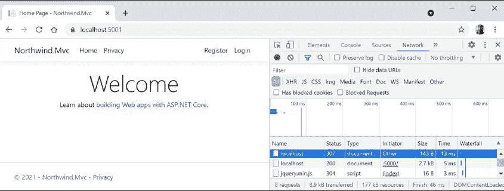

Figure 15.1: ASP.NET Core MVC 项目模板网站主页

## 理解访客注册

默认情况下，密码必须至少包含一个非字母数字字符，必须至少包含一个数字（0-9），并且必须至少包含一个大写字母（A-Z）。当我只是探索时，我在这种情况下使用 Pa$$w0rd。

MVC 项目模板遵循 **双重选择加入（DOI）** 的最佳实践，意味着在填写电子邮件和密码进行注册后，会向电子邮件地址发送一封电子邮件，访客必须点击该电子邮件中的链接以确认他们想要注册。

我们尚未配置电子邮件提供程序来发送该电子邮件，因此我们必须模拟该步骤：

- 1. 在顶部导航菜单中，点击 **注册**。
- 2. 输入电子邮件和密码，然后点击 **注册** 按钮。（我使用了 test@example.com 和 Pa$$w0rd。）
- 3. 点击文字为 **点击此处确认您的账户** 的链接，并注意您将被重定向到 **确认电子邮件** 网页，您可以自定义该页面。
- 4. 在顶部导航菜单中，点击 **登录**，输入您的电子邮件和密码（注意有一个可选的记住我的复选框，如果访客忘记了密码或想作为新访客注册，则有链接），然后点击 **登录** 按钮。
- 5. 在顶部导航菜单中点击您的电子邮件地址。这将导航到账户管理页面。注意您可以设置电话号码、更改电子邮件地址、更改密码、启用双因素身份验证（如果您添加身份验证器应用），以及下载和删除您的个人数据。
- 6. 关闭 Chrome 并关闭 Web 服务器。

## 查看 MVC 网站项目结构

在您的代码编辑器中，在 Visual Studio 解决方案资源管理器（切换到显示所有文件）或 Visual Studio Code EXPLORER 中，查看 MVC 网站项目的结构，如图 15.2 所示：

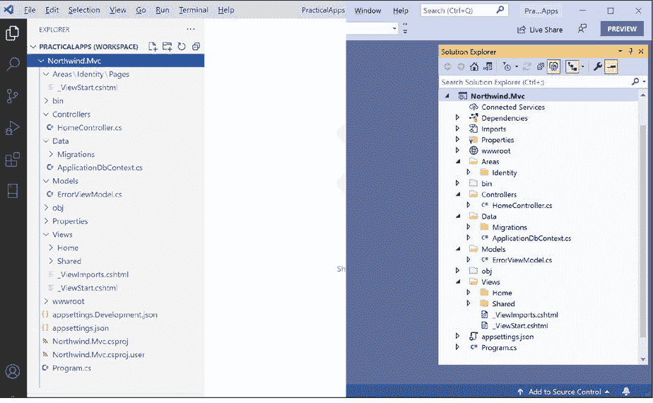

Figure 15.2: ASP.NET Core MVC 项目的默认文件夹结构

我们稍后会更详细地查看其中一些部分，但现在，请注意以下内容：

- Areas：此文件夹包含嵌套文件夹和文件，用于将网站项目与用于身份验证的 ASP.NET Core Identity 集成。
- bin、obj：这些文件夹包含构建过程中需要的临时文件以及项目的编译程序集。
- Controllers：此文件夹包含 C# 类，其中具有方法（称为操作）来获取模型并将其传递给视图，例如 HomeController.cs。


- Data：此文件夹包含实体框架 Core 迁移类，由 ASP.NET Core Identity 系统使用以提供身份验证和授权的数据存储，例如 `ApplicationDbContext.cs`。
- Models：此文件夹包含 C# 类，表示由控制器汇总并传递给视图的所有数据，例如 `ErrorViewModel.cs`。
- Properties：此文件夹包含 Windows 上 IIS 或 IIS Express 的配置文件以及在开发期间启动网站的配置文件，名为 `launchSettings.json`。此文件仅在本地开发机器上使用，不会部署到生产网站。
- Views：此文件夹包含 `.cshtml` Razor 文件，它们将 HTML 和 C# 代码结合起来以动态生成 HTML 响应。`_ViewStart` 文件设置默认布局，而 `_ViewImports` 导入所有视图中使用的通用命名空间，如标签助手：
  - Home：此子文件夹包含主页和隐私页面的 Razor 文件。
  - Shared：此子文件夹包含共享布局的 Razor 文件、一个错误页面以及用于登录和验证脚本的两个局部视图。
- wwwroot：此文件夹包含网站使用的静态内容，例如用于样式的 CSS、JavaScript 库、此网站项目的 JavaScript 以及 `favicon.ico` 文件。你也可以在此放置图像和其他静态文件资源，如 PDF 文档。项目模板包含 Bootstrap 和 jQuery 库。
- app.db：这是存储已注册访客的 SQLite 数据库。（如果你使用的是 SQL Server LocalDB，则不需要它。）
- appsettings.json and appsettings.Development.json：这些文件包含网站在运行时可以加载的设置，例如 ASP.NET Core Identity 系统的数据库连接字符串和日志级别。
- Northwind.Mvc.csproj：此文件包含项目设置，如使用 Web .NET SDK、SQLite 的条目以确保 app.db 文件被复制到网站的输出文件夹，以及项目所需的 NuGet 包列表，包括：
  - `Microsoft.AspNetCore.Diagnostics.EntityFrameworkCore`
  - `Microsoft.AspNetCore.Identity.EntityFrameworkCore`
  - `Microsoft.AspNetCore.Identity.UI`
  - `Microsoft.EntityFrameworkCore.Sqlite` 或 `Microsoft.EntityFrameworkCore.SqlServer`
  - `Microsoft.EntityFrameworkCore.Tools`
- Program.cs：此文件定义了一个隐藏的 Program 类，其中包含 Main 入口点。它构建用于处理传入 HTTP 请求的管道，并使用默认选项（如配置 Kestrel Web 服务器和加载 appsettings）托管网站。它添加并配置网站所需的服务，例如用于身份验证的 ASP.NET Core Identity、用于身份数据存储的 SQLite 或 SQL Server 等，以及应用程序的路由。

## 审查 ASP.NET Core Identity 数据库

打开 appsettings.json 以查找用于 ASP.NET Core Identity 数据库的连接字符串，如以下标记中针对 SQL Server LocalDB 所突出显示的那样：

```
{
  "ConnectionStrings": {
    "DefaultConnection": "Server=(localdb)\\mssqllocaldb;Database=aspnet-Northwind.Mvc-2F6A1E12-F9CF-480C-987D-FEFB4827DE22;Trusted_Connection=True;MultipleActiveResultSets=true"
  },
  "Logging": {
    "LogLevel": {
      "Default": "Information",
      "Microsoft": "Warning",
      "Microsoft.Hosting.Lifetime": "Information"
    }
  },
  "AllowedHosts": "*"
}
```

如果您对身份数据存储使用了 SQL Server LocalDB，则可以使用 Server Explorer 连接到数据库。您可以从 appsettings.json 文件复制并粘贴连接字符串（但请删除 (localdb) 和 mssqllocaldb 之间的第二个反斜杠）。

如果您安装了 SQLiteStudio 等 SQLite 工具，则可以打开 SQLite app.db 数据库文件。

然后您可以看到 ASP.NET Core Identity 系统用于注册用户和角色的表，包括用于存储已注册访客的 AspNetUsers 表。

> 良好实践：ASP.NET Core MVC 项目模板遵循良好实践，通过存储密码的哈希值而不是密码本身，您将在第 20 章《保护您的数据和应用程序》中了解更多相关内容。

## 探索 ASP.NET Core MVC 网站

让我们逐步了解构成现代 ASP.NET Core MVC 网站的各个部分。

## 了解 ASP.NET Core MVC 初始化

恰当的是，我们将从探索 MVC 网站的默认初始化和配置开始：

1. 打开 Program.cs 文件并注意它使用了顶级程序功能（因此存在一个包含 Main 方法的隐藏 Program 类）。该文件可以被视为从上到下分为四个重要部分。

> .NET 5 及更早版本的 ASP.NET Core 项目模板使用 Startup 类将这些部分分离到单独的方法中，但从 .NET 6 开始，Microsoft 鼓励将所有内容放在单个 Program.cs 文件中。

2. 第一部分导入一些命名空间，如以下代码所示：

```
using Microsoft.AspNetCore.Identity; // IdentityUser
using Microsoft.EntityFrameworkCore; // UseSqlServer, UseSqlite
using Northwind.Mvc.Data; // ApplicationDbContext
```

> 请记住，默认情况下，许多其他命名空间是使用 .NET 6 及更高版本中的隐式 using 功能导入的。构建项目后，全局导入的命名空间可以在以下路径找到：obj\Debug\net6.0\Northwind.Mvc.GlobalUsings.g.cs。

3. 第二部分创建并配置 Web 主机生成器。它使用从 appsettings.json 文件加载的数据库连接字符串，使用 SQL Server 或 SQLite 注册应用程序数据库上下文以进行数据存储，添加 ASP.NET Core Identity 用于身份验证并将其配置为使用应用程序数据库，并添加对带视图的 MVC 控制器的支持，如以下代码所示：

```
var builder = WebApplication.CreateBuilder(args);

// Add services to the container.
var connectionString = builder.Configuration
    .GetConnectionString("DefaultConnection");

builder.Services.AddDbContext<ApplicationDbContext>(options =>
    options.UseSqlServer(connectionString)); // or UseSqlite

builder.Services.AddDatabaseDeveloperPageExceptionFilter();

builder.Services.AddDefaultIdentity<IdentityUser>(options =>
    options.SignIn.RequireConfirmedAccount = true)
    .AddEntityFrameworkStores<ApplicationDbContext>();

builder.Services.AddControllersWithViews();
```

builder 对象有两个常用的对象：Configuration 和 Services：

- Configuration 包含可设置配置的所有位置的合并值：appsettings.json、环境变量、命令行参数等
- Services 是已注册依赖服务的集合

调用 AddDbContext 是注册依赖服务的示例。
ASP.NET Core 实现了依赖注入（DI）设计模式，以便像控制器这样的其他组件可以通过其构造函数请求所需的服务。开发人员在此 Program.cs 部分注册这些服务（或如果使用 Startup 类，则在其 ConfigureServices 方法中注册）。

4. 第三部分配置 HTTP 请求管道。它配置一个相对 URL 路径，如果网站在开发环境中运行则运行数据库迁移，或为生产环境提供更友好的错误页面和 HSTS。启用 HTTPS 重定向、静态文件、路由和 ASP.NET Identity，并配置 MVC 默认路由和 Razor Pages，如以下代码所示：

```
// Configure the HTTP request pipeline.
if (app.Environment.IsDevelopment())
{
    app.UseMigrationsEndPoint();
}
else
{
    app.UseExceptionHandler("/Home/Error");
    // The default HSTS value is 30 days. You may want to change this for production scenarios, see https://aka.ms/aspnetcore-hsts.
    app.UseHsts();
}

app.UseHttpsRedirection();
app.UseStaticFiles();

app.UseRouting();

app.UseAuthentication();
app.UseAuthorization();

app.MapControllerRoute(
    name: "default",
    pattern: "{controller=Home}/{action=Index}/{id?}");

app.MapRazorPages();
```

我们在第 14 章《使用 ASP.NET Core Razor Pages 构建网站》中学习了其中大多数方法和功能。


**良好实践：** 扩展方法 UseMigrationsEndPoint 有什么作用？你可以阅读官方文档，但帮助不大。例如，它没有告诉我们默认定义了什么相对 URL 路径：https://docs.microsoft.com/en-us/dotnet/api/microsoft.aspnetcore.builder.migrationsendpointextensions.usemigrationsendpoint。幸运的是，ASP.NET Core 是开源的，所以我们可以阅读源代码并发现它做了什么，在以下链接：https://github.com/dotnet/aspnetcore/blob/main/src/Middleware/Diagnostics.EntityFrameworkCore/src/MigrationsEndPointOptions.cs#L18。养成探索 ASP.NET Core 源代码以了解其工作原理的习惯。

除了 UseAuthentication 和 UseAuthorization 方法之外，Program.cs 此部分中最重要的新方法是 MapControllerRoute，它为 MVC 映射默认路由。此路由非常灵活，因为它可以映射几乎任何传入的 URL，正如你在下一个主题中将会看到的那样。

虽然本章中我们不会创建任何 Razor Pages，但我们需要保留映射 Razor Page 支持的方法调用，因为我们的 MVC 网站使用 ASP.NET Core Identity 进行身份验证和授权，并且它使用 Razor 类库作为其用户界面组件，例如访客注册和登录。

- 5. 第四也是最后一个部分有一个线程阻塞的方法调用，它运行网站并等待传入的 HTTP 请求以做出响应，如以下代码所示：

```
app.Run(); // blocking call
```

## 了解默认的 MVC 路由

路由的职责是发现要实例化的控制器类的名称以及要执行的操作方法，并带有一个可选的 id 参数传递给该方法，该方法将生成 HTTP 响应。

为 MVC 配置了默认路由，如以下代码所示：

```
endpoints.MapControllerRoute(
  name: "default",
  pattern: "{controller=Home}/{action=Index}/{id?}");
```

路由模式具有用花括号 {} 表示的部分，称为段，它们就像方法的有名参数一样。这些段的值可以是任何字符串。URL 中的段不区分大小写。

路由模式会查看浏览器请求的任何 URL 路径并匹配它以提取控制器的名称、操作的名称以及可选的 id 值（？符号使其可选）。

如果用户没有输入这些名称，它会使用 Home 作为控制器的默认值和 Index 作为操作的默认值（= 赋值会为命名段设置默认值）。

下表包含示例 URL 以及默认路由如何推算出控制器和操作的名称：

| URL | Controller | Action | ID |
|---|---|---|---|
| / | Home | Index |  |
| /Muppet | Muppet | Index |  |
| /Muppet/Kermit | Muppet | Kermit |  |
| /Muppet/Kermit/Green | Muppet | Kermit | Green |
| /Products | Products | Index |  |
| /Products/Detail | Products | Detail |  |
| /Products/Detail/3 | Products | Detail | 3 |

## 了解控制器和操作

在 MVC 中，C 代表 controller。从路由和传入的 URL，ASP.NET Core 知道控制器的名称，因此它会查找用 [Controller] 属性装饰的类或派生自用该属性装饰的类的类，例如 Microsoft 提供的名为 ControllerBase 的类，如以下代码所示：

```
namespace Microsoft.AspNetCore.Mvc
{
    //
    // Summary:
    // A base class for an MVC controller without view support.
    [Controller]
    public abstract class ControllerBase
    {
    ...
}
```

## 了解 ControllerBase 类

如 XML 注释所示，ControllerBase 不支持视图。它用于创建 Web 服务，如你在第 16 章《构建和消费 Web 服务》中将会看到的那样。

ControllerBase 具有许多用于处理当前 HTTP 上下文的有用属性，如下表所示：

| Property | Description |
|---|---|
| Request | 仅是 HTTP 请求。例如，标头、查询字符串参数、可以读取的请求体流、内容类型和长度以及 cookie。 |
| Response | 仅是 HTTP 响应。例如，标头、可以写入的响应体流、内容类型和长度、状态码以及 cookie。还有 OnStarting 和 OnCompleted 等委托，你可以挂钩方法。 |
| HttpContext | 关于当前 HTTP 上下文的所有内容，包括请求和响应、连接信息、服务器上通过中间件启用的功能集合以及用于身份验证和授权的 User 对象。 |

## 了解 Controller 类

Microsoft 提供了另一个名为 Controller 的类，如果你的类需要视图支持，可以从它继承，如以下代码所示：

```csharp
namespace Microsoft.AspNetCore.Mvc
{
    //
    // Summary:
    // A base class for an MVC controller with view support.
    public abstract class Controller : ControllerBase,
        IActionFilter, IFilterMetadata, IAsyncActionFilter, IDisposable
    {
        ...
    }
```

Controller 具有许多用于处理视图的有用属性，如下表所示：

| Property | Description |
|---|---|
| ViewData | 控制器可以存储键/值对的字典，可在视图中访问。该字典的生命周期仅限于当前请求/响应。 |
| ViewBag | 一个动态对象，包装 ViewData 以提供更友好的语法来设置和获取字典值。 |
| TempData | 控制器可以存储键/值对的字典，可在视图中访问。该字典的生命周期为当前请求/响应以及同一访客会话的下一个请求/响应。这对于在初始请求期间存储值、响应重定向，然后在后续请求中读取存储的值非常有用。 |

Controller 具有许多用于处理视图的有用方法，如下表所示：

| Method | Description |
|---|---|
| View | 在执行呈现完整响应的视图后返回 ViewResult，例如动态生成的网页。视图可以使用约定选择或使用字符串名称指定。可以将模型传递给视图。 |
| PartialView | 在执行作为完整响应一部分的视图后返回 PartialViewResult，例如动态生成的 HTML 片段。视图可以使用约定选择或使用字符串名称指定。可以将模型传递给视图。 |
| ViewComponent | 在执行动态生成 HTML 的组件后返回 ViewComponentResult。组件必须通过指定其类型或名称来选择。可以将对象作为参数传递。 |
| Json | 返回包含 JSON 序列化对象的 JsonResult。这对于在主要返回供人类查看的 HTML 的 MVC 控制器中实现简单的 Web API 很有用。 |

## 了解控制器的职责

控制器的职责如下：

- 在其类构造函数中识别控制器需要处于有效状态并正常运行的服务。
- 使用操作名称来识别要执行的方法。
- 从 HTTP 请求中提取参数。
- 使用参数获取构建视图模型所需的任何额外数据，并将其传递给客户端的适当视图。例如，如果客户端是 Web 浏览器，则呈现 HTML 的视图是最合适的。其他客户端可能更喜欢替代呈现方式，例如 PDF 文件或 Excel 文件等文档格式，或 JSON 或 XML 等数据格式。
- 以适当的狀態码将视图的结果作为 HTTP 响应返回给客户端。

让我们回顾一下用于生成主页、私密页和错误页的控制器：

- 1. 展开 Controllers 文件夹
- 2. 打开名为 HomeController.cs 的文件
- 3. 注意，如以下代码所示：
  - 导入了额外的命名空间，我已为其添加了注释以显示它们是为哪些类型需要的。
  - 声明了一个私有只读字段，用于存储对 HomeController 的记录器的引用，该引用在构造函数中设置。
  - 所有三个操作方法都调用名为 View 的方法，并将结果作为 IActionResult 接口返回给客户端。


- Error 动作方法将包含用于追踪的请求 ID 的视图模型传递给其视图。错误响应不会被缓存：

```
using Microsoft.AspNetCore.Mvc; // Controller, IActionResult
using Northwind.Mvc.Models; // ErrorViewModel
using System.Diagnostics; // Activity

namespace Northwind.Mvc.Controllers;
public class HomeController : Controller
{
    private readonly ILogger<HomeController> _logger;

    public HomeController(ILogger<HomeController> logger)
    {
        _logger = logger;
    }

    public IActionResult Index()
    {
        return View();
    }

    public IActionResult Privacy()
    {
        return View();
    }

    [ResponseCache(Duration = 0,
        Location = ResponseCacheLocation.None, NoStore = true)]
    public IActionResult Error()
    {
        return View(new ErrorViewModel { RequestId =
            Activity.Current?.Id ?? HttpContext.TraceIdentifier });
    }
}
```

如果访问者导航到 / 或 /Home 路径，则等同于 /Home/Index，因为它们是默认路由中控制器和动作的默认名称。

## 了解视图搜索路径约定

Index 和 Privacy 方法在实现上是相同的，但它们返回不同的网页。这是因为约定。View 方法的调用会在不同的路径中查找用于生成网页的 Razor 文件。

让我们故意破坏其中一个页面名称，以便可以看到默认搜索的路径：

1. 在 Northwind.Mvc 项目中，展开 Views 文件夹，然后展开 Home 文件夹。
2. 将 Privacy.cshtml 文件重命名为 Privacy2.cshtml。
3. 启动网站。
4. 启动 Chrome，导航到 https://localhost:5001/，点击 **Privacy**，并注意为渲染网页而搜索的路径（包括 MVC 视图和 Razor Pages 的 Shared 文件夹），如 图 15.3 所示：

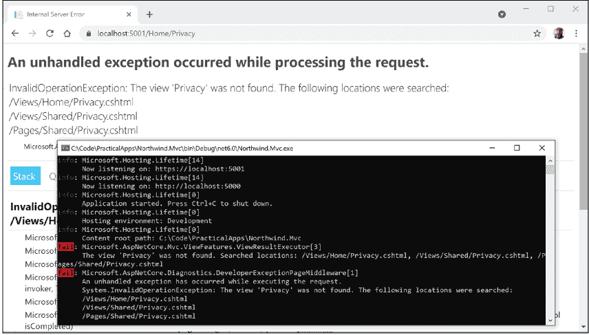

图 15.3：显示视图默认搜索路径的异常

5. 关闭 Chrome 并关闭 Web 服务器。
6. 将 Privacy2.cshtml 文件重新命名为 Privacy.cshtml。

你现在已经看到了视图搜索路径约定，如下列表所示：

- 特定 Razor 视图：/Views/{controller}/{action}.cshtml
- 共享 Razor 视图：/Views/Shared/{action}.cshtml
- 共享 Razor 页面：/Pages/Shared/{action}.cshtml

## 了解日志记录

你刚才看到一些错误被捕获并写入控制台。你可以使用记录器以相同的方式向控制台写入消息。

1. 在 Controllers 文件夹中，在 HomeController.cs 的 Index 方法中，添加语句使用记录器以各种级别向控制台写入一些消息，如以下代码所示：

```
_logger.LogError("This is a serious error (not really!)");
_logger.LogWarning("This is your first warning!");
```

```
_logger.LogWarning("Second warning!");
_logger.LogInformation("I am in the Index method of the HomeController.");
```

2. 启动 Northwind.Mvc 网站项目。
3. 启动 Web 浏览器并导航到网站的首页。
4. 在命令提示符或终端中，注意消息，如以下输出所示：
5. 关闭 Chrome 并关闭 Web 服务器。

```
fail: Northwind.Mvc.Controllers.HomeController[0]
    This is a serious error (not really!)
warn: Northwind.Mvc.Controllers.HomeController[0]
    This is your first warning!
warn: Northwind.Mvc.Controllers.HomeController[0]
    Second warning!
info: Northwind.Mvc.Controllers.HomeController[0]
    I am in the Index method of the HomeController.
```

## 了解筛选器

当你需要在多个控制器和动作中添加一些功能时，可以使用或定义自己的筛选器，这些筛选器实现为属性类。

筛选器可以在以下级别应用：

- 在动作级别通过为动作方法添加属性装饰。这只会影响一个动作方法。
- 在控制器级别通过为控制器类添加属性装饰。这将影响控制器的所有方法。
- 在全局级别通过将属性类型添加到 MvcOptions 实例的 Filters 集合中，该实例可在调用 AddControllersWithViews 方法时用于配置 MVC，如以下代码所示：

```
builder.Services.AddControllersWithViews(options =>
{
    options.Filters.Add(typeof(MyCustomFilter));
});
```

## 使用筛选器保护动作方法

你可能希望确保控制器类的某个特定动作方法只能由某些安全角色的成员调用。你可以通过用 [Authorize] 属性装饰该方法来实现，如下列表所述：

- [Authorize]：仅允许已通过身份验证（非匿名、已登录）的访问者访问此动作方法。
- [Authorize(Roles = "Sales,Marketing")]：仅允许属于指定角色的访问者访问此动作方法。

让我们看一个示例：

1. 在 HomeController.cs 中，导入 Microsoft.AspNetCore.Authorization 命名空间。
2. 向 Privacy 方法添加一个属性，仅允许属于名为 Administrators 的组/角色的已登录用户访问，如以下代码中突出显示所示：
3. 启动网站。
4. 点击 Privacy 并注意你被重定向到登录页面。
5. 输入你的电子邮件和密码。
6. 点击登录并注意你被拒绝访问。
7. 关闭 Chrome 并关闭 Web 服务器。

```
[Authorize(Roles = "Administrators")]
public IActionResult Privacy()
```

## 启用角色管理并以编程方式创建角色

默认情况下，ASP.NET Core MVC 项目中未启用角色管理，因此我们必须先启用它，然后再创建角色，然后我们将创建一个控制器，该控制器将以编程方式创建 Administrators 角色（如果尚不存在）并将测试用户分配给该角色：

1. 在 Program.cs 中，在 ASP.NET Core Identity 及其数据库的设置中，添加对 AddRoles 的调用以启用角色管理，如以下代码中突出显示所示：
2. 在 Controllers 中，添加一个名为 RolesController.cs 的空控制器类并修改其内容，如以下代码所示：

```
services.AddDefaultIdentity<IdentityUser>(
    options => options.SignIn.RequireConfirmedAccount = true)
    .AddRoles<IdentityRole>() // enable role management
    .AddEntityFrameworkStores<ApplicationDbContext>();
```

```
using Microsoft.AspNetCore.Identity; // RoleManager, UserManager
using Microsoft.AspNetCore.Mvc; // Controller, IActionResult

using static System.Console;

namespace Northwind.Mvc.Controllers;

public class RolesController : Controller
{
    private string AdminRole = "Administrators";
```

```
private string UserEmail = "test@example.com";

private readonly RoleManager<IdentityRole> roleManager;
private readonly UserManager<IdentityUser> userManager;

public RolesController(RoleManager<IdentityRole> roleManager,
    UserManager<IdentityUser> userManager)
{
    this.roleManager = roleManager;
    this.userManager = userManager;
}

public async Task<IActionResult> Index()
{
    if (!(await roleManager.RoleExistsAsync(AdminRole)))
    {
        await roleManager.CreateAsync(new IdentityRole(AdminRole));
    }

    IdentityUser user = await userManager.FindByEmailAsync(UserEmail);

    if (user == null)
    {
        user = new();
        user.UserName = UserEmail;
        user.Email = UserEmail;
        IdentityResult result = await userManager.CreateAsync(
            user, "Pa$$w0rd");

        if (result.Succeeded)
        {
            WriteLine($"User {user.UserName} created successfully.");
        }
        else
        {
            foreach (IdentityError error in result.Errors)
            {
                WriteLine(error.Description);
            }
        }
    }

    if (!user.EmailConfirmed)
    {
        string token = await userManager
```


```
.GenerateEmailConfirmationTokenAsync(user);
IdentityResult result = await userManager
    .ConfirmEmailAsync(user, token);

if (result.Succeeded)
{
    WriteLine($"User {user.UserName} email confirmed successfully.");
}
else
{
    foreach (IdentityError error in result.Errors)
    {
        WriteLine(error.Description);
    }
}

if (!(await userManager.IsInRoleAsync(user, AdminRole)))
{
    IdentityResult result = await userManager
        .AddToRoleAsync(user, AdminRole);

    if (result.Succeeded)
    {
        WriteLine($"User {user.UserName} added to {AdminRole} successfully.");
    }
    else
    {
        foreach (IdentityError error in result.Errors)
        {
            WriteLine(error.Description);
        }
    }
}

return Redirect("/");
```

请注意以下事项：
- 角色名称和用户电子邮件的两个字段。
- 构造函数获取并存储已注册的用户和角色管理器依赖服务。
- 如果 Administrators 角色不存在，我们使用角色管理器创建它。

- 我们尝试通过电子邮件查找测试用户，如果不存在则创建它，然后将用户分配到 `Administrators` 角色。
- 由于网站使用 DOI，我们必须生成电子邮件确认令牌并使用它来确认新用户的电子邮件地址。
- 成功消息和任何错误都会写入控制台。
- 您将被自动重定向到主页。

- 3. 启动网站。
- 4. 点击 **Privacy** 并注意您将被重定向到登录页面。
- 5. 输入您的电子邮件和密码。（我使用了 `mark@example.com`。）
- 6. 点击 **Log in** 并注意您仍被拒绝访问。
- 7. 点击 **Home**。
- 8. 在地址栏中，手动输入 roles 作为相对 URL 路径，如以下链接所示：https://localhost:5001/roles。
- 9. 查看写入控制台的成功消息，如以下输出所示：
- 10. 点击 **Logout**，因为您必须注销并重新登录，以便在您已登录后创建的角色成员资格能够加载。
- 11. 再次尝试访问 **Privacy** 页面，输入以编程方式创建的新用户的电子邮件，例如 `test@example.com`，以及其密码，然后点击 **Log in**，您现在应该可以访问。
- 12. 关闭 Chrome 并关闭 Web 服务器。

```
User test@example.com created successfully.
User test@example.com email confirmed successfully.
User test@example.com added to Administrators successfully.
```

## 使用过滤器缓存响应

为了提高响应时间和可扩展性，您可能希望通过使用 [ResponseCache] 属性装饰方法来缓存由操作方法生成的 HTTP 响应。

您可以通过设置参数来控制响应的缓存位置和缓存时长，如以下列表所示：
- **Duration**：以秒为单位。这设置以秒为单位测量的 max-age HTTP 响应头。常见选择是一小时（3600 秒）和一天（86400 秒）。
- **Location**：ResponseCacheLocation 值之一，Any、Client 或 None。这设置 cache-control HTTP 响应头。
- **NoStore**：如果为 true，则忽略 Duration 和 Location 并将 cache-control HTTP 响应头设置为 no-store。

我们来看一个示例：
- 1. 在 HomeController.cs 中，为 Index 方法添加一个属性，以在浏览器或服务器和浏览器之间的任何代理上缓存响应 10 秒，如以下代码中突出显示所示：
- 2. 在 Views 中，在 Home 中，打开 Index.cshtml，并添加一个段落以输出当前时间长格式以包含秒，如以下标记所示：
- 3. 启动网站。
- 4. 注意主页上的时间。
- 5. 点击 Register。
- 6. 点击 Home 并注意主页上的时间相同，因为使用了页面的缓存版本。
- 7. 点击 Register。等待至少十秒。
- 8. 点击 Home 并注意时间现在已更新。
- 9. 点击 Log in，输入您的电子邮件和密码，然后点击 Log in。
- 10. 注意主页上的时间。
- 11. 点击 Privacy。
- 12. 点击 Home 并注意页面未被缓存。
- 13. 查看控制台并注意警告消息，解释您的缓存已被覆盖，因为访问者已登录，在此场景中，ASP.NET Core 使用防伪令牌，它们不应被缓存，如以下输出所示：
- 14. 关闭 Chrome 并关闭 Web 服务器。

```
[ResponseCache(Duration = 10, Location = ResponseCacheLocation.Any)]
public IActionResult Index()
```

```
<p class="alert alert-primary">@DateTime.Now.ToLongTimeString()</p>
```

```
warn: Microsoft.AspNetCore.Antiforgery.DefaultAntiforgery[8]
The 'Cache-Control' and 'Pragma' headers have been overridden and set to 'no-cache, no-store' and 'no-cache' respectively to prevent caching of this response. Any response that uses antiforgery should not be cached.
```

## 使用过滤器定义自定义路由

您可能希望为操作方法定义一个简化的路由，而不是使用默认路由。

例如，要显示隐私页面当前需要以下 URL 路径，该路径指定了控制器和操作：

```
https://localhost:5001/home/privacy
```

我们可以使路由更简单，如以下链接所示：

```
https://localhost:5001/private
```

我们来看如何操作：
- 1. 在 HomeController.cs 中，为 Privacy 方法添加一个属性以定义简化的路由，如以下代码中突出显示所示：
- 2. 启动网站。
- 3. 在地址栏中，输入以下 URL 路径：
- 4. 输入您的电子邮件和密码，点击 Log in，并注意简化路径显示 Privacy 页面。
- 5. 关闭 Chrome 并关闭 Web 服务器。

```
[Route("private")]
[Authorize(Roles = "Administrators")]
public IActionResult Privacy()
```

```
https://localhost:5001/private
```

## 理解实体和视图模型

在 MVC 中，M 代表模型。模型表示响应请求所需的数据。常用的有两种类型的模型：实体模型和视图模型。

实体模型表示 SQL Server 或 SQLite 等数据库中的实体。根据请求，可能需要从数据存储中检索一个或多个实体。实体模型使用类定义，因为它们可能需要更改然后用于更新底层数据存储。

我们希望在响应请求时显示的所有数据都是 MVC 模型，有时称为视图模型，因为它是一个传递到视图中以渲染为 HTML 或 JSON 等响应格式的模型。视图模型应该是不可变的，因此通常使用记录定义。

例如，以下 HTTP GET 请求可能意味着浏览器正在请求产品编号 3 的产品详细信息页面：

```
http://www.example.com/products/details/3
```

控制器需要使用 ID 路由值 3 来检索该产品的实体并将其传递给视图，然后视图可以将模型转换为 HTML 以在浏览器中显示。

想象一下，当用户访问我们的网站时，我们希望向他们展示类别轮播、产品列表以及本月访问者数量的计数。

我们将引用您在 *第 13 章，C# 和 .NET 的实用应用介绍* 中创建的 Northwind 数据库的 Entity Framework Core 实体数据模型：
- 1. 在 `Northwind.Mvc` 项目中，为 SQLite 或 SQL Server 添加对 `Northwind.Common.DataContext` 的项目引用，如以下标记所示：
- 2. 构建 `Northwind.Mvc` 项目以编译其依赖项。
- 3. 如果您使用的是 SQL Server，或者可能需要在 SQL Server 和 SQLite 之间切换，则在 `appsettings.json` 中添加使用 SQL Server 的 Northwind 数据库连接字符串，如以下标记中突出显示所示：
- 4. 在 `Program.cs` 中，导入命名空间以使用您的实体模型类型，如以下代码所示：
- 5. 在 `builder.Build` 方法调用之前，添加语句以加载适当的连接字符串，然后注册 Northwind 数据库上下文，如以下代码所示：
- 6. 向 `Models` 文件夹添加一个类文件并将其命名为 `HomeIndexViewModel.cs`。

```
<ItemGroup>
    <!-- change Sqlite to SqlServer if you prefer -->
    <ProjectReference Include=
"..\Northwind.Common.DataContext.Sqlite\Northwind.Common.DataContext.Sqlite.csproj" />
</ItemGroup>
```

```
{
  "ConnectionStrings": {
    "DefaultConnection": "Server=(localdb)\\mssqllocaldb;Database=aspnet-Northwind.Mvc-DC9C4FAF-DD84-4FC9-B925-69A61240EDA7;Trusted_Connection=True;MultipleActiveResultSets=true",
    "NorthwindConnection": "Server=.;Database=Northwind;Trusted_Connection=True;MultipleActiveResultSets=true"
  },
}
```

```
using Packt.Shared; // AddNorthwindContext extension method
```

```
// if you are using SQL Server
string sqlServerConnection = builder.Configuration
    .GetConnectionString("NorthwindConnection");
builder.Services.AddNorthwindContext(sqlServerConnection);

// if you are using SQLite default is ..\Northwind.db
builder.Services.AddNorthwindContext();
```


> **良好实践：** 尽管 MVC 项目模板创建的 `ErrorViewModel` 类不遵循此约定，但我建议您对视图模型类使用命名约定 `{Controller}{Action}ViewModel`。


7. 修改语句以定义一个记录，该记录具有访客数量的计数属性，以及类别和产品的列表，如以下代码所示：

```
using Packt.Shared; // Category, Product

namespace Northwind.Mvc.Models;

public record HomeIndexViewModel
(
    int VisitorCount,
    IList<Category> Categories,
    IList<Product> Products
);
```

8. 在 HomeController.cs 中导入 Packt.Shared 命名空间，如以下代码所示：

```
using Packt.Shared; // NorthwindContext
```

9. 添加一个字段来存储对 Northwind 实例的引用，并在构造函数中初始化它，如以下代码中突出显示所示：

```
public class HomeController : Controller
{
    private readonly ILogger<HomeController> _logger;
    private readonly NorthwindContext db;

    public HomeController(ILogger<HomeController> logger,
        NorthwindContext injectedContext)
    {
        _logger = logger;
        db = injectedContext;
    }
    ...
```

ASP.NET Core 将使用构造函数参数注入，使用你在 Program.cs 中指定的连接字符串传递一个 NorthwindContext 数据库上下文的实例。

10. 修改 Index 操作方法中的语句，为此方法创建视图模型实例，使用 Random 类模拟访客计数以生成 1 到 1000 之间的数字，并使用 Northwind 数据库获取类别和产品的列表，然后将模型传递给视图，如以下代码中突出显示所示：

```
[ResponseCache(Duration = 10, Location = ResponseCacheLocation.Any)]
public IActionResult Index()
{
    _logger.LogError("This is a serious error (not really!)");
    _logger.LogWarning("This is your first warning!");
    _logger.LogWarning("Second warning!");
    _logger.LogInformation("I am in the Index method of the HomeController.");

    HomeIndexViewModel model = new
    (
        VisitorCount: (new Random()).Next(1, 1001),
        Categories: db.Categories.ToList(),
        Products: db.Products.ToList()
    );
    return View(model); // pass model to view
}
```

请记住视图搜索约定：当在控制器的操作方法中调用 View 方法时，ASP.NET Core MVC 会在 Views 文件夹中查找与当前控制器同名的子文件夹，即 Home。然后它会查找与当前操作同名的文件，即 Index.cshtml。它还会搜索 Shared 文件夹中与操作方法名称匹配的视图以及 Pages 文件夹中的 Razor 页面。

## 了解视图

在 MVC 中，V 代表视图。视图的职责是将模型转换为 HTML 或其他格式。

有多个视图引擎可用于执行此操作。默认视图引擎称为 Razor，它使用 @ 符号表示服务器端代码执行。随 ASP.NET Core 2.0 引入的 Razor Pages 功能使用相同的视图引擎，因此可以使用相同的 Razor 语法。

让我们修改主页视图以呈现类别和产品的列表：

- 1. 展开 Views 文件夹，然后展开 Home 文件夹。
- 2. 打开 Index.cshtml 文件并注意用 @{ } 包裹的 C# 代码块。这将首先执行，可用于存储需要传递到共享布局文件中的数据，例如网页的标题，如以下代码所示：
```
@{
    ViewData["Title"] = "Home Page";
}
```
- 3. 注意使用 Bootstrap 进行样式设置的 <div> 元素中的静态 HTML 内容。


> 良好实践：除了定义自己的样式外，还应基于实现响应式设计的通用库（如 Bootstrap）来构建样式。

就像 Razor Pages 一样，有一个名为 _ViewStart.cshtml 的文件，它会被 View 方法执行。它用于设置适用于所有视图的默认值。

例如，它将所有视图的 Layout 属性设置为共享布局文件，如以下标记所示：

```
@{
    Layout = "_Layout";
}
```

4. 在 Views 文件夹中，打开 _ViewImports.cshtml 文件并注意它导入了一些命名空间，然后添加 ASP.NET Core 标签助手，如以下代码所示：

```
@using Northwind.Mvc
@using Northwind.Mvc.Models
@addTagHelper *, Microsoft.AspNetCore.Mvc.TagHelpers
```

5. 在 Shared 文件夹中，打开 _Layout.cshtml 文件。

6. 注意标题是从 Index.cshtml 视图中先前设置的 ViewData 字典中读取的，如以下标记所示：

```
<title>@ViewData["Title"] - Northwind.Mvc</title>
```

7. 注意对支持 Bootstrap 和站点样式表的链接的呈现，其中 ~ 表示 wwwroot 文件夹，如以下标记所示：

```
<link rel="stylesheet"
    href="~/lib/bootstrap/dist/css/bootstrap.css" />
<link rel="stylesheet" href="~/css/site.css" />
```

8. 注意在页眉中导航栏的呈现，如以下标记所示：

```
<body>
    <header>
        <nav class="navbar ...">
```

9. 注意可折叠 <div> 的呈现，其中包含用于登录的部分视图和超链接，使用 ASP.NET Core 标签助手及其属性如 asp-controller 和 asp-action 允许用户在页面之间导航，如以下标记所示：

```
<div class=
    "navbar-collapse collapse d-sm-inline-flex justify-content-between">
    <ul class="navbar-nav flex-grow-1">
        <li class="nav-item">
            <a class="nav-link text-dark" asp-area=""
                asp-controller="Home" asp-action="Index">Home</a>
        </li>
        <li class="nav-item">
            <a class="nav-link text-dark"
asp-area="" asp-controller="Home"
asp-action="Privacy">Privacy</a>
    </li>
</ul>
<partial name="_LoginPartial" />
</div>
```

<a> 元素使用名为 asp-controller 和 asp-action 的标签助手属性来指定单击链接时将执行的控制器名称和操作名称。如果要导航到 Razor 类库中的功能，例如你在上一章中创建的 employees 组件，则使用 asp-area 指定功能名称。

10. 注意 <main> 元素内正文的呈现，如以下标记所示：

```
<div class="container">
    <main role="main" class="pb-3">
        @RenderBody()
    </main>
</div>
```

RenderBody 方法在共享布局的该位置注入特定 Razor 视图（如 Index.cshtml 文件）的页面的内容。

11. 注意页面底部的 <script> 元素的呈现，以便它不会减慢页面的显示速度，并且你可以将自己的脚本块添加到名为 scripts 的可选定义部分中，如以下标记所示：

```
<script src="~/lib/jquery/dist/jquery.min.js"></script>
<script src="~/lib/bootstrap/dist/js/bootstrap.bundle.min.js">
</script>
<script src="~/js/site.js" asp-append-version="true"></script>
@await RenderSectionAsync("scripts", required: false)
```

当在  或 <script> 等任何元素中与 src 属性一起指定 asp-append-version 且值为 true 时，将调用 Image Tag Helper（该助手命名不当，因为它不仅仅影响图像！）。

它通过自动附加一个名为 v 的查询字符串值来工作，该值是从引用源文件的哈希生成的，如以下示例生成的输出所示：

```
<script src="~/js/site.js?v=K1_dqr9NVtnMdsM2MUg4qthUnWZ m5T1fCEimBPWDNgM"></script>
```

如果 site.js 文件中的单个字节发生变化，则其哈希值将不同，因此如果浏览器或 CDN 缓存了脚本文件，则它将破坏缓存副本并用新版本替换它。

## 自定义 ASP.NET Core MVC 网站

现在你已经回顾了基本 MVC 网站的结构，你将对其进行自定义和扩展。你已经为 Northwind 数据库注册了 EF Core 模型，因此下一个任务是在主页上输出一些该数据。

### 定义自定义样式

主页将显示 Northwind 数据库中的 77 个产品的列表。为了高效利用空间，我们希望以三列显示列表。为此，我们需要自定义网站的样式表：

- 1. 在 wwwroot\css 文件夹中，打开 site.css 文件。
- 2. 在文件的底部，添加一个新样式，该样式将应用于具有 product-columns ID 的元素，如以下代码所示：

```
#product-columns
{
  column-count: 3;
}
```

### 设置类别图像

Northwind 数据库包含一个包含八个类别的表，但它们没有图像，网站配上一些彩色图片会更好看：

- 1. 在 wwwroot 文件夹中，创建一个名为 images 的文件夹。
- 2. 在 images 文件夹中，添加八个图像文件，命名为 category1.jpeg、category2.jpeg，依此类推，直到 category8.jpeg。

> 你可以从本书的 GitHub 仓库下载图像，链接如下：https://github.com/markjprice/cs10dotnet6/tree/master/Assets/Categories

### 了解 Razor 语法

在我们自定义主页视图之前，让我们回顾一个示例 Razor 文件，该文件具有初始 Razor 代码块，用于实例化具有价格和数量的订单，然后在网页上输出有关订单的信息，如以下标记所示：

```
@{
  Order order = new()
  {
    OrderId = 123,
```


```
Product = "Sushi",
Price = 8.49M,
Quantity = 3
};
}
```

```
<div>Your order for @order.Quantity of @order.Product has a total cost of $@ order.Price * @order.Quantity</div>
```

前面的 Razor 文件将导致以下不正确的输出：

```
Your order for 3 of Sushi has a total cost of $8.49 * 3
```

虽然 Razor 标记可以使用 @object. property 语法包含任何单个属性的值，但您应该将表达式用括号括起来，如以下标记所示：

```
<div>Your order for @order.Quantity of @order.Product has a total cost of $@ (order.Price * order.Quantity)</div>
```

前面的 Razor 表达式将产生以下正确的输出：

```
Your order for 3 of Sushi has a total cost of $25.47
```

## 定义类型化的视图

为了在编写视图时改善 IntelliSense，您可以在顶部使用 @model 指令定义视图可以期望的类型：

- 1. 在 Views\Home 文件夹中，打开 Index.cshtml。
- 2. 在文件顶部，添加一条语句以将模型类型设置为使用 HomeIndexViewModel，如以下代码所示：

```
@model HomeIndexViewModel
```

现在，每当我们在此视图中键入 Model 时，代码编辑器将知道模型的正确类型并为其提供 IntelliSense。

在视图中输入代码时，请记住以下几点：

- - 声明模型的类型，使用 @model（小写 m）。
- - 与模型实例交互，使用 @Model（大写 M）。

让我们继续自定义主页的视图。

- 3. 在初始 Razor 代码块中，添加一条语句来声明当前项的字符串变量，并在现有的 <div> 元素下添加新的标记以在轮播中输出类别并以无序列表形式输出产品，如以下标记所示：

```
@using Packt.Shared
@model HomeIndexViewModel
@{
    ViewData["Title"] = "Home Page";
    string currentItem = "";
}

<div class="text-center">
    <h1 class="display-4">Welcome</h1>
    <p>Learn about <a href="https://docs.microsoft.com/aspnet/core">building Web apps with ASP.NET Core</a>.</p>
    <p class="alert alert-primary">@DateTime.Now.ToLongTimeString()</p>
</div>
@if (Model is not null)
{
<div id="categories" class="carousel slide" data-ride="carousel"
    data-interval="3000" data-keyboard="true">
    <ol class="carousel-indicators">
    @for (int c = 0; c < Model.Categories.Count; c++)
    {
        if (c == 0)
        {
            currentItem = "active";
        }
        else
        {
            currentItem = "";
        }
        <li data-target="#categories" data-slide-to="@c"
            class="@currentItem"></li>
    }
    </ol>
    <div class="carousel-inner">
    @for (int c = 0; c < Model.Categories.Count; c++)
    {
        if (c == 0)
        {
            currentItem = "active";
        }
        else
        {
            currentItem = "";
        }
    }
    <div class="carousel-item @currentItem">
        
<div class="carousel-caption d-none d-md-block">
<h2>@Model.Categories[c].CategoryName</h2>
<h3>@Model.Categories[c].Description</h3>
<p>
<a class="btn btn-primary"
href="/category/@Model.Categories[c].CategoryId">View</a>
</p>
</div>
</div>
}
</div>
<a class="carousel-control-prev" href="#categories"
role="button" data-slide="prev">
<span class="carousel-control-prev-icon"
aria-hidden="true"></span>
<span class="sr-only">Previous</span>
</a>
<a class="carousel-control-next" href="#categories"
role="button" data-slide="next">
<span class="carousel-control-next-icon" aria-hidden="true"></span>
<span class="sr-only">Next</span>
</a>
</div>
}
<div class="row">
<div class="col-md-12">
<h1>Northwind</h1>
<p class="lead">
We have had @Model?.VisitorCount visitors this month.
</p>
@if (Model is not null)
{
<h2>Products</h2>
<div id="product-columns">
<ul>
@foreach (Product p in @Model.Products)
{
<li>
    <a asp-controller="Home"
        asp-action="ProductDetail"
        asp-route-id="@p.ProductId">
        @p.ProductName costs
        @(p.UnitPrice is null ? "zero" : p.UnitPrice.Value.ToString("C"))
    </a>
</li>
}
</ul>
</div>
}
</div>
</div>
```

在查看前面的 Razor 标记时，请注意以下几点：

- - 很容易将 <ul> 和 <li> 等静态 HTML 元素与 C# 代码混合，以输出类别轮播和产品名称列表。
- - id 属性为 product-columns 的 <div> 元素将使用我们之前定义自定义样式，因此该元素中的所有内容都将以三列显示。
- - 每个类别的  元素在 Razor 表达式周围使用括号，以确保编译器不会将 .jpeg 包含为表达式的一部分，如以下标记所示： "~/images/category@(Model.Categories[c].CategoryID).jpeg"
- - 产品链接的 <a> 元素使用标签助手生成 URL 路径。单击这些超链接将由 HomeController 及其 ProductDetail 操作方法处理。此操作方法尚不存在，但您将在本章后面添加它。产品的 ID 作为名为 id 的路由段传递，如 Ipoh Coffee 的以下 URL 路径所示： https://localhost:5001/Home/ProductDetail/43。

## 查看自定义的主页

让我们看看我们自定义的主页的结果：

- 1. 启动 Northwind.Mvc 网站项目。
- 2. 注意主页有一个旋转轮播显示类别、随机访客数量以及三列的产品列表，如图 15.4 所示：

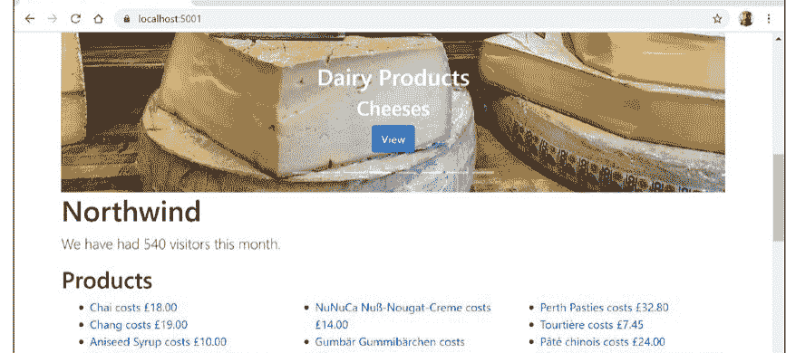

图 15.4：更新后的 Northwind MVC 网站主页

目前，单击任何类别或产品链接都会出现 404 Not Found 错误，因此让我们看看如何实现使用传递参数来查看产品或类别详细信息的页面。

- 3. 关闭 Chrome 并关闭 Web 服务器。

## 使用路由值传递参数

传递简单参数的一种方法是使用默认路由中定义的 id 段：

- 1. 在 HomeController 类中，添加一个名为 ProductDetail 的操作方法，如以下代码所示：

```
public IActionResult ProductDetail(int? id)
{
    if (!id.HasValue)
    {
        return BadRequest("You must pass a product ID in the route, for example, /Home/ProductDetail/21");
    }

    Product? model = db.Products
        .SingleOrDefault(p => p.ProductId == id);

    if (model == null)
    {
return NotFound($"ProductId {id} not found.");
}

return View(model); // pass model to view and then return result
}
```

请注意以下几点：

- - 此方法使用 ASP.NET Core 的一项功能称为 **model binding**，以自动将路由中传递的 id 与方法中名为 id 的参数匹配。
- - 在方法内部，我们检查 id 是否没有值，如果没有，我们调用 BadRequest 方法返回 400 状态代码，并附带自定义消息解释正确的 URL 路径格式。
- - 否则，我们可以连接到数据库并尝试使用 id 值检索产品。
- - 如果找到产品，我们将其传递给视图；否则，我们调用 NotFound 方法返回 404 状态代码，并附带自定义消息解释数据库中未找到具有该 ID 的产品。

2. 在 Views/Home 文件夹内，添加一个名为 ProductDetail.cshtml 的新文件。

3. 修改内容，如以下标记所示：

```
@model Packt.Shared.Product
@{
    ViewData["Title"] = "Product Detail - " + Model.ProductName;
}
<h2>Product Detail</h2>
<hr />
<div>
    <dl class="dl-horizontal">
        <dt>Product Id</dt>
        <dd>@Model.ProductId</dd>
        <dt>Product Name</dt>
        <dd>@Model.ProductName</dd>
        <dt>Category Id</dt>
        <dd>@Model.CategoryId</dd>
        <dt>Unit Price</dt>
        <dd>@Model.UnitPrice.Value.ToString("C")</dd>
        <dt>Units In Stock</dt>
        <dd>@Model.UnitsInStock</dd>
    </dl>
</div>
```

4. 启动 Northwind.Mvc 项目。


5. 当主页出现产品列表时，点击其中一个，例如第二个产品，**Chang**。

6. 注意浏览器地址栏中的 URL 路径、浏览器标签页中显示的页面标题以及产品详情页，如图 15.5 所示：

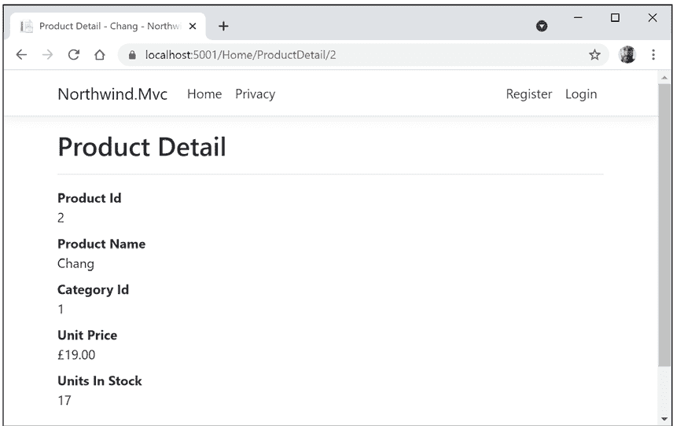

Figure 15.5: Chang 的产品详情页

7. 查看 **开发者工具**。

8. 编辑 Chrome 地址框中的 URL 以请求不存在的产品 ID，例如 99，并注意 404 Not Found 状态码和自定义错误响应。

## 更详细地了解模型绑定器

模型绑定器功能强大，默认的模型绑定器能为你做很多事情。在默认路由识别出要实例化的控制器类和要调用的操作方法后，如果该方法有参数，则需要为这些参数设置值。

模型绑定器通过查找 HTTP 请求中传递的参数值作为以下任一类型的参数来实现这一点：

- **路由参数**，如我们在上一节中所做的 id，如以下 URL 路径所示：`/Home/ProductDetail/2`
- **查询字符串参数**，如以下 URL 路径所示：`/Home/ProductDetail?id=2`
- **表单参数**，如下所示的标记：

```
<form method="post" action="/Home/ProductDetail">
  <input type="text" name="id" value="2" />
  <input type="submit" />
</form>
```

模型绑定器可以填充几乎任何类型：

- 简单类型，如 int、string、DateTime 和 bool。
- 由类、记录或结构体定义的复杂类型。
- 集合类型，如数组和列表。

让我们创建一个有点人为的示例来说明使用默认模型绑定器可以实现什么：

1. 在 Models 文件夹中，添加一个名为 Thing.cs 的新文件。
2. 修改内容以定义一个类，其中包含一个名为 Id 的可空整数和一个名为 Color 的字符串的两个属性，如以下代码所示：
3. 在 HomeController 中，添加两个新的操作方法，一个用于显示包含表单的页面，一个用于使用你的新模型类型并带参数显示事物，如以下代码所示：
4. 在 Views\Home 文件夹中，添加一个名为 ModelBinding.cshtml 的新文件。
5. 修改其内容，如以下标记所示：

```
namespace Northwind.Mvc.Models;

public class Thing
{
    public int? Id { get; set; }
    public string? Color { get; set; }
}
```

```
public IActionResult ModelBinding()
{
    return View(); // the page with a form to submit
}

public IActionResult ModelBinding(Thing thing)
{
    return View(thing); // show the model bound thing
}
```

```
@model Thing
@{
    ViewData["Title"] = "Model Binding Demo";
}
<h1>@ViewData["Title"]</h1>
```

```
<div>
    Enter values for your thing in the following form:
</div>
<form method="POST" action="/home/modelbinding?id=3">
    <input name="color" value="Red" />
    <input type="submit" />
</form>
@if (Model != null)
{
<h2>Submitted Thing</h2>
<hr />
<div>
    <dl class="dl-horizontal">
        <dt>Model.Id</dt>
        <dd>@Model.Id</dd>
        <dt>Model.Color</dt>
        <dd>@Model.Color</dd>
    </dl>
</div>
}
```

6. 在 Views/Home 中打开 Index.cshtml，并在第一个 <div> 中添加一个新段落，其中包含指向模型绑定页面的链接，如以下标记所示：

```
<p><a asp-action="ModelBinding" asp-controller="Home">Binding</a></p>
```

7. 启动网站。

8. 在主页上，点击 Binding。

9. 注意关于模糊匹配的未处理异常，如图 15.6 所示：

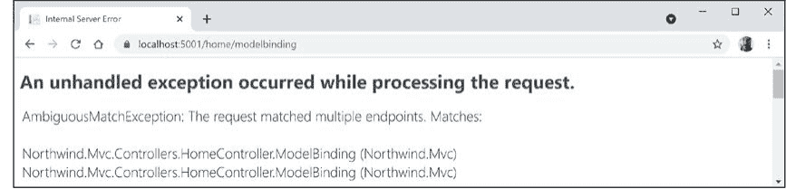

Figure 15.6: 未处理的模糊操作 方法不匹配异常

10. 关闭 Chrome 并关闭 Web 服务器。

## 消除操作方法的歧义

虽然 C# 编译器可以通过注意到签名不同来区分这两种方法，但从 HTTP 请求路由的角度来看，这两种方法都是潜在的匹配项。我们需要一种特定于 HTTP 的方法来消除操作方法的歧义。

我们可以通过为操作创建不同的名称或指定一个方法应用于特定的 HTTP 动词（如 GET、POST 或 DELETE）来实现这一点。这就是我们将如何解决该问题的方法：

1. 在 HomeController 中，为第二个 ModelBinding 操作方法添加装饰，以指示它应用于处理 HTTP POST 请求，即在提交表单时，如以下代码中突出显示的那样：

```
[HttpPost]
public IActionResult ModelBinding(Thing thing)
```

> 另一个 ModelBinding 操作方法将隐式地用于所有其他类型的 HTTP 请求，如 GET、PUT、DELETE 等。

2. 启动网站。

3. 在主页上，点击 Binding。

4. 点击提交按钮并注意 Id 属性的值是从查询字符串参数设置的，而 color 属性的值是从表单参数设置的，如图 15.7 所示：

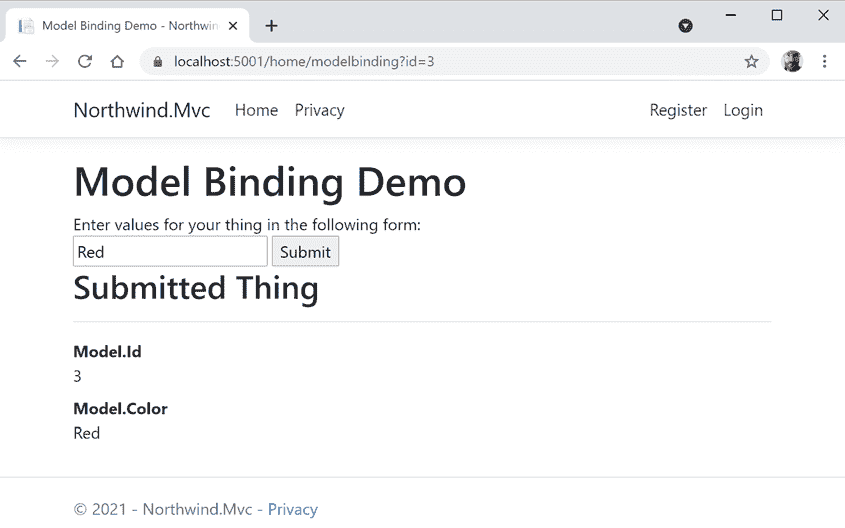

Figure 15.7: 模型绑定演示页面

5. 关闭 Chrome 并关闭 Web 服务器。

## 传递路由参数

现在我们将使用路由参数设置属性：

1. 修改表单的操作以将值 2 作为路由参数传递，如以下标记中突出显示的那样：
2. 启动网站。
3. 在主页上，点击 Binding。
4. 点击提交按钮并注意 Id 属性的值是从路由参数设置的，而 Color 属性的值是从表单参数设置的。
5. 关闭 Chrome 并关闭 Web 服务器。

```
<form method="POST" action="/home/modelbinding/2?id=3">
```

## 传递表单参数

现在我们将使用表单参数设置属性：

1. 修改表单的操作以将值 1 作为表单参数传递，如以下标记中突出显示的那样：
2. 启动网站。
3. 在主页上，点击 Binding。
4. 点击提交按钮并注意 Id 和 Color 属性的值都从表单参数设置。

```
<form method="POST" action="/home/modelbinding/2?id=3">
  <input name="id" value="1" />
  <input name="color" value="Red" />
  <input type="submit" />
</form>
```

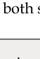

> 良好实践：如果有多个同名参数，请记住表单参数在自动模型绑定中具有最高优先级，而查询字符串参数具有最低优先级。

## 验证模型

模型绑定过程可能会导致错误，例如数据类型转换或如果模型已用验证规则装饰则会产生验证错误。已绑定数据以及任何绑定或验证错误都存储在 ControllerBase.ModelState 中。

让我们通过对绑定模型应用一些验证规则，然后在视图中显示无效数据消息，来探索我们可以用模型状态做什么：

1. 在 Models 文件夹中打开 Thing.cs。
2. 导入 System.ComponentModel.DataAnnotations 命名空间。
3. 使用验证属性装饰 Id 属性以将允许的数字范围限制为 1 到 10，并使用一个属性确保访客提供颜色，并添加一个带有正则表达式用于验证的新 Email 属性，如以下代码中突出显示的那样：
4. 在 Models 文件夹中添加一个名为 HomeModelBindingViewModel.cs 的新文件。
5. 修改其内容以定义一个记录，其中包含属性用于存储绑定模型、指示是否存在错误的标志以及错误消息序列，如以下代码所示：
6. 在 HomeController 中，在处理 HTTP POST 的 ModelBinding 方法中，注释掉之前将 thing 传递给视图的语句，而是添加语句来创建视图模型实例。验证模型并存储错误消息数组，然后将视图模型传递给视图，如以下代码中突出显示的那样：

```
public class Thing
{
    [Range(1, 10)]
    public int? Id { get; set; }

    [Required]
    public string? Color { get; set; }

    [EmailAddress]
    public string? Email { get; set; }
}
```

```
namespace Northwind.Mvc.Models;

public record HomeModelBindingViewModel
(
    Thing Thing,
    bool HasErrors,
    IEnumerable<string> ValidationErrors
);
```

```
[HttpPost]
public IActionResult ModelBinding(Thing thing)
{
    HomeModelBindingViewModel model = new(
        thing,
        !ModelState.IsValid,
        ModelState.Values
            .SelectMany(state => state.Errors)
    )
```


```
    .Select(error => error.ErrorMessage)
    );
    return View(model);
}
```

7. 在 Views\Home 中，打开 ModelBinding.cshtml。

8. 修改模型类型声明以使用视图模型类，如以下标记所示：

```
@model Northwind.Mvc.Models.HomeModelBindingViewModel
```

9. 添加一个 <div> 来显示任何模型验证错误，并更改 thing 属性的输出，因为视图模型已更改，如以下标记中突出显示所示：

```
<form method="POST" action="/home/modelbinding/?id=3">
    <input name="id" value="1" />
    <input name="color" value="Red" />
    <input name="email" value="test@example.com" />
    <input type="submit" />
</form>
@if (Model != null)
{
    <h2>Submitted Thing</h2>
    <hr />
    <div>
        <dl class="dl-horizontal">
            <dt>Model.Thing.Id</dt>
            <dd>@Model.Thing.Id</dd>
            <dt>Model.Thing.Color</dt>
            <dd>@Model.Thing.Color</dd>
            <dt>Model.Thing.Email</dt>
            <dd>@Model.Thing.Email</dd>
        </dl>
    </div>
    @if (Model.HasErrors)
    {
        <div>
            @foreach(string errorMessage in Model.ValidationErrors)
            {
                <div class="alert alert-danger" role="alert">@errorMessage</div>
            }
        </div>
    }
}
```

10. 启动网站。

- 11. 在主页上，单击 **Binding**。
- 12. 单击 **Submit** 按钮并注意 1、Red 和 test@example.com 是有效值。
- 13. 输入 Id 为 13，清空颜色文本框，删除电子邮件地址中的 @，单击 **Submit** 按钮，并注意错误消息，如图 15.8 所示：

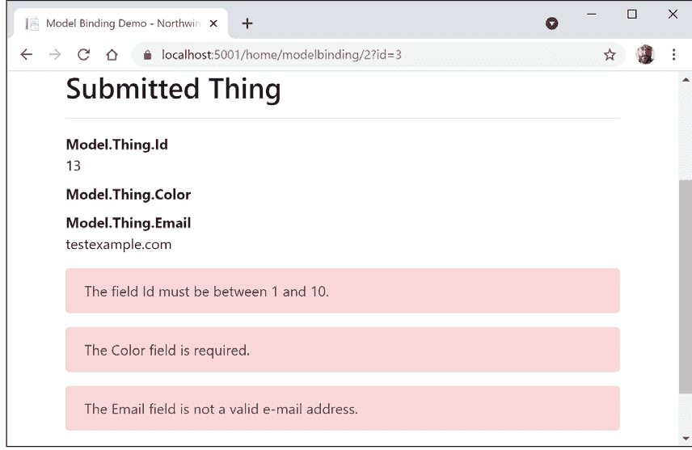

图 15.8：模型绑定演示页面中的字段验证

14. 关闭 Chrome 并关闭 Web 服务器。

**良好实践：** Microsoft 在 EmailAddress 验证属性的实现中使用了什么正则表达式？请在以下链接中查找： https://github.com/microsoft/referencesource/blob/5697c29004a34d80acfaf5742d7e699022c64ecd/System.ComponentModel.DataAnnotations/DataAnnotations/EmailAddressAttribute.cs#L54

## 理解视图辅助方法

在为 ASP.NET Core MVC 创建视图时，您可以使用 Html 对象及其方法来生成标记。

以下是有用的方法：

- ActionLink：使用此方法生成包含指向指定控制器和操作的 URL 路径的锚点 <a> 元素。例如，Html.ActionLink(linkText: "Binding", actionName: "ModelBinding", controllerName: "Home") 将生成 <a href="/home/modelbinding">Binding</a>。您也可以使用锚点标记助手实现相同的结果：<a asp-action="ModelBinding" asp-controller="Home">Binding</a>。
- AntiForgeryToken：在 <form> 内使用此方法插入包含防伪令牌的 <hidden> 元素，该令牌将在表单提交时进行验证。
- Display 和 DisplayFor：使用此方法使用显示模板为相对于当前模型的表达式生成 HTML 标记。.NET 类型有内置显示模板，并且可以在 DisplayTemplates 文件夹中创建自定义模板。在区分大小写的文件系统中，文件夹名称区分大小写。
- DisplayForModel：使用此方法为整个模型而不是单个表达式生成 HTML 标记。
- Editor 和 EditorFor：使用此方法使用编辑器模板为相对于当前模型的表达式生成 HTML 标记。.NET 类型有使用 <label> 和 <input> 元素的内置编辑器模板，并且可以在 EditorTemplates 文件夹中创建自定义模板。在区分大小写的文件系统中，文件夹名称区分大小写。
- EditorForModel：使用此方法为整个模型而不是单个表达式生成 HTML 标记。
- Encode：使用此方法将对象或字符串安全地编码为 HTML。例如，字符串值 "<script>" 将被编码为 "&lt;script&gt;"。这通常是不必要的，因为 Razor @ 符号默认会编码字符串值。
- Raw：使用此方法以 HTML 形式呈现字符串值而不进行编码。
- PartialAsync 和 RenderPartialAsync：使用这些方法为局部视图生成 HTML 标记。您可以选择性地传递模型和视图数据。

让我们看一个示例：

- 1. 在 Views/Home 中，打开 ModelBinding.cshtml。
- 2. 修改 Email 属性的呈现以使用 DisplayFor，如以下标记所示：
- 3. 启动网站。
- 4. 单击 Binding。
- 5. 单击 Submit。
- 6. 注意电子邮件地址是可点击的超链接，而不是纯文本。
- 7. 关闭 Chrome 并关闭 Web 服务器。

```
<dd>@Html.DisplayFor(model => model.Thing.Email)</dd>
```

- 8. 在 Models/Thing.cs 中，注释掉 Email 属性上方的 [EmailAddress] 属性。
- 9. 启动网站。
- 10. 单击 **Binding**。
- 11. 单击 **Submit**。
- 12. 注意电子邮件地址只是文本。
- 13. 关闭 Chrome 并关闭 Web 服务器。
- 14. 在 Models/Thing.cs 中，取消注释 [EmailAddress] 属性。

将 Email 属性用 [EmailAddress] 验证属性装饰并使用 DisplayFor 呈现的组合会通知 ASP.NET Core 将该值视为电子邮件地址，因此将其呈现为可点击的链接。

## 查询数据库并使用显示模板

让我们创建一个新的操作方法，该方法可以接收查询字符串参数并使用它查询 Northwind 数据库中价格高于指定价格的产品。

在之前的示例中，我们定义了一个视图模型，其中包含视图中需要呈现的每个值的属性。在此示例中，将有两个值：产品列表和访客输入的价格。为了避免必须为视图模型定义类或记录，我们将把产品列表作为模型传递，并将最高价格存储在 ViewData 集合中。

让我们实现此功能：

- 1. 在 HomeController 中，导入 Microsoft.EntityFrameworkCore 命名空间。我们需要它来添加 Include 扩展方法，以便我们可以包含相关实体，如您在第 10 章《使用 Entity Framework Core 工作数据》中所学。
- 2. 添加一个新的操作方法，如以下代码所示：

```csharp
public IActionResult ProductsThatCostMoreThan(decimal? price)
{
    if (!price.HasValue)
    {
        return BadRequest("You must pass a product price in the query string, for example, /Home/ProductsThatCostMoreThan?price=50");
    }

    IEnumerable<Product> model = db.Products
        .Include(p => p.Category)
        .Include(p => p.Supplier)
        .Where(p => p.UnitPrice > price);
```

```
if (!model.Any())
{
    return NotFound(
        $"No products cost more than {price:C}.");
}

ViewData["MaxPrice"] = price.Value.ToString("C");
return View(model); // pass model to view
}
```

- 3. 在 Views/Home 文件夹中，添加一个名为 ProductsThatCostMoreThan.cshtml 的新文件。
- 4. 修改内容，如以下代码所示：

```
@using Packt.Shared
@model IEnumerable<Product>
@{
    string title =
        "Products That Cost More Than " + ViewData["MaxPrice"];
    ViewData["Title"] = title;
}
<h2>@title</h2>
@if (Model is null)
{
    <div>No products found.</div>
}
else
{
    <table class="table">
        <thead>
            <tr>
                <th>Category Name</th>
                <th>Supplier's Company Name</th>
                <th>Product Name</th>
                <th>Unit Price</th>
                <th>Units In Stock</th>
            </tr>
        </thead>
        <tbody>
        @foreach (Product p in Model)
        {
            <tr>
                <td>
                    @Html.DisplayFor(modelItem => p.Category.CategoryName)
                </td>
                <td>
                    @Html.DisplayFor(modelItem => p.Supplier.CompanyName)
                </td>
```

```
<td>
    @Html.DisplayFor(modelItem => p.ProductName)
</td>
<td>
    @Html.DisplayFor(modelItem => p.UnitPrice)
</td>
<td>
    @Html.DisplayFor(modelItem => p.UnitsInStock)
</td>
</tr>
}
<tbody>
</table>
}
```

5. 在 Views/Home 文件夹中，打开 Index.cshtml。

6. 在访客计数下方和 Products 标题及其产品列表上方添加以下表单元素。这将为用户提供输入价格的表单。然后用户可以单击 Submit 以调用仅显示价格高于输入价格的产品的方法：

```
<h3>Query products by price</h3>
<form asp-action="ProductsThatCostMoreThan" method="GET">
    <input name="price" placeholder="Enter a product price" />
    <input type="submit" />
</form>
```

7. 启动网站。

8. 在主页上，在表单中输入价格，例如 50，然后单击 Submit。

9. 注意价格高于您输入的价格的产品表，如图 15.9 所示：

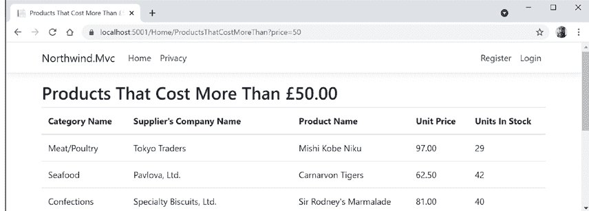

图 15.9：价格高于 £50 的筛选产品列表

10. 关闭 Chrome 并关闭 Web 服务器。


## 使用异步任务提高可扩展性

在构建桌面或移动应用时，可以使用多个任务（及其底层线程）来提高响应性，因为当一个线程忙于处理任务时，另一个线程可以处理与用户的交互。

任务及其线程在服务器端也很实用，尤其是在处理文件或从存储库或可能需要一段时间才能响应的 Web 服务请求数据的网站上。但它们对 CPU 密集型的复杂计算是有害的，因此应让这些计算像往常一样同步处理。

当 HTTP 请求到达 Web 服务器时，会从其线程池分配一个线程来处理该请求。但如果该线程必须等待某个资源，则会被阻塞，无法处理更多传入请求。如果网站收到的同时请求数超过其线程池中的线程数，则其中一些请求将以服务器超时错误 503 Service Unavailable 响应。

被锁定的线程并没有做有用的工作。它们本可以处理其中其他请求，但前提是我们要在网站中实现异步代码。

每当线程等待所需的资源时，它可以返回线程池并处理不同的传入请求，从而提高网站的可扩展性，即增加其可以处理的并发请求数量。

为什么不只是拥有更大的线程池呢？在现代操作系统中，池中的每个线程都有 1 MB 的栈。异步方法使用的内存更少。它还消除了在池中创建新线程的需求，而这需要时间。新线程添加到池中的速率通常每两秒一个，这与在异步线程之间切换相比是一个很长的时间。

> **良好实践：** 使你的控制器操作方法异步化。

## 使控制器操作方法异步化

使现有操作方法异步化很容易：

- 1. 修改 Index 操作方法使其异步化，返回一个任务，并等待对异步方法的调用以获取类别和产品，如以下代码中突出显示所示：

```
public async Task<IActionResult> Index()
{
HomeIndexViewModel model = new
(
    VisitorCount = (new Random()).Next(1, 1001),
    Categories = await db.Categories.ToListAsync(),
    Products = await db.Products.ToListAsync()
);
return View(model); // pass model to view
}
```

- 2. 以类似的方式修改 ProductDetail 操作方法，如以下代码中突出显示所示：

```
public async Task<IActionResult> ProductDetail(int? id)
{
    if (!id.HasValue)
    {
        return BadRequest("You must pass a product ID in the route, for example, /Home/ProductDetail/21");
    }

    Product? model = await db.Products
        .SingleOrDefaultAsync(p => p.ProductId == id);

    if (model == null)
    {
        return NotFound($"ProductId {id} not found.");
    }
    return View(model); // pass model to view and then return result
}
```

- 3. 启动网站并注意网站的功能保持不变，但相信它现在的可扩展性会更好。

- 4. 关闭 Chrome 并关闭 Web 服务器。

## 练习与探索

通过回答一些问题来测试你的知识和理解，进行一些实践操作，并通过更深入的研究探索本章主题。

## 练习 15.1 – 测试你的知识

回答以下问题：

1. 当在 Views 文件夹中创建时，特殊名称为 _ViewStart 和 _ViewImports 的文件有什么作用？
- 2. 默认 ASP.NET Core MVC 路由中定义的三个段的名称是什么，它们代表什么，哪些是可选的？
- 3. 默认模型绑定器做什么，它可以处理什么数据类型？
- 4. 在像 _Layout.cshtml 这样的共享布局文件中，如何输出当前视图的内容？
- 5. 在像 _Layout.cshtml 这样的共享布局文件中，如何输出当前视图可以提供内容的区域，以及视图如何为该区域提供内容？
- 6. 在控制器操作方法的内部调用 View 方法时，按约定会搜索哪些路径来查找视图？
- 7. 如何指示访客浏览器缓存响应的时间为 24 小时？
- 8. 即使你自己不创建，为什么你可能仍会启用 Razor Pages？
- 9. ASP.NET Core MVC 如何识别可以作为控制器使用的类？
- 10. ASP.NET Core MVC 在哪些方面使测试网站变得更容易？

## 练习 15.2 – 通过实现分类详情页来实践实现 MVC

Northwind.Mvc 项目有一个显示类别的首页，但当点击 View 按钮时，网站会返回 404 Not Found 错误，例如以下 URL：

```
https://localhost:5001/category/1
```

通过添加显示类别详情页的能力来扩展 Northwind.Mvc 项目。

## 练习 15.3 – 通过理解和实现异步操作方法来实践提高可扩展性

几年前，Stephen Cleary 为 MSDN Magazine 写了一篇优秀的文章，解释了为 ASP.NET 实现异步操作方法带来的可扩展性优势。相同的原则适用于 ASP.NET Core，但甚至更甚，因为与文章中描述的旧 ASP.NET 不同，ASP.NET Core 支持异步过滤器和其他组件。

在以下链接阅读该文章：

```
https://docs.microsoft.com/en-us/archive/msdn-magazine/2014/october/async-programming-introduction-to-async-await-on-asp-net
```

## 练习 15.4 – 实践单元测试 MVC 控制器

控制器是网站业务逻辑运行的地方，因此使用单元测试来测试该逻辑的正确性非常重要，正如你在第 4 章《编写、调试和测试函数》中所学到的。

为 HomeController 编写一些单元测试。


**良好实践：** 你可以在以下链接阅读有关如何单元测试控制器的更多信息： https://docs.microsoft.com/en-us/aspnet/core/mvc/controllers/testing

## 练习 15.5 – 探索主题

使用以下页面上的链接了解本章涵盖主题的更多信息：

https://github.com/markjprice/cs10dotnet6/blob/main/book-links.md#chapter-15---building-websites-using-the-model-view-controller-pattern

## 总结

在本章中，你学习了如何以易于单元测试的方式构建大型、复杂的网站，通过注册和注入依赖服务（如数据库上下文和记录器），并使用 ASP.NET Core MVC 使其更易于程序员团队管理。你学习了配置、身份验证、路由、模型、视图和控制器。

在下一章中，你将学习如何构建和使用 HTTP 作为通信层的服务，即 Web 服务。

## 16

## 构建与消费
Web 服务

本章介绍如何使用 ASP.NET Core Web API 构建 Web 服务（即 HTTP 或 REST 服务），并使用 HTTP 客户端消费 Web 服务，该客户端可以是任何其他类型的 .NET 应用，包括网站或移动或桌面应用。

本章需要你在第 10 章《使用 Entity Framework Core 工作数据》以及第 13 至 15 章中学到的知识和技能，关于 C# 和 .NET 的实际应用以及使用 ASP.NET Core 构建网站。

在本章中，我们将涵盖以下主题：

- 使用 ASP.NET Core Web API 构建 Web 服务
- 记录和测试 Web 服务
- 使用 HTTP 客户端消费 Web 服务
- 为 Web 服务实现高级功能
- 使用最小 API 构建 Web 服务

## 使用 ASP.NET Core Web API 构建 Web 服务

在构建现代 Web 服务之前，我们需要介绍一些背景知识来为本章设定上下文。

## 理解 Web 服务缩写

尽管 HTTP 最初是为请求和响应人类查看的 HTML 和其他资源而设计的，但它也非常适合构建服务。


Roy Fielding 在他的博士论文中描述了 **表征性状态转移 (REST)** 架构风格，指出 HTTP 标准非常适合构建服务，因为它定义了以下内容：

- 用于唯一标识资源的 URI，例如 `https://localhost:5001/api/products/23`。
- 对这些资源执行常见任务的方法，如 GET、POST、PUT 和 DELETE。
- 在请求和响应中交换的内容媒体类型的协商能力，例如 XML 和 JSON。内容协商发生在客户端指定类似 Accept 的请求头时：`application/xml,*/*;q=0.8`。ASP.NET Core Web API 使用的默认响应格式是 JSON，这意味着响应头之一将是 Content-Type：`application/json; charset=utf-8`。

**Web 服务** 使用 HTTP 通信标准，因此有时被称为 HTTP 或 RESTful 服务。本章讲述的就是 HTTP 或 RESTful 服务。

Web 服务也可以指实现部分 **WS-* 标准** 的 **简单对象访问协议 (SOAP)** 服务。这些标准使在不同系统上实现的客户端和服务能够相互通信。WS-* 标准最初由 IBM 在微软等其他公司参与下定义。

## 了解 Windows Communication Foundation (WCF)

.NET Framework 3.0 及更高版本包含一种名为 **Windows 通信基础 (WCF)** 的 **远程过程调用 (RPC)** 技术。RPC 技术使一个系统上的代码能够通过网络在另一个系统上执行代码。

WCF 使开发人员能够轻松创建服务，包括实现 WS-* 标准的 SOAP 服务。它后来也支持构建 Web/HTTP/REST 风格的服务，但如果这就是你唯一需要的功能，那么它就显得过于复杂了。

如果你有现有的 WCF 服务并希望将其移植到现代 .NET，那么有一个开源项目，其首个 **通用可用性 (GA)** 版本于 2021 年 2 月发布。你可以在以下链接中阅读相关信息：

```
https://corewcf.github.io/blog/2021/02/19/corewcf-ga-release
```

## WCF 的替代方案

微软推荐的 WCF 替代方案是 **gRPC**。gRPC 是由 Google 创建的现代跨平台开源 RPC 框架（非正式地，gRPC 中的“g”）。你将在 *第 18 章，构建和消费专用服务* 中了解更多关于 gRPC 的信息。

## 了解 Web API 的 HTTP 请求和响应

HTTP 定义了标准的请求类型和用于指示响应类型的标准代码。它们大多数可用于实现 Web API 服务。

最常见的请求类型是 GET，用于检索由唯一路径标识的资源，并可通过请求头设置其他选项，如可接受的媒体类型，如以下示例所示：

```
GET /path/to/resource
Accept: application/json
```

常见响应包括成功和多种类型的失败，如下表所示：

| 状态代码 | 描述 |
|---|---|
| 200 OK | 路径格式正确，资源成功找到，已序列化为可接受的媒体类型，然后返回在响应正文中。响应头指定 Content-Type、Content-Length 和 Content-Encoding，例如 GZIP。 |
| 301 永久移动 | 随着时间的推移，Web 服务可能会更改其资源模型，包括用于标识现有资源的路径。Web 服务可以通过返回此状态代码以及名为 Location 的响应头来指示新路径，该头包含新路径。 |
| 302 已找到 | 类似于 301。 |
| 304 未修改 | 如果请求包含 If-Modified-Since 头，则 Web 服务可以用此状态代码响应。响应正文为空，因为客户端应使用其缓存的资源副本。 |
| 400 错误请求 | 请求无效，例如，它使用了用于产品的路径，该路径使用整数 ID，但 ID 值缺失。 |
| 401 未授权 | 请求有效，资源已找到，但客户端未提供凭据或无权访问该资源。重新进行身份验证可能会启用访问，例如通过添加或更改 Authorization 请求头。 |
| 403 禁止访问 | 请求有效，资源已找到，但客户端无权访问该资源。重新进行身份验证无法解决问题。 |
| 404 未找到 | 请求有效，但资源未找到。如果稍后重复请求，资源可能被找到。要指示资源永远找不到，请返回 410 Gone。 |
| 406 不可接受 | 如果请求的 Accept 头仅列出 Web 服务不支持的媒体类型。例如，如果客户端请求 JSON 但 Web 服务只能返回 XML。 |
| 451 因法律原因不可用 | 主机在美国的网站可能会对来自欧洲的请求返回此状态，以避免遵守通用数据保护条例 (GDPR)。该数字是参考小说《华氏 451》，书中书籍被禁止并焚烧。 |
| 500 服务器错误 | 请求有效，但在处理请求时服务器端出现问题。稍后重试可能有效。 |
| 503 服务不可用 | Web 服务繁忙，无法处理请求。稍后重试可能有效。 |

其他常见的 HTTP 请求类型包括创建、修改或删除资源的 POST、PUT、PATCH 或 DELETE。

要创建新资源，你可以发送一个包含新资源的正文的 POST 请求，如以下代码所示：

```
POST /path/to/resource
Content-Length: 123
Content-Type: application/json
```

要创建新资源或更新现有资源，你可以发送一个包含现有资源全新版本的正文的 PUT 请求，如果资源不存在则创建，如果存在则替换（有时称为 upsert 操作），如以下代码所示：

```
PUT /path/to/resource
Content-Length: 123
Content-Type: application/json
```

为了更高效地更新现有资源，你可以发送一个包含仅包含需要更改属性的对象的正文的 PATCH 请求，如以下代码所示：

```
PATCH /path/to/resource
Content-Length: 123
Content-Type: application/json
```

要删除现有资源，你可以发送一个 DELETE 请求，如以下代码所示：

```
DELETE /path/to/resource
```

除了上表为 GET 请求显示的响应外，创建、修改或删除资源的请求类型还有额外的可能常见响应，如下表所示：

| 状态代码 | 描述 |
|---|---|
| 201 已创建 | 新资源创建成功，名为 Location 的响应头包含其路径，响应正文包含新创建的资源。立即 GET 该资源应返回 200。 |
| 202 已接受 | 新资源无法立即创建，因此请求被排队以便稍后处理，立即 GET 该资源可能会返回 404。正文可以包含指向某种状态检查器或资源何时可用的估计的资源。 |
| 204 无内容 | 通常用于响应 DELETE 请求，因为在删除后在正文中返回资源通常没有意义！有时用于响应 POST、PUT 或 PATCH 请求，如果客户端不需要确认请求是否正确处理。 |
| 405 方法不允许 | 当请求使用不支持的方法时返回。例如，设计为只读的 Web 服务可能会明确禁止 PUT、DELETE 等。 |
| 415 不支持的媒体类型 | 当请求正文中的资源使用 Web 服务无法处理的媒体类型时返回。例如，如果正文包含 XML 格式的资源，但 Web 服务只能处理 JSON。 |

## 创建 ASP.NET Core Web API 项目

我们将使用 ASP.NET Core 构建一个 Web 服务，提供一种使用 Northwind 数据库中的数据的方式，以便任何能够发出 HTTP 请求并接收 HTTP 响应的平台上的客户端应用程序都可以使用该数据：

1. 使用你喜欢的代码编辑器添加新项目，如以下列表中定义：
   1. 项目模板：ASP.NET Core Web API / webapi
   2. 工作区/解决方案文件和文件夹：PracticalApps
   3. 项目文件和文件夹：Northwind.WebApi
   4. 其他 Visual Studio 选项：身份验证类型：无，配置 HTTPS：已选，启用 Docker：已清除，启用 OpenAPI 支持：已选。
2. 在 Visual Studio Code 中，将 Northwind.WebApi 选择为活动的 OmniSharp 项目。
3. 构建 Northwind.WebApi 项目。
4. 在 Controllers 文件夹中，打开并查看 WeatherForecastController.cs，如以下代码所示：

```
using Microsoft.AspNetCore.Mvc;

namespace Northwind.WebApi.Controllers;

[ApiController]
[Route("[controller]")]
```

``` 
public class WeatherForecastController : ControllerBase
{
    private static readonly string[] Summaries = new[]
    {
        "Freezing", "Bracing", "Chilly", "Cool", "Mild",
        "Warm", "Balmy", "Hot", "Sweltering", "Scorching"
    };

    private readonly ILogger<WeatherForecastController> _logger;

    public WeatherForecastController(
        ILogger<WeatherForecastController> logger)
    {
        _logger = logger;
    }

    [HttpGet]
    public IEnumerable<WeatherForecast> Get()
    {
        return Enumerable.Range(1, 5).Select(index =>
            new WeatherForecast
            {
                Date = DateTime.Now.AddDays(index),
                TemperatureC = Random.Shared.Next(-20, 55),
                Summary = Summaries[Random.Shared.Next(Summaries.Length)]
            })
            .ToArray();
    }
}
```

在审阅前面的代码时，请注意以下几点：

-   控制器类继承自 ControllerBase。这比 MVC 中使用的 Controller 类更简单，因为它没有像 View 这样的方法来通过将视图模型传递给 Razor 文件来生成 HTML 响应。
-   [Route] 属性为客户端使用以便由该控制器处理的 HTTP 请求注册 /weatherforecast 相对 URL。例如，对 https://localhost:5001/weatherforecast/ 的 HTTP 请求将由该控制器处理。一些开发者喜欢在控制器名称前加上 api/，这是在混合项目中区分 MVC 和 Web API 的惯例。如果像所示那样使用 [controller]，它会使用类名中 Controller 之前的字符，在本例中为 WeatherForecast，或者你可以简单地输入不同的名称而不带方括号，例如 [Route("api/forecast")]。
-   [ApiController] 属性随 ASP.NET Core 2.1 引入，它为控制器启用 REST 特定行为，例如对无效模型自动返回 HTTP 400 响应，正如本章后面将看到的那样。
-   [HttpGet] 属性将控制器类中的 Get 方法注册为响应 HTTP GET 请求，其实现使用共享的 Random 对象返回一个 WeatherForecast 对象数组，其中包含未来五天天气的随机温度和摘要，如 Bracing 或 Balmy。

5. 添加第二个 Get 方法，允许调用指定预报应提前多少天，通过实现以下内容：

-   在原始方法上方添加注释，以显示其响应的操作方法及 URL 路径。
-   添加一个带有名为 days 的整数参数的新方法。
-   将原始 Get 方法的实现代码语句剪切并粘贴到新的 Get 方法中。
-   修改新方法以创建从 1 到所请求天数个整数的 IEnumerable，并修改原始 Get 方法以调用新 Get 方法并传递值 5。

你的方法应如以下代码中突出显示的那样：

```csharp
// GET /weatherforecast
[HttpGet]
public IEnumerable<WeatherForecast> Get() // original method
{
    return Get(5); // five day forecast
}

// GET /weatherforecast/7
[HttpGet("{days:int}")]
public IEnumerable<WeatherForecast> Get(int days) // new method
{
    return Enumerable.Range(1, days).Select(index =>
        new WeatherForecast
        {
            Date = DateTime.Now.AddDays(index),
            TemperatureC = Random.Shared.Next(-20, 55),
            Summary = Summaries[Random.Shared.Next(Summaries.Length)]
        })
        .ToArray();
}
```

在 [HttpGet] 属性中，注意路由格式模式 {days:int}，它将 days 参数约束为 int 值。

## 审查 Web 服务的功能

现在，我们将测试 Web 服务的功能：

1. 如果你使用 Visual Studio，在 **Properties** 中打开 launchSettings.json 文件，并注意默认情况下它将启动浏览器并导航到 /swagger 相对 URL 路径，如以下标记中突出显示的那样：
2. 修改名为 Northwind.WebApi 的配置文件，将 launchBrowser 设置为 false。
3. 对于 applicationUrl，将 HTTP 的随机端口号更改为 5000，将 HTTPS 更改为 5001。
4. 启动 Web 服务项目。
5. 启动 Chrome。
6. 导航到 https://localhost:5001/ 并注意你会收到 404 状态码响应，因为我们尚未启用静态文件，也没有 index.html，也没有配置路由的 MVC 控制器。请记住，该项目并非设计用于人类查看和交互，因此这是 Web 服务的预期行为。
7. 在 Chrome 中显示 **Developer tools**。
8. 导航到 https://localhost:5001/weatherforecast 并注意 Web API 服务应返回一个包含五个随机天气预报对象的 JSON 文档数组，如图 16.1 所示：

```json
"profiles": {
  "Northwind.WebApi": {
    "commandName": "Project",
    "dotnetRunMessages": "true",
    "launchBrowser": true,
    "launchUrl": "swagger",
    "applicationUrl": "https://localhost:5001;http://localhost:5000",
    "environmentVariables": {
      "ASPNETCORE_ENVIRONMENT": "Development"
    }
  },
}
```


> GitHub 上的解决方案配置为使用端口 5002，因为我们将在本书后面更改其配置。

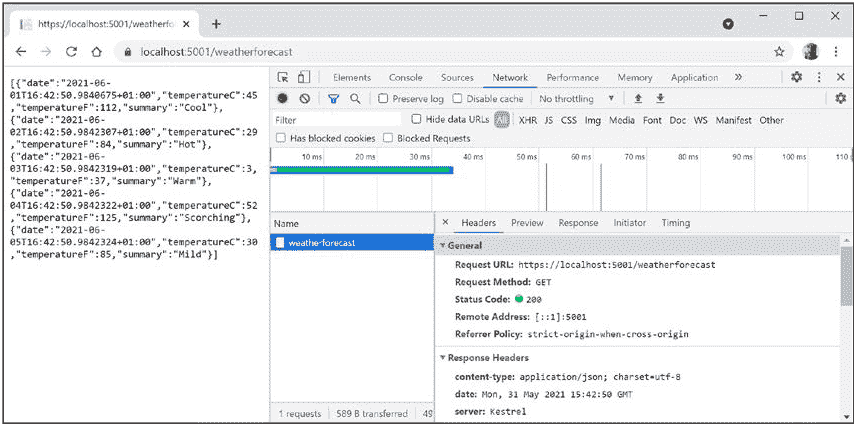

图 16.1：来自天气预报 Web 服务的请求和响应

9. 关闭 Developer tools。
10. 导航到 https://localhost:5001/weatherforecast/14 并注意请求两周天气预报时的响应，如图 16.2 所示：
11. 关闭 Chrome 并关闭 Web 服务器。

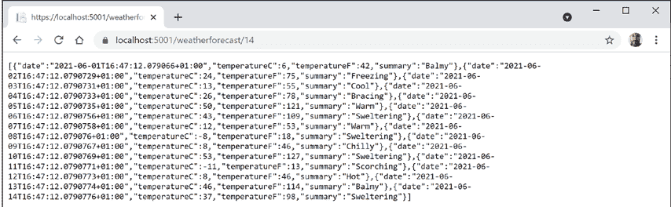

图 16.2：作为 JSON 文档的两周天气预报

## 为 Northwind 数据库创建 Web 服务

与 MVC 控制器不同，Web API 控制器不会调用 Razor 视图来为网站访问者在浏览器中查看返回 HTML 响应。相反，它们使用内容协商与发出 HTTP 请求的客户端应用程序，以在 HTTP 响应中以 XML、JSON 或 X-WWW-FORM-URLENCODED 等格式返回数据。

客户端应用程序随后必须从协商的格式反序列化数据。现代 Web 服务最常用的格式是 JavaScript Object Notation（JSON），因为它紧凑，并且在构建使用 Angular、React 和 Vue 等客户端技术构建的单页应用程序（SPA）时，可与浏览器中的 JavaScript 原生配合使用。

我们将引用你在第 13 章《Introducing Practical Applications of C# and .NET》中创建的 Northwind 数据库的 Entity Framework Core 实体数据模型：

1. 在 Northwind.WebApi 项目中，为 SQLite 或 SQL Server 添加对 Northwind.Common.DataContext 的项目引用，如以下标记所示：
2. 构建项目并修复代码中的任何编译错误。
3. 打开 Program.cs 并导入用于处理 Web 媒体格式化程序和共享 Packt 类的命名空间，如以下代码所示：
4. 在调用 AddControllers 之前添加一条语句以注册 Northwind 数据库上下文类（它将使用 SQLite 或 SQL Server，具体取决于你在项目文件中引用的数据库提供程序），如以下代码所示：
5. 在 AddControllers 调用中，添加一个 lambda 块，其中包含将默认输出格式化程序的名称和支持的媒体类型写入控制台的语句，然后添加 XML 序列化程序格式化程序，如以下代码所示：

```
<ItemGroup>
    <!-- change Sqlite to SqlServer if you prefer -->
    <ProjectReference Include=
    "..\Northwind.Common.DataContext.Sqlite\Northwind.Common.DataContext.Sqlite.csproj" />
</ItemGroup>
```

```
using Microsoft.AspNetCore.Mvc.Formatters;
using Packt.Shared; // AddNorthwindContext extension method

using static System.Console;
```

```
// Add services to the container.
builder.Services.AddNorthwindContext();
```

```
builder.Services.AddControllers(options =>
{
    WriteLine("Default output formatters:");
    foreach (IOutputFormatter formatter in options.OutputFormatters)
    {
        OutputFormatter? mediaFormatter = formatter as OutputFormatter;
        if (mediaFormatter == null)
        {
            WriteLine($"  {formatter.GetType().Name}");
        }
        else // OutputFormatter class has SupportedMediaTypes
```


```
{
    WriteLine(" {0}, Media types: {1}",
        arg0: mediaFormatter.GetType().Name,
        arg1: string.Join(", ",
            mediaFormatter.SupportedMediaTypes));
    }
}
.AddXmlDataContractSerializerFormatters()
.AddXmlSerializerFormatters();
```

6. 启动 Web 服务。

7. 在命令提示符或终端中，注意有四个默认输出格式化程序，包括将空值转换为 204 No Content 的格式化程序，以及支持纯文本、字节流和 JSON 响应的格式化程序，如以下输出所示：

```
Default output formatters:
    HttpNoContentOutputFormatter
    StringOutputFormatter, Media types: text/plain
    StreamOutputFormatter
    SystemTextJsonOutputFormatter, Media types: application/json, text/json, application/*+json
```

8. 关闭 Web 服务器。

## 为实体创建数据存储库

定义和实现数据存储库以提供 CRUD 操作是良好的实践。CRUD 缩写包括以下操作：

- C 代表 Create
- R 代表 Retrieve (or Read)
- U 代表 Update
- D 代表 Delete

我们将为 Northwind 中的 Customers 表创建一个数据存储库。该表中只有 91 个客户，因此我们将整张表的副本存储在内存中，以提高读取客户记录时的可扩展性和性能。

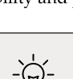

> **良好实践：** 在实际的 Web 服务中，您应该使用像 Redis 这样的分布式缓存，它是一个开源数据结构存储，可用作高性能、高可用的数据库、缓存或消息代理。

我们将遵循现代良好的实践，使存储库 API 异步化。它将由 Controller 类使用构造函数参数注入实例化，因此为处理每个 HTTP 请求都会创建新实例：

1. 在 Northwind.WebApi 项目中，创建一个名为 Repositories 的文件夹。

2. 在 Repositories 文件夹中添加两个类文件，命名为 ICustomerRepository.cs 和 CustomerRepository.cs。

3. ICustomerRepository 接口将定义五个方法，如以下代码所示：

```
using Packt.Shared; // Customer

namespace Northwind.WebApi.Repositories;

public interface ICustomerRepository
{
    Task<Customer?> CreateAsync(Customer c);
    Task<IEnumerable<Customer>> RetrieveAllAsync();
    Task<Customer?> RetrieveAsync(string id);
    Task<Customer?> UpdateAsync(string id, Customer c);
    Task<bool?> DeleteAsync(string id);
}
```

4. CustomerRepository 类将实现这五个方法，请记住在内部使用 await 的方法必须标记为 async，如以下代码所示：

```
using Microsoft.EntityFrameworkCore.ChangeTracking; // EntityEntry<T>
using Packt.Shared; // Customer
using System.Collections.Concurrent; // ConcurrentDictionary

namespace Northwind.WebApi.Repositories;

public class CustomerRepository : ICustomerRepository
{
    // use a static thread-safe dictionary field to cache the customers
    private static ConcurrentDictionary<string, Customer?> customersCache;

    // use an instance data context field because it should not be
    // cached due to their internal caching
    private NorthwindContext db;

    public CustomerRepository(NorthwindContext injectedContext)
    {
        db = injectedContext;
    }
```

```
// pre-load customers from database as a normal
// Dictionary with CustomerId as the key,
// then convert to a thread-safe ConcurrentDictionary
if (customersCache is null)
{
    customersCache = new ConcurrentDictionary<string, Customer>(
        db.Customers.ToDictionary(c => c.CustomerId));
}
}
```

public async Task<Customer?> CreateAsync(Customer c)
{
    // normalize CustomerId into uppercase
    c.CustomerId = c.CustomerId.ToUpper();

    // add to database using EF Core
    EntityEntry<Customer> added = await db.Customers.AddAsync(c);
    int affected = await db.SaveChangesAsync();
    if (affected == 1)
    {
        if (customersCache is null) return c;
        // if the customer is new, add it to cache, else
        // call UpdateCache method
        return customersCache.AddOrUpdate(c.CustomerId, c, UpdateCache);
    }
    else
    {
        return null;
    }
}

public Task<IEnumerable<Customer>> RetrieveAllAsync()
{
    // for performance, get from cache
    return Task.FromResult(customersCache is null
        ? Enumerable.Empty<Customer>() : customersCache.Values);
}

public Task<Customer?> RetrieveAsync(string id)
{
    // for performance, get from cache
    id = id.ToUpper();
    if (customersCache is null) return null!;
    customersCache.TryGetValue(id, out Customer? c);
```

```
return Task.FromResult(c);
}

private Customer UpdateCache(string id, Customer c)
{
    Customer? old;
    if (customersCache is not null)
    {
        if (customersCache.TryGetValue(id, out old))
        {
            if (customersCache.TryUpdate(id, c, old))
            {
                return c;
            }
        }
    }
    return null!;
}

public async Task<Customer?> UpdateAsync(string id, Customer c)
{
    // normalize customer Id
    id = id.ToUpper();
    c.CustomerId = c.CustomerId.ToUpper();

    // update in database
    db.Customers.Update(c);
    int affected = await db.SaveChangesAsync();
    if (affected == 1)
    {
        // update in cache
        return UpdateCache(id, c);
    }
    return null;
}

public async Task<bool?> DeleteAsync(string id)
{
    id = id.ToUpper();

    // remove from database
    Customer? c = db.Customers.Find(id);
    if (c is null) return null;
    db.Customers.Remove(c);
    int affected = await db.SaveChangesAsync();
```

```
if (affected == 1)
{
    if (customersCache is null) return null;
    // remove from cache
    return customersCache.TryRemove(id, out c);
}
else
{
    return null;
}
}
}
```

## 实现 Web API 控制器

有一些有用的属性和方法可用于实现返回数据而不是 HTML 的控制器。

对于 MVC 控制器，像 /home/index 这样的路由告诉我们控制器类名和操作方法名，例如 HomeController 类和 Index 操作方法。

对于 Web API 控制器，像 /weatherforecast 这样的路由只告诉我们控制器类名，例如 WeatherForecastController。要确定要执行的操作方法名，我们必须将 GET 和 POST 等 HTTP 方法映射到控制器类中的方法。

您应该使用以下属性装饰控制器方法以指示它们将响应的 HTTP 方法：

- [HttpGet], [HttpHead]: 这些操作方法响应对资源的 GET 或 HEAD 请求，返回资源及其响应头或仅响应头。
- [HttpPost]: 此操作方法响应用于创建新资源或执行服务定义的某些其他操作的 POST 请求。
- [HttpPut], [HttpPatch]: 这些操作方法响应用于通过替换资源或更新其属性子集来更新现有资源的 PUT 或 PATCH 请求。
- [HttpDelete]: 此操作方法响应用于删除资源的 DELETE 请求。
- [HttpOptions]: 此操作方法响应 OPTIONS 请求。

## 理解操作方法返回类型

操作方法可以返回 .NET 类型，如单个字符串值、由类、记录或结构定义的复杂对象，或复杂对象的集合。ASP.NET Core Web API 将根据 HTTP 请求 Accept 头中设置请求的格式将其序列化为，例如 JSON，如果已注册合适的序列化程序。

为了更好地控制响应，有返回 ActionResult 包装器围绕 .NET 类型的辅助方法。

如果操作方法可能根据输入或其他变量返回不同的返回类型，请将操作方法的返回类型声明为 IActionResult。如果它将仅返回单个类型但具有不同的状态代码，请将操作方法的返回类型声明为 ActionResult<T>。


> **良好实践：** 使用 [ProducesResponseType] 属性装饰操作方法，以指示客户端应期望响应的所有已知类型和 HTTP 状态代码。此信息随后可以公开以记录客户端应如何与 Web 服务交互。将其视为正式文档的一部分。本章后面您将学习如何安装代码分析器，当您未像这样装饰操作方法时，它会向您发出警告。

例如，基于 id 参数获取产品的操作方法将用三个属性装饰——一个用于指示它响应 GET 请求并具有 id 参数，两个用于指示成功时发生的情况以及客户端提供无效产品 ID 时发生的情况，如以下代码所示：

```
[HttpGet("{id}")]
[ProducesResponseType(200, Type = typeof(Product))]
[ProducesResponseType(404)]
public IActionResult Get(string id)
```

ControllerBase 类具有使返回不同响应变得容易的方法，如下表所示：

| 方法 | 描述 |
|---|---|
| Ok | 返回 200 状态代码和转换为客户端首选格式的资源，如 JSON 或 XML。常用于响应 GET 请求。 |
| CreatedAtRoute | 返回 201 状态代码和新资源的路径。常用于响应用于创建资源的 POST 请求，该资源可以快速执行。 |
| Accepted | 返回 202 状态代码以指示请求正在处理中但尚未完成。常用于响应触发长时间完成的后台进程的 POST、PUT、PATCH 或 DELETE 请求。 |
| NoContentResult | 返回 204 状态代码和空响应体。常用于响应 PUT、PATCH 或 DELETE 请求，当响应不需要包含受影响的资源时。 |
| BadRequest | 返回 400 状态代码和可选的消息字符串提供更多详细信息。 |
| NotFound | 返回 404 状态代码和自动填充的 ProblemDetails 主体（需要 2.2 或更高版本的兼容性版本）。 |


## 配置客户存储库和 Web API 控制器

现在您将配置存储库，以便可以从 Web API 控制器内部调用它。

您将在 Web 服务启动时为存储库注册一个作用域依赖服务实现，然后使用构造函数参数注入将其获取到一个新的 Web API 控制器中以处理客户。

为了展示使用路由区分 MVC 和 Web API 控制器的示例，我们将为 customers 控制器使用常见的 /api URL 前缀约定：

- 1. 打开 Program.cs 并导入 Northwind.WebApi.Repositories 命名空间。
- 2. 在调用 Build 方法之前添加一条语句，该语句将 CustomerRepository 注册为在运行时使用的作用域依赖项，如以下代码中突出显示所示：
- 3. 在 Controllers 文件夹中，添加一个名为 CustomersController.cs 的新类。
- 4. 在 CustomersController 类文件中，添加语句以定义用于处理客户的 Web API 控制器类，如以下代码所示：

```
builder.Services.AddScoped<ICustomerRepository, CustomerRepository>();

var app = builder.Build();
```

> 良好实践：我们的存储库使用注册为作用域依赖项的数据库上下文。您只能在其他作用域依赖项内部使用作用域依赖项，因此我们无法将存储库注册为单例。您可以在以下链接中阅读更多相关信息：https://docs.microsoft.com/en-us/dotnet/core/extensions/dependency-injection#scoped

```csharp
using Microsoft.AspNetCore.Mvc; // [Route], [ApiController], ControllerBase
using Packt.Shared; // Customer
using Northwind.WebApi.Repositories; // ICustomerRepository

namespace Northwind.WebApi.Controllers;

// base address: api/customers
[Route("api/[controller]")]
[ApiController]
public class CustomersController : ControllerBase
{
private readonly ICustomerRepository repo;

// constructor injects repository registered in Startup
public CustomersController(ICustomerRepository repo)
{
    this.repo = repo;
}

// GET: api/customers
// GET: api/customers/?country=[country]
// this will always return a list of customers (but it might be empty)
[HttpGet]
[ProducesResponseType(200, Type = typeof(IEnumerable<Customer>))]
public async Task<IEnumerable<Customer>> GetCustomers(string? country)
{
    if (string.IsNullOrWhiteSpace(country))
    {
        return await repo.RetrieveAllAsync();
    }
    else
    {
        return (await repo.RetrieveAllAsync())
            .Where(customer => customer.Country == country);
    }
}

// GET: api/customers/[id]
[HttpGet("{id}", Name = nameof(GetCustomer))] // named route
[ProducesResponseType(200, Type = typeof(Customer))]
[ProducesResponseType(404)]
public async Task<IActionResult> GetCustomer(string id)
{
    Customer? c = await repo.RetrieveAsync(id);
    if (c == null)
    {
        return NotFound(); // 404 Resource not found
    }
    return Ok(c); // 200 OK with customer in body
}

// POST: api/customers
// BODY: Customer (JSON, XML)
[HttpPost]
[ProducesResponseType(201, Type = typeof(Customer))]
[ProducesResponseType(400)]
public async Task<IActionResult> Create([FromBody] Customer c)
{
    if (c == null)
{
    return BadRequest(); // 400 Bad request
}

Customer? addedCustomer = await repo.CreateAsync(c);

if (addedCustomer == null)
{
    return BadRequest("Repository failed to create customer.");
}
else
{
    return CreatedAtRoute( // 201 Created
        routeName: nameof(GetCustomer),
        routeValues: new { id = addedCustomer.CustomerId.ToLower() },
        value: addedCustomer);
}
}

// PUT: api/customers/[id]
// BODY: Customer (JSON, XML)
[HttpPut("{id}")]
[ProducesResponseType(204)]
[ProducesResponseType(400)]
[ProducesResponseType(404)]
public async Task<IActionResult> Update(
    string id, [FromBody] Customer c)
{
    id = id.ToUpper();
    c.CustomerId = c.CustomerId.ToUpper();

    if (c == null || c.CustomerId != id)
    {
        return BadRequest(); // 400 Bad request
    }

    Customer? existing = await repo.RetrieveAsync(id);
    if (existing == null)
    {
        return NotFound(); // 404 Resource not found
    }

    await repo.UpdateAsync(id, c);

    return new NoContentResult(); // 204 No content
}

// DELETE: api/customers/[id]
[HttpDelete("{id}")]
[ProducesResponseType(204)]
[ProducesResponseType(400)]
[ProducesResponseType(404)]
public async Task<IActionResult> Delete(string id)
{
    Customer? existing = await repo.RetrieveAsync(id);
    if (existing == null)
    {
        return NotFound(); // 404 Resource not found
    }

    bool? deleted = await repo.DeleteAsync(id);

    if (deleted.HasValue && deleted.Value) // short circuit AND
    {
        return new NoContentResult(); // 204 No content
    }
    else
    {
        return BadRequest( // 400 Bad request
            $"Customer {id} was found but failed to delete.");
    }
}
}
```

在审查此 Web API 控制器类时，请注意以下事项：

- Controller 类注册的路由以 api/ 开头，并包含控制器的名称，即 api/customers。
- 构造函数使用依赖注入获取用于处理客户的已注册存储库。
- 有五个操作方法用于对客户执行 CRUD 操作——两个 GET 方法（用于所有客户或单个客户）、POST（创建）、PUT（更新）和 DELETE。
- GetCustomers 方法可以传递一个包含国家名称的字符串参数。如果缺少该参数，则返回所有客户。如果存在，则用于按国家筛选客户。
- GetCustomer 方法的路由明确命名为 GetCustomer，以便在插入新客户后可用于生成 URL。
- Create 和 Update 方法都使用 [FromBody] 装饰 customer 参数，以告诉模型绑定器使用 POST 请求正文中的值填充它。
- Create 方法返回的响应使用 GetCustomer 路由，以便客户端将来知道如何获取新创建的资源。我们将两个方法匹配起来以创建然后获取客户。
- Create 和 Update 方法无需检查 HTTP 请求正文中传递的客户的模型状态并在无效时返回包含模型验证错误详细信息的 400 Bad Request，因为控制器使用 [ApiController] 装饰，该装饰会为您执行此操作。

当服务接收到 HTTP 请求时，它将创建 Controller 类的实例，调用适当的操作方法，以客户端首选的格式返回响应，并释放控制器使用的资源，包括存储库及其数据上下文。

## 指定问题详细信息

在 ASP.NET Core 2.1 及更高版本中添加的一项功能是对指定问题详细信息的 Web 标准实现。

在启用了 ASP.NET Core 2.2 或更高版本兼容性的项目中，使用 [ApiController] 装饰的 Web API 控制器中，返回 IActionResult 并返回客户端错误状态代码（即 4xx）的操作方法将自动在响应正文中包含 ProblemDetails 类的序列化实例。

如果您想掌控主动权，则可以自行创建 ProblemDetails 实例并包含附加信息。

让我们模拟一个需要向客户端返回自定义数据的错误请求：

- 1. 在 Delete 方法的实现顶部，添加语句以检查 id 是否匹配字面字符串值 "bad"，如果是，则返回自定义问题详细信息对象，如以下代码所示：
- 2. 您稍后将测试此功能。

```csharp
// take control of problem details
if (id == "bad")
{
    ProblemDetails problemDetails = new()
    {
        Status = StatusCodes.Status400BadRequest,
        Type = "https://localhost:5001/customers/failed-to-delete",
        Title = $"Customer ID {id} found but failed to delete.",
        Detail = "More details like Company Name, Country and so on.",
        Instance = HttpContext.Request.Path
    };
    return BadRequest(problemDetails); // 400 Bad Request
}
```


## 控制 XML 序列化

在 Program.cs 中，我们添加了 XmlSerializer，以便我们的 Web API 服务在客户端请求时可以返回 XML 以及 JSON。

然而，XmlSerializer 无法序列化接口，而我们的实体类使用 ICollection<T> 来定义相关的子实体。这会在运行时导致警告，例如针对 Customer 类及其 Orders 属性，如以下输出所示：

```
warn: Microsoft.AspNetCore.Mvc.Formatters.XmlSerializerOutputFormatter[1]
An error occurred while trying to create an XmlSerializer for the type 'Packt.Shared.Customer'.
System.InvalidOperationException: There was an error reflecting type 'Packt.Shared.Customer'.
---> System.InvalidOperationException: Cannot serialize member 'Packt.Shared.Customer.Orders' of type 'System.Collections.Generic.ICollection`1[[Packt.Shared.Order, Northwind.Common.EntityModels, Version=1.0.0.0, Culture=neutral, PublicKeyToken=null]]', see inner exception for more details.
```

我们可以通过在序列化 Customer 到 XML 时排除 Orders 属性来防止此警告：

- 1. 在 Northwind.Common.EntityModels.Sqlite 和 Northwind.Common.EntityModels.SqlServer 项目中，打开 Customers.cs。
- 2. 导入 System.Xml.Serialization 命名空间，以便我们可以使用 [XmlIgnore] 属性。
- 3. 使用属性装饰 Orders 属性以在序列化时忽略它，如以下代码中突出显示所示：
- 4. 在 Northwind.Common.EntityModels.SqlServer 项目中，也用 [XmlIgnore] 装饰 CustomerCustomerDemos 属性。

```
[InverseProperty(nameof(Order.Customer))]
[XmlIgnore]
public virtual ICollection<Order> Orders { get; set; }
```

## 记录和测试 Web 服务

你可以通过使用浏览器发出 HTTP GET 请求轻松测试 Web 服务。要测试其他 HTTP 方法，我们需要更高级的工具。

## 使用浏览器测试 GET 请求

你将使用 Chrome 测试三种 GET 请求的实现——获取所有客户、获取指定国家/地区的客户，以及使用其唯一客户 ID 获取单个客户：

- 1. 启动 Northwind.WebApi Web 服务。
- 2. 启动 Chrome。
- 3. 导航到 https://localhost:5001/api/customers 并注意返回的 JSON 文档，其中包含 Northwind 数据库中全部 91 名客户（未排序），如图 16.3 所示：
- 4. 导航到 https://localhost:5001/api/customers/?country=Germany 并注意返回的 JSON 文档，其中仅包含德国的客户，如图 16.4 所示：
- 5. 导航到 https://localhost:5001/api/customers/alfki 并注意返回的 JSON 文档，其中仅包含名为 Alfreds Futterkiste 的客户，如图 16.5 所示：

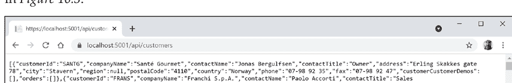

Figure 16.3: 来自 Northwind 数据库的客户作为 JSON 文档

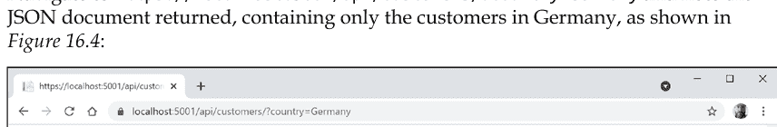

Figure 16.4: 来自德国的客户列表作为 JSON 文档

> 如果返回空数组，请确保使用正确的大小写输入国家名称，因为数据库查询区分大小写。例如，比较 uk 和 UK 的结果。

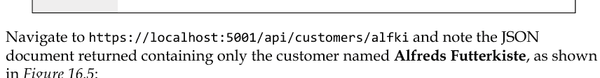

Figure 16.5: 特定客户信息作为 JSON 文档

与国家名称不同，我们无需担心客户 id 值的大小写，因为在控制器类内部，我们在代码中将字符串值规范化为大写。

但是我们如何测试其他 HTTP 方法，例如 POST、PUT 和 DELETE？又如何记录我们的 Web 服务，以便任何人都能轻松理解如何与其交互？

为了解决第一个问题，我们可以安装一个名为 **REST Client** 的 Visual Studio Code 扩展。为了解决第二个问题，我们可以使用 **Swagger**，这是世界上最流行的用于记录和测试 HTTP API 的技术。但首先，让我们看看使用 Visual Studio Code 扩展可以实现什么。


> 有许多用于测试 Web API 的工具，例如 **Postman**。尽管 Postman 很受欢迎，但我更喜欢 **REST Client**，因为它不会隐藏实际发生的事情。我觉得 Postman 太 GUI 化了。但我鼓励你探索不同的工具并找到适合你风格的工具。你可以在以下链接了解更多关于 Postman 的信息：https://www.postman.com/

## 使用 REST Client 扩展测试 HTTP 请求

REST Client 是一个扩展，允许你在 Visual Studio Code 中发送任何类型的 HTTP 请求并查看响应。即使你更喜欢使用 Visual Studio 作为代码编辑器，安装 Visual Studio Code 以使用像 REST Client 这样的扩展也是有用的。

## 使用 REST Client 发出 GET 请求

我们将首先创建一个用于测试 GET 请求的文件：

- 1. 如果你尚未安装由 Huachao Mao 创建的 REST Client（humao.rest-client），请现在在 Visual Studio Code 中安装它。
- 2. 在你喜欢的代码编辑器中，启动 Northwind.WebApi 项目 Web 服务。
- 3. 在 Visual Studio Code 中，在 PracticalApps 文件夹中创建 RestClientTests 文件夹，然后打开该文件夹。
- 4. 在 RestClientTests 文件夹中，创建一个名为 get-customers.http 的文件，并修改其内容以包含用于检索所有客户的 HTTP GET 请求，如以下代码所示：
- 5. 在 Visual Studio Code 中，导航到 View | Command Palette，输入 rest client，选择命令 Rest Client: Send Request，然后按 Enter，如图 16.6 所示：

```
GET https://localhost:5001/api/customers/ HTTP/1.1
```

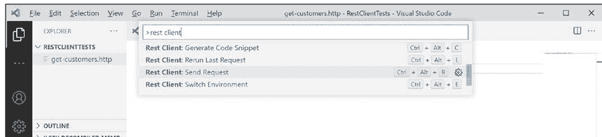

Figure 16.6: 使用 REST Client 发送 HTTP GET 请求

6. 注意 **Response** 在新的选项卡窗口窗格中垂直显示，并且你可以通过拖放选项卡将打开的选项卡重新排列为水平布局。

7. 输入更多 GET 请求，每个请求由三个井号分隔，以测试获取不同国家的客户以及使用其 ID 获取单个客户，如以下代码所示：

```
###
GET https://localhost:5001/api/customers/?country=Germany HTTP/1.1
###
GET https://localhost:5001/api/customers/?country=USA HTTP/1.1
Accept: application/xml
###
GET https://localhost:5001/api/customers/ALFKI HTTP/1.1
###
GET https://localhost:5001/api/customers/abcxy HTTP/1.1
```

8. 点击每个请求上方的 **Send Request** 链接以发送它；例如，GET 请求带有请求头以 XML 而非 JSON 请求美国的客户，如图 16.7 所示：


Figure 16.7: 使用 REST Client 发送 XML 请求并获取响应

## 使用 REST Client 发出其他请求

接下来，我们将创建一个用于测试其他请求（如 POST）的文件：

- 1. 在 RestClientTests 文件夹中，创建一个名为 create-customer.http 的文件，并修改其内容以定义用于创建新客户的 POST 请求，注意在输入常见 HTTP 请求时 REST Client 会提供 IntelliSense，如以下代码所示：

```
POST https://localhost:5001/api/customers/ HTTP/1.1
Content-Type: application/json
Content-Length: 301

{
  "customerID": "ABCXY",
  "companyName": "ABC Corp",
  "contactName": "John Smith",
  "contactTitle": "Sir",
  "address": "Main Street",
  "city": "New York",
  "region": "NY",
  "postalCode": "90210",
  "country": "USA",
  "phone": "(123) 555-1234",
  "fax": null,
  "orders": null
}
```

- 2. 由于不同操作系统中的换行符不同，Content-Length 头的值在 Windows 和 macOS 或 Linux 上会不同。如果值错误，则请求将失败。要发现正确的正文长度，请选择请求正文，然后在状态栏中查看字符数，如图 16.8 所示：


Figure 16.8: 检查正确的正文长度

3. 发送请求并注意响应为 201 Created。还请注意新创建的客户的位置（即 URL）为 https://localhost:5001/api/Customers/abcxy，并且响应正文中包含新创建的客户，如图 16.9 所示：


Figure 16.9: 添加新客户

我将给你一个可选挑战，创建 REST Client 文件来测试更新客户（使用 PUT）和删除客户（使用 DELETE）。请在已存在的客户以及不存在的客户上尝试。解决方案在本书的 GitHub 仓库中。

现在我们已经看到了快速简便的测试服务的方法，这也恰好是学习 HTTP 的好方法，那么外部开发者呢？我们希望他们尽可能轻松地学习然后调用我们的服务。为此，我们将使用 Swagger。

## 了解 Swagger

Swagger 最重要的部分是 OpenAPI Specification，它为你的 API 定义了 REST 风格的契约，以人类可读和机器可读的格式详细说明其所有资源和操作，便于开发、发现和集成。

开发者可以使用 Web API 的 OpenAPI Specification 自动生成其首选语言或库中的强类型客户端代码。

对我们来说，另一个有用的功能是 Swagger UI，因为它会自动为你的 API 生成文档，并内置可视化测试功能。

让我们回顾一下如何使用 Swashbuckle 包为我们的 Web 服务启用 Swagger：

- 1. 如果 Web 服务正在运行，请关闭 Web 服务器。
- 2. 打开 Northwind.WebApi.csproj 并注意 Swashbuckle.AspNetCore 的包引用，如以下标记所示：

```
<ItemGroup>
    <PackageReference Include="Swashbuckle.AspNetCore" Version="6.1.5" />
</ItemGroup>
```


3. 将 Swashbuckle.AspNetCore 包的版本更新到最新，例如，截至 2021 年 9 月撰写本文时，其版本为 6.2.1。

4. 在 Program.cs 中，注意导入 Microsoft 的 OpenAPI 模型命名空间，如以下代码所示：

```
using Microsoft.OpenApi.Models;
```

5. 导入 Swashbuckle 的 SwaggerUI 命名空间，如以下代码所示：

```
using Swashbuckle.AspNetCore.SwaggerUI; // SubmitMethod
```

6. 在 Program.cs 大约中间位置，注意添加 Swagger 支持的语句，包括 Northwind 服务的文档，表明这是您服务的第一个版本，并更改标题，如以下代码中突出显示所示：

```
builder.Services.AddSwaggerGen(c =>
{
    c.SwaggerDoc("v1", new()
    { Title = "Northwind Service API", Version = "v1" });
});
```

7. 在配置 HTTP 请求管道的部分，注意在开发模式下使用 Swagger 和 Swagger UI 的语句，并为 OpenAPI 规范 JSON 文档定义一个端点。

8. 添加代码以明确列出我们在 Web 服务中想要支持的 HTTP 方法，并更改端点名称，如以下代码中突出显示所示：

```
var app = builder.Build();

// Configure the HTTP request pipeline.
if (builder.Environment.IsDevelopment())
{
    app.UseSwagger();
    app.UseSwaggerUI(c =>
    {
        c.SwaggerEndpoint("/swagger/v1/swagger.json", "Northwind Service API Version 1");
        c.SupportedSubmitMethods(new[] {
            SubmitMethod.Get, SubmitMethod.Post,
            SubmitMethod.Put, SubmitMethod.Delete });
    });
}
```

## 使用 Swagger UI 测试请求

现在您已准备好使用 Swagger 测试 HTTP 请求：

- 1. 启动 Northwind.WebApi Web 服务。

2. 在 Chrome 中，导航到 https://localhost:5001/swagger/ 并注意 **Customers** 和 **WeatherForecast** Web API 控制器已被发现并记录，以及 API 使用的 **Schemas**。

3. 点击 **GET** `/api/Customers/{id}` 以展开该端点并注意客户 **id** 的必填参数，如 *图 16.10* 所示：


Figure 16.10: Checking the parameters for a GET request in Swagger

4. 点击 **Try it out**，输入 **id** 为 ALFKI，然后点击宽大的蓝色 **Execute** 按钮，如 *图 16.11* 所示：


Figure 16.11: Inputting a customer id before clicking the Execute button

5. 向下滚动并注意 Request URL、Server response with Code、以及包括 Response body 和 Response headers 在内的 Details，如 Figure 16.12 所示：


Figure 16.12: Information on ALFKI in a successful Swagger request

6. 滚动回页面顶部，点击 POST /api/Customers 以展开该部分，然后点击 Try it out。

7. 在 Request body 框内点击，并修改 JSON 以定义一个新客户，如以下 JSON 所示：

```
{
  "customerID": "SUPER",
  "companyName": "Super Company",
  "contactName": "Rasmus Ibensen",
  "contactTitle": "Sales Leader",
  "address": "Rotterslef 23",
  "city": "Billund",
  "region": null,
  "postalCode": "4371",
  "country": "Denmark",
  "phone": "31 21 43 21",
  "fax": "31 21 43 22"
}
```

8. 点击 **Execute**，并注意 **Request URL**、带 **Code** 的 **Server response**，以及包括 **Response body** 和 **Response headers** 在内的 **Details**，注意响应代码 201 表示客户已成功创建，如 *图 16.13* 所示：


Figure 16.13: Successfully adding a new customer

9. 滚动回页面顶部，点击 GET /api/Customers，点击 Try it out，为 country 参数输入 Denmark，然后点击 Execute，以确认新客户已添加到数据库，如 Figure 16.14 所示：


Figure 16.14: Successfully getting customers in Denmark including the newly added customer

10. 点击 DELETE /api/Customers/{id}，点击 Try it out，为 id 输入 super，点击 Execute，并注意 Server response Code 为 204，表示已成功删除，如 Figure 16.15 所示：


Figure 16.15: Successfully deleting a customer

11. 再次点击 Execute，并注意 Server response Code 为 404，表示客户已不存在，且 Response body 包含一个 problem details JSON 文档，如 Figure 16.16 所示：


Figure 16.16: The deleted customer does not exist anymore

12. 为 **id** 输入 bad，再次点击 **Execute**，并注意 **Server response Code** 为 400，表示客户确实存在但删除失败（在本例中，因为 Web 服务正在模拟此错误），并且 **Response body** 包含自定义的 problem details JSON 文档，如 Figure 16.17 所示：


Figure 16.17: The customer did exist but failed to be deleted

13. 使用 GET 方法确认新客户已从数据库中删除（最初丹麦只有两个客户）。

> 我将把使用 PUT 测试更新现有客户的工作留给读者。

14. 关闭 Chrome 并关闭 Web 服务器。

## 启用 HTTP 日志记录

HTTP logging 是一个可选的中间件组件，用于记录有关 HTTP 请求和 HTTP 响应的信息，包括以下内容：

- 有关 HTTP 请求的信息
- Headers
- Body
- 有关 HTTP 响应的信息

这在 Web 服务的审计和调试场景中很有价值，但请注意，因为它可能会对性能产生负面影响。您还可能记录 **个人身份信息 (PII)**，这在某些司法管辖区可能导致合规问题。

让我们看看 HTTP 日志记录的实际效果：

- 1. 在 Program.cs 中，导入用于处理 HTTP 日志记录的命名空间，如以下代码所示：
- 2. 在服务配置部分，添加一条语句来配置 HTTP 日志记录，如以下代码所示：
- 3. 在 HTTP 管道配置部分，添加一条语句在调用使用路由之前添加 HTTP 日志记录，如以下代码所示：
- 4. 启动 Northwind.WebApi Web 服务。
- 5. 启动 Chrome。
- 6. 导航到 https://localhost:5001/api/customers。
- 7. 在命令提示符或终端中，注意请求和响应已被记录，如以下输出所示：

```
using Microsoft.AspNetCore.HttpLogging; // HttpLoggingFields
```

```
builder.Services.AddHttpLogging(options =>
{
    options.LoggingFields = HttpLoggingFields.All;
    options.RequestBodyLogLimit = 4096; // default is 32k
    options.ResponseBodyLogLimit = 4096; // default is 32k
});
```

```
app.UseHttpLogging();
```

```
info: Microsoft.AspNetCore.HttpLogging.HttpLoggingMiddleware[1]
    Request:
    Protocol: HTTP/1.1
    Method: GET
    Scheme: https
    PathBase:
    Path: /api/customers
    QueryString:
    Connection: keep-alive
    Accept: */*
    Accept-Encoding: gzip, deflate, br
    Host: localhost:5001

info: Microsoft.AspNetCore.HttpLogging.HttpLoggingMiddleware[2]
    Response:
```

```
StatusCode: 200
Content-Type: application/json; charset=utf-8
...
Transfer-Encoding: chunked
```

8. 关闭 Chrome 并关闭 Web 服务器。

您现在已准备好构建使用您的 Web 服务的应用程序。

## 使用 HTTP 客户端使用 Web 服务

现在我们已经构建并测试了 Northwind 服务，我们将学习如何使用 HttpClient 类及其工厂从任何 .NET 应用调用它。

### 了解 HttpClient

使用 Web 服务最简单的方法是使用 HttpClient 类。然而，许多人使用它不正确，因为它实现了 IDisposable，而 Microsoft 自己的文档也显示了其不佳的使用方式。请参阅 GitHub 仓库中的书籍链接，了解对此的更多讨论文章。

通常，当一个类型实现 IDisposable 时，您应该在 using 语句中创建它，以确保它尽快被释放。HttpClient 不同，因为它是共享的、可重入的，并且部分线程安全。

问题与底层网络套接字如何管理有关。底线是，您应该在应用程序的生命周期内为每个使用的 HTTP 端点使用一个实例。这将允许每个 HttpClient 实例具有适合其工作的端点的默认值，同时有效地管理底层网络套接字。

### 使用 HttpClientFactory 配置 HTTP 客户端

Microsoft 知道这个问题，并在 ASP.NET Core 2.1 中引入了 HttpClientFactory 以鼓励最佳实践；这就是我们将使用的技术。

在以下示例中，我们将使用 Northwind MVC 网站作为 Northwind Web API 服务的客户端。由于两者需要在 Web 服务器上同时托管，我们首先需要配置它们使用不同的端口号，如以下列表所示：

- Northwind Web API 服务将使用 HTTPS 在端口 5002 上监听。
- Northwind MVC 网站将继续使用 HTTP 在端口 5000 上监听，使用 HTTPS 在端口 5001 上监听。


让我们配置这些端口：

- 1. 在 Northwind.WebApi 项目中，在 Program.cs 中，添加对 UseUrls 的扩展方法调用以指定 HTTPS 端口 5002，如以下代码中突出显示所示：
```
var builder = WebApplication.CreateBuilder(args);
builder.WebHost.UseUrls("https://localhost:5002/");
```
- 2. 在 Northwind.Mvc 项目中，打开 Program.cs 并导入用于操作 HTTP 客户端工厂的命名空间，如以下代码所示：
```
using System.Net.Http.Headers; // MediaTypeWithQualityHeaderValue
```
- 3. 添加一条语句以启用 HttpClientFactory 并使用命名客户端，通过 HTTPS 在端口 5002 上调用 Northwind Web API 服务并请求 JSON 作为默认响应格式，如以下代码所示：
```
builder.Services.AddHttpClient(name: "Northwind.WebApi",
    configureClient: options =>
    {
        options.BaseAddress = new Uri("https://localhost:5002/");
        options.DefaultRequestHeaders.Accept.Add(
            new MediaTypeWithQualityHeaderValue(
            "application/json", 1.0));
    });
```

## 在控制器中以 JSON 形式获取客户

我们现在可以创建一个 MVC 控制器操作方法，该方法使用工厂创建 HTTP 客户端，对客户执行 GET 请求，并使用 .NET 5 中在 System.Net.Http.Json 程序集和命名空间中引入的便捷扩展方法反序列化 JSON 响应：

- 1. 打开 Controllers/HomeController.cs 并声明一个字段来存储 HTTP 客户端工厂，如以下代码所示：
```
private readonly IHttpClientFactory clientFactory;
```
- 2. 在构造函数中设置该字段，如以下代码中突出显示所示：
```
public HomeController(
    ILogger<HomeController> logger,
    NorthwindContext injectedContext,
    IHttpClientFactory httpClientFactory)
{
    _logger = logger;
    db = injectedContext;
    clientFactory = httpClientFactory;
}
```
- 3. 创建新的操作方法以调用 Northwind Web API 服务、获取所有客户并将它们传递给视图，如以下代码所示：
```
public async Task<IActionResult> Customers(string country)
{
    string uri;

    if (string.IsNullOrEmpty(country))
    {
        ViewData["Title"] = "All Customers Worldwide";
        uri = "api/customers/";
    }
    else
    {
        ViewData["Title"] = $"Customers in {country}";
        uri = $"api/customers/?country={country}";
    }

    HttpClient client = clientFactory.CreateClient(
        name: "Northwind.WebApi");

    HttpRequestMessage request = new(
        method: HttpMethod.Get, requestUri: uri);

    HttpResponseMessage response = await client.SendAsync(request);

    IEnumerable<Customer>? model = await response.Content
        .ReadFromJsonAsync<IEnumerable<Customer>>();

    return View(model);
}
```
- 4. 在 Views/Home 文件夹中，创建一个名为 Customers.cshtml 的 Razor 文件。
- 5. 修改 Razor 文件以呈现客户，如以下标记所示：
```
@using Packt.Shared
@model IEnumerable<Customer>
<h2>@ViewData["Title"]</h2>
<table class="table">
    <thead>
        <tr>
            <th>Company Name</th>
            <th>Contact Name</th>
            <th>Address</th>
            <th>Phone</th>
        </tr>
    </thead>
<tbody>
    @if (Model is not null)
    {
        @foreach (Customer c in Model)
        {
            <tr>
                <td>
                    @Html.DisplayFor(modelItem => c.CompanyName)
                </td>
                <td>
                    @Html.DisplayFor(modelItem => c.ContactName)
                </td>
                <td>
                    @Html.DisplayFor(modelItem => c.Address)
                    @Html.DisplayFor(modelItem => c.City)
                    @Html.DisplayFor(modelItem => c.Region)
                    @Html.DisplayFor(modelItem => c.Country)
                    @Html.DisplayFor(modelItem => c.PostalCode)
                </td>
                <td>
                    @Html.DisplayFor(modelItem => c.Phone)
                </td>
            </tr>
        }
    }
</tbody>
</table>
```
- 6. 在 Views/Home/Index.cshtml 中，在呈现访问者计数后添加一个表单，允许访问者输入国家并查看客户，如以下标记所示：
```
<h3>Query customers from a service</h3>
<form asp-action="Customers" method="get">
    <input name="country" placeholder="Enter a country" />
    <input type="submit" />
</form>
```

## 启用跨域资源共享

跨域资源共享 (CORS) 是一种基于 HTTP 头的标准，用于在客户端和服务器位于不同域（源）时保护 Web 资源。它允许服务器指示除其自身以外的哪些源（由域、方案或端口的组合定义）可以加载资源。

由于我们的 Web 服务托管在端口 5002 上，而我们的 MVC 网站托管在端口 5000 和 5001 上，它们被视为不同的源，因此资源无法共享。

在服务器上启用 CORS 并配置我们的 Web 服务仅允许来自 MVC 网站的请求将很有用：

- 1. 在 Northwind.WebApi 项目中，打开 Program.cs。
- 2. 在服务配置部分添加一条语句以添加 CORS 支持，如以下代码所示：
- 3. 在 HTTP 管道配置部分中，在调用 UseEndpoints 之前添加一条语句以使用 CORS 并允许来自具有源 https://localhost:5001 的类似 Northwind MVC 的任何网站的 GET、POST、PUT 和 DELETE 请求，如以下代码所示：
- 4. 启动 Northwind.WebApi 项目并确认 Web 服务仅在端口 5002 上监听，如以下输出所示：
- 5. 启动 Northwind.Mvc 项目并确认网站在端口 5000 和 5002 上监听，如以下输出所示：
- 6. 启动 Chrome。
- 7. 在客户表单中，输入像 Germany、UK 或 USA 这样的国家，点击提交，并注意客户列表，如图 16.18 所示：
```
builder.Services.AddCors();
```
```
app.UseCors(configurePolicy: options =>
{
    options.WithMethods("GET", "POST", "PUT", "DELETE");
    options.WithOrigins(
        "https://localhost:5001" // allow requests from the MVC client
    );
});
```
```
info: Microsoft.Hosting.Lifetime[14]
  Now listening on: https://localhost:5002
```
```
info: Microsoft.Hosting.Lifetime[14]
  Now listening on: https://localhost:5001
info: Microsoft.Hosting.Lifetime[14]
  Now listening on: http://localhost:5000
```


图 16.18：英国的客户

- 8. 在浏览器中点击后退按钮，清除国家文本框，点击提交，并注意全球客户列表。
- 9. 在命令提示符或终端中，注意 HttpClient 记录其发出的每个 HTTP 请求和收到的 HTTP 响应，如以下输出所示：
- 10. 关闭 Chrome 并关闭 Web 服务器。
```
info: System.Net.Http.HttpClient.Northwind.WebApi.ClientHandler[100]
  Sending HTTP request GET https://localhost:5002/api/customers/?country=UK
info: System.Net.Http.HttpClient.Northwind.WebApi.ClientHandler[101]
  Received HTTP response headers after 931.864ms - 200
```

您已成功构建 Web 服务并从 MVC 网站调用它。

## 为 Web 服务实现高级功能

现在您已经了解了构建 Web 服务然后从客户端调用它的基础知识，让我们来看一些更高级的功能。

## 实现健康检查 API

有许多付费服务执行站点可用性测试，这些测试是基本的 ping，一些还对 HTTP 响应进行更高级的分析。

ASP.NET Core 2.2 及更高版本使实现更详细的网站健康检查变得容易。例如，您的网站可能已上线，但它准备好了吗？它能否从数据库中检索数据？

让我们为我们的 Web 服务添加基本的健康检查功能：

- 1. 在 Northwind.WebApi 项目中，添加项目引用以启用 Entity Framework Core 数据库健康检查，如以下标记所示：
- 2. 构建项目。
- 3. 在 Program.cs 中，在服务配置部分的底部，添加一条语句以添加健康检查，包括 Northwind 数据库上下文，如以下代码所示：
- 4. 在 HTTP 管道配置部分中，在调用 MapControllers 之前，添加一条语句以使用基本的健康检查，如以下代码所示：
- 5. 启动 Web 服务。
- 6. 启动 Chrome。
- 7. 导航到 https://localhost:5002/howdoyoufeel 并注意 Web 服务使用纯文本响应 Healthy 进行响应。
- 8. 在命令提示符或终端中，注意执行以测试数据库健康状况的 SQL 语句，如以下输出所示：
- 9. 关闭 Chrome 并关闭 Web 服务器。
```
<PackageReference Include=
"Microsoft.Extensions.Diagnostics.HealthChecks.EntityFrameworkCore"
Version="6.0.0" />
```
```
builder.Services.AddHealthChecks()
.AddDbContextCheck<NorthwindContext>();
```
> 默认情况下，数据库上下文检查调用 EF Core 的 CanConnectAsync 方法。您可以通过调用 AddDbContextCheck 方法来自定义运行的操作。
```
app.UseHealthChecks(path: "/howdoyoufeel");
```
```
Level: Debug, Event Id: 20100, State: Executing DbCommand [Parameters=[]],
CommandType='Text', CommandTimeout='30']
SELECT 1
```


## 实现 Open API 分析器和约定

本章中，你学习了如何通过手动为控制器类装饰属性来启用 Swagger 以记录 Web 服务。

在 ASP.NET Core 2.2 或更高版本中，存在 API 分析器，它们会反射带有 [ApiController] 属性注释的控制器类以自动记录它。分析器假定某些 API 约定。

要使用它，你的项目必须启用 OpenAPI 分析器，如以下标记中突出显示所示：

```
<PropertyGroup>
  <TargetFramework>net6.0</TargetFramework>
  <Nullable>enable</Nullable>
  <ImplicitUsings>enable</ImplicitUsings>
  <IncludeOpenAPIAnalyzers>true</IncludeOpenAPIAnalyzers>
</PropertyGroup>
```

安装后，未正确装饰的控制器应具有警告（绿色波浪线）以及在编译源代码时发出警告。例如，WeatherForecastController 类。

然后自动代码修复可以添加适当的 [Produces] 和 [ProducesResponseType] 属性，尽管这目前仅在 Visual Studio 中有效。在 Visual Studio Code 中，你会看到有关分析器认为你应该添加属性位置的警告，但你必须自己添加它们。

## 实现瞬态故障处理

当客户端应用程序或网站调用 Web 服务时，它可能来自世界另一端。客户端和服务器之间的网络问题可能导致与实现代码无关的问题。如果客户端发出调用且失败，应用程序不应就此放弃。如果重试，问题可能现在已得到解决。我们需要一种处理这些临时故障的方法。

为处理这些瞬态故障，Microsoft 建议你使用第三方库 Polly 来实现具有指数退避的自动重试。你定义策略，库处理其他所有内容。

> **良好实践：** 你可以在以下链接阅读有关 Polly 如何使你的 Web 服务更可靠的更多信息：https://docs.microsoft.com/en-us/dotnet/architecture/microservices/implement-resilient-applications/implement-http-call-retries-exponential-backoff-polly

## 添加安全 HTTP 头

ASP.NET Core 对常见的安全 HTTP 头（如 HSTS）具有内置支持。但还有许多其他 HTTP 头你应该考虑实现。

添加这些头的最简单方法是使用中间件类：

- 1. 在 Northwind.WebApi 项目/文件夹中，创建一个名为 SecurityHeadersMiddleware.cs 的文件并修改其语句，如以下代码所示：
- 2. 在 Program.cs 中，在 HTTP 管道配置部分，添加语句以在调用 UseEndpoints 之前注册中间件，如以下代码所示：
- 3. 启动 Web 服务。
- 4. 启动 Chrome。
- 5. 显示开发者工具及其网络选项卡以记录请求和响应。
- 6. 导航到 https://localhost:5002/weatherforecast。
- 7. 注意我们添加的名为 super-secure 的自定义 HTTP 响应头，如图 16.19 所示：

```
using Microsoft.Extensions.Primitives; // StringValues

public class SecurityHeaders
{
    private readonly RequestDelegate next;

    public SecurityHeaders(RequestDelegate next)
    {
        this.next = next;
    }

    public Task Invoke(HttpContext context)
    {
        // add any HTTP response headers you want here
        context.Response.Headers.Add(
            "super-secure", new StringValues("enable"));

        return next(context);
    }
}
```

```
app.UseMiddleware<SecurityHeaders>();
```


图 16.19：添加名为 super-secure 的自定义 HTTP 头

## 使用最小 API 构建 Web 服务

对于 .NET 6，Microsoft 投入了大量精力为 C# 10 语言添加新功能并简化 ASP.NET Core 库，以实现使用最小 API 创建 Web 服务。

你可能记得在 Web API 项目模板中提供的天气预报服务。它展示了使用控制器类返回使用伪造数据生成的五天天气预报。我们现在将使用最小 API 重新创建该天气服务。

首先，天气服务有一个类来表示单个天气预报。我们需要在多个项目中使用此类，因此让我们为此创建一个类库：

- 1. 使用你喜欢的代码编辑器添加新项目，如以下列表中定义：
  - 1. 项目模板：类库 / classlib
  - 2. 工作区/解决方案文件和文件夹：PracticalApps
  - 3. 项目文件和文件夹：Northwind.Common
- 2. 将 Class1.cs 重命名为 WeatherForecast.cs。
- 3. 修改 WeatherForecast.cs，如以下代码所示：

```csharp
namespace Northwind.Common
{
    public class WeatherForecast
    {
        public static readonly string[] Summaries = new[]
        {
"Freezing", "Bracing", "Chilly", "Cool", "Mild",
    "Warm", "Balmy", "Hot", "Sweltering", "Scorching"
};

public DateTime Date { get; set; }

public int TemperatureC { get; set; }

public int TemperatureF => 32 + (int)(TemperatureC / 0.5556);

public string? Summary { get; set; }
}
}
```

## 使用最小 API 构建天气服务

现在让我们使用最小 API 重新创建该天气服务。它将监听端口 5003 并启用 CORS 支持，以便请求只能来自 MVC 网站并且只允许 GET 请求：

- 1. 使用你喜欢的代码编辑器添加新项目，如以下列表中定义：
  - 1. 项目模板：ASP.NET Core 空 / web
  - 2. 工作区/解决方案文件和文件夹：PracticalApps
  - 3. 项目文件和文件夹：Minimal.WebApi
  - 4. 其他 Visual Studio 选项：身份验证类型：无，配置 HTTPS：已选，启用 Docker：已清除，启用 OpenAPI 支持：已选。
- 2. 在 Visual Studio Code 中，选择 Minimal.WebApi 作为活动的 OmniSharp 项目。
- 3. 在 Minimal.WebApi 项目中，添加对 Northwind.Common 项目的项目引用，如以下标记所示：
- 4. 构建 Minimal.WebApi 项目。
- 5. 修改 Program.cs，如以下代码中突出显示所示：

```
<ItemGroup>
    <ProjectReference Include="..\Northwind.Common\Northwind.Common.csproj" />
</ItemGroup>
```

```
using Northwind.Common; // WeatherForecast

var builder = WebApplication.CreateBuilder(args);

builder.WebHost.UseUrls("https://localhost:5003");
```

```
builder.Services.AddCors();

var app = builder.Build();

// only allow the MVC client and only GET requests
app.UseCors(configurePolicy: options =>
{
    options.WithMethods("GET");
    options.WithOrigins("https://localhost:5001");
});

app.MapGet("/api/weather", () =>
{
    return Enumerable.Range(1, 5).Select(index =>
        new WeatherForecast
        {
            Date = DateTime.Now.AddDays(index),
            TemperatureC = Random.Shared.Next(-20, 55),
            Summary = WeatherForecast.Summaries[
                Random.Shared.Next(WeatherForecast.Summaries.Length)]
        })
        .ToArray();
});

app.Run();
```

**良好实践：** 对于简单的 Web 服务，避免创建控制器类，而是使用最小 API 将所有配置和实现放在一个地方，Program.cs。

- 6. 在 Properties 中，修改 launchSettings.json 以配置 Minimal.WebApi 配置文件在 URL 中使用端口 5003 启动浏览器，如以下标记中突出显示所示：

```
"profiles": {
    "Minimal.WebApi": {
        "commandName": "Project",
        "dotnetRunMessages": "true",
        "launchBrowser": true,
        "applicationUrl": "https://localhost:5003/api/weather",
        "environmentVariables": {
            "ASPNETCORE_ENVIRONMENT": "Development"
        }
    }
}
```

## 测试最小天气服务

在创建服务客户端之前，让我们测试它是否以 JSON 返回预报：

- 1. 启动 Web 服务项目。
- 2. 如果你未使用 Visual Studio 2022，启动 Chrome 并导航到 https://localhost:5003/api/weather。
- 3. 注意 Web API 服务应返回包含五个随机天气预报对象数组的 JSON 文档。
- 4. 关闭 Chrome 并关闭 Web 服务器。

## 向 Northwind 网站主页添加天气预报

最后，让我们向 Northwind 网站添加一个 HTTP 客户端，以便它可以调用天气服务并在主页上显示预报：

- 1. 在 Northwind.Mvc 项目中，添加对 Northwind.Common 的项目引用，如以下标记中突出显示所示：
```xml
<ItemGroup>
    <!-- change Sqlite to SqlServer if you prefer -->
    <ProjectReference Include="..\Northwind.Common.DataContext.Sqlite\Northwind.Common.DataContext.Sqlite.csproj" />
    <ProjectReference Include="..\Northwind.Common\Northwind.Common.csproj" />
</ItemGroup>
```
- 2. 在 Program.cs 中，添加语句以配置 HTTP 客户端调用端口 5003 上的最小服务，如以下代码所示：
```csharp
builder.Services.AddHttpClient(name: "Minimal.WebApi",
    configureClient: options =>
    {
        options.BaseAddress = new Uri("https://localhost:5003/");
        options.DefaultRequestHeaders.Accept.Add(
            new MediaTypeWithQualityHeaderValue(
                "application/json", 1.0));
    });
```
- 3. 在 HomeController.cs 中，导入 Northwind.Common 命名空间，并在 Index 方法中，添加语句以获取并使用 HTTP 客户端调用天气服务获取预报并将它们存储在 ViewData 中，如以下代码所示：
```csharp
try
{
    HttpClient client = clientFactory.CreateClient(
```

name: "Minimal.WebApi");

HttpRequestMessage request = new(
    method: HttpMethod.Get, requestUri: "api/weather");

HttpResponseMessage response = await client.SendAsync(request);

ViewData["weather"] = await response.Content
    .ReadFromJsonAsync<WeatherForecast[]>();
}
catch (Exception ex)
{
    _logger.LogWarning($"The Minimal.WebApi service is not responding.
Exception: {ex.Message}");
    ViewData["weather"] = Enumerable.Empty<WeatherForecast>().ToArray();
}
```

4. 在 Views/Home 中的 Index.cshtml 中，导入 Northwind.Common 命名空间，然后在顶部的代码块中从 ViewData 字典获取天气预报，如以下标记所示：

```
@{
    ViewData["Title"] = "Home Page";
    string currentItem = "";
    WeatherForecast[]? weather = ViewData["weather"] as WeatherForecast[];
}
```

5. 在第一个 <div> 中，在渲染当前时间之后，添加标记以枚举天气预报（如果有的话），并将其渲染为表格，如以下标记所示：

```
<p>
    <h4>Five-Day Weather Forecast</h4>
    @if ((weather is null) || (!weather.Any()))
    {
        <p>No weather forecasts found.</p>
    }
    else
    {
    <table class="table table-info">
        <tr>
        @foreach (WeatherForecast w in weather)
        {
            <td>@w.Date.ToString("ddd d MMM") will be @w.Summary</td>
        }
        </tr>
    </table>
    }
</p>
```

6. 启动 Minimal.WebApi 服务。

7. 启动 Northwind.Mvc 网站。

8. 导航到 https://localhost:5001/，并注意天气预报，如图 16.20 所示：


图 16.20：Northwind 网站主页上的五天天气预报

9. 查看 MVC 网站的命令提示符或终端，并注意信息消息，表明请求已在约 83ms 内发送到最小 API Web 服务 api/weather 端点，如以下输出所示：

```
info: System.Net.Http.HttpClient.Minimal.WebApi.LogicalHandler[100]
  Start processing HTTP request GET https://localhost:5003/api/weather
info: System.Net.Http.HttpClient.Minimal.WebApi.ClientHandler[100]
  Sending HTTP request GET https://localhost:5003/api/weather
info: System.Net.Http.HttpClient.Minimal.WebApi.ClientHandler[101]
  Received HTTP response headers after 76.8963ms - 200
info: System.Net.Http.HttpClient.Minimal.WebApi.LogicalHandler[101]
  End processing HTTP request after 82.951ms - 200
```

10. 停止 Minimal.WebApi 服务，刷新浏览器，并注意几秒后 MVC 网站主页将显示但没有天气预报。

11. 关闭 Chrome 并关闭 Web 服务器。

## 练习与探索

通过回答问题测试你的知识和理解，进行一些实践操作，并通过更深入的研究探索本章主题。

## 练习 16.1 – 测试你的知识

回答以下问题：

- 1. 创建 ASP.NET Core Web API 服务的控制器类时应继承哪个类？
- 2. 如果你用 [ApiController] 属性装饰控制器类以获得默认行为（如对无效模型自动返回 400 响应），还必须做什么？
- 3. 必须做什么来指定响应 HTTP 请求时将执行哪个控制器操作方法？

- 4. 必须做什么来指定调用操作方法时应期望什么响应？
- 5. 列出三种可以调用以返回不同状态码响应的 方法。
- 6. 列出四种可以测试 Web 服务的方法。
- 7. 为什么即使 HttpClient 实现了 IDisposable 接口，也不应在完成时用 using 语句将其包装以释放它，而应使用什么替代方案？
- 8. CORS 缩写代表什么，为什么在 Web 服务中启用它很重要？
- 9. 如何使用 ASP.NET Core 2.2 及更高版本使客户端能够检测你的 Web 服务是否健康？
- 10. 端点路由提供了什么好处？

## 练习 16.2 – 使用 HttpClient 练习创建和删除客户

将 Northwind.Mvc 网站项目扩展为具有页面，让访客可以填写表单创建新客户，或搜索客户然后删除他们。MVC 控制器应调用 Northwind Web 服务来创建和删除客户。

## 练习 16.3 – 探索主题

使用以下页面上的链接了解本章所涵盖主题的更多详细信息：

```
https://github.com/markjprice/cs10dotnet6/blob/main/book-links.md#chapter-16---building-and-consuming-web-services
```

## 摘要

本章中，你学习了如何构建 ASP.NET Core Web API 服务，该服务可以被任何能够发出 HTTP 请求并处理 HTTP 响应的平台上的任何应用程序调用。

你还学习了如何使用 Swagger 测试和记录 Web 服务 API，以及如何高效地使用服务。

在下一章中，你将学习使用 Blazor 构建用户界面，Blazor 是 Microsoft 的酷炫新组件技术，使开发人员能够使用 C# 而不是 JavaScript 为网站构建客户端单页应用程序（SPA）、桌面混合应用程序以及潜在的移动应用程序。

## 17

## 构建用户界面
使用 Blazor

本章介绍使用 Blazor 构建用户界面。我将描述 Blazor 的不同风格及其优缺点。

你将学习如何构建 Blazor 组件，使其代码可以在 Web 服务器或 Web 浏览器中执行。当使用 Blazor Server 托管时，它使用 SignalR 将用户界面所需的更新通信到浏览器中。当使用 Blazor WebAssembly 托管时，组件在客户端执行其代码，并且必须发出 HTTP 调用与服务器交互。

本章将涵盖以下主题：

- 了解 Blazor
- 比较 Blazor 项目模板
- 使用 Blazor Server 构建组件
- 为 Blazor 组件抽象服务
- 使用 Blazor WebAssembly 构建组件
- 改进 Blazor WebAssembly 应用

## 了解 Blazor

Blazor 让你可以使用 C# 而不是 JavaScript 构建共享组件和交互式 Web 用户界面。2019 年 4 月，Microsoft 宣布 Blazor“不再是实验性的，我们致力于将其作为受支持的 Web UI 框架发布，包括在 WebAssembly 上在浏览器中客户端运行的支持。”Blazor 在所有现代浏览器上均受支持。

## JavaScript 及相关技术

传统上，任何需要在 Web 浏览器中执行的代码都是使用 JavaScript 编程语言或更高级别的技术编写的，该技术 **转译**（transforms or compiles）为 JavaScript。这是因为所有浏览器大约二十年来都支持 JavaScript，因此它已成为在客户端实现业务逻辑的最低公分母。

然而 JavaScript 也有一些问题。尽管它与 C# 和 Java 等 C 风格语言有表面相似性，但一旦深入探究，其实际非常不同。它是一种动态类型的伪函数式语言，使用原型而不是类继承来实现对象重用。它看起来像是人类，但当它被揭露实际上是一个斯克鲁尔人时，你会感到惊讶。

如果我们能在 Web 浏览器中使用与服务器端相同的语言和库，不是很好吗？

## Silverlight – 使用插件的 C# 和 .NET

Microsoft 曾尝试使用名为 Silverlight 的技术实现这一目标。当 Silverlight 2.0 于 2008 年发布时，C# 和 .NET 开发人员可以使用他们的技能构建库和视觉组件，这些组件由 Silverlight 插件在 Web 浏览器中执行。

到 2011 年和 Silverlight 5.0 时，苹果凭借 iPhone 的成功以及史蒂夫·乔布斯对 Flash 等浏览器插件的厌恶，最终导致 Microsoft 放弃 Silverlight，因为与 Flash 一样，Silverlight 被禁止在 iPhone 和 iPad 上使用。

## WebAssembly – Blazor 的目标

浏览器中的最新发展给了 Microsoft 再次尝试的机会。2017 年，**WebAssembly 共识**完成，所有主要浏览器现在都支持它：Chromium（Chrome、Edge、Opera、Brave）、Firefox 和 WebKit（Safari）。Blazor 不受 Microsoft 的 Internet Explorer 支持，因为它是一个旧版 Web 浏览器。

**WebAssembly (Wasm)** 是一种虚拟机的二进制指令格式，提供了一种在接近原生速度下在 Web 上运行用多种语言编写的代码的方法。Wasm 被设计为 C# 等高级语言编译的可移植目标。

## 了解 Blazor 托管模型

Blazor 是一个单一的编程或应用模型，具有多种托管模型：

- **Blazor Server** 在服务器端运行，因此你编写的 C# 代码可以完全访问业务逻辑可能需要的全部资源，而无需进行身份验证。然后它使用 SignalR 将用户界面更新通信到客户端。


- 服务器必须为每个客户端保持一个活动的 SignalR 连接并跟踪每个客户端的当前状态，因此如果需要支持大量客户端，Blazor Server 的扩展性就不佳。它首次作为 ASP.NET Core 3.0 的一部分于 2019 年 9 月发布，并在 .NET 5.0 及更高版本中包含。
- **Blazor WebAssembly** 在客户端运行，因此你编写的 C# 代码只能访问浏览器中的资源，并且必须在访问服务器资源之前发出 HTTP 调用（可能需要身份验证）。它首次作为 ASP.NET Core 3.1 的扩展于 2020 年 5 月发布，并被命名为 3.2，因为它是一个当前版本，因此不受 ASP.NET Core 3.1 长期支持的覆盖。Blazor WebAssembly 3.2 版本使用 Mono 运行时和 Mono 库；.NET 5 及更高版本使用 Mono 运行时和 .NET 5 库。*"Blazor WebAssembly 在没有 JIT 的 .NET IL 解释器上运行，因此它不会在速度竞赛中获胜。我们在 .NET 5 中做了一些重大的速度改进，并且我们预计在 .NET 6 中会进一步改进。" — Daniel Roth*
- **.NET MAUI Blazor App**，又名 **Blazor Hybrid**，在 .NET 进程中运行，使用本地互操作通道将 Web UI 渲染到 WebView 控件中，并在 .NET MAUI 应用中托管。它在概念上类似于使用 Node.js 的 Electron 应用。我们将在在线章节中看到此托管模型，*第 19 章，使用 .NET MAUI 构建移动和桌面应用*。

这种多主机模型意味着，通过仔细规划，开发人员可以一次编写 Blazor 组件，然后在 Web 服务器端、Web 客户端或桌面应用内运行它们。

虽然 Blazor Server 支持 Internet Explorer 11，但 Blazor WebAssembly 不支持。

Blazor WebAssembly 可选支持 **渐进式 Web 应用 (PWAs)**，这意味着网站访问者可以使用浏览器菜单将应用添加到其桌面并离线运行应用。

## 理解 Blazor 组件

重要的是要理解 Blazor 用于创建 **用户界面组件**。组件定义如何渲染用户界面、对用户事件做出反应，并且可以组合和嵌套，并编译成 NuGet Razor 类库以便打包和分发。

例如，你可能会创建一个名为 Rating.razor 的组件，如以下标记所示：

```
<div>
@for (int i = 0; i < Maximum; i++)
{
    if (i < Value)
    {
        <span class="oi oi-star-filled" />
    }
    else
    {
        <span class="oi oi-star-empty" />
    }
}
}
</div>

@code {
    [Parameter]
    public byte Maximum { get; set; }

    [Parameter]
    public byte Value { get; set; }
}
```


与其将标记和 @code 块放在单个文件中，代码可以存储在名为 Rating.razor.cs 的单独代码后置文件中。该文件中的类必须是 partial 并且与组件具有相同的名称。

然后你可以在网页上使用该组件，如以下标记所示：

```
<h1>Review</h1>
<Rating id="rating" Maximum="5" Value="3" />
<textarea id="comment" />
```

内置 Blazor 组件有很多，包括用于在网页的 <head> 部分设置 <title> 等元素的组件，还有大量第三方会为常见用途出售组件。

将来，Blazor 可能不仅限于使用 Web 技术创建用户界面组件。微软有一个名为 Blazor Mobile Bindings 的实验性技术，允许开发人员使用 Blazor 构建移动用户界面组件。不同于使用 HTML 和 CSS 构建 Web 用户界面，它使用 XAML 和 .NET MAUI 构建跨平台图形用户界面。

## Blazor 与 Razor 有什么区别？

你可能会想知道为什么 Blazor 组件使用 .razor 作为文件扩展名。Razor 是一种模板标记语法，允许混合 HTML 和 C#。支持 Razor 语法的旧技术使用 .cshtml 文件扩展名来表示 C# 和 HTML 的混合。

Razor 语法用于：

- ASP.NET Core MVC **视图** 和 **局部视图**，使用 .cshtml 文件扩展名。业务逻辑分离到控制器类中，该类将视图视为模板以推送视图模型，然后将其输出到网页。
- **Razor Pages** 使用 .cshtml 文件扩展名。业务逻辑可以嵌入或分离到使用 .cshtml.cs 文件扩展名的文件中。输出是网页。
- **Blazor 组件** 使用 `.razor` 文件扩展名。输出不是网页，尽管布局可用于包装组件使其作为网页输出，并且 `@page` 指令可用于分配路由以定义检索组件作为页面的 URL 路径。

## 比较 Blazor 项目模板

理解 Blazor Server 和 Blazor WebAssembly 托管模型之间的选择的一种方法是查看其默认项目模板的差异。

## 查看 Blazor Server 项目模板

让我们看一下 Blazor Server 项目的默认模板。大多数情况下你会看到它与 ASP.NET Core Razor Pages 模板相同，只是添加了一些关键内容：

- 1. 使用你喜欢的代码编辑器添加新项目，如以下列表中定义：
  - 1. 项目模板：**Blazor Server App** / `blazorserver`
  - 2. 工作区/解决方案文件和文件夹：`PracticalApps`
  - 3. 项目文件和文件夹：`Northwind.BlazorServer`
  - 4. 其他 Visual Studio 选项：**身份验证类型：** 无；**配置 HTTPS：** 已选；**启用 Docker：** 已清除
- 2. 在 Visual Studio Code 中，选择 `Northwind.BlazorServer` 作为活动的 OmniSharp 项目。
- 3. 构建 `Northwind.BlazorServer` 项目。
- 4. 在 `Northwind.BlazorServer` 项目/文件夹中，打开 `Northwind.BlazorServer.csproj` 并注意它与使用 Web SDK 并以 .NET 6.0 为目标的 ASP.NET Core 项目相同。
- 5. 打开 `Program.cs`，并注意它几乎与 ASP.NET Core 项目相同。差异包括配置服务的部分，其中调用了 `AddServerSideBlazor` 方法，如以下代码中突出显示所示：
- 6. 还要注意配置 HTTP 管道的部分，其中添加了对 `MapBlazorHub` 和 `MapFallbackToPage` 方法的调用，这些方法配置 ASP.NET Core 应用以接受 Blazor 组件的传入 SignalR 连接，而其他请求则回退到名为 `_Host.cshtml` 的 Razor 页面，如以下代码中突出显示所示：

```
builder.Services.AddRazorPages();
builder.Services.AddServerSideBlazor();
builder.Services.AddSingleton<WeatherForecastService>();
```

```
app.UseRouting();
app.MapBlazorHub();
app.MapFallbackToPage("/_Host");
app.Run();
```

7. 在 Pages 文件夹中，打开 _Host.cshtml 并注意它设置了一个名为 _Layout 的共享布局并渲染一个在服务器上预渲染的类型为 App 的 Blazor 组件，如以下标记所示：

```
@page "/"
@namespace Northwind.BlazorServer.Pages
@addTagHelper *, Microsoft.AspNetCore.Mvc.TagHelpers
@{
    Layout = "_Layout";
}

<component type="typeof(App)" render-mode="ServerPrerendered" />
```

8. 在 Pages 文件夹中，打开名为 _Layout.cshtml 的共享布局文件，如以下标记所示：

```
@using Microsoft.AspNetCore.Components.Web
@namespace Northwind.BlazorServer.Pages
@addTagHelper *, Microsoft.AspNetCore.Mvc.TagHelpers

<!DOCTYPE html>
<html lang="en">
<head>
    <meta charset="utf-8" />
    <meta name="viewport"
          content="width=device-width, initial-scale=1.0" />
    <base href="~/" />
    <link rel="stylesheet" href="css/bootstrap/bootstrap.min.css" />
    <link href="css/site.css" rel="stylesheet" />
    <link href="Northwind.BlazorServer.styles.css" rel="stylesheet" />
    <component type="typeof(HeadOutlet)" render-mode="ServerPrerendered" />
</head>
<body>
    @RenderBody()

    <div id="blazor-error-ui">
        <environment include="Staging,Production">
            An error has occurred. This application may no longer respond until reloaded.
        </environment>
        <environment include="Development">
            An unhandled exception has occurred. See browser dev tools for details.
        </environment>
        <a href="" class="reload">Reload</a>
        <a class="dismiss">✕</a>
    </div>
```


```
<script src="_framework/blazor.server.js"></script>
</body>
</html>
```

在审阅前面的标记时，请注意以下事项：

- `<div id="blazor-error-ui">` 用于显示 Blazor 错误，当发生错误时它会作为网页底部的黄色条出现
- 用于 blazor.server.js 的脚本块管理着返回服务器的 SignalR 连接

9. 在 Northwind.BlazorServer 文件夹中，打开 App.razor 并注意它为当前程序集中找到的所有组件定义了一个 Router，如以下代码所示：

```
<Router AppAssembly="@typeof(App).Assembly">
    <Found Context="routeData">
        <RouteView RouteData="@routeData"
                    DefaultLayout="@typeof(MainLayout)" />
        <FocusOnNavigate RouteData="@routeData" Selector="h1" />
    </Found>
    <NotFound>
        <PageTitle>Not found</PageTitle>
        <LayoutView Layout="@typeof(MainLayout)">
            <p>Sorry, there's nothing at this address.</p>
        </LayoutView>
    </NotFound>
</Router>
```

在审阅前面的标记时，请注意以下事项：

- 如果找到匹配的路由，则执行 RouteView，它将组件的默认布局设置为 MainLayout 并将任何路由数据参数传递给组件。
- 如果未找到匹配的路由，则执行 LayoutView，它将在 MainLayout 内部渲染内部标记（在本例中，是一个简单的段落元素，其中包含一条消息，告知访问者此地址没有任何内容）。

10. 在 Shared 文件夹中，打开 MainLayout.razor 并注意它定义了 <div> 用于包含导航菜单的侧边栏，该导航菜单由本项目中的 NavMenu.razor 组件文件实现，以及用于内容的 HTML5 元素，如 <main> 和 <article>，如以下代码所示：

```
@inherits LayoutComponentBase

<PageTitle>Northwind.BlazorServer</PageTitle>

<div class="page">
    <div class="sidebar">
    <NavMenu />
    </div>

    <main>
        <div class="top-row px-4">
            <a href="https://docs.microsoft.com/aspnet/"
            target="_blank">About</a>
        </div>
        <article class="content px-4">
            @Body
        </article>
    </main>
</div>
```

11. 在 Shared 文件夹中，打开 MainLayout.razor.css 并注意它包含组件的隔离 CSS 样式。

12. 在 Shared 文件夹中，打开 NavMenu.razor 并注意它有三个菜单项用于 Home、Counter 和 Fetch data。这些是通过使用 Microsoft 提供的名为 NavLink 的 Blazor 组件创建的，如以下标记所示：

```
<div class="top-row ps-3 navbar navbar-dark">
    <div class="container-fluid">
        <a class="navbar-brand" href="">Northwind.BlazorServer</a>
        <button title="Navigation menu" class="navbar-toggler"
            @onclick="ToggleNavMenu">
            <span class="navbar-toggler-icon"></span>
        </button>
    </div>
</div>

<div class="@NavMenuCssClass" @onclick="ToggleNavMenu">
    <nav class="flex-column">
        <div class="nav-item px-3">
            <NavLink class="nav-link" href="" Match="NavLinkMatch.All">
                <span class="oi oi-home" aria-hidden="true"></span> Home
            </NavLink>
        </div>
        <div class="nav-item px-3">
            <NavLink class="nav-link" href="counter">
                <span class="oi oi-plus" aria-hidden="true"></span> Counter
            </NavLink>
        </div>
        <div class="nav-item px-3">
            <NavLink class="nav-link" href="fetchdata">
                <span class="oi oi-list-rich" aria-hidden="true"></span> Fetch data
            </NavLink>
        </div>
    </nav>
</div>

@code {
    private bool collapseNavMenu = true;

    private string? NavMenuCssClass => collapseNavMenu ? "collapse" : null;

    private void ToggleNavMenu()
    {
        collapseNavMenu = !collapseNavMenu;
    }
}
```

13. 在 Pages 文件夹中，打开 FetchData.razor 并注意它定义了一个组件，该组件从注入的依赖项天气服务中获取天气预报，然后将它们渲染到表格中，如以下代码所示：

```
@page "/fetchdata"

<PageTitle>Weather forecast</PageTitle>

@using Northwind.BlazorServer.Data
@inject WeatherForecastService ForecastService

<h1>Weather forecast</h1>

<p>This component demonstrates fetching data from a service.</p>

@if (forecasts == null)
{
    <p><em>Loading...</em></p>
}
else
{
    <table class="table">
        <thead>
            <tr>
                <th>Date</th>
                <th>Temp. (C)</th>
                <th>Temp. (F)</th>
                <th>Summary</th>
            </tr>
        </thead>
        <tbody>
        @foreach (var forecast in forecasts)
{
    <tr>
        <td>@forecast.Date.ToShortDateString()</td>
        <td>@forecast.TemperatureC</td>
        <td>@forecast.TemperatureF</td>
        <td>@forecast.Summary</td>
    </tr>
}
    </tbody>
</table>
}

@code {
    private WeatherForecast[]? forecasts;

    protected override async Task OnInitializedAsync()
    {
        forecasts = await ForecastService.GetForecastAsync(DateTime.Now);
    }
}
```

14. 在 Data 文件夹中，打开 WeatherForecastService.cs 并注意它不是 Web API 控制器类；它只是一个普通的类，返回随机的天气数据，如以下代码所示：

```
namespace Northwind.BlazorServer.Data
{
    public class WeatherForecastService
    {
        private static readonly string[] Summaries = new[]
        {
            "Freezing", "Bracing", "Chilly", "Cool", "Mild", "Warm",
            "Balmy", "Hot", "Sweltering", "Scorching"
        };

        public Task<WeatherForecast[]> GetForecastAsync(DateTime startDate)
        {
            return Task.FromResult(Enumerable.Range(1, 5)
                .Select(index => new WeatherForecast
                {
                    Date = startDate.AddDays(index),
                    TemperatureC = Random.Shared.Next(-20, 55),
                    Summary = Summaries[Random.Shared.Next(Summaries.Length)]
                }).ToArray());
        }
    }
}
```

## 理解 CSS 和 JavaScript 隔离

Blazor 组件通常需要提供自己的 CSS 来应用样式，或提供 JavaScript 来执行纯 C# 无法完成的活动，例如访问浏览器 API。为了确保这不会与站点级 CSS 和 JavaScript 冲突，Blazor 支持 CSS 和 JavaScript 隔离。如果您有一个名为 Index.razor 的组件，只需创建一个名为 Index.razor.css 的 CSS 文件。此文件中定义样式将覆盖项目中的任何其他样式。

## 理解 Blazor 路由到页面组件

我们在 App.razor 文件中看到的 Router 组件使路由到组件成为可能。创建组件实例的标记看起来像一个 HTML 标签，其中标签名是组件类型。组件可以使用元素嵌入到网页中，例如 <Rating Stars="5" />，也可以像 Razor Page 或 MVC 控制器一样进行路由。

## 如何定义可路由的页面组件

要创建可路由的页面组件，请在组件的 .razor 文件顶部添加 @page 指令，如以下标记所示：

```
@page "customers"
```

前面的代码等同于用 [Route] 属性装饰的 MVC 控制器，如以下代码所示：

```
[Route("customers")]
public class CustomersController
{
```

Router 组件会扫描其 AppAssembly 参数中指定的程序集，查找用 [Route] 属性装饰的组件并注册其 URL 路径。

任何单页组件都可以有多个 @page 指令来注册多个路由。

在运行时，页面组件会与您指定的任何特定布局合并，就像 MVC 视图或 Razor Page 一样。默认情况下，Blazor Server 项目模板将 MainLayout.razor 定义为页面组件的布局。

> **良好实践：** 按惯例，将可路由的页面组件放在 Pages 文件夹中。

## 如何导航 Blazor 路由

Microsoft 提供了一个名为 NavigationManager 的依赖服务，它理解 Blazor 路由和 NavLink 组件。


NavigateTo 方法用于导航到指定的 URL。

## 如何传递路由参数

Blazor 路由可以包含不区分大小写的命名参数，并且你的代码可以通过使用 [Parameter] 属性将参数绑定到代码块中的属性，最容易访问传递的值，如以下标记所示：

```
@page "/customers/{country}"

<div>Country parameter as the value: @Country</div>

@code {
    [Parameter]
    public string Country { get; set; }
}
```

推荐的处理方式是当参数缺失时应具有默认值，即在参数后加上 ? 并在 OnParametersSet 方法中使用空合并运算符，如以下标记所示：

```
@page "/customers/{country?}"

<div>Country parameter as the value: @Country</div>

@code {
    [Parameter]
    public string Country { get; set; }

    protected override void OnParametersSet()
    {
        // if the automatically set property is null
        // set its value to USA
        Country = Country ?? "USA";
    }
}
```

## 理解基组件类

OnParametersSet 方法由组件默认继承的基类定义，该基类名为 ComponentBase，如以下代码所示：

```
using Microsoft.AspNetCore.Components;

public abstract class ComponentBase : IComponent, IHandleAfterRender,
IHandleEvent
{
// members not shown
}
```

ComponentBase 有一些有用的方法，你可以调用和重写，如下表所示：

| 方法 | 描述 |
|---|---|
| InvokeAsync | 调用此方法以在关联渲染器的同步上下文上执行函数。 |
| OnAfterRender, OnAfterRenderAsync | 重写这些方法以在组件每次渲染后调用代码。 |
| OnInitialized, OnInitializedAsync | 重写这些方法以在组件从渲染树中的父级接收初始参数后调用代码。 |
| OnParametersSet, OnParametersSetAsync | 重写这些方法以在组件接收参数并将值分配给属性后调用代码。 |
| ShouldRender | 重写此方法以指示组件是否应渲染。 |
| StateHasChanged | 调用此方法以使组件重新渲染。 |

Blazor 组件可以像 MVC 视图和 Razor Pages 一样拥有共享布局。

创建一个 .razor 组件文件，但使其显式继承自 LayoutComponentBase，如以下标记所示：

```
@inherits LayoutComponentBase

<div>
  ...
  @Body
  ...
</div>
```

基类有一个名为 Body 的属性，你可以在布局中的正确位置在标记中渲染它。

在 App.razor 文件及其 Router 组件中为组件设置默认布局。要显式为组件设置布局，请使用 @layout 指令，如以下标记所示：

```
@page "/customers"
@layout AlternativeLayout

<div>
  ...
</div>
```

## 如何使用带路由的导航链接组件

在 HTML 中，你使用 <a> 元素来定义导航链接，如以下标记所示：

```
<a href="/customers">Customers</a>
```

在 Blazor 中，使用 <NavLink> 组件，如以下标记所示：

```
<NavLink href="/customers">Customers</NavLink>
```

NavLink 组件比锚元素更好，因为如果其 href 与当前位置 URL 匹配，它会自动将其类设置为 active。如果你的 CSS 使用不同的类名，则可以在 NavLink.ActiveClass 属性中设置类名。

默认情况下，在匹配算法中，href 是一个路径前缀，因此如果 NavLink 的 href 为 /customers，如前面的代码示例所示，则它将匹配以下所有路径并将它们全部设置为具有 active 类样式：

/customers
/customers/USA
/customers/Germany/Berlin

为确保匹配算法仅对所有路径执行匹配，请将 Match 参数设置为 NavLinkMatch.All，如以下代码所示：

```
<NavLink href="/customers" Match="NavLinkMatch.All">Customers</NavLink>
```

如果你设置了 target 等其他属性，它们会传递给生成的底层 <a> 元素。

## 运行 Blazor Server 项目模板

现在我们已经回顾了项目模板和特定于 Blazor Server 的重要部分，我们可以启动网站并查看其行为：

- 1. 在 Properties 文件夹中，打开 launchSettings.json。
- 2. 修改 applicationUrl 以使用端口 5000 用于 HTTP 和端口 5001 用于 HTTPS，如以下标记中突出显示所示：

```
"profiles": {
  "Northwind.BlazorServer": {
    "commandName": "Project",
    "dotnetRunMessages": true,
    "launchBrowser": true,
    "applicationUrl": "https://localhost:5001;http://localhost:5000",
    "environmentVariables": {
      "ASPNETCORE_ENVIRONMENT": "Development"
    }
  },
}
```

- 3. 启动网站。
- 4. 启动 Chrome。
- 5. 导航到 https://localhost:5001/。
- 6. 在左侧导航菜单中，点击 **Fetch data**，如 *图 17.1* 所示：
- 7. 在浏览器地址栏中，将路由更改为 /apples 并注意缺失的消息，如 *图 17.2* 所示：
- 8. 关闭 Chrome 并关闭 Web 服务器。


图 17.1：向 Blazor Server 应用中获取天气数据


图 17.2：缺失的组件消息

## 回顾 Blazor WebAssembly 项目模板

现在我们将创建一个 Blazor WebAssembly 项目。如果代码与 Blazor Server 项目中的代码相同，我将在书中不展示代码：

- 1. 使用你喜欢的代码编辑器向 PracticalApps 解决方案或工作区添加一个新项目，如以下列表中定义：
- 1. 项目模板：**Blazor WebAssembly App** / `blazorwasm`
- 2. 开关：`--pwa --hosted`
- 3. 工作区/解决方案文件和文件夹：PracticalApps
- 4. 项目文件和文件夹：`Northwind.BlazorWasm`
- 5. **身份验证类型：** None
- 6. **配置 HTTPS：** 已勾选
- 7. **ASP.NET Core 主机：** 已勾选
- 8. **渐进式 Web 应用：** 已勾选

在查看生成的 文件夹和文件时，请注意生成了三个项目，如以下列表所述：

- `Northwind.BlazorWasm.Client` 是位于 `Northwind.BlazorWasm\Client` 文件夹中的 Blazor WebAssembly 项目。
- `Northwind.BlazorWasm.Server` 是位于 `Northwind.BlazorWasm\Server` 文件夹中的 ASP.NET Core 项目网站，用于托管天气服务，该服务具有与之前返回随机天气预报相同的实现，但作为适当的 Web API 控制器类实现。项目文件对 Shared 和 Client 有项目引用，并有一个包引用以支持服务器端的 Blazor WebAssembly。
- `Northwind.BlazorWasm.Shared` 是位于 `Northwind.BlazorWasm\Shared` 文件夹中的类库，其中包含天气服务的模型。

文件夹结构已简化，如图 17.3 所示：


图 17.3：Blazor WebAssembly 项目模板的文件夹结构

> 有两种方法部署 Blazor WebAssembly 应用。你可以仅部署 Client 项目，将其发布文件放置在任何静态托管 Web 服务器中。它可以配置为调用你在第 16 章 Building and Consuming Web Services 中创建的天气服务，或者你可以部署 Server 项目，该项目引用 Client 应用并同时托管天气服务和 Blazor WebAssembly 应用。应用放置在服务器网站 wwwroot 文件夹中，与其他任何静态资源一起。你可以在以下链接阅读有关这些选择的更多信息：https://docs.microsoft.com/en-us/aspnet/core/blazor/host-and-deploy/webassembly

- 2. 在 Client 文件夹中，打开 Northwind.BlazorWasm.Client.csproj 并注意它使用 Blazor WebAssembly SDK 并引用两个 WebAssembly 包和 Shared 项目，以及 PWA 支持所需的服务工作线程，如以下标记所示：

```xml
<Project Sdk="Microsoft.NET.Sdk.BlazorWebAssembly">

    <PropertyGroup>
        <TargetFramework>net6.0</TargetFramework>
        <Nullable>enable</Nullable>
        <ImplicitUsings>enable</ImplicitUsings>
        <ServiceWorkerAssetsManifest>service-worker-assets.js</ServiceWorkerAssetsManifest>
    </PropertyGroup>

    <ItemGroup>
        <PackageReference Include=
            "Microsoft.AspNetCore.Components.WebAssembly"
            Version="6.0.0" />
        <PackageReference Include=
            "Microsoft.AspNetCore.Components.WebAssembly.DevServer"
            Version="6.0.0" PrivateAssets="all" />
    </ItemGroup>

    <ItemGroup>
        <ProjectReference Include=
            "..\Shared\Northwind.BlazorWasm.Shared.csproj" />
    </ItemGroup>

    <ItemGroup>
        <ServiceWorker Include="wwwroot\service-worker.js"
            PublishedContent="wwwroot\service-worker.published.js" />
    </ItemGroup>

</Project>
```

3. 在 Client 文件夹中，打开 Program.cs 并注意主机生成器是用于 WebAssembly 而不是服务器端 ASP.NET Core，并且它注册了一个用于发出 HTTP 请求的依赖服务，这对于 Blazor WebAssembly 应用来说是一个极其常见的需求，如以下代码所示：

```csharp
using Microsoft.AspNetCore.Components.Web;
using Microsoft.AspNetCore.Components.WebAssembly.Hosting;
using Northwind.BlazorWasm.Client;

var builder = WebAssemblyHostBuilder.CreateDefault(args);
builder.RootComponents.Add<App>("#app");
builder.RootComponents.Add<HeadOutlet>("head::after");

builder.Services.AddScoped(sp => new HttpClient
    { BaseAddress = new Uri(builder.HostEnvironment.BaseAddress) });

await builder.Build().RunAsync();
```

4. 在 wwwroot 文件夹中，打开 index.html 并注意支持离线工作的 manifest.json 和 service-worker.js 文件，以及下载所有 Blazor WebAssembly NuGet 包的 blazor.webassembly.js 脚本，如以下标记所示：

```html
<!DOCTYPE html>
<html>

<head>
    <meta charset="utf-8" />
    <meta name="viewport" content="width=device-width, initial-scale=1.0, maximum-scale=1.0, user-scalable=no" />
    <title>Northwind.BlazorWasm</title>
    <base href="/" />
    <link href="css/bootstrap/bootstrap.min.css" rel="stylesheet" />
    <link href="css/app.css" rel="stylesheet" />
    <link href="Northwind.BlazorWasm.Client.styles.css" rel="stylesheet" />
    <link href="manifest.json" rel="manifest" />
    <link rel="apple-touch-icon" sizes="512x512" href="icon-512.png" />
    <link rel="apple-touch-icon" sizes="192x192" href="icon-192.png" />
</head>

<body>
    <div id="app">Loading...</div>

    <div id="blazor-error-ui">
        An unhandled error has occurred.
        <a href="" class="reload">Reload</a>
        <a class="dismiss">✕</a>
    </div>
    <script src="_framework/blazor.webassembly.js"></script>
    <script>navigator.serviceWorker.register('service-worker.js');</script>
</body>

</html>
```

5. 请注意，以下 .razor 文件与 Blazor Server 项目中的文件相同：

- App.razor
- Shared\MainLayout.razor
- Shared\NavMenu.razor
- Shared\SurveyPrompt.razor
- Pages\Counter.razor
- Pages\Index.razor

6. 在 Pages 文件夹中，打开 FetchData.razor 并注意标记与 Blazor Server 类似，只是注入了用于发出 HTTP 请求的依赖服务，如以下部分标记中突出显示的那样：

```razor
@page "/fetchdata"
@using Northwind.BlazorWasm.Shared
@inject HttpClient Http

<h1>Weather forecast</h1>

...

@code {
    private WeatherForecast[]? forecasts;

    protected override async Task OnInitializedAsync()
    {
        forecasts = await
            Http.GetFromJsonAsync<WeatherForecast[]>("WeatherForecast");
    }
}
```

7. 启动 Northwind.BlazorWasm.Server 项目。

8. 请注意，该应用的功能与之前相同。Blazor 组件代码在浏览器内部执行，而不是在服务器上。天气服务在 Web 服务器上运行。

9. 关闭 Chrome 并关闭 Web 服务器。

## 使用 Blazor Server 构建组件

在本节中，我们将构建一个组件来列出、创建和编辑 Northwind 数据库中的客户。我们将首先为 Blazor Server 简单地构建它，然后对其进行重构以同时适用于 Blazor Server 和 Blazor WebAssembly。

### 定义和测试一个简单组件

我们将把新组件添加到现有的 Blazor Server 项目中：

1. 在 Northwind.BlazorServer 项目（不是 Northwind.BlazorWasm.Server 项目）中，在 Pages 文件夹中，添加一个名为 Customers.razor 的新文件。在 Visual Studio 中，项目项名为 Razor Component。


> 良好实践：组件文件名必须以大写字母开头，否则会出现编译错误！

2. 添加语句以输出 Customers 组件的标题，并定义一个代码块来定义一个属性以存储国家名称，如以下标记所示：

```
<h3>Customers@(string.IsNullOrWhiteSpace(Country) ? " Worldwide" : " in " + Country)</h3>
```

```
@code {
    [Parameter]
    public string? Country { get; set; }
}
```

3. 在 Pages 文件夹中，在 Index.razor 组件中，添加语句到文件底部以实例化 Customers 组件两次，一次将 Germany 作为国家参数传递，一次不设置国家，如以下标记所示：

```
<Customers Country="Germany" />
<Customers />
```

4. 启动 Northwind.BlazorServer 网站项目。

5. 启动 Chrome。

6. 导航到 https://localhost:5001/ 并注意 Customers 组件，如图 17.4 所示：


图 17.4：Country 参数设置为 Germany 且未设置的 Customers 组件

7. 关闭 Chrome 并关闭 Web 服务器。

### 将组件制作成可路由的页面组件

将此组件转换为具有国家路由参数的可路由页面组件非常简单：

1. 在 Pages 文件夹中，在 Customers.razor 组件中，在文件顶部添加一条语句以将其路由注册为 /customers，并带有一个可选的国家路由参数，如以下标记所示：

```
@page "/customers/{country?}"
```

2. 在 Shared 文件夹中，打开 NavMenu.razor 并添加两个列表项元素，用于我们的可路由页面组件以显示全球客户和德国客户，两者都使用人物图标，如以下标记所示：

```
<div class="nav-item px-3">
    <NavLink class="nav-link" href="customers" Match="NavLinkMatch.All">
        <span class="oi oi-people" aria-hidden="true"></span>
        Customers Worldwide
    </NavLink>
</div>
<div class="nav-item px-3">
    <NavLink class="nav-link" href="customers/Germany">
        <span class="oi oi-people" aria-hidden="true"></span>
        Customers in Germany
    </NavLink>
</div>
```

> 我们为客户菜单项使用了人物图标。您可以在以下链接查看其他可用图标：https://iconify.design/icon-sets/oi/

3. 启动网站项目。
4. 启动 Chrome。
5. 导航到 https://localhost:5001/。
6. 在左侧导航菜单中，单击 Customers in Germany，并注意国家名称已正确传递到页面组件，并且该组件使用与其他页面组件（如 Index.razor）相同的共享布局。
7. 关闭 Chrome 并关闭 Web 服务器。

### 将实体获取到组件中

现在您已经看到了组件的最小实现，我们可以为其添加一些有用的功能。在这种情况下，我们将使用 Northwind 数据库上下文从数据库中获取客户：

1. 在 Northwind.BlazorServer.csproj 中，添加对 SQL Server 或 SQLite 的 Northwind 数据库上下文项目的引用，如以下标记所示：

```
<ItemGroup>
    <!-- change Sqlite to SqlServer if you prefer -->
    <ProjectReference Include="..\Northwind.Common.DataContext.Sqlite\Northwind.Common.DataContext.Sqlite.csproj" />
</ItemGroup>
```


2. 构建 Northwind.BlazorServer 项目。

3. 在 Program.cs 中，导入用于操作 Northwind 数据库上下文的命名空间，如以下代码所示：

```csharp
using Packt.Shared; // AddNorthwindContext extension method
```

4. 在配置服务的部分中，添加一条语句以在依赖服务集合中注册 Northwind 数据库上下文，如以下代码所示：

```csharp
builder.Services.AddNorthwindContext();
```

5. 打开 _Imports.razor 并导入用于操作 Northwind 实体的命名空间，以便我们构建的 Blazor 组件无需单独导入命名空间，如以下标记所示：

```razor
@using Packt.Shared @* Northwind entities *@
```

> _Imports.razor 文件仅适用于 .razor 文件。如果使用代码隐藏 .cs 文件来实现组件代码，则必须单独导入命名空间或使用全局 using 隐式导入命名空间。

6. 在 Pages 文件夹中，在 Customers.razor 中，添加注入 Northwind 数据库上下文的语句，然后使用它输出所有客户的表格，如以下代码所示：

```razor
@using Microsoft.EntityFrameworkCore  @* ToListAsync extension method *@
@page "/customers/{country?}"
@inject NorthwindContext db

<h3>Customers @(string.IsNullOrWhiteSpace(Country)
    ? "Worldwide" : "in " + Country)</h3>

@if (customers == null)
{
<p><em>Loading...</em></p>
}
else
{
<table class="table">
    <thead>
        <tr>
            <th>Id</th>
            <th>Company Name</th>
            <th>Address</th>
            <th>Phone</th>
            <th></th>
        </tr>
</thead>
<tbody>
@foreach (Customer c in customers)
{
    <tr>
        <td>@c.CustomerId</td>
        <td>@c.CompanyName</td>
        <td>
            @c.Address<br/>
            @c.City<br/>
            @c.PostalCode<br/>
            @c.Country
        </td>
        <td>@c.Phone</td>
        <td>
            <a class="btn btn-info" href="editcustomer/@c.CustomerId">
                <i class="oi oi-pencil"></i></a>
            <a class="btn btn-danger"
                href="deletecustomer/@c.CustomerId">
                <i class="oi oi-trash"></i></a>
        </td>
    </tr>
}
</tbody>
</table>
}
@code {
    [Parameter]
    public string? Country { get; set; }

    private IEnumerable<Customer>? customers;

    protected override async Task OnParametersSetAsync()
    {
        if (string.IsNullOrWhiteSpace(Country))
        {
            customers = await db.Customers.ToListAsync();
        }
        else
        {
            customers = await db.Customers
                .Where(c => c.Country == Country).ToListAsync();
        }
    }
}
```

- 7. 启动 Northwind.BlazorServer 项目网站。
- 8. 启动 Chrome。
- 9. 导航到 https://localhost:5001/。
- 10. 在左侧导航菜单中，单击 Customers Worldwide，并注意客户表格从数据库加载并在网页中呈现，如图 17.5 所示：


图 17.5：全球客户列表

- 11. 在左侧导航菜单中，单击 Customers in Germany，并注意客户表格被过滤为仅显示德国客户。
- 12. 在浏览器地址栏中，将 Germany 改为 UK，并注意客户表格被过滤为仅显示英国客户。
- 13. 在左侧导航菜单中，单击 Home，并注意客户组件作为页面上的嵌入组件使用时也能正常工作。
- 14. 单击任意编辑或删除按钮，并注意它们会返回一条消息，显示 Sorry, there's nothing at this address.，因为我们尚未实现该功能。
- 15. 关闭浏览器。
- 16. 关闭 Web 服务器。

## 为 Blazor 组件抽象服务

目前，Blazor 组件直接调用 Northwind 数据库上下文来获取客户。在 Blazor Server 中这可以正常工作，因为组件在服务器上执行。但该组件在 Blazor WebAssembly 中托管时将无法工作。

我们现在将创建一个本地依赖服务以实现组件的更好复用：

- 1. 在 Northwind.BlazorServer 项目中，在 Data 文件夹中，添加一个名为 INorthwindService.cs 的新文件。（Visual Studio 项目项模板名为 Interface。）
- 2. 修改其内容以定义一个本地服务的契约，该服务抽象 CRUD 操作，如以下代码所示：
- 3. 在 Data 文件夹中，添加一个名为 NorthwindService.cs 的新文件并修改其内容，以使用 Northwind 数据库上下文实现 INorthwindService 接口，如以下代码所示：

```csharp
namespace Packt.Shared;

public interface INorthwindService
{
    Task<List<Customer>> GetCustomersAsync();
    Task<List<Customer>> GetCustomersAsync(string country);
    Task<Customer?> GetCustomerAsync(string id);
    Task<Customer> CreateCustomerAsync(Customer c);
    Task<Customer> UpdateCustomerAsync(Customer c);
    Task DeleteCustomerAsync(string id);
}
```

```csharp
using Microsoft.EntityFrameworkCore;

namespace Packt.Shared;

public class NorthwindService : INorthwindService
{
    private readonly NorthwindContext db;

    public NorthwindService(NorthwindContext db)
    {
        this.db = db;
    }

    public Task<List<Customer>> GetCustomersAsync()
    {
        return db.Customers.ToListAsync();
    }

    public Task<List<Customer>> GetCustomersAsync(string country)
    {
        return db.Customers.Where(c => c.Country == country).ToListAsync();
    }

    public Task<Customer?> GetCustomerAsync(string id)
    {
        return db.Customers.FirstOrDefaultAsync
            (c => c.CustomerId == id);
    }

    public Task<Customer> CreateCustomerAsync(Customer c)
    {
        db.Customers.Add(c);
        db.SaveChangesAsync();
        return Task.FromResult(c);
    }

    public Task<Customer> UpdateCustomerAsync(Customer c)
    {
        db.Entry(c).State = EntityState.Modified;
        db.SaveChangesAsync();
        return Task.FromResult(c);
    }

    public Task DeleteCustomerAsync(string id)
    {
        Customer? customer = db.Customers.FirstOrDefaultAsync
            (c => c.CustomerId == id).Result;

        if (customer == null)
        {
            return Task.CompletedTask;
        }
        else
        {
            db.Customers.Remove(customer);
            return db.SaveChangesAsync();
        }
    }
}
```

- 4. 在 Program.cs 中，在配置服务的部分中，添加一条语句以将 NorthwindService 注册为实现 INorthwindService 接口的瞬态服务，如以下代码所示：

```csharp
builder.Services.AddTransient<INorthwindService, NorthwindService>();
```

- 5. 在 Pages 文件夹中，打开 Customers.razor 并用注入已注册 Northwind 服务的指令替换注入 Northwind 数据库上下文的指令，如以下代码所示：

```razor
@inject INorthwindService service
```

- 6. 修改 OnParametersSetAsync 方法以调用服务，如以下代码高亮所示：

```csharp
protected override async Task OnParametersSetAsync()
{
    if (string.IsNullOrWhiteSpace(Country))
    {
        customers = await service.GetCustomersAsync();
    }
    else
    {
        customers = await service.GetCustomersAsync(Country);
    }
}
```

- 7. 启动 Northwind.BlazorServer 网站项目并确认其保留了之前相同的功能。

## 使用 EditForm 组件定义表单

Microsoft 提供了用于构建表单的现成组件。我们将使用它们为客户提供、创建和编辑功能。

Microsoft 提供了 EditForm 组件以及多个表单元素（如 InputText），以便更轻松地在 Blazor 中使用表单。

EditForm 可以设置模型将其绑定到具有属性的对象，并具有用于自定义验证的事件处理程序，同时还能识别模型类上的标准 Microsoft 验证属性，如以下代码所示：

```
<EditForm Model="@customer" OnSubmit="ExtraValidation">
    <DataAnnotationsValidator />
    <ValidationSummary />
    <InputText id="name" @bind-Value="customer.CompanyName" />
    <button type="submit">Submit</button>
</EditForm>

@code {
    private Customer customer = new();

    private void ExtraValidation()
    {
        // perform any extra validation
    }
}
```

作为 ValidationSummary 组件的替代方案，您可以使用 ValidationMessage 组件在单个表单元素旁边显示消息。


## 构建和使用客户表单组件

现在我们可以创建一个共享组件来创建或编辑客户：

- 1. 在 Shared 文件夹中，创建一个名为 CustomerDetail.razor 的新文件。（Visual Studio 项目项模板名为 Razor Component。）此组件将在多个页面组件中重复使用。
- 2. 修改其内容以定义一个用于编辑客户属性的表单，如以下代码所示：

```
<EditForm Model="@Customer" OnValidSubmit="@OnValidSubmit">
  <DataAnnotationsValidator />
  <div class="form-group">
    <div>
      <label>Customer Id</label>
      <div>
        <InputText @bind-Value="@Customer.CustomerId" />
        <ValidationMessage For="@(() => Customer.CustomerId)" />
      </div>
    </div>
  </div>
  <div class="form-group ">
    <div>
      <label>Company Name</label>
      <div>
        <InputText @bind-Value="@Customer.CompanyName" />
        <ValidationMessage For="@(() => Customer.CompanyName)" />
      </div>
    </div>
  </div>
  <div class="form-group ">
    <div>
      <label>Address</label>
      <div>
        <InputText @bind-Value="@Customer.Address" />
        <ValidationMessage For="@(() => Customer.Address)" />
      </div>
    </div>
  </div>
  <div class="form-group ">
    <div>
      <label>Country</label>
      <div>
        <InputText @bind-Value="@Customer.Country" />
        <ValidationMessage For="@(() => Customer.Country)" />
      </div>
    </div>
  </div>
</div>
    </div>
</div>
<button type="submit" class="btn btn-@ButtonStyle">
    @ButtonText
</button>
</EditForm>

@code {
    [Parameter]
    public Customer Customer { get; set; } = null!;

    [Parameter]
    public string ButtonText { get; set; } = "Save Changes";

    [Parameter]
    public string ButtonStyle { get; set; } = "info";

    [Parameter]
    public EventCallback OnValidSubmit { get; set; }
}
```
- 3. 在 Pages 文件夹中，创建一个名为 CreateCustomer.razor 的新文件。这将是一个可路由的页面组件。
- 4. 修改其内容以使用客户详细信息组件创建新客户，如以下代码所示：

```
@page "/createcustomer"
@inject INorthwindService service
@inject NavigationManager navigation

<h3>Create Customer</h3>
<CustomerDetail ButtonText="Create Customer"
                Customer="@customer"
                OnValidSubmit="@Create" />

@code {
    private Customer customer = new();

    private async Task Create()
    {
        await service.CreateCustomerAsync(customer);
        navigation.NavigateTo("customers");
    }
}
```
- 5. 在 Pages 文件夹中，打开名为 Customers.razor 的文件，并在 <h3> 元素之后添加一个带有按钮的 <div> 元素以导航到 createcustomer 页面组件，如以下标记所示：

```
<div class="form-group">
    <a class="btn btn-info" href="createcustomer">
        <i class="oi oi-plus"></i> Create New</a>
</div>
```
- 6. 在 Pages 文件夹中，创建一个名为 EditCustomer.razor 的新文件，并修改其内容以使用客户详细信息组件编辑并保存现有客户的更改，如以下代码所示：

```
@page "/editcustomer/{customerid}"
@inject INorthwindService service
@inject NavigationManager navigation

<h3>Edit Customer</h3>
<CustomerDetail ButtonText="Update"
                Customer="@customer"
                OnValidSubmit="@Update" />

@code {
    [Parameter]
    public string CustomerId { get; set; }

    private Customer? customer = new();

    protected async override Task OnParametersSetAsync()
    {
        customer = await service.GetCustomerAsync(CustomerId);
    }

    private async Task Update()
    {
        if (customer is not null)
        {
            await service.UpdateCustomerAsync(customer);
        }
        navigation.NavigateTo("customers");
    }
}
```
- 7. 在 Pages 文件夹中，创建一个名为 DeleteCustomer.razor 的新文件，并修改其内容以使用客户详细信息组件显示即将被删除的客户，如以下代码所示：

```
@page "/deletecustomer/{customerid}"
@inject INorthwindService service
@inject NavigationManager navigation

<h3>Delete Customer</h3>
<div class="alert alert-danger">
    Warning! This action cannot be undone!
</div>
<CustomerDetail ButtonText="Delete Customer"
                ButtonStyle="danger"
                Customer="@customer"
                OnValidSubmit="@Delete" />

@code {
    [Parameter]
    public string CustomerId { get; set; }

    private Customer? customer = new();

    protected async override Task OnParametersSetAsync()
    {
        customer = await service.GetCustomerAsync(CustomerId);
    }

    private async Task Delete()
    {
        if (customer is not null)
        {
            await service.DeleteCustomerAsync(CustomerId);
        }
        navigation.NavigateTo("customers");
    }
}
```

## 测试客户表单组件

现在我们可以测试客户表单组件以及如何使用它来创建、编辑和删除客户：

- 1. 启动 Northwind.BlazorServer 网站项目。
- 2. 启动 Chrome。
- 3. 导航到 https://localhost:5001/。
- 4. 导航到 Customers Worldwide 并点击 + Create New 按钮。
- 5. 输入无效的 Customer Id，例如 ABCDEF，离开文本框，并注意验证消息，如图 17.6 所示：


图 17.6：创建新客户并输入无效的客户 ID

- 6. 将 Customer Id 改为 ABCDE，为其他文本框输入值，然后点击 Create Customer 按钮。
- 7. 当客户列表出现时，向下滚动到页面底部以查看新客户。
- 8. 在 ABCDE 客户行上，点击 Edit 图标按钮，修改地址，点击 Update 按钮，并注意客户记录已更新。
- 9. 在 ABCDE 客户行上，点击 Delete 图标按钮，注意警告，点击 Delete Customer 按钮，并注意客户记录已被删除。
- 10. 关闭 Chrome 并关闭 Web 服务器。

## 使用 Blazor WebAssembly 构建组件

现在我们将在 Blazor WebAssembly 项目中重用相同的功能，以便您可以清楚地看到关键差异。

由于我们在 INorthwindService 接口中抽象了本地依赖服务，我们将能够重用所有组件和该接口，以及实体模型类。唯一需要重写的是 NorthwindService 类的实现。不是直接调用 NorthwindContext 类，它将调用服务器端的客户 Web API 控制器，如图 17.7 所示：


图 17.7：比较使用 Blazor Server 和 Blazor WebAssembly 的实现

## 为 Blazor WebAssembly 配置服务器

首先，我们需要一个 Web 服务，客户端应用程序可以调用它来获取和管理客户。如果您完成了第 16 章《构建和使用 Web 服务》，那么您在 Northwind.WebApi 服务项目中有一个客户服务可以使用。然而，为了使本章更自成一体，让我们在 Northwind.BlazorWasm.Server 项目中构建一个客户 Web API 控制器：

> **警告！** 与之前的项目不同，共享项目（如实体模型和数据库）的相对路径引用高出两级，例如 "..\.."。

- 1. 在 Server 项目/文件夹中，打开 Northwind.BlazorWasm.Server.csproj 并添加语句以引用 SQL Server 或 SQLite 的 Northwind 数据库上下文项目，如以下标记所示：

```
<ItemGroup>
    <!-- change Sqlite to SqlServer if you prefer -->
    <ProjectReference Include="..\..\Northwind.Common.DataContext.Sqlite\Northwind.Common.DataContext.Sqlite.csproj" />
</ItemGroup>
```
- 2. 构建 Northwind.BlazorWasm.Server 项目。
- 3. 在 Server 项目/文件夹中，打开 Program.cs 并添加一条语句以导入用于操作 Northwind 数据库上下文的命名空间，如以下代码所示：

```
using Packt.Shared;
```
- 4. 在配置服务的部分，添加一条语句以注册 SQL Server 或 SQLite 的 Northwind 数据库上下文，如以下代码所示：

```
// if using SQL Server
builder.Services.AddNorthwindContext();

// if using SQLite
builder.Services.AddNorthwindContext(
    relativePath: Path.Combine("..", ".."));
```
- 5. 在 Server 项目的 Controllers 文件夹中，创建一个名为 CustomersController.cs 的文件，并添加语句以定义一个具有与之前类似的 CRUD 方法的 Web API 控制器类，如以下代码所示：

```
using Microsoft.AspNetCore.Mvc; // [ApiController], [Route]
using Microsoft.EntityFrameworkCore; // ToListAsync, FirstOrDefaultAsync
using Packt.Shared; // NorthwindContext, Customer

namespace Northwind.BlazorWasm.Server.Controllers;

[ApiController]
[Route("api/[controller]")]
public class CustomersController : ControllerBase
{
    private readonly NorthwindContext db;

    public CustomersController(NorthwindContext db)
    {
        this.db = db;
    }

    [HttpGet]
```

public async Task<List<Customer>> GetCustomersAsync()
{
    return await db.Customers.ToListAsync();
}

[HttpGet("in/{country}")] // different path to disambiguate
public async Task<List<Customer>> GetCustomersAsync(string country)
{
    return await db.Customers
        .Where(c => c.Country == country).ToListAsync();
}

[HttpGet("{id}")]
public async Task<Customer?> GetCustomerAsync(string id)
{
    return await db.Customers
        .FirstOrDefaultAsync(c => c.CustomerId == id);
}

[HttpPost]
public async Task<Customer?> CreateCustomerAsync
    (Customer customerToAdd)
{
    Customer? existing = await db.Customers.FirstOrDefaultAsync
        (c => c.CustomerId == customerToAdd.CustomerId);

    if (existing == null)
    {
        db.Customers.Add(customerToAdd);
        int affected = await db.SaveChangesAsync();
        if (affected == 1)
        {
            return customerToAdd;
        }
    }
    return existing;
}

[HttpPut]
public async Task<Customer?> UpdateCustomerAsync(Customer c)
{
    db.Entry(c).State = EntityState.Modified;
    int affected = await db.SaveChangesAsync();
    if (affected == 1)
    {
        return c;
    }
    return null;
}

[HttpDelete("{id}")]
public async Task<int> DeleteCustomerAsync(string id)
{
    Customer? c = await db.Customers.FirstOrDefaultAsync
        (c => c.CustomerId == id);

    if (c != null)
    {
        db.Customers.Remove(c);
        int affected = await db.SaveChangesAsync();
        return affected;
    }
    return 0;
}
}

## 配置 Blazor WebAssembly 客户端

其次，我们可以重用来自 Blazor Server 项目的组件。由于组件将完全相同，我们可以复制它们，只需对抽象的 Northwind 服务的本地实现进行更改：

- 1. 在 Client 项目中，打开 Northwind.BlazorWasm.Client.csproj 并添加语句以引用 Northwind 实体模型库项目（不是数据库上下文项目），用于 SQL Server 或 SQLite，如以下标记所示：
- 2. 构建 Northwind.BlazorWasm.Client 项目。
- 3. 在 Client 项目中，打开 _Imports.razor 并导入 Packt.Shared 命名空间，以便在所有 Blazor 组件中都可以使用 Northwind 实体模型类型，如以下代码所示：
- 4. 在 Client 项目的 Shared 文件夹中，打开 NavMenu.razor 并为全球客户和法国客户添加 NavLink 元素，如以下标记所示：

```
<ItemGroup>
    <!-- change Sqlite to SqlServer if you prefer -->
    <ProjectReference Include="..\..\Northwind.Common.EntityModels.Sqlite\
Northwind.Common.EntityModels.Sqlite.csproj" />
</ItemGroup>
```

```
@using Packt.Shared
```

```
<div class="nav-item px-3">
    <NavLink class="nav-link" href="customers" Match="NavLinkMatch.All">
```

```
<span class="oi oi-people" aria-hidden="true"></span>
Customers Worldwide
</NavLink>
</div>
<div class="nav-item px-3">
    <NavLink class="nav-link" href="customers/France">
        <span class="oi oi-people" aria-hidden="true"></span>
        Customers in France
    </NavLink>
</div>
```

- 5. 将 CustomerDetail.razor 组件从 Northwind.BlazorServer 项目的 Shared 文件夹复制到 Northwind.BlazorWasm Client 项目的 Shared 文件夹。

- 6. 将以下可路由页面组件从 Northwind.BlazorServer 项目的 Pages 文件夹复制到 Northwind.BlazorWasm Client 项目的 Pages 文件夹：
  - CreateCustomer.razor
  - Customers.razor
  - DeleteCustomer.razor
  - EditCustomer.razor

- 7. 在 Client 项目中创建 Data 文件夹。

- 8. 将 INorthwindService.cs 文件从 Northwind.BlazorServer 项目的 Data 文件夹复制到 Client 项目的 Data 文件夹。

- 9. 在 Data 文件夹中添加一个名为 NorthwindService.cs 的新文件。

- 10. 修改其内容以通过使用 HttpClient 调用 customers Web API 服务来实现 INorthwindService 接口，如以下代码所示：

```
using System.Net.Http.Json; // GetFromJsonAsync, ReadFromJsonAsync
using Packt.Shared; // Customer

namespace Northwind.BlazorWasm.Client.Data
{
    public class NorthwindService : INorthwindService
    {
        private readonly HttpClient http;

        public NorthwindService(HttpClient http)
        {
            this.http = http;
        }

        public Task<List<Customer>> GetCustomersAsync()
        {
            return http.GetFromJsonAsync
                <List<Customer>>("api/customers");
        }
    }
}
```

```csharp
}

public Task<List<Customer>> GetCustomersAsync(string country)
{
    return http.GetFromJsonAsync
        <List<Customer>>($"api/customers/in/{country}");
}

public Task<Customer> GetCustomerAsync(string id)
{
    return http.GetFromJsonAsync
        <Customer>($"api/customers/{id}");
}

public async Task<Customer>
    CreateCustomerAsync (Customer c)
{
    HttpResponseMessage response = await
        http.PostAsJsonAsync("api/customers", c);

    return await response.Content
        .ReadFromJsonAsync<Customer>();
}

public async Task<Customer> UpdateCustomerAsync(Customer c)
{
    HttpResponseMessage response = await
        http.PutAsJsonAsync("api/customers", c);

    return await response.Content
        .ReadFromJsonAsync<Customer>();
}

public async Task DeleteCustomerAsync(string id)
{
    HttpResponseMessage response = await
        http.DeleteAsync($"api/customers/{id}");
}
}
}
```

- 11. 在 Program.cs 中导入 Packt.Shared 和 Northwind.BlazorWasm.Client.Data 命名空间。

- 12. 在配置服务的部分中，添加一条语句以注册 Northwind 依赖服务，如以下代码所示：

```
builder.Services.AddTransient<INorthwindService, NorthwindService>();
```

## 测试 Blazor WebAssembly 组件和服务

现在我们可以启动 Blazor WebAssembly 服务器托管项目，以测试组件是否能与调用 customers Web API 服务的抽象 Northwind 服务一起工作：

- 1. 在 Server 项目/文件夹中，启动 Northwind.BlazorWasm.Server 网站项目。
- 2. 启动 Chrome，显示开发者工具，并选择 Network 选项卡。
- 3. 导航到 https://localhost:5001/。由于端口号是随机分配的，你的端口号会不同。查看控制台输出以了解其端口号。
- 4. 选择 Console 选项卡并注意 Blazor WebAssembly 已将 .NET 程序集加载到浏览器缓存中，并且它们占用约 10 MB 空间，如图 17.8 所示：


- 5. 选择 Network 选项卡。

- 6. 在左侧导航菜单中，点击 Customers Worldwide 并注意包含所有客户的 JSON 响应的 HTTP GET 请求，如图 17.9 所示：


Figure 17.9: 包含所有客户的 JSON 响应的 HTTP GET 请求

- 7. 点击 + Create New 按钮，如前所述完成表单以添加新客户，并注意所做的 HTTP POST 请求，如图 17.10 所示：


Figure 17.10: 创建新客户的 HTTP POST 请求

- 8. 重复之前的步骤以编辑然后删除新创建的客户。

- 9. 关闭 Chrome 并关闭 Web 服务器。

## 改进 Blazor WebAssembly 应用

改进 Blazor WebAssembly 应用有常见的方法。我们现在来看一些最受欢迎的方法。

## 启用 Blazor WebAssembly AOT

默认情况下，Blazor WebAssembly 使用的 .NET 运行时使用用 WebAssembly 编写的解释器进行 IL 解释。与其他 .NET 应用不同，它不使用即时（JIT）编译器，因此 CPU 密集型工作负载的性能可能低于你的预期。

在 .NET 6 中，Microsoft 已添加对提前（AOT）编译的支持，但你必须明确选择加入，因为虽然它可以显著提高运行时性能，但 AOT 编译在像本书中这样的小型项目上可能需要几分钟，对于大型项目可能需要更长的时间。编译后应用的大小也比不使用 AOT 时更大——通常是两倍大。因此，使用 AOT 的决定基于编译和浏览器下载时间增加与潜在更快的运行时间之间的平衡。

AOT 在 Microsoft 调查中是最受请求的功能，并且缺乏 AOT 被列为一些开发人员尚未采用 .NET 开发单页应用（SPA）的主要原因之一。

让我们安装名为 .NET WebAssembly build tools 的 Blazor AOT 所需的额外工作负载，然后为我们的 Blazor WebAssembly 项目启用 AOT：

- 1. 在具有管理员权限的命令提示符或终端中，安装 Blazor AOT 工作负载，如以下命令所示：
- 2. 注意消息，如以下部分输出所示：
- 3. 修改 Northwind.BlazorWasm.Client 项目文件以启用 AOT，如以下标记中突出显示所示：
- 4. 发布 Northwind.BlazorWasm.Client 项目，如以下命令所示：

```
dotnet workload install wasm-tools
```

```
...
Installing pack Microsoft.NET.Runtime.MonoAOTCompiler.Task version 6.0.0...
Installing pack Microsoft.NETCore.App.Runtime.AOT.Cross.browser-wasm version 6.0.0...
Successfully installed workload(s) wasm-tools.
```

```
<PropertyGroup>
  <TargetFramework>net6.0</TargetFramework>
  <Nullable>enable</Nullable>
  <ImplicitUsings>enable</ImplicitUsings>
  <ServiceWorkerAssetsManifest>service-worker-assets.js</ServiceWorkerAssetsManifest>
  <RunAOTCompilation>true</RunAOTCompilation>
</PropertyGroup>
```

```
dotnet publish -c Release
```


5. 请注意，已对 75 个程序集应用了 AOT，如以下部分输出所示：

```
Northwind.BlazorWasm.Client -> C:\Code\PracticalApps\Northwind.BlazorWasm\Client\bin\Release\net6.0\Northwind.BlazorWasm.Client.dll
Northwind.BlazorWasm.Client (Blazor output) -> C:\Code\PracticalApps\Northwind.BlazorWasm\Client\bin\Release\net6.0\wwwroot
Optimizing assemblies for size, which may change the behavior of the app. Be sure to test after publishing. See: https://aka.ms/dotnet-illink
AOT'ing 75 assemblies
[1/75] Microsoft.Extensions.Caching.Abstractions.dll -> Microsoft.Extensions.Caching.Abstractions.dll.bc
...
[75/75] Microsoft.EntityFrameworkCore.Sqlite.dll -> Microsoft.EntityFrameworkCore.Sqlite.dll.bc
Compiling native assets with emcc. This may take a while ...
...
Linking with emcc. This may take a while ...
...
Optimizing dotnet.wasm ...
Compressing Blazor WebAssembly publish artifacts. This may take a while...
```

6. 等待进程完成。即使在现代多核 CPU 上，该进程也可能需要大约 20 分钟。

7. 导航到 Northwind.BlazorWasm\Client\bin\release\net6.0\publish 文件夹并注意下载大小从 10 MB 增加到 112 MB。

没有 AOT 时，下载的 Blazor WebAssembly 应用占用约 10 MB 空间。有了 AOT 后，它占用约 112 MB。这种大小的增加会影响网站访问者的体验。

使用 AOT 是在较慢的初始下载和更快的潜在执行之间取得平衡。根据应用的具体情况，AOT 可能不值得使用。

## 探索渐进式 Web 应用支持

在 Blazor WebAssembly 项目中，渐进式 Web 应用 (PWA) 支持意味着 Web 应用获得以下好处：

- 它在访问者明确决定升级为完整的应用体验之前，像普通网页一样运行。
- 安装应用后，可从操作系统的开始菜单或桌面启动它。
- 它在自己的应用窗口中视觉呈现，而不是浏览器标签页。
- 它可离线工作。
- 它会自动更新。

让我们看看 PWA 支持的实际效果：

- 1. 启动 Northwind.BlazorWasm.Server Web 主机项目。
- 2. 导航到 https://localhost:5001/ 或您使用的端口号。
- 3. 在 Chrome 中，在地址栏右侧，点击带有工具提示 Install Northwind.BlazorWasm 的图标，如图 17.11 所示：


图 17.11：将 Northwind.BlazorWasm 安装为应用

- 4. 点击 Install 按钮。
- 5. 关闭 Chrome。如果应用自动运行，您可能还需要关闭它。
- 6. 从 Windows 开始菜单或 macOS Launchpad 启动 Northwind.BlazorWasm 应用，并注意它具有完整的应用体验。
- 7. 在标题栏右侧，点击三点菜单并注意您可以卸载应用，但暂时不要这样做。
- 8. 导航到开发者工具。在 Windows 上，按 F12 或 Ctrl + Shift + I。在 macOS 上，按 Cmd + Shift + I。
- 9. 选择 Network 选项卡，然后在 Throttling 下拉菜单中选择 Offline 预设。
- 10. 在左侧导航菜单中，点击 Home 然后点击 Customers Worldwide，并注意无法加载任何客户以及应用窗口底部出现的错误消息，如图 17.12 所示：


图 17.12：网络离线时无法加载任何客户

- 11. 在 **Developer Tools** 中，将 **Throttling** 重新设置为 **Disabled: No throttling**。
- 12. 点击应用底部黄色错误栏中的 **Reload** 链接并注意功能已恢复。
- 13. 您现在可以卸载 PWA 应用或直接关闭它。

## 为 PWA 实现离线支持

我们可以通过在本地缓存来自 Web API 服务的 HTTP GET 响应、在本地存储新建、修改或删除的客户，然后在网络连接恢复后通过发出存储的 HTTP 请求与服务器同步来改善体验。但要很好地实现这一点需要大量工作，因此超出了本书的范围。

## 了解 Blazor WebAssembly 的浏览器兼容性分析器

在 .NET 6 中，Microsoft 已统一所有工作负载的 .NET 库。然而，虽然理论上这意味着 Blazor WebAssembly 应用可以完全访问所有 .NET API，但实际上它在浏览器沙箱中运行，因此存在限制。如果调用不受支持的 API，将会抛出 PlatformNotSupportedException。

为了提前获知不受支持的 API，您可以添加平台兼容性分析器，当代码使用浏览器不支持的 API 时会发出警告。

**Blazor WebAssembly App** 和 **Razor Class Library** 项目模板会自动启用浏览器兼容性检查。

要手动激活浏览器兼容性检查，例如在 **Class Library** 项目中，将条目添加到项目文件中，如以下标记所示：

```xml
<ItemGroup>
  <SupportedPlatform Include="browser" />
</ItemGroup>
```

Microsoft 对不受支持的 API 进行装饰，如以下代码所示：

```csharp
[UnsupportedOSPlatform("browser")]
public void DoSomethingOutsideTheBrowserSandbox()
{
  ...
}
```


> **Good Practice**: 如果您创建不应在 Blazor WebAssembly 应用中使用的库，则应以相同方式装饰您的 API。

## 在类库中共享 Blazor 组件

我们目前在 Blazor Server 项目和 Blazor WebAssembly 项目中重复了组件。最好将它们一次在类库项目中定义，然后从另外两个 Blazor 项目引用它们。

让我们创建一个新的 Razor 类库：

- 1. 使用您喜欢的代码编辑器添加新项目，如以下列表中定义：
- 1. 项目模板：**Razor Class Library** / `razorclasslib`
- 2. 工作区/解决方案文件和文件夹：`PracticalApps`
- 3. 项目文件和文件夹：`Northwind.Blazor.Customers`
- 4. 支持页面和视图：已勾选
- 2. 在 `Northwind.Blazor.Customers` 项目中，添加对 `Northwind.Common.EntityModels.Sqlite` 或 `SqlServer` 项目的项目引用。
- 3. 在 `Northwind.Blazor.Customers` 项目中，添加条目以检查浏览器兼容性，如以下标记中突出显示所示：
- 4. 在 `Northwind.BlazorServer` 项目中，添加对 `Northwind.Blazor.Customers` 项目的项目引用。
- 5. 构建 `Northwind.BlazorServer` 项目。

```xml
<Project Sdk="Microsoft.NET.Sdk.Razor">

  <PropertyGroup>
    <TargetFramework>net6.0</TargetFramework>
    <Nullable>enable</Nullable>
    <ImplicitUsings>enable</ImplicitUsings>
    <AddRazorSupportForMvc>true</AddRazorSupportForMvc>
  </PropertyGroup>

  <ItemGroup>
    <FrameworkReference Include="Microsoft.AspNetCore.App" />
  </ItemGroup>

  <ItemGroup>
    <ProjectReference Include="..\Northwind.Common.EntityModels.Sqlite\Northwind.Common.EntityModels.Sqlite.csproj" />
  </ItemGroup>

  <ItemGroup>
    <SupportedPlatform Include="browser" />
  </ItemGroup>

</Project>
```

6. 在 Northwind.Blazor.Customers 项目中，删除 Areas 文件夹及其所有内容。

7. 将 _Imports.razor 文件从 Northwind.BlazorServer 项目的根目录复制到 Northwind.Blazor.Customers 项目的根目录。

8. 在 _Imports.razor 中，删除 Northwind.BlazorServer 命名空间的两个导入，并添加一条语句以导入将包含我们共享 Blazor 组件的命名空间，如以下代码所示：

```
@using Northwind.Blazor.Customers.Shared
```

9. 创建三个名为 Data、Pages 和 Shared 的文件夹。

10. 将 INorthwindService.cs 从 Northwind.BlazorServer 项目的 Data 文件夹移动到 Northwind.Blazor.Customers 项目的 Data 文件夹。

11. 将 Northwind.BlazorServer 项目的 Shared 文件夹中的所有组件移动到 Northwind.Blazor.Customers 项目的 Shared 文件夹。

12. 将 CreateCustomer.razor、Customers.razor、EditCustomer.razor 和 DeleteCustomer.razor 组件从 Northwind.BlazorServer 项目的 Pages 文件夹移动到 Northwind.Blazor.Customers 项目的 Pages 文件夹。

> 我们将保留其他页面组件，因为它们依赖于尚未正确重构的天气服务。

13. 在 Northwind.BlazorServer 项目中，在 _Imports.razor 中，移除 Northwind.BlazorServer.Shared 的 using 语句并添加语句以导入类库中的页面和共享组件，如以下代码所示：

```
@using Northwind.Blazor.Customers.Pages
@using Northwind.Blazor.Customers.Shared
```

14. 在 Northwind.BlazorServer 项目中，在 App.razor 中，添加一个参数以告知 Router 组件扫描附加程序集以设置类库中页面组件的路由，如以下代码中突出显示所示：

```
<Router AppAssembly="@typeof(App).Assembly"
AdditionalAssemblies="new[] { typeof(Customers).Assembly }">
```

> Good Practice: 只要指定的类在外部程序集中即可，不重要。我选择 Customers，因为它是最重要的、最明显的组件类。

15. 启动 Northwind.BlazorServer 项目并注意其行为与之前相同。


好实践：你现在可以在其他 Blazor Server 项目中重用 Blazor 组件。然而，由于它依赖于完整的 ASP.NET Core 工作负载，你不能在 Blazor WebAssembly 项目中使用该类库。创建适用于两种托管模型的 Blazor 组件库超出了本书的范围。

## 与 JavaScript 的互操作

默认情况下，Blazor 组件无法访问浏览器的功能，如本地存储、地理位置和媒体捕获，或任何 JavaScript 库，如 React 或 Vue。如果需要与它们交互，可以使用 JavaScript 互操作。

让我们看一个使用浏览器窗口的 alert 框和本地存储的示例，本地存储可以无限期地为每个访客持久保存多达 5 MB 的数据：

1. 在 Northwind.BlazorServer 项目中，在 wwwroot 文件夹中，添加一个名为 scripts 的文件夹。
2. 在 scripts 文件夹中，添加一个名为 interop.js 的文件。
3. 修改其内容，如以下代码所示：
4. 在 Pages 文件夹中，在 _Layout.cshtml 中，在添加 Blazor Server 支持的 script 元素之后，添加一个引用你刚刚创建的 JavaScript 文件的 script 元素，如以下代码所示：

```
function messageBox(message) {
  window.alert(message);
}

function setColorInStorage() {
  if (typeof (Storage) !== "undefined") {
    localStorage.setItem("color",
      document.getElementById("colorBox").value);
  }
}

function getColorFromStorage() {
  if (typeof (Storage) !== "undefined") {
    document.getElementById("colorBox").value =
      localStorage.getItem("color");
  }
}
```

```
<script src="scripts/interop.js"></script>
```

5. 在 Pages 文件夹中，在 Index.razor 中，删除两个 Customers 组件实例，然后添加一个按钮和一个代码块，该代码块使用 Blazor JavaScript 运行时依赖服务调用 JavaScript 函数，如以下代码所示：

```
<button type="button" class="btn btn-info" @onclick="AlertBrowser">
    Poke the browser</button>

<hr />

<input id="colorBox" />

<button type="button" class="btn btn-info" @onclick="SetColor">
    Set Color</button>

<button type="button" class="btn btn-info" @onclick="GetColor">
    Get Color</button>

@code {
    [Inject]
    public IJSRuntime JSRuntime { get; set; } = null!;

    public async Task AlertBrowser()
    {
        await JSRuntime.InvokeVoidAsync(
            "messageBox", "Blazor poking the browser");
    }

    public async Task SetColor()
    {
        await JSRuntime.InvokeVoidAsync("setColorInStorage");
    }

    public async Task GetColor()
    {
        await JSRuntime.InvokeVoidAsync("getColorFromStorage");
    }
}
```

6. 启动 Northwind.BlazorServer 项目。
7. 启动 Chrome 并导航到 https://localhost:5001/。
8. 在主页上，在文本框中输入 red，然后单击 Set Color 按钮。
9. 显示开发者工具，选择 Application 选项卡，展开 Local Storage，选择 https://localhost:5001，并注意键值对 color-red，如图 17.13 所示：


图 17.13：使用 JavaScript 互操作在浏览器本地存储中存储颜色

10. 关闭 Chrome 并关闭 Web 服务器。
11. 启动 Northwind.BlazorServer 项目。
12. 启动 Chrome 并导航到 https://localhost:5001/。
13. 在主页上，单击 Get Color 按钮并注意文本框中显示的值 red，该值是从本地存储中在访客会话之间检索的。
14. 关闭 Chrome 并关闭 Web 服务器。

## Blazor 组件库

有很多 Blazor 组件库。付费组件库来自 Telerik、DevExpress 和 Syncfusion 等公司。开源 Blazor 组件库包括以下内容：

- Radzen Blazor 组件： https://blazor.radzen.com/
- 精彩开源 Blazor 项目： https://awesomeopensource.com/projects/blazor

## 练习和探索

通过回答一些问题来测试你的知识和理解，进行一些实践操作，并通过更深入的研究探索本章主题。

### 练习 17.1 – 测试你的知识

回答以下问题：

1. Blazor 的两种主要托管模型是什么，它们有何不同？
2. 在 Blazor Server 网站项目中，与 ASP.NET Core MVC 网站项目相比，Startup 类需要什么额外的配置？
3. Blazor 的好处之一是能够使用 C# 和 .NET 而不是 JavaScript 实现客户端组件。Blazor 组件需要任何 JavaScript 吗？
4. 在 Blazor 项目中，App.razor 文件做什么？
5. 使用 <NavLink> 组件的好处是什么？
6. 如何将值传递给组件？
7. 使用 <EditForm> 组件的好处是什么？
8. 如何在设置参数时执行某些语句？
9. 如何在组件出现时执行某些语句？
10. Blazor Server 和 Blazor WebAssembly 项目的 Program 类之间有哪些两个关键区别？

### 练习 17.2 – 通过创建乘法表组件进行练习

创建一个基于名为 Number 的参数渲染乘法表的组件，然后以两种方式测试你的组件。

首先，通过将你的组件实例添加到 Index.razor 文件中，如以下标记所示：

```
<timestable Number="6" />
```

其次，通过在浏览器地址栏中输入路径，如以下链接所示：

https://localhost:5001/timestable/6

### 练习 17.3 – 通过创建国家导航项进行练习

向 CustomersController 类添加一个 action 方法以返回国家名称列表。

在共享的 NavMenu 组件中，调用客户的 Web 服务以获取国家名称列表并循环遍历它们，为每个国家创建菜单项。

### 练习 17.4 – 探索主题

使用以下页面上的链接了解本章涵盖主题的更多详细信息：

https://github.com/markjprice/cs10dotnet6/blob/main/book-links.md#chapter-17---building-user-interfaces-using-blazor

## 摘要

在本章中，你学习了如何构建托管于 Server 和 WebAssembly 的 Blazor 组件。你看到了两种托管模型之间的一些关键差异，例如如何使用依赖服务管理数据。

## 尾声

我希望这本书与市场上其他书籍不同。我希望你觉得它读起来节奏明快、趣味十足，每个主题都包含实用的动手演练。

本尾声包含以下简短部分：

- 你在 C# 和 .NET 学习之旅中的下一步
- .NET MAUI 延迟
- 下一版将于 2022 年 11 月发布
- 祝好运！

### 你在 C# 和 .NET 学习之旅中的下一步

对于你想了解更多但本书篇幅有限无法包含的主题，我希望 GitHub 仓库中的笔记、良好实践提示和链接能为你指明正确的方向：

```
https://github.com/markjprice/cs10dotnet6/blob/main/book-links.md
```

### 使用设计指南打磨你的技能

现在你已经学习了使用 C# 和 .NET 开发的基础知识，你可以通过学习更详细的设计指南来提高代码质量。

早在 .NET Framework 早期，Microsoft 就发布了一本涵盖 .NET 开发各方面的良好实践书籍。那些建议在现代 .NET 开发中仍然非常适用。

以下主题涵盖：

- 命名指南
- 类型设计指南
- 成员设计指南
- 为可扩展性而设计
- 异常设计指南
- 使用指南
- 常见设计模式

为了使指导尽可能易于遵循，建议仅使用 **Do**、**Consider**、**Avoid** 和 **Do not** 等术语进行标记。

Microsoft 已在以下链接提供该书的摘录：

```
https://docs.microsoft.com/en-us/dotnet/standard/design-guidelines/
```

我强烈建议你查看所有指南并将其应用到你的代码中。

### 进一步提升学习的书籍

如果你正在寻找我出版社出版的涵盖相关主题的其他书籍，有很多可供选择。我推荐 Harrison Ferrone 的 *Learning C# by Developing Games with Unity 2021* 作为学习 C# 的有趣补充。

还有许多书籍将 C# 和 .NET 提升到更高层次，如图 18.1 所示：


图 18.1：Packt 出版的进一步提升你的 C# 和 .NET 学习书籍


## .NET MAUI 延迟

Microsoft 计划随 .NET 6 发布 .NET MAUI。但团队在 2021 年 9 月意识到他们无法满足该目标。他们需要再花六个月时间以确保其满足质量和性能预期。你可以在以下链接阅读关于 .NET MAUI 延迟的官方公告：

```
https://devblogs.microsoft.com/dotnet/update-on-dotnet-maui/
```

我预计 .NET MAUI 将在 2022 年 5 月的 Microsoft Build 大会上进行生产发布。在此之前，团队将每月发布预览版。虽然我不能做出承诺，但我希望使用这些预览版在本书的 GitHub 仓库中更新 .NET MAUI 章节，或至少使用最终的 GA 版本进行更新。

## 下一版将于 2022 年 11 月发布

我已经开始着手第七版的工作，我们计划在 2022 年 11 月发布 .NET 7.0 时出版。虽然我不期望在 Blazor 或 .NET MAUI 水平上有重大的新功能，但我确实期望 .NET 7.0 在 .NET 的各个方面带来值得的改进。

如果你对希望涵盖或扩展的主题有建议，或者你在文本或代码中发现需要修复的错误，那么请通过本书的 GitHub 仓库告知我详细信息，该仓库位于以下链接：

```
https://github.com/markjprice/cs10dotnet6
```

## 祝好运！

我祝愿你在所有 C# 和 .NET 项目中好运！

## 分享你的想法

现在你已经完成了 *C# 10 和 .NET 6 - 现代跨平台开发，第六版*，我们很想听听你的想法！如果你从 Amazon 购买了本书，请点击这里直接前往本书在 Amazon 的评论页面并分享你的反馈或在你购买的网站上留下评论。

你的评论对我们和技术社区很重要，将帮助我们确保我们提供优质的内容。
