# 1 电子书管理器和目录应用 - 用于桌面的 .NET Core

.NET Core 3 标志着 .NET 重启的一个重要版本。既然基础框架已经到位，Microsoft 现在能够审视那些虽不再流行，但在全世界数百万台机器上运行的技术。

WinForms 和 WPF 成为其自身成功的牺牲品：Microsoft 根本不敢改变围绕它们的框架，以免冒风险破坏那些可能已经成功运行多年的应用程序。

C# 8 有着类似的主题，即它引入了可为 null 的引用类型以及旨在改进旧代码库的接口实现等功能。

> 旧代码库是指任何已经编写的代码，无论那是 10 年前还是 10 分钟前！

在本章，即第一章中，我们将创建电子书管理器应用程序。随后，我们将使用 .NET Core 2 构建的电子书管理器迁移到 .NET Core 3。

在 .NET Core 2 中，进行了多项重大性能增强，因此升级现有 WinForms 应用程序到 .NET Core 3 是实实在在的驱动力。Microsoft 曾夸耀 .NET Core 2.1 为 Bing 带来了超过 30% 的性能提升。

我们将涵盖以下主题：

- 在 .NET Core 3.0 中创建新的 WinForms 应用程序
- 将现有的 WinForms 应用程序迁移到 .NET Core 3.0
- 可为 null 的引用类型
- XAML 岛屿，以及如何使用它们为现有 WinForms 应用程序添加功能
- Tree shaking 和编译

## 技术要求

要跟随本章的第一部分，您需要 WinForms 设计器。撰写本文时，该设计器处于预发布阶段，可以从 https://aka.ms/winforms-designer 下载。

对于 XAML 岛屿部分，您需要运行 Windows 10 1903 或更高版本。预计到本书出版时，1903 版本将自动推送到所有 Windows 10 机器上；但是，如果您运行的是较早版本，则可以通过访问以下链接强制更新：https://www.microsoft.com/en-us/software-download/windows10。

> 撰写本文时，此 WinForms 设计器距离可用于生产环境还很遥远。跟随本章时可以试用；但是，如果您发现它太不稳定，请随意从 GitHub 项目复制设计器代码。

## 创建新的 WinForms 应用程序

让我们先创建一个新的 .NET Core 3.0 WinForms 应用程序，随后我们还将看到如何将旧的 .NET Core WinForms 应用升级到 3.0，以便展示两种实现方式。

要跟随本节，您需要安装 *技术要求* 部分中描述的 WinForms 设计器。值得指出的是，撰写本文时该工具处于预览阶段，因此存在多种限制，所以说明已更改以适应这些限制。

使用 Visual Studio 2019，我们将创建一个简单 **Windows 窗体应用** 模板项目。您可以随意命名应用程序，但我将我的命名为 `eBookManager`：

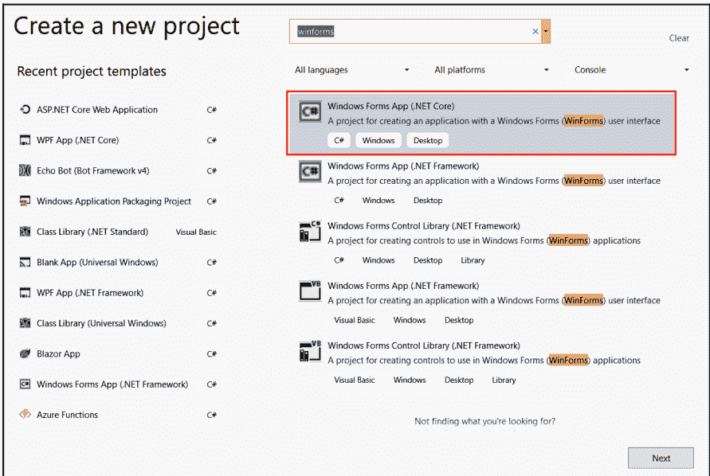

在 Visual Studio 2019 中，创建新项目的流程略有变化，您需要先选择应用程序类型，然后选择创建位置：

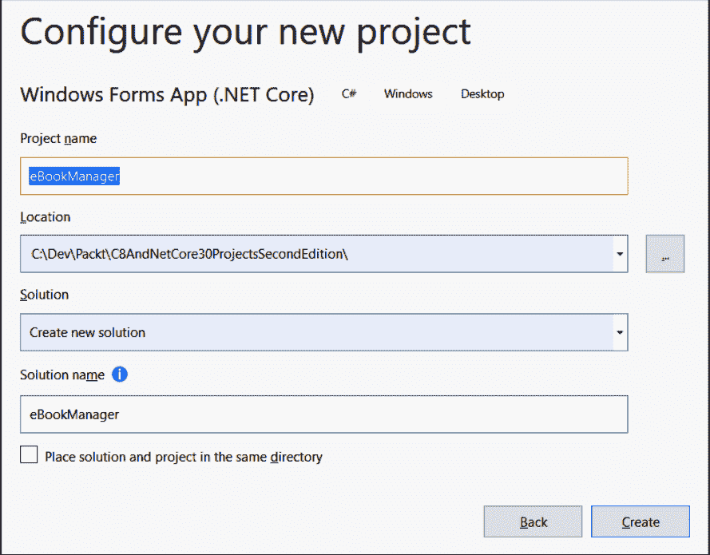

## 创建项目后，效果如下：

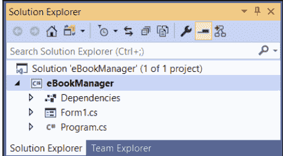

由于这是 .NET Core，您可以全部从命令行完成。在 PowerShell 中，运行以下命令将创建相同的项目：dotnet new winforms -n eBookManager。

我们的解决方案需要一个类库项目来包含驱动 eBookManager 应用程序的类。在 .NET Core 3.0 中，我们可以选择创建 .NET Core 类库或 .NET Standard 类库。

.NET Standard 是一个有点奇怪的概念。它本身不是一种技术，而是一份协议；创建 .NET Standard 类库仅仅是禁止使用任何 .NET Core（或框架）特定的内容，且不符合 .NET Standard。以下文档说明了 .NET Standard 版本，以及 Core 和 Framework 的哪些版本支持它们：https://github.com/dotnet/standard/blob/master/docs/versions.md。

向您的解决方案添加一个新 **类库 (.NET Standard)** 项目，并将其命名为 *eBookManager.Engine*：

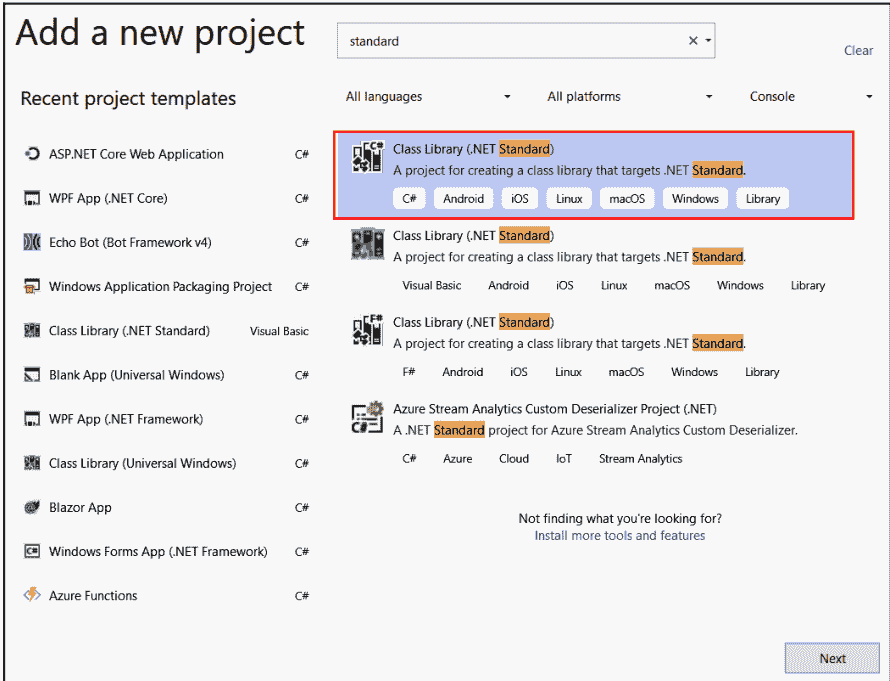

一个类库项目已添加到解决方案中，带有默认类名。将此类更改为 *Document*：

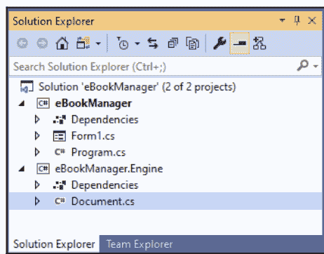

`Document` 类将表示一本电子书。在考虑一本书时，我们可以有多个属性来表示一本书，但这将代表所有书籍。这的一个例子就是作者。所有书籍都必须有作者；否则，它们就不会存在。

我添加到类中的属性仅仅是我对可能代表一本书的内容的诠释。请随意添加其他代码，使其成为您自己的。打开 `Document.cs` 文件，并将以下代码添加到类中：

```
public class Document
{
    public string Title { get; set; }
    public string FileName { get; set; }
    public string Extension { get; set; }
    public DateTime LastAccessed { get; set; }
    public DateTime Created { get; set; }
    public string FilePath { get; set; }
    public string FileSize { get; set; }
    public string ISBN { get; set; }
    public string Price { get; set; }
    public string Publisher { get; set; }
    public string Author { get; set; }
    public DateTime PublishDate { get; set; }
    public DeweyDecimal Classification { get; set; }
    public string Category { get; set; }
}
```

您会发现，我包含了一个名为 Classification 的属性，类型为 DeweyDecimal。我们尚未添加此类，稍后将添加。向 eBookManager.Engine 项目添加一个名为 DeweyDecimal 的类。如果您不想为电子书进行到这种分类级别，可以省略此类。我包含它是为了完整性。我们将介绍一个 Visual Studio 中已存在一段时间的实用小功能：如果您将鼠标悬停在 DeweyDecimal 文本上，将看到一个灯泡出现（您可以通过按住 Ctrl 键和点号键（Ctrl + .）手动调出此菜单。我在本书余下部分将大量使用此快捷键！）

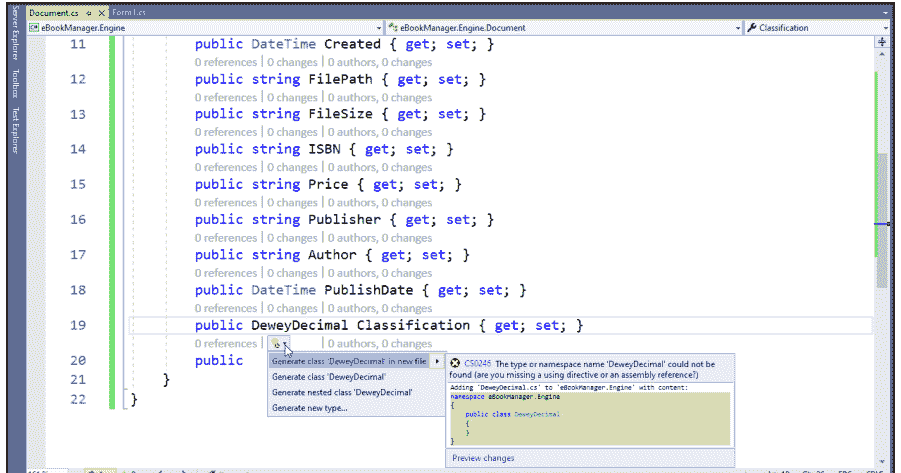


这使我们能够通过几次按键创建一个新类。这也意味着类名将与调用代码中的类名匹配。

你可以使用灯泡菜单来创建方法、添加 using 语句，甚至导入 NuGet 库！

`DeweyDecimal` 系统非常庞大。因此，我并未涵盖每一种可用的图书分类。我也假设你只希望处理编程类电子书。然而，在现实中，你可能希望添加其他分类，例如文学、科学、艺术等。这由你决定：

- 1. 打开 `DeweyDecimal` 类并将以下代码添加到该类中：

```
public class DeweyDecimal
{
    public string ComputerScience { get; set; } = "000";
    public string DataProcessing { get; set; } = "004";
    public string ComputerProgramming { get; set; } = "005";
}
```

文字狂人可能会在此处不同意我的观点，但我想提醒他们，我是个代码狂人。此处列出的分类仅用于让我能够对编程和计算机科学相关的电子书进行编目。如前所述，你可以根据需要更改此内容。

2. 我们现在需要将 eBookManager.Engine 解决方案的核心部分加入。这是一个名为 DocumentEngine 的类，将包含你处理文档所需的方法：

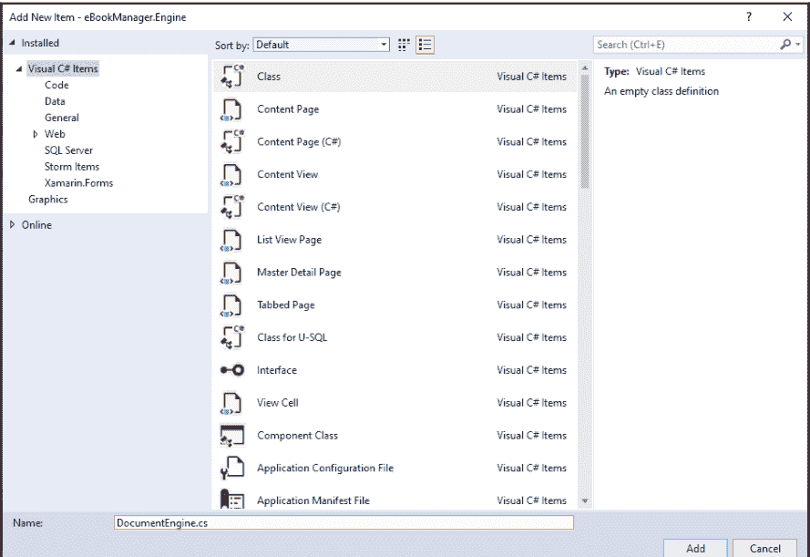

你的 eBookManager.Engine 解决方案现在将包含以下类：

- DeweyDecimal
- Document
- DocumentEngine

3. 我们现在需要从 eBookManager 项目添加对 eBookManager.Engine 的引用：

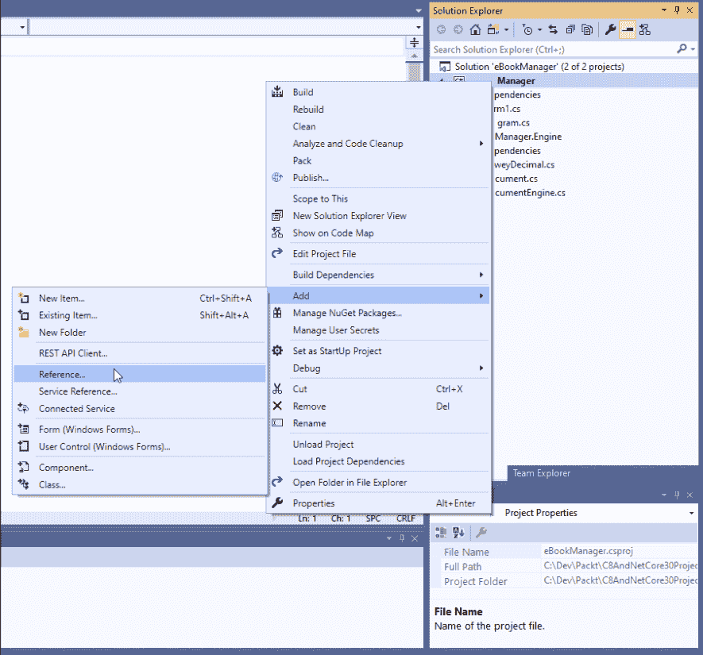

eBookManager.Engine 项目将在引用管理器屏幕的 **项目** 部分中可用：

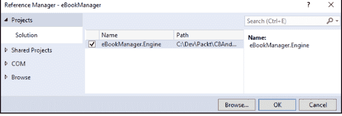

4. 添加引用后，我们需要一个负责导入新书的 Windows 窗体。将名为 `ImportBooks` 的新窗体添加到 `eBookManager` 解决方案中：

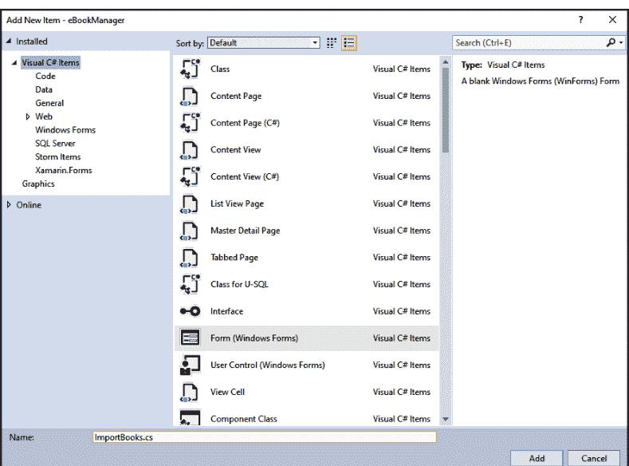

5. 我们将为扩展方法创建一个单独的项目。添加 eBookManager.Helper 类库项目（同样，作为 .NET Standard 类库项目）：

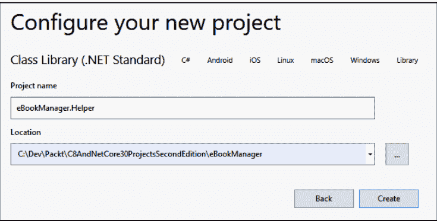

6. 我们将从主项目引用它（与之前一样）：

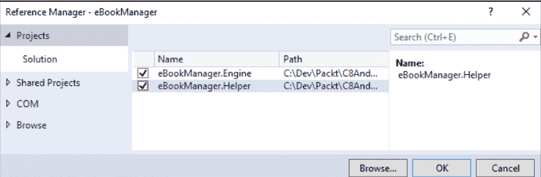

我们现在已经为 eBookManager 应用程序设置好了所需的基本内容。接下来，我们将通过编写一些代码，深入探究应用程序的内部机制。

## 虚拟存储空间和扩展方法

让我们先讨论一下虚拟存储空间背后的逻辑。这是你硬盘（或多个硬盘）上多个物理空间的单一虚拟表示。存储空间将被视为存储特定电子书集合的单个区域。我松散地使用“存储”这个词，因为存储空间并不存在。它更多是代表一种分组，而不是硬盘上的物理空间：

- 1. 要开始创建虚拟存储空间，请向 eBookManager.Engine 项目添加一个名为 StorageSpace 的新类。打开 StorageSpace.cs 文件并将以下代码添加到其中：

```csharp
using System;
using System.Collections.Generic;
namespace eBookManager.Engine
{
    [Serializable]
    public class StorageSpace
    {
        public int ID { get; set; }
        public string Name { get; set; }
        public string Description { get; set; }
        public List<Document> BookList { get; set; }
    }
}
```


请注意，此处需要包含 System.Collections.Generic 命名空间，因为 StorageSpace 类包含一个名为 BookList 的属性，其类型为 List<Document>，将包含该特定存储空间中的所有图书。

现在我们需要将注意力转向 eBookManager.Helper 项目并添加一个名为 ExtensionMethods 的新类。这将是一个静态类，因为扩展方法本质上需要是静态的，才能作用于扩展方法所定义的各种对象。

- 2. 新的 ExtensionMethods 类最初将如下所示：

```csharp
public static class ExtensionMethods
{
}
```

让我们向该类添加第一个扩展方法，名为 `ToInt()`。这个扩展方法的作用是获取一个字符串值，并尝试将其解析为整数值。每当需要将字符串转换为整数时，我都太懒了，不想输入 `Convert.ToInt32(stringVariable)`。正因如此，我使用扩展方法。

- 3. 将以下静态方法添加到 `ExtensionMethods` 类中：

```csharp
public static int ToInt(this string value, int defaultInteger = 0)
{
    try
    {
        if (int.TryParse(value, out int validInteger))
        {
            // Out variables
            return validInteger;
        }
        else
        {
            return defaultInteger;
        }
    }
    catch
    {
        return defaultInteger;
    }
}
```

`ToInt()` 扩展方法仅作用于字符串。这由方法签名中的 `this string value` 定义，其中 `value` 是将包含你尝试转换为整数的字符串的变量名。它还有一个名为 `defaultInteger` 的默认参数，设置为 `0`。除非调用扩展方法的开发者希望返回默认整数值 `0`，否则他们可以向此扩展方法传递不同的整数（例如 -1）。

`ExtensionMethods` 类的其他方法用于提供以下逻辑：

- 读取和写入数据源
- 检查存储空间是否存在
- 将字节转换为兆字节
- 将字符串转换为整数（如前所述）

ToMegabytes 方法非常简单。为了避免到处编写此计算，将其定义在扩展方法中是有意义的：

```csharp
public static double ToMegabytes(this long bytes) =>
(bytes > 0) ? (bytes / 1024f) / 1024f : bytes;
```

我们还需要一种方法来检查特定的存储空间是否已存在。


请务必从 eBookManager.Helper 项目添加对 eBookManager.Engine 的项目引用。

此扩展方法还会将下一个存储空间 ID 返回到调用代码中。
如果存储空间不存在，则返回的 ID 将是创建新存储空间时可使用的下一个 ID：

```csharp
public static bool StorageSpaceExists(this List<StorageSpace> space, string nameValueToCheck, out int storageSpaceId)
{
    bool exists = false;
    storageSpaceId = 0;
    if (space.Count() != 0)
    {
        int count = (from r in space
        where r.Name.Equals(nameValueToCheck)
        select r)
        .Count();
        if (count > 0) exists = true;
        storageSpaceId = (from r in space
        select r.ID).Max() + 1;
    }
    return exists;
}
```


如果你粘贴此代码，请记住前面提到的 Ctrl + . 技巧。
在看到未识别的代码处，只需将光标放在那里并按 Ctrl + .，或单击灯泡，它应该会添加必要的引用。

我们还需要创建一个方法，在将数据转换为 JSON 后将其写入文件：

```csharp
public async static Task WriteToDataStore(this List<StorageSpace> value,
string storagePath, bool appendToExistingFile = false)
{
    using (FileStream fs = File.Create(storagePath))
    await JsonSerializer.SerializeAsync(fs, value);
}
```

基本上，我们在这里所做的就是创建一个流，并将 StorageSpace 列表序列化到该流中。

> 请注意，此处我们使用了 C# 8 的新语法糖，允许我们添加具有隐式作用域（即直到方法结束）的 using 语句。

你需要从包管理器控制台安装 System.Text.Json：

```
Install-Package System.Text.Json -ProjectName eBookManager.Helper
```

这使你能够使用新的 .NET Core 3 JSON 序列化器。与其前身甚至第三方工具（如 Json.NET）相比，它更加简洁。微软声称，你将看到速度改进，因为它利用了 .NET Core 2.x 中引入的性能改进。

最后，我们需要能够将数据读回到 List<StorageSpace> 对象中，并将其返回到调用代码：

```csharp
public async static Task<List<StorageSpace>> ReadFromDataStore(this List<StorageSpace> value, string storagePath)
{
    if (!File.Exists(storagePath))
    {
        var newFile = File.Create(storagePath);
        newFile.Close();
    }

    using FileStream fs = File.OpenRead(storagePath);
    if (fs.Length == 0) return new List<StorageSpace>();

    var storageList = await
    JsonSerializer.DeserializeAsync<List<StorageSpace>>(fs);

    return storageList;
}
```

该方法将返回一个空列表，即一个 <StorageSpace> 对象，文件中不包含任何内容。ExtensionMethods 类可以包含许多你可能经常使用的扩展方法。这是分离常用代码的好方法。


> 与任何其他类一样，你应该考虑你的扩展方法类是否变得过大，或成为不相关功能的倾倒之地，或包含可能更适合提取到独立类中的功能。

## DocumentEngine 类

此类的目的仅仅是为文档提供支持代码。在 eBookManager 应用程序中，我将使用一个名为 GetFileProperties() 的单一方法，它会（你猜对了）返回所选文件的属性。此类也只包含这个单一方法。随着应用程序为你的特定目的进行修改，你可以修改此类并添加特定于文档的其他方法。

在 DocumentEngine 类中，添加以下代码：

```csharp
public (DateTime dateCreated, DateTime dateLastAccessed, string fileName,
string fileExtension, long fileLength, bool error) GetFileProperties(string filePath)
{
    var returnTuple = (created: DateTime.MinValue,
    lastDateAccessed: DateTime.MinValue, name: "", ext: "",
    fileSize: 0L, error: false);
    try
    {
        FileInfo fi = new FileInfo(filePath);
        fi.Refresh();
        returnTuple = (fi.CreationTime, fi.LastAccessTime, fi.Name,
        fi.Extension, fi.Length, false);
    }
    catch
    {
        returnTuple.error = true;
    }
    return returnTuple;
}
```

GetFileProperties() 方法以 (DateTime dateCreated, DateTime dateLastAccessed, string fileName, string fileExtension, long fileLength, bool error) 的形式返回一个元组，并允许我们轻松检查调用代码返回的值。

在获取特定文件的属性之前，元组通过以下方式进行初始化：

```
var returnTuple = (created: DateTime.MinValue, lastDateAccessed:
DateTime.MinValue, name: "", ext: "", fileSize: 0L, error: false);
```

如果有异常，我可以返回默认值。使用 FileInfo 类读取文件属性足够简单。然后我可以通过以下方式将文件属性赋值给元组：

```
returnTuple = (fi.CreationTime, fi.LastAccessTime, fi.Name, fi.Extension,
fi.Length, false);
```

然后将元组返回到调用代码中，按需使用。我们将在下一节查看调用代码。

## ImportBooks 窗体

ImportBooks 窗体正如其名称所示。它允许我们创建虚拟存储空间并将书籍导入这些空间。窗体设计如下：

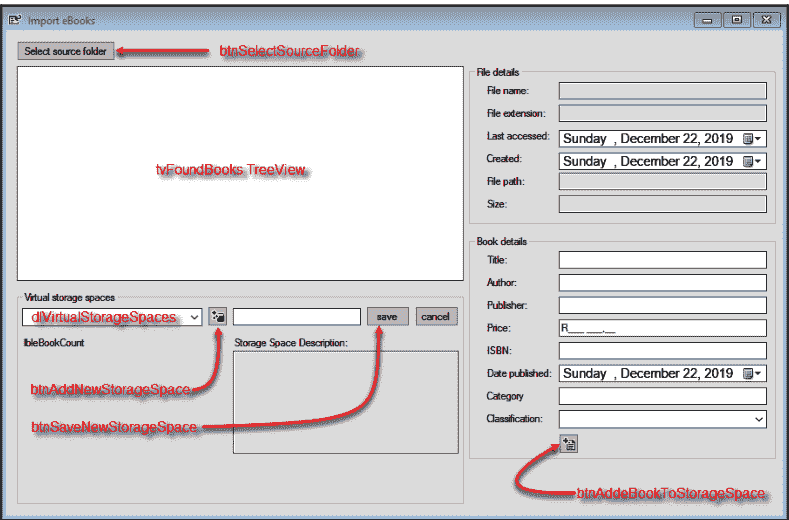

TreeView 控件以 `tv` 作为前缀，按钮以 `btn`，组合框以 `dl`，文本框以 `txt`，日期时间选择器以 `dt`。

虽然这种前缀做法今天不再广泛使用，但它曾是 WinForms 开发者的常见做法。其背后的原因是 WinForms 从来不太适合业务层与表示层的分离（曾有尝试纠正这一问题，尤其是 MVP 模式），这意味着从代码隐藏文件直接引用控件是一种常见做法，因此表明你正在处理的控件类型是有意义的。

当此窗体加载时，如果已定义任何存储空间，它们将在 `dlVirtualStorageSpaces` 组合框中列出。单击 **选择源文件夹** 按钮将允许我们选择要在其中查找电子书的源文件夹。

如果存储空间不存在，我们可以单击 `btnAddNewStorageSpace` 按钮添加新的虚拟存储空间。这将允许我们为新存储空间添加名称和描述，并单击 `btnSaveNewStorageSpace` 按钮。从 `tvFoundBooks` TreeView 选择电子书将填充窗体右侧的 **文件详细信息** 控件组。然后你可以添加其他 **图书详细信息** 并单击 `btnAddBookToStorageSpace` 按钮将书籍添加到我们的空间中。

你可以通过简单地按下 `F7`，或在“解决方案资源管理器”中右键单击并选择 **查看代码** 来访问 Windows 窗体的代码隐藏文件。

以下步骤描述了对 `ImportBooks` 代码隐藏文件所做的更改：

- 你需要确保将以下命名空间添加到你的类中（这些应该替换这里的任何现有命名空间）：

```
using eBookManager.Engine;
using System;
using System.Collections.Generic;
using System.IO;
using System.Linq;
using System.Windows.Forms;
using static eBookManager.Helper.ExtensionMethods;
using static System.Math;
```

- 接下来，让我们从最合理的地方开始：`ImportBooks()` 构造函数和类级变量。在构造函数之上添加以下声明：

```csharp
private string _jsonPath;
private List<StorageSpace> _spaces;
private enum _storageSpaceSelection { New = -9999, NoSelection = -1 }
```

枚举器的有用性将在代码后面变得明显。`_jsonPath` 变量将包含用于存储我们电子书信息的文件的路径。

> 有些人，包括我自己，喜欢给私有类级变量加下划线前缀（如本示例所示）。这是个人偏好；但是，Visual Studio 中有一些设置可以帮助自动生成此类变量，如果你告诉它你的偏好的话。

- 按如下方式修改构造函数：

```csharp
public ImportBooks()
{
    InitializeComponent();

    _jsonPath = Path.Combine(Application.StartupPath,
    "bookData.txt");
}
```

`_jsonPath` 在应用程序的执行文件夹中初始化，文件被硬编码为 bookData.txt。如果你选择改进此项目，可以提供设置屏幕来配置这些设置。

- 因为我们希望在窗体加载时加载一些数据，所以我们将附加 Form_Load 事件。在 WinForms 中创建事件处理程序的简便方法是在窗体设计器中选择事件，然后在要处理的事件旁双击：

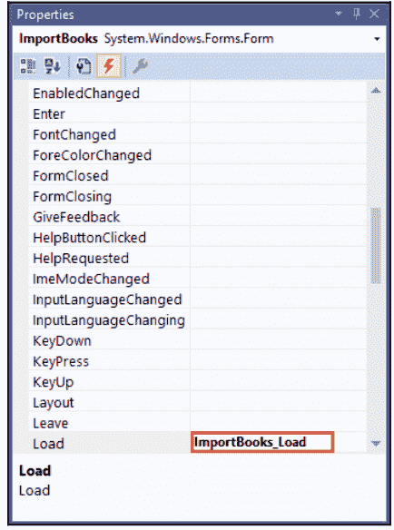

新事件应从数据存储异步加载以下代码：

```
private async void ImportBooks_Load(object sender, EventArgs e)
{
    _spaces = await _spaces.ReadFromDataStore(_jsonPath);
}
```

- 接下来，我们需要添加另外两个枚举器，它们定义了我们应用程序将能够保存的文件扩展名：

```
private HashSet<string> AllowedExtensions => new
HashSet<string>(StringComparer.InvariantCultureIgnoreCase)
{ ".doc", ".docx", ".pdf", ".epub", ".lit" };
```

```
private enum Extension { doc = 0, docx = 1, pdf = 2, epub = 3, lit = 4 }
```

当我们查看 PopulateBookList() 方法时，可以看到 AllowedExtensions 属性的实现。

## 填充 TreeView 控件

PopulateBookList() 方法所做的一切就是用选定源位置找到的文件和文件夹填充 TreeView 控件。请参阅 ImportBooks 代码隐藏文件中的以下代码：

```csharp
public void PopulateBookList(string paramDir, TreeNode paramNode)
{
	DirectoryInfo dir = new DirectoryInfo(paramDir);
	foreach (DirectoryInfo dirInfo in dir.GetDirectories())
	{
		TreeNode node = new TreeNode(dirInfo.Name);
		node.ImageIndex = 4;
		node.SelectedImageIndex = 5;
		if (paramNode != null)
			paramNode.Nodes.Add(node);
		else
			tvFoundBooks.Nodes.Add(node);
		PopulateBookList(dirInfo.FullName, node);
	}
	foreach (FileInfo fleInfo in dir.GetFiles()
	.Where(x => AllowedExtensions.Contains(x.Extension)).ToList())
	{
		TreeNode node = new TreeNode(fleInfo.Name);
		node.Tag = fleInfo.FullName;
		int iconIndex = Enum.Parse(typeof(Extension),
		fleInfo.Extension.TrimStart('.'), true).GetHashCode();
		node.ImageIndex = iconIndex;
		node.SelectedImageIndex = iconIndex;
		if (paramNode != null)
			paramNode.Nodes.Add(node);
		else
			tvFoundBooks.Nodes.Add(node);
	}
}
```

我们需要调用此方法的第一个位置显然是在其内部，因为这是一个递归方法。第二个位置是从 btnSelectSourceFolder 按钮单击事件中调用它（同样，如前所述，选择 click 属性并双击）：

```csharp
private void btnSelectSourceFolder_Click(object sender, EventArgs e)
{
    try
    {
        FolderBrowserDialog fbd = new FolderBrowserDialog();
        fbd.Description = "Select the location of your eBooks and documents";
        DialogResult dlgResult = fbd.ShowDialog();
        if (dlgResult == DialogResult.OK)
        {
            tvFoundBooks.Nodes.Clear();
            string path = fbd.SelectedPath;
            DirectoryInfo di = new DirectoryInfo(path);
            TreeNode root = new TreeNode(di.Name);
            root.ImageIndex = 4;
            root.SelectedImageIndex = 5;
            tvFoundBooks.Nodes.Add(root);
            PopulateBookList(di.FullName, root);
            tvFoundBooks.Sort();
            root.Expand();
        }
    }
    catch (Exception ex)
    {
        MessageBox.Show(ex.Message);
    }
}
```

这全都是相当直接的代码。选择要递归的文件夹，并用所有与我们 AllowedExtensions 属性中包含的文件扩展名匹配的找到的文件填充 TreeView 控件。当有人在 tvFoundBooks TreeView 控件中选择一本书时，我们也需要查看代码。选择一本书时，我们需要读取所选文件的属性，并将这些属性返回到文件详细信息部分：

```csharp
private void tvFoundBooks_AfterSelect(object sender, TreeViewEventArgs e)
{
    DocumentEngine engine = new DocumentEngine();
    string path = e.Node.Tag?.ToString() ?? "";
    if (File.Exists(path))
    {
        var (dateCreated, dateLastAccessed, fileName, fileExtension,
        fileLength, hasError) = engine.GetFileProperties(e.Node.Tag.ToString());
    }
}
```


```
if (!hasError)
{
    txtFileName.Text = fileName;
    txtExtension.Text = fileExtension;
    dtCreated.Value = dateCreated;
    dtLastAccessed.Value = dateLastAccessed;
    txtFilePath.Text = e.Node.Tag.ToString();
    txtFileSize.Text = $"{Round(fileLength.ToMegabytes(),
                        2).ToString()} MB";
    }
}
}
```

你会注意到，正是在这里，我们在 DocumentEngine 类上调用 GetFileProperties() 方法，该方法返回一个元组。

## 填充存储空间列表

下一阶段是填充我们的存储空间列表：

```
private void PopulateStorageSpacesList()
{
    List<KeyValuePair<int, string>> lstSpaces =
        new List<KeyValuePair<int, string>>();
    BindStorageSpaceList((int)_storageSpaceSelection.NoSelection, "Select Storage Space");

    void BindStorageSpaceList(int key, string value) =>
        lstSpaces.Add(new KeyValuePair<int, string>(key, value));

    if (_spaces is null || _spaces.Count() == 0 // Pattern matching
    {
        BindStorageSpaceList((int)_storageSpaceSelection.New, "<create new>");
    }
    else
    {
        foreach (var space in _spaces)
        {
            BindStorageSpaceList(space.ID, space.Name);
        }
    }
    dlVirtualStorageSpaces.DataSource = new
        BindingSource(lstSpaces, null);
    dlVirtualStorageSpaces.DisplayMember = "Value";
    dlVirtualStorageSpaces.ValueMember = "Key";
}
```

PopulateStorageSpacesList() 方法使用了局部函数，本质上允许我们声明一段仅在其父作用域内可访问的功能。

让我们将对此新方法的调用添加到 ImportBooks_Load 方法中：

```
private async void ImportBooks_Load(object sender, EventArgs e)
{
    _spaces = await _spaces.ReadFromDataStore(_jsonPath);
    PopulateStorageSpacesList();
    if (dlVirtualStorageSpaces.Items.Count == 0)
    {
        dlVirtualStorageSpaces.Items.Add("<create new storage space > ");
    }
    lblEbookCount.Text = "";
}
```

我们现在需要添加更改所选存储空间的逻辑。dlVirtualStorageSpaces 控件的 SelectedIndexChanged() 事件修改如下：

```
private void dlVirtualStorageSpaces_SelectedIndexChanged(object sender,
EventArgs e)
{
    int selectedValue =
    dlVirtualStorageSpaces.SelectedValue.ToString().ToInt();
    if ((selectedValue == (int)_storageSpaceSelection.New) // -9999
    {
        txtNewStorageSpaceName.Visible = true;
        lblStorageSpaceDescription.Visible = true;
        txtStorageSpaceDescription.ReadOnly = false;
        btnSaveNewStorageSpace.Visible = true;
        btnCancelNewStorageSpace.Visible = true;
        dlVirtualStorageSpaces.Enabled = false;
        btnAddNewStorageSpace.Enabled = false;
        lblEbookCount.Text = "";
    }
    else if (selectedValue != (int)_storageSpaceSelection.NoSelection)
    {
        // Find the contents of the selected storage space
        int contentCount = (from c in _spaces
        where c.ID == selectedValue
        select c).Count();
        if ((contentCount > 0)
        {
            StorageSpace selectedSpace = (from c in _spaces
where c.ID == selectedValue
select c).First();
txtStorageSpaceDescription.Text = selectedSpace.Description;
List<Document> eBooks = (selectedSpace.BookList == null)
? new List<Document> { }
: selectedSpace.BookList;
lblEbookCount.Text = $"Storage Space contains { eBooks.Count() }
{ (eBooks.Count() == 1 ? "eBook" : "eBooks" )}";
        }
        else
        {
lblEbookCount.Text = "";
        }
    }
}
```

这里我不会对代码进行详细解释，因为它的作用相对明显。

我们还需要添加代码来保存新存储空间。将以下代码添加到 btnSaveNewStorageSpace 按钮的 Click 事件中：

```
private void btnSaveNewStorageSpace_Click(object sender, EventArgs e)
{
try
{
if (txtNewStorageSpaceName.Text.Length != 0)
{
string newName = txtNewStorageSpaceName.Text;
bool spaceExists =
(!_spaces.StorageSpaceExists(newName, out int nextID))
? false
: throw new Exception("The storage space you are trying to
add already exists.");
if (!spaceExists)
{
StorageSpace newSpace = new StorageSpace();
newSpace.Name = newName;
newSpace.ID = nextID;
newSpace.Description =
txtStorageSpaceDescription.Text;
_spaces.Add(newSpace);
}
PopulateStorageSpacesList();
// Save new Storage Space Name
txtNewStorageSpaceName.Clear();
txtNewStorageSpaceName.Visible = false;
lblStorageSpaceDescription.Visible = false;
txtStorageSpaceDescription.ReadOnly = true;
txtStorageSpaceDescription.Clear();
btnSaveNewStorageSpace.Visible = false;
btnCancelNewStorageSpaceSave.Visible = false;
dlVirtualStorageSpaces.Enabled = true;
btnAddNewStorageSpace.Enabled = true;
}
}
catch (Exception ex)
{
txtNewStorageSpaceName.SelectAll();
MessageBox.Show(ex.Message);
}
}
```

最后几个方法处理在所选虚拟存储空间中保存电子书。修改 btnAddBookToStorageSpace 按钮的 Click 事件。这段代码也包含 throw 表达式。如果你没有从组合框中选择存储空间，将抛出一个新异常：

```
private async void btnAddBookToStorageSpace_Click(object sender, EventArgs e)
{
try
{
int selectedStorageSpaceID =
dlVirtualStorageSpaces.SelectedValue.ToString().ToInt();
if ((selectedStorageSpaceID !=
(int)_storageSpaceSelection.NoSelection)
&& (selectedStorageSpaceID != (int)_storageSpaceSelection.New))
{
await UpdateStorageSpaceBooks(selectedStorageSpaceID);
}
else throw new Exception("Please select a Storage Space to add your eBook to"); // throw expressions
}
catch (Exception ex)
{
MessageBox.Show(ex.Message);
}
}
```

如果你输入这段代码，你会发现 UpdateStorageSpaceBooks 方法尚不存在；让我们来修复它。

## 将所选书籍保存到存储空间

以下代码基本上在所选存储空间中已包含特定图书（在与用户确认后）时更新其图书列表。否则，它会将图书作为新图书添加到图书列表中：

```
private async Task UpdateStorageSpaceBooks(int storageSpaceId)
{
    try
    {
        int iCount = (from s in _spaces
                      where s.ID == storageSpaceId
                      select s).Count();
        if (iCount > 0) // The space will always exist
        {
            // Update
            StorageSpace existingSpace = (from s in _spaces
                                          where s.ID == storageSpaceId
                                          select s).First();
            List<Document> ebooks = existingSpace.BookList;
            int iBooksExist = (ebooks != null)
                              ? (from b in ebooks
                                 where
                                 $"{b.FileName}".Equals($"{txtFileName.Text.Trim()}")
                                 select b).Count()
                              : 0;
            if (iBooksExist > 0)
            {
                DialogResult dlgResult = MessageBox.Show($"A book with the
 same name has been found in Storage Space {{existingSpace.Name}}. Do you want
 to replace the existing book entry with this one ?", "Duplicate Title",
                 MessageBoxButtons.YesNo,
                 MessageBoxIcon.Warning,
                 MessageBoxDefaultButton.Button2);
                if (dlgResult == DialogResult.Yes)
                {
                    Document existingBook = (from b in ebooks
                                             where $"{b.FileName}".Equals($"{txtFileName.Text.Trim()}")
                                             select b).First();
                    SetBookFields(existingBook);
                }
            }
            else
            {
                // Insert new book
                Document newBook = new Document();
                SetBookFields(newBook);
            }
        }
    }
}
if (ebooks == null)
    ebooks = new List<Document>();
ebooks.Add(newBook);
existingSpace.BookList = ebooks;
}
}
await _spaces.WriteToDataStore(_jsonPath);
PopulateStorageSpacesList();
MessageBox.Show("Book added");
}
catch (Exception ex)
{
    MessageBox.Show(ex.Message);
}
}
}
```

我们在前面的方法中调用一个名为 SetBookFields 的帮助器方法：

```
private void SetBookFields(Document book)
{
    book.FileName = txtFileName.Text;
    book.Extension = txtExtension.Text;
    book.LastAccessed = dtLastAccessed.Value;
    book.Created = dtCreated.Value;
    book.FilePath = txtFilePath.Text;
    book.FileSize = txtFileSize.Text;
    book.Title = txtTitle.Text;
    book.Author = txtAuthor.Text;
    book.Publisher = txtPublisher.Text;
    book.Price = txtPrice.Text;
    book.ISBN = txtISBN.Text;
    book.PublishDate = dtDatePublished.Value;
    book.Category = txtCategory.Text;
}
```

最后，作为一些整理工作，ImportBooks 窗体包含以下代码，用于根据 btnCancelNewStorageSpace 和 btnAddNewStorageSpace 按钮的单击事件来显示和启用控件：

```
private void btnCancelNewStorageSpaceSave_Click(object sender, EventArgs e)
{
    txtNewStorageSpaceName.Clear();
    txtNewStorageSpaceName.Visible = false;
    lblStorageSpaceDescription.Visible = false;
    txtStorageSpaceDescription.ReadOnly = true;
    txtStorageSpaceDescription.Clear();
    btnSaveNewStorageSpace.Visible = false;
    btnCancelNewStorageSpaceSave.Visible = false;
}
```


dlVirtualStorageSpaces.Enabled = true;
btnAddNewStorageSpace.Enabled = true;
}

private void btnAddNewStorageSpace_Click(object sender, EventArgs e)
{
    txtNewStorageSpaceName.Visible = true;
    lblStorageSpaceDescription.Visible = true;
    txtStorageSpaceDescription.ReadOnly = false;
    btnSaveNewStorageSpace.Visible = true;
    btnCancelNewStorageSpaceSave.Visible = true;
    dlVirtualStorageSpaces.Enabled = false;
    btnAddNewStorageSpace.Enabled = false;
}

现在只需在启动窗体 Form1.cs 中完成代码即可。

## 创建主 eBookManager 窗体

首先将 Form1.cs 重命名为 eBookManager.cs。这是应用程序的启动窗体，将列出之前保存的所有现有存储空间：

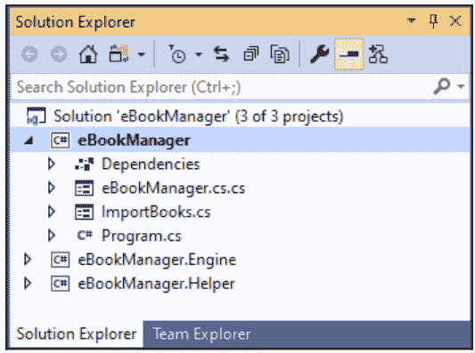

按以下方式设计 eBookManager 窗体：

- 用于现有存储空间的 ListView 控件
- 用于选中存储空间中所包含电子书的 ListView
- 用于打开电子书文件位置的按钮
- 用于导航到 ImportBooks.cs 窗体的菜单控件
- 用于显示所选电子书信息的各种只读字段：

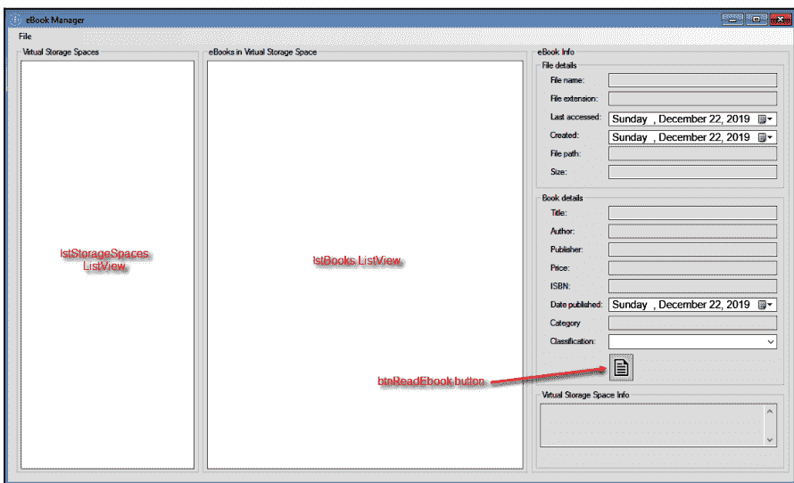

> 同样，由于 WinForms 设计器的特性，您可以直接从仓库复制并粘贴设计器代码。

本节将需要以下 using 语句：

```
using eBookManager.Engine;
using eBookManager.Helper;
using System;
using System.Collections.Generic;
using System.IO;
using System.Windows.Forms;
using System.Linq;
using System.Diagnostics;
```

如前所示，您可以选择省略此步骤，并在每次无法识别特定方法或命名空间时按 Ctrl + . 。

请注意，您无法通过此方式包含带有扩展方法的库，因此需要手动包含 eBookManager.Helper。

现在，我们按照以下步骤开始设计 eBookManager 窗体：

- 1. 构造函数和加载方法与 ImportBooks.cs 窗体中的类似。它们会读取任何可用的存储空间，并使用之前保存的存储空间填充存储空间列表视图控件：

```
private string _jsonPath;
private List<StorageSpace> _spaces;

public eBookManager()
{
    InitializeComponent();
    _jsonPath = Path.Combine(Application.StartupPath,
        "bookData.txt");
}

private async void eBookManager_Load(object sender, EventArgs e)
{
    _spaces = await _spaces.ReadFromDataStore(_jsonPath);

    // imageList1
    this.imageList1.Images.Add("storage_space_cloud.png",
        Image.FromFile("img/storage_space_cloud.png"));
    this.imageList1.Images.Add("eBook.png",
        Image.FromFile("img/eBook.png"));
    this.imageList1.Images.Add("no_eBook.png",
        Image.FromFile("img/no_eBook.png"));
    this.imageList1.TransparentColor =
        System.Drawing.Color.Transparent;

    // btnReadEbook
    this.btnReadEbook.Image = Image.FromFile("img/ReadEbook.png");
    this.btnReadEbook.Location = new System.Drawing.Point(103,
        227);
    this.btnReadEbook.Name = "btnReadEbook";
    this.btnReadEbook.Size = new System.Drawing.Size(36, 40);
    this.btnReadEbook.TabIndex = 32;
    this.toolTip1.SetToolTip(this.btnReadEbook, "Click here to open the eBook file location");
    this.btnReadEbook.UseVisualStyleBackColor = true;
    this.btnReadEbook.Click += new System.EventHandler(this.btnReadEbook_Click);
// EbookManager Icon
    this.Icon = new System.Drawing.Icon("ico/mainForm.ico");
    PopulateStorageSpaceList();
}
```

```
private void PopulateStorageSpaceList()
{
    lstStorageSpaces.Clear();
    if (!(_spaces == null))
    {
        foreach (StorageSpace space in _spaces)
        {
            ListViewItem lvItem = new ListViewItem(space.Name, 0);
            lvItem.Tag = space.BookList;
            lvItem.Name = space.ID.ToString();
            lstStorageSpaces.Items.Add(lvItem);
        }
    }
}
```

- 2. 如果用户单击某个存储空间，我们需要能够读取该选中空间中包含的图书：

```
private void lstStorageSpaces_MouseClick(object sender,
    MouseEventArgs e)
{
    ListViewItem selectedStorageSpace =
    lstStorageSpaces.SelectedItems[0];
    int spaceID = selectedStorageSpace.Name.ToInt();
    txtStorageSpaceDescription.Text = (from d in _spaces
    where d.ID == spaceID
    select d.Description).First();
    List<Document> ebookList =
    (List<Document>) selectedStorageSpace.Tag;
    PopulateContainedEbooks(ebookList);
}
```

- 3. 现在需要创建一个方法，用填充选中存储空间中包含的图书来填充 `lstBooks` 列表视图：

```
private void PopulateContainedEbooks(List<Document> ebookList)
{
    lstBooks.Clear();
    ClearSelectedBook();
    if (ebookList != null)
    {
        foreach (Document eBook in ebookList)
        {
            ListViewItem book = new ListViewItem(eBook.Title, 1);
            book.Tag = eBook;
            lstBooks.Items.Add(book);
        }
    }
    else
    {
        ListViewItem book = new ListViewItem("This storage space contains no eBooks", 2);
        book.Tag = "";
        lstBooks.Items.Add(book);
    }
}
```

- 4. 当更改选中的存储空间时，我们还需要清除所选图书的详细信息。我在文件和图书详细信息周围创建了两个组控件。此代码仅遍历所有子控件；如果子控件是文本框，则将其清除：

```
private void ClearSelectedBook()
{
    foreach (Control ctrl in gbBookDetails.Controls)
    {
        if (ctrl is TextBox)
            ctrl.Text = "";
    }
    foreach (Control ctrl in gbFileDetails.Controls)
    {
        if (ctrl is TextBox)
            ctrl.Text = "";
    }
    dtLastAccessed.Value = DateTime.Now;
    dtCreated.Value = DateTime.Now;
    dtDatePublished.Value = DateTime.Now;
}
```

- 5. 添加到窗体的 MenuStrip 在 ImportEbooks 菜单项上有一个单击事件。它只需打开 ImportBooks 窗体：

```csharp
private async void mnuImportEbooks_Click(object sender, EventArgs e)
{
    ImportBooks import = new ImportBooks();
    import.ShowDialog();
    _spaces = await _spaces.ReadFromDataStore(_jsonPath);
    PopulateStorageSpaceList();
}
```

- 6. 以下方法封装了选择特定电子书并在 eBookManager 窗体上填充文件和电子书详细信息的逻辑：

```csharp
private void lstBooks_MouseClick(object sender, MouseEventArgs e)
{
    ListViewItem selectedBook = lstBooks.SelectedItems[0];
    if (!String.IsNullOrEmpty(selectedBook.Tag.ToString()))
    {
        Document ebook = (Document)selectedBook.Tag;
        txtFileName.Text = ebook.FileName;
        txtExtension.Text = ebook.Extension;
        dtLastAccessed.Value = ebook.LastAccessed;
        dtCreated.Value = ebook.Created;
        txtFilePath.Text = ebook.FilePath;
        txtFileSize.Text = ebook.FileSize;
        txtTitle.Text = ebook.Title;
        txtAuthor.Text = ebook.Author;
        txtPublisher.Text = ebook.Publisher;
        txtPrice.Text = ebook.Price;
        txtISBN.Text = ebook.ISBN;
        dtDatePublished.Value = ebook.PublishDate;
        txtCategory.Text = ebook.Category;
    }
}
```

- 7. 最后，当所选图书是您希望阅读的图书时，单击“读取电子书”按钮以打开所选电子书的文件位置：

```csharp
private void btnReadEbook_Click(object sender, EventArgs e)
{
    string filePath = txtFilePath.Text;
    FileInfo fi = new FileInfo(filePath);
    if (fi.Exists)
    {
        Process.Start("explorer.exe",
        Path.GetDirectoryName(filePath));
    }
}
```

这完成了 eBookManager 应用程序中包含的代码逻辑。

> 您可以进一步修改代码，为所选电子书打开所需的应用程序，而不仅仅是打开文件位置。换句话说，如果您单击 PDF 文档，应用程序可以启动带有已加载文档的 PDF 阅读器。最后，请注意此版本的应用程序尚未实现分类功能。

是时候启动应用程序并进行测试了。

## 运行 eBookManager 应用程序

要运行应用程序，请执行以下步骤：

- 1. 当应用程序首次启动时，将没有可用的虚拟存储空间。要创建一个，我们需要导入一些图书。单击“导入电子书”菜单项：

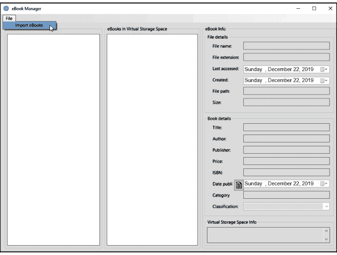


- 2. **导入电子书** 界面打开。你可以添加一个新存储空间，并选择电子书的源文件夹：

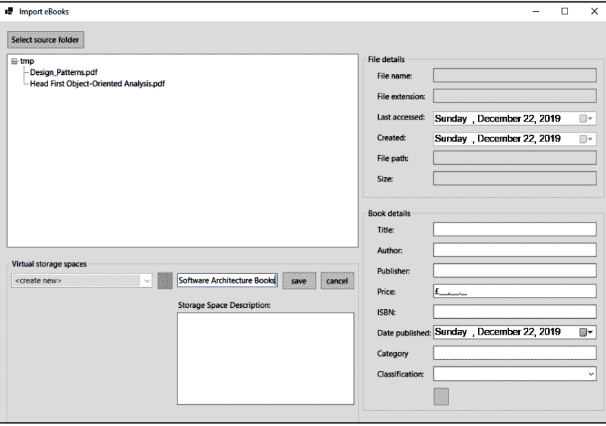

- 3. 选中电子书后，添加图书信息并将其保存到存储空间。添加完所有存储空间和电子书后，你将看到虚拟存储空间列表。点击某个存储空间时，将列出其中包含的图书：

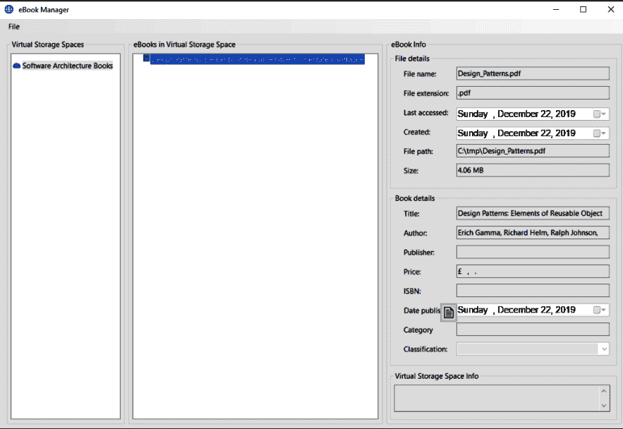

- 4. 选择电子书并单击**读取电子书**按钮，将打开包含所选电子书的文件位置。

- 5. 最后，让我们看看为 **电子书管理器** 应用程序生成的 JSON 文件。最初，它将存储在项目的输出位置中：

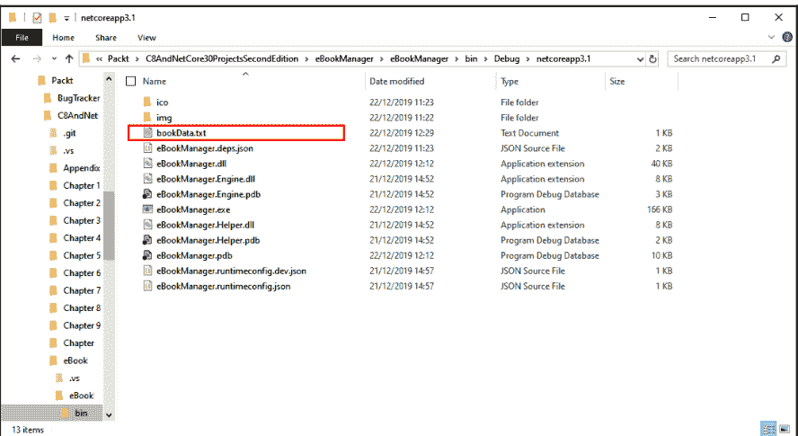

接下来，我使用 VS Code 以良好的格式排列了 JSON：

```
{
  "ID": 0,
  "Name": "Software Architecture Books",
  "Description": "",
  "BookList": [
    {
      "Title": "Design Patterns: Elements of Reusable Object-Oriented Software",
      "FileName": "Design_Patterns.pdf",
      "Extension": ".pdf",
      "LastAccessed": "2019-12-22T12:22:53.5958254+00:00",
      "Created": "2019-12-22T12:22:53.5545254+00:00",
      "FilePath": "C:\\tmp\\Design_Patterns.pdf",
      "FileSize": "4.06 MB",
      "ISBN": "",
      "Price": "\u00A3 .",
      "Publisher": "",
      "Author": "Erich Gamma, Richard Helm, Ralph Johnson, John Vlissides",
      "PublishDate": "2019-12-22T12:22:06.0479953+00:00",
      "Classification": null,
      "Category": ""
    }
  ]
}
```

在 VS Code 中格式化 JSON 的快捷键是 Shift + Alt + F。

可以看出，JSON 文件排版整齐，易于阅读。

现在让我们看看如何将现有的 WinForms 应用升级到 .NET Core 3。

## 升级到 .NET Core 3

要学习本节内容，你不需要第一版中的 WinForms 应用，任何 WinForms 应用均可；不过，建议使用该应用程序，特别是在稍后讨论 C# 8 功能的章节中。

可以从以下位置下载原始项目：

https://github.com/PacktPublishing/CSharp7-and-.NET-Core-2-0-Blueprints

如果下载并运行该应用程序，你会发现它仍然运行良好：

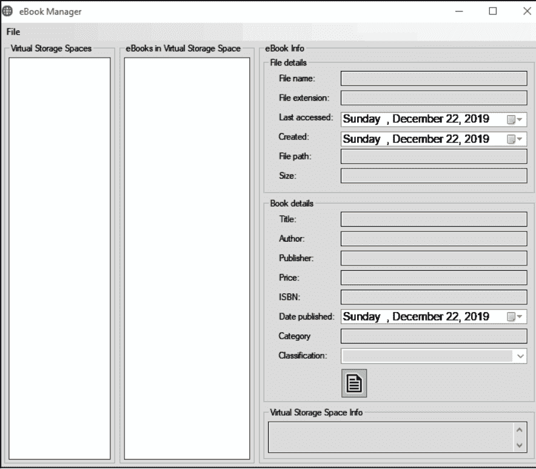

现在让我们探讨如何在 .NET Core 3 下运行这段完全相同的代码库。我们将从项目文件开始。基本上，我们需要告诉 Visual Studio，我们现在有一个 .NET Core 3 项目，而不是 Framework 项目。

如果已安装 PowerTools (https://marketplace.visualstudio.com/items?itemName=VisualStudioProductTeam.ProductivityPowerPack2017)，可以在 Visual Studio 内执行此操作；否则，只需使用喜欢的文本编辑器打开 .csproj 文件即可：

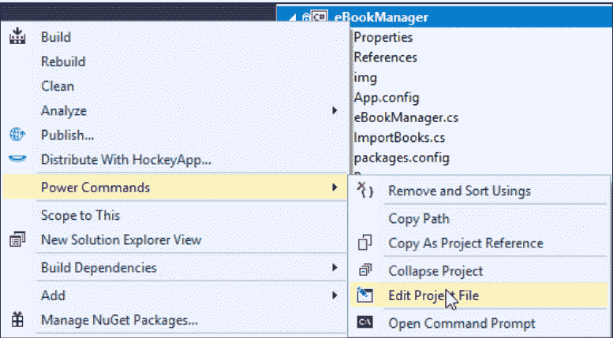

将 .csproj 文件的内容更改为如下内容：

```xml
<Project Sdk="Microsoft.NET.Sdk.WindowsDesktop">

<PropertyGroup>
    <OutputType>WinExe</OutputType>
    <TargetFramework>netcoreapp3.0</TargetFramework>
    <LangVersion>8.0</LangVersion>
    <AssetTargetFallback>uap10.0.18362</AssetTargetFallback>
    <UseWindowsForms>true</UseWindowsForms>
</PropertyGroup>

<ItemGroup>
    <PackageReference Include="Newtonsoft.Json" Version="12.0.2" />
</ItemGroup>

<ItemGroup>
    <ProjectReference
    Include="..\eBookManager.Controls\eBookManager.Controls.csproj" />
    <ProjectReference
    Include="..\eBookManager.Engine\eBookManager.Engine.csproj" />
    <ProjectReference
    Include="..\eBookManager.Helper\eBookManager.Helper.csproj" />
</ItemGroup>

<ItemGroup>
<Reference Include="System">
<HintPath>System</HintPath>
</Reference>
</ItemGroup>
</Project>
```

基本上，这就是所需的全部内容；不过，你需要决定如何处理项目的资源。你可以手动检查它们是否都已设置为复制到输出目录；或者，我们可以向项目文件添加一个 ItemGroup，例如如下内容：

```xml
<ItemGroup>
<None Update="ico\importBooks.ico">
<CopyToOutputDirectory>PreserveNewest</CopyToOutputDirectory>
</None>
<None Update="ico\mainForm.ico">
<CopyToOutputDirectory>PreserveNewest</CopyToOutputDirectory>
</None>
<None Update="img\add_ebook_to_storage_space.png">
<CopyToOutputDirectory>PreserveNewest</CopyToOutputDirectory>
</None>
<None Update="img\add_new_storage_space.png">
<CopyToOutputDirectory>PreserveNewest</CopyToOutputDirectory>
</None>
<None Update="img\docx16.png">
<CopyToOutputDirectory>PreserveNewest</CopyToOutputDirectory>
</None>
<None Update="img\docxx16.png">
<CopyToOutputDirectory>PreserveNewest</CopyToOutputDirectory>
</None>
<None Update="img\eBook.png">
<CopyToOutputDirectory>PreserveNewest</CopyToOutputDirectory>
</None>
<None Update="img\epubx16.png">
<CopyToOutputDirectory>PreserveNewest</CopyToOutputDirectory>
</None>
<None Update="img\folder-close-x16.png">
<CopyToOutputDirectory>PreserveNewest</CopyToOutputDirectory>
</None>
<None Update="img\folder_exp_x16.png">
<CopyToOutputDirectory>PreserveNewest</CopyToOutputDirectory>
</None>
<None Update="img\image sources.txt">
<CopyToOutputDirectory>PreserveNewest</CopyToOutputDirectory>
</None>
<None Update="img\no_eBook.png">
<CopyToOutputDirectory>PreserveNewest</CopyToOutputDirectory>
</None>
<None Update="img\pdfx16.png">
<CopyToOutputDirectory>PreserveNewest</CopyToOutputDirectory>
</None>
<None Update="img\ReadEbook.png">
<CopyToOutputDirectory>PreserveNewest</CopyToOutputDirectory>
</None>
<None Update="img\storage_space_cloud.png">
<CopyToOutputDirectory>PreserveNewest</CopyToOutputDirectory>
</None>
</ItemGroup>
```

可以看出，这比文件的先前版本要简单得多。

撰写本文时，第一个 WinForms 编辑器预览版已发布。以下文章详细说明了它当前的功能：
https://devblogs.microsoft.com/dotnet/introducing-net-core-windows-forms-designer-preview-1/。

遗憾的是，Preview 1 的稳定性不足以进行本章所需的更改，因此我们绕过了设计器。

下一步是删除 Properties 下的以下文件：

- AssemblyInfo.cs
- Settings.Designer.cs
- Settings.settings

事实上，到本章结束时，整个 Properties 文件夹都将不复存在。

其实就是这样。只需重新加载项目并按 F5。该应用现在正在 .NET Core 下运行。不过，此时你很可能会收到一个错误。原因是我们还有两个其他项目仍在 .NET Framework 下运行：

- eBookManager.Engine
- eBookManager.Helper

我们需要以类似的方式迁移每个项目；让我们从 eBookManager.Engine 开始。与以前一样，编辑项目文件，并将其中的内容替换为如下内容：

```xml
<Project Sdk="Microsoft.NET.Sdk">
<PropertyGroup>
<TargetFramework>netcoreapp3.0</TargetFramework>
</PropertyGroup>
</Project>
```

可以看出，这比以前更简单。事实上，不一定要以 3.0 为目标；如果我们愿意，可以以 2.2 甚至 2.1 为目标。同样，我们将删除 AssemblyInfo.cs。

最后，我们来看 eBookManager.Helper。再次编辑项目文件，使其与如下内容匹配：

```xml
<Project Sdk="Microsoft.NET.Sdk">
<PropertyGroup>
<TargetFramework>netcoreapp3.0</TargetFramework>
</PropertyGroup>

<ItemGroup>
<PackageReference Include="Newtonsoft.Json" Version="11.0.2" />
</ItemGroup>

<ItemGroup>
<ProjectReference Include="..\eBookManager.Engine\eBookManager.Engine.csproj" />
</ItemGroup>
</Project>
```

同样，我们将删除 AssemblyInfo.cs。我们还需要从 ExtensionMethods.cs 中移除对 System.Windows.Forms 的错误引用。

## 修复编译错误

最后，我们需要重构一些依赖于嵌入式图像资源的代码。如果按原样运行代码，你很可能会收到类似于以下内容的错误：


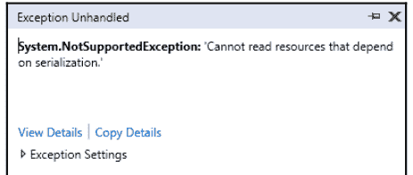

撰写本文时，.NET Core 3.0 上的 WinForms 不支持二进制序列化。因此，我们需要做一些小的更改。

## 资源文件

我们首先需要做的是从输出目录读取文件，因此需要更改图像和图标文件的“复制到输出目录”设置；选中所有文件，然后将“复制到输出目录”操作更改为“如果较新则复制”：

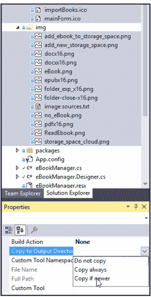

下一步是转到 eBookManager 屏幕。

## eBookManager 屏幕

在 eBookManager.Designer.cs 文件中，删除 imageList1 部分：

```
this.lstStorageSpaces.TabIndex = 1;
this.lstStorageSpaces.UseCompatibleStateImageBehavior = false;
this.lstStorageSpaces.View = System.Windows.Forms.View.Tile;
this.lstStorageSpaces.MouseClick += new System.Windows.Forms.MouseEventHandler
//
// imagelist1
//
this.imagelist1.ImageStream = ((System.Windows.Forms.ImageListStreamer)
this.imagelist1.TransparentColor = System.Drawing.Color.Transparent;
this.imagelist1.Images.SetKeyName(0, "storage_space_cloud.png");
this.imagelist1.Images.SetKeyName(1, "eBook.png");
this.imagelist1.Images.SetKeyName(2, "no_book.png");
//
// groupBox1
//
this.groupBox1.Anchor = ((System.Windows.Forms.AnchorStyles)((System.Windows.Forms.AnchorStyles.Left)));
```

同时删除 btnReadEbook 部分：

```
//
// btnReadEbook
//
this.btnReadEbook.Image = global::eBookManager.Properties.Resources.R
this.btnReadEbook.Location = new System.Drawing.Point(103, 227);
this.btnReadEbook.Name = "btnReadEbook";
this.btnReadEbook.Size = new System.Drawing.Size(36, 40);
this.btnReadEbook.TabIndex = 32;
this.toolTip1.SetToolTip(this.btnReadEbook, "Click here to open the
this.btnReadEbook.UseVisualStyleBackColor = true;
this.btnReadEbook.Click += new System.EventHandler(this.btnReadEbook_Click);
//
// toolTip1
//
this.toolTip1.ToolTipIcon = System.Windows.Forms.ToolTipIcon.Info;
```

最后，在 eBookManager 部分中删除 this.Icon 赋值：

```
//
// eBookManager
//
this.AutoScaleDimensions = new System.Drawing.SizeF(6F, 13F);
this.AutoScaleMode = System.Windows.Forms.AutoScaleMode.Font;
this.ClientSize = new System.Drawing.Size(1113, 643);
this.Controls.Add(this.groupBox3);
this.Controls.Add(this.groupBox2);
this.Controls.Add(this.groupBox1);
this.Controls.Add(this.menuStrip1);
this.Icon = ((System.Drawing.Icon)(resources.GetObject("$this.Icon")));
this.MainMenuStrip = this.menuStrip1;
this.Name = "eBookManager";
this.Text = " eBook Manager";
this.Load += new System.EventHandler(this.Form1_Load);
```

我们将删除的代码移动到 eBookManager.cs 的 Form_Load 事件中：

```
private void Form1_Load(object sender, EventArgs e)
{
    System.ComponentModel.ComponentResourceManager resources = new System.ComponentModel.ComponentResourceManager(typeof(eBookManager));

    this.components = new System.ComponentModel.Container();

    // imageList1
    //this.imageList1.ImageStream =
    ((System.Windows.Forms.ImageListStreamer)(resources.GetObject("imageList1.ImageStream")));
    this.imageList1.Images.Add("storage_space_cloud.png",
    Image.FromFile("img/storage_space_cloud.png"));
    this.imageList1.Images.Add("eBook.png",
    Image.FromFile("img/eBook.png"));
    this.imageList1.Images.Add("no_eBook.png",
    Image.FromFile("img/no_eBook.png"));
    this.imageList1.TransparentColor = System.Drawing.Color.Transparent;

    // btnReadEbook
    this.btnReadEbook.Image = Image.FromFile("img/ReadEbook.png");
    this.btnReadEbook.Location = new System.Drawing.Point(103, 227);
    this.btnReadEbook.Name = "btnReadEbook";
    this.btnReadEbook.Size = new System.Drawing.Size(36, 40);
    this.btnReadEbook.TabIndex = 32;
    this.toolTip1.SetToolTip(this.btnReadEbook, "Click here to open the eBook file location");
    this.btnReadEbook.UseVisualStyleBackColor = true;
    this.btnReadEbook.Click += new System.EventHandler(this.btnReadEbook_Click);

    // eBookManager Icon
    this.Icon = new System.Drawing.Icon("ico/mainForm.ico");

    PopulateStorageSpaceList();
}
```

## importBooks 屏幕

importBooks.Designer.cs 也需要做类似更改。应删除以下部分：

```
this.tvFoundBooks.AfterSelect += new System.Windows.Forms.TreeViewEventHandler
//
// tvImages
//
this.tvImages.ImageStream = ((System.Windows.Forms.ImageListStreamer)
this.tvImages.TransparentColor = System.Drawing.Color.Transparent;
this.tvImages.Images.SetKeyName(0, "docx16.png");
this.tvImages.Images.SetKeyName(1, "docxx16.png");
this.tvImages.Images.SetKeyName(2, "pdfx16.png");
this.tvImages.Images.SetKeyName(3, "epubx16.png");
this.tvImages.Images.SetKeyName(4, "folder_close-x16.png");
this.tvImages.Images.SetKeyName(5, "folder_exp_x16.png");
//
// label1
//
this.label1.AutoSize = true;
```

在同一文件中删除 btnAddeBookToStorageSpace 图像的设置器：

```
//
// btnAddeBookToStorageSpace
//
this.btnAddeBookToStorageSpace.Image = global::eBookManager.Properties
this.btnAddeBookToStorageSpace.Location = new System.Drawing.Point(10
```

删除 btnAddNewStorageSpace 的图像（同样在同一文件中）：

```
this.txtStorageSpaceDescription.TabIndex = 5;
//
// btnAddNewStorageSpace
//
this.btnAddNewStorageSpace.Image = global::eBookManager.Properties.Resources
this.btnAddNewStorageSpace.Location = new System.Drawing.Point(219, 1
this.btnAddNewStorageSpace.Name = "btnAddNewStorageSpace";
```

最后，删除窗体的图标设置器：

```
//
// ImportBooks
//
this.AutoScaleDimensions = new System.Drawing.SizeF(6F, 13F);
this.AutoScaleMode = System.Windows.Forms.AutoScaleMode.Font;
this.ClientSize = new System.Drawing.Size(891, 556);
this.Controls.Add(this.groupBox3);
this.Controls.Add(this.groupBox2);
this.Controls.Add(this.groupBox1);
this.Controls.Add(this.tvFoundBooks);
this.Controls.Add(this.btnSelectSourceFolder);
this.Icon = ((System.Drawing.Icon)(resources.GetObject("$this.Icon")));
this.Name = "ImportBooks";
this.Text = " Import Ebooks";
this.Load += new System.EventHandler(this.ImportBooks_Load);
```

我们将此移动到 ImportBooks.cs 的 Form_Load 事件中，现在应该如下所示：

```
private void ImportBooks_Load(object sender, EventArgs e)
{
    // tvImages
    this.tvImages.Images.Add("docx16.png",
    Image.FromFile("img/docx16.png"));
    this.tvImages.Images.Add("docxx16.png",
    Image.FromFile("img/docxx16.png"));
    this.tvImages.Images.Add("pdfx16.png",
    Image.FromFile("img/pdfx16.png"));
    this.tvImages.Images.Add("epubx16.png",
    Image.FromFile("img/epubx16.png"));
    this.tvImages.Images.Add("folder-close-x16.png",
    Image.FromFile("img/folder-close-x16.png"));
    this.tvImages.Images.Add("folder_exp_x16.png",
    Image.FromFile("img/folder_exp_x16.png"));
    this.tvImages.TransparentColor = System.Drawing.Color.Transparent;
    // btnAddeBookToStorageSpace
    this.btnAddeBookToStorageSpace.Image =
        Image.FromFile("img/add_ebook_to_storage_space.png");
    // btnAddNewStorageSpace
    this.btnAddNewStorageSpace.Image =
        Image.FromFile("img/add_new_storage_space.png");

    // Import Books
    // this.Icon = new System.Drawing.Icon("ico/importBooks.ico");

    PopulateStorageSpacesList();
    if (dlVirtualStorageSpaces.Items.Count == 0)
    {
        dlVirtualStorageSpaces.Items.Add("<create new storage space>");
    }

    lblEbookCount.Text = "";
}
```

## ProcessStartInfo

最后，eBookManager.cs 中需要更改以下内容：

```
private void btnReadEbook_Click(object sender, EventArgs e)
{
    string filePath = txtFilePath.Text;
    FileInfo fi = new FileInfo(filePath);
    if (fi.Exists)
    {
        var processStartInfo = new ProcessStartInfo(filePath, Path.GetDirectoryName(filePath))
        {
            // Change in .NET Core - this defaulted to true in WinForms
            UseShellExecute = true
        };
        Process.Start(processStartInfo);
    }
}
```

原因是 .NET Framework 中的 ProcessStartInfo 默认 UseShellExecute = true。但是，在 .NET Core 中，它现在默认为 false，因此如果不进行此更改，将会失败。


好了！如果你运行该应用，现在是在 .NET Core 3 下运行的。这是同一个应用程序（虽然做了一些小的代码更改），但现在它运行的是 .NET Core 运行时！

## 升级到 .NET Core 的优势

我们先说说这个不得不面对的问题。你现在不能再把 Ebook Manager 拿到 Linux 上运行了——它不再是跨平台的。WinForms 一直是，现在也是，并且很可能永远都是一项 Windows 特定的技术。

升级基本上带来三个好处：

- **速度**：.NET Core 2.1 带来了一些显著的速度改进。具体效果因人而异，很可能取决于你的应用程序具体在做什么。例如，Ebook Manager 应用程序会扫描硬盘以检索书籍：不太可能 .NET Core 2.1 中的内存分配改进会对那部分的速度产生巨大影响。
- **支持**：一旦你升级到 .NET Core，你的应用程序现在将运行在一个更活跃的技术平台上；未来，Microsoft 不太可能修改 .NET Framework，除非是安全漏洞补丁，但 .NET Core 拥有活跃的路线图。
- **热情**：很难让人们对一个十五年前编写的 WinForms 应用程序感到兴奋（甚至很难找到人愿意去维护它）。

> 根据 Build 2019 的公告，.NET Framework 看起来很快就会被 .NET Core 吞并（在撰写本文时被称为 .NET 5）。这意味着，如果你到那时还没有转换，你可能正坐在一列终点站（尽管是几年后）为 Microsoft 停止支持该框架的列车上。

C# 8 带来了一大堆新功能，包括以下内容：

- 可为空的引用类型
- 接口的默认实现
- 记录
- 递归模式
- 异步流
- 范围
- 静态局部函数
- using 声明

从该列表中选取前两个头条功能，很明显，能够在 .NET Core 3 中运行旧代码，并能够应用其中一些功能来帮助更新和维护旧代码，这两者之间存在协同效应。

## 理解可为空的引用类型

在 .NET Core 2.1（或任何之前的 .NET 版本）中，我们可以合法地输入以下代码并运行：

```csharp
string test = null;
Console.WriteLine(test.Length);
```

当然，它当然会崩溃。显然，任何熟悉该语言的人都不会这样写；然而，他们可能会写如下内容：

```csharp
string test = FunctionCanReturnNull();
Console.WriteLine(test.Length);
```

可为空的引用类型是一个选入特性（也就是说，你必须显式启用它），它只是发出警告，告知你引用类型可能为空。

让我们尝试为我们的 Ebook Manager 启用它。可以通过在文件顶部添加以下指令，按类启用或禁用：

```csharp
#nullable enable
```

不过，你也可以通过将以下行添加到 .csproj 文件中，为整个项目启用它：

```csharp
<PropertyGroup>
    <TargetFramework>netcoreapp3.0</TargetFramework>
    <LangVersion>8.0</LangVersion>
    <Nullable>enable</Nullable>
</PropertyGroup>
```

在撰写本文时，此属性会自动添加到 .csproj 文件中。

Nullable 选项还有其他配置选项；有关更多信息，请参阅以下 URL：
https://docs.microsoft.com/en-us/dotnet/csharp/nullable-references

这是一个细粒度特性，因此可以针对特定代码段打开或关闭它。会出现一些警告，所以让我们关注 StorageSpace.cs：

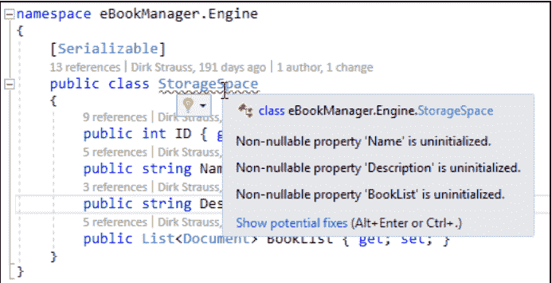

那么，这到底在告诉我们什么？

为了回答这个问题，让我们先看看 ID。ID 是值类型，因此不能为空。如果没有为 ID 分配任何值，它将具有默认值：0。但是 Name 是一个字符串（一种引用类型），因此可以为空，事实上，除非我们对其进行设置，否则它将为空。如果我们想让其中某个字段可为空，当然可以做到（在 Description 的情况下，我们可能应该）：

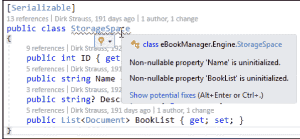

那 Name 呢？我们可能不希望它为空。这里有几种选择；一种是按如下方式添加一个空字符串作为默认初始化器：

```csharp
public string Name { get; set; } = string.Empty;
```

这并不理想。事实上，出现空引用异常可能比它为空而绕过检查更可取。

> 这只是我的观点，但让软件在运行时崩溃并提醒你逻辑中存在错误，要比默默继续运行并可能损坏数据，或者更糟，在第三方系统中请求或更新数据要好得多！

另一种选择是添加一个构造函数。以下是一个示例：

```csharp
[Serializable]
public class StorageSpace
{
    public StorageSpace(string name)
    {
        Name = name;
    }

    public int ID { get; set; }
    public string Name { get; set; }
    public string? Description { get; set; }
    public List<Document>? BookList { get; set; }
}
```

这消除了警告，并确保任何创建该类的人都提供一个名称，我们声明该名称永远不能为空。它在 ImportBooks.cs 中实例化，因此现在我们必须提供该参数：

```csharp
private void btnSaveNewStorageSpace_Click(object sender, EventArgs e)
{
    try
    {
        if (txtNewStorageSpaceName.Text.Length != 0)
        {
            string newName = txtNewStorageSpaceName.Text;

            // null conditional operator:
            "spaces?.StorageSpaceExists(newName) ?? false"
            // throw expressions: bool spaceExists = (space exists = false)
            ? return false : throw exception
            // Out variables
            bool spaceExists = (!spaces.StorageSpaceExists(newName, out int nextID)) ? false : throw new Exception("The storage space you are trying to add already exists.");
            if (!spaceExists)
            {
                StorageSpace newSpace = new StorageSpace(newName);
                newSpace.ID = nextID;
                newSpace.Description = txtStorageSpaceDescription.Text;
                spaces.Add(newSpace);
            }
        }
    }
}
```

既然我们知道 Name 属性永远不能为空，值得注意的是，这里出现的警告只是警告；和所有警告一样，忽略它们是你的权利。但是，C# 8 确实有一个功能（我听人称之为“去他的操作符”），允许你坚持认为，尽管编译器不这么认为，你知道该变量不会为空；它的形式如下：

```csharp
string test = null;

Console.WriteLine(test!.Length);
Console.ReadLine();
```

显然，如果你这样做，前面的代码会崩溃，所以如果你决定你比编译器更了解情况，那就确定无疑！

## 探索 XAML 岛

本节你需要运行 Windows 10 1903 或更高版本。在本书出版时，预计 1903 版本会自动推送到所有 Windows 10 设备；然而，如果你运行的是更早的版本，可以通过访问以下链接强制更新：https://www.microsoft.com/en-us/software-download/windows10。

2019 年撰写本章时，我们注意到导入书籍部分的 TreeView 看起来有些过时了。事实上，你会觉得那是 2005 年 WinForms 很流行时的 TreeView！此外，我们希望将数据绑定到 TreeView，而不是单独构建它。虽然 WinForms 具有一些数据绑定功能，但我们只能使用 TreeView 的一般外观。

除非，也就是说，我们在 WinForms 中使用一个漂亮的新 UWP 控件。XAML 岛正是为此而生！我们可以获取一个现有的 UWP 控件，甚至创建自己的控件，并直接从现有的 WinForms 应用程序中使用它。

让我们尝试在 WinForms 应用程序中使用 UWP 社区工具包中的 TreeView。

## UWP TreeView

这有一些设置要求，我稍后会详细说明。

> 在此出版时，设置此功能的流程可能已大幅简化；请参考链接的文章以获取最新建议。

第一步是确保（如技术要求部分所述）你运行的是 Windows 10 版本 1903 或更高版本。如果你没有，请遵循该部分中的信息。第二步是安装 Windows 10 SDK；为此，你可以使用以下链接：https://developer.microsoft.com/en-us/windows/downloads/windows-10-sdk。

接下来的步骤我们将执行以下文章：https://docs.microsoft.com/en-us/windows/apps/desktop/modernize/desktop-to-uwp-enhance#set-up-your-project。


向你的 WinForms 项目添加以下 NuGet 包：

```
Microsoft.Windows.SDK.Contracts
```

将 XamlHost NuGet 包安装到 WinForms 应用中：

```
Install-Package Microsoft.Toolkit.Forms.UI.XamlHost
```

现在我们可以用 UWP 的 TreeView 替换现有的 TreeView 了。

你会注意到我已经对所有 XAML 控件都使用了完全限定名。由于我们正在处理两个截然不同的框架，这种更改非常容易让人混淆，搞不清楚自己正在使用哪个控件。

在接下来的代码示例中，我为了清晰起见，在代码示例中包含了类级变量。我个人建议，这些变量实际上应该放在类文件的顶部。当然，这不会产生任何功能上的区别。

我们首先需要考虑的是 XamlHost。

## WindowsXamlHost

让我们创建 TreeView；我们将在 ImportBooks.cs 的代码隐藏文件中完成此操作。我们将向构造函数添加一些代码，它现在将如下所示：

```
private readonly Microsoft.Toolkit.Forms.UI.XamlHost.WindowsXamlHost
__windowsXamlHostTreeView;

public ImportBooks()
{
	InitializeComponent();
	_jsonPath = Path.Combine(Application.StartupPath, "bookData.txt");
	spaces = spaces.ReadFromDataStore(_jsonPath);

	var windowsXamlHostTreeView = new WindowsXamlHost();
	windowsXamlHostTreeView.InitialTypeName =
		"Windows.UI.Xaml.Controls.TreeView";
	windowsXamlHostTreeView.AutoSizeMode =
		System.Windows.Forms.AutoSizeMode.GrowOnly;
	windowsXamlHostTreeView.Location = new System.Drawing.Point(12, 60);
	windowsXamlHostTreeView.Name = "tvFoundBooks";
	windowsXamlHostTreeView.Size = new System.Drawing.Size(513, 350);
	windowsXamlHostTreeView.TabIndex = 8;
	windowsXamlHostTreeView.Dock = System.Windows.Forms.DockStyle.None;
	windowsXamlHostTreeView.ChildChanged +=
	windowsXamlHostTreeView_ChildChanged;

	this.Controls.Add(windowsXamlHostTreeView);
}
```

让我们快速回顾一下我们在这里所做的（其实并不多）。首先，我们创建了一个新的 WindowsXamlHost 对象。这是 XAML Islands 的基础；它充当 UWP 控件的包装器，因此它可以在 WinForms 上下文中工作。

虽然本章讨论的是 WinForms，但同样的道理也适用于 WPF，虽然确切的语法可能略有不同，但基本原理是相同的。

此代码示例中需要注意的事项如下：

- 我们将名称设置为 tvFoundBooks，这与我们 WinForms 应用中的名称相同。
- 我们正在监听 ChildChanged 事件：这样我们就可以对控件本身设置一些具体内容（我们稍后将回到这一点）。
- InitialTypeName 是 XAML Islands 知道调用哪个 UWP 控件的方式。
- 我们将主机控件添加到当前窗体（我们还设置了位置）。

## ItemTemplate

现在我们已经设置了主机控件，可以来看看我们提到的 ChildChanged 事件；这里是我们设置 UWP 控件（而不是主机控件）的地方：

```
private Windows.UI.Xaml.Controls.TreeView? _tvFoundBooks = null;

private void windowsXamlHostTreeView_ChildChanged(object? sender, EventArgs e)
{
    if (sender == null) return;

    var host = (WindowsXamlHost)sender;
    _tvFoundBooks = (Windows.UI.Xaml.Controls.TreeView)host.Child;
    _tvFoundBooks.ItemInvoked += _tvFoundBooks_ItemInvoked;
    _tvFoundBooks.ItemsSource = DataSource;

    const string Xaml = "<DataTemplate
    xmlns="http://schemas.microsoft.com/winfx/2006/xaml/presentation"><TreeViewItem ItemsSource="{Binding Children}" Content="{Binding Name}"/></DataTemplate>";
    var xaml = XamlReader.Load(Xaml);
    _tvFoundBooks.ItemTemplate = xaml as Windows.UI.Xaml.DataTemplate;
}
```

不必过于担心 _tvFoundBooks 为什么是类级变量，我们稍后会回到这一点。在前面的代码示例中，我们有一个有条件的检查，以确保 sender 不为 null，然后我们将其强制转换为 WindowsXamlHost 类型。获取此类型后，我们可以通过调用 .Child 属性来获取主机内部的任何内容。

和之前一样，我们正在监听 ItemInvoked 事件（同样，我们稍后会回到这一点）。这里真正新的一点是，我们正在设置 ItemsSource 和 ItemTemplate。我们稍后会回到 ItemsSource，但模板值得探索。与 WinForms 不同，UWP 使用 XAML 来定义其控件的外观。这意味着你可以完全控制 TreeView 中包含的内容；例如，每个节点可以有图像、文本或两者兼有。但是，如果你不指定 ItemTemplate，则呈现引擎不知道显示什么，也不知道如何显示。

前面的 XAML 可能是显示任何内容的最简单示例。你会注意到有几个绑定语句；它们正在绑定到相对于 ItemsSource 的属性。让我们来看看我们到底在绑定什么。

## TreeView 项模型和 ItemsSource

要在 UWP 中将某物绑定到控件，你需要某物。基本上，这意味着我们需要一个模型。

> 在 .NET 术语中，模型只是一个保存数据的类。

我们将创建一个新类，并将其命名为 Item：

```
public class Item
 {
     public string Name { get; set; }
     public ObservableCollection<Item> Children { get; set; } = new
     ObservableCollection<Item>();
     public ItemType ItemType { get; set; }
     public string FullName { get; set; }

 public override string ToString()
 {
           return Name;
       }
   }
```

> 我始终建议将模型放在它们自己的文件中，并位于名为 Models 的文件夹里，但没有任何技术原因阻止你将此类添加到 ImportBooks.cs 的末尾。

这个类的大部分内容应该不言自明；我们正在保存文件的 `Name` 和 `FullName`（即名称和路径）。`ObservableCollection` 是一种特殊的 `Collection` 类型，当它发生变化时，它允许 UI 框架收到通知。

> 对于我们在这里编写的代码，这可以简单地是一个 `List`；但是，在处理 UWP 等桌面 XAML 框架时，`ObservableCollection` 是良好的实践，这将使可扩展性更容易。

最后，我们正在保存项的类型，这是一个新的枚举类型：

```
public enum ItemType
{
    Docx,
    Docxx,
    Pdfx,
    Epubx,
    Folder
}
```

回到 ImportBooks.cs，我们将设置 ItemsSource。第一步是添加一个名为 DataSource 的类级变量：

```
public ObservableCollection<Models.Item> DataSource { get; set; }
```

我们的下一个更改是在 btnSelectSourceFolder_Click 事件处理程序中：

```
private void btnSelectSourceFolder_Click(object sender, EventArgs e)
{
    try
    {
        FolderBrowserDialog fbd = new FolderBrowserDialog();
        fbd.Description = "Select the location of your eBooks and documents";
        DialogResult dlgResult = fbd.ShowDialog();
        if (dlgResult == DialogResult.OK)
        {
            UpdateBookList(fbd.SelectedPath);
        }
    }
    catch (Exception ex)
    {
        MessageBox.Show(ex.Message);
    }
```

如你所见，与之前的版本相比，新方法大大简化了；我们将所有真正的逻辑提取到了一个新方法中，所以让我们接下来看看它：

```
private void UpdateBookList(string path)
{
    DirectoryInfo di = new DirectoryInfo(path);
    var bookList = new List<Models.Item>();
    var rootItem = new Models.Item()
    {
        Name = di.Name
    };
    rootItem.ItemType = Models.ItemType.Folder;
    PopulateBookList(di.FullName, rootItem);
    bookList.Add(rootItem);
    DataSource = new ObservableCollection<Models.Item>(bookList);
    _tvFoundBooks.ItemsSource = DataSource.OrderBy(a => a.Name);
}
```

在这里，我们正在设置 TreeView 的根项；但是，你会注意到我们实际拥有的 TreeView 唯一引用是在末尾，我们在那里刷新 ItemsSource。PopulateBookList 是我们接下来要查看的方法。和之前一样，这个方法基本上分为两部分；让我们先看看第一部分：

```
public void PopulateBookList(string paramDir, Models.Item rootItem)
{
    if (rootItem == null) throw new ArgumentNullException();
    rootItem.FullName = paramDir;
    rootItem.ItemType = Models.ItemType.Folder;
    DirectoryInfo dir = new DirectoryInfo(paramDir);
    foreach (DirectoryInfo dirInfo in dir.GetDirectories())
    {


```csharp
var item = new Models.Item();
item.Name = dirInfo.Name;
rootItem.Children.Add(item);
PopulateBookList(dirInfo.FullName, item);
}
```

在这里，我们正在递归遍历目录结构并填充我们的新模型。请注意，我们在开始时设置了项类型和 FullName（目录路径），然后遍历所有子目录，重新调用我们的方法。

> 递归是指从方法内部调用该方法本身的做法。在像这样希望对嵌套对象执行完全相同操作的场景中，它非常有用。它比使用循环更快；但是，如果使用不当，它有可能非常快地填满堆栈。

对于函数的第二部分，我们将处理当前目录中的任何文件（即，递归堆栈顶部在该时刻所在的目录）：

```csharp
foreach (FileInfo fileInfo in dir.GetFiles().Where(x =>
    AllowedExtensions.Contains(x.Extension)).ToList())
{
    var item = new Models.Item();
    item.Name = fileInfo.Name;

    item.FullName = fileInfo.FullName;
    item.ItemType = (Models.ItemType)Enum.Parse(typeof(Extension),
    fileInfo.Extension.TrimStart('.'), true);
    rootItem.Children.Add(item);
}
}
```

我们接下来的更改是针对 ItemInvoked 方法；新方法应如下所示：

```csharp
private void _tvFoundBooks_ItemInvoked(Windows.UI.Xaml.Controls.TreeView sender, Windows.UI.Xaml.Controls.TreeViewItemInvokedEventArgs args)
{
    var selectedItem = (Models.Item)args.InvokedItem;
    DocumentEngine engine = new DocumentEngine();
    string path = selectedItem.FullName.ToString();
    if (File.Exists(path))
    {
    var (dateCreated, dateLastAccessed, fileName, fileExtension,
    fileLength, hasError) =
    engine.GetFileProperties(selectedItem.FullName.ToString());

    if (!hasError)
    {
        txtFileName.Text = fileName;
        txtExtension.Text = fileExtension;
        dtCreated.Value = dateCreated;
        dtLastAccessed.Value = dateLastAccessed;
        txtFilePath.Text = selectedItem.FullName.ToString();
        txtFileSize.Text = $"{Round(fileLength.ToMegabytes(),
        2).ToString()} MB";
    }
    }
}
```

同样，这只是微小的更改；我们不再将完整文件名（带路径）存储在节点 `tag` 属性中，而是直接引用基础模型，因此更加清晰。我们的下一步是删除现有的 WinForms TreeView 控件。

## 删除现有的 TreeView

以下代码应从 ImportBooks.Designer.cs 中删除：

```csharp
//
// tvFoundBooks
//
this.tvFoundBooks.Location = new System.Drawing.Point(12, 41);
this.tvFoundBooks.Name = "tvFoundBooks";
this.tvFoundBooks.Size = new System.Drawing.Size(513, 246);
this.tvFoundBooks.TabIndex = 8;
this.tvFoundBooks.AfterSelect += new System.Windows.Forms.TreeViewEventHandler(this.tvFoundBooks_AfterSelect);
```

这将删除控件本身。稍后，我们需要删除将 TreeView 添加到控件集合的以下代码：

```csharp
this.Controls.Add(this.tvFoundBooks);
```

就这样。如果您现在运行项目，您将看到 WinForms 应用程序中间有一个 UWP TreeView 控件。

## 树摇（Tree shaking）和编译为单个可执行文件

Web 应用程序日益流行并超越其桌面应用的主要原因，是部署问题。乍看之下，这似乎是个微不足道的问题，但绝非如此。为了解决这个问题，已有许多尝试，从 ClickOnce 之类的技术到 App Store 模式（UWP、Apple 和 Google）。之所以在桌面世界中如此困难而在 Web 世界中如此简单，其中一个原因是：虽然两者都可能拥有复杂的依赖项树，但 Web 允许这些依赖项大多位于服务器上，因此无需直接部署到客户端机器。

.NET Core 3 的一个有用功能是能够将所有依赖项打包到单个可执行文件中。


过去可以使用 IL weaver 的概念来实现这一点。此主题超出了本书的范围；但是，因为 IL 不是编译的，所以它为在项目部署后修改它打开了大门。

在 .NET Core 3 中，我们可以通过将以下行添加到 .csproj 文件来将项目编译为单个可执行文件：

```xml
<PublishSingleFile>true</PublishSingleFile>
<RuntimeIdentifier>win-x64</RuntimeIdentifier>
<PublishReadyToRun>true</PublishReadyToRun>
```

发布应用程序时，您将获得一个单个可执行文件。

您甚至可以使用内置的树摇（Tree shaking）来减小此可执行文件的大小。这是删除应用程序未使用的依赖项的过程；这需要在 .csproj 文件中添加以下附加行：

```xml
<PublishTrimmed>true</PublishTrimmed>
```


撰写本文时，此方法不会复制资产（图像），因此直到该问题修复之前，您需要手动执行此操作。有关此功能的最新详细信息，请参阅以下链接：https://docs.microsoft.com/en-us/dotnet/core/whats-new/dotnet-core-3-0.

## 摘要

在本章中，我们将现有的 WinForms 应用程序迁移到了 .NET Core 3。这意味着，即使我们有一个已经使用了 10 年或 15 年的应用程序，也可以将其更新为使用最新框架，并利用 .NET Core 3 带来的性能改进和新功能。

利用此次升级，我们随后研究了 C# 8 的一个关键功能：可空引用类型。这意味着，无需使用任何第三方软件，我们就能够在遗留代码库中暴露出数十个潜在错误。

我们并没有止步于此；随后我们使用 XAML Islands 将 UWP 功能集成到 WinForms 中来扩展我们的应用程序。这可能是最令人兴奋的功能，因为它基本上意味着您可以从外到内重写遗留的 WinForms 应用程序。

在最后一部分，我们利用 .NET Core 3 中提供的新打包方法。我们使用树摇过程来减小输出文件的大小，并将代码编译为单个可执行文件。

和我一样，您可能会发现这些功能中存在一种规律。.NET Core 在此版本中纳入了仅限 Windows 的功能，这意味着您现在可以将遗留的 WinForms 应用转换为使用最新的 .NET Core，从而从所有性能改进中受益。您可以通过在 WPF 或 UWP 中使用组件创建来扩展它，而无需重写应用程序。此外，部署现在变得更加容易，因为我们现在可以编译为单个可执行文件。

在下一章中，我们将探讨 ASP.NET Core 3 并创建一个使用 Cosmos DB 的 MVC 应用程序。
