# 2 使用 Cosmos DB 的 ASP.NET Core MVC 任务/错误日志记录应用

在本章中，我们将通过创建任务/错误日志记录应用程序，来了解如何将 Cosmos DB 与 ASP.NET Core MVC 结合使用。个人任务管理器很有用，而记录错误尤其方便，特别是在您无法立即处理它们时。

本章将涵盖以下主题：

- 在 Azure 上设置 Cosmos DB 实例
- Cosmos DB 的缩放和复制功能
- 创建 ASP.NET Core MVC 应用程序并集成 Cosmos DB

Cosmos DB 是 Microsoft 对名为 DocumentDB 的文档数据库的重新品牌化。除了提供 NoSQL 数据库的功能外，它还提供了几乎无需任何努力即可实现全局缩放的解决方案。

## 技术要求

本章的代码可在 GitHub 上找到：https://github.com/PacktPublishing/C-8-and-.NET-Core-3-Projects-Using-Azure-Second-Edition.

## 使用 Cosmos DB 的优势

值得花些时间探讨为什么您可能会选择使用 Cosmos 而不是众多其他数据库引擎之一。这里有两个问题：为什么选择云，以及为什么特别选择 Cosmos？

## 为什么选择云？缩放是 Microsoft 的工作，不是您的

由于 Cosmos DB 由 Microsoft 管理，转向它意味着您突然不需要担心一些事情。例如，您是否曾尝试配置 SQL Server 进行故障转移？或者如果您位于美国而客户在澳大利亚呢？Cosmos 按需付费的方式为您处理所有这些场景。显然，如果您希望数据在四大洲复制并具有巨大的吞吐量，那么您将支付更多费用。引用丘吉尔的话来说：

> “使用云解决方案是您能做的最昂贵的事情——除了所有其他选择之外！”

如果您曾参与过关于购买优质服务器、管理故障转移以及雇佣人员设置和支持这些服务器的讨论，您会发现这其实并不那么昂贵。

## 为什么选择 Cosmos？与行业领先 API 的兼容性和全球分布

Cosmos 支持所谓的多模型 API。这意味着，例如，如果您有一个使用 DocumentDB 或 MongoDB 的现有应用，您可以简单地将其指向 Cosmos 实例，并告诉它您想要使用该特定 API。您可以要求将数据复制到靠近数据访问位置的区域，从而降低延迟。


## 设置 Azure Cosmos DB

在本书中，我们将使用 Azure 作为首选的云提供商。如果你想跟进并且目前没有账户，可以在 https://azure.microsoft.com/ 创建一个。在撰写本文时，你可以免费注册并获得首月 £150/$200 的信用额度。

注册后，访问 https://portal.azure.com。在这里，你可以管理 Azure 资源并查看余额。

所有云提供商（至少在撰写本文时）都有一种商业模式，即按使用量向你收费。你离开机器这一事实并不一定意味着你在云中运行的任何进程都会停止。这与机器关机就意味着没有任何东西在运行的过去是非常不同的范式。在每个使用云资源的章节末尾都会有一个 _清理_ 部分，它将引导你完成拆除所有已创建资源的过程。


登录门户后，搜索 Cosmos DB：

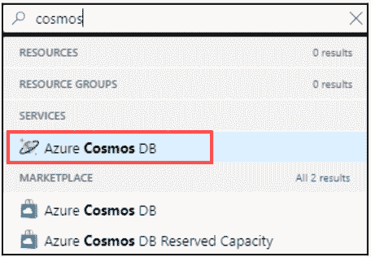

一旦你选择 Azure Cosmos DB，你将看到 Cosmos DB 边栏：

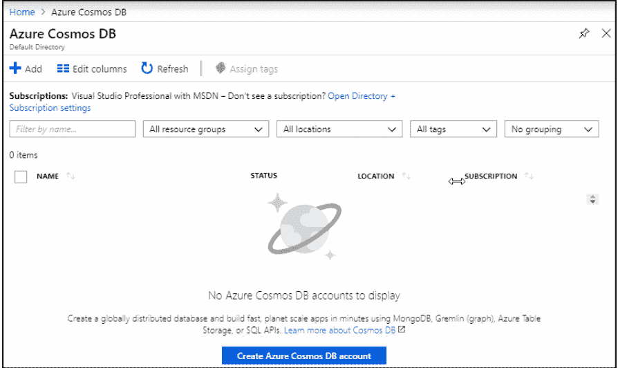

在这种情况下，术语 blade 指的是门户的独立部分。


如果你点击右上角的小图钉，该边栏将被添加到你的仪表板中，方便未来查找。

正如你所见，我们目前还没有任何资源，所以让我们通过选择“添加”来创建一个新数据库：

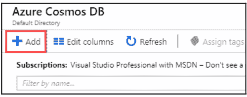

单击添加数据库选项后，你将看到一个新屏幕。这让你有机会配置数据库名称和位置，以及要使用的 API 类型。让我们先创建一个新资源组。然后我们可以使用此组来存放本书涉及的所有未来资源：

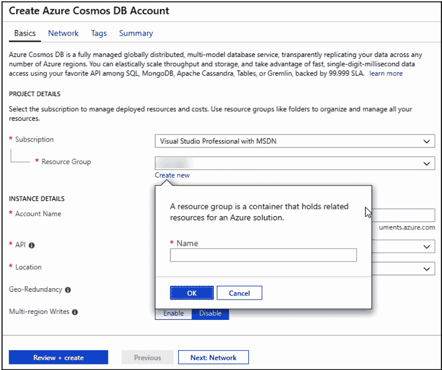

我填写的表单如下所示：

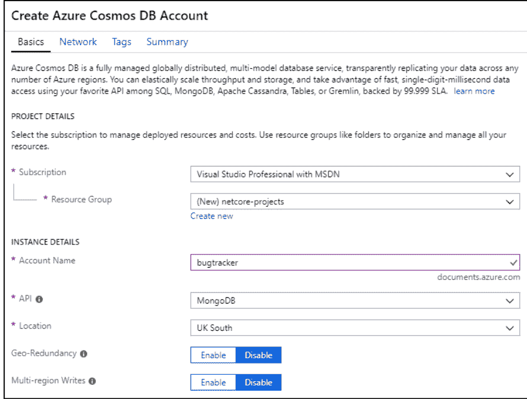

现在让我们更详细地讨论每个选项。

### 订阅/资源组

你的订阅很可能是由你的组织提供的（例如，MyCompanyLtd Dev），或者你可能正在使用私有 MSDN 订阅。取决于你组织的规模和你正在开发的产品的规模，你可能拥有针对你正在开发的产品的订阅、针对整个公司的订阅，或者介于两者之间的订阅。如果你正在使用 MSDN 账户，那也会显示在这里。

在撰写本文时，拥有 MSDN 订阅使你每月有权获得一定数量的 Azure 信用额度；具体数量取决于订阅类型。

资源组就是这样：一种将资源组合在一起的方式。没有规则，但将生命周期和用途相似的资源放在一起是合理的。

此图说明了 Azure 中各种分层实体之间的关系：

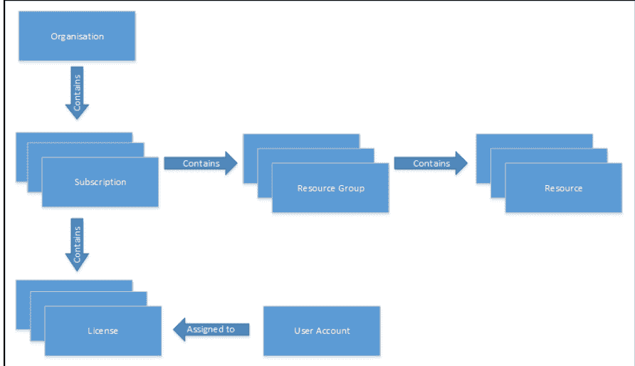

资源实际上是你可以消耗并为其付费的任何东西。在我们的例子中，我们的 Cosmos DB 实例是我们的资源；正如你所见，它存在于资源组内，而资源组又存在于订阅内。

虽然资源组及其管理的详细说明超出了本章（及本书）的范围，只需将资源视为工具，将资源组视为工具箱：你可能会将管道工作所需的工具（扳手、钳子等）放入一个工具箱，将绘画所需的工具（刷子、遮蔽胶带等）放入另一个工具箱。资源组也类似：数据库、使用该数据库的应用程序或应用程序、监控工具（Application Insights）等都将放入一个资源组。在实际场景中，你可能还会按目的拆分，因此你可能会有开发、测试和生产资源组。

将工具箱类比延伸到资源处置，如果你完成了特定类型的工作——例如，你不再绘画了——你可以直接把整个工具箱扔进垃圾桶。同样，只需删除资源组就会移除其中的任何资源。

你可能希望做的一件事是，将为本书创建的所有资源都放在一个资源组中，而不是遵循末尾的清理过程，只需删除资源组（无论是在每个章节末尾还是在书末）。

### 账户名称

账户名称是数据库实例向外界呈现的方式；你会注意到，当你选择一个名称时，它会附加 .documents.azure.com。此名称必须是全局唯一的——也就是说，它必须在整个 Azure 中唯一，无论订阅如何。你会注意到，当你在 Azure 中被要求命名某物时，过一段时间后，名称会被打上一个勾（即，你可以使用你选择的名称）或一个叉（表示不能使用，通常是因为名称已被占用或格式不正确）。

### API

API 允许你以不同的方式与实例交互——例如，我们在此选择了 **MongoDB**，这意味着我们将能够将 Cosmos DB 实例视为 MongoDB 实例。

设置 API 确实会改变你与数据库交互的方式，但不会改变底层数据。然而，在撰写本文时，做出选择后无法更改此选项；看来在创建后切换 API 选择的功能是 Microsoft 未来希望引入的东西。

这是本书的第二版，在第一版中，本章涉及与 MongoDB 的对接。通过选择 MongoDB API，我们应该能够使用完全相同的代码并简单地切换数据库。

### 位置

位置是一个比我们在此能涵盖的更大的话题；然而，本质上你是在选择资源将物理位于的地方。由于信息传播速度有限，你应该仔细考虑此选择；然而，Cosmos 确实允许在其他物理位置复制数据的机会。所以如果，和我一样，你位于英国，你可以将位置设置在那里。但是，假设 30% 的用户群位于澳大利亚，那么，通过 Cosmos，你可以在该地区复制数据，降低延迟。

### 地理冗余/多区域写入

地理冗余和多区域写入设置与 Cosmos 同时在多个物理位置存储数据的能力相关。两者都是非常大的话题，但基本思想很简单：如果数据安全很重要，请使你的数据地理冗余；如果你希望降低延迟时间并从全球多个物理位置访问，请启用多区域写入。

> 与所有 Azure 服务一样，这些服务都有相关费用。计费模型相对复杂，因为服务本身很复杂。如果你担心成本，Microsoft 提供了一个计算器（https://azure.microsoft.com/en-gb/pricing/calculator），它可以让你大致了解任何给定服务的费用可能是多少。

完成所有这些设置后，选择 **评审 + 创建**，然后单击“创建”。

创建资源可能需要几分钟，所以这可能是个去喝咖啡的好时机。

### 配置 Cosmos DB 实例

现在资源已创建，我们可以将此数据库实例视为 MongoDB。首先，我们需要启动 Data Explorer：

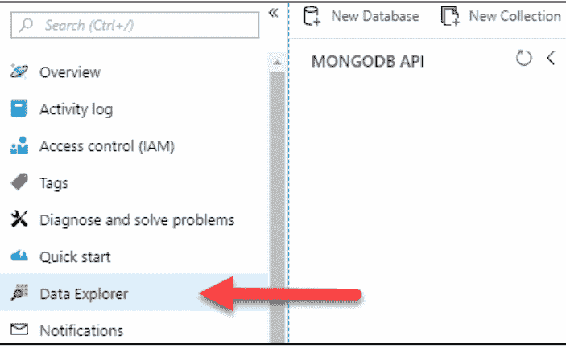


从这里，我们可以选择以下选项来创建新集合：

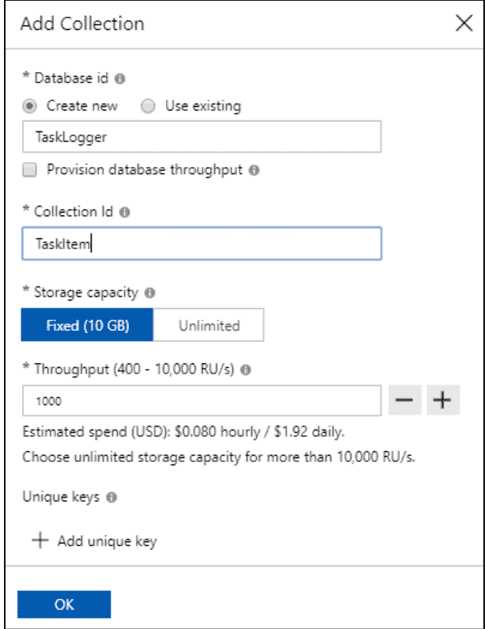

如你所见，我在这里保留了默认值。值得注意的是 **固定 (10 GB)** 不是推荐值，在生产级应用中，你很可能会选择 **无限**。如果这样做，则需要提供分区键。我将吞吐量保留为默认值 **1000 个请求单位/秒 (RU/s)**：这实际上允许你为所需性能付费；速度越慢，越便宜（反之亦然）！创建后，你应该能看到新集合：

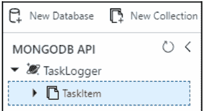

最后要做的是导航到连接字符串选项卡并复制主连接字符串：

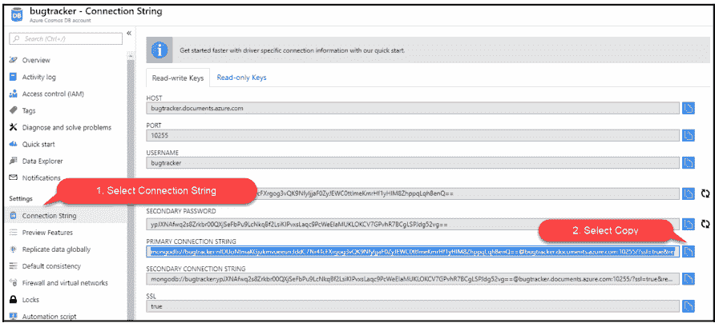

既然我们的 Cosmos DB 实例已配置，可以继续创建 Web 应用程序并连接到它。

## 将 ASP.NET Core MVC 应用程序连接到 Cosmos DB

讨论在应用程序中使用 Cosmos DB 时，人们会好奇将此功能添加到新 ASP.NET Core MVC 应用程序有多容易。这个过程真的很简单。首先，创建新项目：

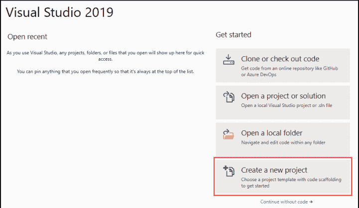

- 1. 将项目命名为 BugTracker：

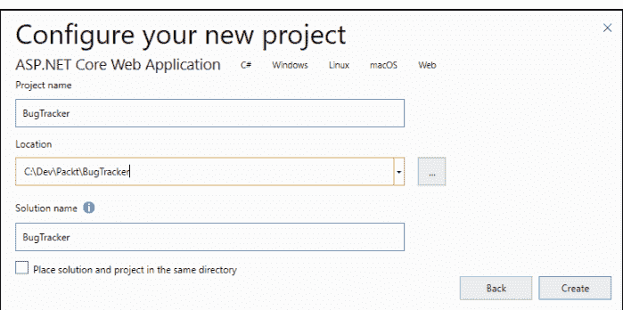

- 2. 选择创建 ASP.NET Core Web 应用程序选项：

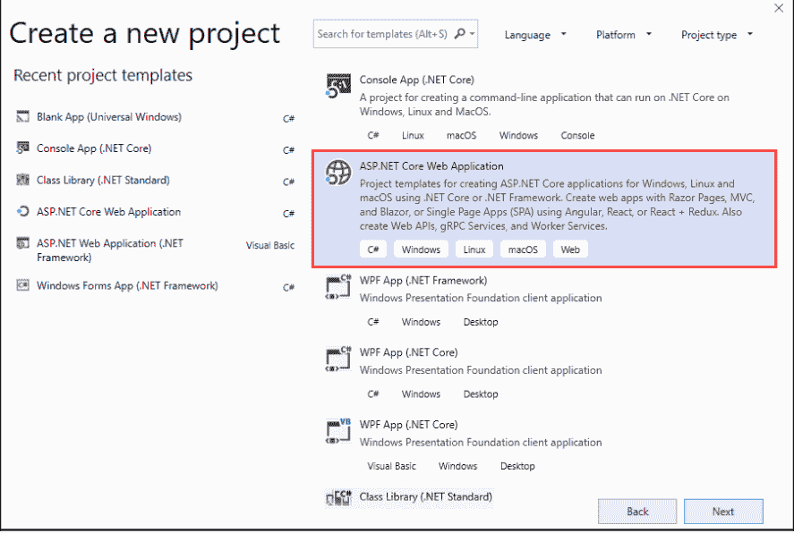

- 3. 在下一屏幕上，选择以下选项（参考下面的屏幕截图）：

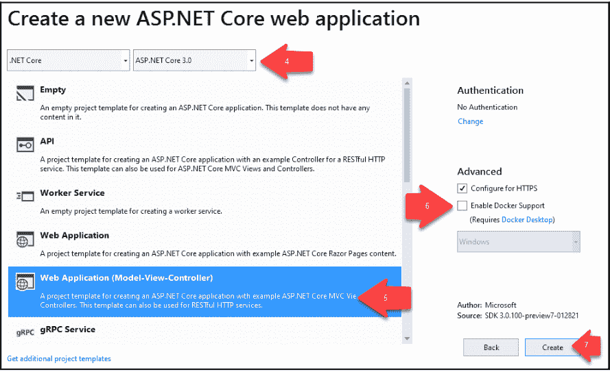

### 创建新的 ASP.NET Core Web 应用程序

- 4. 从下拉列表中选择 ASP.NET Core 3.0。
- 5. 选择 Web 应用程序 (Model-View-Controller)。
- 6. 取消选中 Enable Docker Support 选项。最后，单击 OK 按钮。
- 7. 单击创建，你的新 ASP.NET Core MVC 应用程序将被创建。

在创建时可以轻松为应用程序启用 Docker 支持。你也可以为现有应用程序启用 Docker 支持。

我们将在后面章节中介绍 Docker 以及如何使应用程序与 Docker 配合使用。目前，我们的应用程序不需要 Docker 支持。保持未选中状态并像往常一样创建应用程序。

### 添加 NuGet 包

我们需要将 MongoDB 客户端 API 添加到项目中。最好的方法是添加 NuGet 包。我们可以按照以下步骤操作：

- 1. 右键单击项目，并从上下文菜单中选择 **管理 NuGet 包...**，如下面的屏幕截图所示：

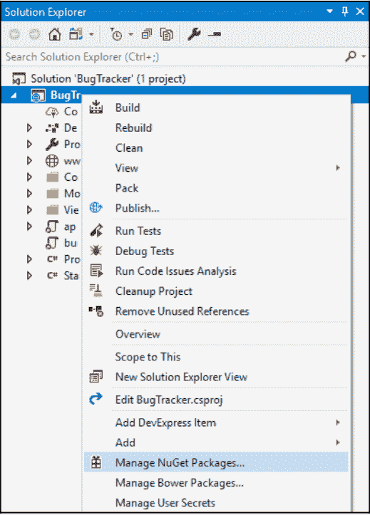

- 2. 在 NuGet 屏幕上，选择 **浏览** 选项卡，并输入 `MongoDB.Driver` 作为搜索词。

- 3. 选择由 **MongoDB.Driver** 由 **MongoDB** 选项。

- 4. 单击 **安装** 按钮以将最新稳定版包添加到项目中。如下面的屏幕截图所示：

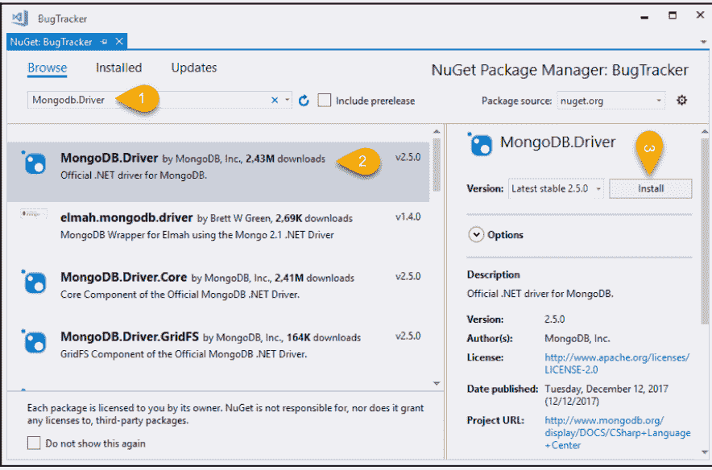

- 5. 可以在 Visual Studio 的 **输出** 窗口中查看进度。

- 6. 将 MongoDB 添加到项目后，你会看到 **MongoDB.Driver (2.5.0)** 已添加到项目的 **NuGet** 依赖项下，如下面的屏幕截图所示：

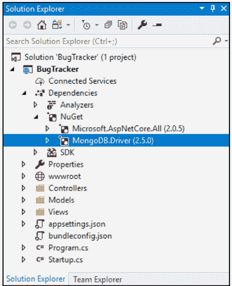

- 7. 展开 Controllers 文件夹。你会发现，默认情况下 Visual Studio 已创建 HomeController.cs 文件。该文件中的代码应该如下所示：

```
public class HomeController : Controller
{
    private readonly ILogger<HomeController> _logger;

    public HomeController(ILogger<HomeController> logger)
    {
        _logger = logger;
    }

    public IActionResult Index()
    {
        return View();
    }

    public IActionResult Privacy()
    {
        return View();
    }

    [ResponseCache(Duration = 0, Location = ResponseCacheLocation.None, NoStore = true)]
    public IActionResult Error()
    {
        return View(new ErrorViewModel { RequestId = Activity.Current?.Id ?? HttpContext.TraceIdentifier });
    }
}
```

我们希望能够从此处连接到 Cosmos DB，所以让我们创建一些代码来连接到 Mongo 客户端。

你需要向类添加 using 语句，如下所示：
using MongoDB.Driver;

连接到 MongoDB 的步骤如下：

- 1. 通过键入片段短代码 ctor 并两次制表符，或显式键入代码来创建构造函数。你的构造函数需要创建 MongoClient 的新实例。完成后，代码应如下所示：

```
public HomeController()
{
    var mclient = new MongoClient();
}
```

虽然这说明了 MongoClient 的用法，但像这样在构造函数中实例化类通常被视为不良实践，因为它几乎使单元测试不可能。

- 2. 为了让 `MongoClient` 工作，我们需要提供我们创建的 MongoDB 实例的连接字符串。在解决方案 'Bug Tracker' 窗格中打开 `appsettings.json` 文件，如下面的屏幕截图所示：

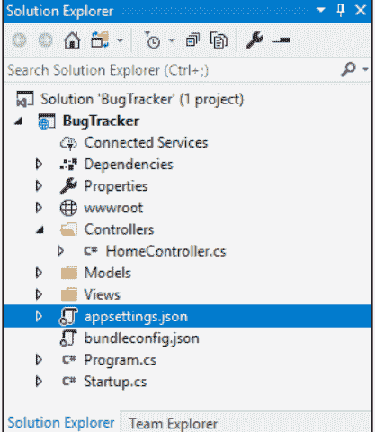

- 3. 打开 `appsettings.json` 文件后，它应该如下所示：

```
{
  "Logging": {
    "IncludeScopes": false,
    "LogLevel": {
      "Default": "Warning"
    }
  }
}
```

- 4. 这时你需要之前复制的连接字符串。修改文件并添加 MongoDB 连接详细信息，如下所示（将 `[connectionstring]` 替换为你之前复制的值）：

```
{
  "MongoConnection": {
    "ConnectionString": "[connectionstring]",
    "Database": "TaskLogger"
  },
}
```

```
"Logging": {
    "IncludeScopes": false,
    "LogLevel": {
        "Default": "Warning"
    }
}
}
```

- 5. 我们现在想要在 Models 文件夹中创建 Settings.cs 文件，如下面的屏幕截图所示：

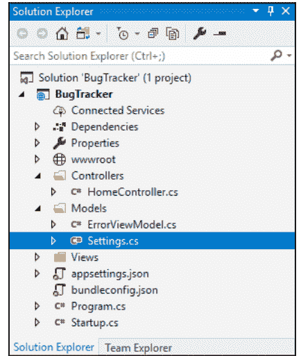

- 6. 打开 Settings.cs 文件并添加以下代码：

```
public class Settings
{
    public string ConnectionString { get; set; }
    public string Database { get; set; }
}
```

- 7. 我们现在需要打开 Startup.cs 文件并按如下方式修改 ConfigureServices 方法，以注册服务：

```
public void ConfigureServices(IServiceCollection services)
{
    services.AddControllersWithViews();
    services.AddRazorPages();

    services.Configure<Settings>(Options => {
    Options.ConnectionString = Configuration.GetSection
    ("MongoConnection:ConnectionString").Value; Options.Database =
    Configuration.GetSection
    ("MongoConnection:Database").Value; }); }

```

- 8. 返回 HomeController.cs 文件并修改构造函数以将连接字符串传递给 MongoClient：

```
public HomeController(IOptions<Settings> settings)
{
    var mclient = new
    MongoClient(settings.Value.ConnectionString);
}
```

- 9. 此时，我们想要测试代码以查看它是否实际访问我的 MongoDB 实例。为此，修改代码以返回集群描述：

```
IMongoDatabase _database;

public HomeController(IOptions<Settings> settings)
{
    var mclient = new
    MongoClient(settings.Value.ConnectionString);
    _database = mclient.GetDatabase(settings.Value.Database);
}

public IActionResult Index()
{
    return Json(_database.Client.Cluster.Description);
}
```

- 10. 运行 ASP.NET Core MVC 应用程序并读取浏览器中输出的信息，如下面的屏幕截图所示：

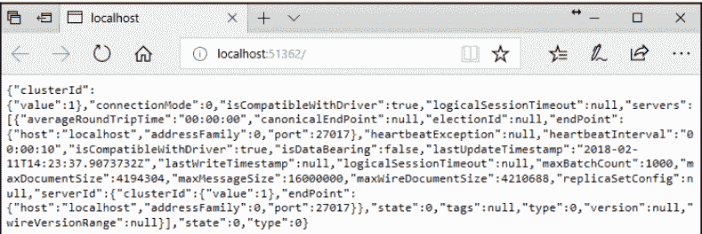

这很好，但让我们看看如何将添加数据库连接的逻辑分离到自己的类中。

### 创建 MongoDbRepository 类

要创建 MongoDbRepository 类，我们需要执行以下步骤：

- 1. 在解决方案中创建一个名为 Data 的新文件夹。在该文件夹中，创建一个名为 MongoDbRepository 的新类：

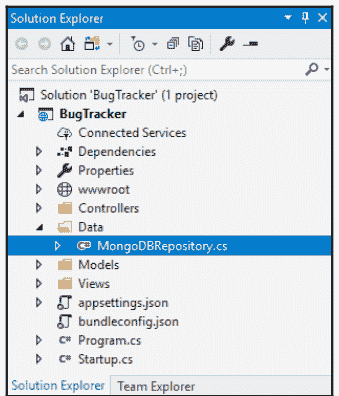


- 2. 在此类中，添加以下代码：

```
public class MongoDBRepository
{
    public readonly IMongoDatabase Database;

    public MongoDBRepository(IOptions<Settings> settings)
    {
        try
        {
            var mclient = new MongoClient(settings.Value.ConnectionString);
            Database = mclient.GetDatabase(settings.Value.Database);
        }
        catch (Exception ex)
        {
            throw new Exception("There was a problem connecting to the MongoDB database", ex);
        }
    }
}
```

如果代码看起来很熟悉，那是因为它与我们在 HomeController.cs 类中编写的代码相同；不过，这次它包含一些错误处理，并且位于其自己的类中。这意味着我们还需要修改 HomeController 类。

- 3. 同时修改 HomeController 构造函数中的代码以及 Index 操作中的代码。你的代码应如下所示：

```
public MongoDBRepository mongoDb;

public HomeController(IOptions<Settings> settings)
{
    mongoDb = new MongoDBRepository(settings);
}

public IActionResult Index()
{
    return Json(mongoDb.Database.Client.Cluster.Description);
}
```

- 4. 再次运行应用程序，你将在浏览器中再次看到先前显示的相同信息，因此再次向浏览器窗口输出。

唯一的区别是，代码现在被正确分离，并且易于重用。因此，如果日后发生任何更改，只需在此处更新即可。

既然我们已经创建了 Web 应用程序，就可以继续访问和更新 DB 实例中的数据了。

## 读取和写入 MongoDB 数据

在本节中，我们将了解如何从 MongoDB 数据库读取工作项列表，以及如何将新工作项插入数据库中（我使用工作项一词来指代任务或 Bug）。这可以通过执行以下步骤完成：

- 1. 在 `Models` 文件夹中，创建一个名为 `WorkItem` 的新类，如下图所示：

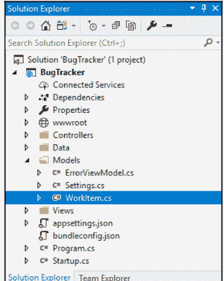

- 2. 将以下代码添加到 `WorkItem` 类中。你会注意到 `Id` 的类型是 `ObjectId`。这表示在创建的 MongoDB 文档中的唯一标识符。

> 你需要确保将以下 `using` 语句添加到 `WorkItem` 类中 `using MongoDB.Bson;`。

查看以下代码：

```
public class WorkItem
{
    public ObjectId Id { get; set; }
    public string Title { get; set; }
    public string Description { get; set; }
    public int Severity { get; set; }
    public string WorkItemType { get; set; }
    public string AssignedTo { get; set; }
}
```

- 3. 接下来，打开 MongoDBRepository 类，并向该类添加以下属性：

```
public IMongoCollection<WorkItem> WorkItems
{
    get
    {
        return Database.GetCollection<WorkItem>("workitem");
    }
}
```

- 4. 由于我们至少使用 C# 6，我们可以将 WorkItem 属性进一步简化为表达式主体属性。为此，请将代码更改为如下所示：

```
public IMongoCollection<WorkItem> WorkItems =>
Database.GetCollection<WorkItem>("workitem");
```

- 5. 如果这看起来有点令人困惑，请查看下图：

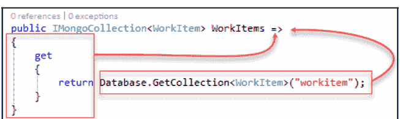

花括号、get 和 return 语句已被 => Lambda 运算符替换。被返回的对象（在此例中为 WorkItem 对象的集合）位于 Lambda 运算符之后。这将生成表达式主体属性。

## 创建接口和 WorkItemService

接下来，我们需要创建一个接口。为此，我们需要执行以下步骤：

- 1. 在解决方案中创建一个名为 Interfaces 的新文件夹，并向 Interfaces 文件夹添加一个名为 IWorkItemService 的接口，如下图所示：

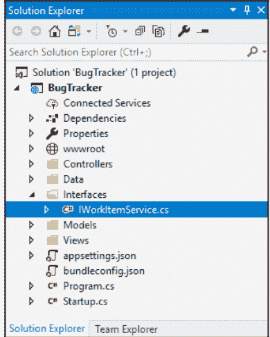

- 2. 将以下代码添加到 IWorkItemService 接口中：

```csharp
public interface IWorkItemService
{
    IEnumerable<WorkItem> GetAllWorkItems();
}
```

- 3. 在 Data 文件夹中，添加一个名为 WorkItemService 的另一个类，并使其实现 IWorkItemService 接口。

请务必添加 using 语句以引用你的接口。在我的示例中，这是 using BugTracker.Interfaces; 语句。

- 4. 你会注意到 Visual Studio 提示你实现接口。为此，请单击灯泡提示，然后从上下文菜单中单击“实现接口”，如下图所示：

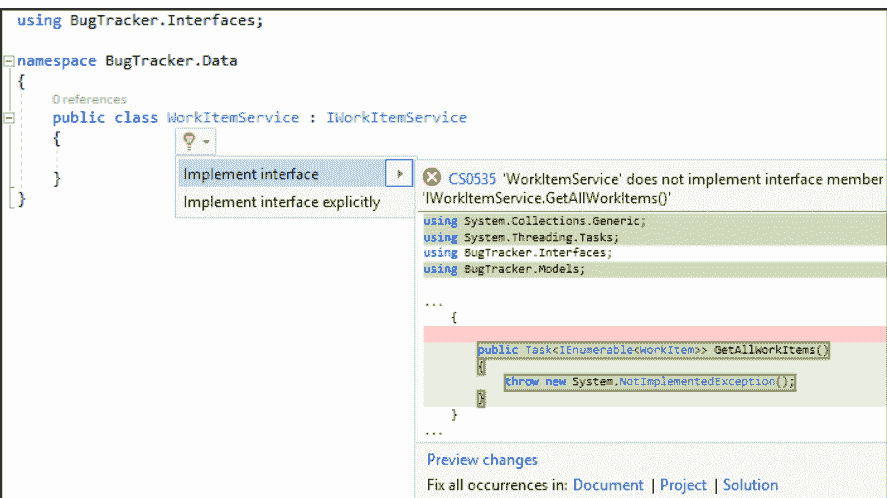

- 5. 完成此操作后，你的 WorkItemService 类将显示如下：

```
public class WorkItemService : IWorkItemService
{
    public IEnumerable<WorkItem> GetAllWorkItems()
    {
        throw new System.NotImplementedException();
    }
}
```

- 6. 接下来，添加构造函数并完成 GetAllWorkItems 方法，使你的类显示如下：

```
public class WorkItemService : IWorkItemService
{
    private readonly MongoDBRepository repository;
    public WorkItemService(IOptions<Settings> settings)
    {
        repository = new MongoDBRepository(settings);
    }
    public IEnumerable<WorkItem> GetAllWorkItems()
    {
        return repository.WorkItems.Find(x => true).ToList();
    }
}
```

- 7. 现在，你需要打开 Startup.cs 文件并编辑 ConfigureServices 方法以添加以下代码行：

```
services.AddScoped<IWorkItemService, WorkItemService>();
```

- 8. 你的 ConfigureServices 方法现在将显示如下：

```
public void ConfigureServices(IServiceCollection services)
{
    services.AddMvc();

    services.Configure<Settings>(Options =>
    {
        Options.ConnectionString =
        Configuration.GetSection("MongoConnection:ConnectionString").Value;
        Options.Database =
        Configuration.GetSection("MongoConnection:Database").Value;
    });

    services.AddScoped<IWorkItemService, WorkItemService>();
}
```

你所做的就是注册 IWorkItemService 接口；这会将 WorkItemService 类添加到依赖注入框架中。有关依赖注入的更多信息，请阅读以下文章 https://docs.microsoft.com/en-us/aspnet/core/fundamentals/dependency-injection。

## 创建视图

当我们启动应用程序时，我们希望看到工作项列表。因此，我们需要为 `HomeController` 创建一个视图来显示工作项列表，具体步骤如下：

- 1. 在 `Views` 文件夹中，展开 `Home` 子文件夹，如果存在，请删除 `Index.cshtml` 文件。
- 2. 然后，右键单击 `Home` 文件夹，并从上下文菜单中导航到 `Add | View`。将显示 `Add MVC View` 窗口。
- 3. 将视图命名为 `Index`，并将 `Template` 选择为 `List`。从 `Model class` 下拉列表中，选择 `WorkItem (BugTracker.Models)`。
- 4. 保持其余设置不变，然后单击 `Add` 按钮：

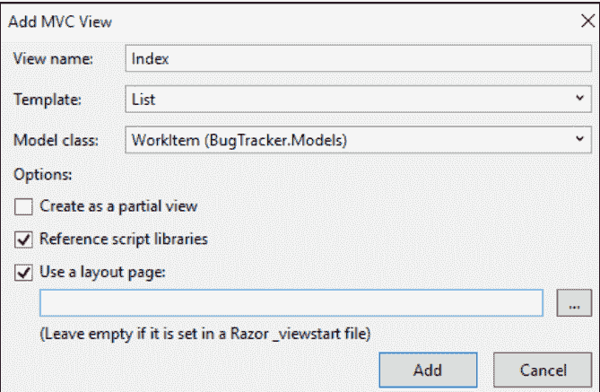

添加视图后，你的 **解决方案资源管理器** 将显示如下：

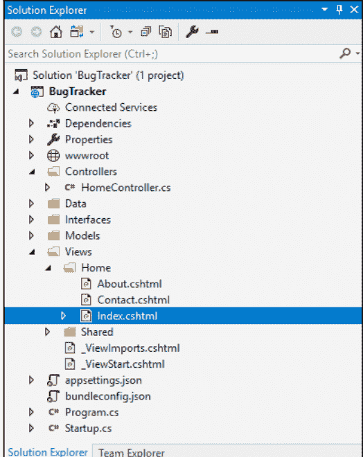

- 5. 仔细查看视图，你会注意到它使用 IEnumerable<BugTracker.Models.WorkItem> 作为模型：

```
@model IEnumerable<BugTracker.Models.WorkItem>

@{
    ViewData["Title"] = "Work Item Listings";
}
```

这样我们就可以遍历返回的 WorkItem 对象集合，并在列表中输出它们。还要注意，ViewData["Title"] 已从 Index 更新为 Work Item Listings。

## 修改 HomeController

在运行应用程序之前，我们需要做的最后一件事就是修改 HomeController 类以与 IWorkItemService 配合使用。让我们通过执行以下步骤来设置此项：

- 1. 如下修改构造函数和 Index 操作：

```
private readonly IWorkItemService _workItemService;

public HomeController(IWorkItemService workItemService)
{
    _workItemService = workItemService;
}

public IActionResult Index()
{
    var workItems = _workItemService.GetAllWorkItems();
    return View(workItems);
}
```

使用此代码，我们将从 MongoDB 数据库获取所有工作项，并将其传递给视图供模型使用。

- 2. 完成后，运行应用程序，如下图所示：

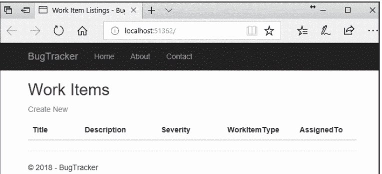

此时，数据库中没有工作项，因此我们在浏览器中看到这个空列表。接下来，我们将添加代码以将工作项插入到我们的 MongoDB 数据库中。


## 添加工作项

让我们通过以下步骤添加工作项：

- 1. 若要添加工作项，让我们先在 Models 文件夹中添加一个名为 AddWorkItem 的类，如下面的截图所示：

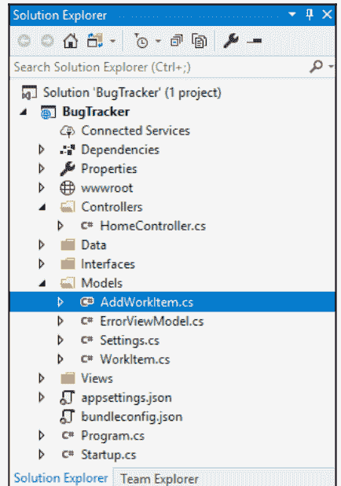

- 2. 修改类中的代码，使其基本上类似于 WorkItem 类：

```
public class AddWorkItem
{
    public string Title { get; set; }
    public string Description { get; set; }
    public int Severity { get; set; }
    public string WorkItemType { get; set; }
    public string AssignedTo { get; set; }
}
```

- 3. 接下来，在 Views 文件夹下创建一个名为 AddWorkItem 的新文件夹。右键单击 AddWorkItem 文件夹，选择 Add，然后在上下文菜单中单击 View。

- 4. 将显示“添加 MVC 视图”窗口。将视图命名为 AddItem，并为 Template 选择 Create。

- 5. 在 Model class 下拉列表中，选择 AddWorkItem (BugTracker.Models)。

- 6. 保持其余设置不变，然后单击 Add 按钮，如下面的截图所示：

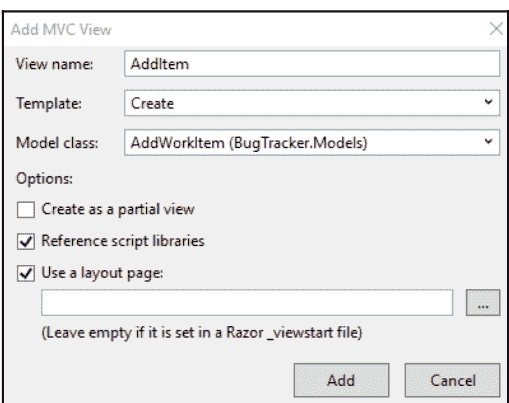

- 7. 打开 AddItem.cshtml 文件并查看 form 操作。确保其设置为 CreateWorkItem。以下代码片段显示代码应采用的形式：

```
<div class="row">
    <div class="col-md-4">
        <form asp-action="CreateWorkItem">
            <div asp-validation-summary="ModelOnly" class="text-danger"></div>@*Rest of code omitted for brevity*@
```

你的 Views 文件夹现在应如下所示：

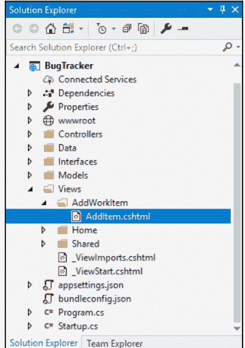

- 8. 现在，我们需要对 IWorkItemService 接口进行一小处更改。修改接口中的代码，使其如下所示：

```
public interface IWorkItemService
{
    IEnumerable<WorkItem> GetAllWorkItems();
    void InsertWorkItem(WorkItem workItem);
}
```

我们刚刚指定，实现 IWorkItemService 接口的类必须有一个名为 InsertWorkItem 的方法，该方法接受 WorkItem 类型的参数。这意味着我们需要去 WorkItemService 添加一个名为 InsertWorkItem 的方法。WorkItemService 接口中的代码将如下所示：

```
private readonly MongoDBRepository repository;

public WorkItemService(IOptions<Settings> settings)
{
    repository = new MongoDBRepository(settings);
}

public IEnumerable<WorkItem> GetAllWorkItems()
{
    return repository.WorkItems.Find(x => true).ToList();
}

public void InsertWorkItem(WorkItem workItem)
{
    throw new System.NotImplementedException();
}
```

- 9. 更改 InsertWorkItem 方法，以将 WorkItem 类型的单个对象添加到我们的 MongoDB 数据库中。将代码更改为如下所示：

```
public void InsertWorkItem(WorkItem workItem)
{
    repository.WorkItems.InsertOne(workItem);
}
```

- 10. 现在，我们需要稍微修改 `WorkItem` 类。向该类添加两个构造函数：一个接受 `AddWorkItem` 对象作为参数，另一个不带任何参数：

```
public class WorkItem
{
    public ObjectId Id { get; set; }
    public string Title { get; set; }
    public string Description { get; set; }
    public int Severity { get; set; }
    public string WorkItemType { get; set; }
    public string AssignedTo { get; set; }

    public WorkItem()
    {
    }

    public WorkItem(AddWorkItem addWorkItem)
    {
        Title = addWorkItem.Title;
        Description = addWorkItem.Description;
        Severity = addWorkItem.Severity;
        WorkItemType = addWorkItem.WorkItemType;
        AssignedTo = addWorkItem.AssignedTo;
    }
}
```

我们添加不带任何参数的第二个构造函数的原因是为了让 MongoDB 能够反序列化 `WorkItem`。

在反序列化期间，将创建对象的实例。因此，需要无参数构造函数；否则，反序列化将无法创建对象（因为它无法确定相关参数。）

- 11. 我们现在需要向项目中添加另一个控制器。右键单击 Controllers 文件夹，添加一个名为 AddWorkItemController 的新控制器。可以将其添加为空控制器。我们稍后会自行添加代码：

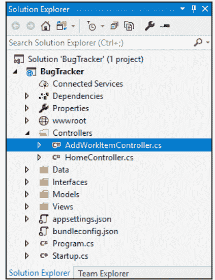

- 12. 在 AddWorkItemController 控制器中，添加以下代码：

```
private readonly IWorkItemService _workItemService;

public AddWorkItemController(IWorkItemService workItemService)
{
    _workItemService = workItemService;
}

public ActionResult AddItem()
{
    return View();
}

[HttpPost]
public ActionResult CreateWorkItem(AddWorkItem addWorkItem)
{
    var workItem = new WorkItem(addWorkItem);
    _workItemService.InsertWorkItem(workItem);
    return RedirectToAction("Index", "Home");
}
```

你会注意到，HttpPost 操作名为 CreateWorkItem。这就是 AddItem.cshtml 文件中有一个名为 CreateWorkItem 的 form 操作的原因。它告诉视图在单击 Create 按钮时要调用控制器上的哪个操作。

## 重定向到工作项列表

值得注意的是，在 WorkItemService 上调用 InsertWorkItem 方法后，我们将视图重定向到 HomeController 上的 Index 操作。如前所述，这将带我们进入工作项列表。让我们来设置对 AddWorkItem 的调用：

- 1. 修改 HomeController 代码，添加一个名为 AddWorkItem 的操作；该操作将调用 AddWorkItemController 类上的 AddItem 操作：

```
public ActionResult AddWorkItem()
{
    return RedirectToAction("AddItem", "AddWorkItem");
}
```

你的 HomeController 代码现在将如下所示：

```
private readonly IWorkItemService _workItemService;

public HomeController(IWorkItemService workItemService)
{
    _workItemService = workItemService;
}
```

```
public IActionResult Index()
{
    var workItems = _workItemService.GetAllWorkItems();
    return View(workItems);
}
```

```
public ActionResult AddWorkItem()
{
    return RedirectToAction("AddItem", "AddWorkItem");
}
```

- 2. 现在，让我们稍微修改 Index.cshtml 视图。为了使索引视图上的列表更直观，请修改 Index.cshtml 文件。

- 3. 添加一个 `if` 语句，以便在列表为空时允许从列表中添加新的工作项。

- 4. 添加一个 `ActionLink`，以便在单击时调用 `AddWorkItemController` 上的 `AddWorkItem` 操作（注意，我们提供一个空区域，以强制操作相对于根目录，而不是 `HomeController`）：

```
@if (Model.Count() == 0)
{
    <tr>
        <td colspan="6">There are no Work Items in BugTracker.
        @Html.ActionLink(linkText: "Add your first Work Item", actionName: "AddItem", controllerName: "AddWorkItem") now.
        </td>
    </tr>
}
else
{
    @foreach (var item in Model)
    {
    <tr>
        <td>
        @Html.DisplayFor(modelItem => item.Title)
        </td>
        <td>
        @Html.DisplayFor(modelItem => item.Description)
        </td>
        <td>
        @Html.DisplayFor(modelItem => item.Severity)
        </td>
        <td>
        @Html.DisplayFor(modelItem => item.WorkItemType)
        </td>
        <td>
        @Html.DisplayFor(modelItem => item.AssignedTo)
        </td>
        <td>
        @Html.ActionLink("Edit", "Edit", new { /* id=item.PrimaryKey */ }) |
        @Html.ActionLink("Details", "Details", new { /* id=item.PrimaryKey */ }) |
        @Html.ActionLink("Delete", "Delete", new { /* id=item.PrimaryKey */ })
        </td>
    </tr>
    }
}
```

- 5. 目前，请将 Create New asp-action 包装在以下 if 语句中：

```
@if (Model.Count() > 0)
{
<p>
    <a asp-action="Create">Create New</a>
</p>
}
```

我们稍后会查看这一点。目前，可以看到 HomeController 的 Index 操作列出了工作项。当单击“添加你的第一个工作项”链接时，我们会调用 HomeController 上的 AddWorkItem 操作。

反过来，AddWorkItemController 上的 AddWorkItem 操作会调用 AddWorkItemController 上的 AddItem 操作。这只是返回 AddItem 视图，我们在其中输入工作项详细信息并单击 Create 按钮。

同样，Create 按钮使用 HttpPost，并且，因为 AddItem 视图上的 form 操作指向 AddWorkItemController 类上的 CreateWorkItem 操作，所以我们会将工作项插入 MongoDB 数据库，并通过向 HomeController 上的 Index 操作执行 RedirectToAction 调用，将视图重定向回工作项列表。

现在，如果你觉得这是一种繁琐的方式，即先重定向回 HomeController，再重定向到 AddWorkItemController 上的 AddItem 操作，那么你 100% 正确。当用户单击创建新工作项的链接时，我会向你展示一种快速方法，直接重定向到 AddWorkItemController 上的 AddItem 操作。目前，请耐心等待；我正在努力向你展示如何与控制器和操作进行交互。

现在，再次运行你的应用程序：

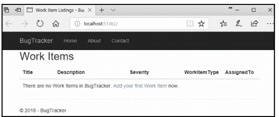


您会看到列表中的链接允许您添加第一个工作项。

此链接会将您重定向回 AddWorkItemController 上的 AddWorkItem 操作。要运行它，请执行以下操作：

- 单击链接，您将看到输出，如下面的屏幕截图所示：

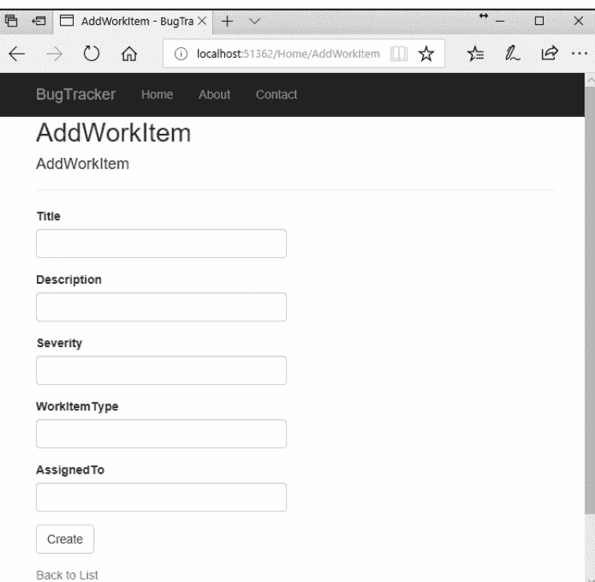

- 这将带您到添加新工作项的视图。在字段中输入一些信息并单击 **创建** 按钮：

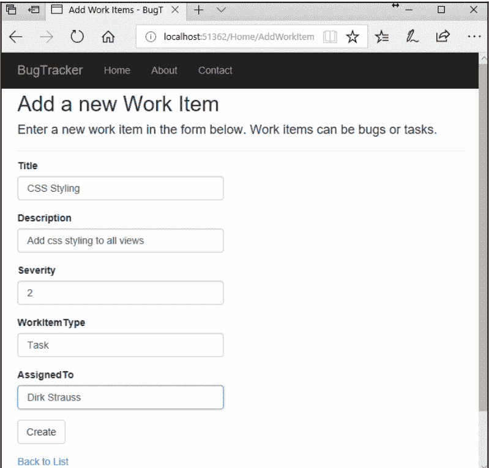

- **创建** 按钮会调用 `AddWorkItemController` 上的 `CreateWorkItem` 操作，并将您重定向回 `HomeController` 上的 `Index` 操作的工作项列表：

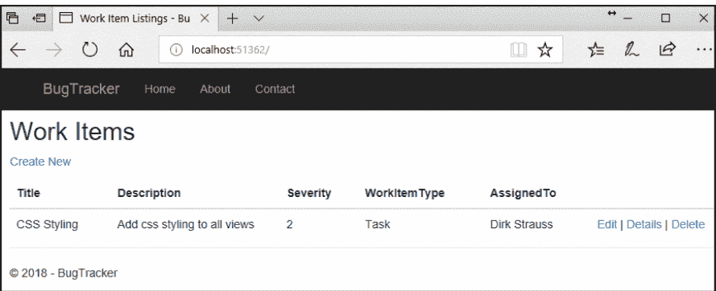

- 您可以看到 **创建新项** 链接现在显示在列表顶部。让我们修改 `Index.cshtml` 视图，使该链接直接重定向到 `AddWorkItemController` 类上的 `AddItem` 操作。按如下方式更改 Razor：

```
@if (Model.Count() > 0)
{
<p>
@Html.ActionLink("Create New", "AddWorkItem/AddItem")
</p>
}
```

您可以看到，我们可以指定应用程序必须采用的路由以到达正确的操作。在此示例中，我们表示当单击 **创建新项** 链接时，必须调用 `AddWorkItemController` 类上的 `AddItem` 操作。

再次运行您的应用程序并单击 **创建新项** 链接。您会看到自己被重定向到之前添加工作项的输入表单。

视图的默认样式看起来并不差，但它们绝对不是最漂亮的设计。至少，这使您作为开发人员能够返回并使用 CSS 对屏幕进行样式设置，以根据您的需求美化它们。目前，这些单调的屏幕 100% 功能正常，足以满足我们的目的。

打开 MongoDB Compass，您会看到里面有一个工作项文档。查看该文档，您将看到我们刚刚从 ASP.NET Core MVC 应用程序添加的信息：

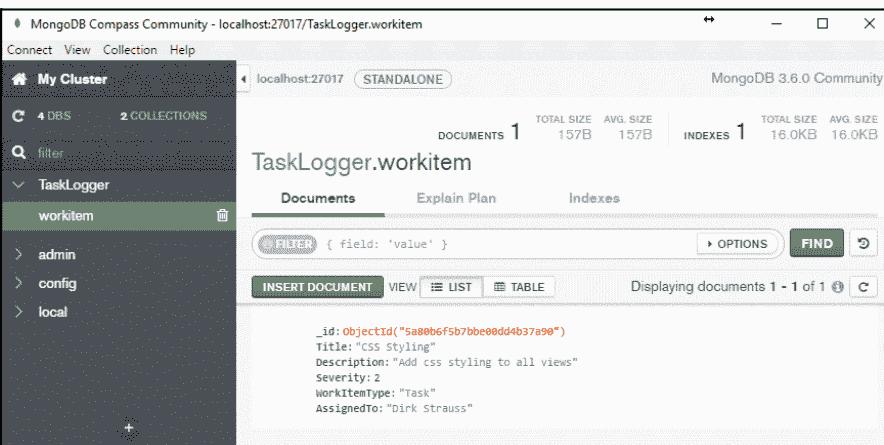

我们现在有一个可运行的网站实例。如果您计划扩展此应用程序，那么本章到此结束；否则，以下部分将介绍如何拆除您创建的资源。

## 清理资源

如前所述，Microsoft 根据您的使用情况从 Azure 赚取收入。为避免产生费用，您应始终清理（即删除）不再需要的资源。如果和我一样，您将 Cosmos DB 实例命名为 bugtracker，则可以返回到 Cosmos DB 边栏（您可能之前已将其固定到仪表板；否则，应搜索它）并选择该实例。

然后只需选择 **删除帐户**：

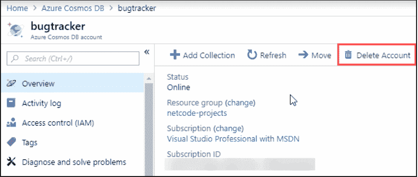

与许多 Azure 资源一样，您需要完成第二步来确认您确实要删除该资源：

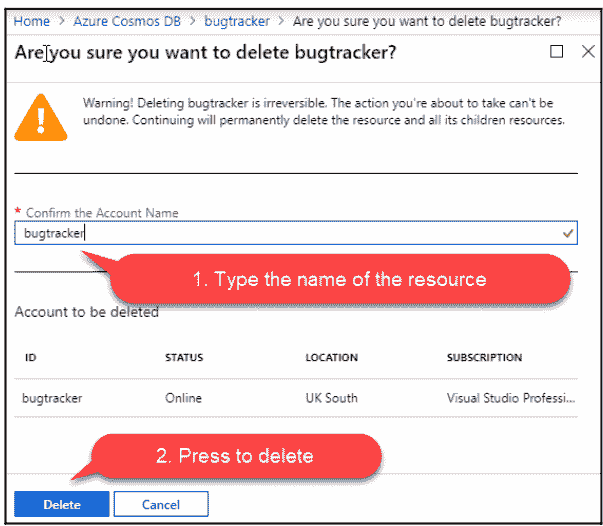

可能需要几秒钟才能完成，之后就完成了。

## 摘要

在 Cosmos DB 和 ASP.NET Core MVC 方面，您仍有大量可学习的内容。单靠一个章节当然不足以涵盖所有内容。数据库安放在办公室机架中、只有某一个人持有钥匙的强大昂贵服务器上的日子已屈指可数。这可以被视为既有好处也有坏处：没有人能意外拔掉或重启服务器，本地停电也不会对其产生任何影响；然而，您（或您的雇主）现在要为低效查询付出英镑和便士（或美元和美分）的代价。

在下一章中，我们将探讨 Azure 上的 SignalR 以及如何创建实时聊天应用程序。
