# 3 ASP.NET Azure SignalR 聊天应用程序

聊天应用程序以一种或另一种形式，可能和互联网本身一样悠久。这并不难以置信，因为互联网的最初目的是让研究人员之间进行通信。在那些早期，这种通信比发送信件快得多，但仍远未即时。

在本章中，我们将创建一个允许网站访客实时相互聊天的应用程序。具体而言，我们将涵盖以下主题：

- 配置 Azure SignalR 服务
- 设计和设置项目
- 添加 SignalR 库
- 构建服务器
- 创建客户端
- 运行应用程序

## 技术要求

在本章中，您需要一个 Azure 订阅（我们在上一章中简要介绍过如何创建一个）。我们还将使用仅在 Visual Studio 的较高版本中可用的一些功能；撰写本文时，15.8.7 是最新版本，但任何高于 15.8.0 的版本都应该足够。

本章的代码可在 GitHub 上找到，网址为：https://github.com/PacktPublishing/C-8-and-.NET-Core-3-Projects-Using-Azure-Second-Edition。

## 介绍 SignalR

通常，在客户端-服务器关系中（例如访问网站），通信由客户端发起。您可能会访问一个显示股价的网站，单击特定的股票代码，然后网站会为您检索该股票的价格。获得价格后，您可能会让页面保持打开状态并一小时后返回。股票价格完全一样；您刷新网页，股票价格会被重新获取并现在正确显示。

解决此问题的一种可能方法是让服务器在信息准备好时随时将其发送给客户端。SignalR 提供了此功能。但是，SignalR 并非单一技术——它实际上是一组经过抽象的技术栈。这对使用者来说完全透明，因此您只需调用 SignalR 方法来发送或接收消息，在内部，SignalR 将使用一系列可用技术来实现此消息传输。撰写本文时，此技术栈如下：

- Web 套接字
- 服务器发送事件
- 永久帧
- 长轮询

详细讨论这些超出了本书的范围，因此我们只需说 SignalR 将使用其可用的最佳技术。

您可以在自己的服务器内自行托管 SignalR；但是，Microsoft Azure 现在允许您使用由 Microsoft 托管的 SignalR 服务。其好处在于 Azure 将处理缩放，此外，该服务还可作为 Azure 无服务器生态系统的一部分使用；例如，您可以将 SignalR 与 Azure Functions 配合使用，以便服务器端离线进程可以触发一个函数，该函数随后会调用 SignalR 以更新客户端，而更新可以推送到成千上万或数以万计的客户端。

为了展示 SignalR 的功能，我们将构建一个简单的 ASP.NET Core SignalR 聊天应用程序。我们的应用程序将自托管，但将使用 Azure SignalR 服务。

## SignalR 项目

在本节中，我们将配置并创建 Web 应用程序。第一步是配置 SignalR 服务。

## 配置 Azure SignalR

第一步是在 Azure 中创建我们的 SignalR 实例：

- 搜索 SignalR 并从结果中选择 SignalR 服务：

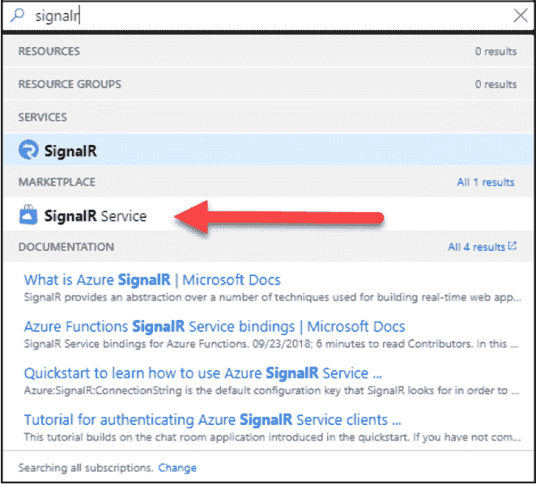

- 选择此项后，您将看到 SignalR 创建页面：

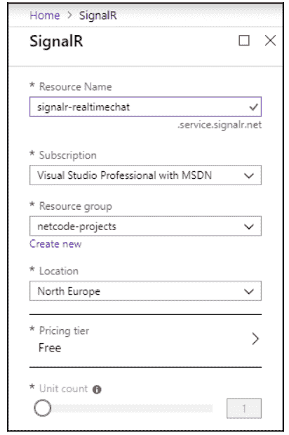

我们在上一章中介绍了这些设置中的大部分；但是，我要指出，**资源名称**与 Azure 中的许多资源一样，是全局唯一的。这意味着，如果我在您阅读本章之前没有删除此资源，您将无法使用相同的资源名称。

**提示** 避免此问题的一种策略是为您的命名建立前缀或后缀。例如，如果您的公司名为 *我的公司名称*，则可以使用 `mcn-` 作为资源前缀。

**注意** 此处的定价层级是免费的，足以用于示例项目或概念验证，但如果您打算在高负载下使用此服务，可能希望探索付费层级。


3. 如果单击 **Create**，资源将在几分钟后创建。部署完成后，访问 **Keys** 部分并复制 **Primary** 连接字符串：

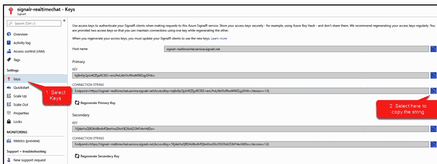

你稍后需要用到连接字符串，因此暂时将其粘贴到记事本或类似工具中。让我们继续创建项目。

## 创建项目

对于此项目，我们需要以下元素：

- **Azure SignalR 实例**：这将管理 SignalR 消息。
- **聊天服务器**：这将是我们的服务器端 C# 代码，用于处理和转发从客户端发送的消息。
- **聊天客户端**：客户端将包含用于向服务器发送消息和从服务器接收消息的 JavaScript 函数，以及用于显示的 HTML 元素。

我们将先设置 Azure，然后是服务器代码，接着转到客户端，构建一个简单的 Bootstrap 布局，并从那里调用一些 JavaScript 函数。

作为额外福利，我们将包含一种将对话历史记录存档为文本文件的方法。

## 设置项目

让我们设置此项目：

- 1. 打开 Visual Studio 2019 并选择 **Create a new project**，如以下屏幕截图所示：

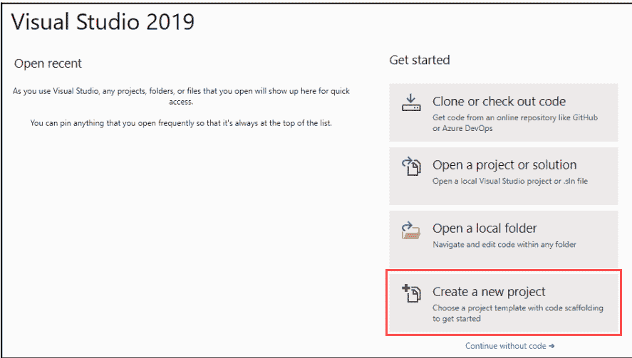

- 2. 选择 ASP.NET Core Web Application：

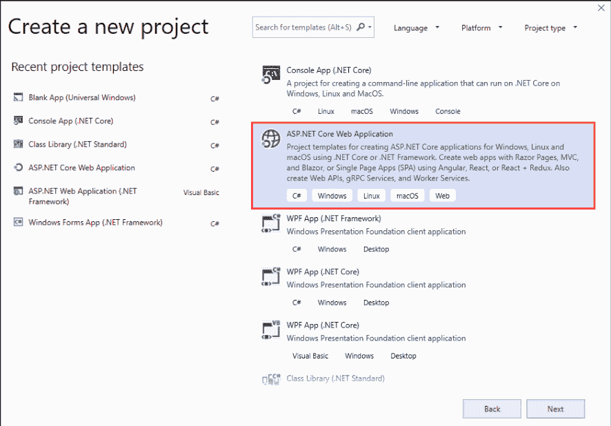

- 3. 配置项目（即，决定名称和位置）：

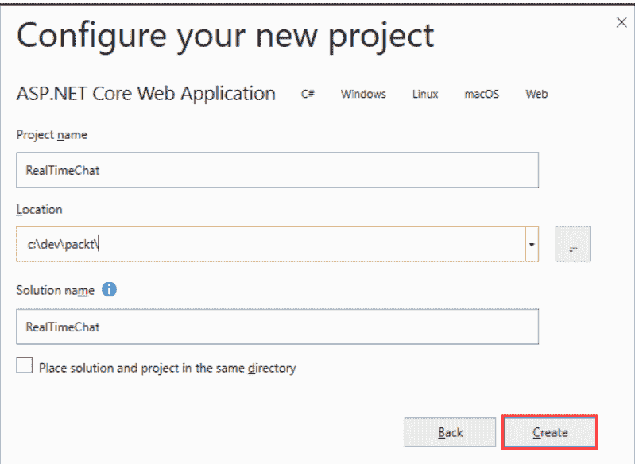

- 4. 我们将使用空项目模板。请确保从下拉列表中选择 ASP.NET Core 3.0：

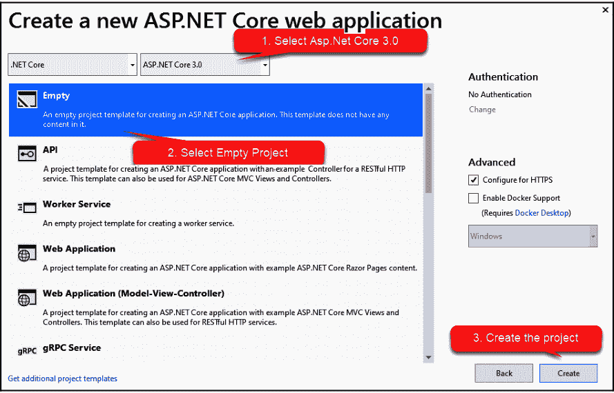

项目将被创建并如下所示：

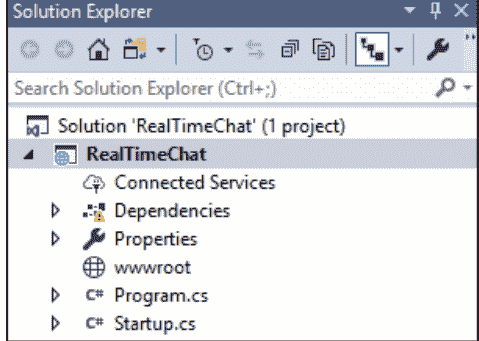

为了使用 SignalR，我们需要添加一些额外的库；我们将在下一部分执行此操作。

## 添加 SignalR 库

需要安装两组库：客户端和服务器：

- 1. 让我们先从服务器库开始。为此，我们将使用 NuGet。在 NuGet 包管理器中，选择 **Manage NuGet Packages**：

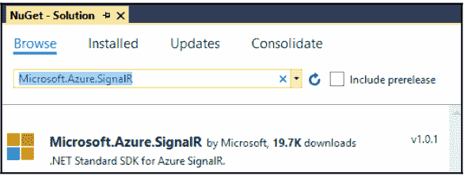

如果您愿意，也可以使用 **Package Manager Console** 并运行 `Install-Package Microsoft.AspNet.SignalR` 命令进行安装。

- 2. 对于客户端库，我们将使用 npm 安装 SignalR 库。

npm 是一个包管理器，类似于 NuGet，但用于 JavaScript。您可以访问 https://www.npmjs.com 了解详情。

- 3. 让我们确保使用的是 npm 的最新版本；启动 PowerShell，在控制台窗口中键入以下命令：

```
npm install npm@latest -g
```

这可能需要一段时间，但应该会更新包管理器。

- 4. 现在，导航到您的项目目录；例如，如果您的目录结构与我类似，可能会键入以下命令：

```
cd C:\Dev\packt\RealTimeChat\RealTimeChat
```

- 5. 现在，键入以下命令并按 Enter：

```
npm init
npm install @aspnet/signalr
```

npm init 将在项目中创建一个名为 package.json 的文件；该文件决定需要哪些文件，并将把该文件中指定的任何包下载到项目根目录中的 node_modules 文件夹。由于您正在初始化 node 模块，系统会询问一系列问题，您只需按 Enter 即可回答。

- 6. 您可以通过检查 node_modules 目录是否存在来确认下载是否成功；它不会包含在您的项目中，因此您可能需要选择显示所有文件：

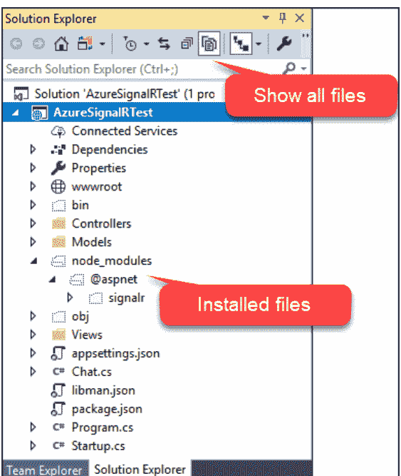

虽然 npm 是广泛使用的包管理器，但它在 .NET 应用程序方面确实存在一个小问题。问题是它将文件下载到 node_modules 目录中（如前面的屏幕截图所示）。这并不理想，因为您将无法访问 wwwroot 之外的任何内容。此外，默认情况下，它实际上并未包含在您的项目中。

- 7. 幸运的是，自 Visual Studio 15.8.0 以来，我们有一个工具可以启用这些库的安装和维护。虽然您可以独立于 `npm` 使用此工具，但这里我们将使用它将 node 模块放置到正确的位置。右键单击项目并选择 **Client-Side Library**...

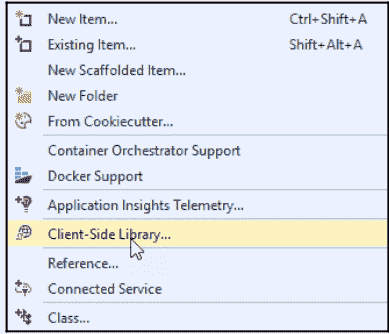

随后显示的对话框如下所示：

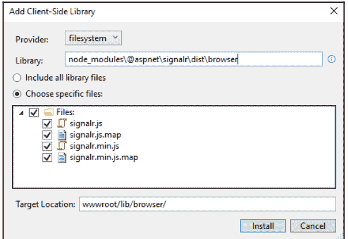

- 8. 在撰写本文时，提供程序可以设置为三个选项之一；暂时将此设置为 `filesystem`。**Library** 应设置为库的源：在我们的情况中，这是 `node_modules` 文件夹的目录，也是 SignalR 文件所在位置。

- 9. 如您所见，这里的额外好处是您可以挑选所需的文件。单击 Install 后，您将能够立即看到包出现在正确的位置。

有了包，我们可以（终于）开始编写一些代码。

## 构建服务器

我们需要为聊天程序构建一个服务器，其中将包含我们希望从连接的客户端调用的方法。我们将使用 SignalR Hubs API，它提供了连接的客户端与我们的聊天服务器通信所需的方法。

## SignalR Hub 子类

现在，我们需要创建 SignalR Hub。让我们逐步学习如何操作：

- 1. 向项目中添加一个类以处理聊天的服务器端。我们将把它命名为 Chat：

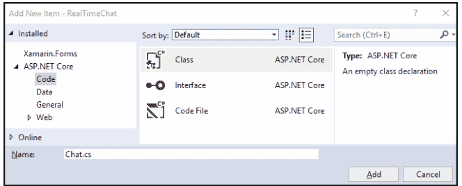

这需要是 SignalR Hub 类的子类。请确保添加 Microsoft.AspNetCore.SignalR 的 using 指令。Visual Studio 的快速操作对此效果很好：

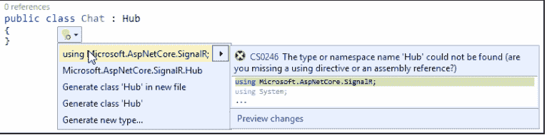

> Ctrl-. 是此操作的键盘快捷方式（目前，它可能是 Visual Studio 中第二有用的快捷方式）。

- 2. 现在，向类中添加一个方法以处理消息发送：

```
public Task Send(string sender, string message) =>
    Clients.All.SendAsync("UpdateChat", sender, message);
```

此方法将导致任何连接的客户端调用 UpdateChat 方法，并传递 sender 和 message 参数。

- 3. 现在，添加一个方法以处理存档功能：

```
public Task ArchiveChat(string archivedBy, string path, string messages)
{
    string fileName =
        $"ChatArchive_{DateTime.Now.ToString("yyyy_MM_dd_HH_mm")}.txt";
    System.IO.File.WriteAllText($"{path}\{fileName}", messages);
    return Clients.All.SendAsync("Archived", $"Chat archived by {archivedBy}");
}
```

如您所见，此方法仅获取 messages 字符串参数的值，将其写入名为 ChatArchive_[日期].txt 的新文本文件中，保存到给定路径，并调用客户端的 Archived 函数。

这一切看起来有点像魔术；实际上，要使这两项任务真正起作用，我们需要进行更多的脚手架操作。

## 配置更改

在 Startup.cs 文件中，我们需要将 SignalR 服务添加到容器，并配置 HTTP 请求管道。让我们开始吧：

- 1. 在 ConfigureServices 方法中，添加以下代码：

```
services.AddSignalR().AddAzureSignalR();
```

- 2. 在 Configure 方法中，添加以下代码：

```
app.UseDefaultFiles();
app.UseStaticFiles();
app.UseAzureSignalR(r =>
{
    r.MapHub<Chat>("/chat");
});
```

请注意，我们已将 `app.UseStaticFiles()` 添加到 `Configure` 方法中。静态文件是 ASP.NET Core 应用直接提供给客户端的资源。静态文件示例包括 HTML、CSS、JavaScript 和图像。对 `app.UseDefaultFiles()`（必须在 `app.UseStaticFiles()` 之前调用）的调用告诉中间件搜索预定义的 HTML 文件列表，包括 `index.html`。

我们的服务器部分已完成。

- 3. 最后，我们需要告诉 SignalR 服务如何连接到 Azure；在项目中创建一个名为 `appsettings.json` 的新文件：

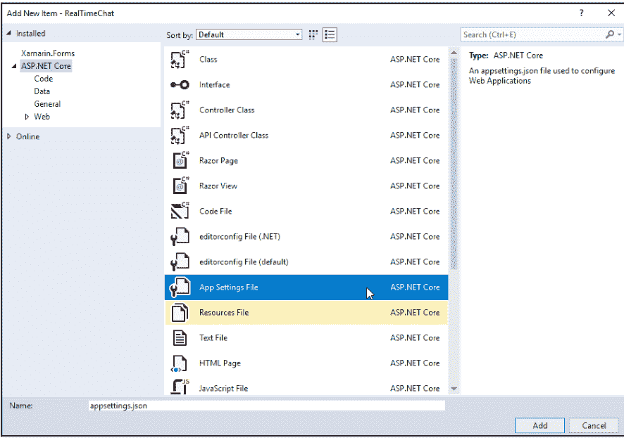


4. 请记住我们之前复制的连接字符串；它需要放入此文件中：

```json
{
"Azure": {
"SignalR": {
"ConnectionString":
"Endpoint=https://signalr-realtimechat.service.signalr.net;AccessKey=accesskeyhere;Version=1.0;"
}
}
}
```

请确保更新连接字符串以反映您的连接字符串。

我们可以（而且将会）稍后扩展服务器的功能，但现在，让我们先转到客户端。

## 创建客户端

如前所述，客户端将由用于向服务器发送和接收消息的 JavaScript 函数以及用于显示的 HTML 元素组成。

向 wwwroot 文件夹添加一个 HTML 页面并将其命名为 index.html：

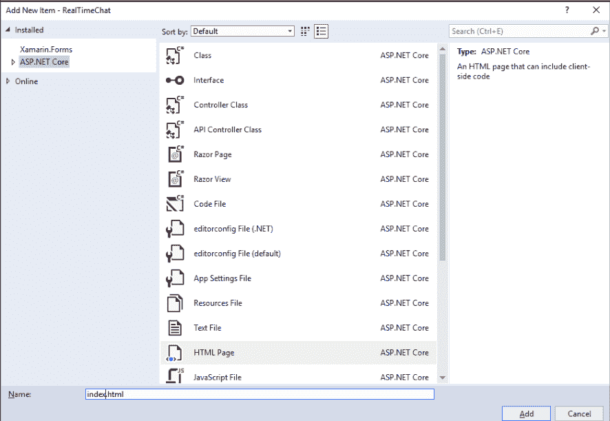

我们将保持客户端页面非常简单。我使用 div 标签作为面板来显示和隐藏页面的不同部分。我还使用 bootstrap 使其看起来美观，但你可以随心所欲地设计。我也不会用诸如在哪里指定页面标题等基础知识来烦你。我们将专注于相关元素。

我们将创建一个骨架页面，并在进程中填充函数：

```html
<!DOCTYPE html>
<html>
<head>
    <title>Realtime Chat</title>
    <link rel="stylesheet" href="https://maxcdn.bootstrapcdn.com/bootstrap/3.3.7/css/bootstrap.min.css">
    <script src="https://ajax.googleapis.com/ajax/libs/jquery/3.2.1/jquery.min.js"></script>
    <script src="https://maxcdn.bootstrapcdn.com/bootstrap/3.3.7/js/bootstrap.min.js"></script>
    <script src="/lib/browser/signalr.min.js"></script>
    <script type="text/javascript">
    </script>
</head>
```

## 包含的库

在开始填充函数之前，让我们先了解 link 和 script 标签的作用。它们引入了所需的库：

```html
<link rel="stylesheet" href="https://maxcdn.bootstrapcdn.com/bootstrap/3.3.7/css/bootstrap.min.css">
<script src="https://ajax.googleapis.com/ajax/libs/jquery/3.2.1/jquery.min.js"></script>
<script src="https://maxcdn.bootstrapcdn.com/bootstrap/3.3.7/js/bootstrap.min.js"></script>
<script src="/lib/browser/signalr.min.js"></script>
```

如果你不想使用 bootstrap 来控制外观和风格，则不需要 bootstrap JavaScript 库或 CSS，但请注意，我们将在脚本中使用 jQuery，因此请保留它。我们还引用了之前添加到 lib/browser 目录中的 SignalR 库。

## JavaScript 函数

以下代码都将放入 <script> 标签内。

我们的客户端需要一些代码来发送和接收服务器的消息。我尽量保持 JavaScript 简单，选择使用 jQuery 代码以提高可读性：

- 1. 为我们的 SignalR Hub 服务器创建一个变量（我将其命名为 connection）并调用其 start 函数：

```javascript
var connection = new signalR.HubConnectionBuilder()
.withUrl('/chat')
.build();

connection.start();
```

.withUrl 的 '/chat' 参数指的是我们的 Chat.cs 类，该类继承自 SignalR 的 Hub 接口。

- 2. 添加 UpdateChat 和 Archived 方法，这些方法将由服务器调用：

```javascript
connection.on('UpdateChat', (user, message) => {
	updateChat(user, message);
});
connection.on('Archived', (message) => {
	updateChat('system', message);
});
```

我们只是将从服务器获得的参数传递给 updateChat 方法。我们将在下方定义该方法。

- 3. 定义 enterChat 函数：

```javascript
function enterChat() {
	$('#user').text($('#username').val());
	sendWelcomeMessage($('#username').val());
	$('#namePanel').hide();
	$('#chatPanel').show();
};
```

我们从 username 输入元素的值设置用户标签的文本，将其传递给 sendWelcomeMessage 方法（我们将稍后定义），并切换相关面板的显示状态。

- 4. 定义 sendMessage 函数：

```javascript
function sendMessage() {
	let message = $('#message').val();
	$('#message').val('');
	let user = $('#user').text();
	connection.invoke('Send', user, message);
};
```

我们从 message 输入元素设置 message 变量，然后清空它以供下一条消息使用，并从用户标签设置 user 变量。然后，我们使用 connection.invoke 方法调用服务器上的 Send 方法，并将我们的变量作为参数传递。

### 定义 sendWelcomeMessage 函数：

```javascript
function sendWelcomeMessage(user) {
    connection.invoke('Send','system',user+' joined the chat');
};
```

就像前面描述的 sendMessage 函数一样，我们将使用 connection.invoke 函数调用服务器上的 Send 方法。不过这一次，我们将 'system' 字符串作为 user 参数传递，并附加一条关于刚加入用户的简短信息消息。

### 定义 updateChatPanel 方法：

```javascript
function updateChatPanel(user, message) {
    let chat = '<b>' + user + '</b>:' + message + '<br/>'
    $('#chat').append(chat);
    if ($('#chat')[0].innerText.length > 0) {
    $('#history').show();
    $('#archivePanel').show();
    }
};
```

updateChat 只是我们用于更新聊天历史记录面板的自定义函数。我们本可以在两个 connection.on 函数中内联完成此操作，但这意味着我们会重复代码。作为编程的一般准则，你应尽量避免重复代码。

在此函数中，我们设置 chat 变量，以决定每条聊天历史记录行在样式方面的显示方式。在此示例中，我们只是将用户（带冒号）设置为粗体，随后的消息不设置样式，并在末尾添加换行。几行聊天内容大致如下所示：

```
John: Hello people
Sarah: Hi John
server: Peter joined the chat
John: Hi Sarah, Hello Peter
Peter: Hello Everyone
```

我们还需要检查 chat div 的 innerText 属性，以确定聊天历史记录和存档面板是否应可见。

### 定义 archiveChat 函数：

```javascript
function archiveChat () {
    let message = $('#chat')[0].innerText;
    let archivePath = $('#archivePath').val();
    connection.invoke('ArchiveChat', archivePath, message);
};
```

与其他内容一样，我尽量将其保持简单。我们获取聊天面板（div）的 innerText 以及 archivePath 输入中指定的路径，并将其传递给服务器的 ArchiveChat 方法。

当然，这里有一个小小的出错可能：如果用户没有输入保存文件的有效路径，代码将抛出异常。我将留给你自己的创造力来解决这个问题。我只是在这里实现 SignalR 功能。

让我们看看 body 部分的轮廓：

```html
<body>
    <div class="container col-md-10">
        <h1>Welcome to SignalR <label id="user"></label></h1>
    </div>
    <hr />
</body>
</html>
```

以下代码将全部依次位于水平线之后。

## 命名部分

让我们先看看命名部分，然后再深入了解一些细节：

```html
<div id="namePanel" class="container">
    <div class="row">
        <div class="col-md-2">
            <label for="username" class="form-label">Username:</label>
        </div>
        <div class="col-md-4">
            <input id="username" type="text" class="form-control" />
        </div>
        <div class="col-md-6">
            <button class="btn btn-default" onclick="enterChat()">
                Enter
            </button>
        </div>
    </div>
</div>
```

我们需要知道聊天室参与者是谁。在此，我们添加一个输入元素来捕获用户名，并添加一个按钮来调用 enterChat 函数：

- <input id="username" type="text" class="form-control" />
- <button class="btn btn-default" onclick="enterChat()">Enter</button>

## 聊天输入

聊天部分允许用户输入消息并查看已输入的内容：

```html
<div id="chatPanel" class="container" style="display: none">
<div class="row">
<div class="col-md-2">
<label for="message" class="form-label">
Message:
</label>
</div>
<div class="col-md-4">
<input id="message" type="text" class="form-control" />
</div>
<div class="col-md-6">
<button class="btn btn-info" onclick="sendMessage()">
Send
</button>
</div>
</div>
</div>
<div id="historyPanel" style="display:none;">
<h3>Chat History</h3>
<div class="row">
<div class="col-md-12">
<div id="chat" class="well well-lg"></div>
</div>
</div>
</div>
</div>


The following elements allow our user to type a message (input) and post it to the server (the event button for sendMessage):

以下元素允许我们的用户键入消息（输入）并将其发布到服务器（sendMessage 的事件按钮）：

- <input id="message" type="text" class="form-control" />
- <button class="btn btn-info"
onclick="sendMessage()" >发送</button>

We also have a div tag called `<div id="chat" class="well well-lg"></div>` with an ID of "chat". We are using this as a container for our conversation (chat history).

我们还有一个名为 `<div id="chat" class="well well-lg"></div>` 的 div 标签，其 ID 为 "chat"。我们将其用作对话（聊天历史记录）的容器。

## Archive function

## 存档功能

Finally, we have the archive section:

最后，我们有存档部分：

```
<div id="archivePanel" class="container" style="display:none;">
    <div class="row">
        <div class="col-md-2">
            <label for="archivePath" class="form-label">Archive Path:</label>
        </div>
        <div class="col-md-4">
            <input id="archivePath" type="text" class="form-control" />
        </div>
        <div class="col-md-6">
            <button class="btn btn-success"
                onclick="archiveChat()" >
                Archive Chat
            </button>
        </div>
    </div>
</div>
```

Here, we allow our user to specify a path where the archive file needs to be saved (input) and post the messages to the server (the event button for archiveChat):

在这里，我们允许用户指定保存存档文件的路径（输入）并将消息发布到服务器（archiveChat 的事件按钮）：

- <input id="archivePath" type="text" class="form-control" />
- <button class="btn btn-info" onclick="archiveChat()" >存档聊天</button>

> If you are going to use this application as a base and extend it, I recommend moving the JavaScript code to a separate .js file. It is easier to manage and is another good coding standard to follow.

> 如果你打算将此应用程序作为基础并进行扩展，我建议将 JavaScript 代码移动到单独的 .js 文件中。它更易于管理，也是遵循的另一个良好编码标准。

Now that we've created the application, let's build and test what we've done.

既然我们已经创建了应用程序，让我们构建并测试我们所做的工作。

## Building and running the project

## 构建和运行项目

We've created our project, so let's build it. On the top menu in Visual Studio, click the **Build** menu button:

我们已经创建了项目，因此让我们构建它。在 Visual Studio 的顶部菜单中，单击 **构建** 菜单按钮：

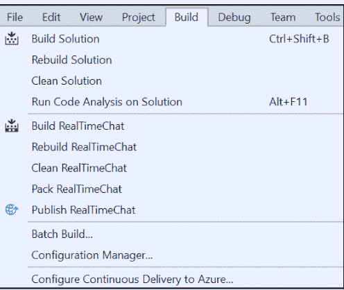

You can choose to either build the entire solution or an individual project. Since we only have one project in our solution, we can choose either. You can also use the keyboard shortcut Ctrl + Shift + B, but bear in mind that if you have multiple projects, this will only build the startup project and its dependent libraries.

您可以选择构建整个解决方案或单个项目。由于我们的解决方案中只有一个项目，二者皆可。您也可以使用键盘快捷键 Ctrl + Shift + B，但请记住，如果您有多个项目，这将仅构建启动项目及其依赖库。

You should see some (hopefully successful) build messages in the **Output** window:

您应该在 **输出** 窗口中看到一些（希望是成功的）构建消息：

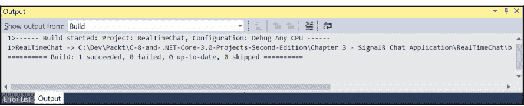

If you get any errors, go through this chapter again and see whether you have missed something.

如果遇到任何错误，请再仔细阅读本章，看看是否有遗漏。

Let's run the application and check that it does what we expect.

让我们运行应用程序并检查它是否按预期工作。

## Running the application

## 运行应用程序

Running the application is quite straightforward; however, testing requires a little ingenuity:

运行应用程序非常简单；然而，测试需要一点技巧：

- 1. To run the app, hit F5 (or Ctrl + F5 to start without debugging):

- 1. 要运行应用，请按 F5（或按 Ctrl + F5 以不启动调试的方式启动）：

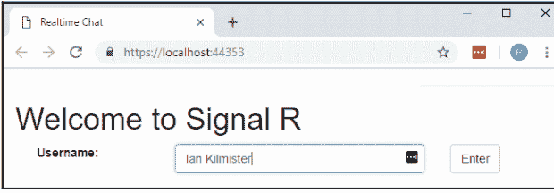

Running the application without debugging can have a significant improvement in terms of performance.

不启动调试的方式运行应用程序可以显著提升性能。

- 2. Now, we can start chatting. Type in a username and hit Enter:

- 2. 现在，我们可以开始聊天。输入用户名并按 Enter：

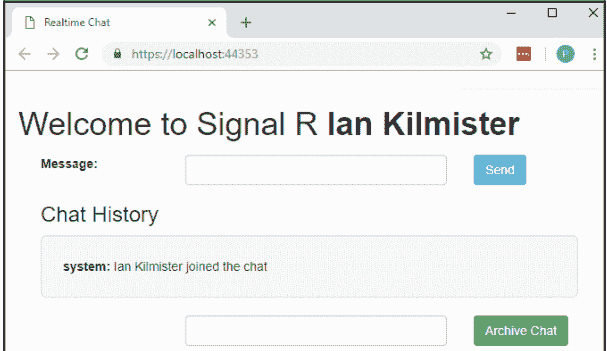

As you can see, our name panel is now hidden and our chat and archive panels are showing. Our server was also kind enough to inform us that we joined the chat, thanks to our sendWelcomeMessage(user) function.

如您所见，我们的名称面板现在已隐藏，聊天和存档面板正在显示。服务器也很好地通知我们已加入聊天，多亏了我们的 sendWelcomeMessage(user) 函数。

- 3. Every time we send a message, our Chat History will be updated:

- 3. 每次我们发送消息时，聊天历史记录都会更新：

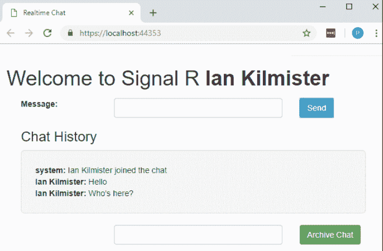

Let's see how this works with more participants.

让我们看看当参与者更多时这如何工作。

## Getting the party started

## 开始聚会

A conversation is only a conversation if multiple parties are involved. So, let's start a party.

只有多方参与才算是对话。那么，让我们开始聚会。

If you publish the app on a network, you can use actual network clients to chat with, but I'm not on a network (not in that sense), so we need to use another trick. We can use various browsers to represent our different party guests (network clients).

如果您在网络上发布应用，可以使用真实的网络客户端进行聊天，但我并不在网络上（不是这个意思），因此我们需要使用另一种技巧。我们可以使用不同的浏览器来代表我们的不同聚会客人（网络客户端）。

Copy your application URL (including the port number) and paste it into a few other browser windows.

复制您的应用程序 URL（包括端口号），并将其粘贴到其他几个浏览器窗口中。

For each new guest (browser), you will need to specify a username. As each of them enters the chat and starts sending messages, you'll see our Chat History grow.

对于每个新客人（浏览器），您需要指定一个用户名。当他们中的每个进入聊天并开始发送消息时，您会看到我们的聊天历史记录增长。

You can tile the browsers (or move them to other monitors if you have extra) to see how many messages sent by one person get delivered to all instantaneously, which is the whole point of SignalR.

您可以平铺浏览器（如果有额外显示器，也可以将它们移动到其他显示器上），以查看一个人发送的多少消息会立即送达所有人，这正是 SignalR 的要点。

We started with Ian Kilmister in Microsoft Edge, so we'll continue with him there:

我们最初在 Microsoft Edge 中使用 Ian Kilmister，因此我们将继续在那里使用他：

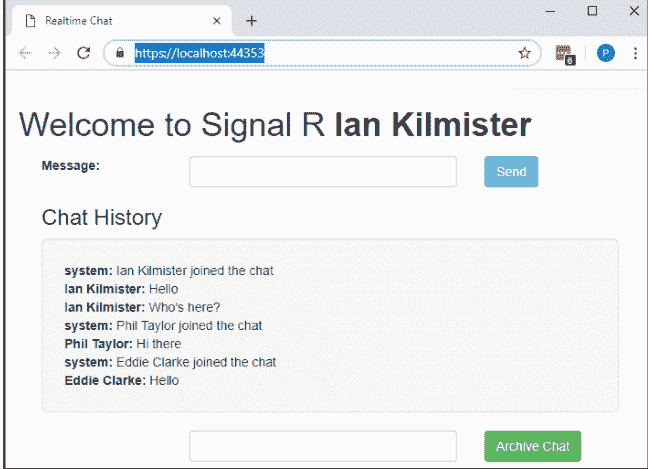

You'll also notice that each guest's chat history only starts when they join the chat. This is by design. We don't send historical chats to clients when they join.

您还会注意到，每个客人的聊天历史记录仅在其加入聊天时才开始。这是出于设计考虑。当客户端加入时，我们不会将历史聊天发送给它们。

## Archiving the chat

## 存档聊天

To save the chat history to a text file, enter a valid local folder path in the `archivePath` input element and hit the **存档聊天** button:

要将聊天历史记录保存到文本文件，请在 `archivePath` 输入元素中输入有效的本地文件夹路径，然后单击 **存档聊天** 按钮：

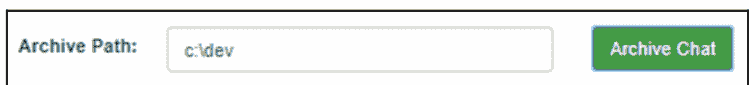

As we mentioned earlier, we haven't built in proper validation for our path, so make sure you test it using a valid path. If successful, you should see a message in the chat window like this:

如前所述，我们对路径没有构建适当的验证，因此请确保使用有效路径进行测试。如果成功，您应该在聊天窗口中看到类似这样的消息：

```
system: Chat archived by Ian Kilmister
```

You will also find the newly created text file in the specified path with the `ChatArchive_[date].txt` naming convention.

您还将在指定路径中找到新创建的文本文件，命名约定为 `ChatArchive_[date].txt`。

## The Azure service

## Azure 服务

At this stage, let's pause for a minute to check the Azure portal. Using the portal, we can easily identify that the service is, in fact, being used. While we've been typing away and testing this application, the Azure service has been registering activity, and we can see that by having a quick glance at the SignalR **概览** blade:

此时，让我们暂停一分钟查看 Azure 门户。使用门户，我们可以轻松识别该服务确实正在被使用。在我们输入和测试此应用程序的同时，Azure 服务一直在记录活动，我们可以通过快速查看 SignalR **概览** 边栏来看到这一点：

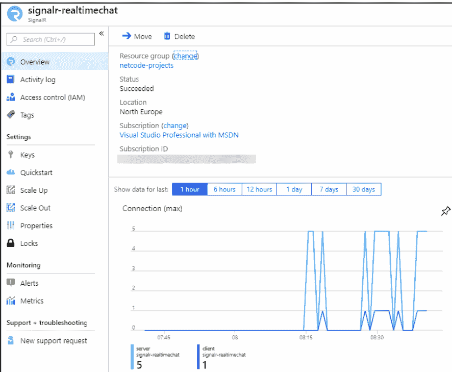

As you can see, our activity is being routed through the SignalR service on Azure. Now that we've built our application, let's clean up the resources we used.

如您所见，我们的活动正通过 Azure 上的 SignalR 服务进行路由。既然我们已构建应用程序，让我们清理所使用的资源。

## Cleanup

## 清理

Now that we have a working solution, we'll need to tidy up. In the case of Azure SignalR, if you're using the free tier, then there shouldn't be any financial implications to leaving it as is; however, as you start playing around with Azure more, you'll see your dashboard gradually fill up and become unmanageable.

既然我们有了可用的解决方案，就需要进行清理。就 Azure SignalR 而言，如果您使用的是免费层，那么保持现状不应有任何财务影响；但是，随着您开始更多地使用 Azure，您会看到仪表板逐渐填满并变得难以管理。

Inside the SignalR blade, simply select **删除**:

在 SignalR 边栏中，只需选择 **删除**：

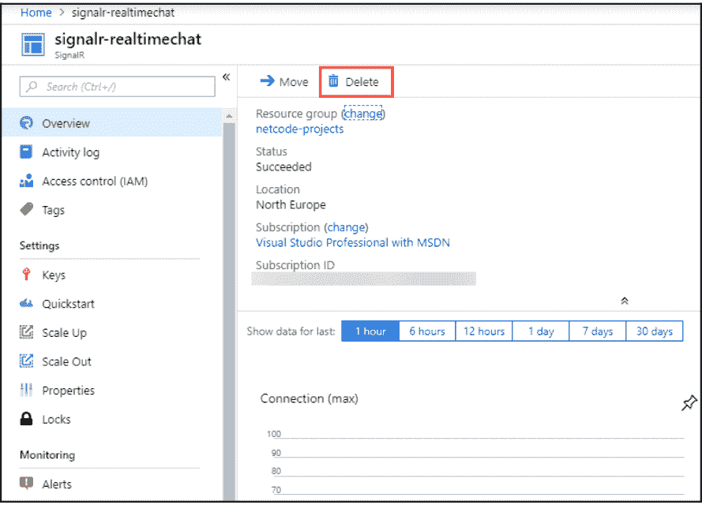

You'll be asked to confirm the deletion. Then, a few seconds later, you should receive a notification to tell you that it was successful:

系统会要求您确认删除。几秒钟后，您应该会收到一条通知，告知操作成功：

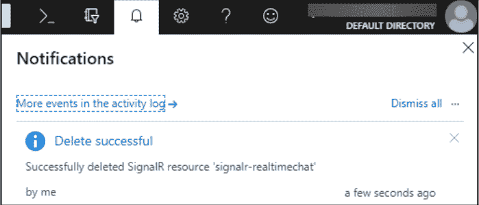

Now that we've removed all the resources we used, let's sit back and have a think about what we've covered in this chapter.

既然我们已移除所使用的所有资源，让我们坐下来思考一下本章所涵盖的内容。

## Summary

## 摘要

As we discussed in this chapter, SignalR is really easy to implement. We created a chat application, but there are a number of apps that can benefit from real-time experiences. These include the stock exchange, social media, multiplayer games, auctions, e-commerce, financial reporting, and weather notifications. The list can go on. Even if the need for real-time data is not a requirement, SignalR can still be beneficial for any app to make communication between nodes seamless.

正如我们在本章中讨论的那样，SignalR 非常容易实现。我们创建了一个聊天应用程序，但许多应用都可以从实时体验中受益。这些包括证券交易所、社交媒体、多人游戏、拍卖、电子商务、财务报告和天气通知。列表可以继续下去。即使实时数据不是必需的，SignalR 也能为任何应用带来好处，使节点间的通信无缝衔接。

Glancing at the GitHub page for ASP.NET SignalR (https://github.com/aspnet/SignalR), it is obvious that the library is constantly being worked on and improved, which is great news.

浏览 ASP.NET SignalR 的 GitHub 页面（https://github.com/aspnet/SignalR），可以明显看出该库一直在不断改进和完善，这是个好消息。

With the need for quick, relevant, and accurate information becoming more critical, SignalR is a useful tool to be aware of, especially since, with Azure, you can simply hand off the problem of scaling to Microsoft.

随着对快速、相关和准确信息的需求变得越来越关键，SignalR 是一个值得了解的有用工具，尤其是因为有了 Azure，您可以简单地将扩展问题交给 Microsoft。

In the next chapter, we'll have a look at data access using Entity Framework Core.

在下一章中，我们将探讨使用 Entity Framework Core 进行数据访问。
