# 4 使用 Entity Framework Core 的 Web 研究工具

## 4 使用 Entity Framework Core 的 Web 研究工具

> "The biggest lie I tell myself is that I don't need to write it down, I'll remember it."
> – Unknown

> “我对自己说的最大的谎话是‘我不需要把它写下来，我会记得。’”
> – 未知

So, you've got a few minutes to catch up on your feeds. As you scroll through, you come across a link to an article that someone shared about new ways to remember your guitar chords. You really want to read it, but you don't have enough time now. I'll read it later, you tell yourself, and later becomes never. Mainly because you did not write it down.

那么，您有几分钟时间来浏览自己的信息流。在滚动浏览时，您遇到有人分享的一篇关于新的记忆吉他和弦方法的文章链接。您真的很想读它，但现在时间不够。您告诉自己，等以后再读，而以后就变成了永远。主要原因是您没有把它写下来。

There are various applications out there that cater to your need to save links for later use. But we're developers. Let's just have some fun writing our own!

市面上有各种各样的应用程序可以满足您稍后保存链接的需求。但我们是开发人员。让我们写一个自己的来玩玩吧！

In this chapter, we will look at the following topics:

在本章中，我们将探讨以下主题：

- Entity Framework (EF) Core history
- Code-First versus Model-First versus Database-First approach
- Developing a database design
- Setting up the project
- Installing EF Core
  - Creating the models
  - Configuring the services
  - Creating the database
  - Seeding the database with test data
  - Creating the controller
  - Running the application

在本章中，我们将探讨以下主题：

- Entity Framework (EF) Core 的历史
- 代码优先与模型优先与数据库优先方法
- 开发数据库设计
- 设置项目
- 安装 EF Core
  - 创建模型
  - 配置服务
  - 创建数据库
  - 使用测试数据填充数据库
  - 创建控制器
  - 运行应用程序


- 测试应用程序
- 部署应用程序

这听起来有点复杂，但别担心，我们会一步一步来。让我们一起来看看。

## Entity Framework (EF) Core 历史

开发一个需要从某种数据库读取数据并向其中写入数据的应用程序时，最令人沮丧的部分之一，就是要在你的代码和数据库之间建立通信层。

至少过去是这样，直到 Entity Framework 出现！

Entity Framework 是一个 **对象关系映射器 (ORM)**。它将你的 .NET 代码对象映射到关系型数据库实体。就这么简单。现在，你不再需要为处理普通的 CRUD 操作而去搭建所需的数据访问代码。

Entity Framework 的第一个版本随 .NET 3.5 SP1 于 2008 年 8 月发布，最初的反响并不理想——以至于一群开发人员就该框架签署了一份*不信任票*。幸运的是，大部分提出的问题都得到了解决，Entity Framework 4.0 连同 .NET 4.0 的发布，让关于框架稳定性的许多批评不再被提及。

Entity Framework Core 是一次完整的重写。微软已表示，他们并非试图让 EF6 和 EF Core 功能完全等同；虽然它们支持许多相同的功能，但 EF Core 提供了机会来解决一些原本可能已不再合理的初始决策。

## Code-First 与 Model-First 与 Database-First 方法

使用 Entity Framework 时，你有三种实现方式可供选择。但是，在 Entity Framework Core 中，实际上只有一种：Code-First。尽管 Database-First 的概念确实存在，但它是单向的：也就是说，你可以从数据库反向工程生成代码模型，但之后，你将从代码生成数据库模型。

## 开发数据库设计

在我们知道自己在做什么之前，我们无法知道自己在做什么。在跳入并使用我们的数据库、模型和控制器创建解决方案之前，我们需要弄清楚如何设计数据库。

根据 Microsoft TechNet，我们可以遵循五个基本步骤来规划数据库：

- 收集信息
- 识别对象
- 建模对象
- 识别每个对象的信息类型
- 识别对象之间的关系

我们的需求非常简单。我们只需保存一个网络链接以便日后导航，因此不会有相互关联的多个对象。

不过，我们确实需要澄清想要为我们的对象（网络链接）保存哪些类型的信息。显然，我们需要 URL，但还需要什么？请确保你理解解决方案需要哪些信息以及它们将如何使用。

用日常生活中的例子来想——如果你为朋友家的房子写地址，你可能不仅需要街道，可能还需要知道朋友的名字或某种备注。

在我们的解决方案中，我们想知道 URL 是什么，但我们也想知道保存时间，并有一个地方来记录备注，以便为条目添加更多个人细节。因此，我们的模型将包含以下内容：

- URL
- DateSaved
- Notes

当我们开始创建模型时，我们会深入探讨更多细节，但不要操之过急。我们仍需先创建项目。

## 设置项目

使用 Visual Studio 2019，创建 ASP.NET Core Web 应用程序：

- 创建一个新的 ASP.NET Core Web 应用程序：

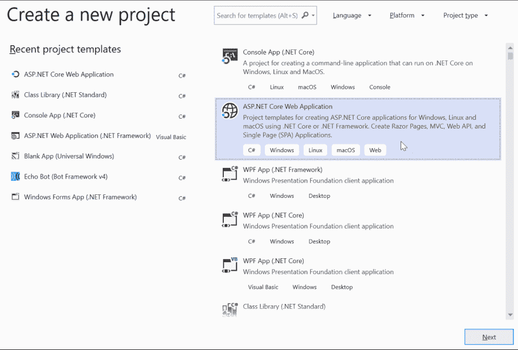

- 让我们将应用程序命名为 WebResearch。如下图所示：

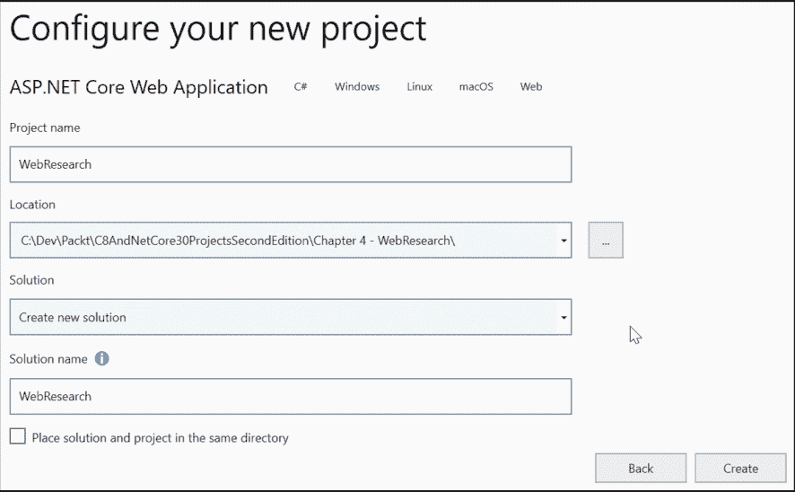

- 在下一个屏幕上，选择 Web 应用程序 (模型-视图-控制器) 作为项目模板。为了保持简单，请将身份验证保持为无身份验证。请参阅以下屏幕截图：

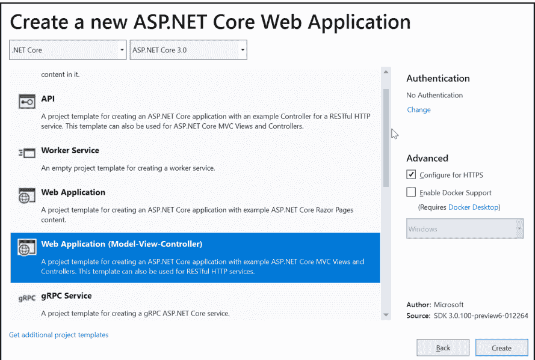

- 创建的项目将如下所示：

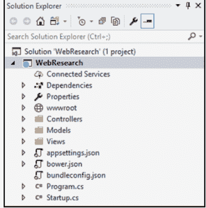

现在我们已经设置了项目，让我们安装所需的包！

## 安装所需的包

我们需要为解决方案安装三个 NuGet 包，它们将在我们的探索之旅中提供帮助。这通过包管理器控制台完成。

转到 Tools | NuGet Package Manager | Package Manager Console：

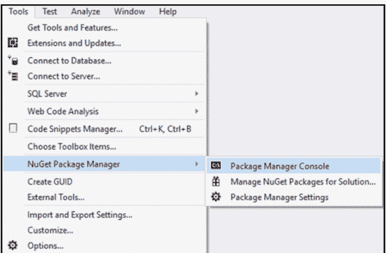

我们之前见过 **包管理器控制台**；不过，值得指出的是，这不仅仅是它表面上的样子（或者说，不仅仅是其名称所暗示的那样）。**包管理器控制台**实际上是在你的解决方案上下文中运行的 PowerShell 控制台。

### EF Core SQL Server

EF Core 支持多种数据库提供程序，包括 Microsoft SQL Server、PostgreSQL、SQLite 和 MySQL。我们将在这里使用 SQL Server 作为数据库提供程序。

有关数据库提供程序的完整列表，请参阅 [官方 Microsoft 文档](https://docs.microsoft.com/en-us/ef/core/providers/index)。

在控制台窗口中，键入以下命令并按 *Enter*：

```
Install-Package Microsoft.EntityFrameworkCore.SqlServer
```

你应该会看到几行响应，显示成功安装的项目。

### EF Core 工具

接下来，我们将安装一些 EF Core 工具，以帮助我们从模型创建数据库。

在控制台窗口中，键入以下命令并按 *Enter*：

```
Install-Package Microsoft.EntityFrameworkCore.Tools
```

同样，你应该会看到几行响应，显示成功安装的项目。

### 代码生成设计

我们不需要亲自编写所有代码，可以使用一些 ASP.NET Core 代码生成工具来协助脚手架。

在控制台窗口中，键入以下命令并按 Enter：

```
Install-Package Microsoft.VisualStudio.Web.CodeGeneration.Design
```

如往常一样，检查是否出现了“成功安装”的项目。

如果你在安装任何 NuGet 包时遇到问题，这可能指向访问控制问题。一般而言，我将 Visual Studio 设置为以管理员身份运行，这可以解决大多数此类问题。

安装后，我们的解决方案将在 **依赖项** 部分下反映添加的 NuGet 包，如下所示：

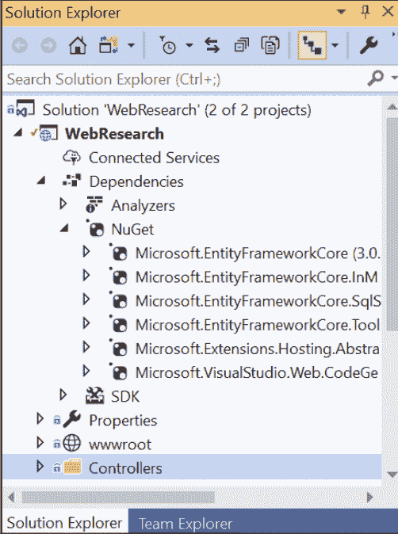

### 创建模型

右键单击项目中的 **模型** 文件夹，添加一个名为 `ResearchModel.cs` 的类：

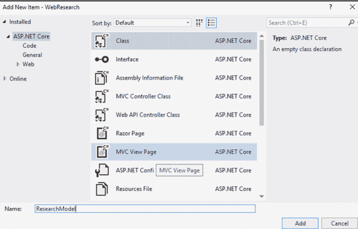

我们实际上需要两个类：一个是 Research 类，代表我们的实体对象；另一个是 ResearchContext 类，是 DbContext 的子类。为了保持简单，我们可以将这两个类都放在 ResearchModel 文件中。代码如下：

```
using Microsoft.EntityFrameworkCore;
using System;

namespace WebResearch.Models
{
    public class Research
    {
        public int Id { get; set; }
        public string Url { get; set; }
        public DateTime DateSaved { get; set; }
        public string Note { get; set; }
    }

    public class ResearchContext : DbContext
    {
        public ResearchContext(DbContextOptions<ResearchContext>
        options) : base(options)
        {
        }

        public DbSet<Research> ResearchLinks { get; set; }
    }
}
```

我们将其分解如下：

- 首先，我们有 Research 类，即我们的实体对象表示。正如我们在开发数据库设计部分提到的，对于每个链接，我们将保存 URL、日期和备注。ID 字段是存储信息的数据库表的标准做法。
- 我们的第二个类，ResearchContext，是 DbContext 的子类。该类将有一个接受 DbContextOptions 作为参数的空构造函数，以及一个用于数据集合的 DbSet<TEntity> 属性。

我可以在这里简要介绍 DbSet<TEntity>，但我宁愿让 Visual Studio 帮助我们。让我们来看下面的屏幕：

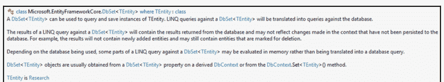

如果你将鼠标悬停在 DbSet 上，你将获得一个信息弹出窗口，包含你需要知道的一切！

### 配置服务

在 Startup.cs 类的 ConfigureServices 方法中，使用以下代码添加 DbContext 服务：

```
string connection =
Configuration.GetConnectionString("LocalDBConnection");
services.AddDbContext<ResearchContext>(options =>
options.UseSqlServer(connection));
```

如你所见，我们从配置中设置一个连接字符串变量，然后将其作为 SqlServer 的选项参数传递给我们的 DbContext。


不过等一下。`LocalDBConnection`是从哪里来的？我们在配置中还没有设置任何东西。不管怎样，目前还没有。现在让我们把这个完成。

打开项目根目录中的`appsettings.json`文件：

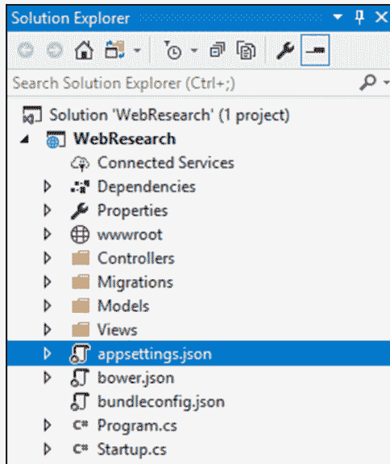

默认情况下，你应该能看到一个日志条目。在`Logging`部分之后添加你的`ConnectionStrings`部分，并带有一个`LocalDBConnection`属性。

完整的文件应该如下所示：

```
{
    "Logging": {
        "IncludeScopes": false,
        "LogLevel": {
            "Default": "Warning"
        }
    },

    "ConnectionStrings": {
        "LocalDBConnection": "Server=(localdb)\\mssqllocaldb;Database=WebResearch;
Trusted_Connection=True"
    }
}
```

稍后，我们将了解如何连接到现有数据库，但目前，我们只是连接到本地db文件。

## 创建数据库

在任何应用程序的开发阶段，你的数据模型发生变化的可能性相当大。当这种情况发生时，你的EF Core模型与数据库架构不同，你必须删除过时的数据库，并根据更新后的模型创建一个新的数据库。

在你完成首次实际实现并且应用程序在生产环境中运行之前，这听起来都很美好。你不能仅为了修改几个列就去删除数据库。你必须确保在进行任何更改时，实时数据能够持久保存。

EF Core迁移是一个实用的功能，允许我们对数据库架构进行更改，而不是重新创建数据库并丢失生产数据。使用迁移可以实现大量功能和灵活性，这是一个值得花时间学习的主题，但我们现在只涵盖一些基础知识。

我们可以在程序包管理器控制台中使用EF Core迁移命令来设置、创建以及在需要时更新我们的数据库。

在程序包管理器控制台中，我们将执行以下两个命令：

- Add-Migration InitialCreate
- Update-Database

第一个命令将在项目的`Migrations`文件夹中生成代码，这些代码用于创建数据库。这些文件的命名约定为`<timestamp>_InitialCreate.cs`。

第二个命令将创建数据库并运行迁移：

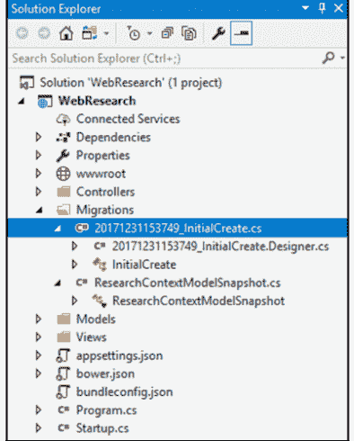

InitialCreate类中有两个需要注意的方法：Up和Down。简单来说，升级应用程序时执行Up方法的代码，降级应用程序时运行Down方法的代码。

假设我们想要向Research模型添加一个名为Read的布尔属性。为了持久化这个值，我们显然还需要将该列添加到表中，但我们不希望仅为了添加一个字段就删除表。使用迁移，我们可以更新表而不是重新创建它。

我们将从修改模型开始。在Research类中添加Read属性。我们的类将如下所示：

```
public class Research
{
    public int Id { get; set; }
    public string Url { get; set; }
    public DateTime DateSaved { get; set; }
    public string Note { get; set; }
    public bool Read { get; set; }
}
```

接下来，我们将添加一个迁移。我们将使用迁移名称来指示我们正在做什么。在你的程序包管理器控制台中执行以下命令：

```
Add-Migration AddResearchRead
```

你会注意到我们的Migrations文件夹中有一个新类：

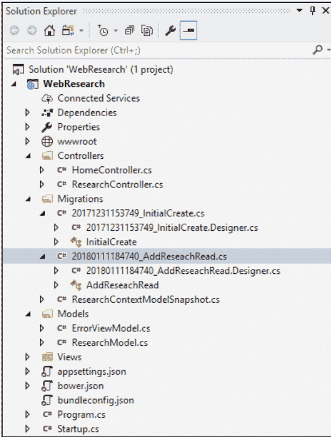

让我们来看看内部情况。你会发现我们的Up和Down方法不再像InitialCreate类中那样为空：

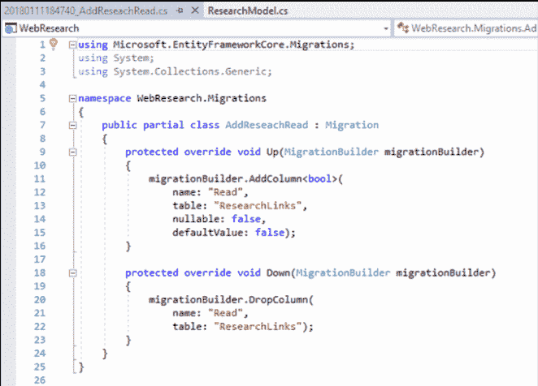

如前所述，Up方法在升级期间执行，Down方法在降级期间执行。现在我们可以看到代码，这个概念要清晰得多。在Up方法中，我们正在添加Read列，在Down方法中，我们正在删除该列。

如果需要，我们可以对这段代码进行修改。例如，我们可以更改Read列的可空属性，通过更新代码使其如下所示：

```
protected override void Up(MigrationBuilder migrationBuilder)
{
    migrationBuilder.AddColumn<bool>(
        name: "Read",
        table: "ResearchLinks",
        nullable: true,
        defaultValue: false);
}
```

我们还可以添加一个自定义SQL查询，用于将所有现有条目更新为Read：

```
migrationBuilder.Sql(@"
UPDATE Research
SET Read = 'true';
");
```

我知道这不是一个很好的示例，因为你在每次更新数据库时都不希望所有的Research条目都被标记为Read，但希望你能理解这个概念。

不过，这段代码尚未执行。因此，目前我们的模型和数据库架构仍不同步。

再次执行以下命令，我们就可以同步到最新状态了：

```
Update-Database
```

## 使用测试数据填充数据库

现在我们有一个空数据库，让我们用一些测试数据填充它。为此，我们需要创建一个方法，在数据库创建后调用它：

1. 在你的项目中创建一个名为Data的文件夹。在这个文件夹内，添加一个名为DbInitializer.cs的类：

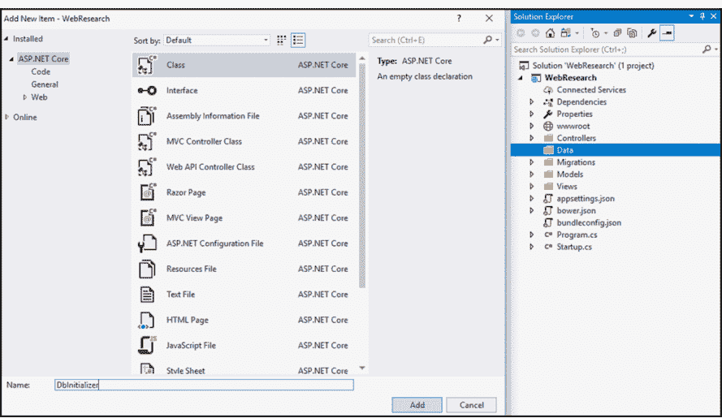

这个类有一个Initialize方法，它将我们的ResearchContext作为参数：

```
public static void Initialize(ResearchContext context)
```

2. 在Initialize方法中，我们调用Database.EnsureCreated方法来确保数据库存在，如果不存在则创建它：

```
context.Database.EnsureCreated();
```

3. 接下来，我们快速执行一个Linq查询来检查ResearchLinks表是否有任何记录。其理由是，如果表是空的，我们想要添加一些测试数据：

```
if (!context.ResearchLinks.Any())
```

4. 然后，我们创建一个Research模型的数组并添加一些测试条目。URL可以是你喜欢的任何内容。我只是选择了一些最常见的网站：

```
var researchLinks = new Research[]
{
    new Research{Url="www.google.com", DateSaved=DateTime.Now,
    Note="Generated Data", Read=false},
    new Research{Url="www.twitter.com", DateSaved=DateTime.Now,
    Note="Generated Data", Read=false},
    new Research{Url="www.facebook.com", DateSaved=DateTime.Now,
    Note="Generated Data", Read=false},
    new Research{Url="www.packtpub.com", DateSaved=DateTime.Now,
    Note="Generated Data", Read=false},
    new Research{Url="www.linkedin.com", DateSaved=DateTime.Now,
    Note="Generated Data", Read=false},
};
```

5. 用我们的数组填充数据后，我们遍历它并将条目添加到上下文中，然后调用SaveChanges方法将数据持久化到数据库：

```
foreach (Research research in researchLinks)
{
    context.ResearchLinks.Add(research);
}
context.SaveChanges();
```

6. 把所有内容放在一起如下所示：

```
using System;
using System.Linq;
using WebResearch.Models;

namespace WebResearch.Data
{
    public static class DbInitializer
    {
        public static void Initialize(ResearchContext context)
        {
            context.Database.EnsureCreated();

            if (!context.ResearchLinks.Any())
            {
                var researchLinks = new Research[]
                {
                    new Research{Url="www.google.com",
                    DateSaved=DateTime.Now, Note="Generated Data",
                    Read=false},
                    new Research{Url="www.twitter.com",
                    DateSaved=DateTime.Now, Note="Generated Data",
                    Read=false},
                    new Research{Url="www.facebook.com",
                    DateSaved=DateTime.Now, Note="Generated Data",
                    Read=false},
                    new Research{Url="www.packtpub.com",
                    DateSaved=DateTime.Now, Note="Generated Data",
                    Read=false},
                    new Research{Url="www.linkedin.com",
                    DateSaved=DateTime.Now, Note="Generated Data",
                    Read=false},
                };
                foreach (Research research in researchLinks)
                {
                    context.ResearchLinks.Add(research);
                }
                context.SaveChanges();
            }
        }
    }
}


## 创建控制器

控制器是构建 ASP.NET Core MVC 应用程序的基本构建块。控制器内部的方法称为操作。因此，我们可以说控制器定义了一组操作。操作处理请求，这些请求通过路由映射到特定的操作。

有关控制器和操作主题的更多信息，请参阅 https://docs.microsoft.com/en-us/aspnet/core/mvc/controllers/actions 上的 Microsoft 文档。有关路由的更多信息，请参阅 https://docs.microsoft.com/en-us/aspnet/core/mvc/controllers/routing 上的 Microsoft 文档。

按照以下步骤操作：

- 1. 右键单击 Controller 文件夹，然后选择“添加 | 控制器”。
- 2. 在脚手架屏幕上，选择“使用 Entity Framework 的带视图的 MVC 控制器”，然后单击“添加”：

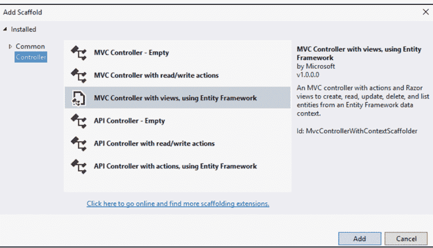

- 3. 在下一屏幕上，为 **模型类** 选择我们的 **Research** 模型，为 **数据上下文类** 选择 **ResearchContext**。除非您想更改 **控制器名称**，否则其余部分保持不变：

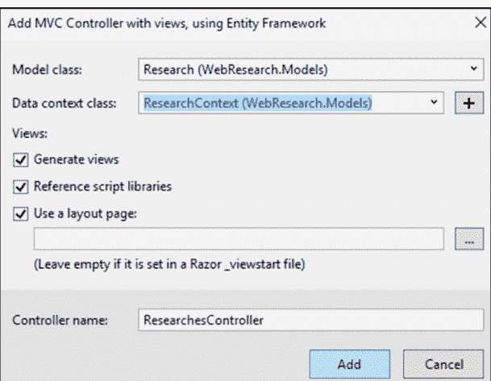

简单查看创建的控制器，我们现在已具备基本的 **创建、读取、更新和删除 (CRUD)** 任务。现在，是主环节的时候了。

## 运行应用程序

在运行应用程序之前，让我们确保新页面易于访问。最简单的方法是将其设置为默认主页：

- 1. 查看 `Startup.cs` 中的 `Configure` 方法。您会注意到默认路由指定为 `Home` 控制器。

- 2. 只需将控制器更改为您的 `Research` 控制器，如下所示：

```
app.UseEndpoints(endpoints =>
{
    endpoints.MapControllerRoute(
        name: "default",
        pattern: "{controller=Research}/{action=Index}/{id?}");
    endpoints.MapRazorPages();
});
```

如果您熟悉 ASP.NET 2.x，您可能会期望在此处看到 UseMvc。事实上，UseMvc 已弃用，转而支持手动构建您所需的 MVC 中间件。

- 3. 最后，确保您的 Main 方法如下所示：

```
public static void Main(string[] args)
{
    var host = BuildWebHost(args);
    using (var scope = host.Services.CreateScope())
    {
        var services = scope.ServiceProvider;
        try
        {
            var context = services.GetRequiredService<ResearchContext>();
            DbInitializer.Initialize(context);
        }
        catch (Exception ex)
        {
            var logger =
            services.GetRequiredService<ILogger<Program>>();
            logger.LogError(ex, "An error occurred while seeding the database.");
        }
    }
    host.Run();
}
```

- 4. 现在，按 Ctrl + F5 运行应用程序，查看您的成果：

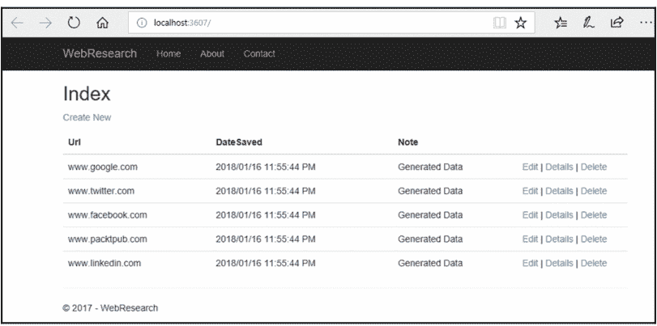

- 5. 如您所见，我们的测试条目可供我们使用。让我们快速查看可用功能：
- 6. 单击 **创建新项** 以查看我们链接的条目表单：

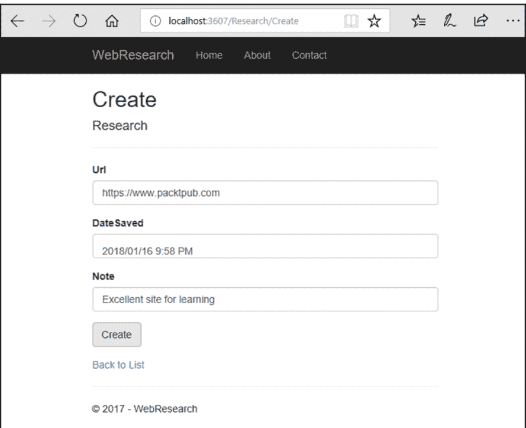

- 7. 输入一些有趣的数据，然后单击 **创建** 按钮。您将被重定向到列表视图，并看到新条目已添加到列表底部：

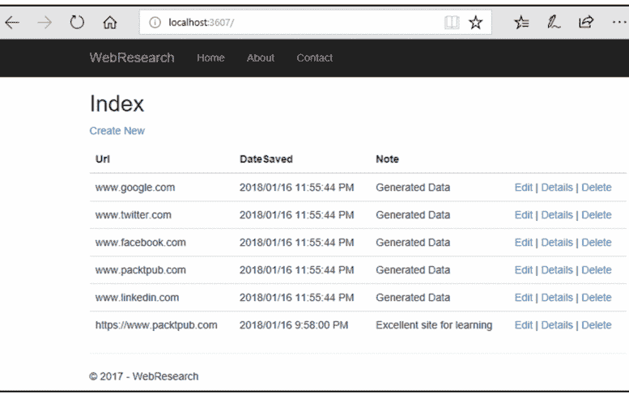

每个项目旁边，您可以选择 **编辑**、查看 **详细信息** 或 **删除**。大胆尝试功能。我们可以做很多事情来改善用户体验，例如自动填充日期字段。我将把改善用户体验的创意留给您，按您觉得合适的方式进行。

## 测试应用程序

如果您选择扩展此项目的功能，您可能想要添加的一项内容是一些自动化测试。先厘清一些术语：本节涉及自动化测试，但不涉及单元测试。关于什么是测试，很容易产生争论和讨论，但出于本节的目的，我们正在添加自动化测试。

由于此应用程序基本上是一个基本的数据访问应用程序，自动化测试常常被省略。当然可以争辩说，由于逻辑很少，您实际上是在测试 EF Core。不测试基本 CRUD 应用程序的另一个主要原因一直是其难度。测试以数据库为中心的应用程序一直是一项困难、耗时且感恩不尽的任务。

首先，许多单元测试纯粹主义者会争辩说，您无法在测试中包含数据访问，因此应该模拟数据访问。这通常通过创建存储库模式来抽象数据访问，甚至通过多层抽象来完成，但一旦我们这样做，就必须模拟对数据库的调用将返回的内容，尽管这符合单元测试的原则，但并不能让我们太放心我们的应用程序能够正常工作。

其次，数据库操作通常不具备幂等性；也就是说，一旦在真实数据库上运行过测试，再次运行通常会产生不同的结果，因为数据已发生变化。在过去，人们通过每次重新创建数据库、编写脚本回滚操作或在事务中运行测试然后回滚来绕过这一问题。所有这些方法的共同点是它们都非常缓慢。

Entity Framework 本身就是一种存储库模式，您当然可以抽象掉 `DbContext`；但是，使用 EF Core 时，您有一个称为 **内存数据库** 的概念。已经有许多开源项目试图通过将数据更改保存在字典或类似结构中，为 EF6 提供此功能。

让我们创建几个自动化测试（我不会将它们称为单元测试，因为它们显然不测试单个功能单元）：

- 1. 第一步是创建一个 `Test` 项目：

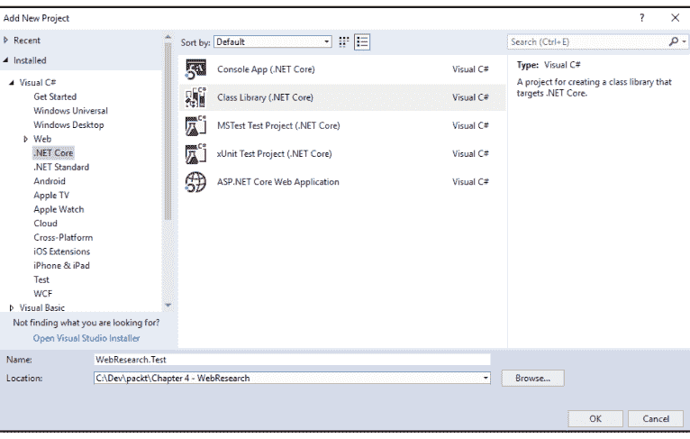

目前我们将项目创建为类库。对于这个特定的测试，我们将使用 XUnit，但您应该能够毫无困难地将其替换为任何主要测试库。

- 2. 项目创建完成后，可以使用包管理器控制台安装测试库（确保选择了正确的 Test 项目）：

```
Install-Package XUnit -ProjectName WebResearch.Test
```

我们还需要一些其他库：

```
Install-Package Microsoft.EntityFrameworkCore -ProjectName WebResearch.Test Install-Package XUnit.Runner.VisualStudio -ProjectName WebResearch.Test
```

- 3. 接下来，我们需要添加对要测试的项目的引用：

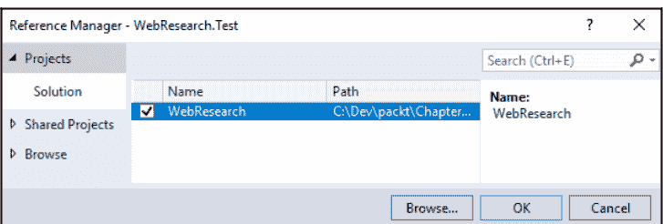

因为控制器是数据访问前面的逻辑，让我们测试 ResearchController。在测试库中创建（或重命名）类为 ResearchControllerTests：

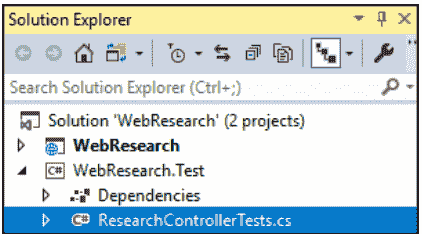

- 4. 最后，我们需要向测试项目添加一个 NuGet 包，以便我们可以使用内存数据库：

```
Install-Package Microsoft.EntityFrameworkCore.InMemory
```

我们将在本章后面讨论这究竟是什么。

让我们来看看测试的代码。然后，我们可以逐步了解它的作用：

```
[Fact]
public async Task RetrieveDetails_DetailsCorrect()
{
    // Arrange
    var testUrl = "www.pichaels.net";
    var options = new DbContextOptionsBuilder<ResearchContext>()
        .UseInMemoryDatabase(Guid.NewGuid().ToString())
        .EnableSensitiveDataLogging()
        .Options;
    var researchContext = new ResearchContext(options);
    var researchController = new ResearchController(researchContext);
    var research = new Research()
    {
        Id = 1,
        DateSaved = new DateTime(2018, 10, 24),
        Note = "Useful site for programming and tech information",
        Read = false,
        Url = testUrl
    };
    var createResult = await researchController.Create(research);
    // Act
    var detailsResult = await researchController.Details(1);
    // Assert
    var viewResult = (ViewResult)detailsResult;
    var resultsModel = (Research)viewResult.Model;
    Assert.Equal(testUrl, resultsModel.Url);
}
```


- 5. 创建测试后，启动测试资源管理器：

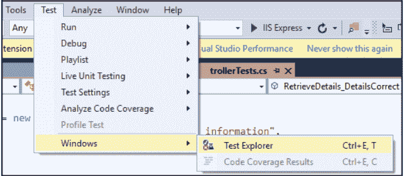

- 6. 出现此界面后，运行全部（或目前只有我们的这一个）测试：

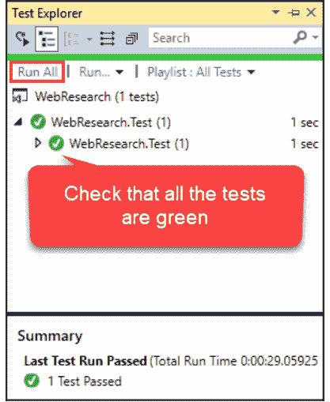

单元测试和 XUnit 的完整解释超出了本章和本书的范围；不过，为了完整起见，我将介绍测试中的一些要点。

### 安排/执行/断言

单元测试显然不需要这些注释，但我发现，当我使用它们时，可以清楚地识别我在测试什么，并且在测试单个操作。由于这并非严格意义上的单元测试，因此有多条执行代码的语句；不过，只有一条正在被测试。这在你尝试为测试命名以及识别测试覆盖的内容时很有帮助。

### 内存数据库

以下代码在 DbContext 选项中设置内存数据库，并使用这些选项创建一个新上下文。这与程序使用真实数据运行时创建的 DbContext 完全相同，只是存储在内存中：

```
var options = new DbContextOptionsBuilder<ResearchContext>()
    .UseInMemoryDatabase(Guid.NewGuid().ToString())
    .EnableSensitiveDataLogging()
    .Options;
var researchContext = new ResearchContext(options);
var researchController = new ResearchController(researchContext);
```

### 我们在测试什么？

问自己这个问题总是有价值的。测试是代码，这意味着编写和维护它们需要时间，因此请确保它们物有所值。这个测试是否做到了这一点其实是有争议的。我们所做的是创建一条记录，然后检索该记录。这两个步骤之间存在一些逻辑，因此测试肯定在测试某些东西。让我们添加第二个测试，以确保我们不会检索不存在的记录：

```
[Fact]
public async Task RetrieveInvalidRecord_DetailsCorrect()
{
    // Arrange
    var testUrl = "www.pmichaels.net";
    var options = new DbContextOptionsBuilder<ResearchContext>()
        .UseInMemoryDatabase(Guid.NewGuid().ToString())
        .EnableSensitiveDataLogging()
        .Options;

    var researchContext = new ResearchContext(options);
    var researchController = new ResearchController(researchContext);
    var research = new Research()
    {
    Id = 1,
    DateSaved = new DateTime(2018, 10, 24),
    Note = "Useful site for programming and tech information",
    Read = false,
    Url = testUrl
};

var createResult = await researchController.Create(research);

// Act
var detailsResult = await researchController.Details(2);

// Assert
Assert.IsType<NotFoundResult>(detailsResult);
}
```

如你所见，这与前一个测试完全相同，只不过我们测试的是 ID 为 2 而不是 1。然后，我们断言预计找不到该记录。

### 速度

我们在此讨论的测试大体符合大多数 FIRST 测试原则（缩写代表 **快速、隔离、可重复、自验证、彻底**）；然而，它们不会像典型的单元测试那样快，因此应放在测试金字塔的顶部附近：

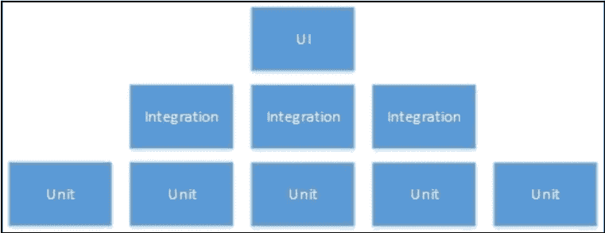

现在我们已经了解了如何测试应用程序，接下来讨论如何部署它。

## 部署应用程序

一旦您的应用程序准备好部署，就有几个可用选项，包括以下选项：

- Microsoft Azure 应用服务
- 自定义目标 (IIS, FTP 等)
- 文件夹
- 导入配置文件

在 Visual Studio 的 **生成** 菜单项下，单击 **发布 WebResearch**（或您决定为项目命名的任何名称）：

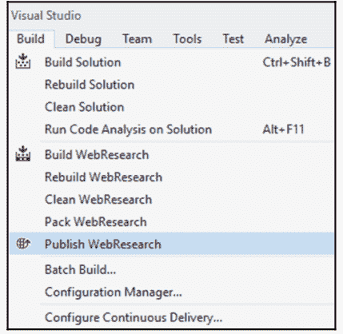

您应该会看到一个显示可用发布选项的屏幕。让我们仔细看一下。

### Microsoft Azure 应用服务

Microsoft Azure 负责创建和维护 Web 应用程序所需的所有基础设施要求。这意味着我们开发人员不需要担心服务器管理、负载平衡或安全等问题。由于该平台几乎每天都在改进和扩展，我们也可以相当有信心，能够使用到最新、最强大的功能。

我们不会过多详述 Azure 应用服务，因为整本书都可以专门写它，但我们当然可以查看将 Web 应用发布到此云平台所需的步骤：

1. 将 **Microsoft Azure 应用服务** 选择为发布目标。如果您有想要发布到的现有站点，可以选择 **选择现有项**。目前，我假设您需要 **新建**：

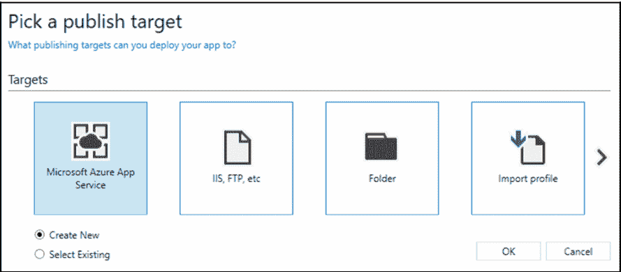

2. 单击“确定”按钮后，Visual Studio 将使用您已登录的 Microsoft 帐户联系 Azure，随后 Azure 将检查您是否有 Azure 帐户并返回可用的服务详细信息。我为本示例创建了一个试用帐户，事先未设置任何特定详细信息，如您从以下截图中所见，Azure 将为您推荐可用的 **应用名称** 和 **应用服务计划**。

3. 资源组是可选的，如果您不指定任何内容，它将有一个唯一的组名称：

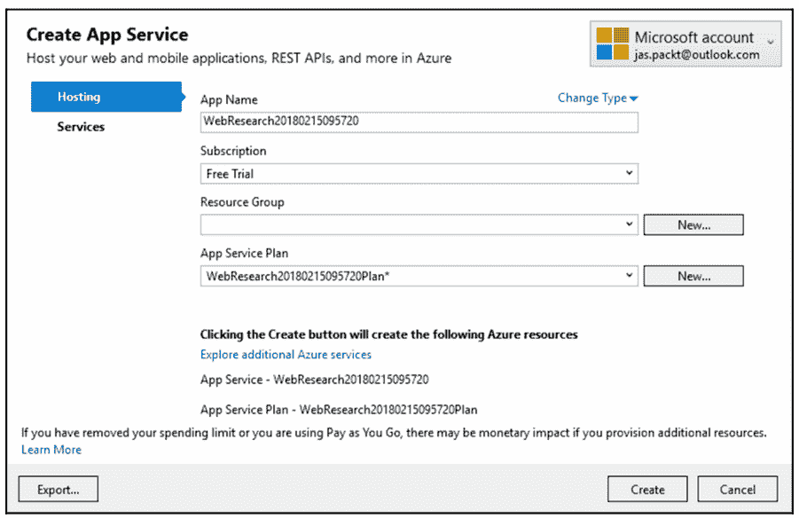

4. 您可以在“更改类型”选项下更改要发布的应用程序类型。在我们的情况中，我们显然会选择 Web 应用：

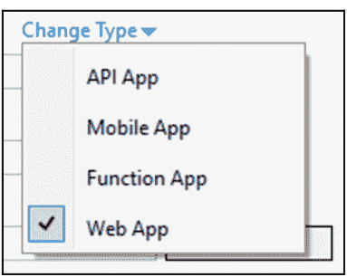

5. 单击左侧的 **服务** 以查看将与发布一起设置的服务。第一个框显示您的应用程序可能受益的任何 **推荐** 资源类型。在我们的情况中，推荐 **SQL 数据库**，而且我们确实需要它，因此只需单击添加（+）按钮将其添加即可：

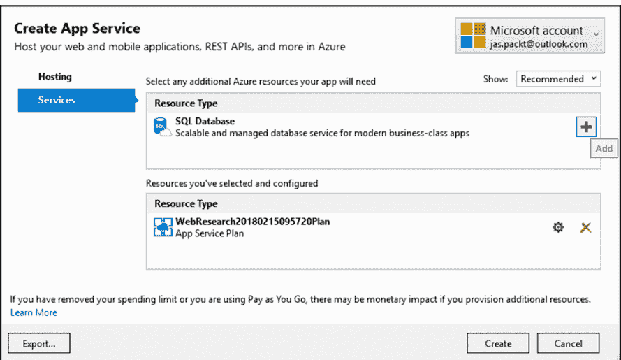

Azure 将处理 SQL 安装，但我们需要提供所需的信息，例如如果您个人资料中已有服务器则使用哪个服务器，或者如果没有则创建一个新服务器。

6. 在这种情况下，我们将配置新的 SQL Server。单击 **SQL Server** 下拉列表旁边的 **新建** 按钮以打开“配置 SQL Server”窗体。Azure 将为服务器提供推荐名称。虽然您可以提供自己的名称，但该服务器名称大多可能不可用，因此我建议您直接使用推荐的名称。

7. 为服务器提供 **管理员用户名** 和 **管理员密码**，然后单击“确定”：

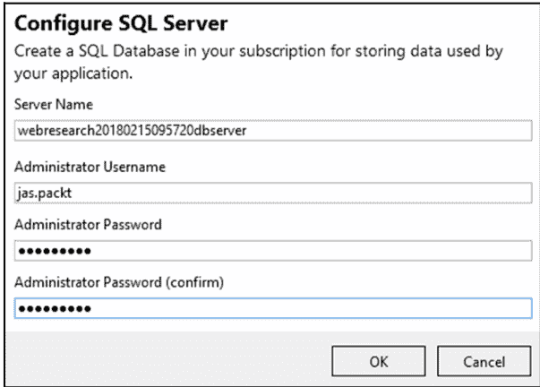

8. 这样做会将您带回 **配置 SQL 数据库** 窗体，您需要在其中指定 **数据库名称** 以及 **连接字符串名称**：

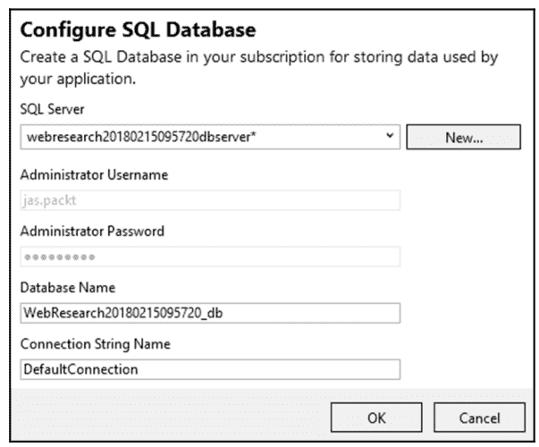

9. 再次查看 **创建应用服务** 窗体。您会注意到 **SQL 数据库** 已添加到 **您已选择并配置的资源** 部分：

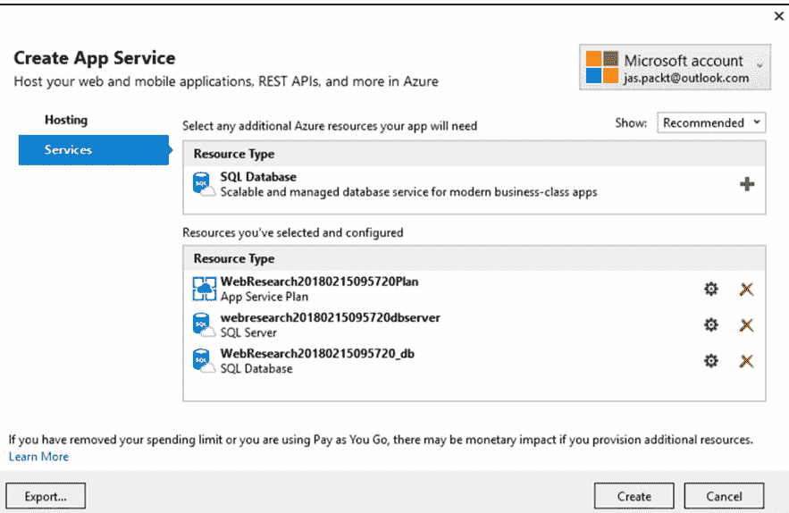

10. 现在，我们可以返回到 **托管** 选项卡，它将显示单击 **创建** 按钮时将发生的情况概览。

11. 如以下截图所示，将创建 **应用服务**、**应用服务计划** 和 **SQL Server** 资源：

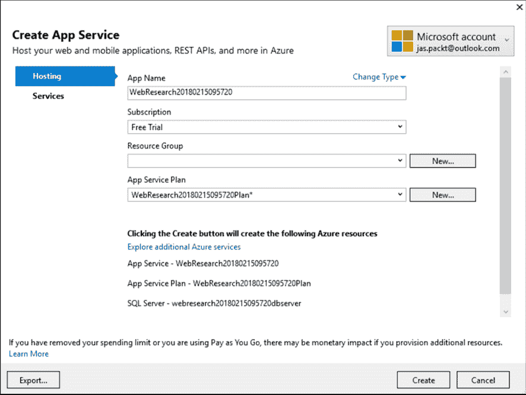

12. 创建完成后，我们可以单击 **发布** 按钮发布新的 Azure 配置文件。

13. 您将在输出窗口中看到一些 **生成** 消息，并且最终会得到如下内容：

```
Publish Succeeded.
Web App was published successfully
http://webresearch20180215095720.azurewebsites.net/
=========== Build: 1 succeeded, 0 failed, 0 up-to-date, 0 skipped
===========
=========== Publish: 1 succeeded, 0 failed, 0 skipped ===========
```


14. 您可以在 Azure 门户 (portal.azure.com) 上查看仪表板，它将显示由于我们的服务创建而已在您的帐户上启用的资源：

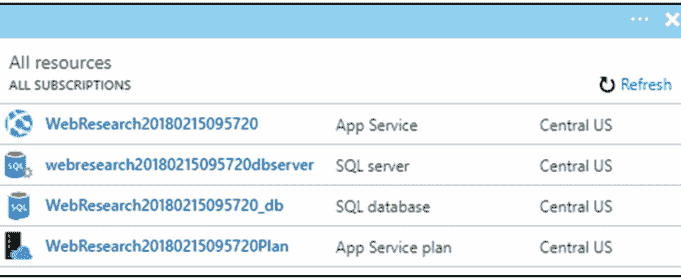

15. 发布的应用将在您的浏览器中打开，您很可能会看到一条错误消息。默认情况下，您无法看到太多关于错误的详细信息，但至少 Azure 会提供一些提示，以便您获取错误详细信息。您可以通过将 ASPNETCORE_ENVIRONMENT 环境变量设置为 Development 并重启应用程序来实现此操作：

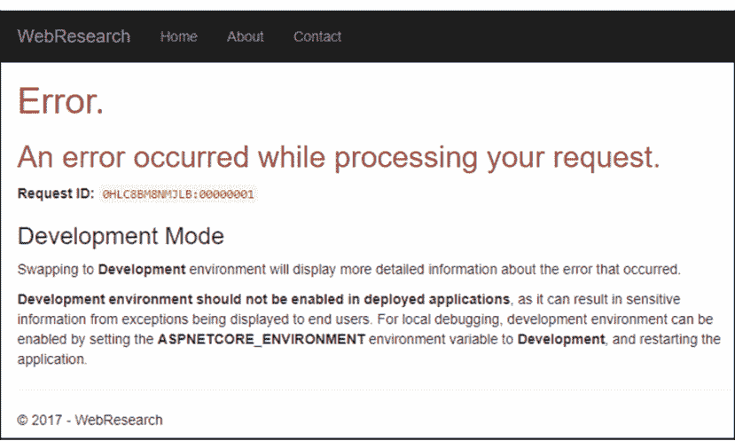

16. 当您登录 Azure 门户时，可以导航到您的应用服务，然后在应用程序设置中，添加值为 Development 的 ASPNETCORE_ENVIRONMENT 设置并重启您的应用：

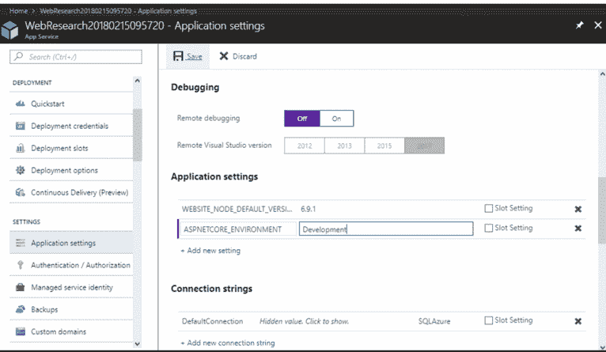

17. 现在，我们可以刷新网站。我们应该能看到关于底层错误的更多详细信息：

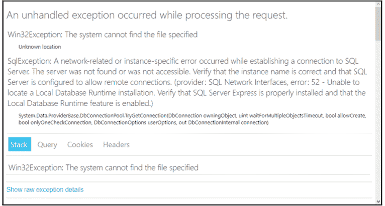

18. 啊，是的！我们仍然指向本地数据库，并且从发布环境无法访问它。让我们更新 `appsettings.json`，使其指向我们的 Azure 数据库。

19. 从 Azure 仪表板导航到 SQL Server，然后转到 **属性**。在右侧窗格中，您应该能看到一个 **显示数据库连接字符串** 选项：

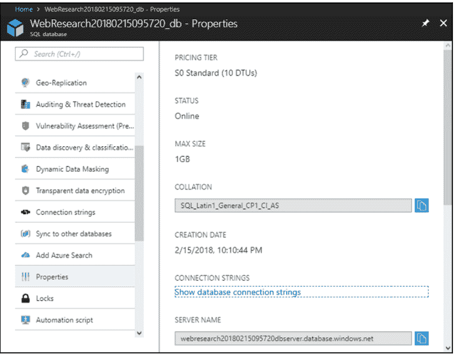

20. 复制 **ADO.NET 连接字符串**，返回代码，并更新 `appsettings.json` 文件中的 `CONNECTION STRINGS` 条目。

21. 重新发布应用，您就可以开始了！

## 自定义目标

下一个发布选项通常称为自定义目标。

此选项基本上包括除 Azure 或本地文件系统之外的任何内容。单击“确定”按钮后，您可以选择发布方法：

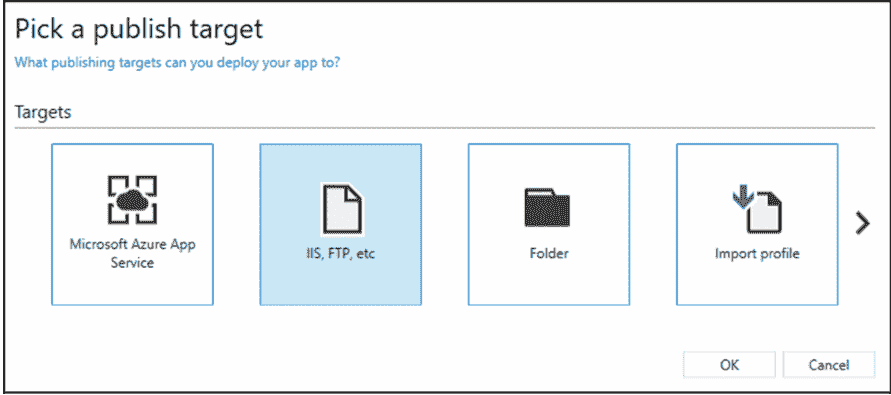

有四种可用的发布方法——或自定义目标——每种都有其自身要求：

- FTP
- Web Deploy
- Web Deploy Package
- 文件系统

我们还有一个 **设置** 选项卡，适用于所有四种方法。让我们快速看看那里有哪些选项：

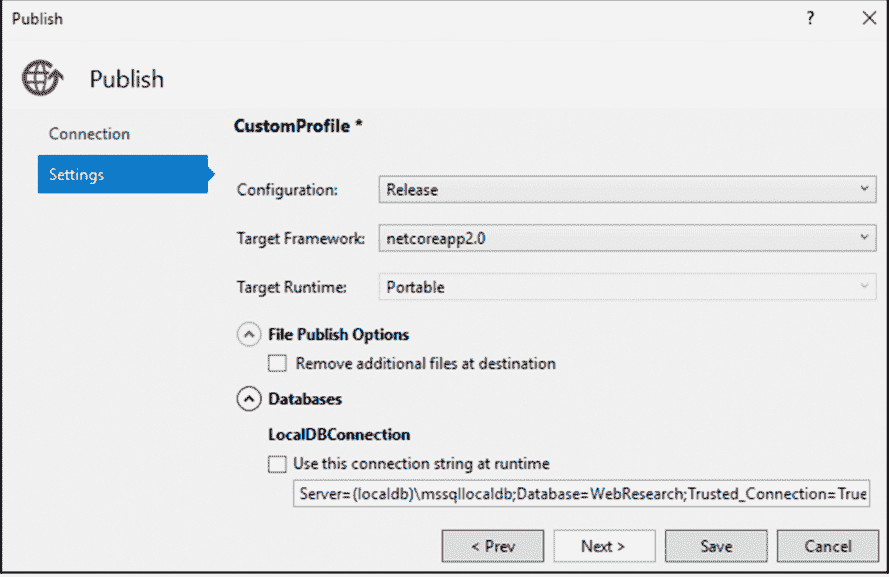

**配置** 选项可以设置为 **调试** 或 **发布**。

使用 **调试**，生成的文件可调试，这意味着可以命中指定的断点。但这也意味着性能会下降。

使用 **发布**，您无法实时调试，但应用程序已完全优化，因此性能会提高。

在我们的情况中，唯一可用的目标框架是 **netcoreapp2.0**，但在标准 .NET 应用程序中，这里可以将目标设置为 .NET 3.5 或 .NET 4.5，或任何可用版本。

您还可以指定目标运行时，选择让 Visual Studio 清理目标文件夹，并为运行时专门指定连接字符串。

如前所述，这些设置适用于所有四种发布方法，我们将立即查看这些方法。

## FTP

FTP 发布方法允许您发布到托管的 FTP 位置。对于此选项，您需要提供以下内容：

- 服务器 URL
- 站点路径
- 用户名
- 密码
- 目标 URL

它还允许您根据输入的详细信息验证连接：

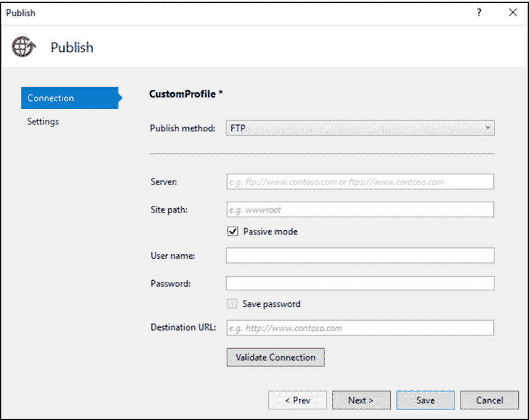

## Web Deploy

查看 Web Deploy 和 FTP 的表单，如果您认为它们是同一件事，那也情有可原。好吧，两者基本上都会导致相同的结果，即直接发布到托管站点，但使用 Web Deploy，您可以获得多项额外优势，包括：

- Web Deploy 会比较源和目标，仅同步所需的更改，与 FTP 相比显著减少发布时间。
- 尽管 FTP 也有其安全变体 SFTP 和 FTPS，但 Web Deploy 始终支持安全传输。
- 适当的数据库支持，允许您在同步过程中应用 SQL 脚本。

发布屏幕如下所示：

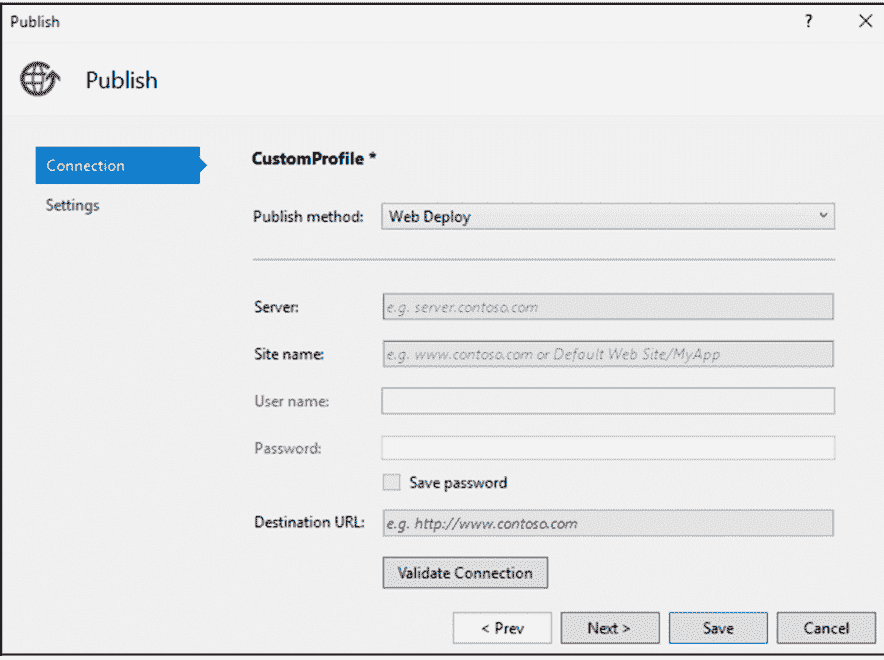

## Web Deploy Package

**Web Deploy Package** 选项用于创建部署包，您可以稍后使用它将应用程序安装到您选择的任何位置。请参阅以下屏幕截图：

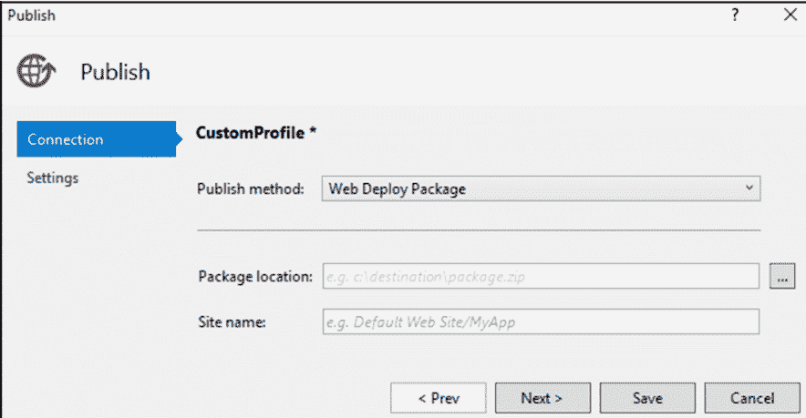

## Folder

此选项受到全球老派开发者的青睐，主要是因为我们仍然不太信任某些可用工具，它允许您发布到您选择的文件夹位置，然后手动将其复制到发布环境中。

只需指定文件夹位置并单击“确定”：

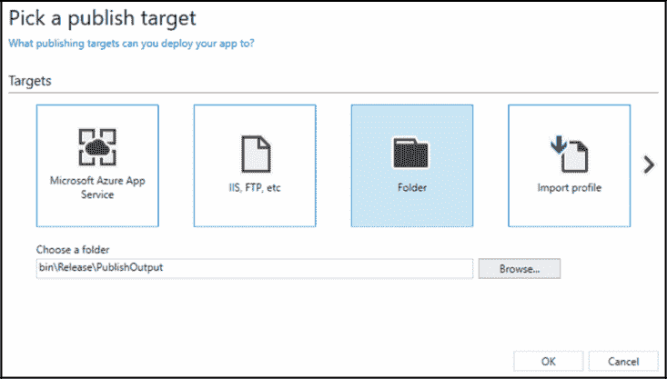

## Import profile

“导入配置文件”方法不是实际的发布方法，而是一个简单选项，用于导入之前保存的配置文件，可以从备份导入，也可用于在开发团队之间共享发布配置文件：

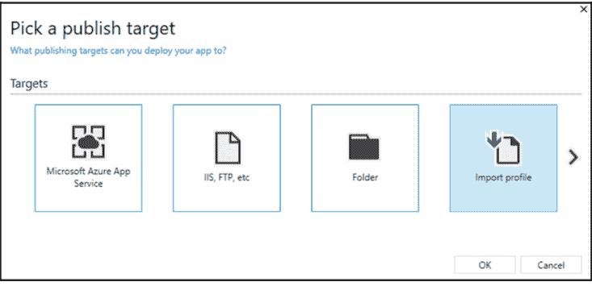

选择 **导入配置文件** 选项将提示您查找已保存的配置文件 (*.publishsettings)。显然，当您创建之前的某个配置文件时，可以将其保存。有时，存储多个发布配置文件是有意义的：这通常是在本地完成的，因为在现代软件开发中，很少有人会手动部署应用程序；相反，他们会设置一个 CI/CD 管道，该管道直接从 GitHub 仓库签入触发。

既然我们已成功发布应用程序，本章也即将结束。让我们回顾一下所学内容。

## Summary

在本章中，我们对 EF Core 社区进行了导览。我们从博物馆开始，了解了 Entity Framework 的历史，然后参观了学区，讨论了 Code-First、Model-First 和 Database-First 实现方法之间的一些差异。TechNet 甚至简要介绍了设计数据库的一些想法。

随后，我们花了一些时间构建自己的 EF Core 解决方案，并了解了部署应用程序的各种方式。我们还查看了如何用一些测试数据填充我们的新大楼，以了解其向公众开放后的表现。

导览最后拜访了分发区，以便我们了解可用的部署选项概览。

这次访问时间太短，无法涵盖 Entity Framework Core 世界中所有可用和可能的内容，因为它是一个拥有庞大社区的框架，该社区不断致力于改进和扩展其已非常广泛的功能。

得知开发者社区从不满足于平庸，并不断致力于改进和扩展功能（例如 Entity Framework，它本身可能已经看起来相当成熟且功能丰富），这真是太好了。

在下一章中，我们将探索 Azure 的 Logic Apps。本章将指导您完成逻辑应用程序的创建、将应用程序与 Twitter 集成，以及允许您将数据输入电子表格并自动将其发布到 Twitter。
