# 5 使用 Azure Logic Apps 和 Functions 构建 Twitter 自动化活动管理器

自200多年前查尔斯·巴贝奇构思出第一台计算机以来，计算的目的就是自动化和精确性。也就是说，我们希望计算机能做我们能做的事情，但速度更快、错误更少。自模拟计算机时代以来，事情已经发生了很大变化，如今我们拥有能够存储 PB 级数据的系统，我们通常口袋里就带着计算机，其性能足以让50年前将人类送上月球的计算机相形见绌！不过，这一切的前提是相同的：我们只是希望计算机能做我们能做的事情，但速度更快、错误更少。

本章要解决的特定问题是一个自动化问题：想象一下，您刚刚在一家新公司开始工作，作为第一份工作，您登录了 Twitter，并被告知公司希望启动一个营销活动来销售他们的新产品。您的任务是定期发送推文，让人们了解他们的新产品。您可以坐在那里每半小时手动输入这些条目，但如果您能在半小时以内自动化此过程，那又会怎样呢？

在本章中，我们将讨论 Microsoft 的工作流引擎（逻辑应用），并了解如何只需编写很少的代码，就能生成一个完全自动化的系统，该系统可以执行相对复杂的任务。


本章将涵盖以下主题：

- 从头开始创建 Microsoft 逻辑应用
- 将 Microsoft 逻辑应用与 Azure 函数和 Microsoft Excel 集成以实现额外功能

在本章中，我们将构建一个逻辑应用，用于读取 Microsoft Excel 电子表格，并根据内容发布推文。虽然我们需要的大部分功能都可以在逻辑应用中使用，但我们需要调用 Azure 函数来进行部分日期计算。

## 技术要求

与前几章一样，您需要一个 Azure 订阅。您还需要一份 Excel 副本，或访问 Office Online。最后，您需要一个 OneDrive 帐户——这些帐户免费设置，可在此处找到：https://onedrive.live.com/。

由于我们在此项目中使用 Twitter，您需要一个有效的 Twitter 帐户。如果您没有，则可以在此处创建一个：https://twitter.com/signup。

本章的代码，与本书中的其他章节一样，可以在此处找到：https://github.com/PacktPublishing/C-8-and-.NET-Core-3-Projects-Using-Azure-Second-Edition。

## 工作流引擎、逻辑应用和函数概述

工作流引擎已经存在一段时间了。基本上，这个想法是您拥有一个非常高级的系统，可以将复杂且独立的组件插在一起。Microsoft 的此实现具有非常直观的图形界面，可以在 Web 浏览器或 Visual Studio 中编写。当您找不到能满足需求的预构建组件时，可以调用 HTTP 终结点，从而允许工作流与 Azure Functions（或者，事实上，与另一个云提供商）无缝集成。

Azure 函数被称为 **无服务器**；这并非因为它们神奇且无需任何硬件即可运行，而只是因为作为开发人员的您，无需关心它们运行在什么上面。它们旨在作为小型功能单元——想想 C# 中的单个方法——它通常接受一个参数并返回一个值；使用 Azure 函数得到的正是如此。

我们已经确定（或者至少会在本章结束时确定），使用 Azure Functions 和逻辑应用比从头开始设置所有这些功能编写得更快，但你还能得到什么？

您获得的主要优势是可扩展性；您的软件运行在恰好所需的硬件量上，因此如果您没有使用该软件，就不需要付费。如果使用量激增，Microsoft 将提供更多硬件来满足您软件的需求。

## 创建 Excel 表

我们需要做的第一件事是创建一个可读取的 Excel 电子表格。对 Excel 进行任何详细解释超出了本章（和本书）的范围；但是，在 Excel 中，创建一个新电子表格并按如下方式插入表格：

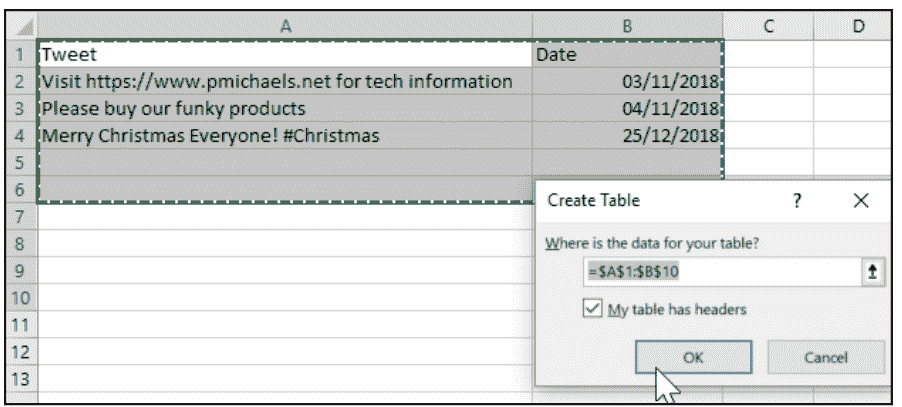

重命名表（这将使以后更容易识别）：

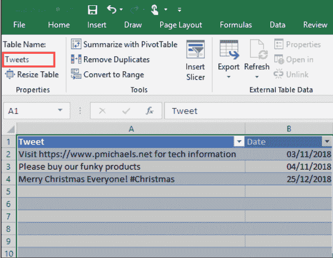

> > 写作时，某些版本的 Excel（免费的在线版本）不支持重命名表格。

将 Excel 文件保存到您的 OneDrive 帐户中。我们很快会回到此文件，因为它基本上将用作此应用程序的数据源。

## 在 Azure 门户中构建逻辑应用

在本章中，我们将使用 Visual Studio 和逻辑应用功能（作为扩展提供）来创建和测试我们的应用程序。但是，在这样做之前，我们将快速了解一下如果您选择直接在 Azure 门户中构建，应该在哪里构建。

在 Azure 门户中，搜索 `logic apps`，然后选择 **逻辑应用** 服务，如下所示：

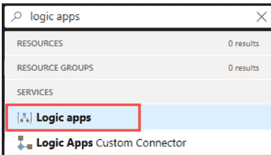

> 记住，一旦边栏启动，您可以使用右上角的图钉图标将其固定到仪表板上。

当边栏启动时，您将看到订阅中当前拥有的所有逻辑应用；如果没有，则您将看到一个邀请您创建一个的按钮，如下面的屏幕截图所示：

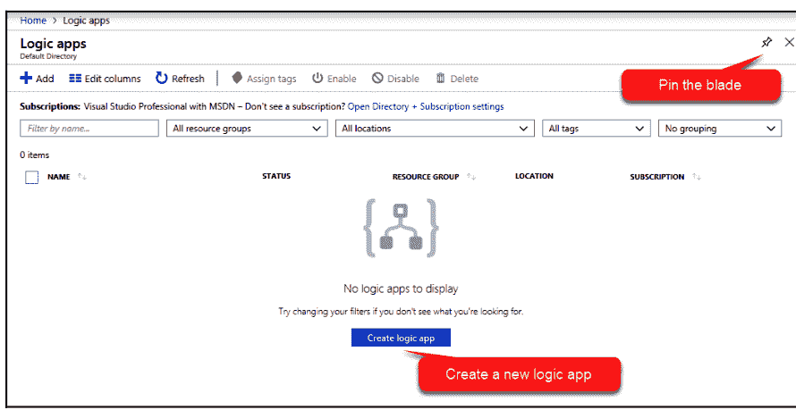

从这一点开始，在 Azure 门户中创建逻辑应用的过程基本上与使用 Visual Studio 相同。在 Azure 门户中创建应用程序有优势，使用 Visual Studio 插件也有优势，如下表所示：

| Visual Studio | Azure portal |
| :--- | :--- |
| 源代码控制很容易，对逻辑应用、相关函数和 Web 作业的更改可以保持在一起 | 更改被跟踪，但源代码控制不那么容易 |
| 功能略微滞后于门户 | 最新功能 |
| 需要安装 Azure 工作负载和逻辑应用扩展 | 不需要在本地计算机上安装任何软件（甚至不需要 Visual Studio） |

从这一点开始，我们将切换到 Visual Studio。

## 在 Visual Studio 中构建逻辑应用

在开始之前，我们需要执行几个安装步骤；第一步是在 Visual Studio 中安装 Azure 工作负载。

### Azure 开发工作负载

要开始，请运行 Visual Studio Installer，并选择正在运行的版本上的修改，如下所示：

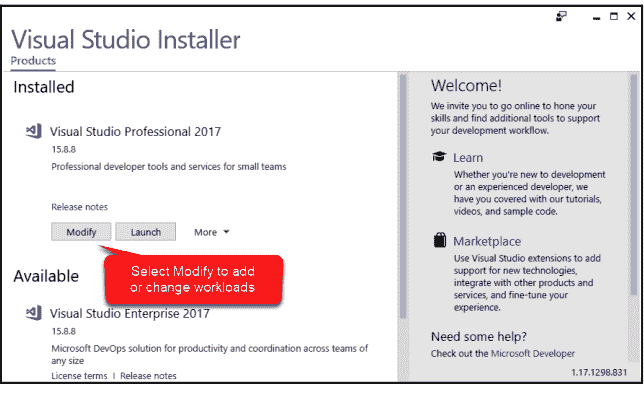

> > Visual Studio Installer 是初始安装的一部分，您可以在此更改或更新 Visual Studio 的安装。

选择（或勾选）**Azure 开发**工作负载，然后选择 **修改**：

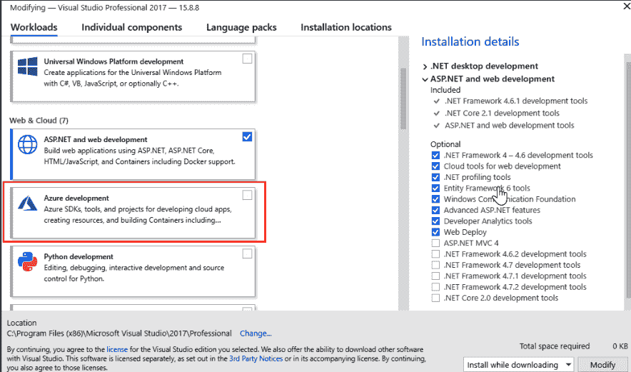

如果您当前正在运行 Visual Studio，则在更新进行期间需要关闭它。下载和安装可能需要几分钟，所以这可能是个去喝杯咖啡的好时机！

> > 工作负载是功能集合，允许 Visual Studio 执行某些任务或感知某些语言。

### 逻辑应用扩展

要安装此扩展，请先从 Visual Studio 的工具菜单启动扩展和更新...，如下所示：

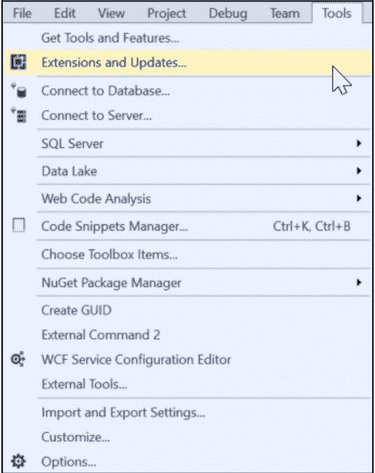

您可以在此管理 Visual Studio 扩展。我们将在此处搜索逻辑应用扩展，如下所示：

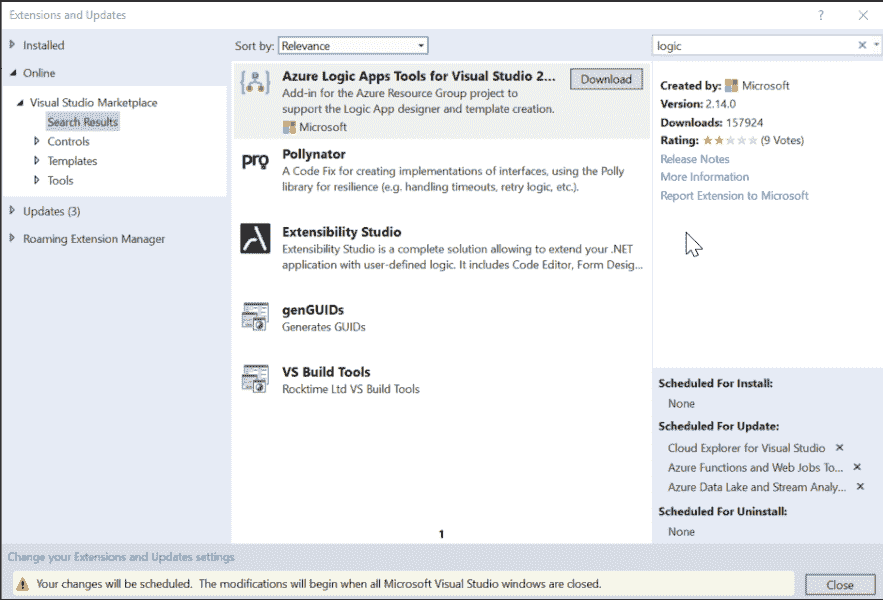

安装完成后，您需要重新启动 Visual Studio，完成后，您就可以开始开发我们的逻辑应用了。

### 创建资源组

现在我们已安装 Azure 工作负载和逻辑应用扩展，更多功能可用；其中之一是在 Visual Studio 中创建新项目（类型为资源组）的功能。现在让我们这样做：

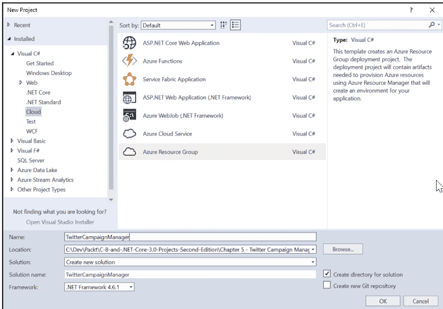

创建完成后，您将看到第二个对话框，询问您想要创建什么。选择 **逻辑应用**，如下面的屏幕截图所示：

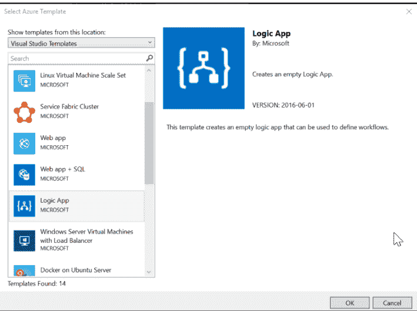

创建的项目包含三个文件，将如下所示：

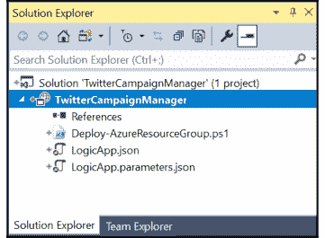

Deploy-AzureResourceGroup.ps1 是一个 PowerShell 脚本，用于将逻辑应用部署到 Azure。另外两个文件是逻辑应用模板本身，描述为 JSON。

如果您愿意，可以直接编辑 JSON。如果您要做的更改很小，或者希望比较或合并更改，这很有效，但要说最不理想的方式，尝试这样创建逻辑应用会非常具有挑战性！相反，右键单击 `LogicApp.json` 文件并选择 **使用逻辑应用设计器打开**：

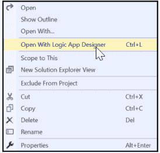

系统会要求您选择要将应用关联到的 Azure 订阅和资源组。然后，您将看到以下内容：

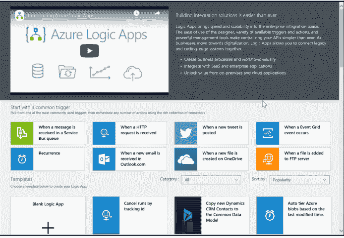

如您所见，这里有一个有用的小视频可帮助您入门，一些预构建的触发器模板，以及一些几乎可以直接使用的模板。


## 创建工作流

这里的基本流程是在每次重复时检查 Excel 文件，当找到符合条件的行时，使用该行中的文本发送一条推文，然后删除该行。我们将只创建一个空白逻辑应用，以便逐步探索每个步骤。

### 步骤 1 – 选择触发器

选择空白逻辑应用后，您将看到模板设计器，并需要选择触发器：

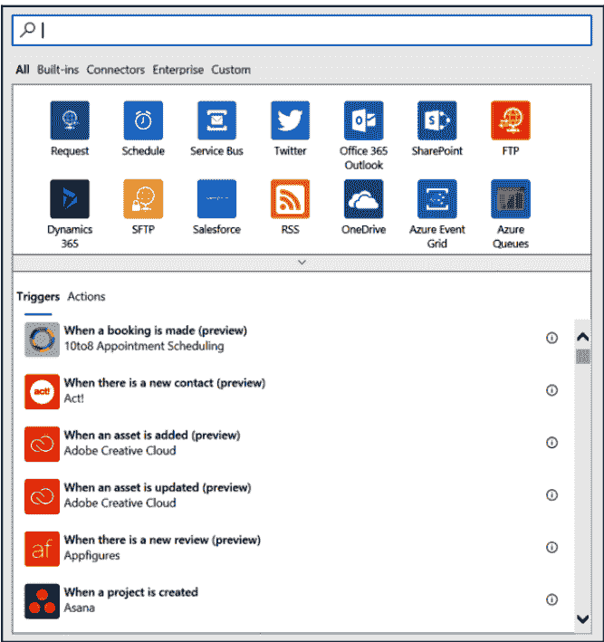

触发器只是引发工作流开始的某个事物。这可能是来自另一个系统的事件、存储中出现的文件、放入队列的消息，或者只是一个计划。

在我们的案例中，我们将选择 **计划**，之后，您将获得有关计划类型的选项。在撰写本文时，这里只有一个可用选项：**重复**，因此让我们选择它。

最后，您将选择工作流运行的频率。在创建工作流期间，请将此保留为默认的一小时；但是，完成后，我们将将其设置为更灵敏一点的频率。

您在此处选择的值可能会对工作流的运行成本产生非常直接的影响。如果您每分钟都有大量处理在运行，您可能会发现 Azure 账单越来越高。由于我们使用此工作流进行的处理非常适度，每分钟运行一次不应对成本产生太大影响。

确认此对话框后，重复将折叠为一个较小的框，您将能够选择工作流执行的操作。选择 + **新建步骤**，如下图所示：

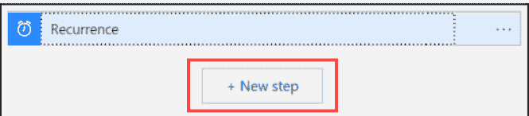

在初始触发器之后，您只能添加操作，但从后续操作中，您可以添加条件和循环。

### 步骤 2 – 读取 Excel 文件

选择新建步骤后，您将看到数百个可能操作的列表。
搜索 Excel 并选择 Excel Online (OneDrive)：

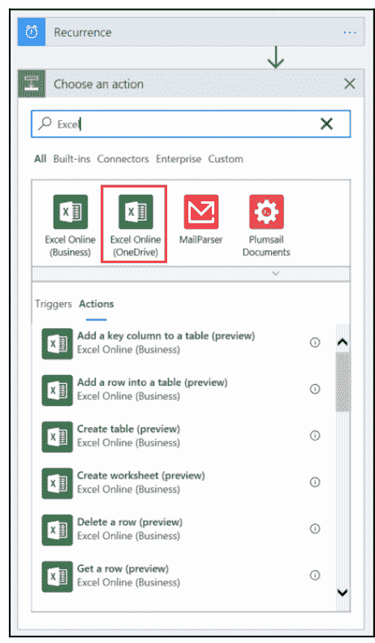

选择 Excel 类别后，列表将被缩减。在生成的列表中，选择 **列出表中存在的行 (预览)**：

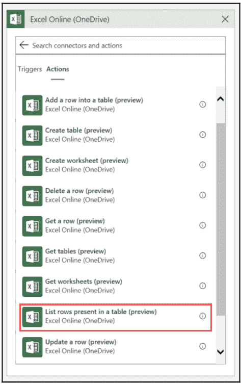

正如您所见，在撰写本文时，此功能仍处于预览状态。

选择此项后，系统会要求您登录到 OneDrive。这是一次性事件，但对于每个需要凭据的操作都是必需的。然后您的凭据将被安全存储。

您现在需要选择在 OneDrive 中存储的 Excel 文件以及创建的表：

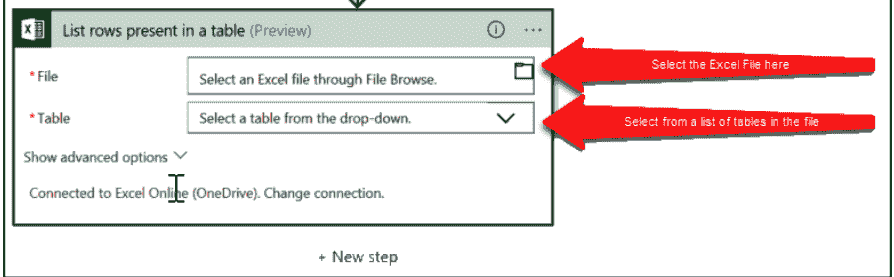

如果您使用的是 Excel 的在线免费版，则无法重命名表。但是，它仍将在此处可见，但名称可能类似于 `Table1`。如果有多个表，则难以识别正确的表。

在以下屏幕截图中，您可以看到我的文件和表：

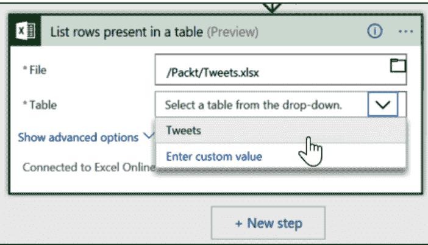

在开发逻辑应用的过程中，需要注意的一点是，操作数量会迅速增加。与使用 `Button1` 和 `Button2` 等默认名称的 UI 设计器一样，如果保留默认命名，在添加几个操作后就会乱成一团。我们将在此处重命名操作：

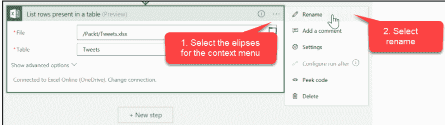

为其命名一个能够识别它的名称很重要：

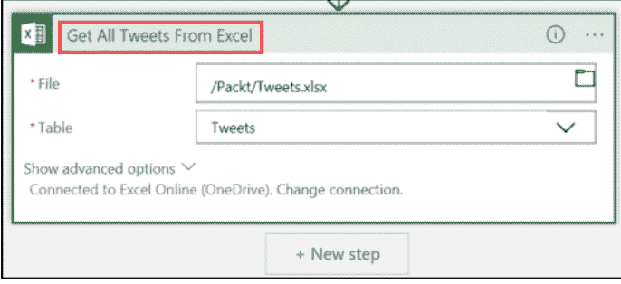

> 您可以先在纸上规划流程，并为每个步骤分配代码，例如，`001 GetData` 和 `002 Write File`；这样，您可以将其映射回来。

由于我的工作流相对简单，我只是给它起了一个描述性名称。

下一步是遍历电子表格中的日期并确定哪些日期已过；但是，在撰写本文时，逻辑应用处理日期效果不佳，尤其是 Excel 日期。对于这种事情，能够调用 Azure 函数非常有用。通常对于这种高级别系统，一旦遇到它不处理的东西，您就会陷入困境。然而，逻辑应用的精妙之处在于，在需要时可以简单地回退到常规代码。让我们现在创建一个 Azure 函数。

### 新建 Azure 函数

我们将在同一解决方案中创建新函数。这样，我们可以将逻辑应用的所有功能保持在一起：

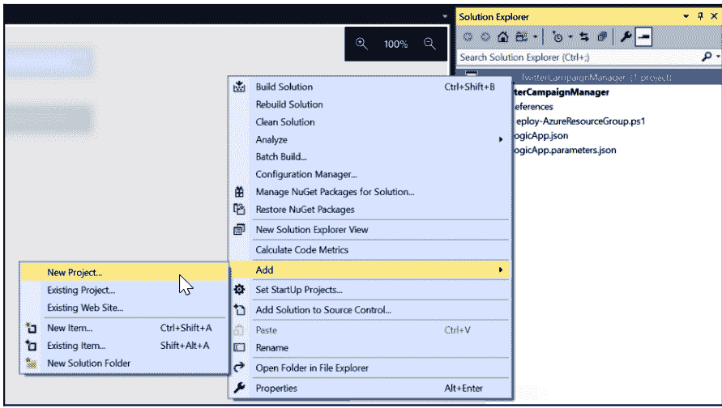

我们要创建的项目类型是 Azure 工作负载添加的新类型之一，即 Azure Functions：

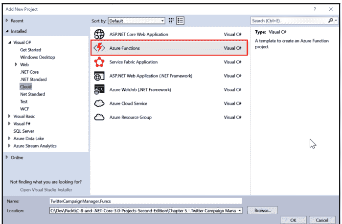

选择此项后，将显示一个对话框，询问您想要创建什么类型的函数。Azure Functions v2 现已推出，它使用 .NET Core，因此我们将选择它，并选择 Http 触发器：

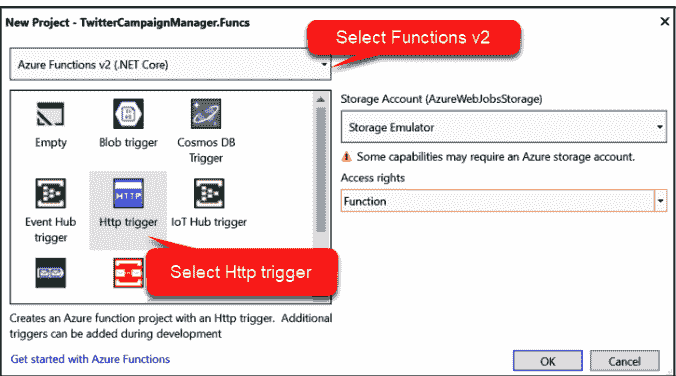

有关 Azure 函数的完整详细解释以及它们能做什么和不能做什么超出了本书的范围。但是，简单来说，函数是一段无状态的功能，可以被调用，并且能够自动缩放。

但是，如果您曾使用过 Web API，默认生成的代码应该不会太陌生。我们要做的第一件事是将类名从 Function1 更改：

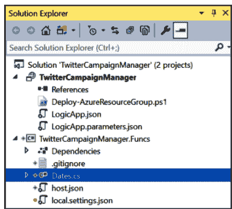

我们的新类将表示单个 Azure 函数。以下是您需要的函数代码，因此请使用此代码替换默认函数：

```
[FunctionName("DatesCompare")]
public static IActionResult Run([HttpTrigger(AuthorizationLevel.Function,
"get", "post", Route = null)]HttpRequest req, ILogger log)
{
    log.Log(LogLevel.Trace, "C# HTTP trigger function processed a
request.");
    string requestBody = new StreamReader(req.Body).ReadToEnd();
    return ParseDates(requestBody);
}
```

正如您所见，此函数在这里不做太多事情，只是记录已被调用的事实，并使用请求正文调用 ParseDates。这里需要注意的重要事项都在方法签名中。

虽然函数本身名为 Run，但装饰器表明它将从其他地方称为 DatesCompare；当我们将其插入逻辑应用时，您将看到更多此类情况。

HttpTrigger 指示调用函数的时间。在 `HttpTrigger` 的情况下，该函数实际上作为面向 Web 的端点公开；但是，可以使用其他触发器；此列表会不断变化，可以在此处找到：https://docs.microsoft.com/en-us/azure/azure-functions/functions-triggers-bindings.

让我们来看看 ParseDates 方法，如下所示：

```
public static IActionResult ParseDates(string requestBody)
{
    dynamic data = JsonConvert.DeserializeObject(requestBody);
    DateTime date1 = (DateTime)data.date1;
    DateTime date2 = DateTime.FromOADate((double)data.date2);
    int returnFlagIndicator = 0;
    if (date1 > date2)
    {
        returnFlagIndicator = 1;
    }
    else if (date1 < date2)
    {
        returnFlagIndicator = -1;
    }
    return (ActionResult)new OkObjectResult(new
    {
        returnFlag = returnFlagIndicator
    });
}
```

从功能角度来看，此方法实际上做的事情很少，因为它实际上只是一个条件检查。这里需要注意的重要事项是 `DateTime.FromOADate`。它将从 Excel 获取日期，并将其转换为标准 .NET DateTime 格式。

我们还使用了 `dynamic` 数据类型；实际上，这告诉 C# 运行时不要静态地对变量进行类型化。这是一把双刃剑；与 JavaScript 类似，这意味着您可以使用编译器在编译时不需要知道的结构。此外，与 JavaScript 类似，这意味着如果您拼写错误变量名，可能会遇到难以诊断的运行时异常或错误。

> `dynamic` 数据类型不应与 `var` 关键字混淆。
> `var` 关键字确实表示静态数据类型；它只是一种让编译器自行推断该类型的方式。`dynamic` 类型在代码执行之前不为编译器所知。


## 部署和测试函数

既然我们已经编写了函数，就需要将其部署，以便逻辑应用设计器能够看到它。我们将手动发布函数；右键单击函数项目并选择 **发布...**

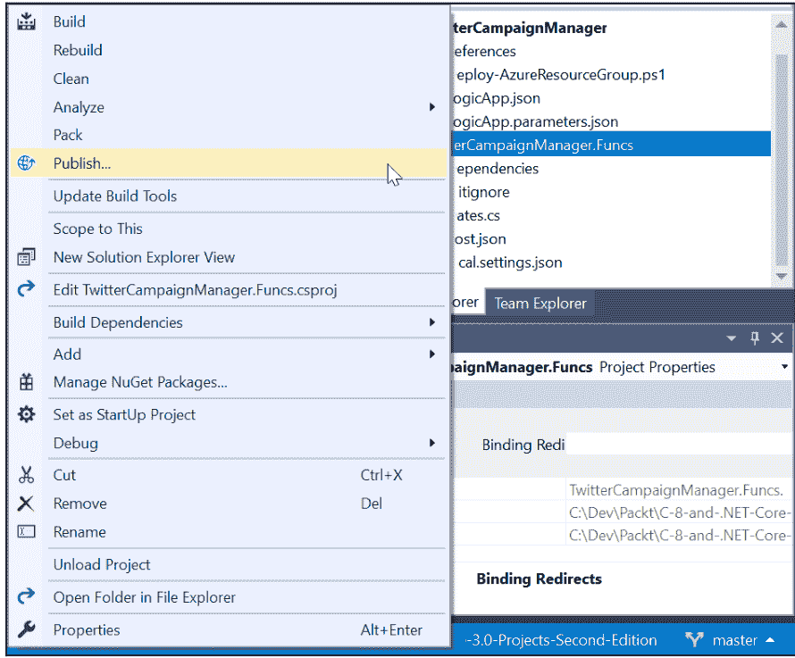

将出现一个对话框，让您有机会将函数本地发布到目录或发布到 Azure：

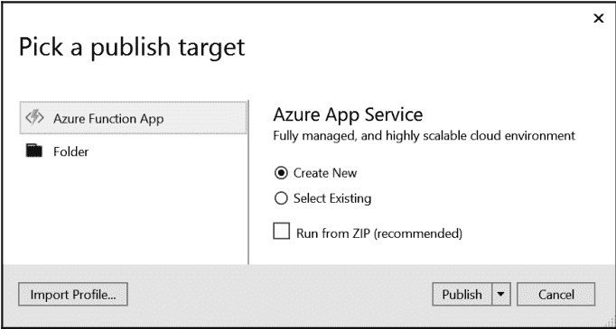

目前忽略其余内容并选择发布。由于应用正在发布到 Azure，下一个屏幕涉及它将在 Azure 中的哪个位置发布：

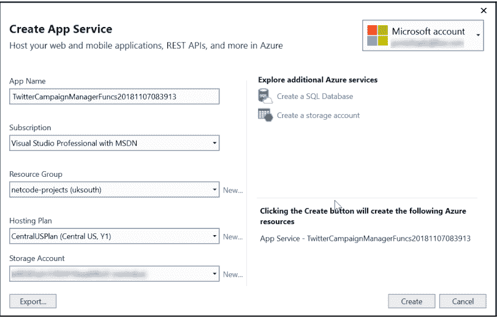

成功部署后，您应该看到以下屏幕。如您所见，有一个指向函数部署URL的链接：

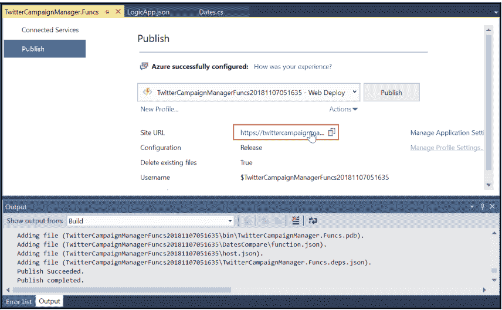

如果单击此链接，您应该能够访问一个网站，该网站会向您保证您的函数确实正在运行且可访问：

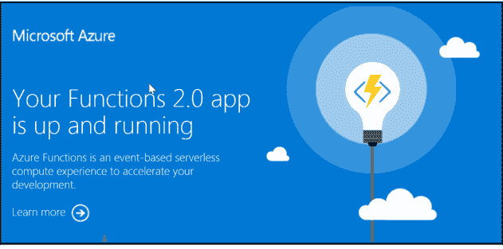

您可以像使用任何其他HTTP端点一样使用此端点；例如，您可以使用Postman或其他类似工具构建对它的调用。

好的，它正在运行；让我们快速测试一下。在Azure门户（www.portal.azure.com）中，搜索您的函数。找到它后，选择您的函数名称（在我的例子中，它是 DatesCompare）：

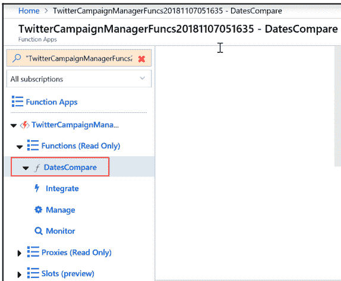

如果向右滚动，您会看到一个类似这样的小选项卡面板：

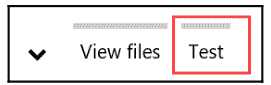

选择“测试”，将出现一个全新的面板。这将允许您就地测试您的函数。

与Azure门户上的许多事物一样，除非您拥有一个巨大的屏幕，否则您会花费大量时间滚动。

要测试函数，请输入示例JSON正文并选择“运行”：

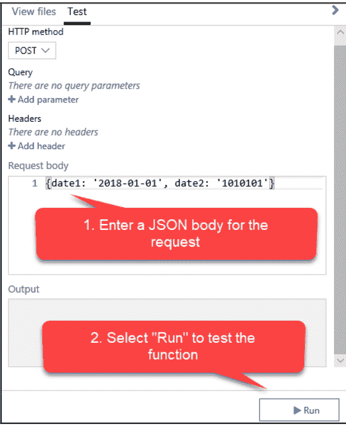

既然我们的函数已经运行起来了，让我们回到逻辑应用并将其连接起来。

## 遍历电子表格

逻辑应用提供了您在标准编程语言中会找到的大部分功能；除了操作之外，您还有循环和条件。接下来我们需要的是一个循环。在逻辑应用设计器中，选择 **新步骤**，并选择 **控件** 类别：

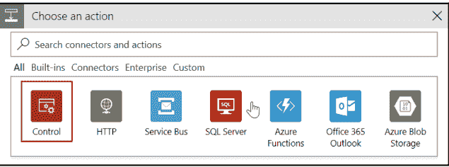

选择此项后，您将能够选择 **For each** 循环：

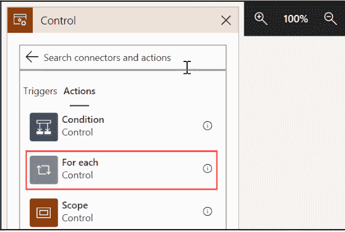

> 循环将在每次调用时遍历表中的每个元素。值得牢记这一点，尤其是如果您没有排除已处理记录的条件。

创建循环后，我们可以在循环内添加一个操作，即在每次迭代时执行的操作：

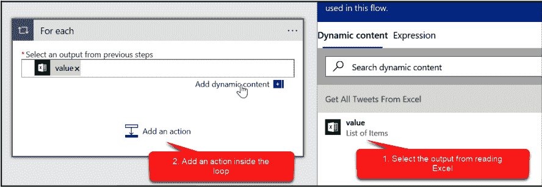

这使我们来到了我们正在做的事情的核心，即发送一条推文。

## 发送推文

上一节应该会让您看到一个提示选择操作的对话框：

1. 搜索 Twitter，如以下屏幕截图所示：

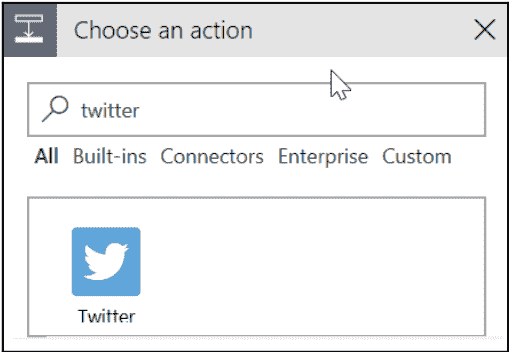

2. 选择后，您会看到 Twitter 提供的多个操作，但我们只想发布一条推文，因此我们将选择该操作：

- 获取我的关注者 Twitter
- 获取我的关注 Twitter
- 获取用户 Twitter
- 获取用户时间线 Twitter
- 发布推文 Twitter
- 搜索推文 Twitter

3. 选择该项后，系统将提示您登录到 Twitter：

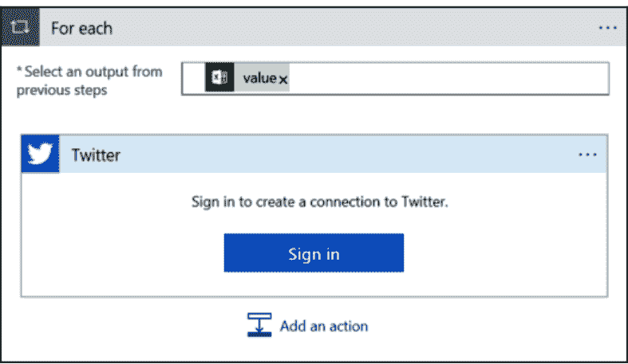

4. 登录后，您将被问及要发布什么文本。我们已经在电子表格表中拥有此文本，并且很容易获得：

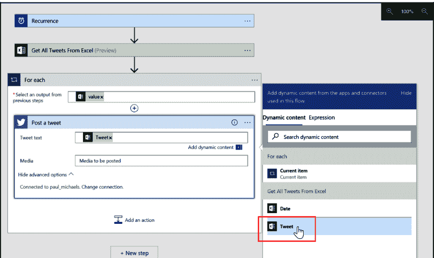

信不信由你，就这样。就目前而言，工作流将每小时运行一次，遍历列表，并发送它找到的任何推文。但是，我们目前有点过于热心了。我们仍然需要只获取日期正确的推文的功能，并且需要在发送推文后删除该行（否则日期过了之后我们会继续发送）。

## 添加条件并删除当前行

让我们先从条件开始，这使我们来到了逻辑应用的一个非常有用的功能；虽然您可以在流的底部添加步骤，但也可以在现有流中插入步骤和条件。每个步骤之间的区域隐藏着一个圆圈中的加号；如果您将鼠标悬停在该区域上，它将出现并可以选择：

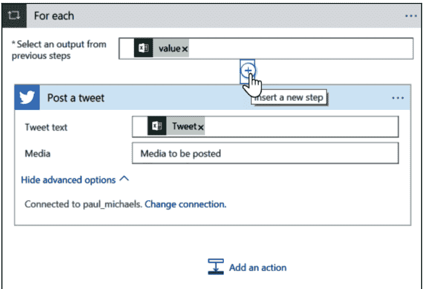

在此示例中，我们将选择发布推文上方的区域。选择它后，将出现一个上下文菜单，允许您 **添加操作**。如果选择该项，您将看到（现在已经熟悉的）对话框，允许您选择操作。在此对话框中，选择 **控件**，如下所示：

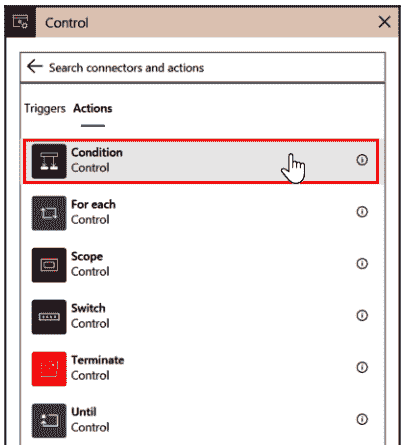

这次，我们将选择 **条件**。选择 **条件** 时，您会看到表面上看起来像是一组复杂的选项；但实际上它非常简单。

每个条件都必须是一个测试，其结果是 *是* 或 *否* 的答案；不能有任何中间状态。例如，如果测试是“现在是下午5点GMT吗？”，那么答案要么是“是，现在正好是下午5点GMT”，要么是“否，现在不是正好下午5点GMT”。逻辑应用需要知道在这两种情况下分别要做什么（如果有的话）：

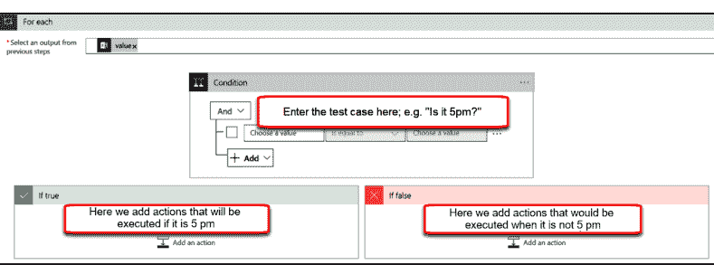

在我们的示例中，我们的条件只是使用当前日期和时间（即此函数运行的日期和时间）以及电子表格上的日期和时间（即我们希望推文发送的日期和时间）来调用我们的函数。因此，在添加测试之前，我们需要调用我们的函数。同样，在条件上方插入一个操作，如下所示：

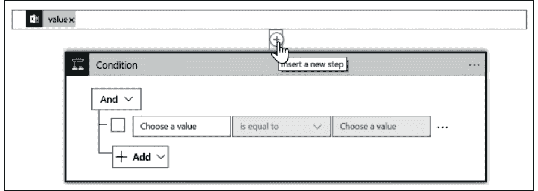

现在，只需选择 Azure Functions 作为操作类型即可：

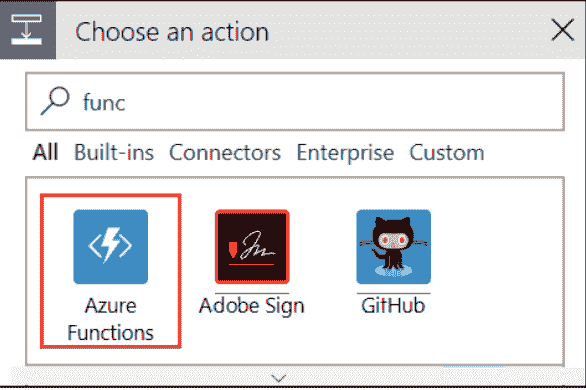

应该现在会出现可用函数列表，如下所示：

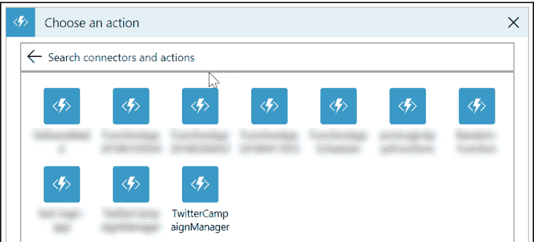

> 如果您在这里看不到自己的函数，那么很可能是在发布函数时出现了问题。

选择此项后，您将看到函数应用中函数的列表。

> 单个函数应用可以包含许多函数；但是，每个函数均独立缩放。

## 向函数传递参数

使用设计器的下一个部分并不是特别好的体验。基本上，我们需要将请求正文格式化为JSON；这意味着部分需要手动输入，部分需要选择内置函数。一旦您习惯了这个，您可能会发现自己需要切换到原始JSON来添加内容；但是，让我们逐步介绍。

请求正文的最终JSON需要如下所示：

```
{ date1: '[Current Date]', date2: '[Date from Spreadsheet]' }
```

在请求正文中，输入JSON的第一部分，然后选择 **添加动态内容**：

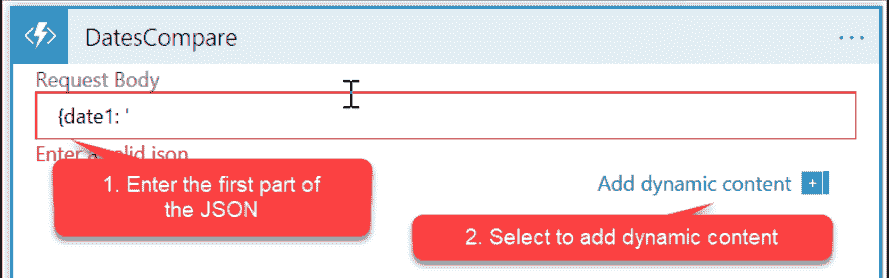

选择 **添加动态内容** 将弹出一个对话框。如您所见，我们的日期可用于此，但目前，我们将切换到 **表达式** 选项卡：

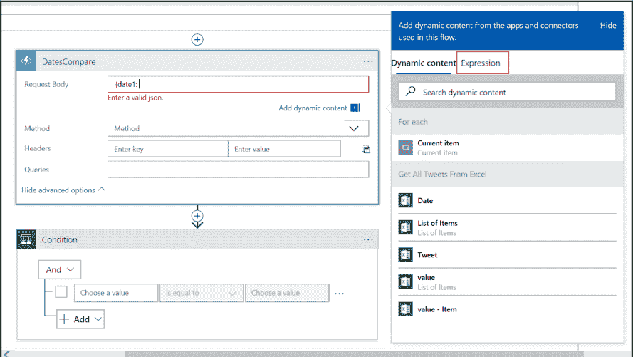

在 **表达式** 选项卡中，您会找到许多内置函数，并且您会看到 `utcNow()`：

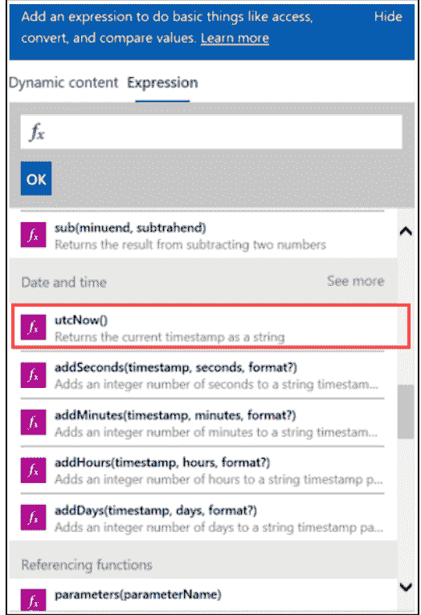

**提示** UTC是不受夏令时或地区差异影响的时区，这意味着如果您处理日期和时间，应该使用UTC（您可以为显示或输入目的转换为本地时区）。


一旦选择了函数，我们需要完成 JSON 并传递来自 Excel 的日期（如前所述）。完成的 JSON 应如下所示：

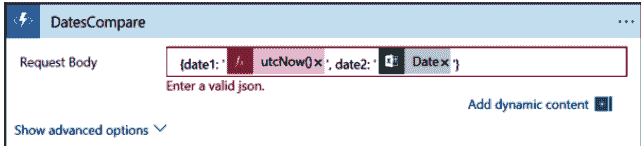

如前所述，在测试函数时，这将返回一个 JSON 文档。如果我们希望在稍后的工作流中使用此函数的输出，我们需要解析 JSON 输出。如果您在 DatesCompare 函数调用后直接插入一个操作，您将能够为此选择一个特殊操作：

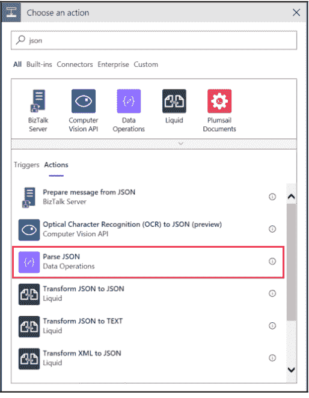

如果您在想为什么您会 *不* 想要使用函数的输出，值得注意的是，函数可以简单地执行任务；例如，您可以有一个更新数据库或写入文本文件的函数。

我们来自名为 `Body` 的函数的输出。就目前而言，那是标准 JSON，所以您可以简单地自己拆解它；然而，我们会将其传递给我们的 **解析 JSON** 函数。

我们还需要指定架构，因为不太可能有人能够脱口而出 JSON 架构。有一个方便的小函数允许您只需提供 JSON 输出（您可以直接从我们之前看到的测试屏幕中获取）：


尝试返回章节的前面部分，复制输出并粘贴到这里。

生成的架构应如下所示：


现在我们有了日期比较，因此让我们回到我们的条件。

## 回到我们的条件

我们可以直接插入值。请记住，`Date1` 是我们的当前 UTC 日期，`Date2` 是我们的 Excel 日期。因此，逻辑应测试当前日期是否等于或晚于 Excel 日期；在此日期，我们可以发布推文：


最后，让我们将推文操作拖动到真分支：


功能基本完成。我们现在应该能够成功发布推文了。

## 删除行

下一步是删除该行；我们将在推文下方添加此操作：


同样，我们将搜索 *Excel* 并选择 **Excel Online (OneDrive)**。最后，我们将选择 **删除行 (预览)**：


在出现的对话框屏幕中，需要选择相同的电子表格和表；然后，系统会要求您选择键列和值：


这些列用于唯一标识要删除的行。在我们的例子中，只有两种选择：可以选择日期（这意味着我们只能在特定日期安排发送一条推文），或推文文本（这意味着我们不能多次发送相同的推文文本）。在我们的例子中，我们将选择日期。

> 如果您要扩展此应用程序，可能希望定义一个带有唯一标识符的第三列（您甚至可以让 Excel 自动为您生成此标识符）。

在 **键值** 框中，我们将选择之前的日期：


现在我们可以继续发布逻辑应用了。

## 发布逻辑应用

我们现在已经接近尾声了。剩下的就是将应用发布到 Azure。右键单击逻辑应用，选择部署，然后新建...


从这张截图可以看出，一旦部署了项目，将创建一个快捷方式以部署到正确的资源组。

在出现的对话框中，系统要求您选择一个资源组：


最后，系统会要求您填写缺少的参数；在我们的例子中，这只是应用的名称：

| 参数名称 | 值 |
|---|---|
| logicAppName | TwitterCampaign |
| logicAppLocation | [resourceGroup().location] |
| excelonline_1_Connection_Name | excelonline |
| excelonline_1_Connection_DisplayName | Excel Online (OneDrive) |
| twitter_1_Connection_Name | twitter |
| twitter_1_Connection_DisplayName | paul_michaels |

发布后，您可以通过检查 Twitter 帐户和电子表格来验证工作流是否成功：


不过，您也可以查看日志。这些日志详细说明了工作流何时执行，更重要的是，它们可能在何处失败。

## 失败

事实上，如果您完全复制了之前的步骤，您会看到，尽管该应用正在执行其应有的操作，但它报告失败：


让我们看看能否找出原因；单击其中一个失败，您将看到逻辑应用在抛出错误之前运行了多远：


因此，我们可以看到它运行到了 ForEach，并且某事失败了，但乍一看，它似乎成功了。选择“下一个失败”选项以跳转到问题：


好吧，我们的函数出了问题。逻辑应用在帮助诊断问题方面非常出色；继续单击步骤以深入（单击 DatesCompare）：


因此，我们传递了一个空字符串。原因当然是因为我们的 Excel 表包含空条目。您可以通过简单地将表的大小减小到可用数据来解决此问题，或者更改函数以过滤掉空行；无论哪种方式，我们现在都成功了：

| 状态 | 开始时间 | 标识符 | 持续时间 |
| :--- | :--- | :--- | :--- |
| Succeeded | 13/11/2018 18:04 | 08586594746326782372134683960CU07 | 9.02 Seconds |
| Succeeded | 13/11/2018 18:03 | 08586594746938763376847245421CU06 | 7.81 Seconds |
| Succeeded | 13/11/2018 18:02 | 08586594747548182867614267521CU13 | 9.99 Seconds |
| Succeeded | 13/11/2018 18:01 | 08586594748162566775079526679CU01 | 16.79 Seconds |
| Succeeded | 13/11/2018 18:00 | 08586594748800656461473187008CU22 | 13.79 Seconds |
| Succeeded | 13/11/2018 17:59 | 08586594749411363881593582417CU03 | 9.44 Seconds |
| Succeeded | 13/11/2018 17:58 | 08586594750015904695702940037CU04 | 8.63 Seconds |
| Succeeded | 13/11/2018 17:57 | 08586594750618289008112806929CU13 | 10.56 Seconds |
| Failed | 13/11/2018 08:40 | 08586595084819484650174508324CU17 | 1.64 Minutes |

我们现在有了一个可用的逻辑应用。让我们清理本章中使用的资源。

## 清理 Azure 资源

本章中我们只使用了两个资源；让我们从清理逻辑应用开始：

- 1. 在 Azure 门户中，选择逻辑应用边栏：


- 2. 在此屏幕中，您现在应该能够看到您的应用：


- 3. 接下来，我们可以以类似的方式找到我们的函数——选择 **函数** 边栏，可以从菜单选项中选择（如您所见，我的选项中没有 **函数**），或者直接搜索 `Functions`。同样的过程适用：


如果您不清理函数应用，则不太可能被收费。函数仅在被调用时执行；但是，逻辑应用设计为按设定间隔运行。如果您选择不清理它，那么您可能会产生费用。

现在我们已处置资源，让我们回顾本章。

## 摘要

我们现在已创建一个逻辑应用，它从 Excel 电子表格中检索数据，分析这些数据，并基于结果与 Twitter 交互。尽管步骤很多，但我希望您可以看到，与自己编写所有这些接口相比，开发此应用要快得多。此外，您会记录对逻辑应用的每个调用，因此可以轻松诊断任何问题。

您可以轻松添加错误处理功能，以便在失败时发送电子邮件；也许您想在 Jira 上提出问题；也许您有一个网站，希望每天对其进行测试以检查它是否仍在运行，并在未运行时给您发送电子邮件；也许您有一个服务总线队列，希望在收到死信消息时通知某人。所有这些都可以用很少的代码甚至无代码实现。

在下一章中，我们将讨论如何使用 Identity Server 4 在应用中实现授权。


