# 使用 Identity Server 和 OAuth 2 的股票检查器

在现代开发中，建立一个可靠且安全的接口来对用户进行身份验证是绝对必要的。OAuth 2 在此已大致成为事实上的标准；但是，由于其历史原因，OAuth 2 究竟是什么意思取决于你问谁（也就是说，如果你问 Google，他们可能会告诉你与 Twitter 略有不同的事情）。

事实上，如果你希望某人只需使用安全界面登录，并且对该登录过程的具体细节不感兴趣，那么使用这些公司之一来提供你的身份服务是个不错的选择。例如，用户可以使用他们的 Twitter 凭据登录到你的网站。

在本章中，我们将开发一个股票检查应用程序。我们的应用程序将非常简单：我们将允许人们输入股票代码并获取股票数值，并允许其他人更新股票数值。我们无法依赖互联网访问，因此无法使用在线身份服务。

为了实现这一点，我们将使用一个名为 IdentityServer 的开源框架 (https://identityserver.io/)。

值得注意的是，我们即将使用 IdentityServer 构建的东西可能对于你的特定使用场景来说有点大材小用。如果你只想对用户进行身份验证，那么你可能会发现 Twitter、Google 或 Microsoft 预构建的 OAuth 2 实现更适合你的需求。我们在这里要做的是构建一个自定义身份服务器，尽管使用了框架，但这仍然比使用预构建的产品要多一些工作。

在本章中，我们将涵盖以下主题：

- 使用 IdentityServer 保护 API
- 实现简单的基于角色的权限模型
- 通用 Windows 平台 (UWP) 应用程序
- 创建 ASP.NET Core 3.0 API
- Entity Framework Core
- 创建用于开发目的的证书

## 技术要求

在本章中，我们将使用 EF Core 和 SQL Server。在本章中，我假设你正在运行本地安装的 SQL Server 版本。如果你选择连接到不同的 SQL Server 实例，除了连接字符串外，不应该有任何区别。SQL Server 的下载页面可以在这里找到：https://www.microsoft.com/en-gb/sql-server/sql-server-downloads。

SQL Server Developer 版本可免费用于开发和测试软件（如你在此所做的那样）。你也可以使用 SQL Server Express，甚至是商业版 SQL Server；但是，免费版本之一对于这个项目来说已经足够了。

你还需要一种测试 API 的方法。Postman 是一种可用于此目的的工具，可以在这里找到：https://www.getpostman.com/。

你可以在这里找到 Postman 的文档（包括一些入门教程）：https://learning.getpostman.com/docs。

## Visual Studio Installer – 新工作负载

可以通过 Visual Studio Installer 选择“修改”选项来安装其他工作负载。

为了创建 UWP 应用程序，你需要安装 UWP 工作负载：

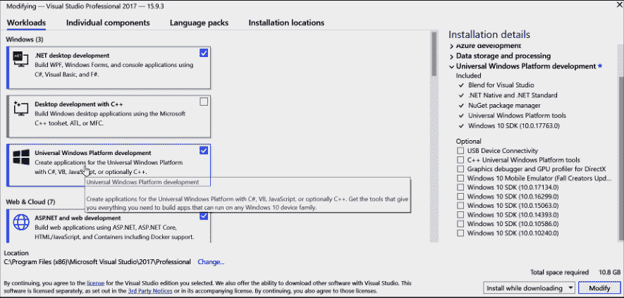

你可能希望下载 Visual Studio 的数据工具：

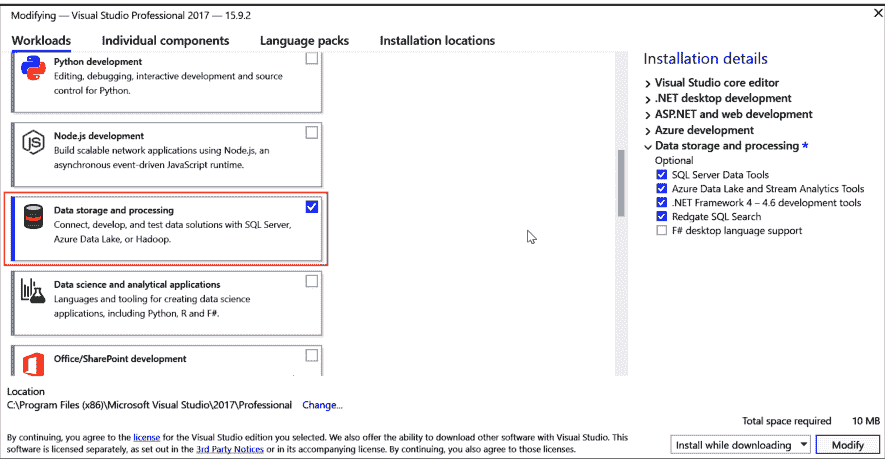

或者，你可以下载 SQL Server Management Studio，可以在这里找到：https://docs.microsoft.com/en-us/sql/ssms/download-sql-server-management-studio-ssms。

## 身份和权限

在开始实现我们的解决方案之前，理解这两个概念（及其同义词）很重要。在我们的应用程序中（除了实际检查库存之外），我们有两个不同的要求：

- 只有经过*身份验证*的人才能使用它。也就是说，作为用户，你必须已成功登录到系统。
- 在那些*已*获准使用软件的人中，只有其中一部分人可能被授权更新库存数字。

为了更好地说明这一点，让我们想象一家虚构的公司和四家与该公司有关联的人；让我们想象我们的公司销售建筑材料：我们将称其为 **PCM 建筑材料有限公司**。

Graham 是该公司的现场经理；他负责现场发生的一切，包括检查库存水平是否正确，并在库存水平低于一定水平时从供应商处订货。

Lucy 在销售部门工作：她接收客户订单并负责发货。

Morris 是管理员，负责维护建筑物、清洁现场并每晚锁门。

Sam 是一名建筑商，从 PCM 建筑材料有限公司购买材料。

在我们的示例中，Graham 需要访问系统并获得检查和更新库存的权限，因为他是现场经理。

Lucy 需要*访问*系统，但只需要检查库存的权限，不需要更新数字的权限。

Morris 确实在公司工作并且需要访问系统；他只需要更新库存的权限，因为他没有理由检查库存，但在工作中可能会用到一些库存。

最后，Sam 既不需要访问权限也不需要权限，因为她不为该公司工作。

这是一家虚构公司。我们将在本章中始终使用它，以便利用测试数据说明我们的产品在这些场景中的工作原理。

由于从未在建筑材料公司工作过，这些示例可能不符合现实。如果你觉得我说的话在真实的建筑材料公司中讲不通，那么我请你暂时搁置疑虑，因为这纯粹是为了说明目的。话虽如此，这里的原则适用于无论你将其应用于哪个行业：该系统可以轻松应用于报刊亭、蔬菜店或服装店。

现在我们已经讨论了本章关键主题背后的概念，让我们继续讨论项目本身。

## 项目概述

由于我们的要求之一是该解决方案应尽可能在没有连接的情况下工作，如果没有连接，则仅通过局域网连接工作，因此我们的项目将由本地托管的 ASP.NET Core API 和 UWP 应用程序组成。每个需要访问此应用程序的人都会得到一台平板电脑，他们可以在其中检查或更新库存。我们的系统架构大致如下（并非原创架构）：

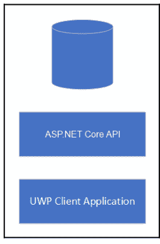

UWP 客户端应用程序将发放给所有员工，这意味着除了对用户进行身份验证外，应用程序还需要防止某些用户访问某些功能。

## 股票检查器应用程序 API

首先，我们将为所有人启用所有功能来创建我们的股票检查器应用程序，然后使用 IdentityServer 将应用程序锁定为仅限经过身份验证的用户，最后，我们将仅为用户启用正确的功能。

### 设置

第一阶段是创建我们的 API。在 .NET Core 中，`ApiController` 的概念被简单的 `Controller` 取代；也就是说，除了返回类型外，提供数据的控制器方法和提供网页的控制器方法之间没有区别。

让我们创建新项目：

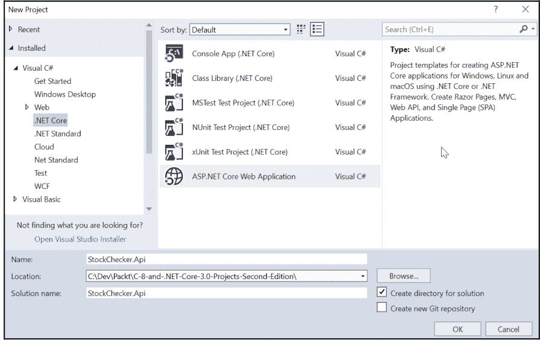

我们将创建一个空应用程序并手动添加 API（面向 .NET Core 3.0）：

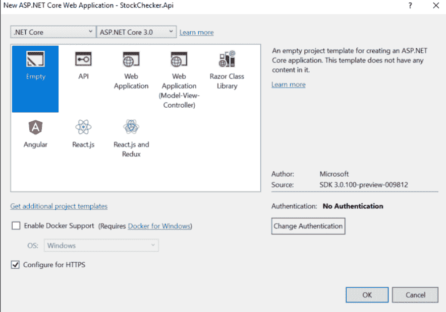

这应该会给你一个基本的 Web 应用程序；现在，我们可以通过添加新控制器来丰富它。

### 添加控制器和路由

在我们的新应用程序中，我们需要创建自己的控制器。让我们看看如何操作：

1. 首先将这些控制器放在名为 `Controllers` 的专用文件夹中：

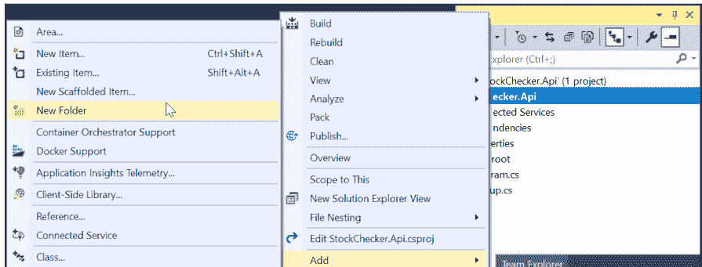

2. 然后，在文件夹中右键单击并选择 `Add` | `Controller...`：

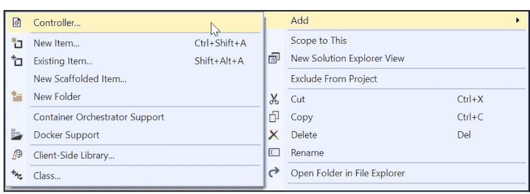


- 3. 您可以让 Visual Studio 为您创建控制器，但同样，让我们亲手来做并选择 **Empty**：

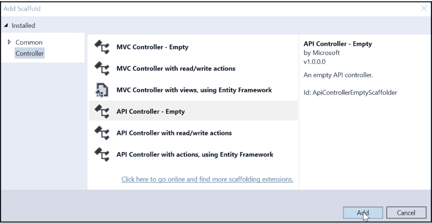

新控制器继承自 `ControllerBase`。之所以这样，是因为 `Controller` 类（它本身继承自 `ControllerBase`）添加了一些仅与 MVC 控制器相关的视图绑定功能。您可以将其更改为继承自 `Controller`，这也能正常工作（虽然您会包含一些不需要的功能）。您会注意到新控制器被装饰为 `ApiController`。同样，这是可选的，但它会为您添加一些基本验证。

因此，您的初始 `controller` 方法应如下所示：

```csharp
[Route("api/[controller]")]
[ApiController]
public class StockController : ControllerBase
{
}
```

- 4. 为了让它运行起来，让我们添加一些非常基本的代码来返回某些内容：

```csharp
[HttpGet]
public string Get()
{
    return "test";
}
```

- 5. 现在，我们需要为控制器添加一些中间件以便能够找到它。在 startup.cs 中，按以下方式更改 ConfigureServices 方法：

```csharp
public void ConfigureServices(IServiceCollection services)
{
    services.AddControllers();
}
```

这是一个扩展方法，它告诉框架您将为 Web API 使用与控制器和控制器映射相关的服务，因此它会添加授权和 CORS 等功能。


在早期版本的 .NET Core 中，您会在此处添加 .UseMvc 或 .UseMvcCore；但是，在 .NET Core 3 中，框架希望您仅添加所需的部分。这意味着您的代码永远不会包含不必要的中间件。很明显，缺点是初始设置 API 时需要做的工作稍微多一些。

- 6. 在 Configure 方法中，告诉应用程序使用我们之前添加的服务：

```csharp
public void Configure(IApplicationBuilder app, IHostingEnvironment env)
{
    if (env.IsDevelopment())
    {
        app.UseDeveloperExceptionPage();
    }

    app.UseRouting();
    app.UseAuthorization();
    app.UseEndpoints(endpoints =>
    {
        endpoints.MapControllers();
    });
}
```

- 7. 现在，您应该能够运行应用程序并导航到控制器；确切地址取决于您的端口，但例如可能如下所示：

https://localhost:44371/api/stock

现在我们有了控制器，可以创建股票功能了。我们有两个需求：检查库存水平和更新库存水平。我们还需要持久化这些信息，因此将使用 EF Core。

## 读取库存水平

让我们看看如何使用 Entity Framework Core 将其持久化到 SQL Server 数据库：

- 1. 因为我们将所有这些持久化到数据库，所以我们将在 API 中安装 Entity Framework Core：

```
Install-Package Microsoft.EntityFrameworkCore.SqlServer
Install-Package Microsoft.EntityFrameworkCore.Tools
```

这会安装所需的 Entity Framework 库和工具。

- 2. 下一步是创建我们的模型；即，在 C# 类中创建数据库的映射。您的模型可能如下所示：

```csharp
public class Product
{
    public int Id { get; set; }
    public string Description { get; set; }
    public int StockCount { get; set; }
}
```

它应该放在应用程序可见的位置。我已将其添加到名为 Models 的子文件夹中。

> **提示**：对于较大的应用程序，将所有数据访问逻辑移至单独的库可能有意义，但由于这是一个非常小的项目，目前可能不值得承担额外的开销。如果您在数据访问和业务逻辑之间保持抽象，那么稍后移动代码应该是一件轻而易举的事。默认情况下，Entity Framework Core 使用任何以 `Id` 结尾的字段来创建主键。在我们的例子中，`Id` 将被视为主键。

数据库性能、索引和键超出了本章和本书的范围；但是，如果您决定扩展此项目，那么对于任何数据量，您很可能需要考虑这些事项。

- 3. 下一步是创建数据上下文。这实际上是一个映射类，用于告诉 EF Core 使用哪些类并将其映射到数据库。目前我们的类需要如下所示：

```csharp
public class StockContext : DbContext
{
    public StockContext(DbContextOptions<StockContext> options)
        : base(options) { }

    public DbSet<Product> Products { get; set; }
}
```

这个类有两个重要部分：声明 `DbSet`，它告诉 Entity Framework Core 我们想要持久化什么，以及它继承自什么，即 `DbContext`（其构造函数）。

- 4. 最后，我们需要告诉 ASP.NET Core 我们想要使用 Entity Framework Core，在哪里找到 `DbContext`，以及在哪里找到数据库。所有这些都位于 `ConfigureServices` 中：

```csharp
public void ConfigureServices(IServiceCollection services)
{
    services.AddMvcCore();

    var connection =
        @"Server=(localdb)\MSSQLLocalDb;Database=StockCheckerDB;Trusted_Connection=True;ConnectRetryCount=0";
    services.AddDbContext<StockContext>(options =>
    options.UseSqlServer(connection));
}
```

> > 您可能希望将连接字符串移到配置文件中，并使用 SQL Server 安全性而不是受信任的连接。

- 5. 既然我们已配置好数据，将创建迁移以更新数据库以反映我们的模型。在包管理器控制台中，键入以下内容：

```
Add-Migration InitialMigration
```

这应该会在您的项目中创建一个名为 Migrations 的新文件夹和两个新文件。如果您快速查看迁移文件，会发现它由两个函数组成：Up（告诉 EF 在正向迁移时做什么）和 Down（应该撤销这些更改）。

> > 虽然这是生成的代码，但它不是持续生成的，这意味着如果您愿意可以对其进行更改。请注意，如果您更改了 Up 但没有更改 Down，可能会发现无法撤销迁移，或者更糟的是，撤销迁移会让您处于一种新状态：既不是新的也不是旧的。

- 6. 下一步是更新数据库（仅运行迁移）：

```
Update-Database
```

既然我们的数据库已存在、可访问且为最新状态，我们需要控制器函数来访问这些数据。

您可以简单地从应用程序中的任何位置访问 DataContext；但是，这会给单元测试带来问题；也就是说，如果控制器函数直接访问数据库，就很难测试功能单元。此外，如果您决定以后将 Entity Framework 替换为另一种数据访问方法，这会使事情变得更加困难。

为了解决这些问题，我们将依赖项注入到控制器中。让我们看看如何做：

- 1. 为了将依赖项注入到控制器中，第一步是将我们的 DbContext 类抽象为一个接口：

```csharp
public interface IDbContext
{
    DbSet<Product> Products { get; set; }
}
```

您可能会疑惑，为什么我们要创建一个接口而不是直接传递类。事实上，这没有什么妨碍；然而，这意味着我们总是需要传入 DbContext 类型的类。创建接口意味着我们可以使用一个虚拟类，甚至一个完全不同的类来替换我们的 DbContext 类，只要它实现相同的接口即可。

这看起来可能像是为了抽象而抽象，但请考虑您将如何为引用此 DbContext 的任何方法编写单元测试。

对于我们的项目，我们将简单地传递 DbContext；但是，最佳实践是完全抽象数据访问，因此您不应传入 DbContext，而是可以传入一个 IDataAccess 类，后者又接受 IDbContext。这意味着，如果您决定将 EF Core 替换为另一个 ORM，只需更改此类的实现即可。

- 2. 既然我们有了接口，就可以将其注入到控制器中：
  `public StockController(IDbContext dbContext)`

如果您使用的是 Visual Studio，在 DbContext 上按 Ctrl+. 将有机会在类中创建并填充字段，从而省去添加类级变量的步骤：

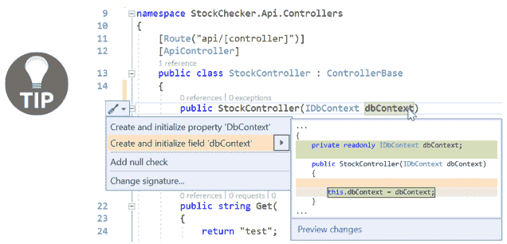

- 3. 最后，当调用 Get 方法时，我们将从数据库返回数据：
  `[HttpGet("{id}")]`
  `public ActionResult<int> Get(int id)`


```
{
    Product product = dbContext.Products.FirstOrDefault(a => a.Id
    == id);
    if (product == null) return NotFound();
    return Ok(product.StockCount);
}
```

您的 StockController 现在应该如下所示：

```
[Route("api/[controller]")]
[ApiController]
public class StockController : ControllerBase
{
    private readonly IDbContext dbContext;

    public StockController(IDbContext dbContext)
    {
        this.dbContext = dbContext;
    }

    [HttpGet("{id}")]
    public int Get(int id)
    {
        Product product = dbContext.Products.FirstOrDefault(a =>
        a.Id == id);
        if (product == null) return NotFound();
        return Ok(product.StockCount);
    }
}
```

- 4. 我们现在已经将一个依赖项注入到控制器中；但是，我们需要某种东西来为我们完成注入。这时 IoC 容器就派上用场了。在 ASP.NET Core 之前，你可能曾使用过类似 Unity 的东西。如果你愿意，仍然可以使用，但 ASP.NET Core 3 自带了一个 IoC 容器：

```
public void ConfigureServices(IServiceCollection services)
{
    services.AddControllers();
}
```

```
var connection =
@"Server=(localdb) \\MSSQLLocalDb;Database=StockCheckerDB;Trusted_Connection=True;ConnectRetryCount=0";
services.AddDbContext<StockContext>
(options => options.UseSqlServer(connection));
services.AddTransient<IDbContext, StockContext>();
}
```

有许多免费的 IoC 容器可供选择。如果你选择使用第三方容器，那么我建议你有使用它的理由；虽然目前某些选项确实提供了内置版本所没有的功能，但你应该考虑该功能是否真的是你需要的。此外，除了实验之外，我不建议你编写自己的 IoC 容器，因为这会让你未来有维护它的责任。

因此，我们现在应该能够运行此代码并获取库存数字；让我们试一下。执行 API；它应该会启动一个浏览器并显示 404 错误（没关系——基地址处没有任何内容）。导航到以下地址：
https://localhost:44371/api/stock/1

你的端口可能不同——如果不同，只需替换为你的端口即可。

你现在应该能够导航到以下地址：
https://localhost:44371/api/stock/1

浏览器应该正确返回库存数字（即 0）。

## 更新库存水平

既然我们可以读取库存水平，现在让我们添加更改它们的功能。既然检索已完成，更新就相对简单；你的 Update 方法应该类似于下面这样：

```
[HttpPut("{id}")]
public IActionResult Update(int id, [FromBody]int stockCount)
{
    Product product = dbContext.Products.FirstOrDefault(a => a.Id == id);
    if (product == null) return NotFound();
    product.StockCount = stockCount;
    dbContext.SaveChanges();
    return NoContent();
}
```

如你所见，代码与检索非常相似；我们只是在 dbContext 上更新库存计数并调用 SaveChanges()。

为了测试此功能，我们需要使用 Postman（如果你尚未安装，请参阅技术要求部分）：

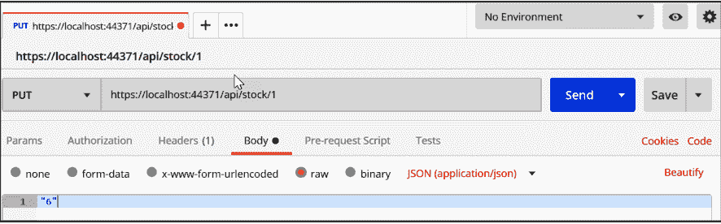

你会发现这将项目 1 的库存水平更新为 6 个数量。你可以通过查看数据库来证明这一点，或者你可以直接导航到端点以检查库存水平（使用 Postman 或浏览器，就像你之前做的那样）。

> 你可能已经注意到，我们没有构建任何添加新产品的功能。这是有意为之；如果你希望作为扩展来做此操作，我强烈建议你考虑它是否适合放在 `Stock` 控制器中，或者是否应该单独处理。

## 权限

目前为止，一切都好。我们现在有了库存检查器应用程序的基本功能；也就是说，它检查库存水平并允许我们更新库存水平。但是，这里存在一个问题。在我们的示例中，任何用户都可以轻松更新库存水平。这可以（而且应该）在客户端上锁定；但是，我们也应该在 API 上实现此安全性；毕竟，访问 Postman，甚至网络浏览器，并非专属，而我们最不希望看到的是未经授权的人更新我们的库存水平。

让我们接入 IdentityServer 4，并确保访问 API 的人至少经过授权。

## 客户端应用程序

在我们引入 IdentityServer 以验证正确的人员和应用程序可以访问 API 之前，我们需要有一个可以说可以合法访问 API 的应用程序；否则，我们最好的办法就是完全阻止访问 API。我们的客户端应用程序将使用 **通用 Windows 平台 (UWP)** 构建。

> UWP 是 Microsoft 构建桌面应用程序的首选方法。WPF 和 WinForms 仍然受支持（如果你阅读过前面的章节，你会发现它们正在焕发新生）。但是，对于新应用程序，建议使用 UWP。事实上，XAML Islands 是连接旧技术和新技术的一种方式。

我们的应用程序将非常简单：我们只想要一个单屏，包含库存水平查找和更新库存水平的选项。

> 我从未声称自己是 UX 设计师，所以如果你觉得你能设计出更好的屏幕，那很可能是因为你能（而且更改屏幕布局不会改变任何功能）！

让我们在解决方案中创建一个新项目：

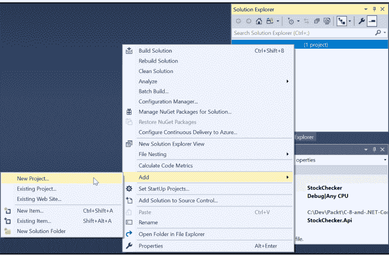

我们的客户端应用程序将是一个 C# UWP 应用程序：

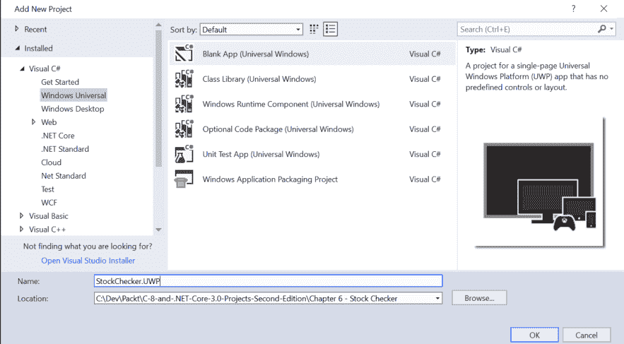

在这个项目中，我们将利用 UWP 的数据绑定功能；但是，说这代表 MVVM 架构是错误的。数据绑定虽然是 MVVM 架构的重要组成部分，但与 MVVM 不等同。对于这个项目，我故意不引入任何 MVVM 框架，以演示项目是如何构建的；但是，除了提供学习机会之外，这实际上是重复造轮子。外面有几个优秀的 MVVM 框架：例如 MVVM Cross 或 MVVM Light。它们都会提供内置的命令、消息传递和依赖注入帮助程序。

UWP 允许你简单地编写事件处理程序；因此，从理论上讲，我们可以处理按钮的点击事件，检查屏幕，然后调用 API。事实上，我们的 UI 层非常小，这可能代表最佳解决方案；但是，我们将使用 UWP 提供的开箱即用的内置数据绑定。这种方法也使解决方案更具可扩展性。

让我们先创建一个 `ViewModels` 文件夹，并为我们的主视图添加一个 `ViewModel`：

```
public class MainPageViewModel : INotifyPropertyChanged
```

我们稍后将解释为什么实现这个特定的接口。ViewModel 的目的是在代码中提供视图的表示：也就是说，所有功能，但没有任何视觉元素。

> 你可以随意命名 ViewModel；但是，如果你选择使用特定的 MVVM 框架，其中一些框架采用约定，即 ViewModel 应该与 View 具有相同的词干；例如，`MainPageView`/`MainPageViewModel`。

我们在 ViewModel 中首先要声明的是我们将显示和更新的字段；在我们的案例中，我们实际上只显示两个：

```
private int _productId;
private int _quantity;
private int _originalQuantity;

public int ProductId
{
    get => _productId;
    set
    {
        if (UpdateField(ref _productId, value))
        {
            RefreshQuantity();
        }
    }
}

public int Quantity
{
    get => _quantity;
    set
    {
        if (UpdateField(ref _quantity, value))
        {
            UpdateQuantity.RaiseCanExecuteChanged();
        }
    }
}
```


显然，我们正在引用一些此处不存在的方法；`UpdateField` 只是一个辅助方法，省去了我们重写检查字段是否已更改以及需要在何处调用 `OnPropertyChanged` 的工作（稍后会详细介绍）：

```csharp
private bool UpdateField<T>(ref T field, T value,
    [CallerMemberName] string propertyName = null)
{
    if (EqualityComparer<T>.Default.Equals(field, value))
    {
        return false;
    }

    field = value;

    OnPropertyChanged(propertyName);
    return true;
}
```

## OnPropertyChanged

XAML 的工作原理是在需要时重新渲染屏幕。对于 WPF 和 UWP，这意味着我们需要告知它某些内容已更改，我们通过实现 `INotifyPropertyChanged` 接口上的名为 `OnPropertyChanged` 的方法来做到这一点：

```csharp
public void OnPropertyChanged([CallerMemberName] string propertyName =
    null)
{
    this.PropertyChanged(this, new PropertyChangedEventArgs(propertyName));
}
```

调用此方法时，它会重新渲染屏幕中绑定到所传递属性的部分。


`CallerMemberName` 早在 .NET 4.5 中就已引入，它允许你在设计时无需显式定义即可引用调用者的名称。也就是说，如果我们更改了某个属性的名称，`CallerMemberName` 只会获取新名称。

## Commands and API calls

既然我们有了属性，就需要引入两个功能：更新库存数量的功能和获取库存数量的功能。我们已经引用了后者，因此先添加它：

```csharp
private async Task RefreshQuantity()
{
    Quantity = await _httpClientHelper.GetQuantityAsync(ProductId);
    _originalQuantity = Quantity;
    UpdateQuantity.RaiseCanExecuteChanged();
}
```

同样，我们显然在引用一些尚不存在的代码，但让我们来看看我们看到的内容：我们只是在调用 API，将数量值赋给我们的属性，然后设置 `_originalQuantity` 字段。`_originalQuantity` 字段和 `RaiseCanExecuteChanged` 密切相关，我们很快就会明白原因。不过在此之前，让我们先看看 `_httpClientHelper` 来自哪里。我们将在此处添加构造函数和字段定义：

```csharp
private readonly IHttpStockClientHelper _httpClientHelper;
public RelayCommand UpdateQuantity { get; set; }

public MainPageViewModel(IHttpStockClientHelper httpClientHelper)
{
    _httpClientHelper = httpClientHelper;
    UpdateQuantity = new RelayCommand(async () =>
    {
        await _httpClientHelper.UpdateQuantityAsync(
            ProductId, Quantity);
        await RefreshQuantity();
    }, () => Quantity != _originalQuantity);
}
```

这里有很多内容。同样，我请你暂时先放下关于这些接口和变量类型用途的问题，先看看我们看到的内容：我们正在注入之前看到的帮助类，并实例化一个 RelayCommand，它显然只接受一个操作（要做的事）和一个函数（要评估的内容）。

这代表了 ViewModel 的所有代码，因此让我们来看看帮助类。

## Helper classes

我们在这里使用了两个帮助类；第一个是 RelayCommand。任何绑定到 XAML 前端的命令都必须实现 ICommand。实现 ICommand 是一件简单的事情：你只需告诉它执行时要做什么，以及允许执行的条件即可。然而，这确实意味着你会为每个命令创建一个单独的类，并且使从 ViewModel 传递功能变得更加困难。因此，解决方案是通用地实现一个帮助类，它只需接受操作和评估函数，并为你实现 ICommand。它看起来像这样：

```csharp
public class RelayCommand : ICommand
{
    private readonly Action _execute;
    private readonly Func<bool> _canExecute;
    public event EventHandler CanExecuteChanged;

    public RelayCommand(Action execute) : this(execute, null)
    {
    }

    public RelayCommand(Action execute, Func<bool> canExecute)
    {
        _execute = execute ?? throw new ArgumentNullException("execute");
        _canExecute = canExecute;
    }

    public bool CanExecute(object parameter)
    {
        return _canExecute == null ? true : _canExecute();
    }

    public void Execute(object parameter)
    {
        _execute();
    }

    public void RaiseCanExecuteChanged()
    {
        CanExecuteChanged?.Invoke(this, EventArgs.Empty);
    }
}
```

这有很多开源版本可用，其中不乏来自微软自己的版本。所有实现基本都一样；不过，如果你决定自己使用它，可能会发现它需要一些定制；例如，添加一些日志会非常有用！据我所知，所有 MVVM 框架都提供了一个版本，其功能可能比你自己编写的要丰富得多。


我们的第二个帮助类是 HttpClientHelper。让我们来看看代码。然后，我们可以讨论它的作用以及，更重要的是，为什么需要将其放入单独的类中：

```csharp
public class HttpClientHelper : IHttpStockClientHelper
{
    static HttpClient _httpClient;

    public HttpClientHelper(Uri baseAddress)
    {
        _httpClient = new HttpClient();
        _httpClient.BaseAddress = baseAddress;
    }

    public async Task<int> GetQuantityAsync(int productId)
    {
        string path = $"api/stock/{productId}";
        string quantityString = await _httpClient.GetStringAsync(path);
        return int.Parse(quantityString);
    }

    public async Task UpdateQuantityAsync(int productId, int newQuantity)
    {
        string path = $"api/stock/{productId}";
        var httpContent = new StringContent(newQuantity.ToString());
        httpContent.Headers.ContentType = new MediaTypeHeaderValue("application/json");

        await _httpClient.PutAsync(path, httpContent);
    }
}
```

如你所见，我们有两个公共方法和一个构造函数。由于我们调用的是同一服务，可以在构造函数中配置所有内容。如你所见，我们只是为 `GetQuantityAsync` 使用 `HttpGet`，为 `UpdateQuantityAsync` 使用 `HttpPut` 来调用服务。

值得注意的是，这两个方法都进行了一些类型转换：帮助方法暴露你期望的功能是合理的；例如，*将产品数量更新为 3*。在这里，你只需要两个参数：产品和数量。如果你传入或传出任何其他内容，那么你就在制造噪音，一旦出现 bug，你（或其他人）可能不得不筛选这些内容。

因此，减少噪音是拥有这个帮助类的第一个原因。第二个原因是，如果我们需要对调用代码进行单元测试，可以轻松模拟对服务的调用。

我们现在有了一个可运行的桌面应用程序，因此让我们继续保护功能。我们可以从 IdentityServer 开始。

## IdentityServer 4

如前所述，IdentityServer 不是一个预构建的服务，而是一个框架。这类服务确实存在——Google、Twitter、Facebook、Microsoft 等都提供预构建的服务，你可以简单地调用并获取身份。IdentityServer 更多的是一种自建解决方案。


值得考虑的是，你为什么可能会选择以这种方式自建。在我们的示例中，一个要求是离线访问，因此这确实增加了论点的分量——如果你不在线，就无法使用 Facebook 进行身份验证。同样值得考虑的是，你是否希望将用户身份验证外包给第三方。我绝不是说这些服务不可靠或不安全，但它们由公司运营。如果你围绕 Facebook 身份验证构建整个应用程序，而它们出于某种原因突然撤销服务，那你将面临什么情况？


让我们先创建我们的IdentityServer，它可以只是一个标准的ASP.NET Core Web应用程序：

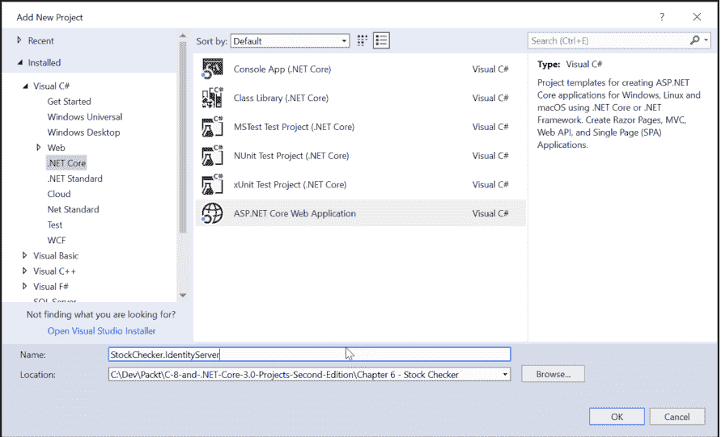

同样，我们将创建一个空应用程序，以便我们可以清楚地看到这是如何构建的。

> 除非另有说明，本节中的所有说明都与您刚刚创建的新（IdentityServer）项目相关。

在包管理器控制台中，我们将安装IdentityServer4包：

```
Install-Package IdentityServer4 -ProjectName StockChecker.IdentityServer
```

> 如果您决定将项目命名为与我不同的名称，那么您需要更改前面的项目名称。

在Startup.cs中，我们需要添加IdentityServer：

```
public void ConfigureServices(IServiceCollection services)
{
    services
        .AddIdentityServer()
        .AddDeveloperSigningCredential();
}
```

这里我们做了两件事：我们将IdentityServer添加到**依赖注入（DI）**系统中，并添加了一些临时凭据。

我们稍后会再回来，添加一些（更多）有效的凭据，但这将让我们运行起来。

接下来，我们需要将IdentityServer注册到ASP.NET Core中间件管道中：

```
public void Configure(IApplicationBuilder app, IHostingEnvironment env)
{
    if (env.IsDevelopment())
    {
        app.UseDeveloperExceptionPage();
    }

    app.UseIdentityServer();
}
```

为了让IdentityServer运行，我们需要更改的最后一件事是告诉它将请求信息的是什么；这可以在ConfigureServices（在Startup.cs中）中完成：

```
public void ConfigureServices(IServiceCollection services)
{
    services
        .AddIdentityServer()
        .AddDeveloperSigningCredential()
        .AddInMemoryClients(new List<Client>())
        .AddInMemoryIdentityResources(new List<IdentityResource>());
}
```

显然，这在现阶段不会让我们实际对任何东西进行身份验证。本质上，为了正常运行，IdentityServer需要知道三件事：

- 谁需要访问（用户）
- 他们需要访问什么（资源）
- 他们将如何获得访问权限（客户端）

> IdentityServer提供帮助程序方法，例如`AddInMemoryClients`，作为入门方式。在将来的某个阶段，可能需要添加其他客户端或资源，并且可以轻松重构，以便将每个列表持久化到数据存储中。

## IdentityServer

目前，我们有一个运行中的身份服务器；但是，我们可以在没有任何凭据的情况下运行客户端并使用我们的应用程序。在将资源、客户端或用户添加到身份服务器之前，下一步是让它拒绝我们进入（因为我们还没有设置任何这些内容）。

## 保护 API

为了保护API，我们只需要做两件事（其中两者都不需要IdentityServer——并且其中一项已经为我们完成！）。首先，我们需要告诉ASP.NET Core我们想要使用授权。在我们的启动文件中，我们已经在调用`AddControllers`。因为ASP.NET Core现在是开源的，我们可以简单地查看它为我们做了什么：

```
```csharp
private static IMvcCoreBuilder AddControllersCore(IServiceCollection services)
{
    return services
        .AddMvcCore()
        .AddApiExplorer()
        .AddAuthorization()
        .AddCors()
        .AddDataAnnotations()
        .AddFormatterMappings();
}
```
```

> 许多Microsoft产品（尤其是.NET Core产品）中的常见做法是使用**生成器模式**来允许配置中间件。该模式的前提很简单：方法执行一个操作，然后返回对其进行调用的对象的引用。这允许更易于人类阅读的代码流（如前面的代码所示）。

这里的相关行是AddAuthorization。接下来我们需要做的是告诉ASP.NET Core我们想要保护什么。在控制器中，添加以下装饰器：

```
[Authorize]
[Route("api/[controller]")]
[ApiController]
public class StockController : ControllerBase
{
```

现在，如果您尝试访问API，将会收到错误。好吧；现在我们完全无法访问API；让我们插入IdentityServer代码。这里的原理很简单：我们将从我们的IdentityServer请求一个令牌，该令牌将允许我们访问我们的API。在我们的API中，我们将安装一个IdentityServer包：

```
Install-Package IdentityServer4.AccessTokenValidation -ProjectName StockChecker.Api
```

严格来说，您可以通过添加JWTBearer身份验证来完全不使用IdentityServer完成这部分。但是，使用IdentityServer确实会在此处为您提供某些优势，而且，既然我们已经在使用IdentityServer，为解决方案的一部分重新造轮子真的没有多大意义。

在我们的API中，我们将在ConfigureServices中需要以下代码：

```
public void ConfigureServices(IServiceCollection services)
{
    services.AddControllers();

    services.AddAuthentication(IdentityServerAuthenticationDefaults.AuthenticationScheme)
        .AddIdentityServerAuthentication(options =>
        {
        // Base-address of our IdentityServer
        // (if you haven't purposely changed it then this is likely correct)
        options.Authority = "https://localhost:5001";

        // Name of the API resource
        options.ApiName = "StockCheckerApi";
        });
```

我们将身份验证添加到管道中：

```
public void Configure(IApplicationBuilder app, IHostingEnvironment env)
{
    if (env.IsDevelopment())
    {
        app.UseDeveloperExceptionPage();
    }

    app.UseAuthentication();

    app.UseRouting();
    app.UseAuthorization();
    app.UseEndpoints(endpoints =>
    {
        endpoints.MapControllers();
    });
}
```

## 客户端配置

我明白本章的流程可能看起来有点杂乱，但实际上，其中经过了深思熟虑。我们首先保护了API，这意味着我们已经保护了我们的资源。接下来我们要做的是更改客户端，以便它获取令牌并正确调用API（就是本节）；显然，这目前还无法工作，因为我们还没有更改我们的IdentityServer。在下一节中，我们将更改IdentityServer，我们应该看到一切突然生机勃勃。之所以按此顺序进行，是因为我经常发现，如果先看到它不工作，那么更容易理解某事是如何工作的（否则，你其实不知道自己做对了什么）。

在我们的UWP应用程序中，我们将需要另一个NuGet包：

```
Install-Package IdentityModel -ProjectName StockChecker.UWP
```

UWP应用程序（或一般的桌面应用程序）与Web应用程序在两个重要方面不同：首先，在Web应用程序中，您必须处理这样一个事实，即用户可以简单地在应用程序中导航到任何位置。例如，用户可以简单地将登录屏幕上的地址栏更改为以下内容：

https://www.mysecurisite.com/products/stock/1

因此，在保护Web应用程序时，您不能依赖屏幕的预期流程；但是，在桌面应用程序中，您可以。

第二个考虑是，用户在其桌面上拥有桌面应用程序的代码。我们正在使用.NET，这意味着逆向工程代码是一件非常简单的事情；但是，据我所知，没有哪种语言在有人足够决心的情况下不能在某种程度上被逆向工程。

这里的要点是，我们可以指望用户进入登录屏幕，并且只需很少的努力就能让他们留在那里，但我们绝不应该在客户端设备上存储任何可能允许用户访问服务器的内容。

## 登录屏幕

让我们创建一个新的登录屏幕；我将我的页面命名为LoginView。以下代码放在`<Page>`元素内：

```
<Grid HorizontalAlignment="Center" VerticalAlignment="Center">
    <Grid.RowDefinitions>
        <RowDefinition Height="Auto" />
        <RowDefinition Height="Auto" />
        <RowDefinition Height="Auto" />
    </Grid.RowDefinitions>
    <Grid.ColumnDefinitions>
        <ColumnDefinition Width="Auto" MinWidth="200" />
        <ColumnDefinition Width="Auto" MinWidth="200" />
    </Grid.ColumnDefinitions>
    <TextBlock Text="Username" Margin="5"
        Grid.Row="0" Grid.Column="0" />
    <TextBlock Text="Password" Margin="5"
        Grid.Row="1" Grid.Column="0" />
    <TextBox Text="{Binding Username, Mode=TwoWay,
        UpdateSourceTrigger=PropertyChanged}" Margin="5"
        Grid.Row="0" Grid.Column="1" />
    <PasswordBox Password="{Binding Password, Mode=TwoWay,
        UpdateSourceTrigger=PropertyChanged}" Margin="5"
        Grid.Row="1" Grid.Column="1" />
    <Button Grid.Row="2" Grid.Column="0" Grid.ColumnSpan="2"
        HorizontalAlignment="Center" Margin="5"
        Command="{Binding LoginCommand}">Login</Button>
</Grid>
```

这里有相当多的代码，但其中大部分只是语法（XAML像其父级XML一样相当冗长）。正如您所见，我们在这里使用数据绑定，就像我们之前做的那样。表单上只有一个按钮（因为用户要么登录，要么关闭应用程序）。

在这个阶段，我们还没有设置绑定或任何功能，因此视图将什么也不做。我们还需要告诉UWP应用程序启动到这个视图，而不是我们之前在App.xaml.cs（在OnLaunched方法中）创建的主视图：

```
if (e.PrelaunchActivated == false)
{
    if (rootFrame.Content == null)
    {
```


```
// When the navigation stack isn't restored
// navigate to the first page,
// configuring the new page by passing required
// information as a navigation parameter
rootFrame.Navigate(typeof(LoginView), e.Arguments);
}
// Ensure the current window is active
Window.Current.Activate();
}
```

我们在此处更改代码，而不是添加任何内容。事实上，唯一实际的更改是 LoginView 的文本（假设你将视图命名得和我一样）。

让我们来创建 ViewModel。我们将从与主视图使用的相同样板代码开始：

```
public class LoginViewModel : INotifyPropertyChanged
{
    public event PropertyChangedEventHandler PropertyChanged;
    private bool UpdateField<T>(ref T field, T value,
        [CallerMemberName] string propertyName = null)
    {
        if (EqualityComparer<T>.Default.Equals(field, value)) return false;
        field = value;
        OnPropertyChanged(propertyName);
        return true;
    }

    public void OnPropertyChanged([CallerMemberName] string propertyName = null)
    {
        this.PropertyChanged(this, new
            PropertyChangedEventArgs(propertyName));
    }
}
```

如果这是一个生产应用程序，这两个类应该继承自一个共享的基础 ViewModel。如果你选择扩展此应用程序，我强烈建议你从那里开始。

接下来我们需要一些新属性来反映用户名和密码：

```
private string _username;

public string Username
{
    get => _username;
    set
    {
        UpdateField(ref _username, value);
    }
}

private string _password;

public string Password
{
    get => _password;
    set
    {
        UpdateField(ref _password, value);
    }
}
```

我们需要的最后两件事是 LoginCommand 的连接和数据上下文设置；让我们先从 LoginCommand 开始：

```
public LoginViewModel()
{
    LoginCommand = new RelayCommand(() =>
    {
        DoLogin();
    });
}
```

```
private void DoLogin()
{
    throw new NotImplementedException();
}
```

```
public RelayCommand LoginCommand { get; set; }
```

让我们设置数据上下文。然后，我们应该能够在登录屏幕上看到除了实际登录之外的一切（在 LoginView.xaml.cs 中）：

```
public LoginView()
{
    this.InitializeComponent();
    ViewModel = new LoginViewModel();
    DataContext = ViewModel;
}
```

```
public LoginViewModel ViewModel { get; set; }
```

运行此代码应在启动时显示 **登录** 屏幕，允许你输入用户名和密码，然后在你按下 `Login` 按钮时抛出 `Not Implemented` 异常。现在，我们可以调用 IdentityServer，获取我们的令牌，并访问 API。

## 调用 IdentityServer

调用 IdentityServer 其实只是填充我们在登录按钮后面创建的命令的问题。让我们在 `LoginViewModel` 中更改我们的命令，使其看起来更像这样：

```csharp
public LoginViewModel(IHttpStockClientHelper httpStockClientHelper)
{
    _httpStockClientHelper = httpStockClientHelper;
    LoginCommand = new RelayCommand(() =>
    {
        DoLogin();
    });
}

private async Task DoLogin()
{
    bool loggedIn = await _httpStockClientHelper.Login(Username, Password);
    if (loggedIn)
    {
        var frame = Window.Current.Content as Frame;
        frame.Navigate(typeof(MainPage), null);
    }
}
```

> 我们正在从同步方法中调用 `async` 方法。其效果是代码不会等待操作的结果。如果你决定扩展此应用程序，添加一个 `RelayCommandAsync` 将是一个很好的补充；然而，这将满足我们的特定目的。

正如你所见，我们现在正在调用一个尚不存在的新帮助器方法，并传入用户名和密码；一旦我们确定登录成功，就可以导航到该屏幕。

> 你可能注意到，当我编写代码时，很多时候我会引用尚不存在的方法，然后再创建它们。如果你实践 **测试驱动开发**（TDD），你会逐渐习惯这种工作方式。这样做的好处是你不会最终为永远不会使用的大量基础设施代码进行脚手架搭建。

我们现在只需要编写我们的登录帮助器方法。如果你使用 Ctrl-. 创建存根，它应该为你在 IHttpClientHelper.cs 中创建一个接口定义：

```
Task<bool> Login(string username, string password);
```

新方法（在 HttpClientHelper 中）将如下所示：

```
private static string _accessToken;

public async Task<bool> Login(string username, string password)
{
    var disco = await _httpClient.GetDiscoveryDocumentAsync(new
    DiscoveryDocumentRequest
    {
        Address = "https://localhost:5001"
    });

    var response = await _httpClient.RequestPasswordTokenAsync(new
    PasswordTokenRequest
    {
        Address = disco.TokenEndpoint,
        ClientId = "StockChecker",
        ClientSecret = "secret",
        Scope = "StockCheckerApi",
        UserName = username,
        Password = password
    });

    if (response.IsError)
    {
        // ToDo: Log error
        return false;
    }

    _accessToken = response.AccessToken;
    return true;
}
```

这里有不少内容，所以让我们逐行分析。但是在此之前，你可能已经输入了这段代码，并意识到其中一些方法（例如，RequestPasswordTokenAsync）并不存在于 HttpClient 对象上。这些是由 IdentityModel.Client 库添加的扩展方法，所以请确保你已在文件顶部添加了对此的 using 语句。

首先要注意的是，我们有一个令牌，我们将其保存在类中。虽然我们现在没有使用它，但我们稍后会需要它来调用 API（这意味着我们很快就会重新查看此文件）。

我们在这里所做的，实际上是一个三步过程；步骤一是从 IdentityServer 获取令牌端点。发现文档是 OpenID 规范的一部分，就是如此：一份告诉你身份验证服务器所有资源位置的文档；它始终位于相同的（相对）位置，因此你可以去查看大型身份提供商（例如 Microsoft、Google 和 Twitter）的发现文档；它始终位于此处：

```
https://baseaddress/.well-known/openid-configuration
```

GetDiscoveryDocumentAsync 为我们提供了一个良好的包装器，以便我们可以拆解此文档而无需解析 JSON。我们给了它基地址——暂时就这些。如果你选择扩展程序，你可能会发现需要重新访问此处并设置 Policy 变量。

下一步是从我们刚刚获得的端点请求令牌。为此，我们必须提供有效凭据。我们现在不会讨论这些设置，因为我们需要回到 IdentityServer 本身中讨论它们。目前，重要的是要注意的是，我们正在传递用户名和密码。

最后，如果一切正常，我们将缓存令牌并返回一个指示成功的标志。

## 功能

UWP 应用程序作为受信任的应用程序分发。这意味着它们所做的任何事情都必须清晰；也就是说，你需要告诉应用程序你需要访问什么以及你需要什么权限。这与身份权限无关，但我们需要告诉应用程序它可以访问 localhost（显然，仅在开发期间），我们可以使用证书，等等。所有这些都在 `Package.appxmanifest` 文件中实现。如果你在 Visual Studio 中双击它，你将获得一个允许你选择资产、功能、声明等的用户界面；超出本章范围来讨论这里发现的所有内容，但你需要添加三个功能：

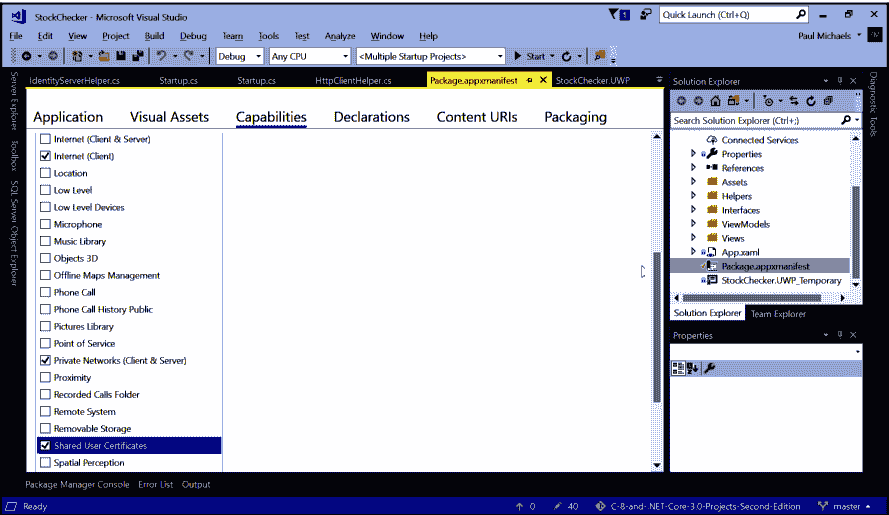

现在一切都已准备就绪，我们可以正确配置 IdentityServer 并使整个登录系统运行起来。

## 设置 IdentityServer

设置 IdentityServer 通常是这个拼图的第一部分；然而，我认为当你先插入其他部分时，这更能说明一切是如何工作的。

为了设置 IdentityServer，我们需要了解三个概念，并且我们已经简要地接触过它们：

- 用户（谁可以访问资源 – 在我们的示例中，Lucy 将是一个用户）
- 资源（他们希望访问的资源 – 我们的资源是我们的 API）
- 客户端（用户尝试访问系统的方法 – 在我们的情况中，这是我们的 UWP 应用程序）

为了正常运行，IdentityServer 需要获得每个项目的有效列表。通常，尤其是对于用户，你会将其链接到数据库；但是，为了简单起见，我们将简单地告诉系统每个项目是什么。


在我们的 IdentityServer services.cs 文件中，我们已经有了这个：

```csharp
public void ConfigureServices(IServiceCollection services)
{
    services
        .AddIdentityServer()
        .AddDeveloperSigningCredential()
        .AddInMemoryClients(new List<Client>())
        .AddInMemoryIdentityResources(new List<IdentityResource>());
}
```

我们已经向 IdentityServer 告知了我们的客户端列表，那么让我们来介绍另外两个概念：

```csharp
public void ConfigureServices(IServiceCollection services)
{
    services
        .AddIdentityServer()
        .AddDeveloperSigningCredential()
        .AddInMemoryClients(IdentityServerHelper.GetClients())
        .AddInMemoryApiResources(IdentityServerHelper.GetApiResources())
        .AddTestUsers(IdentityServerHelper.GetUsers())
        .AddInMemoryIdentityResources(new List<IdentityResource>());
}
```

现在，我们已经介绍了三个概念。如日渐成为标准，我们使用了一些尚未存在的方法（和一个类）。

> 给用户添加方法并非偶然命名为 AddTestUsers。虽然我们在这里所做的可以工作，但它不够可扩展，在系统中为用户定义数据存储应该是扩展此项目的优先事项之一。

我们的第一个方法将是添加客户端：

```csharp
public static class IdentityServerHelper
{
    internal static IEnumerable<Client> GetClients()
    {
        var clients = new List<Client>
        {
            new Client
            {
                ClientId = "StockChecker",
                AllowedGrantTypes = GrantTypes.ResourceOwnerPassword,
                ClientSecrets =
                {
                    new Secret("secret".Sha256())
                },
                AllowedScopes = { "StockCheckerApi" }
            }
        };
        return clients;
    }
}
```

请记住，我们说过客户端是你访问资源的方式。在我们的例子中，我们的客户端是我们的 UWP 应用程序；不过，它也可以是 Web 应用程序、控制台应用程序，甚至是用 Python 或 Go 编写的应用程序——它不必是 .NET。

你会从客户端中识别出客户端 ID 和客户端秘密（通常，你会先设置服务器，然后将该信息用于客户端，而不是反过来，就像我们在这里所做的那样）。

我们已设置授权类型——我们稍后会回到这一点并更详细地讨论它——并且我们已设置范围。范围告诉 IdentityServer 此客户端被允许做什么。这意味着你可以有多个客户端登录到系统，并纯粹基于客户端来限制访问。

接下来，我们将向同一个类添加资源：

```csharp
internal static IEnumerable<ApiResource> GetApiResources()
{
    var resources = new List<ApiResource>()
    {
        new ApiResource("StockCheckerApi", "Stock Checker API")
    };
    return resources;
}
```

这里的资源和客户端内的范围是同一概念，只是角度不同。这是服务器提供访问权限的所有资源的综合列表，而客户端则指定它需要其中的哪些资源。

最后，在同一个类中，我们将添加用户：

```csharp
internal static List<TestUser> GetUsers()
{
    var users = new List<TestUser>()
    {
        new TestUser
        {
            SubjectId = "1",
            Username = "Lucy",
            Password = "password123"
        },
        new TestUser
        {
            SubjectId = "2",
            Username = "Morris",
            Password = "password123"
        },
        new TestUser
        {
            SubjectId = "3",
            Username = "Graham",
            Password = "password123"
        }
    };
    return users;
}
```

在本章开头，我们给出了一个场景，公司需要考虑四个不同的人，如你所见，这里有三个用户。如果你回去看，你会发现实际上缺少的是 Sam。Sam 不为公司工作，她是一位客户，因此不需要访问系统。然而，她是一个重要的概念；也就是说，一个间接与系统交互但不需要访问权限的用户。

如果你正在考虑扩展此项目，那么你可以考虑这一点：作为客户，Sam 可能喜欢访问 Web 门户，而不是 UWP 应用程序。因此，除了我们前面提到的适当用户存储之外，你还需要创建一个网站并将其作为客户端添加。

好的，这样我们的设置就完成了。如果你现在运行所有三个项目，你应该能够输入 Lucy 的凭据（她的密码是 password123）并让她登录。

此外，如果例如你尝试密码 password1，你还应该能看到它们被拒绝登录。

## 调用 API

现在你可以登录了；但是，如果你尝试访问任何资源，你会发现系统抛出异常。原因是我们保护了 API，这意味着当我们调用 API 时，需要传递一个持有者令牌来证明我们就是我们自称的那个人。

在 `HttpClientHelper.cs` 内，我们可以简单地添加一个方法调用来传递持有者令牌：

```csharp
public async Task<int> GetQuantityAsync(int productId)
{
    string path = $"/api/stock/{productId}";
    _httpClient.SetBearerToken(_accessToken);
    string quantityString = await _httpClient.GetStringAsync(path);
    return int.Parse(quantityString);
}
```

最后，我们可以为更新方法添加类似的行，我们的 API 应该就能安全地工作了：

```csharp
public async Task UpdateQuantityAsync(int productId, int newQuantity)
{
    string path = $"/api/stock/{productId}";
    _httpClient.SetBearerToken(_accessToken);
    var httpContent = new StringContent(newQuantity.ToString());
    httpContent.Headers.ContentType = new MediaTypeHeaderValue("application/json");
    await _httpClient.PutAsync(path, httpContent);
}
```

因此，我们的身份系统现在验证用户在我们系统中是有效的。不过，我们仍有一个问题：我们的用户可以访问系统的所有功能。我们需要加以限制，我们会这么做，但首先让我们先处理几个悬而未决的问题。

## 授权类型

我们首先要处理的悬而未决的问题是授权类型。我们不会更改它，但我们将调查为什么应该更改（或至少为什么应该考虑更改它）。我们正在使用的授权类型是 Resource Owner Password；它让我们能够捕获用户的用户名和密码，然后连同一个密钥一起发送到 IdentityServer。然后我们会收到一个令牌，并可以使用该令牌与我们的资源进行通信。在我们的例子中，资源是一个 API。这是一个 *在某种程度上* 安全的系统。

让我们戴上黑帽，思考一下我们如何可能攻破这样的系统。请记住，我们处理的是桌面软件，在 .NET 的情况下，如前所述，逆向工程 .NET 程序集或可执行文件非常容易。我们将秘密存储在编译后的代码中，因此攻击者可以访问该秘密。诚然，没有用户名和密码，这也无法获得任何访问权限。

这种授权类型的进一步问题是，如果我们引入第二个访问点（假设我们决定为建筑工人 Sam 开发一个 Web 门户——如果你忘了她是谁，请参阅上一节），我们需要创建另一个屏幕来接受用户名和密码。

那么，解决方案是什么？

嗯，绕过这个问题的一种方法是在桌面应用程序内托管一个网页。这样，即使我们在桌面上，处理安全性的代码也托管在服务器上。Windows 10 为此目的提供了一个 **Web 身份验证代理**。

在处理安全问题时，应始终记住，不存在 _绝对安全_ 的事情。总有办法进入系统——无论你把系统锁得多么严密，总是有可能进入：你可以把它想象成保护你的房子。不同的房子有不同级别的安全性：你的房子可能有一扇门——仅仅关上门比大门洞开更安全；锁上门则更安全；有多把锁更安全；加固的门则更安全。然而，银行有金库，配有几十把锁和钥匙、保安、警报等等，然而如果我告诉你有人抢劫了银行，你不会认为这是件独特的事情。

因此，安全是一种权衡：你试图保护的东西有多有价值（如果你的系统被攻破，最坏的结果是什么？），如果你实施该防护，系统有多易用，以及增加该防护的成本有多高？

在我们的例子中，由于我们有非常具体且有限的要求，我们将保持授权类型不变。不过，如果你希望改进这个系统，这是一个极佳的扩展点。

## 创建和使用有效密钥

最后一个悬而未决的问题是我们的密钥。我们目前正在使用开发密钥。在编写软件期间，这工作得很好，但我们显然需要在发布系统之前生成一个真正的密钥。虽然生成生产证书超出了本章的范围，但我们将简要介绍如何生成和使用自签名证书。

此解决方案不用于生产环境。在部署到生产环境之前，你应该从证书提供商处获取证书。有几家这样的提供商，其中一些（据我所知至少有一家）提供免费证书。


为了生成我们的证书，让我们来生成它。首先启动 Windows PowerShell（确保以管理员身份运行），并输入以下命令：

```
> New-SelfSignedCertificate -Subject "CN=testcert" -KeySpec "Signature" - 
CertStoreLocation "Cert:\CurrentUser\My"
```

这将在您的证书存储中生成一个个人证书。生成后，它会给出一个拇印 – 请记下该值，因为几分钟后您将需要它：

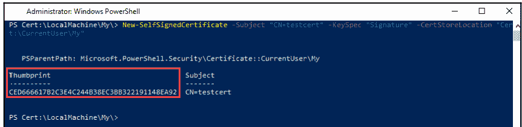

如果您希望查看它，可以轻松做到。如果您运行的是 Windows 10，请按 Windows 键并键入以下内容：

```
mmc.exe
```

这应该会打开管理控制台。在这里，您可以选择“个人”存储并查看所有证书：

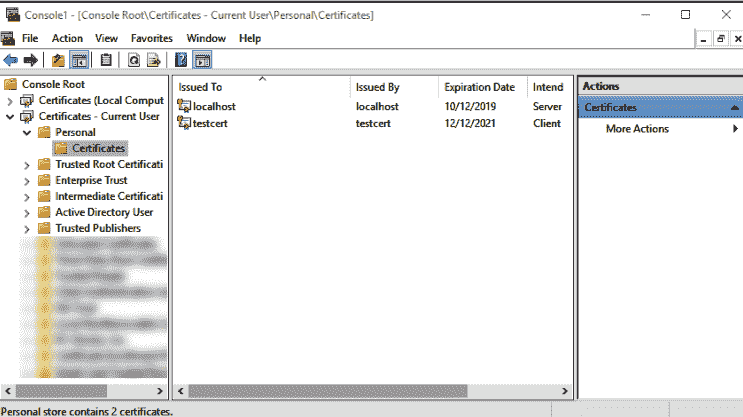

我们需要对代码进行微小更改。在 IdentityServer 的 startup.cs 文件中，更改 ConfigureServices 方法，使其如下所示：

```
public void ConfigureServices(IServiceCollection services)
{
    X509Certificate2 x509Certificate2 = null;
    using (var certStore = new X509Store(StoreName.My,
    StoreLocation.CurrentUser))
    {
        certStore.Open(OpenFlags.ReadOnly);
        var certCollection = certStore.Certificates.Find(
        X509FindType.FindByThumbprint,
        "CED666617B2C3E4C244B38EC3BB322191148EA92", // Thumbprint
        false);
        if (certCollection.Count == 0)
        throw new Exception("No certificate found");
        x509Certificate2 = certCollection[0];
    }
    services
    .AddIdentityServer()
    //.AddDeveloperSigningCredential()
    .AddSigningCredential(cert)
    .AddInMemoryClients(IdentityServerHelper.GetClients())
    .AddInMemoryApiResources(IdentityServerHelper.GetApiResources())
    .AddTestUsers(IdentityServerHelper.GetUsers())
    .AddInMemoryIdentityResources(new List<IdentityResource>());
}
```

如您所见，我们正在证书存储中查找之前记下的拇印。如果找不到任何内容，我们就会直接崩溃（这比后续出错更可取）。最后，我们将 AddDeveloperSigningCredential 更改为普通的 AddSigningCredential，并将我们的证书传递给它。虽然该证书不适合生产环境，但这更接近生产代码。

现在，我们将看看如何检查用户的凭据，以允许他们访问应用程序的不同部分。

## 授权

授权是在用户身份验证后应用于用户的策略。也就是说，我们现在知道用户是谁：至少我们知道他们拥有有效的用户名和密码，并且正在使用经过批准的客户端。下一阶段是确保每个用户只能访问系统的正确部分。

这些权限中的一些可能不完全现实，但它们确实具有覆盖各种可能性的优势。关于 PolicyServer 的简要说明：PolicyServer（可在此处找到：https://policyserver.io/）是一个框架，由创建 IdentityServer 的同一批人编写。它提供非常相似的功能。如果您打算扩展此应用程序，我强烈建议您考虑使用它。它是一个开源和商业产品。

此更改包含三个部分：更改用户以拥有相关权限、更改基础设施以传递这些权限，以及更改客户端以显示正确的控件。

## 用户和角色

本质上，为了使我们的应用程序适用于不同的用户，我们将引入角色的概念。在处理权限时，这是一个非常常见的概念；这意味着，我们不再创建识别用户名“Graham”然后启用所有功能的代码路径，而是可以为每个用户分配一个角色，并基于该角色授予权限。

我将其视为授权中的“木棍房子”（这是对三只小猪儿童故事的引用，他们通过建造不同类型的房子来保护自己免受大灰狼的侵害）。稻草房子（即最不可扩展的方式）是每次都显式检查特定用户（例如，检查用户名是否为 Graham）。砖房子（即最可扩展的方式）是进一步的抽象，您在其中引入策略的概念；每个角色可能有一个或多个策略，而策略决定了可以访问什么。

让我们从这里开始，为每个用户分配一个角色。在 IdentityServerHelper.cs 中，我们当前有一个名为 GetUsers 的方法；我们将在这里添加角色：

```
internal static List<TestUser> GetUsers()
{
    var users = new List<TestUser>
    {
        new TestUser
        {
            SubjectId = "1",
            Username = "Lucy",
            Password = "password123",
            Claims = new List<Claim>()
            {
                new Claim(JwtClaimTypes.Role, "Sales")
            }
        },
        new TestUser
        {
            SubjectId = "2",
            Username = "Morris",
            Password = "password123",
            Claims = new List<Claim>()
            {
                new Claim(JwtClaimTypes.Role, "Maintenance")
            }
        },
        new TestUser
        {
            SubjectId = "3",
            Username = "Graham",
            Password = "password123",
            Claims = new List<Claim>()
            {
                new Claim(JwtClaimTypes.Role, "Administrator")
            }
        }
    };
    return users;
}
```

这里有很多代码，但如您所见，只有五六行新代码：我们只是为用户分配一组新的声明，每个声明都有一个特定角色。

如前所述，这不是存储用户的理想方式，但这意味着当我们进行此类更改时，更改内容显而易见。如果这些用户存储在数据库中，那么更改就会被掩盖。

不幸的是，我们不能只是向用户分配新信息并让其立即传播：我们需要进行许多辅助更改。

## IdentityServer

下一站是我们的客户端。我们需要告诉 IdentityServer，客户端被允许访问一个额外资源；在 IdentityServerHelper.cs 文件中，我们将更改 GetClients 方法，使其如下所示：

```
internal static IEnumerable<Client> GetClients()
{
    var clients = new List<Client>
    {
        new Client
        {
            ClientId = "StockChecker",
            AllowedGrantTypes = GrantTypes.ResourceOwnerPassword,
            ClientSecrets =
            {
                new Secret("secret".Sha256())
            },
            AllowedScopes =
            {
                "StockCheckerApi",
                "roles",
                IdentityServerConstants.StandardScopes.OpenId
            }
        }
    };
    return clients;
}
```

同样，我们在这里只添加了两行新代码；我们指定可以返回 OpenId 和一个名为 roles 的新资源。

> OpenId 是处理身份识别的标准化方法。为了返回任何关于用户的信息，我们需要指定此项。

既然我们说可以返回名为 roles 的内容，让我们来定义这是什么；这以本文件中的一个新帮助方法形式出现（我们将在下一节中调用它）：

```
internal static IEnumerable<IdentityResource> GetIdentityResources()
{
    return new List<IdentityResource>
    {
        new IdentityResource
        {
            Name = "roles",
            UserClaims = new List<string> { JwtClaimTypes.Role }
        },
        new IdentityResources.OpenId()
    };
}
```

迄今为止，我们只见过 ApiResource；但是在这里，我们声明将返回与身份相关的资源。事实上，我们返回了两个：OpenId 和我们新的 roles 资源。

让我们快速回顾一下 IdentityServer 中的 startup.cs 文件；ConfigureServices 方法需要更改，如下所示：

```
services
.AddIdentityServer()
// .AddDeveloperSigningCredential()
.AddSigningCredential(x509Certificate2)
.AddInMemoryClients(IdentityServerHelper.GetClients())
.AddInMemoryApiResources(IdentityServerHelper.GetApiResources())
.AddTestUsers(IdentityServerHelper.GetUsers())
.AddInMemoryIdentityResources(IdentityServerHelper.GetIdentityResources()); 
}
```

这里未包含整个方法，但我们只更改了一行：AddInMemoryIdentityResources() 现在将我们的新帮助方法传递给它。

就这么多。现在，让我们来看看需要哪些客户端更改（这是此更改中绝大部分）。

## 客户端

在这里，我们将更新客户端，以便用户只能看到与其相关的功能。

值得注意的是，我们在此处所做的更改并不能阻止用户手动调用 API 并执行屏幕上不可用的功能。同样，此项目是一个起点，在扩展它时，您应该仔细考虑正在保护什么以及保护对象是谁。


在客户端更改中，有三个阶段：实际允许用户查看和更改他们有权访问的控件的逻辑更改、用于获取其他数据的服务器调用更改，最后是从服务器检索一些其他信息并将其传递到相关 ViewModel 的需求。让我们从逻辑更改开始。

## 逻辑更改和 UI 更改

让我们先看看 UWP 应用程序的 MainPage.xaml 文件。目前，这里只有一处更改（稍后我们会再回来处理第二处更改）。我们需要做的是在用户没有权限查看数量时隐藏数量。在 XAML 中找到数量 TextBox：

```
<TextBox Grid.Row="1" Grid.Column="1" Text="{Binding Quantity, Mode=TwoWay,
UpdateSourceTrigger=PropertyChanged}" Visibility="{Binding CanViewQuantity,
Converter={StaticResource BooleanToVisibilityConverter}}" />
```

谁会想到这么少的代码会引发这么多问题呢？
然而，答案很简单：这里引用的新内容我们目前都还没有——它们即将到来。然而，我们确实需要快速讨论一下这里到底绑定了什么。

使用数据绑定的主要优势之一是，你可以将业务逻辑（在 MVVM 术语中，即你的 ViewModel）与视图分离。在这里，我们正在绑定一个名为 CanViewQuantity 的布尔属性；然而，我们希望将其绑定到控件的 Visible 属性。我们可以让 CanViewQuantity 返回一个枚举的 Visibility 对象（视图可以直接理解），这也可行；然而，我们将无法在 Windows 环境之外使用该模型。因此，我们需要创建一个转换器。

> 事实上，如果你使用新的 x:Bind 语法，BooleanToVisibility 转换现在已内置到系统中；然而，这仅适用于 Windows 10 1607 及更高版本。有关更多详细信息，请查看以下链接：https://docs.microsoft.com/en-us/windows/uwp/xaml-platform/x-bind-markup-extension.

现在，通过创建一个新文件并将其命名为 BooleanToVisibilityConverter 来实现：

```
class BooleanToVisibilityConverter : IValueConverter
{
    public object Convert(object value, Type targetType, object parameter,
        string language)
    {
        return (bool)value ? Visibility.Visible : Visibility.Collapsed;
    }

    public object ConvertBack(object value, Type targetType, object
    parameter, string language)
    {
        throw new NotImplementedException();
    }
}
```

> 这以及其他有用的扩展、工具和控件也可以在 Windows 社区工具包中找到：https://docs.microsoft.com/en-gb/windows/communitytoolkit/.

这个代码文件其实不需要太多解释；我们只是在布尔值为 true 时返回 `Visible`。值得注意的是，转换可以根据需要变得尽可能复杂，尽管你应该避免在此处放置业务逻辑：它始终应该是将原始类型绑定到复杂视图概念（例如 `true` 到 `visible`）的一种方式。

让我们简要回到 `MainPage.xaml`。在继续之前，我们需要声明要使用转换器；声明部分应类似于这样：

```
<Page
    x:Class="StockChecker.UWP.MainPage"
    xmlns="http://schemas.microsoft.com/winfx/2006/xaml/presentation"
    xmlns:x="http://schemas.microsoft.com/winfx/2006/xaml"
    xmlns:local="using:StockChecker.UWP"
    xmlns:d="http://schemas.microsoft.com/expression/blend/2008"
    xmlns:mc="http://schemas.openxmlformats.org/markup-compatibility/2006"
    mc:Ignorable="d"
    Background="{ThemeResource ApplicationPageBackgroundThemeBrush}"
    xmlns:converters="using:StockChecker.UWP.Converters">
    <Page.Resources>
        <converters:BooleanToVisibilityConverter
            x:Key="BooleanToVisibilityConverter" />
    </Page.Resources>
```

这里我们添加了两项内容：一个 XML 命名空间引用（`xmlns`）以包含 `converters` 文件，以及我们希望作为资源使用的特定转换器。

现在我们已完成 XAML 的处理，让我们来看看 ViewModel 中需要更改什么。MainPageViewModel 需要三个新属性：用户的角色、用户是否应该能够查看数量，以及用户是否应该能够更新数量。让我们先添加局部变量：

```
private bool _canViewQuantity;
private bool _canUpdateQuantity;
private string _userRole;
```

CanViewQuantity 和 CanUpdateQuantity 是非常简单的属性：

```
public bool CanUpdateQuantity
{
    get => _canUpdateQuantity;
    set
    {
        UpdateField(ref _canUpdateQuantity, value);
    }
}

public bool CanViewQuantity
{
    get => _canViewQuantity;
    set
    {
        UpdateField(ref _canViewQuantity, value);
    }
}
```

然而，在 UserRole 中，我们将决定用户可以执行的操作：

```
public string UserRole
{
    get => _userRole;
    set
    {
        if (UpdateField(ref _userRole, value))
        {
            CanViewQuantity = UserRole == "Administrator" || UserRole ==
            "Sales";
            CanUpdateQuantity = UserRole == "Administrator" || UserRole ==
            "Maintenance";
        }
    }
}
```

这是一个非常简单的示例；如果你希望使其更复杂，我强烈建议你将此逻辑提取到单独的类，甚至负责权限的单独库中。解决此问题的一种可能方法是使用装饰器。

ViewModel 中只剩下最后一处更改，即确保 **更新数量** 按钮仅对有权限的用户启用。构造函数应更改为：

```csharp
public MainPageViewModel(IHttpStockClientHelper httpClientHelper)
{
    _httpClientHelper = httpClientHelper;
    UpdateQuantity = new RelayCommand(async () =>
    {
        await _httpClientHelper.UpdateQuantityAsync(ProductId, Quantity);
        await RefreshQuantity();
    },
    () => Quantity != _originalQuantity && CanUpdateQuantity);
}
```

我们在这里所做的只是添加一个额外的检查，以便命令（因此按钮）仅在 CanUpdateQuantity 为 true 时启用。

接下来，我们将更改登录流程以获取其他信息并将其传递到 ViewModel。

## 登录和导航更改

**登录** 视图本身不需要更改；然而，我们需要更改 **登录** ViewModel，以便我们可以检索与用户相关的数据。在 LoginViewModel.cs 中，我们将更改 DoLogin() 方法，如下所示：

```csharp
private async Task DoLogin()
{
    bool loggedIn = await _httpStockClientHelper.Login(Username, Password);
    if (loggedIn)
    {
        string userRole = await _httpStockClientHelper.GetUserRole();
        var frame = Window.Current.Content as Frame;
        frame.Navigate(typeof(MainPage), userRole);
    }
}
```

在这里我们做了两件事：首先，我们调用了帮助器类上的一个新方法（该方法本身稍后将介绍）；其次，我们将该信息传递到了 MainPage。此更改的第二部分位于 MainPage 代码隐藏文件（MainPage.xaml.cs）中，我们将添加一个新方法：

```
protected override void OnNavigatedTo(NavigationEventArgs e)
{
    base.OnNavigatedTo(e);
    var viewModel = DataContext as MainPageViewModel;
    viewModel.UserRole = e.Parameter.ToString();
}
```

在构造函数中，我们将视图的数据上下文设置为 ViewModel。因此，我们可以在这里简单地将数据上下文转换回 ViewModel。

> 代码中包含过多代码通常表明项目缺乏良好的基础架构，业务逻辑和 UI 耦合过紧。正如你在这里看到的，我们正在耦合两者。如果你必须打破它们的分离，那么从视图引用 ViewModel 是更好的方法。

这就是我们需要对逻辑和导航所做的所有更改。我们最后的更改涉及服务器调用。

## 服务器调用

这里最明显的更改是我们需要一个新方法。我们之前已经引用过它，因此当前代码无法编译。如果你选择未识别的方法调用并使用 Ctrl+.，你应该会看到以下方法定义已在接口中创建（或者你可以直接从这里复制到 IHttpClientHelper.cs 中）：

```
Task<string> GetUserRole();
```

此新方法的实现位于 HttpClientHelper.cs 中，需要如下所示：

```
public async Task<string> GetUserRole()
{
    var userInfo = await _httpClient.GetUserInfoAsync(new UserInfoRequest()
    {
        Address = _discoveryResponse.UserInfoEndpoint,
        Token = _accessToken
    });
}
```


string role = userInfo.Claims.First(a => a.Type == JwtClaimTypes.Role).Value;
	return role;
}
```

GetUserInfoAsync() 是 IdentityServer 4 库中的一个扩展方法。本质上，它允许你获取经过身份验证的用户的一些信息。正是这个调用，使我们需要允许 OpenId。

这将返回，除了用户信息之外，他们拥有的任何声明，而这正是我们的角色定义。


值得注意的是，关于用户的信息应该是关于该用户本身的。例如，用户的年龄、性别、发色和角色都是关于用户的信息示例，而用户是否有权更新数量字段则绝对不是关于用户的信息；它是基于该信息的逻辑决策。

在结束之前，我们还需要对同一文件做几处小改动。首先，我们需要修改 Login 方法：

```
public async Task<bool> Login(string username, string password)
{
	_discoveryResponse = await _httpClient.GetDiscoveryDocumentAsync(new
	DiscoveryDocumentRequest
	{
	Address = "https://localhost:5001",
	Policy =
	{
	ValidateIssuerName = false,
	}
	});

	var response = await _httpClient.RequestPasswordTokenAsync(new
	PasswordTokenRequest
	{
	Address = _discoveryResponse.TokenEndpoint,
	ClientId = "StockChecker",
	ClientSecret = "secret",
	Scope = "openid roles StockCheckerApi",
	UserName = username,
	Password = password
	});

	if (response.IsError)
	{
	// ToDo: Log error
	return false;
	}
	_accessToken = response.AccessToken;
	return true;
}
```

实际上，这里只有两处真正的改动。第一处在作用域中——我们声明希望返回关于用户和角色的信息。第二处是我们重命名了发现响应变量。事实上，我们将为该变量赋予类级别作用域：

```
static DiscoveryResponse _discoveryResponse;
```

这样做只是为了在完成初始发现调用后，能够保留该信息。

这就全部完成了。现在，如果你运行应用程序，应该会发现一切都如预期般运作……只有一个微小的例外。

### 当你看不到数量时如何更新数量

事实证明，逻辑这里存在一个小瑕疵：Morris，我们的看护人，需要能够更新库存，但不能查看当前水平。然而，我们的程序对他隐藏了库存数字，因此他无法更新它。为了绕过这个问题，我们需要添加一些额外的命令和按钮。本质上，我们希望 Morris 能够做的是使用一件库存物品，因此一个减少库存按钮将是理想的；让我们现在将按钮添加到 MainPage.xaml 中（我们将把它放在 Update Quantity 按钮正下方）：

```
<Button Command="{Binding UpdateQuantity}"
Grid.Row="2" Grid.Column="0">
<TextBlock Text="Update Quantity" />
</Button>
<Button Command="{Binding DecreaseQuantity}"
Grid.Row="2" Grid.Column="1">
<TextBlock Text="Decrease Quantity" />
</Button>
</Grid>
```

我们可以将这个新命令添加到我们的 ViewModel（MainViewModel.cs）中：

```
public RelayCommand DecreaseQuantity { get; set; }
```

最后，让我们在构造函数中为新命令创建逻辑，它现在应该如下所示：

```
public MainPageViewModel(IHttpStockClientHelper httpClientHelper)
{
    _httpClientHelper = httpClientHelper;
    UpdateQuantity = new RelayCommand(async () =>
    {
        await _httpClientHelper.UpdateQuantityAsync(
            ProductId, Quantity);
        await RefreshQuantity();
    },
    () => Quantity != _originalQuantity && CanUpdateQuantity);
    DecreaseQuantity = new RelayCommand(async () =>
    {
        await _httpClientHelper.UpdateQuantityAsync(
            ProductId, Quantity - 1);
        await RefreshQuantity();
    },
    () => Quantity > 0 && CanUpdateQuantity);
}
```

好吧，我们在这里做什么呢？事实上，这几乎与更新数量相同；我们只是告诉它希望将数量减一，并在 CanExecute 中检查我们是否还剩下至少一件。我们需要做的最后一件事是在 RefreshQuantity 中强制应用程序刷新 CanExecute：

```
private async Task RefreshQuantity()
{
    Quantity = await _httpClientHelper.GetQuantityAsync(ProductId);
    _originalQuantity = Quantity;
    UpdateQuantity.RaiseCanExecuteChanged();
    DecreaseQuantity.RaiseCanExecuteChanged();
}
```

同样，这只是多加一行，以确保只有在存在可减少的数量时才能减少数量：

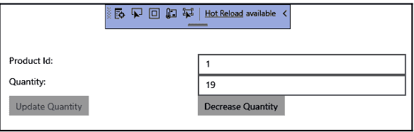

现在我们已完成项目，让我们回顾一下在此处所涵盖的内容。

### 总结

那真是一段不简单的旅程。我们为我们的小公司建立了一个功能齐全的应用程序，使用 IdentityServer 4 保护了访问权限，并使用角色实现了权限管理。

我在本章中已经说过几次了，但为了做个结论：当涉及身份，实际上是安全问题时，并没有唯一正确的答案。在这种情况下，IdentityServer 很有道理，因为我们使用了由公司拥有和维护的应用程序和 API，我们需要离线访问，并且我们支持的是桌面应用程序。如果你改变其中任何一个参数，使用 Google OAuth 或 Azure B2C 可能更有意义。

再次重申另一个我多次说过的观点：任何安全都不是绝对的。你的系统可能非常安全，因为它可能使用加密流量和防火墙。然而，你可能已经对应用程序进行了渗透测试，它毫发无损，然后你的一名员工可能会将密码分享给别人。突然间，你所有这些努力可能就都白费了。

在下一章中，我们将探讨如何使用 .NET Core 3 创建 Windows 服务。我们将创建一个应用程序，它将把你 PC 上的照片备份到 Azure Storage 帐户。

### 建议的改进

如果你希望拿起这个应用程序并对其进行改进，我有一些关于从哪里开始的建议（如果你一直仔细关注，可能已经在过程中注意到其中一些）：

- 1. 将凭据流更改为隐式流。为此，你需要在桌面应用程序内托管 Web 视图并创建登录网站。
- 2. 添加用户存储。我们的用户显然不适合生产环境；除非我们可以绝对保证他们永远不会雇佣或丢失任何员工。另外，在代码中以纯文本存储密码显然绝非好主意（即使是在服务器上）。
- 3. 执行以下任一操作：
  - * 获取 UWP 应用程序中的 XAML 并将其转换为 Xamarin.Forms，然后编译并发布 Android 版本。
  - * 获取代码中的常见部分并将它们合并，为你的应用程序创建一个微型框架。
  - * 实现 MVVM 框架。大多数 MVVM 框架现在也支持一定程度的跨平台编译。
- 4. 将库存系统链接到前端网站，允许用户登录并购买有库存的商品。
- 5. 创建库存商品图片；你可以将这些图片存储在 Azure Storage 中。事实上，我们的下一章就是关于此内容的。

### 延伸阅读

在撰写本书时，IdentityServer 文档正处于不断变化之中。不过，它仍然非常有用，包含许多示例。可以在这里找到：docs.identityserver.io。

OpenID 规范可以在这里找到：https://openid.net/developers/specs/。

OAuth 2 规范可以在这里找到：https://oauth.net/2/。
