# 使用 Windows 服务和 Azure Storage 构建照片存储应用

自 1997 年我开始第一份工作以来，计算领域经历了一些有趣的变化，而自 1980 年代初我拥有第一台电脑（一台 Spectrum ZX81）以来，变化更大。在 Spectrum 上，如果你想保存一些信息，你会将其记录在磁带上；一个典型的游戏需要大约 5 到 10 分钟才能从磁带加载。当然，当时也在使用更先进的计算机，但大量大容量存储实际上仍然是在磁带上完成的。即使在我得到第一台 PC 后，我还记得为它买了一个磁带驱动器，这样我就可以存储高达一个千兆字节的信息（在那个年代，一个千兆字节的信息是大量数据）。

如今，你的手机拥有远比那多得多的存储空间，但仍然不够用：你去度假时可能会拍 100 张照片；携带两卷 24 次曝光的胶卷去度假的日子已经一去不复返了。当然，过了一段时间，你会意识到，成百上千张自己吃早餐的高分辨率照片正在占满你的手机。

一些手机制造商每月不到 1 英镑就提供额外的存储容量。考虑到这为你所有图像提供了备份，这当然似乎不算多；然而，这可能比你自己将图像放入云端所要支付的费用还要多。

这正是我们在本章中打算做的事，我们将编写一个 Windows 服务来监视你计算机上的一个目录，将其中的任何内容上传到 Azure 云，然后如果文件超过一定年龄，就从源目录中删除它。这样，你就可以随身保留最新的照片，并将其余照片存档。


本章将涵盖以下主题：

- 使用 .NET Core 3 创建 Windows 服务
- 安装和使用 Windows 兼容性包
- 将文件上传到 Azure Blob 存储

## 技术要求

Azure Storage Explorer 可以在此处找到：https://azure.microsoft.com/en-gb/features/storage-explorer/。这是由 Microsoft 维护的开源软件；其 GitHub 仓库可以在此处找到：https://github.com/Microsoft/AzureStorageExplorer。

这并非必需，但它将极大地帮助开发和测试阶段。

## Windows 服务和 Windows 兼容性包

在本项目中，我们将使用 Windows 兼容性包来创建 Windows 服务。我们稍后会讨论原因，但在这一节中，我想快速讨论一下这些东西是什么。

## Windows 服务

大多数操作系统都有 Windows 服务的等效物。本质上，这是一个始终运行并在后台执行某些操作的应用程序。如果你快速查看机器上当前运行的服务，你会发现有很多种且各不相同；要在 Windows 10 中执行此操作，只需按下开始按钮并键入 `Services`。然后，选择最匹配的项。你应该会看到以下应用程序：

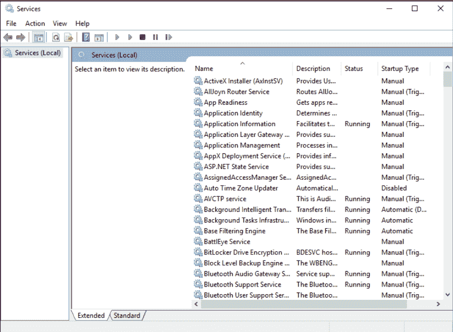

很可能你会有一组不同的服务，但原理是相同的。这些应用程序都在后台运行并执行某些操作。每一个标记为运行的服务都在消耗你计算机的资源，因此，当你安装一个服务时，你应该考虑是否需要它始终运行（否则，只需禁用它）。

> 禁用某些 Windows 服务可能会导致你的计算机表现不同，甚至停止某些功能，因此如果你打算禁用在你到达时已安装的服务，请小心。

如果我们正在编写一个服务，这一点尤其正确：如果是你的应用程序拖慢了他们的计算机，人们会非常迅速地注意到，因此性能在这里是一个巨大的考量因素。

## Windows 兼容性包

.NET Core 背后的历史很有趣，我在这里不会详尽展开（必须赶快说一句，以免你合上这本书去读斯蒂芬·金的作品！）。然而，我想简要谈谈（至少一个原因）为什么微软选择创建 .NET Core。

.NET Framework 自 2002 年以来一直存在，你现在仍然可以运行那时编写的应用程序。在撰写本文时，这意味着 .NET Framework 需要支持基于 _那时_ 的技术环境的近 20 年的假设和代码。

由于这一点，微软发现自己陷入了一个困境，无法更改任何基本内容，因为他们不能冒打破成千上万甚至数以百万计的那些未动过但仍在运行的应用程序的风险。因此，唯一的解决方案是创建一个全新的框架，不依赖于原始框架：这就是 .NET Core。然而，你为此付出的代价是，新框架不支持原始框架的所有功能。

一个这样的例子是，出人意料的是 Windows 特定功能（包括创建 Windows 服务）。然而，在 2017 年，微软发布了 Windows 兼容性包：一个 NuGet 包，它提供了访问你所需的大部分 Windows 功能的途径。

## 项目概览

本质上，我们的项目将围绕一个 Windows 服务展开，该服务将监控计算机硬盘上的给定文件夹。一旦检测到文件，我们将读取一些属性，例如大小、日期和名称，并在 Azure 云中进行快速搜索；如果不存在，我们将上传它。一旦确定它安全地在云中，我们将检查日期，任何超过一定年限的文件都将从硬盘中删除。

## 配置 Azure 存储

设置 Azure 存储帐户是一个相当简单的过程；你需要先登录 Azure。如果你没有帐户，则可以在此处创建一个：https://azure.microsoft.com/。注册后，请访问 https://portal.azure.com。

大多数云提供商都有存储模型，使用备用提供商并不困难；然而，你需要更改一些与 Azure 交互的代码。

首先，从 Azure 门户选择存储边栏：

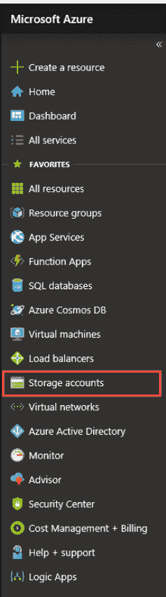

或者，你也可以直接搜索 Storage。边栏出现后，选择 **添加** 并填写新帐户的详细信息：

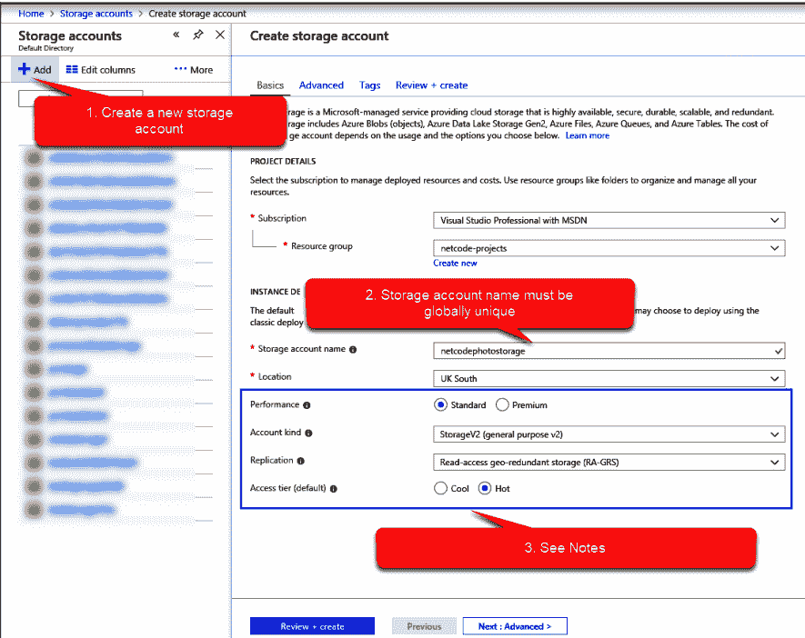

如果你已经读完了本书的其余部分，你会对这个屏幕的大部分内容比较熟悉；然而，前一部分，标记为 3. See Notes，表示存储帐户中直接影响成本、性能和数据安全性的部分。本质上，如果你想快速访问数据，你将支付更多；如果你希望数据安全（在其他区域备份），那么你将支付更多。

我不会详细介绍这些选项（主要是因为到你读到这里时，它们可能已经不同了）。然而，这里有两个在所有云平台上都使用的概念：

- 热存储和冷存储
- 存储冗余

让我们从前者开始。

### 热存储和冷存储

通常，云提供商提供存储概念，该存储针对读取或写入进行了优化。虽然我们在此处将存储模型设置为 *热*，但这个特定模型可能更适合 *冷* 存储；也就是说，读取和写入数据的成本更高，但实际存储的成本更低。*热* 存储则相反：存储成本更高，但访问信息的成本更低。

一些云提供商（包括 Microsoft）提供一个类似于冷存储但更加针对存储优化的层级：这是你可能用于备份或预计根本不需要检索的文件的存储类型。

对于像我们这样的应用程序，你可能会发现将 hot 用于开发和测试阶段，并在实际系统中使用时替换为冷存储帐户很有用。

最后，关于 premium：Microsoft 提供固态硬盘，这意味着你的访问速度提高；然而，这比其他两个选项都更贵。

### 存储冗余

时刻值得记住的是，云只是 *其他人的计算机* 的另一种说法；在我们的情况中，这可以读作 *微软的计算机*。显然，将数据存储在 Azure 中比将其存储在隔壁邻居的计算机上更安全，但许多概念是相同的；这包括你的邻居可能会遭遇入室盗窃、洪水或火灾这一事实。

微软面临同样的风险，他们试图通过比你的邻居可能拥有的更多安全、防火和防水措施来减轻这些风险。然而，存储你数据的机器仍然有可能付之一炬。

不同供应商对这一概念有略微不同的版本，但它们本质上都提供相同的东西：将数据复制到其他地方的能力。开箱即用，你通常会将数据写入多个物理机器，因此单个机器故障不会丢失数据。

下一级通常是数据复制到物理建筑之外，甚至是一组建筑之外。最终级别是数据复制到区域之外（通常位于不同国家）。

如我之前提到的，不同云提供商对这些概念有不同的名称并更改术语；然而，它大体上归结为导致你丢失数据必须发生什么，即多个机器故障、全国性灾难或全球性灾难。值得注意的是，虽然云提供商会给你一个持久性百分比，但没有一个会达到 100%；也就是说，他们不会保证你数据的安全性。他们只会说不太可能丢失。

## 存储帐户

回到我们的存储帐户，我们有四个存储概念：**Blob**、**文件**、**表**和 **队列**。出于本项目的目的，我们将使用 **Blob**。


简而言之：文件为旧版应用程序提供本地存储复制，表提供简单的键值对数据存储机制，队列提供基本消息队列功能。这些其他类型的完整详细信息超出了本章的范围。

在我们的存储区域内，我们需要创建一个容器。在 **Blob** 中，选择创建容器：


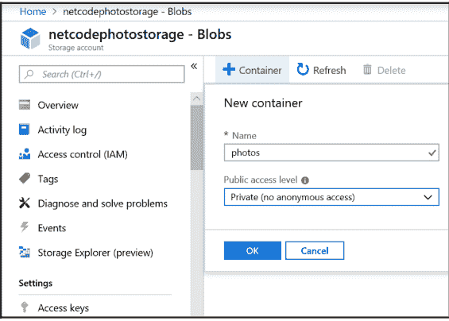

访问级别与你如何访问容器相关。设置匿名访问意味着你实际上是在授予任何知道你的容器所在位置的人都可以访问的权限。

接下来我们需要的东西（好吧，并不完全是需要，但它确实有助于测试）是 Azure Storage Explorer。如果你已经安装了它，请立即启动它：

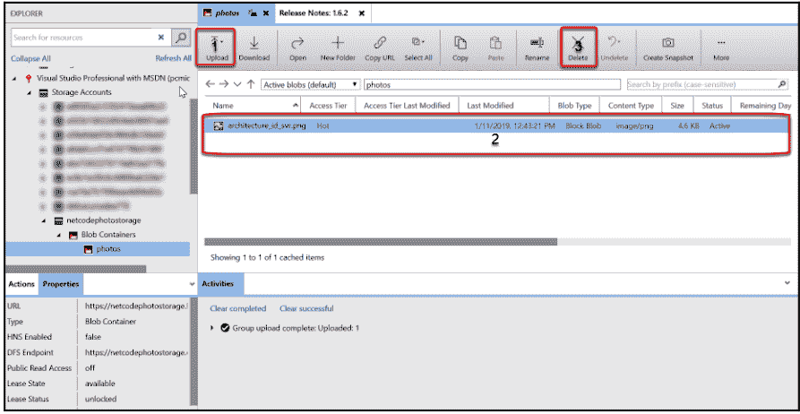

如你所见，在这个实用程序中，你可以向容器上传文件（1）、查看其内容（2），并再次删除它（3）。

该工具还允许你管理文件，但目前，我们只使用这三个功能。

> 如果你选择不安装此工具，仍然可以跟随本章学习；但是，判断你的项目是否正常工作将不太容易。话虽如此，到本项目结束时，你应该有足够的知识来编写一个小型实用程序，用于列出容器的内容。

一旦你玩过这个工具，我们就可以继续并创建我们的 Windows 服务了。

## 创建我们的 Windows 服务

要创建 Windows 服务，让我们从一个新的 .NET Core 3 控制台应用程序开始：

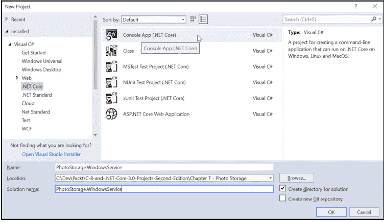

> 如果你选择扩展此应用程序，你可能希望将应用程序的部分内容分离到它们自己的类库中。显然，我们正在使用的功能并不仅限于控制台应用程序。如果功能在其自己的类中，你可以简单地从桌面应用程序调用它。

下一步是安装 Windows Compatibility NuGet 包：

```
Install-Package Microsoft.Windows.Compatibility
```

这将允许我们创建 Windows 服务。

> 值得注意的是，尽管这是 .NET Core，但此应用程序不会是跨平台的；事实上，任何使用 Windows 兼容包的应用程序都不会是跨平台的。

现在我们已经安装了这个，可以创建服务了。我们需要一个类似于这样的类：

```
public class PhotoService : ServiceBase
{
}
```

你应该能够使用 `Ctrl + . ServiceBase`，因为它是兼容包的一部分。我们需要在此处重写一些函数（即 `OnStart` 和 `OnStop`）：

```
public class PhotoService : ServiceBase
{
    protected override void OnStart(string[] args)
    {
        base.OnStart(args);
    }

    protected override void OnStop()
    {
        base.OnStop();
    }
}
```

我们还需要告诉控制台应用程序运行该服务。在这里，我们可以使用 C# 8 的另一个功能——隐式作用域 using 语句。基本上，不再显式地将可处置对象包装在 using 语句中，现在可以简单地声明它，当对象超出作用域时将被处置：

```
class Program
{
    static void Main(string[] args)
    {
        using var service = new PhotoService();
        ServiceBase.Run(service);
    }
}
```

基本上，我们的服务就完成了。敏锐的你可能已经注意到，它目前实际上还不*做*任何事情，但就目前而言，它是一个合法的服务。

该服务基本上需要做三件事：扫描硬盘上的文件夹以查找新文件、将文件上传到 Azure 上的容器，以及扫描 Azure 容器。让我们先从一个有用的小类开始，该类为我们监视文件系统：FileSystemWatcher。这现在通过兼容包的魔力在 .NET Core 上可用。将所有这些代码放入单独的类中是合理的，因此让我们在服务中创建和销毁该类。然后，我们稍后可以看看这个类可能是什么样子：

```
public class PhotoService : ServiceBase
{
    private FileMonitor _fileMonitor;

    protected override void OnStart(string[] args)
    {
        _fileMonitor = new FileMonitor("c:\\tmp");
    }

    protected override void OnStop()
    {
        _fileMonitor.Dispose();
    }
}
```

在本章中，我将大量使用 c:\tmp 路径。这只是我通常用于测试此类事物的一个目录。如果你不想使用它，则可以使用任何你选择的路径（虽然我建议你让它保持简短）。我们稍后会将其设为可配置。

只需在未定义的新类 FileMonitor 上使用键盘快捷方式 Ctrl + .，它就会为你创建类存根。让我们看看它需要是什么样子：

```
public class FileMonitor : IDisposable
{
    private FileSystemWatcher _fileSystemWatcher;

    public FileMonitor(string path)
    {
        _fileSystemWatcher = new FileSystemWatcher(path);
        _fileSystemWatcher.Filter = "*.*";
        _fileSystemWatcher.EnableRaisingEvents = true;

        _fileSystemWatcher.Changed += new FileSystemEventHandler(OnChanged);
        _fileSystemWatcher.Created += new FileSystemEventHandler(OnCreated);
        _fileSystemWatcher.Renamed += new RenamedEventHandler(OnRenamed);
    }

    private void OnRenamed(object sender, RenamedEventArgs e)
    {
        throw new NotImplementedException();
    }

    private void OnCreated(object sender, FileSystemEventArgs e)
    {
        throw new NotImplementedException();
    }

    private void OnChanged(object sender, FileSystemEventArgs e)
    {
        throw new NotImplementedException();
    }

    public void Dispose()
    {
        _fileSystemWatcher.Dispose();
    }
}
```

如你所见，这里没有太多内容：FileSystemWatcher 类本身可能超出了本章的详细讨论范围，但基本上，你将其指向一个路径并告诉它在该处发生任何事情时通知你；然后，你会收到一个事件。需要设置 Filter 和 EnableRaisingEvents，以便类知道要查找什么以及在找到任何内容时该做什么。我们实现了 IDisposable 模式，以便在服务停止时可以处置 FileSystemWatcher。


> 如今，IDisposable 模式不太常被实现。基本上，它给了你一个整理资源的机会。如果你正在做任何需要文件访问或数据库访问的事情，那么你真的应该考虑使用它。Using 语句为你提供了一种非常好的方式，让系统在发生错误时也能自动为你处置对象。

## 测试类

在这里使用控制台应用程序的一个优点是，我们可以简单地运行项目。

做这件事有很多方法，但前面的代码将只是实例化 FileMonitor 类并处于无限循环中。如果你在 c:\tmp 中创建一个文件，你应该会看到程序因 NotImplementedException 而崩溃。这证明我们的 FileMonitor 迄今为止工作正常。

下一步是告诉类该做什么。在这种情况下，我们将使用一个名为 AzureStorageClientService 的新依赖类。这将提供 Azure Storage 接口功能。但是，在开始编写它的繁琐工作之前，让我们先使用它。首先创建一个基础接口（你可以选择将其放在一个名为 AzureClient 的目录中，就像我一样）：

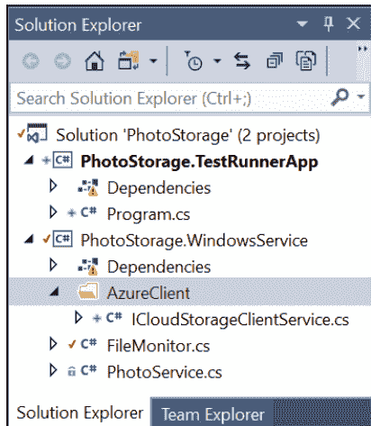

敏锐的你可能会注意到，我没有将接口命名为 IAzureStorageClientService，而是 ICloudStorageClientService。这样做的原因是，除了便于测试之外，拥有这样的依赖注入使你能够轻松地替换一段功能。例如，假设你决定使用 Google Cloud Platform 而不是 Azure——你可以简单地创建一个实现相同接口的 GoogleCloudStorageClient，并注入该类而非原先的类。

让我们通过在类顶部声明一个变量来使用我们的接口：

```csharp
public class FileMonitor : IDisposable
{
    private FileSystemWatcher _fileSystemWatcher;
    private ICloudStorageClientService _cloudStorageClientService;

    public FileMonitor(string path, ICloudStorageClientService cloudStorageClientService)
    {
        _cloudStorageClientService = cloudStorageClientService;

        _fileSystemWatcher = new FileSystemWatcher(path);
        _fileSystemWatcher.Filter = "*.*";
        _fileSystemWatcher.EnableRaisingEvents = true;

        _fileSystemWatcher.Changed += new FileSystemEventHandler(OnChanged);
        _fileSystemWatcher.Created += new FileSystemEventHandler(OnCreated);
        _fileSystemWatcher.Renamed += new RenamedEventHandler(OnRenamed);
    }
}
```

如你所见，我们正在使用构造函数将其注入到我们的类中。我们将在类的更下方使用它：

```csharp
private async void OnRenamed(object sender, RenamedEventArgs e)
{
    if (_cloudStorageClientService.FileExists(e.Name))
    {
        await _cloudStorageClientService.RenameFile(e.Name, e.OldName);
    }
    else
    {
        await _cloudStorageClientService.UploadFile(e.FullPath);
    }
}
```

```csharp
private async void OnCreated(object sender, FileSystemEventArgs e)
{
    await _cloudStorageClientService.UploadFile(e.FullPath);
}
```

```csharp
private async void OnChanged(object sender, FileSystemEventArgs e)
{
    await _cloudStorageClientService.UploadFile(e.FullPath);
}
```


## 使用 Azure 存储客户端

如果您愿意，可以使用 Ctrl + . 创建接口定义；不过，这些方法确实需要是异步的。接口的最终定义如下：

```
public interface ICloudStorageClientService
{
    Task RenameFile(string name, string oldName);
    Task UploadFile(string fullPath);
    Task<bool> FileExists(string name);
}
```

最后，我们需要实现该服务。

我们将从向 Azure 存储上传文件开始。第一步是下载用于客户端访问 Azure 存储的 NuGet 包：

```
Install-Package WindowsAzure.Storage
```

然后，我们可以创建上传文件的方法：

```
public async Task UploadFile(string fullPath)
{
    string fileName = Path.GetFileName(fullPath);
    var blob = GetBlockBlobReference(fileName);

    using (var fileStream = System.IO.File.OpenRead(fullPath))
    {
        await blob.UploadFromStreamAsync(fileStream);
    }
}
```

上述代码基本上是获取 Azure 中文件的引用（即使它不存在）并上传流。我们或许应该看一下辅助方法，即 GetBlockBlobReference：

```
private CloudBlockBlob GetBlockBlobReference(string fileName)
{
    if (CloudStorageAccount.TryParse(_connectionString, out
CloudStorageAccount storageAccount))
    {
        var client = storageAccount.CreateCloudBlobClient();
        var container = client.GetContainerReference("photos");
        var blob = container.GetBlockBlobReference(fileName);
        return blob;
    }
    else
    {
        throw new Exception("Unable to parse the storage account");
    }
}
```

这个辅助方法确实包含相当多的代码，所以让我们拆解一下，看看我们实际在做什么。暂时不要质疑 _connectionString 来自哪里——我们稍后会回到这一点。我们正在做的第一件事是使用 CloudStorageAccount 类上的一个静态方法，该方法有用地允许我们根据连接字符串创建 CloudStorageAccount 的新实例。

如果您希望扩展此功能，可以考虑在连接字符串无效时，而不是抛出异常，采用其他替代方案。

然后，我们根据名称获取存储帐户中的容器；接着，根据名称（即我们的文件名）获取 Blob 的引用。值得注意的是，Blob 不需要实际存在也能返回 Blob 对象。

**Blob** 是 **二进制大对象** 的缩写。基本上，在此上下文中，这表示任何可以作为单个文件存储在计算机上的内容。

在测试此功能之前，我们需要回到 _connectionString，在此之前我曾请您暂时搁置关于它的疑问。

### 配置我们的服务以访问 Azure 存储

基本上，这需要表示存储帐户的连接字符串。您可以在 Azure 门户的“访问密钥”下轻松找到此项的正确值：

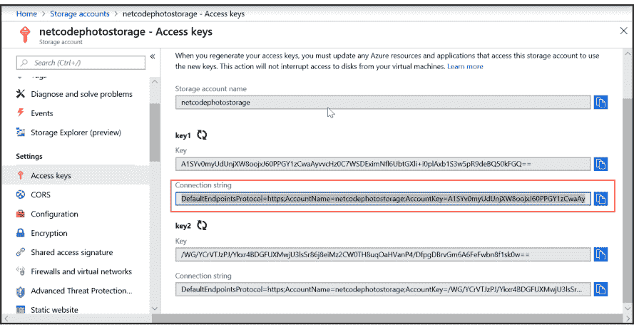

我们可以简单地将其复制并直接粘贴到代码中，方法是将 __connectionString 变量赋值为它。不过，我们将使用 ConfigurationBuilder。在开始之前，我们需要一些 NuGet 包：

```
Install-Package Microsoft.Extensions.Configuration -ProjectName
PhotoStorage.WindowsService

Install-Package Microsoft.Extensions.Configuration.Json -ProjectName
PhotoStorage.WindowsService
```

这应该允许我们使用 JSON 文件构建配置，因此下一步是创建一个。我们将向项目中添加一个名为 appsettings.json 的文件：

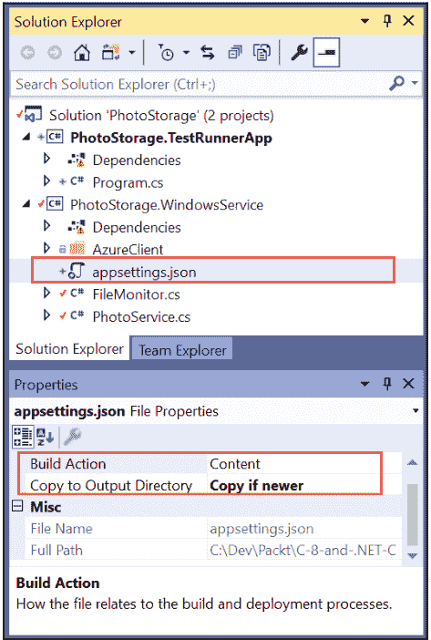

如您所见，我们不仅创建了新文件，还设置了 **生成操作** 和 **复制到输出目录**，以便在应用程序运行时将文件复制到应用程序的主目录。

让我们看看文件本身长什么样：

```
{
    "ConnectionStrings": {
        "netcodephotostorage":
    "DefaultEndpointsProtocol=https;AccountName=netcodephotostorage;AccountKey=
    A1SYv0myUdUnjXW80ojxJ60PPGYlzCwaAvvvcHz0C7WSDEXimNf16UbtGX1i+i0pIaxb1S3w5pR
    9deBQ50KFGQ==;EndpointSuffix=core.windows.net"
    }
}
```

我在此处保留了我的连接字符串，以示字符串的示例格式；显然，等到本书出版时，该存储帐户将不再存在，因此请将其替换为您自己的连接字符串；否则，将无法连接。老实说，如果您愿意，可以以不同方式构建此文件；查看配置生成器，您会发现，只要它是键值对结构，就没什么区别。

现在，让我们看看如何提取该配置。在 AzureStorageClientService 内部，我们将创建一个构造函数：

```
private string _connectionString;
public AzureStorageClientService()
{
 var builder = new ConfigurationBuilder()
 .SetBasePath(Directory.GetCurrentDirectory())
 .AddJsonFile("appsettings.json");
 var configuration = builder.Build();
 _connectionString =
 configuration["ConnectionStrings:netcodephotostorage"];
}
```

我们在此所做的只是使用配置生成器加载并解析我们刚刚创建的 JSON 文件。完成后，可以使用生成的配置属性来提取键值对。

现在，如果我们运行控制台应用程序，应该能够看到文件已上传到 Azure 云存储：

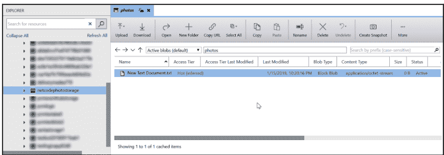

我们可以看到存储客户端代码现在可用了。还有一些方法需要填充，让我们接下来做这件事。

### 完成云存储客户端

我们将从一个简单的方法开始，即 FileExists：

```
public async Task<bool> FileExists(string name)
{
    var blob = GetBlockBlobReference(name);
    return await blob.ExistsAsync();
}
```

我们正在重复使用 Upload 函数中的同一辅助方法，但这次，我们只是调用一个内置方法 ExistsAsync，以确定文件是否存在。

最后，我们有 RenameFile 方法：

```
public async Task<bool> RenameFile(string name, string oldName)
{
    var blobNew = GetBlockBlobReference(name);
    var blobOld = GetBlockBlobReference(oldName);
    if (await blobNew.ExistsAsync()) return false;
    await blobNew.StartCopyAsync(blobOld);
    await blobOld.DeleteAsync();
    return true;
}
```

由于没有重命名文件的内置方法，我们只是复制内容并删除原始文件。显然，如果新名称已存在，任务将失败。

### 进一步配置

我们的下一项任务是将仅剩的唯一硬编码变量移到 appsettings.json 文件中。让我们快速看看它在配置文件中可能是什么样子：

```
{
    "ConnectionStrings": {
```

```
"netcodephotostorage":
"DefaultEndpointsProtocol=https;AccountName=netcodephotostorage;AccountKey=A1SYv0myUdUnjXW800xjJ60PPGY1zCwaAyvvcHz0C7WSDEximF16UbtGXli+i0pIaXb1S3w5pR
9deBQ50kFGQ==;EndpointSuffix=core.windows.net"
,
"MonitorPath": "c:\\tmp"
}
```

好的，所以我们的下一阶段将是使用它。实现这一点有多种方法；我们可以在需要时读取每个配置值，或者，如我们在此所做，在开始时读取所有配置并传递这些值。让我们创建一个新类来保存这些值。我已将其添加到一个名为 Models 的新文件夹中：

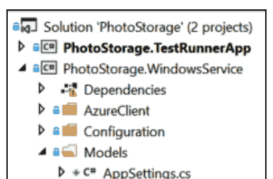

这里的想法是，我们有一个单一类来保存应用程序的所有配置；因此，我们可以将其传递给任何需要该配置的其他类。类本身的代码如下：

```
public class AppSettings
{
    public string ConnectionString { get; set; }
    public string MonitorPath { get; set; }
}
```

我们的下一步是添加一些代码来读取此配置。为了实现这一点，我创建了一个新服务：

```
public class ConfigurationService
{
    public AppSettings Load()
    {
        var builder = new ConfigurationBuilder()
        .SetBasePath(Directory.GetCurrentDirectory())
        .AddJsonFile("appsettings.json");

    var appSettings = new AppSettings();
```


var configuration = builder.Build();

appSettings.ConnectionString =
    configuration["ConnectionStrings:netcodephotostorage"];
appSettings.MonitorPath = configuration["MonitorPath"];

return appSettings;
}
}

由于我们已创建一个服务来加载配置设置，因此可以将其传递给 AzureStorageClientService。以下是该文件中修订后的构造函数和类变量：

```
private readonly AppSettings _appSettings;
public AzureStorageClientService(AppSettings appSettings)
{
	_appSettings = appSettings;
}
```

我想你会同意，现在我们不在服务内部加载配置，代码看起来更加清晰了；GetBlockBlobReference 也需要像下面这样更新：

```
private CloudBlockBlob GetBlockBlobReference(string fileName)
{
	if (CloudStorageAccount.TryParse(_appSettings.ConnectionString, out
	CloudStorageAccount storageAccount))
	{
		var client = storageAccount.CreateCloudBlobClient();
		var container = client.GetContainerReference("photos");
		var blob = container.GetBlockBlobReference(fileName);
		return blob;
	}
	else
	{
		throw new Exception("Unable to parse the storage account");
	}
}
```

我们的 PhotoService.cs 类将在启动时需要实例化这个新的配置服务：

```
private FileMonitor _fileMonitor;
private AppSettings _appSettings;

protected override void OnStart(string[] args)
{
    var configurationService = new ConfigurationService();
    _appSettings = configurationService.Load();

    var cloudStorageClientService = new
    AzureStorageClientService(_appSettings);
    _fileMonitor = new FileMonitor(_appSettings.MonitorPath,
    cloudStorageClientService);
}
```

最后，如果你创建了一个用于测试的控制台应用程序，也需要更新它（在 Program.cs 中）：

```
static void TestFileMonitorNewFile()
{
    var configurationService = new ConfigurationService();
    var appSettings = configurationService.Load();

    var cloudStorageClientService = new
    AzureStorageClientService(appSettings);

    using var fileMonitor = new FileMonitor(appSettings.MonitorPath,
    cloudStorageClientService);
    for (; ; ) { }
}
```

这样一来，我们就完成了。现在，应用程序应该会从 appsettings.json 文件读取配置，并且，如果我们在 c:\tmp 文件夹中创建或放入文件，应该会看到它被上传到云端。当文件被更改时，更改后的版本会被上传；然而，我们缺少三个关键功能。

接下来我们需要添加的是日志记录。关于 Windows 服务（或任何类型的服务）的不幸现实是，它们臭名昭著地难以调试。

其次，如果我们运行应用程序且目标目录为空，那么放入该目录的所有文件都会被传输到云端；但是，如果我们将其指向一个已充满照片的现有目录，该怎么办呢？最后，目前我们正在备份所有文件，而我们只关心图像格式。

让我们解决这三个剩余的功能。

## 日志记录

归根结底，日志记录只是将信息写入持久化存储，这意味着你可以记录到数据库或文件中。你甚至可以将日志输出到屏幕，但那样持久性可能不足。在我们的例子中，我们将文本输出到一个文件。让我们来看看日志代码：

```
public class FileLogger : ILogger
{
    private readonly string _loggingPath;

    public FileLogger(string loggingPath)
    {
        _loggingPath = loggingPath;
    }

    public void Log(string message)
    {
        File.AppendAllText($@"{_loggingPath}\PhotoStorage.Log.txt",
            $"{DateTime.Now} : {message}{Environment.NewLine}");
    }
}
```

这里，我们正在实现 ILogger 接口，我们稍后会介绍它。这个类并没有太多复杂之处——我们只是接受一个路径，然后将其输出到该路径下的一个文件中。让我们看看这个接口长什么样：

```
public interface ILogger
{
    void Log(string message);
}
```

关于这个接口，除了它的存在之外，可能没有太多需要解释的。日志记录是那些你肯定希望能够为单元测试替换的功能之一，因此接口至关重要。我不会详细说明我记录日志的每个位置，但让我们来看看 PhotoService 构造函数：

```
private readonly string _path;
private readonly ILogger _logger;
private FileMonitor _fileMonitor;
private AppSettings _appSettings;

public PhotoService(string path, ILogger logger)
{
    ServiceName = "PhotoService";
    AutoLog = true;
    _path = path;
    _logger = logger;
}
```

正如你所见，我们将日志记录器传入；因此，我们在 Main 方法中对其实例化：

```
static void Main(string[] args)
{
    var path = args[0];
    var logger = new FileLogger(path);

    using var service = new PhotoService(path, logger);
    ServiceBase.Run(service);
}
```

这里做了一点调整：现在，我们获取参数并将其存储在 path 变量中。

现在，我们有了日志功能；如果你想看几条日志消息，可以尝试在 OnStart 和 OnStop 中各放一条。

> 虽然我不会列出所有记录日志的地方，但你可以自由下载本书的 GitHub 仓库并查看。如果在跟随学习时遇到任何问题，此日志功能将非常宝贵；不过，如果你想了解更多，后面有一个关于测试和调试的章节。

## 仅上传图像

为了确定是否有图像，我们将在处理任何文件之前添加一个检查。以下是 OnCreated 和 OnChanged 的修订方法：

```
private async void OnCreated(object sender, FileSystemEventArgs e)
{
    if (!FileHelper.IsImage(e.Name)) return;
    await _cloudStorageClientService.UploadFile(e.FullPath);
}
```

```
private async void OnChanged(object sender, FileSystemEventArgs e)
{
    if (!FileHelper.IsImage(e.Name)) return;
    await _cloudStorageClientService.UploadFile(e.FullPath);
}
```

正如你所见，我们只有一个非常基础的门控检查，用于返回我们是否正在处理图像。当然，我们需要编写这个方法。这里，我们接触到了一个尚未提及的 C# 8 新特性。在 C# 8 之前，这个方法可能如下所示：

```
public static bool IsImage(string fileName)
{
    string ext = Path.GetExtension(fileName);
    switch (ext)
    {
        case "png":
        case "jpg":
        case "jpeg":
        case "bmp":
        case "gif":
            return true;
        default: return false;
    }
}
```

然而，借助新的 switch 语句，我们可以像下面这样编写这个方法：

```
public static bool IsImage(string fileName)
{
    string ext = Path.GetExtension(fileName);
    return ext switch
    {
        "png" => true,
        "jpg" => true,
        "jpeg" => true,
        "bmp" => true,
        "gif" => true,
        _ => false
    };
}
```

如果我们在 switch 语句本身中包含一个 GetExtension 调用，可以使其更加简洁，但通常这样写更易读。

新的 switch 语句实际上比这更强大，事实上，它支持模式匹配。

让我们看看如何在启动时上传目录中找到的任何图像。

## 上传现有图像

启动后，我们的应用程序会监控目录中新创建或更改的任何文件，但如果我们启动应用程序并将其指向一个已满文件的目录，该怎么办呢？我们可以修改 OnStart 代码，使其调用一个为我们扫描目录的方法。推测，我们需要传递关于它可以扫描哪里以及找到文件后要做什么的信息：

```
protected override void OnStart(string[] args)
{
    var configurationService = new ConfigurationService();
    _appSettings = configurationService.Load(_path);

    var cloudStorageClientService = new
    AzureStorageClientService(_appSettings);

    _fileDiscoverer.DiscoverFiles(_appSettings.MonitorPath, (file) =>
    cloudStorageClientService.UploadFile(file));
    _fileMonitor = new FileMonitor(_appSettings.MonitorPath,
    cloudStorageClientService, _logger);
}
```

这里新增的一行是对名为 _fileDiscoverer 的新对象的调用。这里，我们传递要监控的目录以及一个指向 UploadFile 方法的回调。首先，让我们将此依赖项添加到构造函数中：

```
private readonly string _path;
private readonly ILogger _logger;
private readonly IFileDiscoverer _fileDiscoverer;
private FileMonitor _fileMonitor;
private AppSettings _appSettings;

public PhotoService(string path, ILogger logger, IFileDiscoverer fileDiscoverer)
{
    ServiceName = "PhotoService";
    AutoLog = true;
    _path = path;
    _logger = logger;
    _fileDiscoverer = fileDiscoverer;
}
```

与所有良好的依赖注入一样，我们使用接口来传入对象；让我们看看我们的接口应该是什么样子：

```
public interface IFileDiscoverer
{


void DiscoverFiles(string directory, Action<string> action);
}

你可以让 Visual Studio 自动为你生成这些内容，只需对之前所有未知的方法和接口使用 Ctrl + . 快捷方式即可。

在创建该方法本身之前，让我们先看看传入此内容的 Program.cs 代码：

```csharp
static void Main(string[] args)
{
    var path = args[0];
    var logger = new FileLogger(path);
    var fileDiscoverer = new FileDiscoverer(logger);

    using var service = new PhotoService(path, logger, fileDiscoverer);
    ServiceBase.Run(service);
}
```

我们只是实例化对象并将其传入。

> 你可能会注意到，这看起来开始像是我们需要一个 IoC 容器。我特意不使用它，因为它会分散我们演示代码的注意力；但是，如果你决定扩展这个项目，那将是一个绝佳的起点。

我们需要一种方法来扫描目录中已存在的文件。为此，我们将能够使用一个在 .NET Core 2.1 中引入的名为 FileSystemEnumerable 的功能。这基于在 .NET Core 2.1 中完成的引入 Span 的工作，因此相比之前的 System.IO 替代方案提供了一些性能优势。让我们来看看 IFileDiscoverer 的实现：

```csharp
public class FileDiscoverer : IFileDiscoverer
{
    private readonly ILogger _logger;

    public FileDiscoverer(ILogger logger)
    {
        _logger = logger;
    }

    public void DiscoverFiles(string directory, Action<string> action)
    {
        var enumerationOptions = new EnumerationOptions()
        {
            RecurseSubdirectories = false,
            AttributesToSkip = FileAttributes.Directory
            | FileAttributes.Device | FileAttributes.Hidden
        };

        var files = new FileSystemEnumerable<FileInfo>(directory,
            (ref FileSystemEntry entry) =>
            (FileInfo)entry.ToFileSystemInfo(), enumerationOptions)
        {
            ShouldIncludePredicate = (ref FileSystemEntry entry) =>
            FileHelper.IsImage(entry.FileName.ToString())
        };

        foreach (var file in files)
        {
            action.Invoke(file.FullName);
        }
    }
}
```

我们传入 ILogger 以便可以查看发现和上传了哪些文件；但是，它与该类的功能无关，因此我将其使用从前面的代码中省略了。

FileSystemEnumerable 允许我们以多种方式遍历目录。正如你所见，我们可以通过组合使用 EnumerationOptions 和 ShouldIncludePredicate 来筛选某些文件和文件类型。一旦有了列表，我们就可以像遍历任何集合一样遍历它；在我们的例子中，我们正在调用传入的方法并返回文件名。

> 对 FileSystemEnumerable 的完整详细说明超出了本章（和本书）的范围；但是，了解 .NET Core API 函数的一个良好信息来源是 Microsoft 在线文档，可以在此处找到：https://docs.microsoft.com/en-us/dotnet/api/。

## 安装 Windows 服务

安装 Windows 服务（尤其是针对 .NET Core，至少在撰写本文时）是一个非常手动的过程。此外，因为我们使用配置文件，我们需要做一些微小的调整，以便服务知道在哪里查找配置文件。

### 代码更改

在安装服务时，我们需要告诉它在哪里查找配置文件。我们可以通过将参数传递给服务来实现这一点。实际上有两种方法；第一种（也是我们感兴趣的一种）是在安装服务期间传递参数。这将被传递到 Main 方法。第二种是通过服务管理实用程序传递的；参数将被传递到服务的 OnStart 方法。

在我们的例子中，我们有兴趣更改 Main 方法：

```csharp
static void Main(string[] args)
{
    using (var service = new PhotoService(args[0]);
    ServiceBase.Run(service);
}
```

显然，我们需要在 PhotoService 的构造函数中接受该参数：

```csharp
private readonly string _path;
private FileMonitor _fileMonitor;
private AppSettings _appSettings;

public PhotoService(string path)
{
    ServiceName = "PhotoService";
    AutoLog = true;
    _path = path;
}
```

正如你所见，我们将参数存储在类级别变量中。最后，我们需要更改 OnStart 方法，以便它使用该路径：

```csharp
protected override void OnStart(string[] args)
{
    var configurationService = new ConfigurationService();
    _appSettings = configurationService.Load(_path);
    var cloudStorageClientService = new
    AzureStorageClientService(_appSettings);
    _fileMonitor = new FileMonitor(_appSettings.MonitorPath,
    cloudStorageClientService);
}
```

现在我们只需要发出安装命令即可完成。

### 安装命令

完成所有这些后，我们可以安装我们的服务。

> 如果你选择扩展这个项目以使其需要分发，那么这种部署方法将不够。有许多安装选项，并且我预计到本书出版时会有更多选项。但是，创建一个运行本节命令的简单控制台应用程序可能是最简单、最快速的选项。

为了安装我们的服务，我们将使用一个名为 Service Control 的工具：它是 Windows SDK 的一部分。以提升的权限启动命令提示符。你需要使用以下命令：

```
c:\windows\system32\sc.exe create PhotoService binpath= [Full Path and
Filename for PhotoStorage.WindowsService.exe] [Full Path to the
appsettings.json] start= auto
```

如果你想从 Visual Studio 获取可执行文件的路径，可以在项目编译时从输出窗口复制它（请注意，你需要提供可执行文件而不是 DLL）：

```
..... Microsoft (R) Build Engine version 16.11.0+f...
1>------ Build started: Project: PhotoStorage.AdminService, Configuration: Debug Any CPU ------
1>C:\Program Files\dotnet\sdk\6.0.400\Sdks\Microsoft.NET.Sdk\...
1>PhotoStorage.AdminService -> C:\...\PhotoStorage.AdminService.dll
1>Done Building Project ...
2>------ Build started: Project: PhotoStorage.WindowsService, Configuration: Debug Any CPU ------
2>C:\Program Files\dotnet\sdk\6.0.400\Sdks\Microsoft.NET.Sdk\...
2>C:\...\PhotoStorage.WindowsService.csproj : error NU1605: ...
2>Done building project "PhotoStorage.WindowsService.csproj" -- FAILED.
========== Build: 1 succeeded, 1 failed, 0 up-to-date, 0 skipped ==========
```

appsettings.json 的路径可以是任何路径；但是，最初，它将与可执行文件的路径相同。这也是日志写入的位置。

值得注意的是，取决于你的服务运行方式和你自己的权限，你可能无法访问硬盘上的任何位置。

在我的例子中，完整的命令如下：

```
c:\windows\system32\sc.exe create PhotoService binpath=
"C:\Dev\Packt\C-8-and-.NET-Core-3.0-Projects-Second-Edition\Chapter 7 -
Photo
Storage\PhotoStorage.WindowsService\bin\Debug\netcoreapp3.0\PhotoStorage.Wi
ndowsService.exe\" "C:\Dev\Packt\C-8-and-.NET-Core-3.0-Projects-Second-
Edition\Chapter 7 - Photo
Storage\PhotoStorage.WindowsService\bin\Debug\netcoreapp3.0\" " start= auto
```

显示前面命令的截图如下：

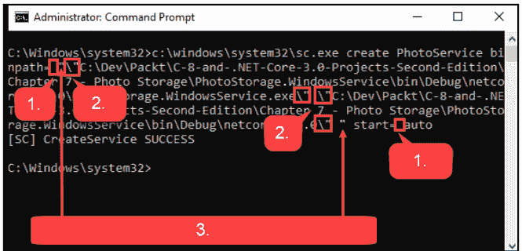

前面截图中的命令可以如下解释：

- 1. 参数后面的空格并非装饰性的，而是怪异地必要！
- 2. binpath 参数内的任何引号都必须转义。
- 3. 这些表示 binpath 参数的开闭引号。

创建服务后，你应该能够看到它并启动它：

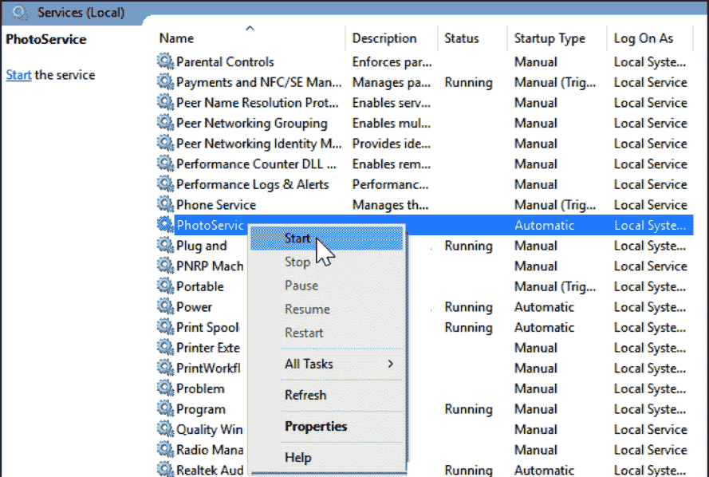

就是这样。现在，你应该能够将文件拖入指定目录，并看到它们神奇地上传到云端（你可以使用 Azure Storage Explorer 进行检查，正如我们在本章前面提到的那样）。

这很棒，但如果不起作用怎么办？

## 测试和调试

如果你拉取存储库，你会看到我添加了一些单元测试来覆盖一些基本功能。如果你发现某些东西不起作用，那么编写一个暴露该问题的单元测试通常是修复它的最快方法。但是，有时应用程序会运行，单元测试通过，但某些东西仍然不起作用。我列出了一些步骤，你可以按照这些步骤尝试调试服务，以防它不起作用。


### 步骤 1 – 检查服务是否在运行

这听起来很简单，但某事无法按预期运行的最明显解释，就是它根本没有在运行。你可以通过打开“服务”应用程序来轻松检查服务是否在运行：

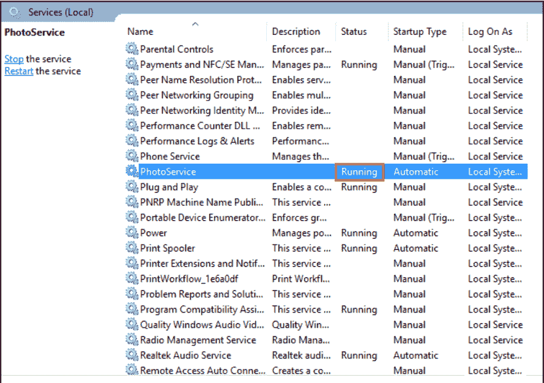

如果服务不显示**运行中**，如上一张截图所示，则表示未运行。这可能有多种原因，而且与大多数其他类似情况不同，直接启动它不太可能奏效。通常，找出原因的最快方法是检查日志文件或事件查看器。

### 步骤 2 – 检查日志文件

最初，日志文件将写入与可执行文件相同的目录中（除非你为配置文件指定不同的目录）。日志文件可能如下所示：

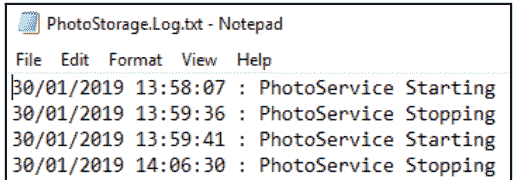

> 在服务中创建 `PhotoService` 启动和 `PhotoService` 停止日志消息的代码已从前面的代码片段中省略；但是，如果你拉取仓库，应该能够看到我添加的所有日志，甚至可以添加自己的日志。

这通常是调试逻辑错误的好工具（例如，我原本期望我的应用程序执行 X，但它却执行了 Y）；但是，如果你的服务只是崩溃，那么事件查看器应该告诉你崩溃的位置。

### 步骤 3 – 检查事件查看器

当 Windows 服务执行任何操作时，它都会向事件查看器写入一条条目。你可以在此处查看可能发生的任何错误：

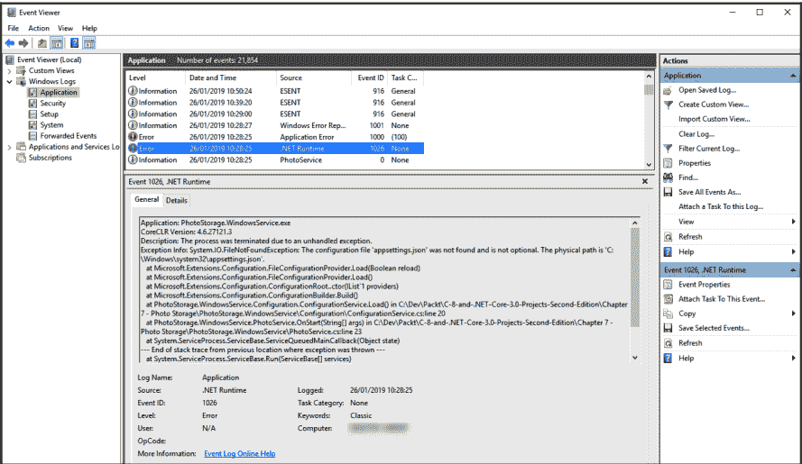

如你所见，在前面的案例中，服务无法找到配置文件。

此处不可能涵盖每一种可能的错误和解决方案；但总体而言，Windows 服务遵循与其他任何程序相同的规则。如果 Windows 服务在测试框架中正常工作且单元测试通过，那么可能的问题是环境问题，即已部署目录、权限或所需的运行时资源。

如果程序找不到配置文件（或任何依赖项），请打开它正在查找的目录，看看自己是否能找到日志文件（或依赖项）。在此示例中，appsettings.json 文件只需复制到输出目录即可。你可以通过更改生成操作和复制到输出目录参数，让 Visual Studio 完成此操作。

事件查看器是一个非常有用的工具，它会提供完整的调用堆栈，这意味着你可以隔离出失败的特定行。

## 摘要

在本章中，我们使用 .NET Core 3 和 Windows 兼容包创建了一个 Windows 服务。我们还使用了 C#8 中提供的新 switch 语句。然后，我们使用 Azure Blob 存储作为上传和存储文件的机制。

我们现在有一个小服务，它会在后台运行，并在我们将文件拖入特定目录时将文件上传到云中。

在下一章中，我们将探讨 Docker 以及如何构建可在 Azure AKS 上托管的服务。
