# 使用 Docker 和 Azure Kubernetes 服务构建负载均衡的订单处理微服务

不久以前，在浏览招聘广告时，“n 层架构”一词常出现，是潜在候选人需要熟悉的内容。这种架构范式背后的原理是：通常有一个存储在公司自有服务器上的数据存储；接着，有一个服务（或多个服务）会应客户端应用程序或另一个服务的请求来查询这些数据，此外还有一个客户端应用程序（无论是桌面客户端还是 Web 客户端）与该服务进行通信。该架构通常如下所示：

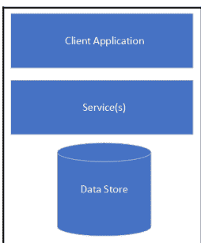

“n 层”取代了“三层”，因为图中的服务实际上可以调用另一个服务，因此客户端和服务器之间可能存在多个层。

这种方法有许多优点：你可以将 UI 和业务逻辑分开，并且（如果做得正确）它可以与数据存储无关（或者至少不是与数据存储不可撤销地绑定）。所有代码都可以存在于一个解决方案中（如果你使用 .NET），并且你知道数据库中的任何内容都是任何给定时刻的状态。

但是，这种架构方法存在一些缺点，这些缺点与规模或可靠性有关。

首先是使用量：如果你增加流量，那么到了某个点，你的架构将无法处理该级别的流量。

我们之前提到的数据存储有定义的限制，因为最终它是在读写磁盘。这一点可以改进：数据可以分布在多个磁盘上，这大大提高了性能。还有一个问题是，在更新数据库中的数据时，必须锁定记录，最后，插入新记录、更新索引等等所需的物理时间。

服务也存在类似问题：它一次能摄入的流量量是有限的，尤其是在与数据库通信并执行事务时。当然，你可以增加服务的数量，但它们都在争夺同一个数据存储。

下一个规模问题是开发：假设你想同时处理应用程序的几个部分。当然，使用现代源代码控制，在机械上这非常容易；但是，你的销售订单系统可能依赖于你的库存检查系统。你可能会遇到这样的情况：销售订单团队无法推进，因为库存检查团队仍在处理某个特定功能。

此外，如果你想更新这些系统之一，那么你需要一次性测试并更改所有系统。这意味着系统的每个部分在每次部署时都会发生变化（也许有些部分只是因为重新编译而改变，但它们确实会改变）。

那么，解决方案是什么？许多人最近一直在推广分布式系统的概念（至少在撰写本文时是如此）。其理念是将整个系统拆分为松散耦合的部分或服务。系统的各部分通常通过某种形式的消息传递进行通信。

出于本章的目的，我们将基于这样一个前提来工作：我们的系统是为一家大型 DIY 商店连锁设计的。

在本章中，我们将探讨使用 Azure Kubernetes 服务来扩展和编排微服务。我们将涵盖以下主题：

- 在 Azure 中创建存储队列
- 创建新服务并将其部署到 Azure 容器注册表 (ACR)，然后再部署到 Azure Kubernetes 服务 (AKS)
- 通过终止 Pod 来演示系统是负载均衡的
- 使用 JMeter 在负载下测试我们的服务

微服务和容器目前是热门术语：

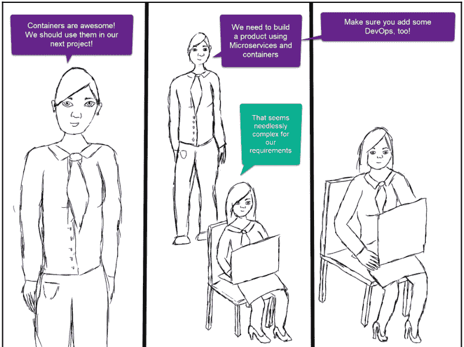

## 技术要求

我们将使用 **Azure Kubernetes 服务 (AKS)**，因此你需要的第一个东西是 Azure CLI。你可以通过访问 `https://aka.ms/installazurecliwindows` 来安装它。

你还需要一个 Azure 帐户；如果你没有，可以在此处创建一个：`https://azure.microsoft.com/` 。

在撰写本文时，你可以免费注册，并获得首月 £150/$200 的信用额度。

注册后，请访问 `https://portal.azure.com`。在此处，你可以管理 Azure 资源并查看余额。

## JMeter

这是一个可选步骤，我将在稍后说明如何跳过此步骤。如果你选择跳过，也可以直接跳到本节末尾。

为了在负载下测试我们的微服务，我们将使用一个名为 JMeter 的工具；可以从 `http://jmeter.apache.org/download_jmeter.cgi` 下载。

此外，你需要安装 Java SE 开发工具包；可以在此处安装：`http://www.oracle.com/technetwork/java/javase/downloads/index.html`。

安装 JRE 超出了本章的范围，尽管网上有许多相关教程；如果你正确安装了它，应该能够在命令提示符中键入以下内容并查看已安装的版本：

```
`java --version`
```

## 微服务

多年前，我曾参与开发一个 **电子数据交换 (EDI)** 系统。该系统的工作方式是：销售订单系统将当天的销售摘要写入文本文件；然后，另一个进程会拾取该文本文件并处理这些订单。本质上，这是一个分布式系统：系统的每个部分相互独立地运行。销售订单系统可以关闭，但它已经写入的任何文件仍会被处理。


如今，这种数据交换形式已改为使用消息代理：要么在本地维护，要么在云端维护。我稍后会详细解释为什么会这样。

撰写本文时，RabbitMQ 和 ActiveMQ 是两种知名的消息代理，通常在本地运行。所有主要云服务提供商都以一种或另一种形式提供消息代理，包括 Azure、Google 和 AWS（它们使用 ActiveMQ）。

微服务只是一种分布式系统，并且与使用容器很契合。其思想是将最小粒度的功能封装在一个自包含的进程中。关键在于该进程是自包含的——虽然似乎没有官方文档声明什么是微服务，但如果你仅仅有一个直接依赖于另一个进程的进程，那么将其称为微服务是不正确的。

值得在此考虑一下“依赖”这一术语。在我的 EDI 示例中，显然在逻辑进程意义上存在依赖。这里的测试是，你是否可以关闭其中一个进程，而其他进程仍能继续运行（显然效果会有限）。

我们已经了解了创建分布式系统对我们有什么好处，但让我们考虑一下这种方法的弊端，因为弊端很多：除非你需要，否则绝对不应该创建分布式系统。我在此编制了一份（非详尽的）负面清单（每一点在某种程度上都可以缓解，但这份清单的目的是说明这并非万能药）：

- **数据完整性**：在使用单一数据存储的系统中，你可以简单地依赖所选 DBMS 的事务模型来确保，例如，当你创建销售订单时，库存会减少。在真正的分布式系统中，这些可能是独立的服务，你无法将其作为单个事务来执行；其净效果是，你无法保证在任何特定时刻你的数据是正确的。

- **系统复杂性**：一旦你开始创建许多服务，就会发现存在一张逻辑依赖网（类似于我们之前提到的单体或 n 层系统中可能存在的物理依赖）。

- **速度**：将一组数据写入数据库的最快方式是在单个事务中完成。一旦在该过程中引入服务总线，其速度就会显著降低。

- **维护**：使用这种架构风格的优势之一是你可以独立更新各个组件，但这也是其弊端之一。如果你有 50 个不同的组件，那么你就需要跟踪 50 个不同的版本。

在本章中，我们将做以下事情：

- 创建一个非常简单的销售订单处理系统。不会有前端，但我们会向其提供一份销售订单列表。

- 将我们的系统封装在 Docker 容器中，并将其添加到托管在 Azure Kubernetes Service (AKS) 上的 Kubernetes 集群。

- 演示，即使我们杀死了该服务的一个实例，或者它崩溃了，Kubernetes 也能自愈，我们的订单将继续被处理。

我提到了 Docker 和 Kubernetes，但这些技术究竟是什么？最简单的方法是从探索 Docker 开始。

## 探索 Docker

Docker 是一个容器引擎：这意味着你可以将进程（可执行文件）的所有依赖项封装到单个实体中。我经常认为，分析最终（或当前）导致容器的历程是有帮助的。

在过去，在 Microsoft 开发世界（.NET 之前），我们会编写仍然依赖于 DLL 的应用程序。Windows 提供了一个注册表，告诉程序 DLL 位于何处。当需要交付产品时，你必须创建一个安装程序，将依赖项添加到注册表中；但是，由于所有 DLL 都集中存储，你会遇到这样一个问题：另一个程序可能依赖于同一个 DLL，但版本不同。不用说，这造成了无数问题，我们根本不知道现场运行的是什么代码，也从不敢肯定任何东西都能安装成功。注册表清理工具和安装工具如雨后春笋般涌现，最后 Microsoft 远离了注册表模型。

当 .NET 发布时，有两种方式可以交付你的依赖项：你可以将它们安装到全局程序集缓存 (GAC)，或者只是将它们放在与可执行文件相同的目录中。GAC 有其自身的问题（它与注册表模型非常接近），但我需要并使用的打包依赖项方式工作得还不错；然而，当你想要使用系统依赖（例如 .NET Framework）时会发生什么？好吧，同样，Microsoft 做得不错，它允许你将此添加到安装程序中，但我们回到了这个原则：我们正在将一段软件在与测试时不同的环境中运行。例如，你针对哪个版本的 SQL Server 编写了数据访问代码，而目标机器上是否也是那个版本？

开始出现的是这样一种原则：创建虚拟机，然后将整个虚拟机简单地复制到目标位置；这样，你可以绝对确定运行的是什么，因为它基本上就是进行测试的同一台机器。这是一个很好的解决方案，但它（可以说）走得太远了。现在有许多带有操作系统和许可证的虚拟机需要更新和维护。所需要的是一个用于应用程序的容器，你可以在其中存储应用程序及其依赖项，但整体需要从操作系统中抽象出来。

本质上，Docker 就是如此——一个这样的容器。

## Kubernetes 和编排

就一切实际目的而言，Kubernetes 出现于 2016 年左右。这受到 Google 内部一个他们已使用多年的产品的启发。为了说明 Kubernetes 允许我们做什么，我邀请你跟我一起走一遍一个小场景。

你在超市排队。不幸的是，收银机非常成问题，总是在故障。超市里有一个工作人员的工作是保持队列流动：他的名字叫 Winston，因此每次收银机故障时，他会将队列中的下一位人士重定向到另一台收银机，修复收银机，然后重新开启它。

突然，队列变得非常大：200,000 人同时加入队列。Winston 有指示，如果发生这种情况，他应该“扩展”，因此他迅速又建造了 500 台收银机来应对压力；花了几分钟，但收银机很快就上线了，队列又流动起来了：


Kubernetes 扮演我们的 Winston 角色：它可以创建新容器，在无停机时间的情况下升级现有容器，并路由流量。

## 创建我们的微服务

我们应该考虑我们的微服务是什么，以及它不是什么：这里最重要的是，服务需要是自治的。如果我们创建一个需要其他服务才能运行的服务，那么它就不是微服务。

我们不应该将此与创建需要其他服务才能运行的服务混淆。例如，我们的销售订单处理系统必须有销售订单，而这些订单来自外部源。这是可以的，因为我们不依赖于那个外部源：如果我们没有收到销售订单列表，那么我们的服务仍将运行；它只是什么也不做。

让我们开始创建我们的新服务！

请记住，我们这里所说的 *服务* 是指执行任务的进程：它不应与“服务”一词的特定用法混淆，例如 REST 服务。我们想要的仅仅是一个独立进程。

请记住，就像我们忙碌的超市员工 Winston 一样，Kubernetes 可以通过 *复制* 容器来扩展你的应用程序。只有当容器或进程以允许这种方式编写时，才能复制容器或进程。这对我们意味着，我们需要使用一种机制与我们的服务进行通信，该机制允许多个进程从单个队列中读取，而该队列需要维护。

如果我们回到关于超级超市员工 Winston 的例子，队列中每个人只有在被叫到时才会走近收银机；如果他们都试图同时走近收银机，那么收银机操作员将无法为他们服务。或者，想象一种情况：收银机操作员走到队伍前面，扫描最前面那个人的商品，但然后把那个人留在那里：下一个可用的收银机操作员可能也会这样做。Winston 新建收银机只有在存在一种机制让顾客有序地走近收银机时才有效。

我们的容器也是如此：如果你以错误的方式设计微服务，那么它根本无法扩展。

## 队列

为了解决这个问题，我们将使用 Azure 服务总线为系统的输入提供一个队列；因为我们不需要保证投递顺序，所以可以使用存储队列而不是服务总线队列。

值得牢记的是，在销售订单处理的情况下，处理消息的顺序可能不太重要；但是，情况并非总是如此。你应该仔细考虑在你自己的案例中，投递顺序是否至关重要。


让我们先配置队列：

- 1. 我们需要做的第一件事是创建一个新存储帐户。在 Azure 门户中，从菜单中选择 **存储帐户**，或直接搜索。一旦 **创建存储帐户** 边栏出现，选择添加新存储帐户的选项：

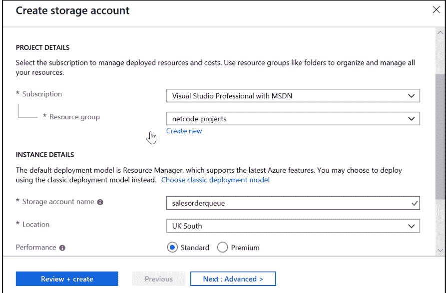

- 2. 撰写本文时，创建存储帐户时有四项服务可用：Blobs、Files、Tables 和 Queues。我们要做的需要 **队列**，因此从列表中选择它：

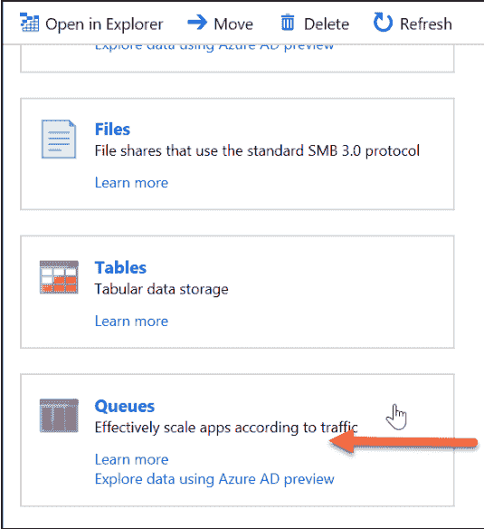

- 3. 选择 **队列** 后，你会看到当前设置的队列列表。这里最初有点空荡荡，所以让我们创建一个新队列：

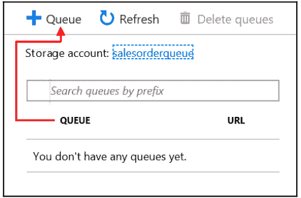

- 4. 这里会要求你为队列命名：

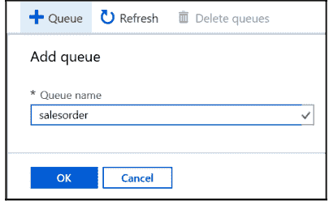

- 5. 新队列创建完成后，请记下 URL，稍后会用到：

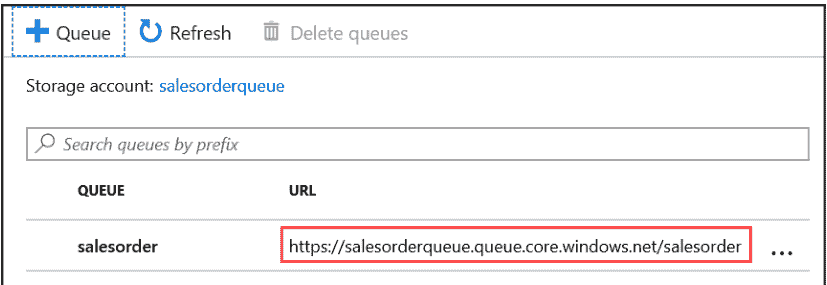

- 6. 接下来，导航到访问密钥并复制连接字符串（同样，稍后会用到）：

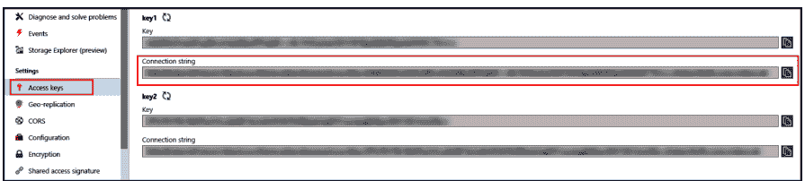

我们已配置好队列，现在是时候探讨如何模拟创建销售订单了。

## 销售订单生成器

由于我们没有一个每天接收数千个订单的网站，我们将创建一个新进程来生成销售订单消息。随后，我们将使用名为 JMeter 的工具多次调用该进程，以模拟高负载。让我们先构建用于创建新消息的应用程序；第一步是创建一个新的 .NET Core 3 控制台应用程序。

即使你决定不使用 JMeter，也请继续阅读，我会说明哪些部分可以跳过。

由于我们将向存储队列写入和读取数据，我们将把这些代码放在一个单独的帮助程序库中。目前，我们假设该帮助程序已存在来编写代码。让我们从控制台的主方法开始：

```csharp
static void Main(string[] args)
{
    // How many to create?
    int salesOrderCount = int.Parse(args[0]);

    // Set-up Helpers and Dependencies
    var serviceBusHelper = new ServiceBusHelper();
    var productRepository = new ProductRepository();
    var productService = new ProductService(productRepository);
    var salesOrderRepository = new SalesOrderRepository();

    // Process sales orders - will run forever
    var generateSalesOrders = new GenerateSalesOrders(serviceBusHelper,
        productService);
    generateSalesOrders.Run(salesOrderCount);
}
```

如你所见，我们遵循手动构建依赖项的标准，而不是使用第三方库。

```csharp
public class GenerateSalesOrders
{
    private readonly IServiceBusHelper __serviceBusHelper;
    private readonly IProductService __productService;
    private Random __rnd = new Random();
    public GenerateSalesOrders(IServiceBusHelper serviceBusHelper,
        IProductService productService)
    {
        __serviceBusHelper = serviceBusHelper;
        __productService = productService;
    }
}
```

这里我们只是接受一些基本依赖项：`serviceBusHelper` 和 `productService`。我们将稍后详细介绍这些类。

> 目前，我希望引起你对 `__rnd` 变量的注意。除了编写游戏之外，在代码中发现随机数的情况很少。我觉得在这里使用它是合理的，因为我们正在生成示例数据。显然，任何使用随机数的测试都不符合 FIRST 测试原则。

类的下一部分是 Run 方法：

```csharp
public void Run(int salesOrderCount)
{
    for (int i = 0; i < salesOrderCount; i++)
    {
        var newOrder = CreateSalesOrder();
        __serviceBusHelper.SendToSalesOrderMessageQueue(newOrder);
    }
}
```

这只是调用一个方法来创建销售订单，然后使用服务总线帮助程序将消息放入队列。我们将在下一节中再讨论服务总线，但目前，让我们来看看 `CreateSalesOrder()` 方法做了什么：

```csharp
private SalesOrder.Models.SalesOrder CreateSalesOrder()
{
    var products = __productService.GetProductData();
    var product = products.ElementAt(__rnd.Next(products.Count() - 1));
    var salesOrder = new SalesOrder.Models.SalesOrder()
    {
        ProductCode = product.ProductCode,
        UnitPrice = product.UnitPrice,
        Quantity = __rnd.Next(1, 5)
    };
    return salesOrder;
}
```

这个方法还有更多内容，但本质上我们只是调用产品服务来检索产品列表，然后随机选取一个。最后，我们使用随机数量创建一个销售订单。

产品服务从产品存储库读取产品列表；为了完整起见，我将在此列出产品服务及其接口。但是，由于它只是调用产品存储库，我不会对代码进行进一步解释：

```csharp
public interface IProductService
{
    IEnumerable<Models.Product> GetProductData();
}
```

实现如下：

```csharp
public class ProductService : IProductService
{
    private readonly IProductRepository _productRepository;
    public ProductService(IProductRepository productRepository)
    {
        _productRepository = productRepository;
    }

    public IEnumerable<Models.Product> GetProductData()
    {
        return _productRepository.GetProductData();
    }
}
```

我会再次列出存储库接口，但它不需要任何解释：

```csharp
public interface IProductRepository
{
    IList<SalesOrder.Models.Product> GetProductData();
}
```

这里有趣的部分在于实现。不过，在深入探讨之前，我将向你展示这些组件在我的解决方案中的位置，以及我将用于产品数据的数据：

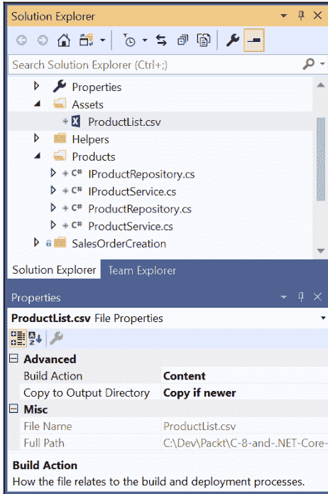

`ProductList.csv` 文件已作为内容文件包含。我不会在此列出完整内容，但如果你想查看，我鼓励你从 GitHub 仓库下载它。不过，我会列出前几行，让你了解文件的格式（毕竟，我相信你编造产品代码和价格的能力和我一样强！）。文件应采用以下格式：

```
SCREW025MMX50, 1.72
HARDWOODSQMT, 0.45
SLEDGEHAMMER, 34.56
```

## 产品存储库方法如下

```csharp
public IList<SalesOrder.Models.Product> GetProductData()
{
    string data = File.ReadAllText($"Assets/ProductList.csv");
    var products = new List<Models.Product>();
    string[] productLines = data.Split(Environment.NewLine);
    foreach(var productLine in productLines)
    {
        string[] productData = productLine.Split(",");
        var product = new Models.Product()
        {
            ProductCode = productData[0],
            UnitPrice = decimal.Parse(productData[1])
        };
        products.Add(product);
    }
    return products;
}
```

该文件包含的内容相当多，首先是调用读取数据文件中的所有文本。首先，我们将其拆分为行，然后用逗号进一步拆分。最后，我们创建一个新的产品类对象并读取数据。

这段代码的健壮性不强：使用格式不正确的数据很容易让它崩溃。如果你决定扩展此项目，可以从这里开始，要么通过添加一些防御性检查来改进代码，要么甚至将数据移至数据库；对于任何严肃的扩展，后者是明智的。

> **提示** 如果你希望提高代码的可靠性，可以选择使用我创建的以下 NuGet 包：https://www.nuget.org/packages/Castr/。

现在我们已完成服务和存储库的处理，让我们来看看服务总线帮助程序。


## 服务总线帮助库

如前一节所示，我们正在引用服务总线帮助程序。对于生成例程，我们将在服务总线帮助程序中只有一个方法。我强烈建议将此代码放在其自己的项目中：这样，你可以将对 Azure 的依赖限制在单个项目中。以下是我当前解决方案的概述：

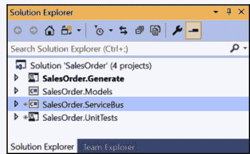

如你所见，我们已分离服务总线交互。让我们来看看迄今为止一直在使用的接口：

```
public interface IServiceBusHelper
{
    Task SendToSalesOrderMessageQueue(SalesOrder.Models.SalesOrder salesOrderData);
}
```

在我们的新项目中，我们需要引用一个 Microsoft NuGet 库：

```
Install-Package WindowsAzure.Storage
```

完成此操作后，我们可以实现帮助程序方法：

```
public async Task SendToSalesOrderMessageQueue(Models.SalesOrder salesOrderData)
{
    CloudStorageAccount storageAccount = CloudStorageAccount.Parse("DefaultEndpointsProtocol=https;AccountName=salesorderqueue;AccountKey=...;EndpointSuffix=core.windows.net");
    CloudQueueClient queueClient = storageAccount.CreateCloudQueueClient();
    CloudQueue queue = queueClient.GetQueueReference("salesorder");
    CloudQueueMessage message = new CloudQueueMessage(JsonConvert.SerializeObject(salesOrderData));
    await queue.AddMessageAsync(message);
}
```

在深入解释这段代码的作用之前，请注意传递给 `CloudStorageAccount.Parse()` 的字符串是我们之前记下的连接字符串。如你所见，我已将连接字符串直接放入代码中。不用说，这是不良实践；然而，与以前的章节一样，我认为这能更好地、更直接地说明我们正在编写的软件。

那么，这段代码在做什么呢？起初，我们创建一个 `CloudStorageAccount` 实例；这实际上连接到 Azure 存储帐户，并作为我们未来调用的基础。接下来，我们请求一个 `CloudQueueClient`，然后使用 `GetQueueReference` 获取队列本身的引用。最后，我们通过简单序列化类数据并将其添加到队列来构建一条新消息。

一条消息应包含处理该消息所需的所有信息。你应仔细考虑消息的大小；但是，在存储队列中，你有 200 GB 的限制！

## 测试我们的销售订单生成器和 JMeter

在继续之前，让我们快速测试一下生成器。有两种方法可以做到这一点；第一种是在命令行中编译并运行软件，但你也可以简单地在项目属性中提供一个参数：

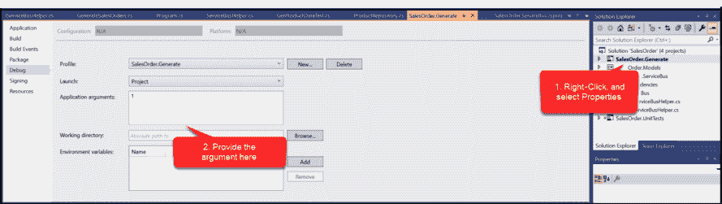

如你所见，我选择创建一个订单。最好先尝试创建一个项目，仅为了检查它是否能正确运行。一旦你知道这有效，你可以将其增加到，比如，10 或 20。

你如何知道它有效？幸运的是，Microsoft 有存储资源管理器应用程序，你可以免费下载；你可以在这里找到它：https://azure.microsoft.com/en-us/features/storage-explorer/。

此外，在撰写本文时，Microsoft 已在门户中发布了同一工具的预览版：

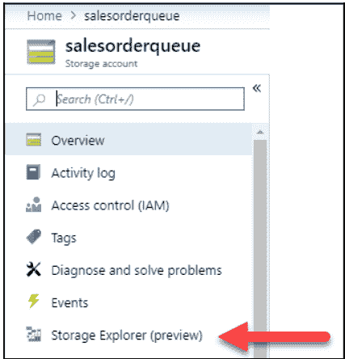

无论你决定以何种方式查看队列，运行销售订单生成器后，你应该在队列中看到一条消息（以下屏幕截图来自桌面版本）：

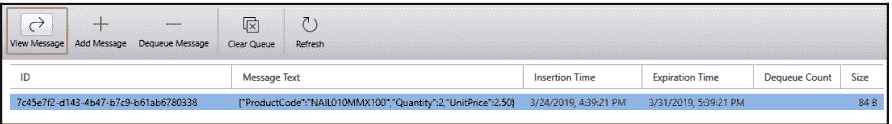

尝试为 10 条甚至 100 条消息运行软件，仅为了检查它是否按预期生成它们。

我们的下一步将是从 JMeter 调用我们的程序，以便我们可以模拟同时下达许多订单。

## JMeter

要模拟高负载，一个选择是简单地编译应用程序并同时运行多个实例。像 JMeter 这样的工具就是为此而设计的：我在“技术要求”部分中提到过 JMeter 是可选的；如果你不想使用 JMeter，那么只需多次运行你的应用程序，将数量设置为大约 100。以下 DOS 命令会为你完成此操作：

```
for /l %x in (1, 1, 10) do start SalesOrder.Generate.exe 10
```

在这种情况下，我们调用 Generate 例程 10 次。这将几乎立即向队列添加 100 条消息。你会在 GitHub 仓库中找到一个执行相同操作的批处理脚本。如果你不希望使用 JMeter，请随意跳到下一节，标题为“日志记录”。

回到 JMeter，假设你已成功安装 JDK（请参阅“技术要求”部分），你应该能够将 ZIP 文件简单地解压到本地驱动器上的某个位置并运行 jmeter.bat。你可以在解压后的以下子目录中找到它：apache-jmeter-5.1\bin。

如果你已成功运行该软件，应该会看到类似这样的屏幕：

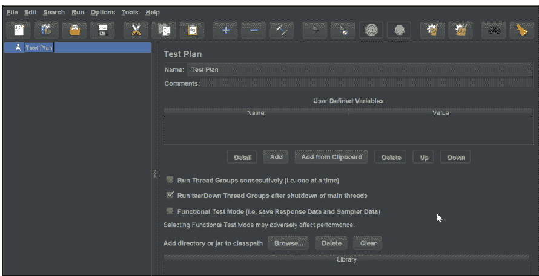

> 值得注意的是，取决于你阅读本文的时间，JMeter 的用户界面可能已更改。

第一步是添加一个线程组：

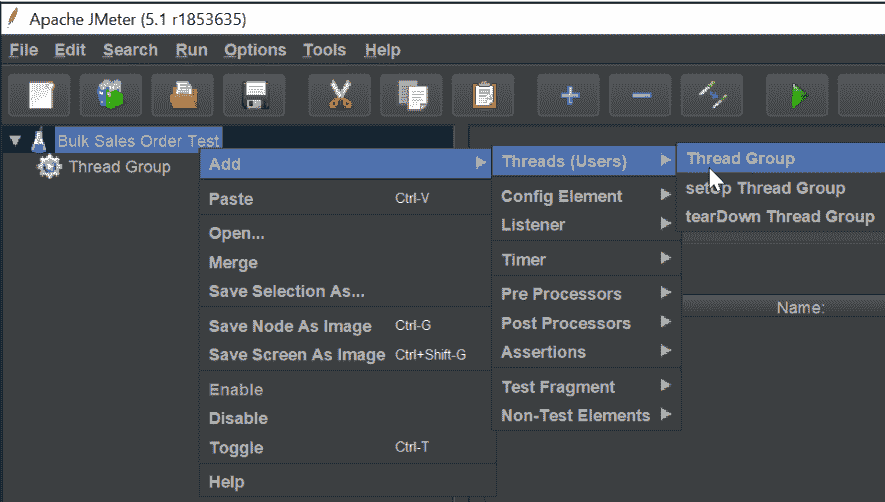

线程组是一组表示执行操作的用户的方式。让我们设置 10 个用户，每个用户将运行我们的生成应用程序 10 次。

> 10 个用户运行应用程序 10 次，且应用程序每次调用生成 10 个订单，这意味着将生成 1,000 个订单。

以下是我们如何在线程屏幕上配置前面的场景：

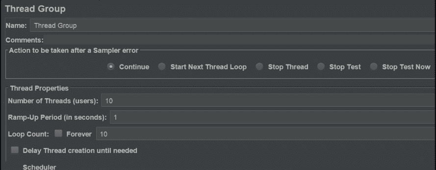

最后，我们将添加一个新的采样器来调用我们的可执行文件：

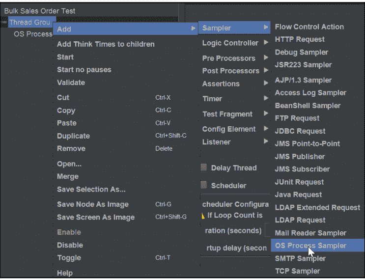

添加该采样器后，我们可以要求它从新采样器调用我们的可执行文件，这样就完成了：

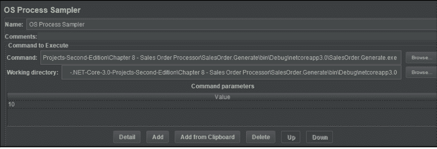

一切就绪。只需按下播放按钮。10 个用户应该会立即开始飞快下单！

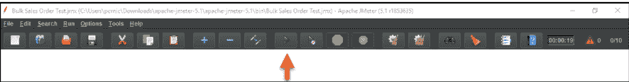

## 日志记录

在进一步深入之前，我们应该考虑日志记录。使用单一应用程序时，日志记录是一个相当简单的过程——你将所有内容记录到日志文件中（通常位于服务器上），并且由于所有调用都是指向该单一服务器上的服务，因此所有内容都记录在同一个地方。在迁移到微服务时，我们会创造许多问题，其中之一就是日志记录。究竟是哪个服务在记录日志，日志记录到了哪里？在容器系统中，你不能简单地记录到本地文件系统，因为它不一定会持久化。

创建一个聚合日志记录系统远超出本章的范围；但是，如果你希望这样做，我强烈建议你查看一些主要云提供商提供的产品。Microsoft 的 Application Insights 提供日志记录功能。

另一个选择是简单地创建一个日志队列并将所有日志消息写入队列（然后，你可以选择编写一个消费者，将其转换为单个文件）。请记住，你可能会在完全相同的时间写入多条日志消息，因此你应该有办法分离这些进程。

## 创建新微服务

既然我们有了队列和一些数据，就可以创建我们的新微服务了。

我们的微服务将与技术无关。它将使用 .NET Core 3.0 编写并在 Linux 容器中运行；但是，它不会对任何外部托管有任何硬依赖，因此我们应该能够将其从 AKS 中移除并放入 Google 托管的 Kubernetes 中。如果你在开发微服务（或任何东西），你应该问自己为什么使用你选择的技术（和架构）。如果是个人项目，诸如“为了接触该技术”这样的理由是可以接受的，但是如果你在为他人开发软件并获得报酬，说出这个理由可能不被付费者接受。Kubernetes 是一个出色的容器编排器，但请记住，如果你只是编写一个 Azure WebJob 或函数，你可能以较少的开销获得你需要的所有好处。

我们的服务本身非常简单。我们将只需监控队列，并在找到消息时对其进行处理。显然，一个完整的、功能齐全的销售订单处理系统对于单个章节来说代码太多了；但是，我们将创建一个完整的流程，它将执行以下操作：

- 将新销售订单添加到数据库
- 将一条消息添加到另一个队列，供分发系统提取

你可能已经从架构中意识到，这个过程是断开的；也就是说，当用户下订单时，检查是否有足够库存来完成订单的过程发生在离线状态下。这是故意为之：系统这样处理是为了应对突发的流量激增；然而，这意味着你必须重新思考用户体验。假设用户已经下了订单，然后在未来的某个时间点，订单被拒绝。有办法处理这种情况；例如，如果库存是你唯一的潜在问题，你可以简单地将补货商品所需的时间计入交货时间，这样每个订单都有 10 天的交货窗口，但大多数订单会在 2 天内送达。简而言之，这是一个业务逻辑问题，但也许你在更传统的架构中不会遇到这个问题。


现在，我们需要创建我们的微服务。其逻辑实际上相对简单；该服务应执行以下操作：

- 检查销售订单队列是否有新请求；如果没有请求，则服务应在一段时间后再次检查（我们将设置为 1 分钟）
- 如果找到一条消息，则服务应将销售订单添加到数据库中
- 服务应向新队列发送一条消息，表明订单已成功

> 显然，此流程已被精简，但它本身是完全功能的。

## 创建我们的新 Docker 容器

首先，让我们创建一个新的控制台应用程序；我们将在 Linux 容器中编译和运行它。控制台应用程序的创建方式与其他任何控制台应用程序完全相同，但由于我们要处理 Linux，因此命名必须为小写且不能包含点号。这使得我们的解决方案看起来有点杂乱，但尽管如此，让我们创建 `salesorder-process`：

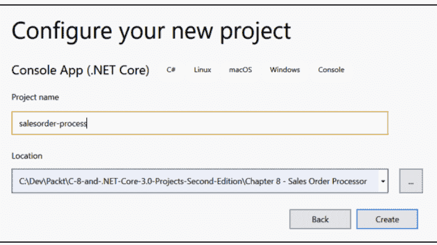

下一步是添加 Docker 支持。在这里，你可以手动创建 Dockerfile，但 Visual Studio 很贴心地为我们提供了帮助。右键单击项目，现在有一个“添加 | Docker 支持”选项：

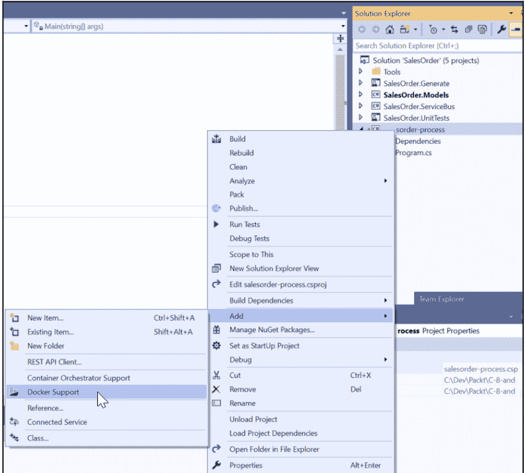

你将看到可以创建 Windows 容器或 Linux 容器的选项；我们将选择 Linux。这将为你创建 Dockerfile。

Docker for Windows 要么运行 Linux 容器，要么运行 Windows 容器，但在撰写本文时，它不能同时运行两者（你可以切换）。看来 Microsoft 正全力押注 Linux 容器，因此我的建议是选择 Linux 并坚持使用它。当然，这只是我个人的看法。

Dockerfile 出现后，将出现一个新的右键上下文菜单。选择 **生成 Docker 镜像**：

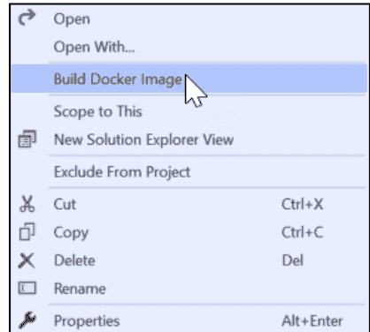

经过相当长的构建过程后，你应该会收到镜像已成功创建的报告。为了检查这一点，让我们运行一个 PowerShell 实例并查看当前可用的镜像列表；列出镜像的命令如下：

```
docker images
```

你的新镜像应该列在顶部：

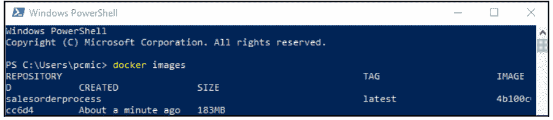

现在，我们可以运行此镜像，只是为了检查它是否构建正确。为此，请使用以下命令：

```
docker run salesorderprocess
```

你应该会看到控制台应用程序的输出；由于我们尚未更改任何内容，这是默认的 Hello World。

既然我们已成功创建容器，让我们开始添加构成微服务的逻辑。

## 创建微服务逻辑

逻辑本身相对简单；但是，你会注意到这里有一些空白，我们正在使用不存在或不可访问的方法和类。我们将首先将逻辑放入一个单独的类中；为了让类易于理解，我们将创建一个名为 Run 的公共函数：

```
public async Task Run()
{
    while (true)
    {
        if (!await ProcessEachMessage())
        {
            await Task.Delay(60000);
            continue;
        }
    }
}

public async Task<bool> ProcessEachMessage()
{
    SalesOrder.Models.SalesOrder? salesOrder = await
    _serviceBusHelper.GetNextOrderFromMessageQueue();

    if (salesOrder == null) return false;

    _salesOrderService.Create(salesOrder);
    await _serviceBusHelper.ConfirmSalesOrderToMessageQueue(salesOrder);

    return true;
}
```

如果我们确实从队列中获取了销售订单，我们会调用服务方法来创建销售订单；然后，我们向队列添加一条确认消息。

这是这种设计的基础；当你需要与系统的其他部分通信时，你需要通过一种不需要该部分立即（甚至根本不）响应的机制来进行。在这种情况下，如果我们停止此服务，然后运行生成器，生成器不会因为服务未运行而失败。

我们使用单独的类是为了能够注入依赖项；如你所见，我们正在使用几个，而且它们目前大多不存在。我们将稍后介绍那些，但让我们先介绍一下新类的构造函数：

```
private readonly IServiceBusHelper _serviceBusHelper;
private readonly IProductService _productService;
private readonly ISalesOrderService _salesOrderService;

public SalesOrderProcessor(IServiceBusHelper serviceBusHelper,
IProductService productService,
ISalesOrderService salesOrderService)
{
    _serviceBusHelper = serviceBusHelper;
    _productService = productService;
    _salesOrderService = salesOrderService;
}
```

此时，你需要添加对 SalesOrder.ServiceBus 和 SalesOrder.Models 项目的引用。我们现在已经到了这样一个阶段：SalesOrder.Generate 内部的大部分代码应该移至其自己的项目，以便从其他地方访问。由于这大部分是将代码从一个项目移到另一个项目，我不会详细介绍每个类，而只是展示新旧项目的结构；以下是移动后的 SalesOrder.Generate 项目：

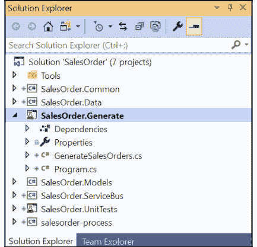

如你所见，我们已将 SalesOrder.Generate 中的几乎所有内容移出，并转移到一个新项目：SalesOrder.Data。让我们看看 SalesOrder.Data 中有什么：

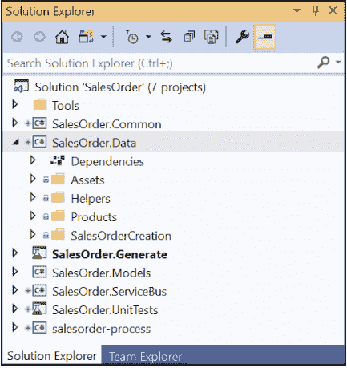

如你所见，我们只是将文件从一个项目复制并粘贴到另一个项目。唯一必要的其他步骤是重命名命名空间；例如，`ProductService` 的命名空间现在将是 `SalesOrder.Data.Products`。

> 在这种情况下，Ctrl + Shift + H 是你的最佳朋友，它将允许你将旧命名空间的所有实例替换为新命名空间。

你还需要添加一些项目引用；`SalesOrder.Generate` 项目现在应引用 `SalesOrder.Data` 项目。新的 `SalesOrder.Data` 项目反过来依赖于 `SalesOrder.Models`。

既然我们已经处理完这些，可以开始填充我们的存根函数了；让我们从 `SalesOrder` 服务开始。

> 为了说明方便，我们将服务和数据存储库类分组在单个项目中。通常，应该避免这样做；如果你决定扩展此项目，将存储库和服务分开可能是个好主意。

## 创建新的 Azure SQL 数据库

当你为容器编写代码时，尤其是在你希望获得顺畅的开发体验时，记住 Docker 命令变得不那么重要了；事实上，在本章的过程中，在开始将容器移至 AKS 之前，甚至有可能不需要接触命令行。因此，很容易忘记你正在容器内运行，而且是 Linux 容器。EF Core 允许你连接到 SQL 实例，因此连接到 (LocalDB) 会很容易。但是，你无法从容器内部访问它，因为它是仅限 Windows 的概念，并且当然存在于主机上，而不是容器中。

那么，我们可以从容器内部访问 SQL Server 吗？如果可以，怎么做？答案是你可以访问它，但你需要记住你在哪里：当你在容器内部时，你的 localhost 不是你的机器——而是你的容器。如果你想托管自己的 SQL Server 实例，当然可以，但你需要通过外部 IP 地址连接。

在我们的案例中，我们打算将此移至 AKS，因此将数据库托管在 Azure 上是合理的。让我们快速创建一个新的 Azure SQL 数据库和服务器。从 Azure 中，选择 SQL 数据库边栏选项卡：

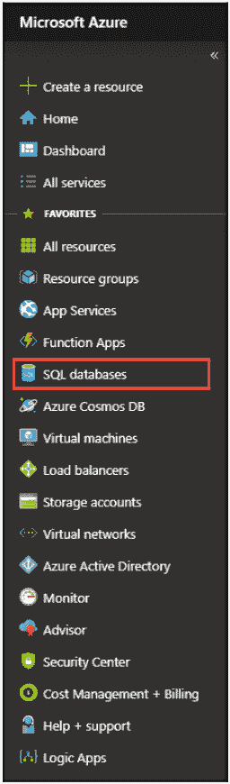


照常，你也可以直接搜索。选中后，单击**添加**以创建新数据库：

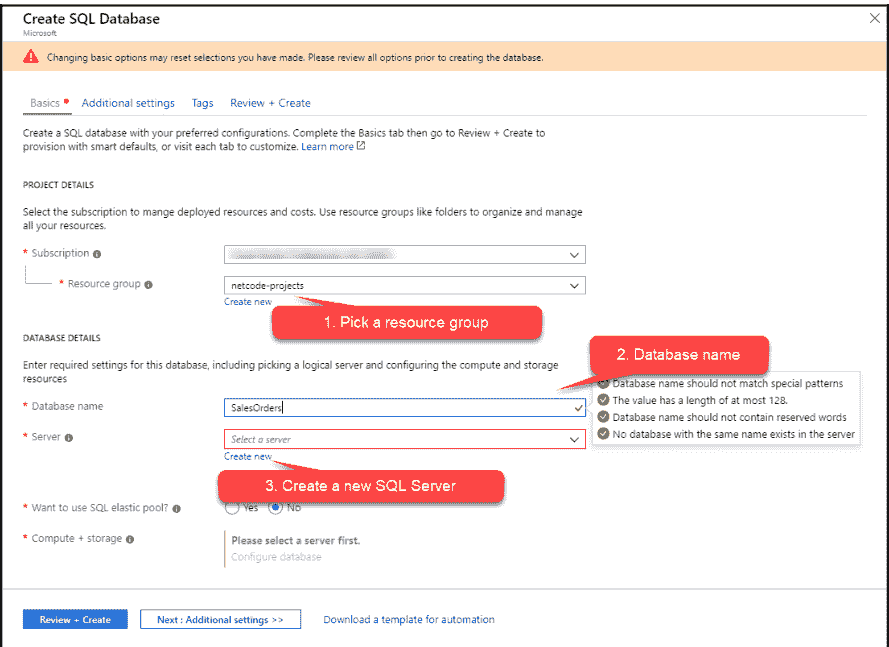

现在这个界面应该已经看起来很熟悉了。所有部分大体相同：**订阅**和**资源组**决定了资源的位置。**数据库名称**应在每个服务器上唯一。

除非你已经设置好服务器，否则请选择标记为**创建新 SQL 服务器**的链接。这将在屏幕右侧打开一个窗口，允许你创建新服务器。完成后，它会为你填充该值。

你将获得默认的标准 S0 计算和存储模型。你选择的计算和存储模型只有你自己知道；不过，如果你只是跟着学习这是如何工作的，我建议选择配置数据库的超链接并选择**基本**层级。撰写本文时，其费用低于每月 5 英镑。

资源创建完成后，从**概述**中选择**连接字符串**，并保存连接字符串的副本——我们很快就会用到它。

## 实体框架核心

此时，我们需要引入数据持久层。为此，我们将使用**实体框架核心 (EF Core)**。第一步是将 EF Core 添加到数据项目中：

```
Install-Package Microsoft.EntityFrameworkCore -ProjectName SalesOrder.Data
Install-Package Microsoft.EntityFrameworkCore.Tools -ProjectName SalesOrder.Data
Install-Package Microsoft.EntityFrameworkCore.SqlServer -ProjectName SalesOrder.Data
Install-Package Microsoft.EntityFrameworkCore.Design -ProjectName salesorder-process
```

安装所需的包后，我们需要几个类，以便 EF Core 能够创建我们的数据库；让我们将它们都放在 **SalesOrder.Data** 项目中名为 **实体** 的新文件夹里。事实上，我们首先需要的是一个 **SalesOrder** 实体：

```csharp
public class SalesOrderEntity : SalesOrder.Models.SalesOrder
{
    [DatabaseGenerated(DatabaseGeneratedOption.Identity)]
    public int Id { get; set; }
}
```

如你所见，我们只是从模型继承。拥有可与数据库无关地传递的模型类，然后从中继承以创建数据库实体的过程并不罕见。你可以简单地告诉 EF 使用模型类，但此方法提供了一种抽象，因此你可以掩盖对模型类的更新，而不让它们扩散到数据库。我们还在这里声明了一个自动生成的主键，这显然不应该出现在我们的模型中。

接下来，我们需要创建一个数据库上下文：

```csharp
public class SalesOrderContext : DbContext
{
    public SalesOrderContext(DbContextOptions<SalesOrderContext> options) :
    base(options)
    {
    }

    public DbSet<SalesOrderEntity> SalesOrders { get; set; }
}
```

这里，我们只是想要一个表来保存销售订单。其余功能由 EF Core 有帮助地为我们提供（注意我们从 DbContext 继承）。最后，我们需要一个设计上下文，以便 EF Core 知道在哪里创建我们的数据库：

```csharp
public class SalesOrderContextFactory :
IDesignTimeDbContextFactory<SalesOrderContext>
{
    public SalesOrderContext CreateDbContext(string[] args)
    {
        var optionsBuilder = new DbContextOptionsBuilder<SalesOrderContext>();
        optionsBuilder.UseSqlServer(@"Data Source=[ConnectionString]");

        return new SalesOrderContext(optionsBuilder.Options);
    }
}
```

这只是为了让 EF Core 能够连接到我们的数据库并创建或更新它。你需要将 [ConnectionString] 占位符替换为你之前记下的连接字符串。

连接字符串绝对不应该出现在此文件中；一旦你熟悉了工作原理，我建议你将其放入配置文件中。

这就是我们需要的所有基础设施。下一步是添加迁移：

```
Add-Migration InitialCreation -Project SalesOrder.Data -StartupProject salesorder-process
```

> **提示：** 你可以从 PowerShell 或任何你选择的地方调用此命令，但在 Visual Studio 内使用包管理器控制台会直接在 IDE 中提供一个方便的 PowerShell 接口。

这应该会在 `SalesOrder.Data` 项目中创建一个 `Migrations` 文件夹，并提供一个将创建数据库的迁移。为了让它实际创建数据库，我们需要另一个命令：

```
Update-Database -Project SalesOrder.Data -StartupProject salesorder-process
```

快速查看 Visual Studio 中的 SQL Server 对象资源管理器，应该可以验证数据库确实已创建。我们现在可以继续处理我们的代码，并从消息队列填充它。

> **提示：** 你可以让程序在运行时自动调用迁移。两种方式都有其优势；这种方法提供了更多控制（如果数据库不是最新的，你将无法运行软件），但是，在你的部署场景中，手动运行更新脚本可能说不通。

## 创建销售订单

在创建销售订单时，我们实际上有两层抽象：服务和仓储类。这里的想法是，仓储负责数据访问，服务负责业务概念。在我们的情况中，这些是相同的，因为这是一个非常简单的应用程序，但如果你开始扩展此项目，牢记这些差异将有助于代码保持整洁和简洁。

> **提示：** 为了抽象而抽象是简洁的敌人。如果你 *知道* 你的应用程序永远只是数据库上的一个 UI，并且你将始终使用实体框架，那么请直接访问数据上下文。虽然这确实降低了创建不包含数据访问的单元测试的能力，但可以认为，在这种情况下，那些测试无论如何都是不必要的。

从我们之前在 Main 方法中创建的代码来看，我们需要在销售订单服务中创建两个新方法；我们将从创建销售订单开始。

SalesOrderService 需要一个名为 Create 的单一方法。以下是修改后的接口：

```csharp
public interface ISalesOrderService
{
    void Create(SalesOrder.Models.SalesOrder salesOrder);
}
```

承认，这没什么好看的。其实现也不复杂多少：

```csharp
public void Create(SalesOrder.Models.SalesOrder salesOrder)
{
    var salesOrderEntity = new SalesOrderEntity ()
    {
        ProductCode = salesOrder.ProductCode,
        Quantity = salesOrder.Quantity,
        Reference = salesOrder.Reference,
        UnitPrice = salesOrder.UnitPrice
    };
    _salesOrderRepository.Create(salesOrderEntity);
}
```

我们的存储库方法接受 SalesOrderEntity 类型的实体（我们之前已经介绍过），这意味着我们需要在这里转换对象。我们将存储库注入此类；为了完整性，以下是构造函数和类变量：

```csharp
public class SalesOrderService : ISalesOrderService
{
    private readonly ISalesOrderRepository _salesOrderRepository;

    public SalesOrderService(ISalesOrderRepository salesOrderRepository)
    {
        _salesOrderRepository = salesOrderRepository;
    }
    ...
}
```

我们的下一步是在 StorageQueueHelper 中填充方法。

## 存储队列

我们有两个方法需要从存储队列中完成。我们的第一个方法是 ConfirmSalesOrderToMessageQueue；它负责将销售订单的副本发布到新队列，以指示我们已处理它。你可能会开始注意到这与我们最初写的将消息发送到队列的方法之间的相似之处：

```csharp
public async Task ConfirmSalesOrderToMessageQueue (Models.SalesOrder salesOrderData)
{
    CloudStorageAccount storageAccount =
    CloudStorageAccount.Parse ("DefaultEndpointsProtocol=https;AccountName=salesorderqueue;AccountKey=aa8eED0s5wezSDCyj0BmukVq2zEp9uEFRVq4jIRr+n8L1NNSUyZ2ajXZHVN91BgsQQ9sPE2gnlsb5MWC1TsVw==;EndpointSuffix=core.windows.net");

    CloudQueueClient queueClient = storageAccount.CreateCloudQueueClient ();
    CloudQueue queue = queueClient.GetQueueReference ("salesorderconfirm");
    await queue.CreateIfNotExistsAsync ();
    CloudQueueMessage message = new CloudQueueMessage (JsonConvert.SerializeObject (salesOrderData));

    await queue.AddMessageAsync (message);
}
```

> 请记得将连接详细信息替换为你自己的（这些不是真实的帐户详细信息）。

事实上，这两个方法几乎相同。队列名称不同，但显然，如果你愿意，这两个方法可以重构为一个。目前，我将保持它们分开，因为我认为这更好地说明了它们不同的功能；不过，我不会重新解释代码。

最后，我们有从队列中获取下一个销售订单的代码，即 GetNextOrderFromMessageQueue：

```csharp
public async Task<Models.SalesOrder?> GetNextOrderFromMessageQueue ()
{
    CloudStorageAccount storageAccount =
    CloudStorageAccount.Parse ("DefaultEndpointsProtocol=https;AccountName=salesorderqueue;AccountKey=aa8eED0s5wezSDCyj0BmukVq2zEp9uEFRVq4jIRr+n8L1NNSUyZ2ajXZHVN91BgsQQ9sPE2gnlsb5MWC1TsVw==;EndpointSuffix=core.windows.net");
    CloudQueueClient queueClient = storageAccount.CreateCloudQueueClient ();
    CloudQueue queue = queueClient.GetQueueReference ("salesorder");
```


var message = await queue.GetMessageAsync();
if (message == null) return null;
string data = message.AsString;
var salesOrder =
JsonConvert.DeserializeObject<Models.SalesOrder>(data);

await queue.DeleteMessageAsync(message.Id, message.PopReceipt);
return salesOrder;
}
```

再次，这是一组非常熟悉的方法；重点如下：

```
var message = await queue.GetMessageAsync();
...
string data = message.AsString;
```

这只是返回一条消息。现在，我们可以通过使用 AsString 属性来提取其内容。然后，我们将其反序列化回 SalesOrder 对象：

```
await queue.DeleteMessageAsync(message.Id, message.PopReceipt);
```

此命令从队列中删除消息。值得注意的是，在此之后如果发生崩溃，消息将丢失。你可能需要考虑保留此 ID，甚至在创建订单后才删除消息。不过，我们仍然可以识别出唯一的订单，因为我们能够确定销售订单没有确认。

如果现在运行此项目，你会发现它按预期工作，并开始处理队列中的任何消息。

最后一步是将此上传到 Azure 的 AKS 系统，从而完成项目。

现在我们已创建项目，让我们看看如何在 Microsoft Azure Kubernetes Service 中托管该项目。

## Azure Kubernetes 服务

Azure Kubernetes Service（通常简称为 AKS）只是多种云端 Kubernetes 产品之一。它介于创建和托管自己的 Kubernetes 集群与使用特定云服务（例如 AWS Lambda 和 Azure Functions）之间，是一种半成品解决方案。主要优势在于控制力（你可以确定部署如何以及为何进行缩放）和可移植性（你应该能够从 Microsoft 迁出，将完全相同的设置部署到 Google，并从中断处继续）。

## 构建 Docker 镜像

让我们从代码创建 Docker 镜像。在项目中找到 Dockerfile，并从上下文菜单中选择“构建 Docker 图像”：

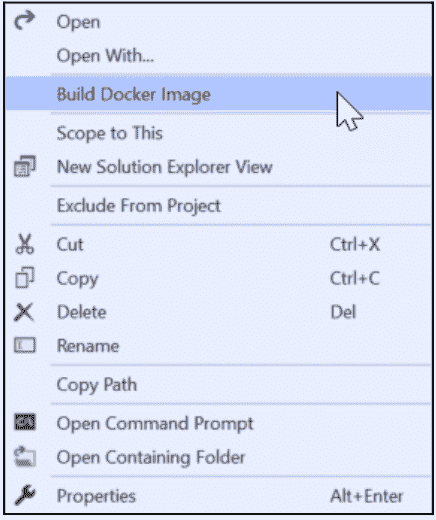

## Azure 容器注册表

现在，你应该能够打开 PowerShell 并输入以下内容：

```
docker images
```

这将列出你当前机器上所有的 Docker 镜像。容器注册表本质上是此的远程版本；也就是说，你创建镜像并将其上传到注册表。当上传到 AKS 时，我们需要镜像位于容器注册表中。虽然 Azure 有自己的容器注册表，但你可以使用任何注册表；Docker 拥有容器注册表，大多数（如果不是全部）大型云提供商也都有。在本节中，我们将上传到 **Azure 容器注册表 (ACR)**。

直到现在，我们一直依赖 Visual Studio 来管理 Docker 镜像；撰写本文时，这是一项非常新的功能，以前所有操作都需要在命令行中完成。现在，我们需要离开 IDE 的舒适区，进入 PowerShell 和 Azure CLI 的晦涩世界。为确保已安装 CLI，请打开 PowerShell 窗口并输入以下命令：

```
az --version
```

> 我的版本是 2.0.57，不过 2.0.55 及更高版本应该都可以。如果你的版本低于该版本，请返回 *技术要求* 部分并重新安装 CLI。如果你未安装此工具，请跳回 *技术要求* 部分，那里有安装说明。

我们的首要任务是将镜像推送到 ACR。

## Azure 容器注册表

现在我们已确认拥有有效的 CLI 版本，可以创建新的注册表；以下命令将为你完成此操作：

```
az acr create --resource-group netcode-projects --name salesorderregistry --sku Basic
```

netcode-projects 是我的资源组，因此你需要将其替换为自己的资源组。我将注册表命名为 salesorderregistry，但只要你遵守命名规则，就可以随意命名你的注册表。sku 决定可用的性能和规模。

使用时你需要查阅具体细节，但大致来说，付费越多，性能越好，规模也越容易扩展。这是云使用中的常见模式。

上述命令的响应应类似于以下内容：

```
PS C:\> az acr create --resource-group netcode-projects --name salesorderregistry --sku Basic
{
  "adminUserEnabled": false,
  "creationDate": "2019-04-10T07:13:45.7357544+00:00",
  "id": "/subscriptions/.../resourceGroups/netcode-projects/providers/Microsoft.ContainerRegistry/registries/salesorderregistry",
  "location": "uksouth",
  "loginServer": "salesorderregistry.azurecr.io",
  "name": "salesorderregistry",
  "networkRuleSet": null,
  "provisioningState": "Succeeded",
  "resourceGroup": "netcode-projects",
  "sku": {
    "name": "Basic",
    "tier": "Basic"
  },
  "status": null,
  "storageAccount": null,
  "tags": {},
  "type": "Microsoft.ContainerRegistry/registries"
}
```

请记下 loginServer 响应，因为这决定了你今后如何引用你的注册表，从登录开始：

```
az acr login --name salesorderregistry
```

在上述命令中，salesorderregistry 实际上是我们几分钟前创建 ACR 时返回的值（为此命令，我们只需要该值的第一部分）。你应该会收到此命令的响应，告知登录已成功。

此前，我们查看了 Docker 镜像以识别本地系统中存在的镜像；我们需要再次使用该命令，但这次需要记下镜像名称和标签。提醒一下，命令如下：

```
docker images
```

响应应类似于以下内容：

```
PS C:\> docker images
REPOSITORY                                      TAG                 IMAGE ID            CREATED             SIZE
D
salesorderprocess                               dev                 3071c2
                                                41 hours ago        183MB
fcfee                                           latest              e95e574
salesorderprocess                               41 hours ago        192MB
5e62a
```

首先，我们需要为镜像打标签；以下命令应能完成此操作：

```
docker tag salesorderprocess
salesorderregistry.azurecr.io/salesorderprocess:v1
```

如果再次列出镜像，应该能看到新标签：

```
salesorderregistry.azurecr.io/salesorderprocess    v1     e95e574
5e62a      41 hours ago   192MB
```

现在我们有了标签，可以将镜像推送到仓库：

```
docker push salesorderregistry.azurecr.io/salesorderprocess:v1
```

这次，我们应该会看到一些活动；也就是说，当镜像被推送到仓库时，你应该能看到状态条在移动：

```
PS C:\> docker push salesorderregistry.azurecr.io/salesorderprocess:v1
The push refers to repository [salesorderregistry.azurecr.io/salesorderprocess]
e3015455a998c: Pushed
14a21ca053e7: Pushed
28faef933b8f: Pushed
132c8212430d: Pushed
98bd9d81b9b02: Pushed
5dacd731af1b: Pushing [==================================================>]  44.47MB/55.28MB
```

为确认这一点，请使用以下命令，它应会告诉你镜像现已确实位于 ACR 中：

```
az acr repository list --name salesorderregistry --output table
```

现在我们已在容器注册表中拥有镜像，可以创建 Kubernetes 集群并设置编排。

## Azure Kubernetes 服务

我们将花费整个部分在 PowerShell 中。为了使用 Kubernetes，首先需要安装 CLI。为此，请登录 Azure：

```
az login
```

这应该会弹出一个窗口，允许你输入 Azure 凭据。身份验证通过后，你应该能够安装 Kubernetes CLI：

```
az aks install-cli
```

这可能需要下载一段时间；下载完成后，我们就可以创建新的 Kubernetes 集群。集群，本质上，就是你提到 Kubernetes 时所想到的东西。集群中的节点由主节点管理。这意味着你与主节点交互，由主节点将工作负载委派给节点。一个很好的理解方式是将其比作建筑工地上的工作队：你可以走向工头并请他建一堵墙，但他不太可能亲自去做；相反，他会找一些可用且能够建墙的工人，请他们开始施工。

以下命令应会创建我们的集群：

```
az aks create --resource-group netcode-projects --name salesorder-cluster --generate-ssh-keys
```


值得指出的是，创建 Kubernetes 集群会创建多个虚拟机，无论你是否实际使用它们，都需要付费。总的来说，完成本章时可能只需花费一两英镑，但请记得事后清理；否则，你可能会收到一笔出乎意料的高额账单！

同样，你应将资源组替换为本项目使用的资源组。你也可以将名称替换为……嗯，你喜欢的任何名称。


你请求的 SSH 密钥将允许你访问集群。

完成后，你应该会收到一个包含大量集群详细信息的 JSON 响应。


下一步是将 `kubectl` 工具指向你的新集群：

```
az aks get-credentials --resource-group netcode-projects --name salesorder-cluster
```

`kubectl` 是通过命令行与 Kubernetes 交互的主要工具。

我们可以通过让它列出我们的节点来验证它现在是否能正常与我们的集群一起工作：

```
kubectl get nodes
```

你应该会得到三个节点的列表，全部准备就绪。接下来我们需要做的是指定集群中要使用的 Docker 镜像；我们可以通过创建 Kubernetes 部署文件（YAML 格式！）来做到这一点。

## Kubernetes 部署

现代部署技术的巨大优势之一是，你不再需要公司里有 *执行部署* 的人。我记得在早期的职业生涯中，你要么自己手动将软件部署到生产环境，要么认识 *办公室里的人* 能做到这一点。不用说，这种技术充满了危险！输入错误的命令，你可能会部署错误的软件，或者错误或不完整地部署正确的软件；这使得现场诊断问题变得极其困难，因为你从来不太确定那里有什么。

当今，有很多工具可以帮助做到这一点；然而，Kubernetes（以及容器生态系统）的构建中，自动化部署是你使用它的一部分。因此，为了在 Kubernetes 上部署任何东西，你必须创建一个脚本（YAML 或 JSON 格式），告诉 Kubernetes 要部署什么以及如何部署。

YAML 对空白字符敏感，也就是说，缩进层级很重要。

让我们先创建我们的 YAML 文件：

```
apiVersion: extensions/v1beta1
kind: Deployment
metadata:
  name: salesorderservice
spec:
  replicas: 2
  template:
    metadata:
      labels:
        app: salesorderservice
    spec:
      containers:
      - name: salesorder-process
        image: salesorderregistry.azurecr.io/salesorderprocess:v1
        ports:
        - containerPort: 80
```

在这里，我们声明了将镜像部署到 Kubernetes 的意图。部署之后，Kubernetes 会不断尝试保持此声明的正确性；例如，如果节点宕机，它会尝试创建另一个；如果我们推送新镜像，它会尝试获取该镜像，以此类推。

可以简单地要求 Kubernetes 返回最新镜像（:latest），但这通常被认为是不良实践，尤其是在生产环境中，因为这可能导致生产环境出现未计划的更改。

现在，我们可以使用 kubectl 工具应用我们的部署（每当部署文件更改时都需要这样做——我们稍后会再回来讨论这一点）：

```
kubectl apply -f "C:\Dev\Packt\C-8-and-.NET-Core-3.0-Projects-Second-Edition\Chapter 8 - Sales Order Processor\deployment.yaml"
```

记住要将路径替换为你自己的 YAML 文件的路径。

运行此命令时，它看起来应该正常工作。然而，这实际上告诉你的只是文件本身是有效的；你要求它执行的操作可能不可能。例如，让我们键入以下内容：

```
kubectl describe pod
```

由此，我们可以看到部署远未成功：

```
Events:
  Type     Reason             Age   From                                                              Message
  ----     ------             ---   ----                                                              -------
  Normal   Scheduled          24m   default-scheduler             Successfully assigned default/salesorder...
  ...
  Warning  Failed             23m   (x4 over 24m)   kubelet, aks-nodepool1-40464275-0   Error: ErrImagePull
  Warning  Failed             9m    (x64 over 24m)  kubelet, aks-nodepool1-40464275-0   Error: ImagePullBackOff
  Normal   BackOff            4m    (x86 over 24m)  kubelet, aks-nodepool1-40464275-0   Back-off pulling image "salesorderreg...

```

问题是，Kubernetes 没有权限从 ACR 拉取镜像。我们可以通过查看 Kubernetes 仪表板来更好地了解正在发生的情况。首先，我们需要让仪表板访问我们的集群：

```
kubectl create clusterrolebinding kubernetes-dashboard --clusterrole=cluster-admin --serviceaccount=kube-system:kubernetes-dashboard
```

然后，以下命令将启动仪表板：

```
az aks browse --resource-group netcode-projects --name salesorder-cluster
```

> 在尝试诊断 Kubernetes 问题时，仪表板是一个非常有价值的工具！

事实上，为了从 ACR 拉取，AKS 需要明确权限。我们可以使用以下命令授予该权限：

```
az ad sp create-for-rbac --skip-assignment
```

由此，你应该得到类似下面的响应：

```
PS C:\Users\pmic> az ad sp create-for-rbac --skip-assignment
>>
{
  "appId": "8a970d1b-7b69-4d2e-a084-0087c9cbf5d0",
  "displayName": "azure-cli-2019-04-11-07-25-04",
  "name": "http://azure-cli-2019-04-11-07-25-04",
  "password": "1e1ddf9f-ac29-4b35-bfb4-f8bc08b588c4",
  "tenant": "03510b8c-63d4-414d-8e1e-a4cbd8bdeb99"
}
```

高亮显示的值是被分配者（assignee）的值（请记下它）；我们将稍后将其称为 `value_a`。我们还需要从容器注册表中获取一些详细信息：

```
az acr show --resource-group netcode-projects --name salesorderregistry --query "id" --output tsv
```

这应该给你类似下面的响应：

```
PS C:\Users\pmic> az acr show --resource-group netcode-projects --name salesorderregistry --query "id" --output tsv
/subscriptions/16a7fc79-9bea-4d04-83a1-09f3b260adb0/resourceGroups/netcode-projects/providers/Microsoft.ContainerRegistry/registries/salesorderregistry
PS C:\Users\pmic>
```

我们将此处的高亮值称为作用域（scope）（我们将其称为 `value_b`）。

为了实际分配角色，我们需要使用以下命令：

```
az role assignment create --assignee value_a --scope value_b --role acrpull
```

在我的情况中，这如下所示：

```
az role assignment create --assignee 8a970d1b-7b69-4d2e-a084-0087c9cbf5d0 --scope /subscriptions/16a7fc79-9bea-4d04-83a1-09f3b260adb0/resourceGroups/netcode-projects/providers/Microsoft.ContainerRegistry/registries/salesorderregistry --role acrpull
```

现在，这应该能正确工作；然而，如果你遇到任何问题，诊断这些问题的一个好起点是仪表板内部。选择下面截图中高亮显示的按钮将显示容器的日志文件，包括任何崩溃报告：

| 名称 | 节点 | 状态 | 重启次数 | 运行时间 | CPU (核心) | 内存 (字节) |
| :--- | :--- | :--- | :--- | :--- | :--- | :--- |
| salesorderservice-666bb859f-5nc64 | aks-nodepool1-40464275-1 | Running | 0 | 一分钟 | 0 | 21.145 Mi |
| salesorderservice-666bb859f-bcnrz | aks-nodepool1-40464275-2 | Running | 0 | 24 分钟 | 0 | 50.477 Mi |

如果你确实发现有任何错误，你可以修复它们并重新创建镜像（跳转到“构建 Docker 镜像”部分了解更多信息）。然后，你可以通过给镜像打标签来跟进；但是这次，将镜像标记为 v2。最后，更新并重新应用 deployment.yaml 文件。现在，你的新 YAML 文件可能如下所示：

```
apiVersion: extensions/v1beta1
kind: Deployment
metadata:
  name: salesorderservice
spec:
  replicas: 2
  template:
    metadata:
      labels:
        app: salesorderservice
    spec:
      containers:
        - name: salesorder-process
          image: salesorderregistry.azurecr.io/salesorderprocess:v2
          ports:
            - containerPort: 80
```

当你的 pod 正常运行时，你应该能在 pod 状态中看到以下内容：

```
kubectl describe pod
```

这应该给你 pod 的健康报告：

```
Type Reason Age From Message
Normal Scheduled 16m default-scheduler Successfully assigned default/salesorderservice-666b8b59f-wl58x to aks-nodepool1-40464275-1
Normal Pulling 16m kubelet, aks-nodepool1-40464275-1 pulling image "salesorderregistry.azurecr.io/salesorderprocess:v2"
Normal Pulled 16m kubelet, aks-nodepool1-40464275-1 Successfully pulled image "salesorderservice:v2"
Normal Created 16m kubelet, aks-nodepool1-40464275-1 Created container
Normal Started 16m kubelet, aks-nodepool1-40464275-1 Started container
PS C:\Users\pcmic>
```

最后，仪表板应该显示绿色：

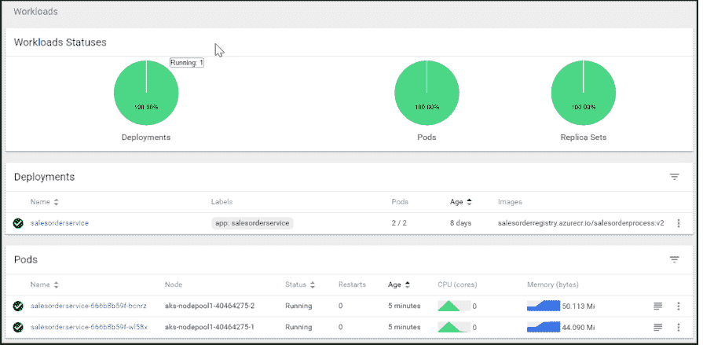

既然我们已成功配置 Kubernetes 集群，让我们回到本章标题，探讨 Kubernetes 的负载均衡方面。


## 负载均衡

本章的标题是《使用 Docker 和 Azure Kubernetes Service 的负载均衡订单处理微服务》。事实上，你已经见过这种情况了，因为 worker pod 根据可用性从队列中取出了项目。然而，让我们看看是否可以设计一个更具戏剧性的演示，来说明这实际上意味着什么。让我们进入仪表板，删除其中一个 pod；在 pod 右侧选择省略号并将其删除：

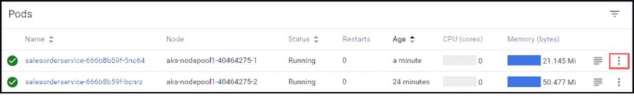

删除 pod 后，你应该（几乎立即）注意到屏幕变化，看起来像这样：

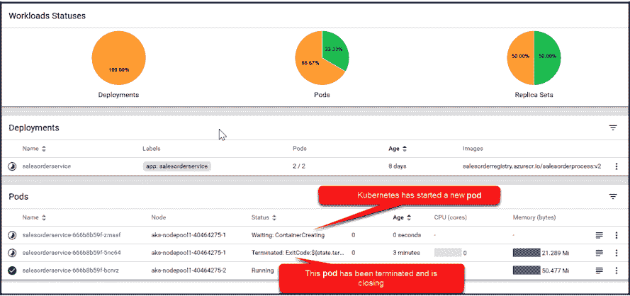

如你所见，一旦 Kubernetes 意识到你杀死了其中一个 pod，它就会立即通过启动一个新的来补偿！它怎么知道要这样做的？嗯，在我们的 deployment.yaml 文件中，我们已经将副本数设置为 2。为了证明这一点，让我们将副本数增加到 3：

```
apiVersion: extensions/v1beta1
kind: Deployment
metadata:
name: salesorderservice
spec:
replicas: 3
template:
metadata:
labels:
app: salesorderservice
spec:
containers:
- name: salesorder-process
image: salesorderregistry.azurecr.io/salesorderprocess:v2
ports:
- containerPort: 80
```

如你所见，我们只更改了那个字段，没有做其他改动。现在，让我们重新应用部署：

```
kubectl apply -f "C:\Dev\Packt\C-8-and-.NET-Core-3.0-Projects-Second-Edition\Chapter 8 - Sales Order Processor\deployment.yaml"
```

Kubernetes 立即行动，启动了一个新节点：

| 名称 | 节点 | 状态 | 重启 | 运行时间 | CPU (核心) | 内存 (字节) |
|---|---|---|---|---|---|---|
| salesorderservice-666bb59f-7z5hq | aks-nodepool1-40464275-2 | 运行中 | 0 | 7 秒 | - | - |
| salesorderservice-666bb59f-zmsf | aks-nodepool1-40464275-1 | 运行中 | 0 | 4 分钟 | | 21.781 Mi |
| salesorderservice-666bb59f-bcnrz | aks-nodepool1-40464275-2 | 运行中 | 0 | 31 分钟 | | 50.5 Mi |

现在，我们已成功创建 AKS 群集并看到它处理我们的订单。AKS 在不必要的情况下保持运行可能会很昂贵，因此我们将在下一部分拆除我们的资源。

### 清理

Kubernetes 群集可能是一项昂贵的业务。确切地说，它通常比购买并自行运行服务要便宜得多；但是，如果你在玩这些东西，你可能会迅速积累一笔巨额账单。要删除本章中创建的资源，让我们先从群集开始：

- 1. 首先打开 Kubernetes 服务边栏并选择你的群集：

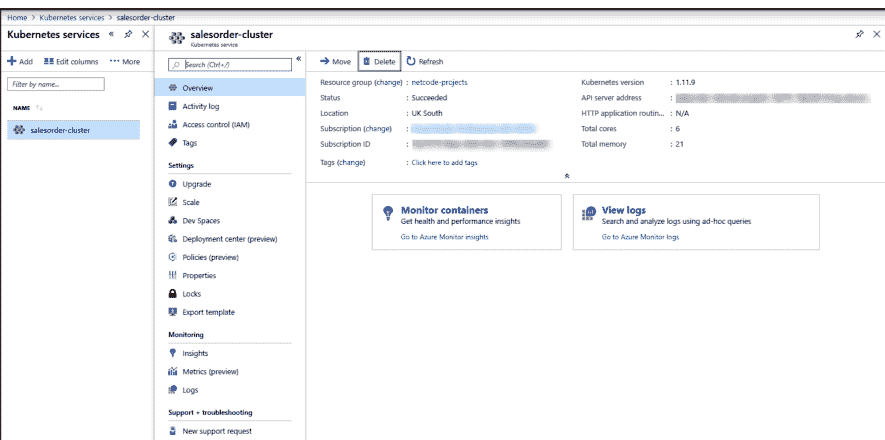

这绝非快速过程，但一旦完成，它还应该删除所创建的虚拟机。

- 2. 接下来，打开存储帐户边栏并找到你为存储队列创建的帐户：

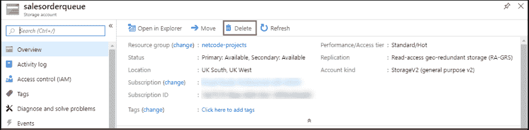

- 3. 我们的下一站是 **容器注册表** 边栏。我们需要找到我们的注册表并将其删除：

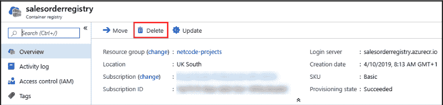

- 4. 最后但同样重要的是，是我们的数据库。在 **SQL 数据库** 边栏中，找到并删除我们创建的数据库：

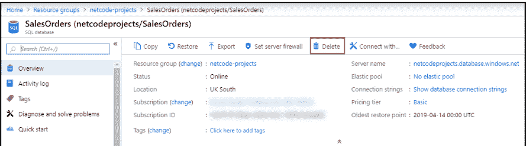

既然我们已清理了创建的资源，让我们谈谈本章所涵盖的内容。

## 摘要

在本章中，我们了解了什么是微服务以及如何创建一个。我们讨论了如何使用队列等技术来分离服务，这意味着一个微服务不依赖于另一个。在使用 Kubernetes 编排我们的服务时，我们看到这可以是一个自愈系统。

在此过程中，我们研究了 Docker 和构建 Docker 镜像；我们探索了容器注册表以及如何在其中存储 Docker 镜像；我们还创建和配置了 AKS 群集。我们探索了 Azure 中服务总线和存储队列的使用，以及它们如何在分布式系统中使用。

正如我在引言中提到的，这是一种非常诱人的架构模式；然而，我们也讨论了它并非没有代价，而那个代价就是复杂性。在用多个软件取代单一软件时，它们之间的交互、日志机制以及轻松维护整个系统的能力突然变得困难得多。

在下一章中，我们将朝着非常不同的方向前进，从设计大规模云托管系统转向运行在移动设备上的应用程序。然而，我们不会完全离开云的世界，因为我们将利用一些预构建的机器学习模型。
