# 情绪检测器移动应用 - 使用 Xamarin Forms 和 Azure 认知服务

在本章中，我们将结合过去几年中取得重大进展的两种技术：移动开发和机器学习。

几年前，机器学习仍然是极少数人的专属领域。它被用来预测天气和设计国际象棋计算机。对于该特定且专业领域之外的程序员来说，这根本遥不可及。然而，最近，随着云的到来以及前所未有的数据量，云提供商正在将这项能力作为服务提供给普通程序员。我们将看到，上传某人的人脸照片并让 Microsoft Azure 返回对该人脸的分析，以预测该人是开心、悲伤、愤怒等，是多么容易。

我们要涵盖的第二个主题是移动开发。Xamarin 使得可以编写 C# 应用程序、进行交叉编译，并在 Android、iOS 和其他平台上运行。Microsoft 收购 Xamarin 已经将这种跨平台移动开发方法变成了大多数桌面开发人员的默认选择。

本章将涵盖以下主题：

- 机器学习和 Azure 认知服务
- 跨平台开发：
  - 创建可在 Android 设备上运行的新 Xamarin 应用程序
  - 设置 Azure 认知服务
  - 从我们的新应用程序中使用认知服务

## 技术要求

要跟进本章，你需要安装 Visual Studio 的 Xamarin 工作负载。你应该能够在 Visual Studio 安装程序中找到它：

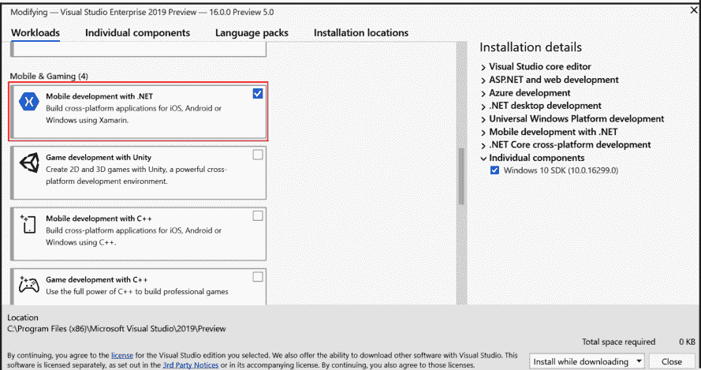

与以前的章节一样，你还需要一个 Azure 帐户。由于设置此过程的内容已在第 2 章《使用 Cosmos DB 的 ASP.NET Core MVC 应用任务错误日志》中介绍过，我们在这里不再赘述。

在测试阶段，我们将在物理设备上运行我们的应用程序；这意味着你需要能够访问带有附带摄像头的 Android 设备。没有这个，虽然你仍然可以跟进，但你将无法看到应用程序的工作情况。

## 概念概述

在开始构建任何东西之前，让我们简要讨论本章中两个主要概念的高层概述。

## 机器学习

这是一个巨大的主题，远远太大，无法在一个部分中以任何合理的深度来涵盖。但是，简要地介绍一下什么是机器学习，以及什么不是，是值得的。

在本章中，我们将拍摄一张人脸图像并将其上传到机器学习服务。该服务将提供关于它认为该人脸是开心、悲伤、愤怒或其他情绪的详细信息。重要的是，要尽量不要将此过程拟人化。算法将分析人脸并返回确定百分比；但是，这是基于它看到许多、许多相似图像并被告知它正在识别的图像是，例如，开心的。这意味着，如果我开始输入悲伤人员的图像，但告诉机器学习算法这些是开心的人，它将逐渐开始改变其估计。这是老话 **垃圾进，垃圾出 (GIGO)** 的现代等效物。

可以创建你自己的机器学习模型；事实上，所有大型云提供商都围绕此拥有工具套件。但是，这里有一个权衡：创建你自己的模型需要时间和数据科学专业知识，但它让你完全控制模型以及你想要解答的问题。另一方面，使用预构建服务意味着你依赖于服务提供商正确训练模型，因此它不太可能适合特定需求。

## 跨平台和移动开发

当 .NET 20 多年前首次发布时，它是一款 Windows 开发工具。事实上，直到那时，Microsoft 开发工具一直是 Windows 特定的，并且引以为傲。Microsoft 曾经有一种依赖于销售操作系统的商业模式；而且，很明显，如果你有程序员创建只能在你的操作系统上运行的软件，你就比竞争对手占优势。

这种模式似乎运行良好，直到 Apple 发布了第一部 iPhone。虽然 Windows 仍然主导商业市场，但人们逐渐开始转向手机，然后是平板电脑用于娱乐。Microsoft 每个家庭和企业都有一台电脑的梦想已经成为过去，程序员突然看到理由放弃 .NET 开发，转向 iOS 和 Android 开发。


为了追赶，微软尝试发布自己的手机（也就是说，他们收购了诺基亚）；他们也开始密切支持 Xamarin，试图让用 .NET 编写的代码在 Android 和 iOS 上运行。撰写本文时，微软已放弃对夭折的 Windows 手机的支持并收购了 Xamarin。有其他方法可以编写在 iOS 和 Android 上运行的软件，但据我所知，Xamarin 是唯一允许你使用 C# 并编译为原生平台的方法。

话虽如此，与本书中展示的所有技术一样，你应该考虑是否可以使用更简单的选项；例如，一个简单的网站是否可以满足你的需求？并非每个用例都需要为智能手机定制应用程序。

## 项目概览

本章的项目将是一个非常简单的应用程序。它将有一个单独的按钮来拍照。然后我们将该图像发送到 Azure 并显示结果，指示我们在该图像中检测到的情绪。

我们将使用 Xamarin Forms，这是一个简单的 UI 层，也是跨平台的：对于我们的需求，这是理想的，因为软件的 UI 组件非常小。

我们还将仅为 Android 创建此应用程序。这样做的主要原因是，要创建 iOS 应用程序，你需要一台 Mac，我觉得这会让许多读者（以及作者）无法跟随！

## 配置 Azure 认知服务

在开始编写任何代码之前，我们需要配置认知服务。要完成此操作，你需要一个 Azure 帐户；如果你还没有，请参阅第 2 章（使用 Cosmos DB 的 ASP.NET Core MVC 应用程序任务错误日志记录）。

让我们设置认知服务：

- 1. 我们将从在 Azure 门户中导航到 **认知服务** 边栏开始；你可以搜索它或从左侧菜单中选择它。从这个边栏，添加新服务。一旦你这样做，你将看到一系列可以创建的可能认知服务：

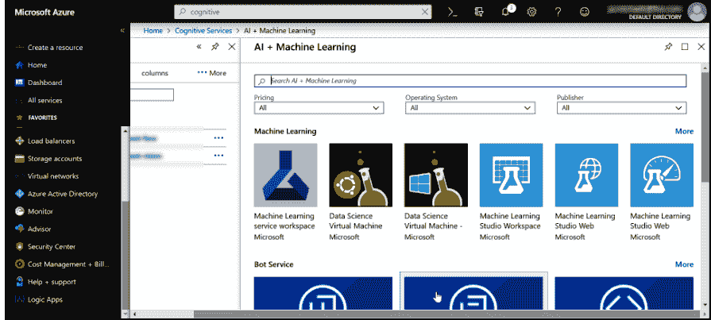

- 2. 同样，你可以通过向下滚动搜索此列表中的人脸 API，或直接在搜索框中输入 Face。这应该会显示人脸 API 并允许你创建它：

### 人脸

使用人脸 API 为你的应用程序添加人脸识别功能。最先进的算法在图像中检测人脸，为你的应用程序开启一系列人脸功能。人脸检测还可以识别属性，包括人脸特征（鼻子、眼睛等）、性别、年龄以及其他机器预测的面部特征。

一旦识别出人脸，API 可以使用置信度分数检查图像或多个图像中的两个人是否相同，或将其与数据库进行比较，看是否已存在外观相似或相同的人脸。它还可以使用共享视觉特征将相似的人脸组织成组。

使用人脸 API 将人脸识别作为你应用程序的关键功能。

- 3. 一旦你选择 **创建**，你将看到一个熟悉的选项列表：

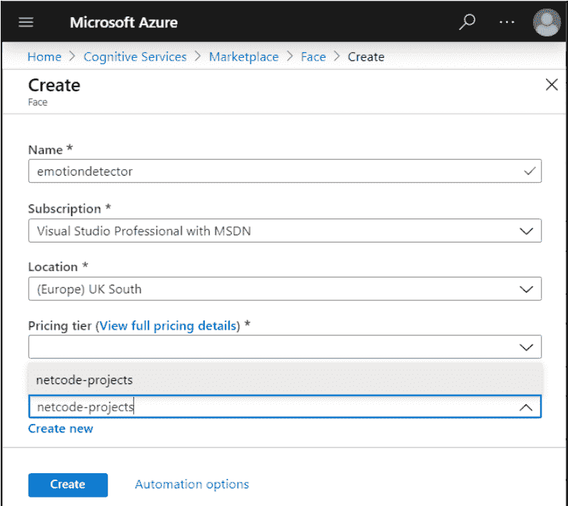

除非你打算将其用于商业目的（例如，高吞吐量），否则我建议你选择 F0 定价计划，本质上是免费的。

- 4. 资源创建后，你需要两条信息。第一个是访问密钥：

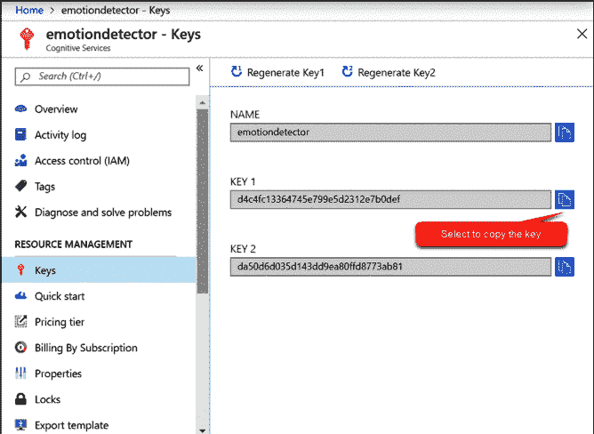

- 5. 你需要的第二条信息是终结点，可以在概览屏幕上找到：

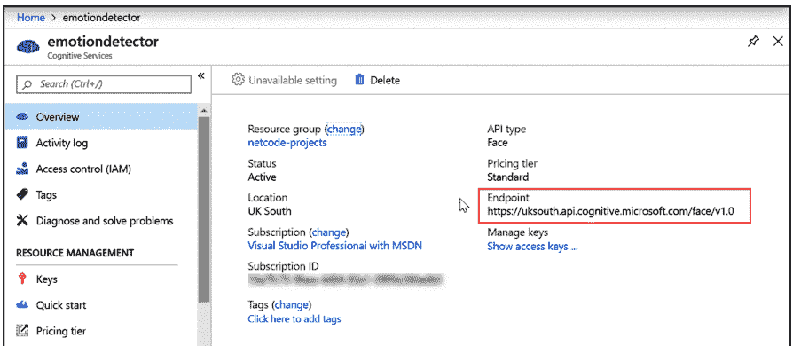

好了！你现在已配置认知服务。**快速入门**页面拥有大量你可以使用的资源；它也很可能比你在这里找到的信息更新。现在我们已配置 Azure 服务，可以创建 Xamarin 应用程序了。

### 创建 Xamarin 应用程序

让我们创建 Xamarin 应用程序。选择 文件 | 新建 | 项目，你将看到以下屏幕：

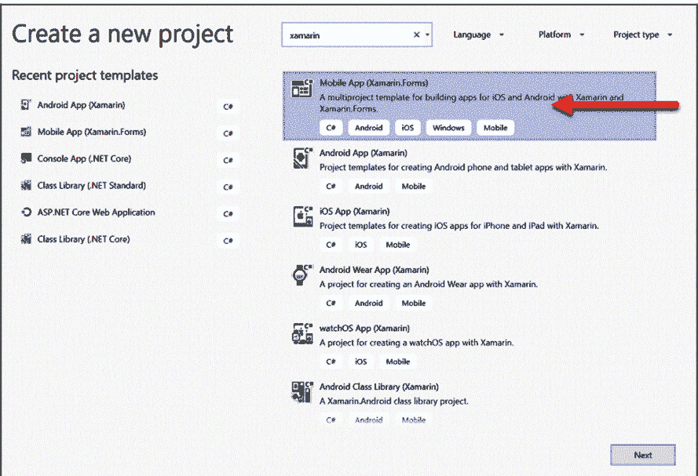

一旦你选择 Xamarin 应用程序，你将看到另一个对话框：

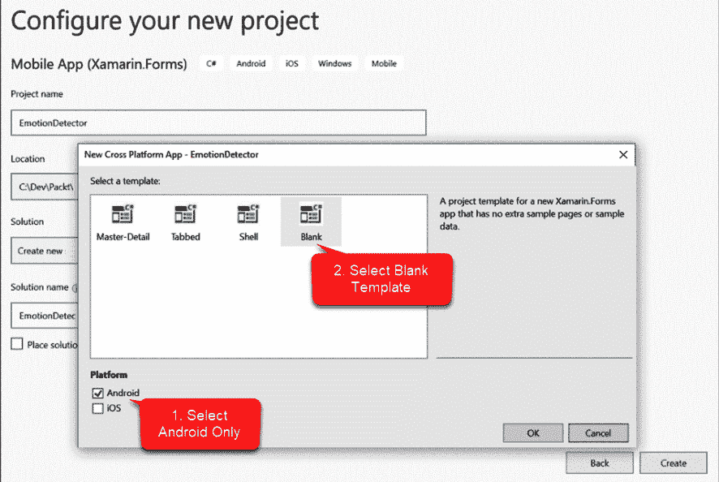

- 1. 选择是为 iOS、Android 还是两者创建应用程序。我们将仅创建 Android 应用程序。
- 2. 选择 **空白** 模板，以便我们可以确切地看到我们正在创建的内容。

现在我们已配置模板，可以创建项目（通过选择 **创建**）。

> 值得牢记的是，路径中可以包含的内容以及路径长度有一些非常严格的规则。避免空格、破折号和超过 127 个字符的完整路径。

创建后，你的项目大致如下所示：

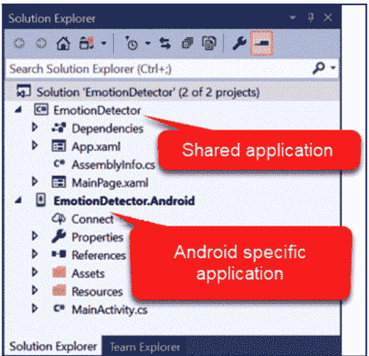

如果我们有 iOS 项目，将有一个名为 `EmotionDetector.iOS` 的第三个项目。如果你查看 `EmotionDetector.Android` 中的引用，你会发现它引用了 `EmotionDetector`。这里的想法是 `EmotionDetector` 代表共享代码库；但是，此功能可以按平台覆盖。

在对项目进行任何操作之前，让我们运行它并查看模拟器中的结果：

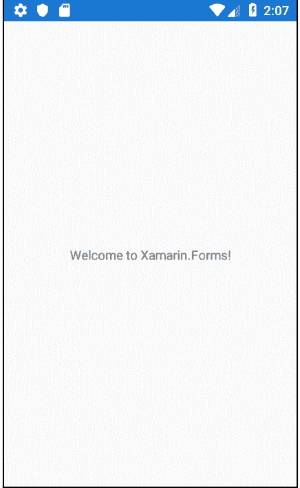

如果模拟器显示空白屏幕，请确保它已打开。模拟器像真实手机一样运行，甚至可以开关机。

让我们添加一个按钮来拍照，以及一个图像控件来显示该图片。在 MainPage.Xaml 中，用以下 XAML 代码替换：

```xml
<?xml version="1.0" encoding="utf-8" ?>
<ContentPage xmlns="http://xamarin.com/schemas/2014/forms"
             xmlns:x="http://schemas.microsoft.com/winfx/2009/xaml"
             xmlns:local="clr-namespace:EmotionDetector"
             x:Class="EmotionDetector.MainPage">

<AbsoluteLayout x:Name="Layout">

    <Image x:Name="DisplayedImage"
        VerticalOptions="Center"
        HorizontalOptions="Center" />

    <Button Text="Take Picture"
        HorizontalOptions="Center"
        VerticalOptions="EndAndExpand"
        Clicked="Button_Clicked"
        AbsoluteLayout.LayoutBounds=" .5, .1, .5, .1"
        AbsoluteLayout.LayoutFlags="All" />
</AbsoluteLayout>

</ContentPage>
```

在之前的章节中，我谈到了使用 MVVM 模式将 UI 层与应用程序逻辑抽象出来。在 Xamarin Forms 中这也是可行的。但是，我觉得在这里创建 MVVM 抽象会在开发中造成不必要的额外干扰。

如果你确实决定扩展此项目，那么创建（或使用第三方）MVVM 基础架构可能是一个好的起点。

前面的代码在 Layout 组件中有两个控件。AbsoluteLayout 是一个容器，允许我们精确指定控件的位置。在布局中，我们有一个位于屏幕顶部附近居中的单个按钮和一个图像。代码要求在代码隐藏文件中存在一个事件处理程序。MainPage.xaml.cs 的代码隐藏文件中的 Button_Clicked 事件目前可以为空：

```csharp
[DesignTimeVisible(true)]
public partial class MainPage : ContentPage
{
    public MainPage()
    {
        InitializeComponent();
    }

    private void Button_Clicked(object sender, EventArgs e)
    {
    }
}
```

虽然此事件处理程序目前什么也不做，但我们最终需要它做三件事：

- 拍照
- 将照片上传到 Azure
- 显示结果

让我们通过一些对存根方法的调用来勾勒出这一点。然后，我们可以逐一关注每个步骤：

```csharp
private void Button_Clicked(object sender, EventArgs e)
{
    var image = TakePicture();
    var emotionData = GetEmotionAnalysis(image);
    DisplayData(emotionData);
}

private void DisplayData(object emotionData)
{
    throw new NotImplementedException();
}

private object GetEmotionAnalysis()
{
    throw new NotImplementedException();
}

private object TakePicture()
{
    throw new NotImplementedException();
}
```

这些方法的签名将会改变，但这描述了我们逻辑的基本流程；也就是说，我们拍照并将结果传递给调用 Azure 认知服务的方法，然后再显示结果。让我们逐一了解这些步骤，并逐个填写它们。

### 拍照

在 Xamarin 中使用任何（或大多数）平台特定代码时，你往往会发现自己在使用插件。在继续之前，我们需要讨论 Xamarin 插件。


## Xamarin plugins

Xamarin 背后的原理是你编写的代码会进行交叉编译。也就是说，当你为 Android 编译时，最终会得到一个针对 Android 平台的原生应用；而当你为 iOS 编译时，最终会得到一个针对 iOS 平台的原生应用。然而，当某段代码是平台特定的时，Xamarin 平台就无法做到这一点。例如，假设我想访问相机——这因平台而异。你不能简单地拿取在 iPhone 上运行的那段代码，然后为 Android 进行编译。那么，我们该如何创建平台特定的代码呢？

答案是，每段平台特定的代码都需要为每个平台单独创建；Xamarin Forms 背后的原理是以多态方式调用方法。让我们以相机为例（因为我们即将要用到它）；在 Android 上拍照的代码明显不同于 iOS 上的代码。当我们安装插件时，每个环境都会以平台特定的方式实现该插件的代码。不过，从我们的角度来看，我们只需安装插件并调用几行代码，它就能在任何地方正常工作。

## Media plugin

安装插件本身其实就像添加 NuGet 包一样简单：

```
Install-Package Xam.Plugin.Media -ProjectName EmotionDetector
```

> 值得注意的是，这些插件一直在不断变化；
> 编写时它们是正确的，但你应该以 readme.txt 文件为主要参考来源。

完成此操作后，插件会显示一个 readme.txt 文件，其中包含安装说明。请务必按照这些说明操作，因为到你阅读本文时，说明可能已经发生变化。为了完整起见，我会在此详细说明 Android 相关说明，因为有些说明可能不够详尽。

让我们从 EmotionDetector.Android 中的 MainActivity.cs 开始。OnRequestPermissionsResult 方法应如下所示：

```
public override void OnRequestPermissionsResult(int requestCode, string[]
permissions, Android.Content.PM.Permission[] grantResults)
{
    Plugin.Permissions.PermissionsImplementation.Current.OnRequestPermissionsResult(
        requestCode, permissions, grantResults);
}
```

如今，你想要在移动应用中做的任何事情都必须获得用户批准；如果你需要访问用户的联系人、电话或相机，用户将看到一个对话框，指示你的应用需要这些权限。此方法中的代码会在用户对该对话框做出回应后被调用。

你需要声明你的应用需要哪些权限，这应该会由插件自动添加。如果你查看 EmotionDetector.Android.Properties.AssemblyInfo.cs，你应该能看到以下内容：

```
// Add some common permissions, these can be removed if not needed
[assembly: UsesPermission(Android.Manifest.Permission.Internet)]
[assembly:
UsesPermission(Android.Manifest.Permission.WriteExternalStorage)]

[assembly: UsesFeature("android.hardware.camera", Required = true)]
[assembly: UsesFeature("android.hardware.camera.autofocus", Required = false)]
```

如果没有自动添加，请立即添加。

请注意，我们在此略微偏离了说明，因为我们声明相机是必需的。在大多数应用中，即使没有相机，功能仍然可以正常工作，但在此示例中，我们确实需要使用相机。


你还应考虑，即使用户不愿授予所请求资源的访问权限，你的应用是否可以提供一些降级的功能。如前所述，在此特定情况下，没有相机我们能做的不多，但如果你扩展了此应用，也许会添加上传现有图片到应用的功能——在这种情况下，即使没有相机，应用仍然可以使用。

AndroidManifest.xml 文件应如下所示：

```
<?xml version="1.0" encoding="utf-8"?>
<manifest xmlns:android="http://schemas.android.com/apk/res/android"
    android:versionCode="1" android:versionName="1.0" package="com.companyname"
    android:installLocation="auto">
    <uses-sdk android:minSdkVersion="21" android:targetSdkVersion="27" />
    <application android:label="EmotionDetector.Android">
        <provider android:name="android.support.v4.content.FileProvider"
            android:authorities="${applicationId}.fileprovider"
            android:exported="false"
            android:grantUriPermissions="true">
            <meta-data android:name="android.support.FILE_PROVIDER_PATHS"
                android:resource="@xml/file_paths"></meta-data>
        </provider>
    </application>
</manifest>
```

这用于支持媒体插件的一个子依赖项。如你所见，它引用了特定的资源目录，因此下一步是创建该目录。在 Android 资源文件夹中，创建一个新的 xml 文件夹：

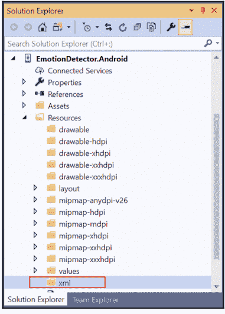

在此文件夹中创建一个名为 file_paths.xml 的文件，并添加以下代码：

```
<?xml version="1.0" encoding="utf-8"?>
<paths xmlns:android="http://schemas.android.com/apk/res/android">
  <external-files-path name="my_images" path="Pictures" />
  <external-files-path name="my_movies" path="Movies" />
</paths>
```

最后，MainActivity.cs 模块的 OnCreate 方法中需要添加一行额外代码：

```
protected override void OnCreate(Bundle savedInstanceState)
{
    TabLayoutResource = Resource.Layout.Tabbar;
    ToolbarResource = Resource.Layout.Toolbar;

    base.OnCreate(savedInstanceState);
    CrossCurrentActivity.Current.Init(this, savedInstanceState);

    Xamarin.Essentials.Platform.Init(this, savedInstanceState);
    global::Xamarin.Forms.Forms.Init(this, savedInstanceState);
    LoadApplication(new App());
}
```

CrossCurrentActivity 插件是同一生态系统中的另一个插件。它允许媒体插件访问 MainActivity。

### TakePicture()

现在我们已添加插件，可以创建使用相机的代码了。让我们快速看一下此方法：

```
private async Task<MediaFile> TakePicture()
{
    string fileName = $"FaceImg_{DateTime.Now.Ticks}";

    MediaFile photo = await
    Plugin.Media.CrossMedia.Current.TakePhotoAsync(new
    Plugin.Media.Abstractions.StoreCameraMediaOptions()
    {
        SaveToAlbum = true,
        Name = fileName
    });

    if (photo != null)
    {
        return photo;
    }
    return null;
}
```

此方法并没有太多内容，因为插件为我们完成了大部分工作。我们传入的参数允许保存图像，并且我们为其声明了一个唯一名称。

> 在测试期间，你可能会决定关闭保存功能；否则，你的手机将会充满你做出奇怪表情试图看起来愤怒、悲伤或快乐的照片！

如果照片成功拍摄，我们将返回一个 `MediaFile`；否则，我们返回 `null`。

### GetEmotionAnalysis()

我们的下一个方法负责调用 Azure API 并获取响应。不过，这有一个客户端 API。编写时，它仍处于预览阶段，并且似乎存在各种问题。如果你希望调查使用此 API，则一个好的起点是 NuGet 存储库：https://www.nuget.org/packages/Microsoft.Azure.CognitiveServices.Vision.Face/。

但是，我们将只使用此包的一部分，所以让我们现在安装它：

```
Install-Package Microsoft.Azure.CognitiveServices.Vision.Face -Version 2.4.0-preview
```

在此部分中，我们将手动构建对 API 的调用；这是我们方法的代码：

```
private async Task<IList<DetectedFace>> GetEmotionAnalysis(Stream imageStream)
{
    var byteData = GetImageAsByteArray(imageStream);

    return await MakeAnalysisRequest(byteData,
        "https://uksouth.api.cognitive.microsoft.com/face/v1.0/detect",
        "a9ac2b7404fd45ed9aff787f158e24c7");
}
```


MakeAnalysisRequest 接受三个信息（你稍后就会看到）。其中第一个 byteData 是图像流的二进制表示（我们稍后会回到 GetImageAsByteArray 方法）。第二个参数是你之前记下的终结点；随后我们在 URL 中追加 detect，用于指示我们要执行的操作。结果如下：

```
$"{endpoint}/detect"
```

第三个参数是你之前记下的密钥。

> 编写本文时，上述数值是我的数值；当你阅读本文时，为其生成数值的资源可能已被删除。你需要将这些数值更改为与你自己的值相匹配。

在继续之前，让我们快速回顾一下 GetImageAsByteArray 方法：

```
private byte[] GetImageAsByteArray(Stream stream)
{
    using BinaryReader binaryReader = new BinaryReader(stream);
    return binaryReader.ReadBytes((int)stream.Length);
}
```

然而，大部分工作由 MakeAnalysisRequest 方法完成。让我们看看它的样子：

```
public async Task<List<DetectedFace>> MakeAnalysisRequest(Byte[] byteData,
string uriBase, string subscriptionKey)
{
    using HttpClient client = new HttpClient();
    client.DefaultRequestHeaders.Add("Ocp-Apim-Subscription-Key",
    subscriptionKey);

    string requestParameters =
    "returnFaceId=true&returnFaceLandmarks=false" +
    "&returnFaceAttributes=emotion&recognitionModel=recognition_01&returnRecognitionModel=false";

    string uri = $"{uriBase}?{requestParameters}";
    HttpResponseMessage response;

    using (ByteArrayContent content = new ByteArrayContent(byteData))
    {
    content.Headers.ContentType = new
MediaTypeHeaderValue("application/octet-stream");

response = await client.PostAsync(uri, content);
string contentString = await response.Content.ReadAsStringAsync();

List<DetectedFace> faceDetails =
    JsonConvert.DeserializeObject<List<DetectedFace>>(contentString);

if (faceDetails.Count != 0)
{
    return faceDetails;
}

return null;
}
```

这里有很多内容；然而，基础是我们正在发出 HTTP 调用，并将返回的结果序列化为 DetectedFace 列表。DetectedFace 是一个类，可以在我们之前安装的 NuGet 包中找到。我们在请求标头中传递访问密钥，并在查询字符串中构建参数。

> Face API 文档的链接可在 Azure 门户的快速入门指南中找到。这将为你提供可用方法和参数的全面（且最新）列表。

下一步是将图片打包并发送到 Azure 进行分析。返回的是分析的 JSON 表示。

## DisplayData()

这是最终方法：我们现在已使用相机拍摄了照片，并将该图片发送到 Azure 进行分析。我们的最终任务是将结果显示给用户。在查看代码之前，我们应该考虑这里究竟想要实现什么。

我们的特定应用程序旨在指示拍摄照片时某人的情绪状态。当我们将图片传递给 Azure 时，它不会返回“此人很高兴”这样的陈述；相反，它会返回可能检测到的人脸列表以及每个人脸的可能情绪列表，以及一个值来指示它认为此人表现出该情绪的程度。例如，快照镜子看看：你看起来如何？你是高兴、愤怒、惊讶还是厌恶？也许你同时带有两三种情绪。正因为如此，返回的 JSON 是针对每个人脸和每种情绪的值列表。

在显示数据时，我们需要做两件事：

- 1. 当存在多个或少于一个面部时，显示错误以指示这一点。
- 2. 当只有一个面部时，仅显示排名最高的情绪；例如，如果你既愤怒又惊讶，我们需要采用分析认为程度较大的那个并显示它。

牢记这一点，让我们来看看代码：

```csharp
private void DisplayData(IList<DetectedFace> faces)
{
    // Remove any existing labels
    var labels = Layout.Children
        .Where(a => (a.AutomationId?.Contains("emotion-label") ?? false)
            || (a.AutomationId?.Contains("error") ?? false))
        .ToList();

    foreach (var label in labels)
    {
        Layout.Children.Remove(label);
    }

    if (faces == null)
    {
        CreateLabel("Unable to get data", "error");
        return;
    }

    if (faces.Count() > 1)
    {
        CreateLabel("Multiple faces not supported in this version",
            "error");
        return;
    }

    var face = faces.SingleOrDefault();
    if (face == null)
    {
        CreateLabel("No face found", "error");
        return;
    }

    CreateLabel(face.GetStrongestEmotion(), face.FaceId.ToString());
}
```

开始分析之前，我们将从 CreateLabel 开始。

## CreateLabel()

我们稍后会看这段代码，但现在，请先接受它会动态创建一个标签，并使用 AutomationId 作为唯一引用。

AutomationId 确实旨在为自动化 UI 测试框架提供固定引用。我们在这里所做的可能与该初衷不符；事实上，没有理由不能将 AutomationId 简单固定为："emotion-label"，这将允许自动化 UI 测试更轻松地与此应用程序配合使用。前面的代码在调试时确实提供了稍多一点的信息，因此我建议将此作为未来的增强功能，等软件运行正常后再实现。

可以看到，我们的第一项任务是查找带有相关 AutomationId 的任何标签并将其删除。随后是一系列门控检查，用于确定是否返回了单个面部；如果没有，我们将创建一个错误标签。

假设没有错误，将基于我们尚未见过的名为 face.GetStrongestEmotion() 的方法创建一个标签。这将返回一个字符串，指示找到的最强烈情绪（我们稍后会介绍）。让我们回到 CreateLabel() 方法：

```csharp
private void CreateLabel(string displayText, string id)
{
    var newLabel = new Label()
    {
        Text = displayText,
        AutomationId = $"emotion-label-{id}",
        FontAttributes = FontAttributes.Bold,
        FontSize = 20,
        HorizontalTextAlignment = TextAlignment.Center
    };

    AbsoluteLayout.SetLayoutBounds(newLabel, new Rectangle(.5, 1, .5, .1));
    AbsoluteLayout.SetLayoutFlags(newLabel, AbsoluteLayoutFlags.All);

    Layout.Children.Add(newLabel);
}
```

这里我们正在代码中构建 UI 控件。大部分前面的代码都相对简单：我们正在设置字体和文本（我们已经讨论过 AutomationId），然后正在对 AbsoluteLayout 父控件调用一个方法，以便将控件定位到特定坐标：

```csharp
AbsoluteLayout.SetLayoutBounds(newLabel, new Rectangle(.5, 1, .5, .1));
```

此方法为相关控件在 AbsoluteLayout 控件中设置边界矩形。我们传递给它的值的含义因调用方式而异：

```csharp
AbsoluteLayout.SetLayoutFlags(newLabel, AbsoluteLayoutFlags.All);
```

在我们的示例中，我们将此设置为 All，这表示所有值都是按比例计算的；例如，X 坐标（即 Rectangle 结构体中的第一个值）指定控件应正好定位在 AbsoluteLayout 控件的水平中间位置。

最后，我们将创建的新控件添加到 Layout 控件中。接下来，我们将分析 GetStrongestEmotion() 方法。

## GetStrongestEmotion()

此方法只是一个扩展方法，使用反射来计算得分最高的情绪：

```csharp
public static class FaceExtensions
{
    public static string GetStrongestEmotion(this DetectedFace face)
    {
        var emotions = face.FaceAttributes.Emotion;

        var strongest = emotions.GetType()
            .GetProperties()
            .Select(a => new { name = a.Name, value =
                (double)a.GetValue(emotions) })
            .OrderByDescending(a => a.value)
            .First();

        return strongest.name;
    }
}
```


> 如果你不熟悉扩展方法，扩展方法类必须是静态的，你正在扩展的项由参数前的 this 关键字指示。

## Button_Clicked

最后，让我们更改事件处理程序，以正确处理更新后的方法：

```
private async void Button_Clicked(object sender, EventArgs e)
{
    var image = await TakePicture();
    DisplayedImage.Source = ImageSource.FromStream(() =>
    image.GetStream());
    var emotionData = await GetEmotionAnalysis(image.GetStream());
    DisplayData(emotionData);
}
```

正如你所见，我们需要将处理程序设为 async，因为我们正在调用异步方法。
我们通过从 TakePicture 的结果中提取流来设置图像源。
最后，我们将从 GetEmotionAnalysis 返回的面孔列表传递给 DisplayData 方法。

我们现在有了一个可运行的应用程序：

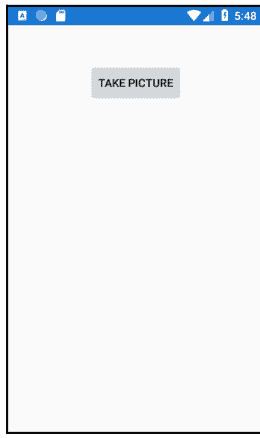

如果你按下按钮，你会看到模拟器会通知你正在使用相机，但实际上并未提供对我们的应用有意义的图像。我们现在需要讨论如何在实体设备上测试此应用。

## 在实体设备上测试和运行

由于本程序的基础是使用相机，因此在实体设备上测试应用至关重要。

此外，出乎意料的是，在实体设备上测试实际上可能比在模拟器上测试更快。

在本节中，我们将介绍在 Android 设备上设置此应用所需的基础知识；但是，我强烈建议你参阅 Xamarin 官方关于此主题的指南：https://docs.microsoft.com/en-gb/xamarin/android/get-started/installation/set-up-device-for-development。

该指南更加全面，并且由于经常更新（而本书则未更新），因此是最新的指南。

此处的说明涉及 Android 8.x (Oreo)，但也应适用于更高版本（撰写本书时，最新版本为 9.x，即 Pie）。

> 以下屏幕截图来自模拟器；但是，已在实体设备上核对过，以确保其针对此 Android 版本的准确性。

为了配置你的手机：

- 1. 第一步是配置你的手机；首先加载设置屏幕：

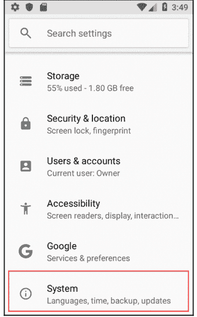

- 2. 在“系统”中，你应当能看到一个名为“关于手机”或类似的菜单选项：

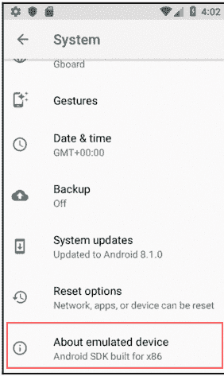

- 3. 找到“编译号”：

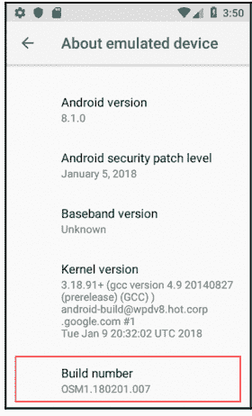

- 4. 你需要轻点七次。你将看到以下消息（别眨眼，否则会错过！）：

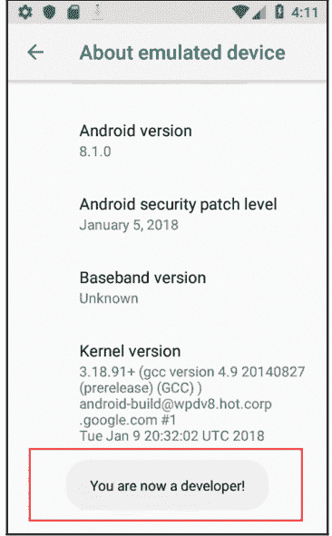

- 5. 在**系统**菜单中将出现一个新菜单，即 **开发者选项**：

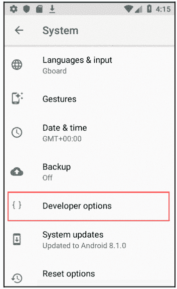

- 6. 此新菜单允许你确定测试软件时有用的各种设置；但是，有一个特定设置需要更改，即 USB 调试：

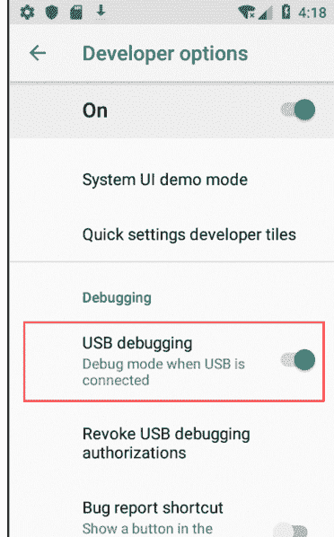

其他设置为可选。你可能会发现“保持唤醒”很有用，但如果使用手机，之后别忘了将其关闭。

下一步是检查 Android SDK 管理器。对于 Oreo (8.1)，你应当（至少）安装以下组件：

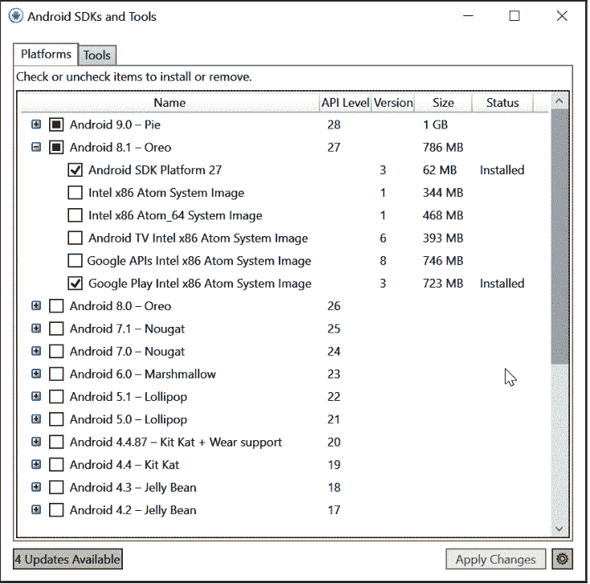

如果和我一样有多个更新，你肯定应该更新。

基本知识就讲这些了。具体取决于你的手机，你可能需要安装一些 USB 驱动程序。如果是这种情况，请参阅前面的链接。

当你连接手机时，请选择传输文件。

Visual Studio 应当会自动识别手机已连接，且运行图标应会从模拟器更改为实际手机：

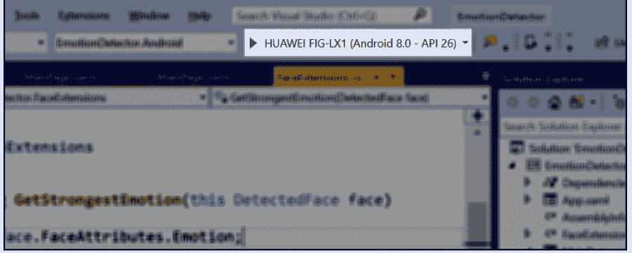

现在，当你运行项目时，它应当会在实体设备上启动，而非模拟器上。

## 摘要

在本章中，我们了解了如何处理两个相对复杂的问题——跨平台开发和机器学习——并利用一些易于访问的服务，创建一个应用程序，而几年前，编写该应用程序需要专家团队花费数年时间。

当然，该应用程序 *确实* 需要专家团队花费数年时间来编写——只是你现在可以使用他们的劳动成果。

许多公司都尝试过跨平台开发：Microsoft 首先将 Xamarin 引入公司（通过收购），而现在它出现在代码库中（2019 版本宣布，2020 年 .NET 将合并 Mono、.NET Core 和 .NET Framework 为单一 .NET —— 撰写本书时，这简称为 .NET 5）。

机器学习正吸引数十亿美元的研究投入：想象一下在不久的将来，你的手机能够监控你的情绪。想象一下商店里的摄像头能够检测到顾客因不满意而离开；想象一下街头的摄像头能够仅凭行人的面部表情就检测出其是否正准备犯罪。

在下一章中，我们将更详细地探讨机器学习，并创建一个使用 Microsoft 语言理解智能服务来模拟与人类对话的聊天机器人。
