# 10 面向 21 世纪的 Eliza - UWP 与 MS Bot 框架

图灵测试由艾伦·图灵开发，旨在回答机器是否可能被视为拥有思考能力的问题。在 20 世纪 60 年代，创建了名为 Eliza 的程序，它是首批尝试通过此测试的程序之一。

图灵测试诞生于机器学习概念尚处于萌芽期之时（事实上，图灵本人也为该领域做出了贡献）。如今，我们拥有使用机器学习检测情感的系统，拥有能够理解语言的复杂系统，并且会接到来自机器人的电话，与之进行完整的口头对话却从未意识到它们并非人类。

Eliza 的设计旨在模拟心理治疗师，其理念是提取关键字和短语，并将其转化为问题，从而让人类相信自己正在与另一个人类交谈。

在本章中，我们将创建 Eliza 的一个版本。我们将学习如何使用 .NET Core 3 在 UWP 中创建客户端应用程序。然后，我们将学习如何设置和配置 LUIS，最后，我们将学习如何将其集成到 MS Bot 框架中。

本章将介绍以下主题：

- 聊天机器人
- Microsoft 聊天机器人框架
- LUIS (Microsoft 语言理解服务)
- 在 UWP 中创建应用程序

聊天机器人可用于从 IT 支持到预订航班的各种用途（以下图片显示了一个示例）：

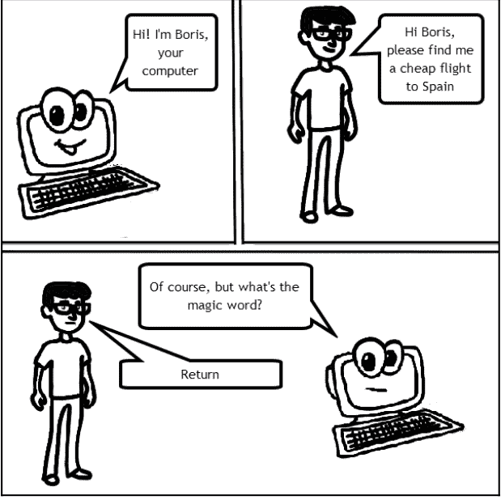

## 技术要求

在本章中，我们将使用创建使用 Bot Framework 的 Microsoft 机器人的默认模板。撰写本书时，尽管 .NET Core 3 已发布，但 Bot Framework 项目仍在 .NET 2.2 中创建。在后续章节中，我们将了解如何将其升级到 .NET Core 3；但是，到本书出版时，情况可能会有所变化。

在本章中，你需要一个 Azure 订阅（我们在第 2 章“使用 Cosmos DB 记录任务错误的 ASP.NET Core MVC 应用”中简要介绍了如何创建一个）。

本章代码可在 GitHub 上找到：https://github.com/PacktPublishing/C-8-and-.NET-Core-3-Projects-Using-Azure-Second-Edition。

## 创建聊天机器人

让我们先从聊天机器人开始。撰写本书时，聊天机器人无处不在，无论你是在网站上寻求帮助，还是在致电呼叫中心。本质上，聊天机器人只是一个复杂的状态机，而 Microsoft Azure Bot Framework 之类的框架只是向你隐藏了这种复杂性。请想象一下人类与机器（H 和 M）之间的以下对话：

```
M: Hello, how can I help?
H: Hello, I'd like to check my balance, please.
M: I can help you with that. Which account is this for?
H: Current.
M: I'm sorry, I didn't get that. Which account is this for?
H: Current account.
M: What is the number of your current account?
```

好的，如果我们查看这次交互，可以看出是由机器人发起的。客户回答说他们想查询余额——因此这里机器人正在监听关键字，而余额显然就是其中之一。现在机器需要知道客户想查询哪个账户的余额。在幕后，它可能已检查客户名下是否注册了多个账户。此时，客户说的是“当前账户”，机器人需要澄清，因此会循环返回并再次询问。当它最终理解答案后，就会继续。

我们将使用模板创建我们的机器人，你需要从 https://marketplace.visualstudio.com/items?itemName=BotBuilder.botbuilderdev4 安装该模板。


当您选择创建新机器人时，会有三个选项：**空机器人**、**回声机器人**和**核心机器人**，如下面的屏幕截图所示。对于本项目，我们将选择**回声机器人**：

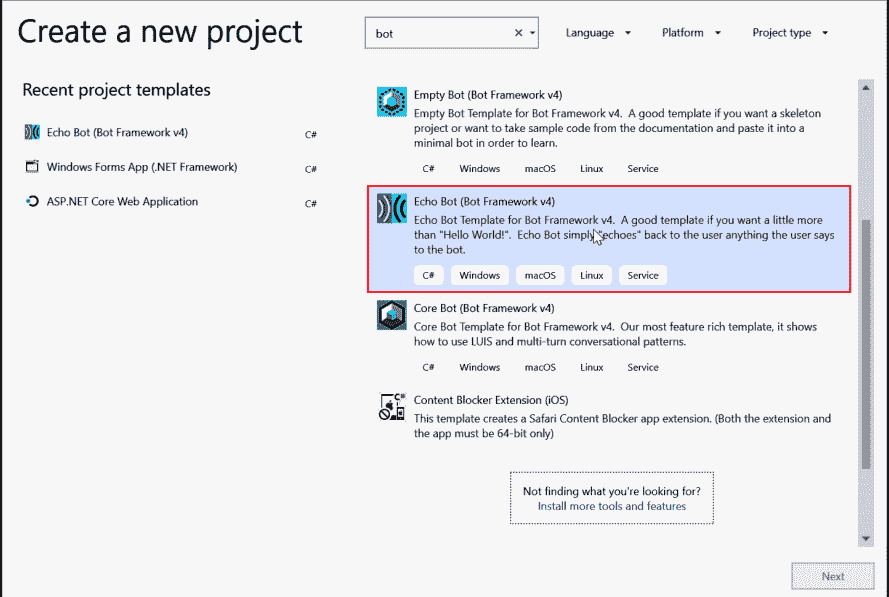

这些是预建模板，具有不同程度的现有功能。显然，空模板没有功能，只有样板代码。**核心机器人**会为您提供一个已链接到 LUIS 的功能完善的机器人。

我们现在将选择项目的文件位置：

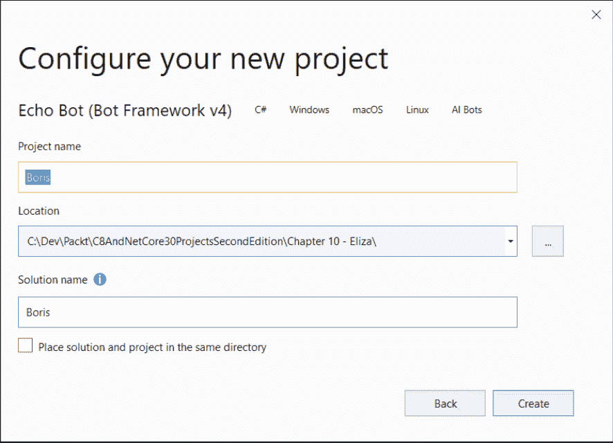

> 默认情况下，机器人名称将设置为项目名称。

创建机器人后，运行它，您应该会看到以下屏幕：

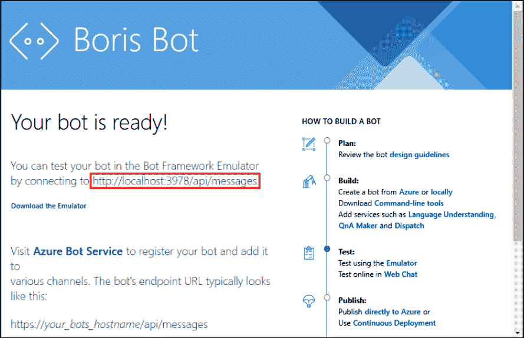

这可能不是您预期的内容，因为我们还需要经历几个步骤才能看到机器人运行的效果（剧透：此时实际上没什么可看的！）。请记下屏幕截图中的 URL，因为稍后会用到它。

## 机器人模拟器

下一阶段是运行模拟器。我们刚刚创建的机器人实际上只是一个服务。模拟器为我们提供了一个用于与其交互的 UI。

撰写本文时，模拟器的最新版本位于 https://github.com/Microsoft/BotFramework-Emulator/releases/tag/v4.2.1。

要安装此程序，有一个自解压可执行文件：

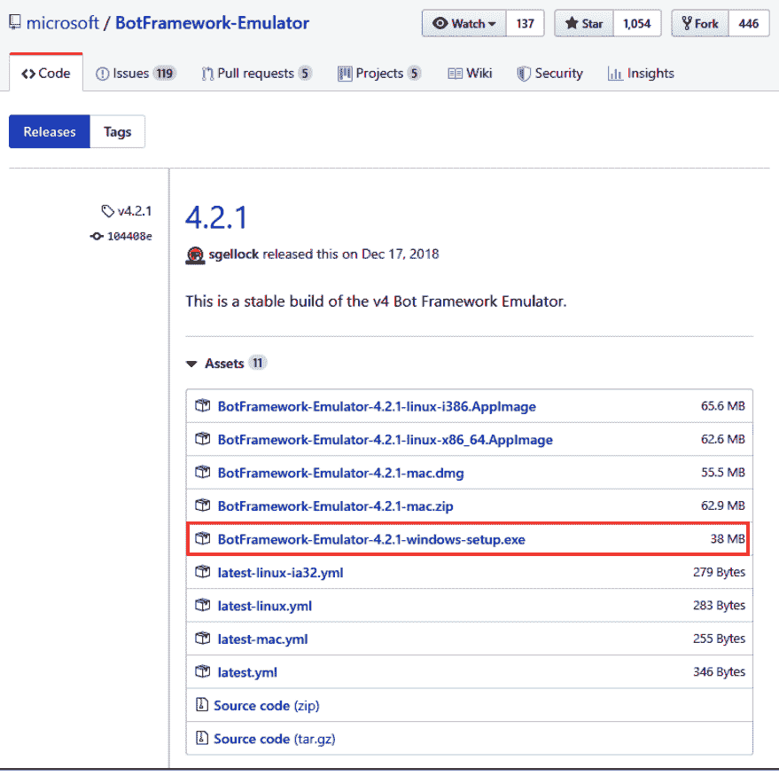

下载并安装模拟器，然后运行它。

您需要以管理员身份运行模拟器。

运行模拟器时，您需要为其指定名称和 URL（您刚才记下了 URL，名称可以随意）：

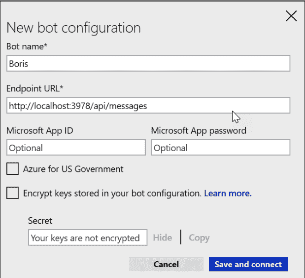

连接后，您就能与机器人对话了。让我们快速看一下模拟器屏幕：

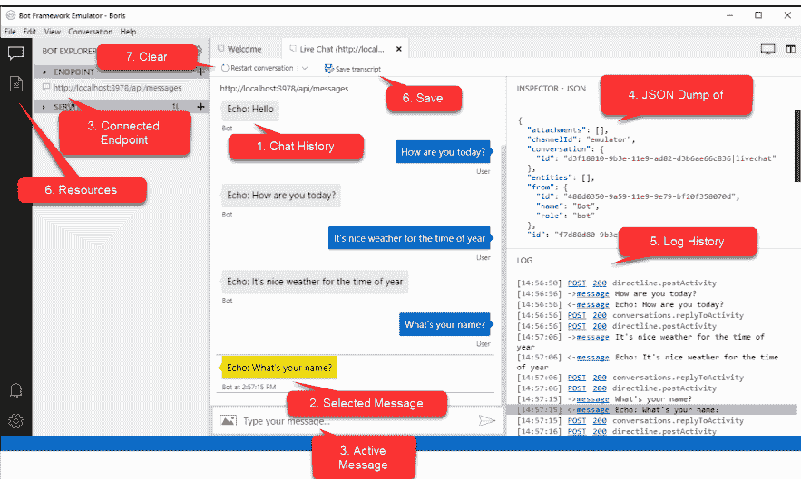

让我们看看它实际上在告诉我们什么：

- 1. 此部分列出您（人类）或机器人编写的所有消息。
- 2. 您可以选择聊天记录中的任何消息（参见 4）。
- 3. 这是您向机器人输入消息的位置。
- 4. 这以原始 JSON 形式显示消息。请记住，您的机器人只是一个 API，因此入站和出站通信均采用 JSON 格式。
- 5. 这提供了对话的网络历史记录。如果您遇到身份验证或网络问题，这尤其有用。
- 6. 整个聊天记录可以保存到 .transcript 文件中。这本质上是对话历史记录的 JSON 表示。左侧的资源图标允许您打开这些文件并查看旧的转录记录。在支持场景中（例如出了问题，想查看聊天期间发生了什么），这非常有用。
- 7. 随时可以从头重新开始聊天。
- 8. 这显示或隐藏“资源”部分。这允许您查看转录记录或聊天文件。
- 9. 这显示您当前正在与之通信的终结点。
- 10. 已保存已连接终结点的历史记录；您可以通过浏览历史记录在这些终结点之间切换。

您可能会注意到，机器人的对话深受您自身启发。让我们看看能否找出原因并稍加修正。

## 回声机器人 – 除了“Hello”

目前，回声机器人名副其实——它只是重复您所说的一切。让我们通过稍作更改，让它变得更像“Boris”一点。让我们从重命名开始

```
`EchoBot` to `BorisBot`:
```

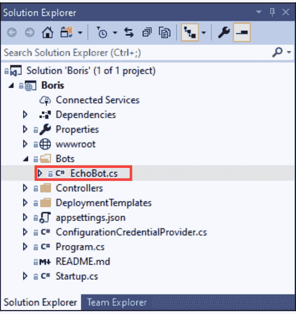

我们将按照以下步骤稍微修改机器人的代码：

- 1. 首先，让我们重命名类：

```
public class BorisBot : ActivityHandler
{
    ...
}
```

- 2. 接下来，我们将对 OnMessageActivityAsync 进行小幅更改，以捕获用户输入 Hello，并返回更合理的消息：

```
protected override async Task
OnMessageActivityAsync(ITurnContext<IMessageActivity> turnContext,
CancellationToken cancellationToken)
{
    if (turnContext.Activity.Text == "Hello")
    {
        await
turnContext.SendActivityAsync(MessageFactory.Text($"Hello, my name
is Boris"), cancellationToken);
    }
    else
    {
        await
turnContext.SendActivityAsync(MessageFactory.Text($"Echo:
{turnContext.Activity.Text}"), cancellationToken);
    }
}
```

- 3. 在 Startup.cs 中，您还需要更改依赖注入以注册新机器人：

```
services.AddTransient<IBot, BorisBot>();
```

现在，如果运行机器人，我们会得到不同的响应：

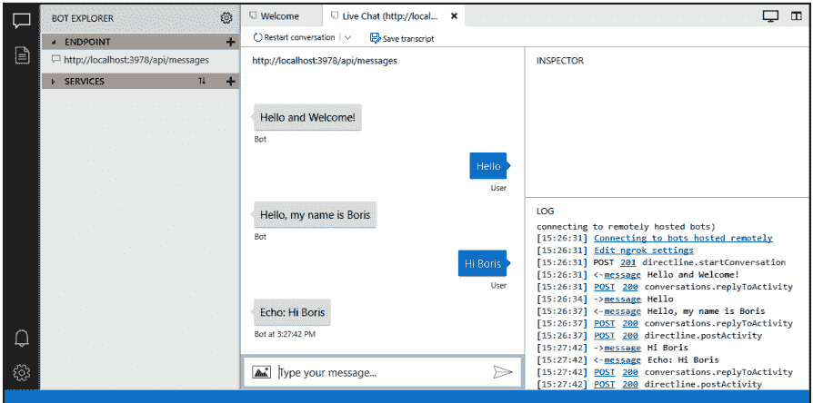

好吧，现在当我们输入 Hello 时，会得到合理的响应，但对于其他任何内容，我们又回到了回声模式。为了通过图灵测试，我们需要改进这一点。请记住，这全在于感知，因此我们首先需要涵盖表达类似意思的各种方式，其次，我们需要变化我们的响应。我们可以在 OnMessageActivityAsync 内部编写一个巨大的 switch 语句，并尽可能想出更多表达 Hello 的方式。不过，我们也可以使用 Microsoft 为我们创建的名为 LUIS 的工具，它可以帮助我们完成部分工作。

## LUIS 简介

LUIS 代表语言理解智能服务。它允许您利用机器学习算法来训练预建语言模型。事实上，此服务（与机器人框架一样）比我们在这里看到的要强大得多。就我们的目的而言，我们只需训练一个关键词和短语很少的简单模型。如果您尚未注册，则需要先在 https://www.luis.ai 上注册。

注册后，您可以开始构建新模型：

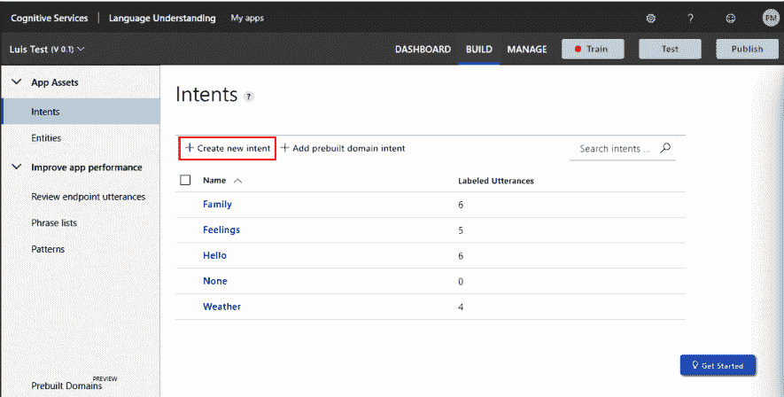

在这里，如果选择**意图**，我们可以识别对话的关键领域；如您所见，我在这里已识别出多个领域。您选择**创建新意图**选项，然后为意图命名（事实上，您给意图命名为何并不重要）。完成后，系统会要求您提供可能输入的示例——例如，对于**情感**，您可能会看到如下内容：

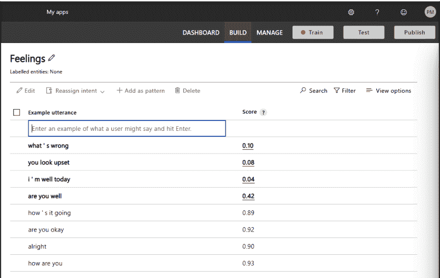

| 示例语句 | 分数 |
|---|---|
| 怎么了 | 0.10 |
| 你看起来很不开心 | 0.08 |
| 我今天感觉很好 | 0.04 |
| 你好吗 | 0.42 |
| 最近怎么样 | 0.89 |
| 你还好吗 | 0.92 |
| 没事 | 0.90 |
| 你好吗 | 0.93 |

您应确保为每个意图添加至少五个短语，但短语越多，模型效果越好。

完成此操作后，您可以训练和测试模型。

您可以整天添加这些示例，但除非训练模型，否则模型不会改变。

让我们尝试训练和测试我们的模型。添加若干个意图后（不必全部添加，也不必与此处列出的相同），请选择**训练**。如前面的屏幕截图所示，当模型需要训练时，**训练**按钮旁边会出现一个小红绿灯。模型训练完成后，请选择**测试**进行测试：

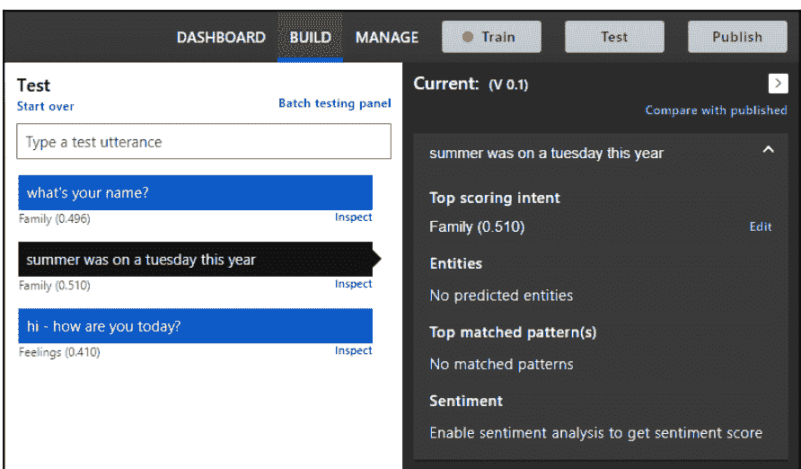

在这里，我尝试了三个短语。您可以看到，在每个短语下方它都会返回一个意图。它似乎正确匹配了其中一个，但另外两个稍有偏差。妙就妙在，测试时如果识别错误，我可以单击**编辑**，然后告知正确的意图：

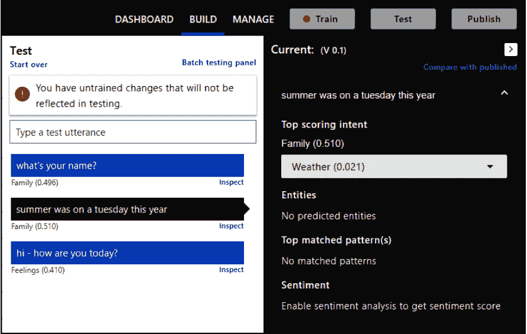

显然，您的意图越细致，机器人听起来就越逼真。一旦您对训练结果满意，就可以继续下一部分，届时我们将把 LUIS 集成到机器人中。

> 我们随时可以返回并重新训练模型，但请确保您对意图感到满意，因为我们将根据它们进行编码。


## 将 LUIS 集成到机器人框架中

值得注意的是，此过程已由 Microsoft 详细记录；您可以按照本节操作，也可以查看 https://docs.microsoft.com/en-us/azure/bot-service/bot-builder-howto-v4-luis?view=azure-bot-service-4.0&tabs=csharp 上的文档。

让我们逐步完成以下步骤：

- 1. 集成 LUIS 首先需要添加连接详细信息。在 LUIS 门户中，选择 管理，并从 应用程序信息 中复制 应用程序 ID：

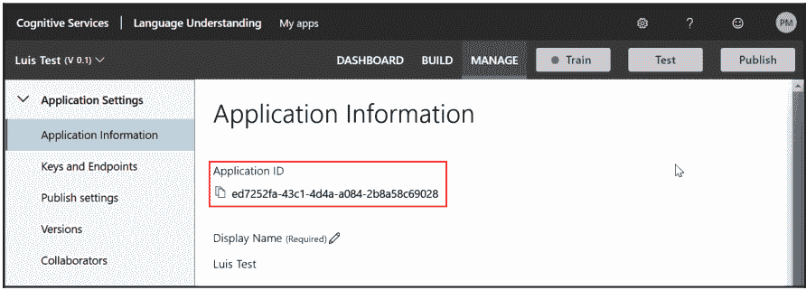

- 2. 将此内容添加到 `appsettings.json` 文件中：

```
{
  "MicrosoftAppId": "",
  "MicrosoftAppPassword": "",
  "LuisAppId": "ed7252fa-43c1-4d4a-a084-2b8a58c69028",
  "LuisAPIKey": "",
  "LuisAPIHostName": ""
}
```

- 3. 现在，选择 **密钥和终结点** 并复制 **创作密钥**：

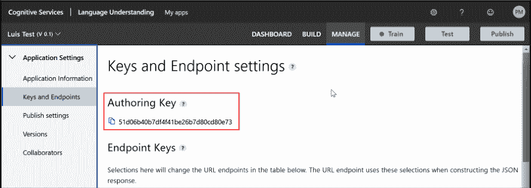

- 4. 在同一页面底部，向下滚动即可找到终结点：

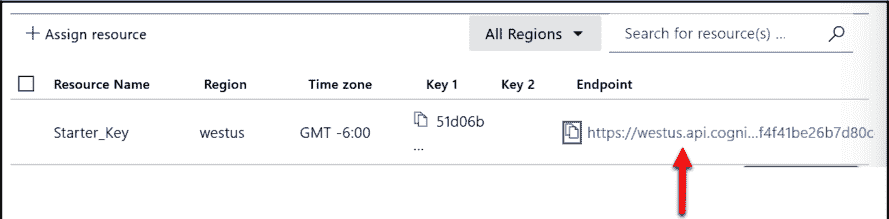

这些值也需要复制到 `appsettings.json`：

```
{
  "MicrosoftAppId": "",
  "MicrosoftAppPassword": "",
  "LuisAppId": "ed7252fa-43c1-4d4a-a084-2b8a58c69028",
  "LuisAPIKey": "51d06b40b7df4f41be26b7d80cd80e73",
  "LuisAPIHostName": "https://westus.api.cognitive.microsoft.com"
}
```

> 请注意，主机名在 `.microsoft.com` 后被截断。

- 5. 完成此操作后，您需要 **发布** 模型：

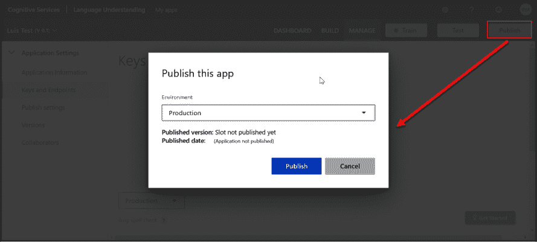

- 6. 下一步是安装 LUIS NuGet 包：

```
Install-Package Microsoft.Bot.Builder.AI.Luis
```

- 7. 最后，我们需要将代码接入；让我们将对 Hello 的检查替换为对 LUIS 的调用：

```
protected override async Task
OnMessageActivityAsync(ITurnContext<IMessageActivity> turnContext,
CancellationToken cancellationToken)
{
    var luisApplication = new LuisApplication(
        _configuration["LuisAppId"],
        _configuration["LuisAPIKey"],
        _configuration["LuisAPIHostName"]
    );

    var recognizer = new LuisRecognizer(luisApplication);
    var recognizerResult = await
    recognizer.RecognizeAsync(turnContext, cancellationToken);

    var (intent, score) = recognizerResult.GetTopScoringIntent();
    if (intent == "Hello")
    {
        await
    turnContext.SendActivityAsync(MessageFactory.Text($"Hello, my name
is Boris"), cancellationToken);
        }
        else
        {
            await
turnContext.SendActivityAsync(MessageFactory.Text($"Echo:
{turnContext.Activity.Text}"), cancellationToken);
        }
    }
```

让我们快速回顾一下我们在这里所做的更改。首先，我们实例化一个新的 `LuisApplication` 并提供在 `appsettings.json` 中收集的凭据。为此，我们还将 `IConfiguration` 注入类中，我们稍后会再回到这一点。

然后，我们调用 `RecognizeAsync`，它执行短语的实际分析，最后，我们要求它告诉我们它认为的意图是什么。让我们看看这对机器人意味着什么：

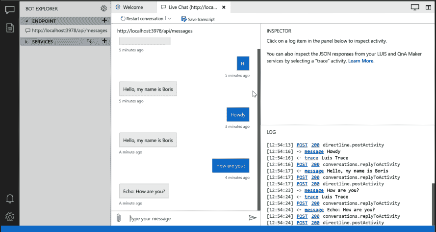

如您所见，Boris 现在理解得多了一些；然而，我们的响应仍然相当生硬，并且仅适用于 `Hello` 意图。接下来让我们处理其他意图，但首先，我们将 `IConfiguration` 注入类中。让我们看看那个更改：

```
private readonly IConfiguration _configuration;
public BorisBot(IConfiguration configuration)
{ _configuration = configuration;
}
```

下一阶段是将我们的项目升级到使用 .NET Core 3。

在撰写本文时，模板使用 .NET Core 2.1；但是，如果在您阅读本文时情况并非如此，请随时跳过下一节。

## 将模板从 .NET Core 2.1 升级到 3.0

在此阶段，我们需要将版本从 .NET Core 2.1 提升到 .NET Core 3.0。这可能会导致我们需要做一些小的调整。

第一个调整是 `IHostingEnvironment` 应替换为 `IHostEnvironment` （有关此方法的完整记录，请参见以下内容）：

```
public void Configure(IApplicationBuilder app, IHostEnvironment env)
```

这是为了避免 2.1 中引入的命名空间冲突。

下一个更改是兼容版本：您不会惊讶地了解到，应用现在需要设置为与版本 3 兼容：

```
services.AddMvc()
.SetCompatibilityVersion(CompatibilityVersion.Version_3_0);
```

现在我们已将 MVC 添加到依赖注入系统，需要将其注册为应用程序中的中间件。

### UseMvc

最后，终结点路由方面发生了一些变化。其净效果是 `UseMvc` 似乎一次配置了太多设置；因此，`Configure` 方法应更像这样：

```
public void Configure(IApplicationBuilder app, IHostEnvironment env)
{
    if (env.IsDevelopment())
    {
        app.UseDeveloperExceptionPage();
    }
    else
    {
        app.UseHsts();
    }

    app.UseDefaultFiles();
    app.UseStaticFiles();

    //app.UseHttpsRedirection();
    //app.UseMvc();
    app.UseRouting();
    app.UseCors();
    app.UseEndpoints(e =>
    e.MapControllerRoute("default",
    "{controller=Home}/{action=Index}/{id?}")
    );
}
```

我们不再调用 `UseMvc`，而是调用我们需要的特定中间件方面。

### AllowSynchronousIO

在 .NET Core 3.0 中，引入了一个重大变更，即默认情况下不再允许同步调用。在撰写本文时，`BotFrameworkAdapter` 违反了该规则（可能是因为它使用 Newtonsoft JSON 序列化——在这种情况下，在本书出版时可能不再是问题）。运行项目时，您可能会收到以下错误：

```
System.InvalidOperationException: Synchronous operations are disallowed.
Call ReadAsync or set AllowSynchronousIO to true instead.'
```

只有在运行项目时遇到上述错误时，才应实施以下更改：

- 1. 在 `BotController` 中，更改 `AllowSynchronousIO` 标志：

```
[HttpPost]
public async Task PostAsync()
{
    var syncIOFeature =
    _httpContextAccessor.HttpContext.Features.Get<IHttpBodyControlFeature>();
    if (syncIOFeature != null)
    {
        syncIOFeature.AllowSynchronousIO = true;
    }

    // Delegate the processing of the HTTP POST to the adapter.
    // The adapter will invoke the bot.
    await _adapter.ProcessAsync(Request, Response, _bot);
}
```

- 2. 我们需要将 `IHttpContextAccessor` 注入 `BotController`；构造函数现在应如下所示：

```
private readonly IHttpContextAccessor _httpContextAccessor;

public BotController(IBotFrameworkHttpAdapter adapter,
    IBot bot, IHttpContextAccessor httpContextAccessor)
{
    _adapter = adapter;
    _bot = bot;
    _httpContextAccessor = httpContextAccessor;
}
```

- 3. 最后，在 `Startup.ConfigureServices` 中，添加上下文访问器：

```
services.AddHttpContextAccessor();
```

您的项目现在应该可以使用 .NET Core 3.0 编译。现在让我们调查如何扩展代码以处理其他意图。

## 意图/响应矩阵

本节基本涵盖了此 API 的最后两个要求。我们将创建一个 JSON 文件，将意图映射到可能的回复（或多个回复）。事实上，我们将每个意图链接到多个回复，然后随机使用其中一个；这样，机器人会给人印象，它正在针对每条消息做出独特的回复。

让我们从 JSON 文档开始。它可能如下所示：

```
{
 "Hello": [
 "Hi there!",
 "Hello, My name is Boris",
 "Nice to meet you",
 "Hello"
 ],
 "Family": [
 "Tell me more about your family",
 "Do you have any siblings?",
 "Let's talk about your family some more"
 ],
 "Feelings": [
 "It's important to talk about your feelings",
 "It's healthy to talk about how you feel",
 "Please tell me: how are you feeling"
 ],
 "Weather": [
 "How's the weather where you are",
 "In 1987, the BBC weatherman Michael Fish failed to predict a Hurricane",
 "The weather is very unpredictable",
 "What's the forecast for tomorrow?"
 ],
 "None": [
 "I'm afraid I'm not sure what you mean",
 "That sounds interesting, please tell me more",
 "Wow - really?"
 ]
}
```


将此保存到名为 `Data` 的文件夹中，并更改属性以将其设置为 **嵌入的资源**：

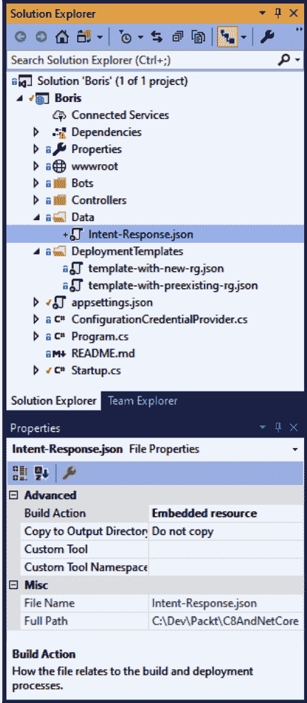

让我们来实现此功能。我们需要更改的内容在机器人文件 BorisBot.cs 中。我们将修改 OnMessageActivityAsync 方法。在此过程中，我们将遇到 .NET Core 3 和 C# 8 中的另外几个新功能：

- 1. 首先，删除此处不再需要的代码：

```csharp
if (intent == "Hello")
{
    await turnContext.SendActivityAsync(MessageFactory.Text($"Hello, my
name is Boris"), cancellationToken);
}
else
{
    await turnContext.SendActivityAsync(MessageFactory.Text($"Echo:
{turnContext.Activity.Text}"), cancellationToken);
}
```

我们将用一些能生成更真实响应的代码来替换这段占位符代码。

- 2. 我们的下一步是将 JSON 文件读取为文本，得到 result：

```csharp
var assembly = Assembly.GetExecutingAssembly();
var resourceName = "Boris.Data.Intent-Response.json";
using Stream stream =
    assembly.GetManifestResourceStream(resourceName);
using StreamReader reader = new StreamReader(stream);
string result = reader.ReadToEnd();
```

请注意，我们正在使用 C# 8 中的新 using 语法。在类似这样的方法中，这尤其有用，因为如果没有新语法，方法会更长，并且在下面的代码中，using 语句需要嵌套。新的 using 语句从声明点到函数末尾具有隐式作用域；在其他所有方面，它的行为与标准 using 语句完全相同。

- 3. 然后，我们将 JSON 文件的文本内容和 intent 传递给一个新方法，该方法返回一个回复数组。然后我们从该数组中随机选择一条回复并发送它：

```csharp
var response = ReadResponse(result, intent);
string selectedResponse = response[_rnd.Next(response.Length)];
await turnContext.SendActivityAsync(MessageFactory.Text(selectedResponse), cancellationToken);
```

在讨论新方法 ReadResponse() 之前，让我们看看 _rnd 在哪里以及如何声明。它实际上是在类顶部声明的：

```csharp
private Random _rnd = new Random();
```


关于如何在 C# 中可靠地生成随机数的讨论可能超出了本章（和本书）的范围；然而，值得注意的是，随机数算法使用基于一天中时间的种子，这意味着如果你在短时间内两次实例化该类并调用 _rnd.Next(number)，你很可能会两次得到相同的数字。

- 4. 最后，让我们看看我们的新方法：

```csharp
public static string[] ReadResponse(string jsonString, string key)
{
    using var document = JsonDocument.Parse(jsonString);

    var root = document.RootElement;
    var possibleResponses = root.GetProperty(key);

    return possibleResponses.EnumerateArray().Select(a =>
    a.GetString()).ToArray();
}
```

再次，我们正在使用新的 using 语法。我们还使用了 .NET Core 3 中包含的新 JSON 库。在 .NET Core 2.1 和 2.2 中所做的一些更改为一个新的、更快的 .NET Core JSON 解析库打开了大门。


将此引入内部的决定并非完全因为微软认为他们可以比 JSON.NET 制作出更好的 JSON 解析库（实际上，在撰写本文时，该库的作者正在微软工作）。该决定更多可能是由框架中一些最底层的库依赖于 JSON.NET 这一事实所驱动的。

让我们简要谈谈这段新 JSON 解析代码在做什么：一旦我们实例化了一个新的 JsonDocument，我们找到根元素，然后通过在 root 上调用 GetProperty 来返回我们要查找的特定文本。最后，我们调用 EnumerateArray 并将其传入 Linq Select 语句以提取字符串。

此处的最后一步是发布机器人。

## 发布机器人

要启动发布过程，只需右键单击项目文件并选择 **发布**。您将看到以下屏幕：

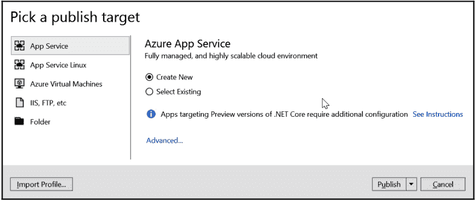

保持默认设置不变，并选择 **发布**。您现在将被问及一系列关于如何以及在哪里部署应用程序的问题：

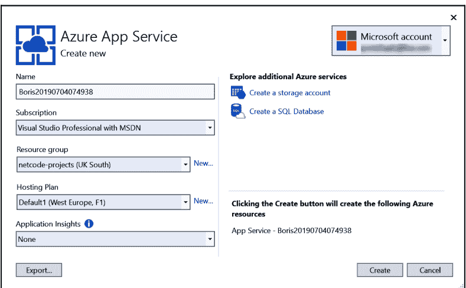

同样，您可以将这些保留为默认值并单击 Create。

在撰写本文时，这会导致 Visual Studio 报错，告知您 .NET Core 3.0 不受支持。虽然从技术上讲这是真的，但遵循本章概述的步骤应该会产生一个可用的机器人。该团队希望很快获得对 .NET Core 3 的完整支持。

您应该会看到一个指示机器人已成功部署的网页。请记下此页面的 URL，因为我们很快就会用到它。在我的例子中，它是以下地址：

```
https://boris20190704074938.azurewebsites.net/
```

下一阶段是创建通道注册。

请注意，分别创建 App Service 和 Channel Registration 的替代方案是在门户中创建机器人。这将为您创建两者，然后您可以将机器人发布到该服务中。

## 创建通道注册

通道注册允许其他应用程序与我们的机器人通信。让我们创建一个。从 Azure 门户中选择“创建资源”：

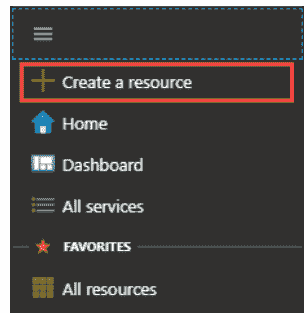

在下一屏幕中，选择 **机器人通道注册**：

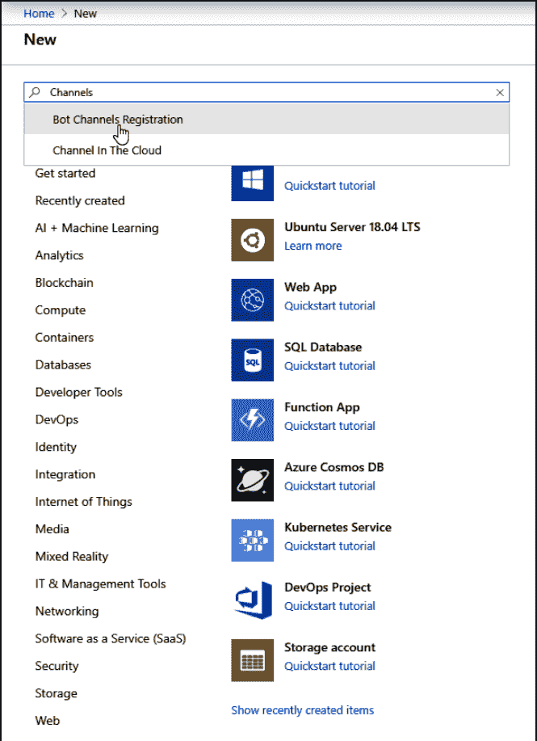

选择创建机器人的选项后，您将看到类似于以下内容的屏幕。页面上标注的部分在截图后的列表中有所描述：

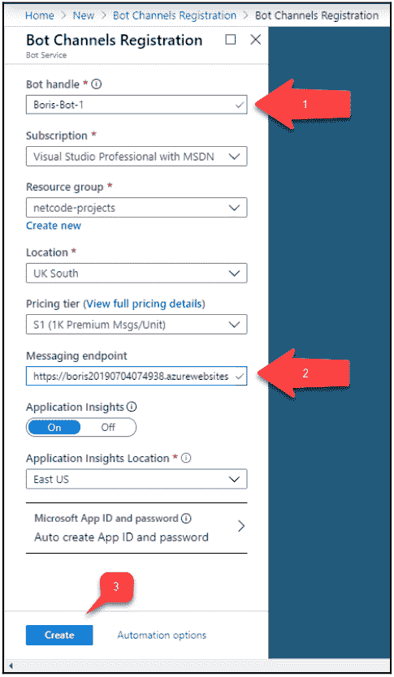

- 1. **机器人句柄**是全球唯一的引用。
- 2. **消息终结点**是您之前记下的 URL。您应在 URL 末尾追加 `/api/messages`；在我的例子中，这是 `https://boris20190704074938.azurewebsites.net/api/messages`。
- 3. 完成设置后，选择 **创建资源** 选项。

我们现在有一个已发布、可运行并与 LUIS 集成的机器人。下一步是创建我们的 UWP 应用。

## MicrosoftAppId 和 MicrosoftAppPassword

本章前面，您可能记得我们在 appsettings.json 中创建了一些值；上次看到它们时，它们大致如下所示：

```json
{
	"MicrosoftAppId": "",
	"MicrosoftAppPassword": "",
	"LuisAppID": "ed7252fa-43c1-4d4a-a084-2b8a58c69028",
	"LuisAPIKey": "51d06b40b7df4f41be26b7d80cd80e73",
	"LuisAPIHostName": "https://westus.api.cognitive.microsoft.com"
}
```

既然我们已发布机器人，就需要填充这些值。如果您在门户中导航到新的 Channel Registration 并选择“设置”屏幕，您应该会看到类似以下的内容：

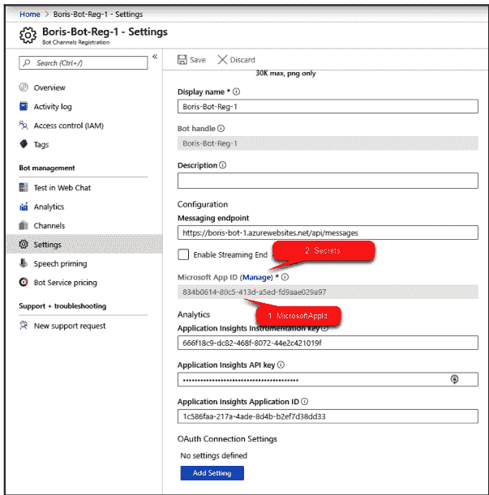

记下 `MicrosoftAppId`。选择 **管理** 以显示 **证书和密钥** 边栏：

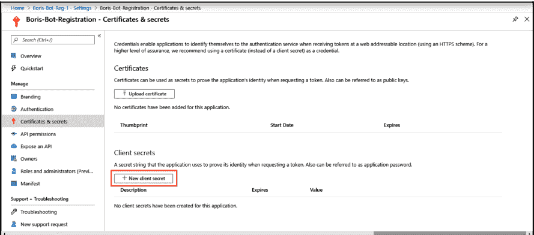

在此处，我们可以创建一个新密钥：

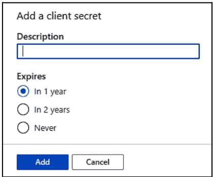

只需提供描述并单击 **添加**。创建密钥后，您只有机会记下它一次；您将永远无法再次看到它，因此如果丢失，您将需要删除并重新创建它。

记下应用 ID 和密钥后，有两种方法可以激活它们。第一种（也许在调试时最简单）是将它们简单地粘贴到 `appsettings.json` 中并再次发布应用。但是，您不 *需要* 这样做——您可以简单地导航到 App Service 的 **配置** 边栏，并在那里添加一个 `AppSetting`：

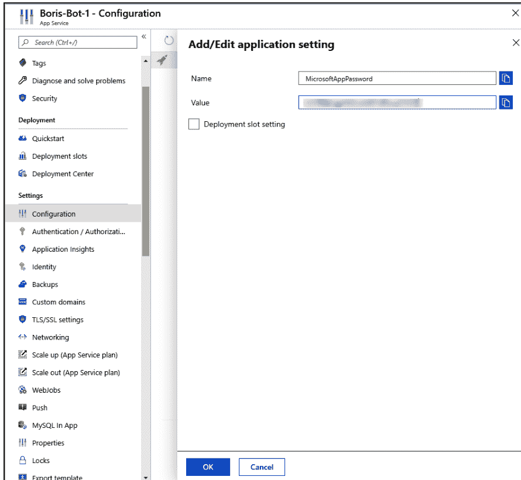


这是一个非常有用的技巧：添加到这里的任何应用设置都将替代 `appsettings.json` 中的所有内容。这意味着你不需要在源代码中保存敏感数据。

现在我们已正确设置注册，可以继续创建客户端应用程序了。

## 创建 UWP 应用程序

我们的 UWP 应用程序将非常简单。我们将创建一个单一屏幕，用于输入消息，然后是一个日志，用户可以在其中看到机器人的响应，以及自己的聊天记录。首先，让我们创建一个新的 UWP 应用程序：

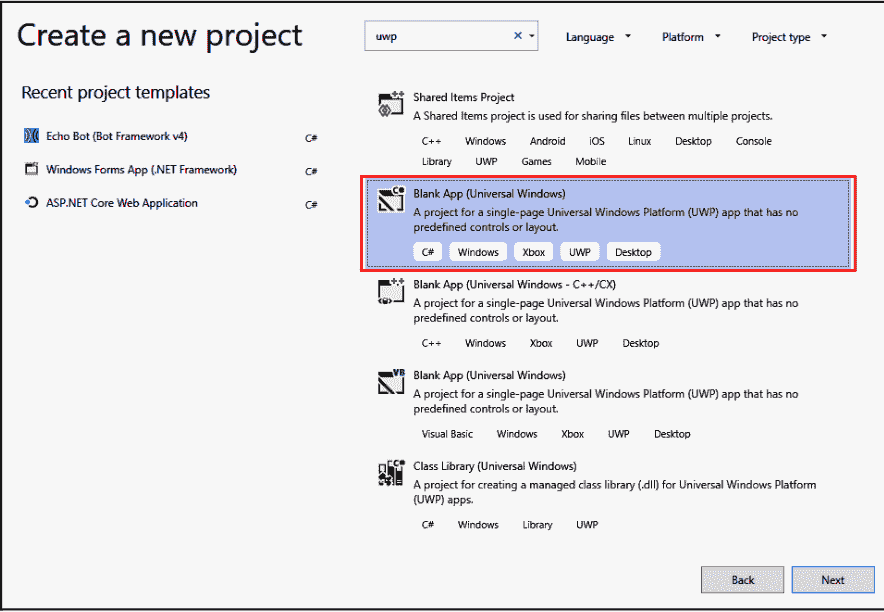

初始应用程序由两个 XAML 文件创建：App.xaml 和 MainPage.xaml：

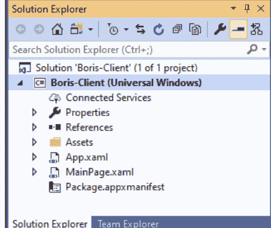

程序的主结构实际上位于 App.xaml 的代码隐藏文件中：App.xaml.cs。如果你查看该文件，将看到处理应用程序启动和挂起，以及应用内导航失败时的代码。

### MainPage

我们的第一项任务是修改 MainPage.xaml 来构建我们的屏幕。让我们先看看新的 XAML 长什么样，然后逐一介绍我们的更改：

```xaml
<Page
    x:Class="Boris_Client.MainView"
    xmlns="http://schemas.microsoft.com/winfx/2006/xaml/presentation"
    xmlns:x="http://schemas.microsoft.com/winfx/2006/xaml"
    xmlns:local="using:Boris_Client"
    xmlns:d="http://schemas.microsoft.com/expression/blend/2008"
    xmlns:mc="http://schemas.openxmlformats.org/markup-compatibility/2006"
    mc:Ignorable="d"
    Background="{ThemeResource ApplicationPageBackgroundThemeBrush}"
    xmlns:models="using:Boris_Client.Models"
    Loaded="Page_Loaded">

    <Grid>
        <Grid.RowDefinitions>
            <RowDefinition Height="*" />
<RowDefinition Height="Auto" />
</Grid.RowDefinitions>

<ListView Grid.Row="0" ItemsSource="{Binding ChatHistory}">
    <ListView.ItemTemplate>
        <DataTemplate x:DataType="models:ChatMessage">
            <StackPanel Orientation="Horizontal">
                <TextBlock Text="{Binding Sender}"/>
                <TextBlock Text=":"/>
                <TextBlock Text="{Binding Message}"/>
            </StackPanel>
        </DataTemplate>
    </ListView.ItemTemplate>
</ListView>

<Grid Grid.Row="1">
    <Grid.ColumnDefinitions>
        <ColumnDefinition Width="*"/>
        <ColumnDefinition Width="Auto"/>
    </Grid.ColumnDefinitions>

    <TextBox Grid.Column="0" Grid.Row="0" x:Name="SendMsg"
    Text="{Binding MessageText}"/>
    <Button Grid.Row="0" Grid.Column="1"
    Command="{Binding SendMessageCommand}"
    CommandParameter="{Binding ElementName=SendMsg,
    Path=Text, Mode=OneWay}"
    Content="Send" />
</Grid>
</Page>
```

我们将在下一节详细讨论此块。让我们先从网格布局开始。

### 行定义

在 XAML 中，我们有一个网格的概念：基本上，每个 XAML 页面都被细分为一个网格，你可以告诉系统你想要在网格中有多少行和多少列。在我们的示例中，网格有两行。第二行的大小为自动（Auto）以适应其内容，第一行占据剩余空间（*）。

如果需要，你可以在网格中嵌套网格。控件嵌套的深度没有限制（可用内存除外）。显然，嵌套得越深，UI 渲染器需要处理的工作就越多，这可能会影响性能。

网格中每个后续控件都会指定它想要占据的行——子网格也是如此。指定行和列始终适用于直接父网格。

### ListView

接下来，我们来看看 `ListView`。理解 XAML 的关键在于组合：你可以实现几乎任何效果，因为你可以将一个控件放在另一个控件内部。对于 `ListView` 控件，你基本上有两个元素：控件正在显示的数据以及显示该数据的方式。

```
<ListView Grid.Row="0" ItemsSource="{Binding ChatHistory}"/>
```

我们稍后会回来具体说明 `ChatHistory` 是什么，但现在，你可以把它当作一个集合。我们正在将 `ItemSource`——即控件的数据源——绑定到称为 `ChatHistory` 的事物集合。这就是 _什么_; 下一部分是 _怎么做_:

```
<ListView.ItemTemplate>
    <DataTemplate x:DataType="models:ChatMessage">
        <StackPanel Orientation="Horizontal">
            <TextBlock Text="{Binding Sender}"/>
            <TextBlock Text=": "/>
            <TextBlock Text="{Binding Message}"/>
        </StackPanel>
    </DataTemplate>
</ListView.ItemTemplate>
```

在这里，我们使用 `DataTemplate` 来告诉 `ListView` 每个元素将是 `ChatMessage` 类型；同样，我们稍后会回来解释那是什么——重要的是它至少有两个属性：`Sender` 和 `Message`。在 `DataTemplate` 内部，我们正在声明一个 `StackPanel`，并在其中声明若干个 `TextBlock` 元素。这就是我所说的组合——如果你想在列表中显示一系列元素，那么你需要定义数据在哪里以及确切地如何显示它。

虽然这个过程比其他技术更冗长，但它提供了更大的灵活性——例如，你可以在 `DataTemplate` 内部放置一个图像控件、另一个 `StackPanel`，甚至另一个 `ListView`。此外，`DataTemplate` 可以跨文件甚至跨应用程序重复使用。

### 消息和命令绑定

最后，我们有第二行，它只是第一行内部的另一个网格。有趣的部分在下面的代码中显示：

```
<TextBox Grid.Column="0" Grid.Row="0" x:Name="SendMsg" Text="{Binding MessageText}"/>
<Button Grid.Row="0" Grid.Column="1" Command="{Binding SendMessageCommand}" CommandParameter="{Binding ElementName=SendMsg, Path=Text, Mode=OneWay}" Content="Send" />
```

在 TextBox 中，我们将内容绑定到称为 MessageText 的东西。同样，不必担心 MessageText 是什么，但鉴于它绑定到 Text 属性，我们可以安全地假设它是（或必须是）一个字符串。

最后，我们有一个按钮和一种称为命令绑定的东西。与其他绑定不同，我们基本上只是获取数据并显示它，而命令绑定绑定到一个方法。同样，让我们不要过于担心 SendMessageCommand 到底是什么；现在，我们就接受它能完成某项操作即可。

### 数据绑定和视图模型

既然我们已经创建了前端 XAML 文件，让我们来看看代码隐藏文件（MainPage.xaml.cs）：

```
public sealed partial class MainPage : Page
{
    public MainPage()
    {
        this.InitializeComponent();
        DataContext = new MainViewModel();
    }
}
```

如你所见，这里没什么可讨论的。事实上，我们只有一行额外的代码，它将 DataContext 设置为 MainViewModel 的一个实例。

基本上，我们在这里所做的是获取一个类，并将该类分配给 XAML 代码文件的 DataContext。这意味着该文件中的任何内容现在都可以绑定到前端 XAML。

这完全取决于你，但在此阶段，我将 `MainPage` 文件重命名为 `MainView`。之所以这么做，是因为它绑定到 `MainViewModel`，并且我发现如果名称按约定对齐，阅读起来会容易得多。但不用担心：如果你不这样做，代码仍然可以正常工作。

现在我们已经绑定了视图模型，可以在 `ViewModel` 上调用方法了。页面加载完成后，我们将调用一个方法来初始化所有内容：

```
private async void Page_Load(object sender, RoutedEventArgs e)
{
    await ((MainViewModel)DataContext).Initialise();
}
```

我们稍后可以查看 `ViewModel` 文件；不过，首先，让我们花一分钟来谈谈视图模型作为一个概念。假设你不写应用程序，而是在安装一个水槽。如果你去当地的 DIY 商店，你可能会看到几十种水槽，但你可以挑选任何适合你水龙头数量的水槽并带回家，确信你可以把它放在旧水槽的位置，连接几根管道，就能有自来水了。

这与视图和视图模型有什么关系呢？嗯，想象一下进入你家的管道就是视图模型。它们以原始形式携带必要的信息——也就是水。如果你不安装水槽就打开总水阀，你就会看到信息从管道里涌出。水槽就像视图一样，以你想要看到的任何形式安排信息或水。

> 请不要将此类比的任何方面视为可靠的管道安装信息——这仅用于说明目的。我不是合格的管道工！

在设计你的视图和视图模型时，你应该牢记这一点。如果你开始看到与数据布局相关的本地内容混入到你的视图模型中，那应该是一个红旗信号，表明你越界了，并且两者之间紧密耦合。你可以问自己一个问题：如果我想以不同的方式显示这些内容，是否可以在不更改视图模型的情况下实现？如果答案是否定的，那么请考虑不同的方法。

让我们开始声明我们的 `ViewModel`:

```
public class MainViewModel : INotifyPropertyChanged
{
    public event PropertyChangedEventHandler PropertyChanged;

    protected void RaisePropertyChanged([CallerMemberName] string name =
```


null)
{
    if (PropertyChanged != null)
    {
        PropertyChanged(this, new PropertyChangedEventArgs(name));
    }
}
}
}

这是实现正常工作的 UWP ViewModel 所需的最少代码。INotifyPropertyChanged 接口是一个具有一个事件的接口：PropertyChanged。基本上，这里的目的是当你更改属性时，需要告诉绑定系统你已经这样做了，然后 UI 可以更新。我们在 ViewModel 中需要的第一件事是一个名为 Initialise 的方法——如果你记得，我们实际上前面已经调用过它了：

```
internal async Task Initialise()
{
    await _wrapper.StartConversation();
}
```

## 让我们添加应用中显示的数据

```
public ObservableCollection<ChatMessage> ChatHistory { get; set; } = new
ObservableCollection<ChatMessage>();

private string _messageText;
public string MessageText
{
    get { return _messageText; }
    set
    {
        _messageText = value;
        RaisePropertyChanged();
    }
}
}
```

MessageText 短语只是一个字符串（正如我们早先猜测的那样）。如你所见，在属性设置时，我们正在调用早先创建的 RaisePropertyChanged 事件。

你可以选择只在值更改时引发该事件来增强此功能。

第二个数据片段存储在一个名为 ObservableCollection 的特殊集合中。

## ObservableCollection

ObservableCollection 在其内容更改时会通知 UI。也就是说，每次添加或删除项时，UI 都会自动更新。在其他各方面，ObservableCollection 的行为与任何其他集合（例如 List）相同。

> 值得注意的是，虽然 ObservableCollection 在添加或删除项时会更新 UI，但如果你更改集合本身，它不会更新 UI。例如，请看如下代码：

```
MyCollection = new ObservableCollection<MyObject>()
```

这不会更新 UI。此外，更改 MyObject 的内容（在此情况下）也不会更新 UI。

目前，我们不必担心 ChatHistory，虽然你现在可能已经猜到它长什么样了。接下来，我们来看看命令。

## 命令绑定

在 UI 中，我们有一个设置了 Command 属性的按钮。在本节中，我们不会详细查看 Command 实际上是什么样子。在这段代码中，我们将使用一个名为 RelayCommand 的包装类。我们稍后会回到 RelayCommand，但命令只是任何实现 ICommand 接口的类。我们在这里使用的帮助类只是意味着我们可以在 ViewModel 中声明命令功能。

最初，我们只需声明 RelayCommand：

```
public RelayCommandAsync<string> SendMessageCommand { get; set; }
```

然后，我们在构造函数中实例化它：

```
public MainViewModel()
{
    SendMessageCommand = new RelayCommandAsync<string>(SendMessage);
}
```

如你所见，我们将一个方法作为参数传递给命令。在查看方法本身之前，我们需要绕点远路；否则，该方法将难以理解。

### DirectLineWrapper

归根结底，这个整个应用程序的目的是向我们的机器人发送消息并在屏幕上打印回复。我们即将引入的下一个东西是一个包装类，用来做 exactly 这件事。我们将在本章后面填充实际的类代码，但在这里，我们将像它能做我们需要的一切一样使用这个类。让我们先将其声明为类级别变量：

```
BotClientSdk.DirectLineWrapper _wrapper = null;
```

现在，我们将在构造函数中实例化它，它现在应该如下所示：

```
public MainViewModel()
{
    SendMessageCommand = new RelayCommandAsync<string>(SendMessage);
    _wrapper = new BotClientSdk.DirectLineWrapper(PopulateHistory);
}
```

你会注意到我们将一个变量传递给 DirectLineWrapper 类；我们稍后会回到这个方法。

总的来说，在构造函数中实例化依赖项是不好的做法。这会使测试该类变得非常困难；如果你希望扩展此项目，将其移至注入依赖将是一个很好的开始。

SendMessage 方法的主体应更改如下：

```
private async Task SendMessage(string message)
{
    await _wrapper.SendMessage(message);
    MessageText = string.Empty;
}
```

_wrapper 具有一个名为 SendMessage 的方法。这会调用我们将稍后创建的类内部的一个方法。最后，我们清空文本框，以便用户可以输入另一条消息。

我们还需要一个方法来填充历史记录：

```
private void PopulateHistory(List<KeyValuePair<string, string>> response)
{
    var ignored = Dispatcher.RunAsync(CoreDispatcherPriority.Normal, () =>
    {
        foreach (var historyItem in response)
        {
            ChatHistory.Add(new ChatMessage(historyItem.Key,
                historyItem.Value));
        }
    });
}
```

这被传递给我们新包装类的构造函数——也就是说，整个函数被传入。这里的想法是我们可以从包装类内部更新 UI，但包装类本身对其调用上下文一无所知。这里还需要添加的最后一个小片段是：

```
private CoreDispatcher Dispatcher =>
    (Window.Current == null) ?
        CoreApplication.MainView.CoreWindow.Dispatcher :
        CoreApplication.GetCurrentView().CoreWindow.Dispatcher;
```

这只是允许我们使用 Dispatcher；由于我们实际上是在后台线程上工作，如果没有这个，我们将无法更新 UI，而 UI 之必要是前台线程。

在遍历过程中，我们将其添加到 ObservableCollection 中；我们早先说过，以这种方式向集合添加数据将为我们更新 UI。

在介绍包装类内部的细节之前，我们使用了一些帮助类和模型。让我们先从模型开始。

## 模型

我们使用了一个模型来存储聊天消息（单数），因此我们需要看看这个类长什么样。正如我早先所说，如果你一直读到本章这里，它的形状不应该令人惊讶：

```
public class ChatMessage
{
    public ChatMessage(string sender, string message)
    {
        Sender = sender;
Message = message;
}
public string Message { get; set; }
public string Sender { get; set; }
}
```

在继续之前，我们需要查看 RelayCommandAsync 类。

### RelayCommandAsync

RelayCommandAsync 的代码并不繁琐。我们实现了一个名为 ICommand 的接口，它只有两个方法。ICommand 的最简实现如下：

```
public class RelayCommandAsync<T> : ICommand
{
    public bool CanExecute(object parameter)
    {
    }

    public void Execute(object parameter)
    {
    }
}
```

显然，这什么也不做，所以让我们填充这些方法。我们将从 Execute 开始；我们需要将一个操作传递给 Execute 方法，可以通过构造函数来完成：

```
public class RelayCommandAsync<T> : ICommand
{
    readonly Func<T, Task> _execute = null;

    public RelayCommandAsync(Func<T, Task> execute)
    {
        if (execute == null)
            throw new ArgumentNullException("execute");

        _execute = execute;
    }

    public void Execute(object parameter)
    {
        _execute.Invoke((T)parameter);
    }
}
```

在这里，我们只是将一个函数委托作为构造函数传递给类，然后在调用 `Execute` 时调用它。


我们在这里使用 `Func` 而不是 `Action` 的原因是，我们实际上正在返回一些东西——即一个 `Task`。如果命令是同步的，我们可以返回一个 `Action`。

最后，我们将添加 CanExecute 代码：

```
public class RelayCommandAsync<T> : ICommand
{
    readonly Func<T, Task> _execute = null;
    readonly Func<T, bool> _canExecute = null;

    public RelayCommandAsync(Func<T, Task> execute)
        : this(execute, null)
    {
    }

    public RelayCommandAsync(Func<T, Task> execute, Func<T, bool> canExecute)
    {
        if (execute == null)
            throw new ArgumentNullException("execute");

        _execute = execute;
        _canExecute = canExecute;
    }

    public bool CanExecute(object parameter)
    {
        return _canExecute == null ? true :
               _canExecute.Invoke((T)parameter);
    }

    public event EventHandler CanExecuteChanged;

    public void RaiseCanExecuteChanged()
    {
        CanExecuteChanged?.Invoke(this, EventArgs.Empty);
    }

    public void Execute(object parameter)


```
{
    _execute.Invoke((T)parameter);
}
```

CanExecute 语句本质上返回一个布尔值，用于指示相关命令是否有效执行。通过将 UI 与此绑定，如果此项返回 `False`，则可以禁用 UI 上的按钮。我们在这里实际上并未使用此功能；不过，如果我们使用，这段代码也能正常工作。

> `CommandBinding` 的一个优势是，你可以对命令本身进行单元测试，而无需触及 UI——也就是说，你的单元测试涵盖了按下按钮后立即执行的代码。

现在我们已经填补了剩余的空白，需要讨论 Direct Line 以及如何与我们的机器人进行通信。

## 通道

在讨论 Direct Line 及其含义之前，我们先来探讨在机器人语境下什么是通道。请看下图：

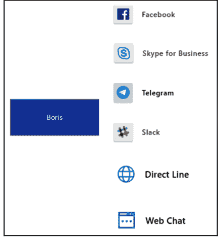

这并非旨在列举详尽的通道列表，而是试图说明，通道只是应用程序与机器人之间的接口——例如，如果你愿意，可以将机器人与 Slack 关联。

这里有两个通道尤为突出：Direct Line 和 Web Chat。我们简要地看一下。

## Direct Line 和 Web Chat

我们已经见过 Web Chat 了：本质上，它是一种测试机器人的方式，当你注册通道时它是免费提供的，这就是为什么你之前在本章中可以使用它来测试机器人。

Direct Line 允许你直接与机器人交互。现在让我们配置一个 Direct Line 通道。在 Azure 门户中，导航到你的机器人并选择“通道”：

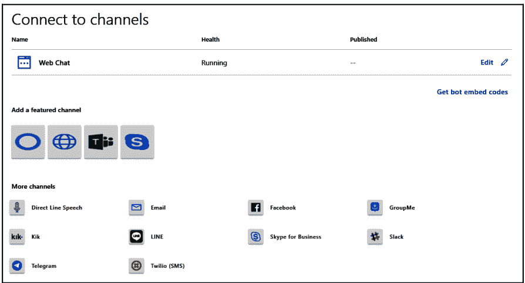

不管那奇怪扭曲的图形，Direct Line 通道是那个地球图标；如果你点击它，系统会要求你为站点命名：

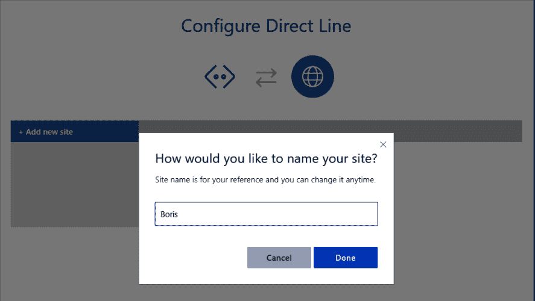

在下一屏幕中，你会获得两个密钥。点击第一个旁的 **显示**，并保留其一份副本，因为我们稍后需要用到。完成后，点击 **完成**，你应该会看到现在有两个通道。

## 机器人客户端

最后一步是创建我们在 UWP 应用程序中引用的客户端。首先创建一个新项目，并立即从 UWP 应用程序中引用它。一个 .NET Standard 2.0 类库足以满足我们的需求：

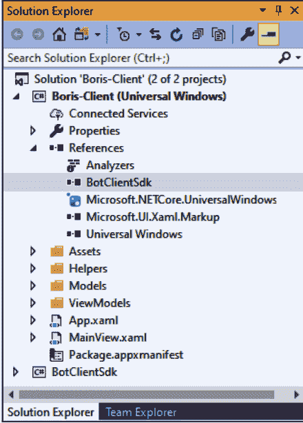

首先需要导入两个 NuGet 包：Direct Line 包本身和 Rest Client Runtime：

```
Install-Package Microsoft.Bot.Connector.DirectLine
Install-Package Microsoft.Rest.ClientRuntime
```

在这个项目中，我们只需要一个类——让我们将其命名为 `DirectLineWrapper`。

> 作为一般原则，我总是喜欢尝试将外部依赖项封装在 Wrapper 项目中，以保护主项目免受过多直接外部依赖项的影响：这样，如果例如你希望使用不同的机器人服务，可以更轻松地替换包装器。

我们需要一些类级别的变量，包括 DirectLineClient 本身；我们还需要按如下方式实例化它：

```
public class DirectLineWrapper
{
    private string? _conversationId = null;
    private readonly DirectLineClient _client;
    Action<List<KeyValuePair<string, string>>> _updateMessages;

    public DirectLineWrapper(Action<List<KeyValuePair<string, string>>> updateMessages)
    {
        _client = new DirectLineClient ("A33UCbCQoP1.QNPYS_u2Z7LhobFce9mA2ZWt47n7VzEuTjTGWHA-aLO");
        _updateMessages = updateMessages;
    }
}
```

传递给 DirectLineClient 构造函数的字符串参数是你之前记下的密钥。我们稍后会再回到会话 ID。如你所见，我们将一个操作注入到类中；这将使我们能够在消息到来时更新屏幕。

这个类中我们只需要三个方法，其中只有两个是公共的。让我们先看第一个：

```
public async Task SendMessage(string message)
{
    if (string.IsNullOrWhiteSpace(_conversationId))
    {
        throw new Exception("No active conversation");
    }

    Activity userMessage = new Activity
    {
        From = new ChannelAccount("User"),
        Text = message,
        Type = ActivityTypes.Message
    };

    var resourceResponse = await _client.Conversations.PostActivityAsync(_conversationId, userMessage);
}
```

在这里，我们创建一个新的 `Activity` 实例。本质上，这是我们的消息；但是，它不一定必须是消息——也可能只是一个指示你正在输入的通知，或是一个 ping。有许多选项，但我们这里关注的是 `Message`。

每次你与机器人开始会话时，它都会为你提供一个会话 ID。如果你每次都开始新会话，就会擦除聊天上下文，因此你需要维护对该 ID 的引用，并在 ID 不存在时调用 `StartConversationAsync()`，该方法正好完成此操作。这就引出了我们的第二个公共方法：

```
public async Task StartConversation()
{
    if (string.IsNullOrWhiteSpace(_conversationId))
    {
        var conversation = await _client.Conversations.StartConversationAsync();
        _conversationId = conversation.ConversationId;

        new System.Threading.Thread(async () => await ReadBotMessagesAsync(_client, conversation.ConversationId)).Start();
    }
}
```

一旦开始会话，我们便会启动一个新线程来读取消息。我们的第三个方法在无限循环中读取消息：

```
private async Task ReadBotMessagesAsync(DirectLineClient client, string conversationId)
{
    string watermark = string.Empty;
    var messages = new List<KeyValuePair<string, string>>();
    while (true)
    {
        var activitySet = await client.Conversations.GetActivitiesAsync(conversationId, watermark);

        lock (_lock)
        {
            watermark = activitySet.Watermark;

            var activities = from x in activitySet.Activities
            select x;

            messages.Clear();
            foreach (Activity activity in activities)
            {
                messages.Add(new KeyValuePair<string, string>(activity.From.Id, activity.Text));
            }
            _updateMessages(messages);
        }
        await Task.Delay(TimeSpan.FromSeconds(1)).ConfigureAwait(false);
    }
}
```

这本质上只是读取活动；然而，这里需要注意的重要一点是水标。尽管命名不佳，但水标是指向我们在活动集中当前位置的指针。如果你不存储水标，那么每次都会获取整个对话。一旦我们获得活动列表，就只需调用委托 _updateMessages，它将更新 UI。

这基本上就是我们项目的全部内容了；我们现在有一个聊天客户端，可以与用户进行通信，并且希望能让他们相信自己正在与另一个人交谈：

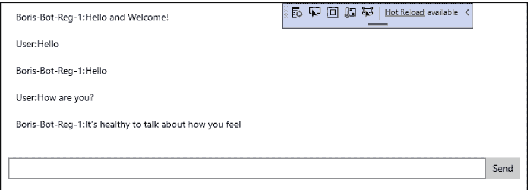

如你所见，机器人正在响应用户，虽然有些含糊，但正在进行对话。为了改善这种交互的质量，我们只需返回 LUIS 部署，并使用特定响应进一步训练它即可。

## 总结

在本章中，我们创建了一个聊天机器人，并使用 LUIS 赋予了其基本的语言理解能力。我们采用了默认模板，并将其从 .NET Core 2.2 升级到 .NET Core 3.0，创建了一个使用 Direct Line API 与机器人通信的 UWP 客户端应用。

我们的 Eliza（Boris）版本比原版更有可能通过图灵测试吗？也许吧。如果你希望改进 LUIS 中的模型，或许能让它多几分获胜的机会，但聊天机器人和语言识别在现实世界中的应用远远超出了让人误以为自己正在与人交谈的能力。你可以轻松地将其与语音合成器和电话集成软件（如 Twilio）关联，从而拥有一个自动化呼叫中心。

通用 Windows 平台，至少目前，是微软所宣传的首选桌面平台。这是否会持续，以及我们是否会转向单一 .NET 平台，我不得而知。

在本书中，我们介绍了 C# 语言中的许多新功能。我们利用这些功能使代码更易读且更简洁，并且在可空引用类型的情况下，我们实际上减少了代码中潜在错误的数量。

我们还探讨了 .NET Core 3 提供的一些优势，这使我们能够将现有桌面应用程序迁移到新的 .NET Core 3 框架，并且使用 XAML 岛，甚至可以在旧版软件中使用较新应用程序中的控件。

我们广泛研究了可用的 Azure 服务，并了解将这些服务集成到我们的代码库中是多么容易。


