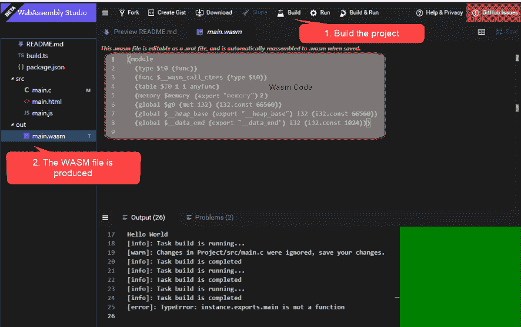
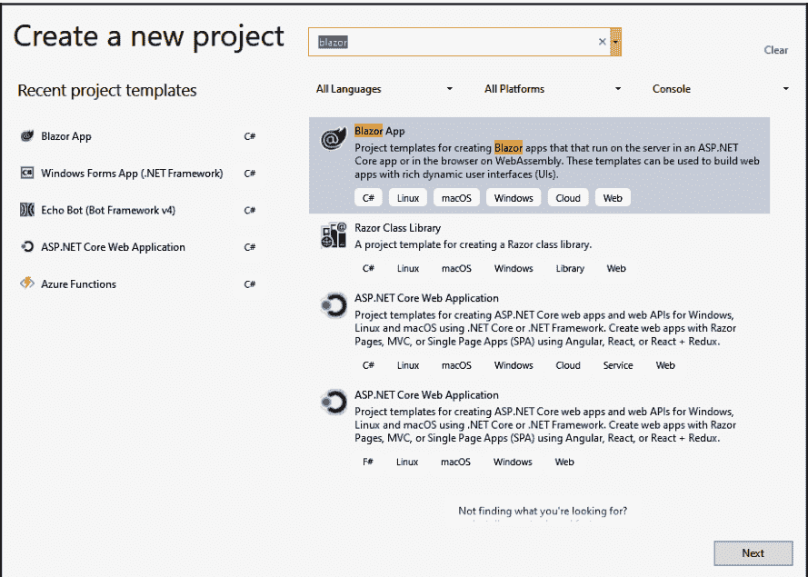
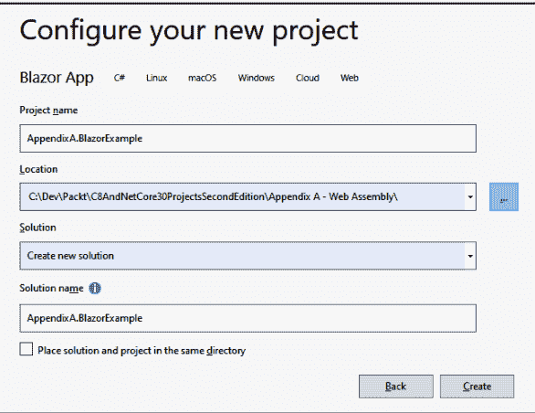
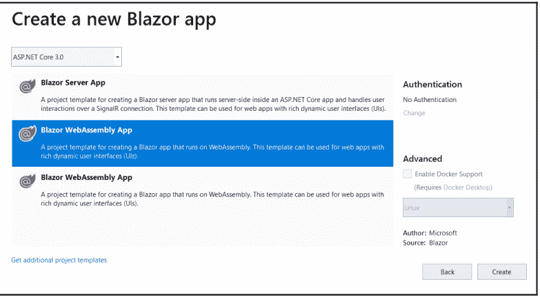
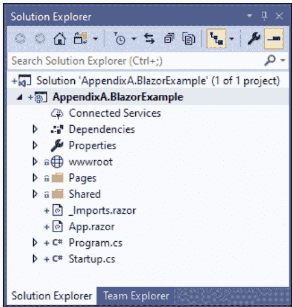
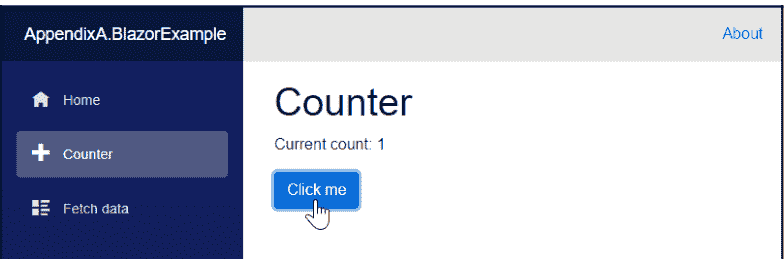
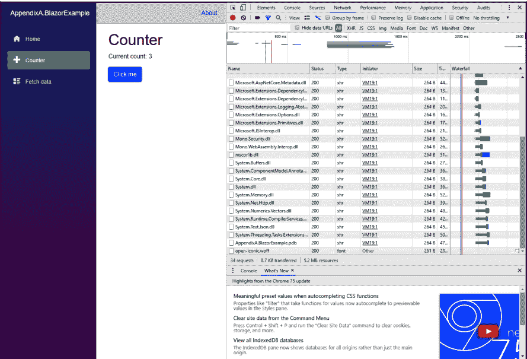
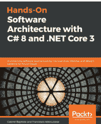
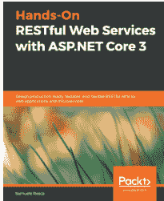

# WebAssembly

WebAssembly 是撰写本文时人人都在谈论的东西。它首次推出于 2015 年。其基本原理是，你的浏览器（所有主流浏览器都支持 WebAssembly）可以运行一种编译后的代码（之前，你仅限于使用 JavaScript）。

以下链接显示了 WebAssembly 的浏览器支持情况：https://caniuse.com/#feat=wasm。

Firefox、Chrome、Edge 和 Safari 均支持它。值得注意的是，一些旧版浏览器（例如 IE）不支持它，因此如果你编写的内容需要与这些旧版浏览器兼容，可能不得不回归到更传统的 JavaScript。

你最初可能会问自己：为什么我应该关心？希望本附录能解释 WebAssembly 为何有望在未来几年主导 Web。

我们将随后介绍两个示例：一个使用原生 WebAssembly 编译，另一个使用 Blazor（一项微软技术，可让你编写 C# 并在浏览器中运行）。

本章将涵盖以下主题：

- 为什么选择 WebAssembly？
- 编写 WebAssembly
- 理解 Blazor

## 为什么选择 WebAssembly

> 由于这项比较的性质，其不可避免地包含一些主观观点。例如，我将赞扬静态类型语言相对于动态类型语言的优点。如果你熟悉并喜欢使用 JavaScript，可能希望跳过不感兴趣的部分。

### 原因一 – 静态类型

我个人对 JavaScript 的不满之一在于它是动态类型语言。这意味着你可以使用未显式声明的变量。由此产生的连锁反应是，你可能会得到如下代码：

```
var myInt = 2;
myNum++;
```

假设你希望这两个数字相同，你会希望在编译时捕获此问题；然而，使用 JavaScript 时，这段代码会运行——虽然它显然不会按你预期的方式工作。

> 有许多工具可帮助缓解此问题，从 ESLint 到 TypeScript。然而，这涉及将一个步骤加入你的构建链，以捕获那些在静态类型语言中仅会是编译错误的问题。

### 原因二 – 编译

这是一个比较牵强的理由：虽然 JavaScript 肯定不是编译型，而是解释型，而 WebAssembly 是 JIT 编译的话。话虽如此，C 或 C# 的编译过程会捕获前一节中提到的大多数问题。此外，与 JavaScript（解释型）相比，代码执行速度有显著提升。有人声称速度可提高多达 20 倍；然而，正如你在下一节将看到的，事情并非表面看起来那么非黑即白。

### 原因三 – 速度

与原因二一样，原因三也比较牵强。断言 WebAssembly 比 JavaScript 快是错误的。如前所述，相同代码的执行速度确实比 JavaScript 快——事实上，处理器密集型代码的速度正是 WebAssembly 存在的原因之一。

但是，请记住你仍在浏览器上下文中运行，因此你可能希望使用的任何外部库都需要下载。对于运行编译为 WASM 的 C 程序来说，这问题不大；但对于诸如 Blazor 之类的东西（需要下载 .NET 运行时的版本），这可能是个问题。


我们将在后续章节中详细探讨此问题。目前，客户端 Blazor 版本使用的是 Mono 运行时。

### 原因四 – 你熟悉的语言/前后端使用同一语言

如果你了解 JavaScript，可能会选择使用 Node.js 作为后端。这样做可能有很多原因，其中之一可能是你可以为团队雇佣 JavaScript 开发人员。让我们深入探讨一下：撰写本文时，IT 行业（至少在英国）存在技能短缺；如果你能隔离出单一需要招聘的技能，那无疑会让你的工作更加轻松，因为除了编程 C# 和 JavaScript 的开发人员外，你还可以雇佣只使用 JavaScript 的开发人员，或使用 Python、Ruby、VB.NET 或任何后端语言并在前端使用 JavaScript 的开发人员——事实上，2019 年任何从事 Web 编程的人都至少需要具备基本的 JavaScript 知识。

直到现在，如果你是 C# 开发人员（或任何前述语言的开发人员），就必须学习 JavaScript 来编写应用程序的前端：现在你可以用 C# 编写前端和后端。


撰写本文时，客户端 Blazor 尚未正式成为 .NET Core 生态系统的一部分。我们将在本章后面详细介绍这一点。

还值得注意的是，随着 Xamarin 的出现，这基本上意味着你可以为绝对任何平台使用 C# 编程。


事实上，有一个开源项目将 Xamarin.Forms 代码转换为 WASM；可以在这里找到：https://github.com/praeclarum/Ooui。

Uno 是另一个项目，允许你编写 XAML 并将其转换为平台特定的代码（包括 WASM）：https://platform.uno/。

### 原因五 – 现有代码

由于许多语言已经得到各种工具的支持，可以编译为 WASM，你可能已有代码可简单编译为 WebAssembly。已有几个轶事示例表明此举非常成功。

假设你有一个完全用 C 编写的游戏；你可能可以将其移植到浏览器上运行。我个人正急切期待一种工具的出现，该工具能将 Spectrum ZX80 汇编语言转换为 WASM，这样我就可以在 Web 上玩所有旧的 Spectrum 游戏了！

### 原因六 – 部署

Web 开发比桌面开发更流行的主要原因之一在于，Web 浏览器解决了多年来一直困扰程序员的问题：部署。编写桌面应用程序并部署它——当你无法完全控制目标机器时，部署会变得多么困难，你会感到惊讶。

在我看来，这个理由可能是所有理由中最令人信服的：WebAssembly 在桌面和 Web 开发环境之间提供了一种混合解决方案。

### 原因七 – 安全

需要说明的是，WebAssembly 与 JavaScript 在相同的上下文中运行，因此相比于使用 JavaScript 编写 Web 应用程序，它既不更安全也不更不安全。然而，当你考虑你正在做什么时，它其实相当安全。它比向人们发送可执行文件并要求他们在机器上运行要安全得多。

我列出了使用 WebAssembly 的一些理由。对于某些应用程序，它显然比传统的 Web 模型具有某些优势。然而，和技术中的所有事情一样，这是关于权衡取舍。

在下一节，我们将探讨如何实际编写一些 WebAssembly。

## 编写 WebAssembly

要尝试编写一些 WebAssembly，我们将使用 WebAssembly Studio 工具：https://webassembly.studio/。

这是一个在线工具，允许你使用各种语言编写代码并将其编译为 WASM。在 WebAssembly Studio Web 应用程序中，如果你创建一个新的 C Hello World 应用程序，可以通过构建项目非常快速地看到一些 WASM 代码：



正如你所看到的，WASM 并不完全直观。然而，你可以自己编写（或生成）代码，并让 Web 浏览器运行它。


此工具无疑让人对这项技术可能实现的功能有所了解；然而，如果你对 C 或 Rust 不太熟悉，可能很难在浏览器中显示 42 之外使用它。

幸运的是，Microsoft 正在开发一项名为 Blazor 的实验性技术，它将大量工作隐藏在一个看似熟悉的项目结构背后。

## 了解 Blazor

在撰写本书时，Blazor 大约有两年历史（它最初于 2017 年进行演示）。其理念是将 WebAssembly 的概念与 Web 开发者熟悉的现有概念（例如 Razor）相结合。

> 此部分作为附录的部分原因是，仅服务器端 Blazor 随 .NET Core 3 一起发布。虽然客户端处于可用状态，但在撰写本书时，它尚未包含在官方发布版本中。

Blazor 有两种变体：客户端和服务器端。服务器端 Blazor 随 .NET Core 3 一起发布。它的工作原理是在服务器上运行 C# 代码，然后使用 SignalR 将屏幕更新发送到客户端。虽然这是一种有趣的方法，但由于它不使用 WebAssembly，我们将不在本章中进一步讨论。

要创建 Blazor 项目，你需要 Visual Studio 插件：https://marketplace.visualstudio.com/items?itemName=aspnet.blazor。

你还需要安装 Blazor 的 Visual Studio 模板；从命令行中，键入以下内容：

```
dotnet new -i Microsoft.AspNetCore.Blazor.Templates
```

> 到本书出版时，此步骤可能不再必要。

现在我们可以创建一个新的 Blazor 项目：

- 1. 从 Visual Studio 2019 创建一个新的 **Blazor 应用程序** 项目：



- 2. 在下一屏幕中，像平常一样选择你的 **项目名称** 和 **位置**：



- 3. 在下一屏幕中，你应该会看到几个选项。在本示例中，我们将创建一个客户端 Blazor 应用程序：



- 4. 如果你现在选择 **创建**，你将看到一个完整且可运行的 Blazor 示例。尝试运行它：你应该会看到一个功能齐全的单页应用程序。如果你曾经见过 React 模板，这个结构应该对你来说非常熟悉。

> > 尽管在撰写本书时情况属实，但到你阅读本书时，模板可能已经发生了变化。

如果你在应用程序中点击浏览，它应该很像现代单页应用程序。让我们深入了解一下。我们将从项目结构开始：



这个结构应该对你来说非常熟悉。值得注意的是 `.razor` 扩展名：事实上，**Blazor** 这个名称是由 **浏览器** 和 **Razor** 两个词合成的。

为了快速概览，我们不会过多深入细节，但让我们来看看 **Counter** 页面；当你运行应用程序时，你应该会看到一个允许你点击按钮并增加数值的页面：



这个页面能很好地让你了解语言的工作原理；让我们来看看驱动它的代码。`Counter.razor` 文件如下：

```
@page "/counter"

<h1>Counter</h1>

<p>Current count: @currentCount</p>

<button class="btn btn-primary" @onclick="@IncrementCount">Click me</button>

@code {
    int currentCount = 0;

    void IncrementCount()
    {
        currentCount++;
    }
}
```

我们有一些 HTML：页面标题、当前计数等等。然后，我们有 Razor 语法——基本上就是你在任何地方看到 `at` 符号 (@) 的地方。请注意，按钮将 `click` 事件处理程序映射到 `@code` 块内的方法。Blazor 会跟踪 DOM，当有变化时（例如 `currentCount`），页面将被刷新。

让我们再次运行应用程序，但这次，打开浏览器中的开发者工具：



对于大多数浏览器，可以通过按 F12 来实现。

在处理 Blazor 时，这告诉我们两点非常重要的信息。首先，查看运行应用程序时下载的所有 DLL。本质上，这是下载 Mono 运行时。如你所见，这些文件并不特别大，但在选择 Blazor 技术时这是一个需要牢记的方面。

需要注意的第二点是，点击按钮不会发起服务器调用。所有代码都在客户端执行。这就是 Blazor 的真正吸引力：你可以编写 C# 代码，并在浏览器中运行它。

我们已经快速了解了 WebAssembly 的原始形式。我们讨论了为什么 WebAssembly 是一项如此吸引人、新兴的 Web 技术。接着，我们查看了 Blazor 项目，以了解它如何简化 Web 应用程序的创建过程。

# 你可能还喜欢的其他图书

如果你喜欢这本书，可能会对 Packt 出版的这些其他图书感兴趣：



## 使用 C# 8 和 .NET Core 3 的软件架构实战

Gabriel Baptista, Francesco Abbruzzese

ISBN: 978-1-78980-093-7

- 克服现实世界中的架构挑战并解决设计考虑问题
- 应用分层架构、面向服务架构 (SOA) 和微服务等架构方法
- 学习使用容器、Docker 和 Kubernetes 等工具来管理微服务
- 掌握 Azure Cosmos DB 以交付多大洲解决方案
- 学习如何使用 C# 编程和维护 Azure Functions
- 了解何时将测试驱动开发 (TDD) 用作软件开发方法
- 为你的项目编写自动化功能测试用例



## 使用 ASP.NET Core 3 构建 RESTful Web 服务实战

Samuele Resca

ISBN: 978-1-78953-761-1

- 全面掌握 ASP.NET Core 的工作原理
- 集成第三方工具和框架，构建可维护且高效的服务
- 使用依赖注入实现模式，以减少样板代码并提高灵活性
- 使用 ASP.NET Core 的现成工具测试你的应用程序
- 使用 Docker 在隔离且自包含的环境中运行 ASP.NET Core Web 服务
- 使用 HTTPS 和基于令牌的身份验证保护你的信息
- 使用复原能力模式和消息传递技术集成多个 Web 服务

## 留下评论 - 让其他读者了解你的想法

请通过在购买该书的网站上留下评论，与其他人分享你对本书的看法。如果你从 Amazon 购买了本书，请在本书的 Amazon 页面上留下真诚的评论。这至关重要，以便其他潜在读者可以看到并使用你不偏不倚的意见来做出购买决定，我们可以了解客户对我们产品的看法，并且我们的作者可以看到你对他们与 Packt 合作创作的书名的反馈。这只需要花费你几分钟时间，但对其他潜在客户、我们的作者和 Packt 来说都很有价值。谢谢！
