## 2 树、堆和图

### 学习目标

在本章结束时，你将能够：

- 分析并识别非线性数据结构可用于哪些场景
- 实现和操作树结构以表示数据并解决问题
- 使用各种方法遍历树
- 实现图结构以表示数据并解决问题
- 根据给定场景使用不同方法表示图

在本章中，我们将研究两种非线性数据结构，即树和图，以及如何使用它们来表示现实世界中的场景并解决各种问题。

### 引言

在上一章中，我们实现了不同类型的线性数据结构，以线性的方式存储和管理数据。在线性结构中，我们最多可以向两个方向遍历——向前或向后。然而，这些结构的适用范围非常有限，无法用于解决高级问题。在本章中，我们将探索更高级的一类问题。我们将会看到，之前实现的解决方案不足以直接使用。因此，我们将扩展这些数据结构，以构建更复杂的结构来表示非线性数据。

在了解了这些问题之后，我们将讨论使用树数据结构的基本解决方案。我们将实现不同类型的树来解决不同种类的问题。之后，我们将研究一种称为堆的特殊类型的树，以及它的可能实现和应用。接下来，我们将研究另一种复杂结构——图。我们将实现图的两种不同表示。这些结构有助于将现实世界中的场景转化为数学形式。然后，我们将运用编程技能和技术来解决与这些场景相关的问题。

对树和图的深入理解是理解更高级问题的基础。数据库（B树）、数据编码/压缩（哈夫曼树）、图着色、分配问题、最短距离问题以及许多其他问题都是使用树和图的某些变体来解决的。

现在，让我们来看一些无法用线性数据结构表示的问题示例。

### 非线性问题

无法用线性数据结构表示的两大类情况是层次问题和循环依赖。让我们仔细看看这些情况。

#### 层次问题

让我们看几个本质具有层次属性的示例。以下是一个组织的结构：


图2.1：组织结构

正如我们所见，CEO是公司的负责人，管理副总监。副总监领导其他三名主管，以此类推。

数据在本质上是层次性的。这类数据很难使用简单的数组、向量或链表来管理。为了巩固我们的理解，让我们再看一个用例；即大学课程的结构，如下图所示：

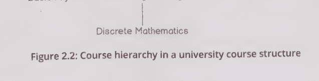

图2.2：大学课程结构中的课程层次

上图显示了某虚构大学中一些课程的依赖关系。正如我们所见，要学习高等物理II，学生必须成功完成以下课程：高等物理和高等数学。同样，许多其他课程也有各自的先修课程。

有了这些数据，我们可以提出不同类型的查询。例如，我们可能想找出需要成功完成哪些课程才能学习高等数学。

这类问题可以使用称为树的数据结构来解决。所有对象都称为树的节点，而从一个节点通向另一个节点的路径称为边。我们将在本章后面的*图*一节中更深入地讨论这一点。

#### 循环依赖

让我们看另一个可以用非线性结构更好地表示的复杂现实场景。下图表示了几个人之间的友谊：

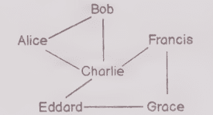

*图2.3：朋友网络*

这种结构称为图。人的姓名或元素称为节点，它们之间的关系表示为边。这类结构通常被各种社交网络用来表示其用户以及用户之间的连接。我们可以观察到，爱丽丝和查理是朋友，查理和艾德是朋友，艾德和格蕾丝是朋友，等等。我们还可以推断，爱丽丝、鲍勃和查理彼此认识。我们还可以推断，艾德是格蕾丝的一级连接，查理是二级连接，爱丽丝和鲍勃是三级连接。

图的另一个有用领域是表示城市之间的道路网络，你将在本章后面的*图*一节中看到。

4. 现在，让我们添加一个函数来创建根节点，从公司的最高指挥官开始：

```
static org_tree create_org_structure(const std::string& pos)
{
    org_tree tree;
    tree.root = new node{pos, NULL, NULL};
    return tree;
}
```

这只是一个用于创建树的静态函数。现在，让我们看看如何扩展树。

5. 现在，我们想要添加一个员工的下属。该函数应接受两个参数——树中已存在员工的姓名，以及要作为下属添加的新员工的姓名。但在此之前，让我们编写另一个函数，该函数将帮助我们根据值查找特定节点，从而使插入函数更简单：

```
static node* find(node* root, const std::string& value)
{
    if(root == NULL)
        return NULL;
    if(root->position == value)
        return root;
    auto firstFound = org_tree::find(root->first, value);
    if(firstFound != NULL)
        return firstFound;
    return org_tree::find(root->second, value);
}
```

当我们遍历树查找元素时，该元素要么是我们当前所在的节点，要么位于右子树或左子树中。

因此，我们需要首先检查根节点。如果不是目标节点，我们将尝试在左子树中找到它。最后，如果我们还没有成功找到，我们将查看右子树。

6. 现在，让我们实现插入函数。我们将使用find函数来重用代码：

```
bool addSubordinate(const std::string& manager, const std::string&
subordinate)
{
    auto managerNode = org_tree::find(root, manager);
    if(!managerNode)
```


```cpp
{
    std::cout << "No position named " << manager << std::endl;
    return false;
}
if(managerNode->first && managerNode->second)
{
    std::cout << manager << " already has 2 subordinates." << std::endl;
    return false;
}
if(!managerNode->first)
    managerNode->first = new node{subordinate, NULL, NULL};
else
    managerNode->second = new node{subordinate, NULL, NULL};
return true;
}
};
```

正如我们所见，该函数返回一个布尔值，表示我们是否可以成功插入节点。

7. 现在，让我们使用这段代码在 **main** 函数中创建一个树：

```cpp
int main()
{
    auto tree = org_tree::create_org_structure("CEO");
    if(tree.addSubordinate("CEO", "Deputy Director"))
        std::cout << "Added Deputy Director in the tree." << std::endl;
    else
        std::cout << "Couldn't add Deputy Director in the tree" << std::endl;

    if(tree.addSubordinate("Deputy Director", "IT Head"))
        std::cout << "Added IT Head in the tree." << std::endl;
    else
        std::cout << "Couldn't add IT Head in the tree" << std::endl;
    if(tree.addSubordinate("Deputy Director", "Marketing Head"))
        std::cout << "Added Marketing Head in the tree." << std::endl;
    else
        std::cout << "Couldn't add Marketing Head in the tree" << std::endl;

    if(tree.addSubordinate("IT Head", "Security Head"))
        std::cout << "Added Security Head in the tree." << std::endl;
    else
        std::cout << "Couldn't add Security Head in the tree" << std::endl;

    if(tree.addSubordinate("IT Head", "App Development Head"))
        std::cout << "Added App Development Head in the tree." << std::endl;
    else
        std::cout << "Couldn't add App Development Head in the tree" << std::endl;

    if(tree.addSubordinate("Marketing Head", "Logistics Head"))
        std::cout << "Added Logistics Head in the tree." << std::endl;
    else
        std::cout << "Couldn't add Logistics Head in the tree" << std::endl;

    if(tree.addSubordinate("Marketing Head", "Public Relations Head"))
        std::cout << "Added Public Relations Head in the tree." << std::endl;
    else
        std::cout << "Couldn't add Public Relations Head in the tree" << std::endl;

    if(tree.addSubordinate("Deputy Director", "Finance Head"))
        std::cout << "Added Finance Head in the tree." << std::endl;
    else
        std::cout << "Couldn't add Finance Head in the tree" << std::endl;
}
```

执行上述代码后，你应得到以下输出：

```
Added Deputy Director in the tree.
Added IT Head in the tree.
Added Marketing Head in the tree.
Added Security Head in the tree.
Added App Development Head in the tree.
Added Logistics Head in the tree.
Added Public Relations Head in the tree.
Deputy Director already has 2 subordinates.
Couldn't add Finance Head in the tree
```

该输出在以下图表中进行了说明：

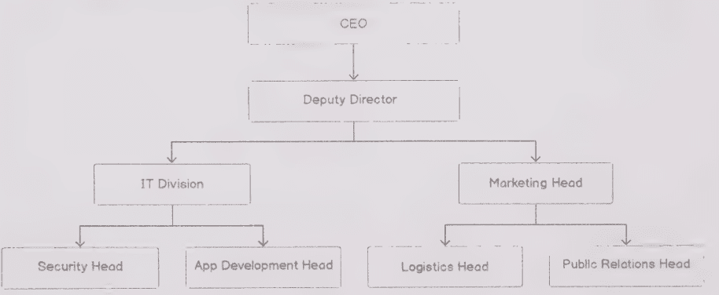

**图 2.4：基于组织层级的二叉树**

到目前为止，我们只是插入元素。现在，我们将看看如何遍历树。虽然我们已经看到了如何使用 `find` 函数进行遍历，但这只是众多方法之一。我们可以用许多其他方式遍历树，所有这些方法我们将在下一节中介绍。

## 遍历树

一旦我们有了树，就有各种方法可以遍历它并到达我们需要的节点。让我们简要了解一下各种遍历方法：

- **先序遍历：** 在这种方法中，我们首先访问当前节点，然后以递归方式访问当前节点的左子节点，最后访问右子节点。这里前缀“pre”表示父节点在其子节点之前被访问。使用先序方法遍历图 2.4 所示的树如下：

```
CEO, Deputy Director, IT Head, Security Head, App Development Head,
Marketing Head, Logistics Head, Public Relations Head,
```

正如我们所见，我们总是先访问父节点，然后是左子节点，然后是右子节点。我们不仅对根这样做，而且对任何节点相对于其子树也是如此。我们使用如下函数实现先序遍历：

```cpp
static void preOrder(node* start)
{
    if(!start)
        return;
    std::cout << start->position << ", ";
    preOrder(start->first);
    preOrder(start->second);
}
```

- **中序遍历：** 在这种遍历类型中，我们首先访问左节点，然后是父节点，最后是右节点。遍历图 2.4 所示的树如下：

```
Security Head, IT Head, App Development Head, Deputy Director, Logistics Head, Marketing Head, Public Relations Head, CEO,
```

我们可以像这样在函数中实现它：

```cpp
static void inOrder(node* start)
{
    if(!start)
        return;
    inOrder(start->first);
    std::cout << start->position << ", ";
    inOrder(start->second);
}
```

- **后序遍历：** 在这种遍历中，我们首先访问两个子节点，然后访问父节点。遍历图 2.4 所示的树如下：

```
Security Head, App Development Head, IT Head, Logistics Head, Public Relations Head, Marketing Head, Deputy Director, CEO,
```

我们可以像这样在函数中实现它：

```cpp
static void postOrder(node* start)
{
    if(!start)
        return;
    postOrder(start->first);
    postOrder(start->second);
    std::cout << start->position << ", ";
}
```

- **层序遍历：** 这要求我们逐层遍历树，从上到下，从左到右。这类似于列出树每一层的元素，从根层开始。此类遍历的结果通常按层表示，如下所示：

```
CEO,
Deputy Director,
IT Head, Marketing Head,
Security Head, App Development Head, Logistics Head, Public Relations Head,
```

该遍历方法的实现在以下练习中进行了演示。

### 练习 8：演示层序遍历

在本练习中，我们将在 *练习 7 创建组织结构* 中创建的组织结构中实现层序遍历。与之前的遍历方法不同，这里我们不会遍历到与当前节点直接连接的节点。这意味着遍历更容易在不使用递归的情况下实现。我们将扩展练习 7 中所示的代码来演示此遍历。让我们开始：

1. 首先，我们将在 *练习 7* 中的 **org_tree** 结构内部添加以下函数：

```cpp
static void levelOrder(node* start)
{
    if(!start)
        return;
    std::queue<node*> q;
    q.push(start);
    while(!q.empty())
    {
        int size = q.size();
```

## 二叉搜索树

**二叉搜索树 (BST)** 是二叉树的一种流行版本。BST 只不过是具有以下属性的二叉树：

- 父节点的值 ≥ 左子节点的值
- 父节点的值 ≤ 右子节点的值

简而言之，左子节点 ≤ 父节点 ≤ 右子节点。

这导致了一个有趣的特性。在任何时候，我们都可以始终说，所有小于或等于父节点的元素都将在左侧，而大于或等于父节点的元素将在右侧。因此，搜索元素的空间在每一步都会减半。

如果 BST 的构造方式是除最后一层外的所有元素都有两个子节点，则树的高度将为 log n，其中 n 是元素的数量。由于此原因，搜索和插入的时间复杂度为 O(log n)。这种类型的二叉树也称为 **完全二叉树**。

### 在 BST 中搜索

让我们看看如何在二叉搜索树中搜索、插入和删除元素。考虑一个具有唯一正整数的 BST，如下图所示：

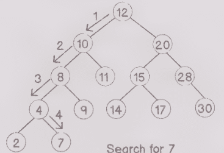

*图 2.5：在二叉搜索树中搜索元素*

假设我们要搜索 7。正如前一图中箭头所示的步骤，我们在将值与当前节点的数据进行比较后选择一侧。正如我们已经提到的，左侧的所有节点将始终小于当前节点，而右侧的所有节点将始终大于当前节点。


因此，我们首先将根节点与7进行比较。如果它大于7，我们就移动到左子树，因为那里的所有元素都小于父节点，反之亦然。我们逐个比较每个子节点，直到遇到7，或者遇到一个小于7且没有右节点的节点。在这种情况下，到达节点4后就会找到我们的目标7。

正如我们所见，我们并没有遍历整棵树。相反，当当前节点不是目标节点时，我们通过选择左侧或右侧来将搜索范围缩小一半。这类似于线性结构中的二分查找，我们将在第4章*分而治之*中学习。

## 向二叉搜索树中插入新元素

现在，让我们看看插入是如何工作的。步骤如下面的图所示：

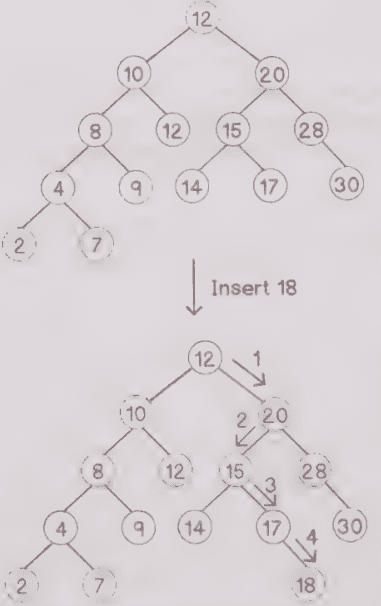

可以看到，首先，我们必须找到要插入新值的父节点。因此，我们必须采用与搜索类似的方法；也就是说，从根节点开始，通过将每个节点与新元素进行比较来决定移动方向。在最后一步中，18大于17，但17没有右子节点。因此，我们将18插入该位置。

## 从二叉搜索树中删除元素

现在，让我们看看删除是如何工作的。考虑以下二叉搜索树：

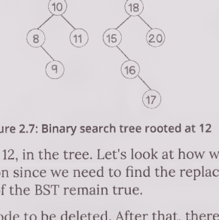

图2.7：以12为根节点的二叉搜索树

我们将删除树中的根节点12。让我们看看如何删除任意值。这比插入要棘手一些，因为我们需要找到被删除节点的替代者，以便保持二叉搜索树的属性。

第一步是找到要删除的节点。之后，有三种可能的情况：

- 该节点没有子节点：直接删除该节点。
- 该节点只有一个子节点：将父节点对应的指针指向该唯一的子节点。
- 该节点有两个子节点：在这种情况下，我们用其后继节点替换当前节点。

后继节点是当前节点之后的下一个最大的数。换句话说，后继节点是所有大于当前节点的元素中最小的那个。因此，我们首先进入右子树，其中包含所有大于当前节点的元素，并找到其中最小的元素。找到最小节点意味着尽可能向左子树移动，因为左子节点总是小于其父节点。在图2.7所示的树中，12的右子树从18开始。因此，我们从那里开始查找，然后尝试向下移动到15的左子节点。但15没有左子节点，而另一个子节点16大于15。因此，15应该是这里的后继节点。

要用15替换12，首先，我们将在根节点复制后继节点的值，同时删除12，如下图所示：

### 步骤1

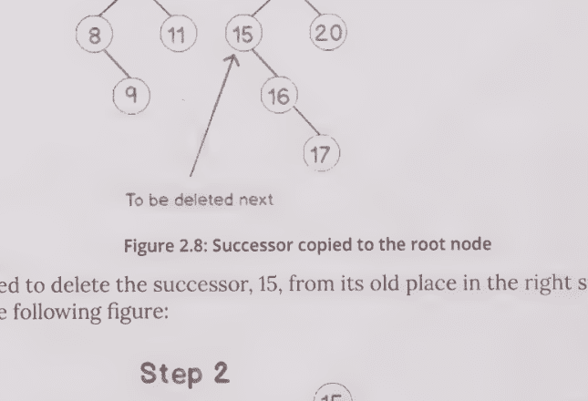

图2.8：将后继节点复制到根节点

接下来，我们需要从右子树中的原位置删除后继节点15，如下图所示：

### 步骤2

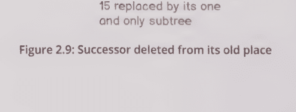

15被其唯一的子树替换

图2.9：从原位置删除后继节点

在最后一步中，我们删除节点15。我们使用相同的过程进行此删除。由于15只有一个子节点，我们将18的左子节点替换为15的子节点。因此，以16为根节点的整个子树成为18的左子节点。

> **注意**
>
> 后继节点最多只能有一个子节点。如果它有一个左子节点，那么我们会选择那个子节点作为后继节点，而不是当前节点。

## 树上操作的时间复杂度

现在，让我们看看这些函数的时间复杂度。理论上，我们可以说每次都将搜索范围减少一半。因此，搜索具有*n*个节点的二叉搜索树所需的时间是T(n) = T(n / 2) + 1。这个方程得出的时间复杂度为T(n) = O(log n)。

但这里有一个问题。如果我们仔细看插入函数，插入的顺序实际上决定了树的形状。而且，并不一定总是像前面公式中的T(n/2)描述的那样，将搜索范围减少一半。因此，O(log n)的复杂度并不总是准确的。我们将在*平衡树*一节中更深入地探讨这个问题及其解决方案，在那里我们将看到如何更准确地计算时间复杂度。

现在，让我们在C++中实现刚才看到的操作。

## 练习9：实现二叉搜索树

在这个练习中，我们将实现*图2.7*中所示的二叉搜索树，并添加一个*find*函数来搜索元素。我们还将尝试插入和删除元素，如前面小节所述。让我们开始吧：

- 1. 首先，让我们包含所需的头文件：

```
#include <iostream>
```

- 2. 现在，让我们编写一个节点。这与我们之前的练习类似，只是我们使用整数而不是字符串：

```
struct node
{
    int data;
    node *left, *right;
};
```

- 3. 现在，让我们在节点上添加一个包装器，以提供干净的接口：

```
struct bst
{
    node* root = nullptr;
```

- 4. 在编写插入函数之前，我们需要编写**find**函数：

```
node* find(int value)
{
    return find_impl(root, value);
}

private:
node* find_impl(node* current, int value)
{
    if(!current)
    {
        std::cout << std::endl;
        return NULL;
    }
    if(current->data == value)
    {
        std::cout << "Found " << value << std::endl;
        return current;
    }
    if(value < current->data) // Value will be in the left subtree
    {
        std::cout << "Going left from " << current->data << ", ";
        return find_impl(current->left, value);
    }
    if(value > current->data) // Value will be in the right subtree
    {
        std::cout << "Going right from " << current->data << ", ";
        return find_impl(current->right, value);
    }
}
```

由于这是递归的，我们将实现放在一个单独的函数中，并将其设为私有，以防止有人直接使用它。

```
if(!start)
    return NULL;
if(value < start->data)
    start->left = delete_impl(start->left, value);
else if(value > start->data)
    start->right = delete_impl(start->right, value);
else
{
    if(!start->left)  // Either both children are absent or only left child is absent
    {
        auto tmp = start->right;
        delete start;
        return tmp;
    }
    if(!start->right)  // Only right child is absent
    {
        auto tmp = start->left;
        delete start;
        return tmp;
    }

    auto succNode = successor(start);
    start->data = succNode->data;
    // Delete the successor from right subtree, since it will always be in the right subtree
    start->right = delete_impl(start->right, succNode->data);
}
return start;
}
};
```

- 9. 让我们编写**main**函数，以便我们可以使用二叉搜索树：

```
int main()
{
    bst tree;
    tree.insert(12);
    tree.insert(10);
    tree.insert(20);
    tree.insert(8);
    tree.insert(11);
```

```
tree.insert(28);
tree.insert(4);
tree.insert(2);

std::cout << "Inorder: ";
tree.inorder();  // This will print all the elements in ascending order
std::cout << std::endl;

tree.deleteValue(12);
std::cout << "Inorder after deleting 12: ";
tree.inorder();  // This will print all the elements in ascending order
std::cout << std::endl;

if(tree.find(12))
    std::cout << "Element 12 is present in the tree" << std::endl;
else
    std::cout << "Element 12 is NOT present in the tree" << std::endl;
}
```

执行上述代码后，输出应如下所示：

```
Inorder: 2 4 8 10 11 12 15 20 28
Inorder after deleting 12: 2 4 8 10 11 15 20 28
Going left from 15, Going right from 10, Going right from 11,
Element 12 is NOT present in the tree
```

观察上述二叉搜索树的中序遍历结果。中序遍历会先访问左子树，然后访问当前节点，最后递归地访问右子树，如代码片段中的注释所示。因此，根据二叉搜索树的属性，我们会先访问所有小于当前节点的值，然后是当前节点，之后访问所有大于当前节点的值。由于这是递归进行的，我们将得到按升序排列的数据。

## 平衡树

在我们理解平衡树之前，让我们从以下插入顺序的二叉搜索树示例开始：

```
bst tree;
tree.insert(10);
tree.insert(9);
tree.insert(11);
```


```
tree.insert(8);
tree.insert(7);
tree.insert(6);
tree.insert(5);
tree.insert(4);
```

该二叉搜索树可以借助下图来可视化：

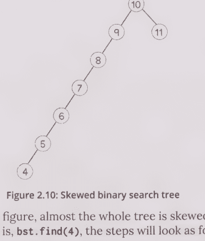

图 2.10：倾斜的二叉搜索树

如上图所示，几乎整棵树都向左侧倾斜。如果我们调用查找函数，即 `bst.find(4)`，其步骤将如下所示：


图 2.11：在倾斜的二叉搜索树中查找元素

可以看出，步骤数量几乎等于元素数量。现在，让我们用不同的插入顺序再试一次，如下所示：

```
bst tree;
tree.insert(7);
tree.insert(5);
tree.insert(9);
tree.insert(4);
tree.insert(6);
tree.insert(10);
tree.insert(11);
tree.insert(8);
```

现在，二叉搜索树以及查找元素 4 所需步骤将如下所示：

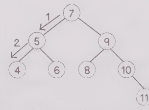

可以看到，这棵树不再倾斜了。换句话说，这棵树是平衡的。在这种配置下，查找 4 的步骤大大减少了。因此，**find** 的时间复杂度不仅依赖于元素数量，还取决于它们在树中的配置。如果我们仔细观察这些步骤，会发现搜索时我们总是朝着树的底部走一步。最终，我们会到达叶子节点（没有任何子节点的节点）。在这里，我们根据元素是否存在来返回目标节点或 NULL。因此，我们可以说步骤数量总是小于二叉搜索树的最大层数，也就是二叉搜索树的高度。所以，查找元素的实际时间复杂度是 O(height)。

为了优化时间复杂度，我们需要优化树的高度。这也被称为*树的平衡*。其思想是在插入/删除后重新组织节点，以减少树的倾斜程度。由此得到的树称为高度平衡的二叉搜索树。

我们可以通过多种方式实现这一点，并得到不同类型的树，例如 AVL 树、红黑树等等。AVL 树背后的思想是执行一些旋转操作来平衡树的高度，同时保持二叉搜索树的属性。考虑下图所示的例子：

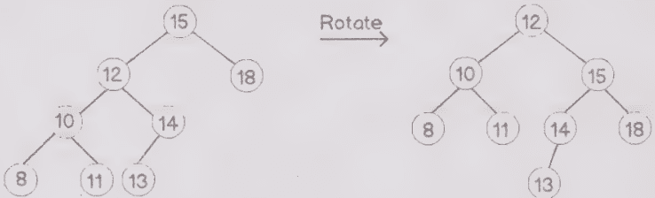

图 2.13：旋转树

可以看到，右边的树比左边的树更平衡。旋转超出了本书的讨论范围，因此我们不会深入探讨这个例子的细节。

## N 叉树

到目前为止，我们主要见到了二叉树或其变体。对于 N 叉树，每个节点可以有 N 个子节点。由于这里的 N 是任意的，我们将它存储在一个向量中。因此，最终的结构如下所示：

```
struct nTree
{
    int data;
    std::vector<nTree*> children;
};
```

可以看到，每个节点可以有任意数量的子节点。因此，整棵树是完全任意的。然而，就像普通的二叉树一样，普通的 N 叉树也不是很有用。因此，我们必须针对不同类型的应用构建不同的树，这些应用中的层级结构比二叉树更高。*图 2.1* 中展示的组织层级结构就是一个 N 叉树。

在计算机领域，N 叉树有两个非常著名的实现，如下所示：

- **计算机中的文件系统结构：** 从 Linux 中的**根目录 (/)** 或 Windows 中的驱动器开始，我们可以有任意数量的文件（终端节点）以及任意文件夹内任意数量的文件夹。我们将在*活动 1：为文件系统创建数据结构*中更详细地讨论这一点。
- **编译器：** 大多数编译器会根据源代码所使用的标准定义的语法构建抽象语法树（AST）。编译器通过解析 AST 来生成更底层的代码。

## 活动 4：为文件系统创建数据结构

使用 N 叉树为文件系统创建一个数据结构，支持以下操作：进入目录、查找文件/目录、添加文件/目录以及列出文件/目录。我们的树将保存文件系统中所有元素（文件和文件夹）的信息和文件夹层级结构（路径）。

执行以下步骤来完成此活动：

1. 创建一个 N 叉树，每个节点包含两个数据元素——目录/文件的名称以及一个指示它是目录还是文件的标志。
2. 添加一个数据成员来存储当前目录。
3. 用一个目录根节点 (/) 初始化树。
4. 添加查找目录/文件的函数，该函数接受单个参数——**路径**。**路径**可以是绝对的（以 / 开头）也可以是相对的。
5. 添加在给定路径下添加文件/目录以及列出文件/目录的函数。
6. 类似地，添加一个更改当前目录的函数。

> **注意**
>
> 此活动的解决方案可以在第 490 页找到。

我们用前面的 d 来表示目录，以区别于文件，文件前面会打印一个 “-”（连字符）。你可以尝试使用绝对或相对路径创建更多目录和文件来进行实验。

到目前为止，我们还没有支持某些 Linux 约定，例如用单个点表示任何目录、用双点表示父目录。这可以通过扩展我们的节点，使其同时保存一个指向父节点的指针来实现。这样，我们就可以非常容易地进行双向遍历。还有其他各种可能的扩展，例如添加符号链接，以及使用 “*” 通配符运算符来扩展各种文件/目录的名称。这个练习为我们提供了一个基础，使我们能够根据自己的需求构建一些东西。

## 堆

在上一章中，我们简要了解了堆以及 C++ 如何通过 STL 提供堆。在本章中，我们将更深入地了解堆。简单回顾一下，以下是预期的时间复杂度：

- O(1)：直接访问最大元素
- O(log n)：插入任意元素
- O(log n)：删除最大元素

为了实现 O(log n) 的插入/删除操作，我们将使用树来存储数据。但在这里，我们将使用完全树。完全树的定义是：除最后一层外，所有层级的节点都有两个子节点，并且最后一层的元素尽可能靠左排列。例如，考虑下图中显示的两棵树：

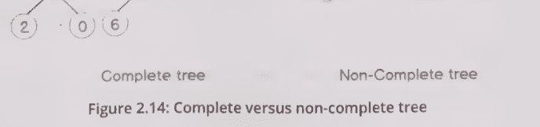

完全树 | 非完全树
图 2.14：完全树与非完全树

因此，将新元素视为根节点而生成的子树满足所有不变量。然而，新元素仍然可能大于它的新父节点。因此，我们需要不断交换节点，直到整棵树满足不变量。由于完全树的高度最多是 O(log n)，整个操作最多需要 O(log n) 时间。下图说明了向树中插入元素的操作：

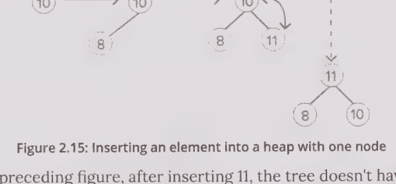

图 2.15：向只有一个节点的堆中插入元素

如上图所示，插入 11 后，树不再具有堆属性。因此，我们将交换 10 和 11，使其重新成为堆。下面的例子层级更多，可以更清楚地说明这个概念：


插入 8

图 2.16：向具有多个节点的堆中插入元素

然而，有一种堆化算法可以在 O(n) 时间内完成这项工作。其背后的想法非常简单：我们以自底向上的方式不断更新树，使较小的子树符合堆属性。首先，最后一层已经具有堆属性。然后，我们逐层向根节点推进，使每个子树逐一满足堆属性。这个过程的时间复杂度仅为 O(n)。幸运的是，C++ 标准已经提供了一个名为 `std::make_heap` 的函数，它可以接受任何数组或向量迭代器并将它们转换为堆。

## 练习 10：流式众数

在这个练习中，我们将解决一个在数据分析相关应用（包括机器学习）中经常出现的有趣问题。想象一下，某个数据源连续不断地向我们提供元素（数据流）。我们需要在收到每一个元素后，找出到目前为止已收到元素的中位数。一种简单的方法是每次有新元素到达时对数据进行排序，然后返回中间元素。但由于排序，这种方法的时间复杂度为 O(n log n)。根据元素到达的速率，这可能会非常耗费资源。不过，我们将借助堆来优化这一点。让我们开始吧：

1. 首先包含所需的头文件：

```
#include <iostream>
#include <queue>
#include <vector>
```

2. 现在，编写一个容器来存储到目前为止我们收到的数据。我们将数据存储在两个堆中——一个最小堆和一个最大堆。我们将较小的一半元素存储在最大堆中，将较大的一半元素存储在最小堆中。因此，在任何时候，都可以仅使用堆的顶部元素来计算中位数，而这些顶部元素很容易访问：

```
struct median
{
    std::priority_queue<int> maxHeap;
    std::priority_queue<int, std::vector<int>, std::greater<int>> minHeap;
```


3. 现在，让我们编写一个 **insert** 函数，以便插入新到达的数据：

```
void insert(int data)
{
    // First element
    if(maxHeap.size() == 0)
    {
        maxHeap.push(data);
        return;
    }

    if(maxHeap.size() == minHeap.size())
    {
        if(data <= get())
            maxHeap.push(data);
        else
            minHeap.push(data);
        return;
    }
    if(maxHeap.size() < minHeap.size())
    {
        if(data > get())
        {
            maxHeap.push(minHeap.top());
            minHeap.pop();
            minHeap.push(data);
        }
        else
            maxHeap.push(data);
        return;
    }
    if(data < get())
    {
        minHeap.push(maxHeap.top());
        maxHeap.pop();
        maxHeap.push(data);
    }
    else
        minHeap.push(data);
}
```

这个算法的奇妙之处在于，考虑到我们之前描述的现实场景，它实际上不需要同时存储所有 n × k 个元素；它随时只需存储 k 个元素，其中 k 是集群中列表或节点的数量。因此，k 的值永远不会太大。借助堆，我们可以一次生成一个数字，并立即处理该数字，或将其流式传输到其他地方进行处理，而无需实际存储它。

## 图

虽然树是表示层次结构数据的一种很好方式，但我们无法在树中表示循环或环形依赖，因为我们从一个节点到另一个节点总是有唯一的一条路径。然而，还有一些更复杂的场景本质上具有循环结构。例如，考虑一个道路网络。从一个地方（地方可以表示为节点）到另一个地方可能有多条路径。这类场景使用图来表示更好。

与树不同，图必须存储节点数据以及节点之间的边的数据。例如，在任何道路网络中，对于每个节点（地点），我们都必须存储它与哪些其他节点（地点）相连的信息。这样，我们就可以用所有需要的节点和边构成一个图。这被称为**无权图**。我们可以为每条边添加*权重*或更多信息。以道路网络为例，我们可以为每条边（路径）添加从一个节点（地点）到另一个节点的距离。这种表示方法称为**加权图**，它包含了解决诸如寻找两地之间距离最短路径等问题所需的关于道路网络的全部信息。

图有两种类型——无向图和有向图。**无向图**表示边是双向的。双向表示一种双边或可交换的性质。以道路网络为例，A 点和 B 点之间的双向边意味着我们既可以从 A 到 B，也可以从 B 到 A。但假设我们有些道路是单向限制的——我们需要使用**有向图**来表示这种情况。在有向图中，每当我们需要表示可以沿任一方向行驶时，我们使用两条边——从 A 点到 B 点，以及从 B 点到 A 点。我们将主要关注双向图，但这里学习的关于结构和遍历方法的内容同样适用于有向图。唯一的变化将是如何向图中添加边。

由于图可能包含循环边，并且从一个节点到另一个节点可能有多种路径，我们需要唯一标识每个节点。为此，我们可以为每个节点分配一个标识符。为了表示图的数据，我们实际上不需要像在树中那样以编程方式构建类似节点的结构。事实上，我们可以通过组合 std 容器来存储整个图。

## 用邻接矩阵表示图

理解图的最简单方法之一如下：考虑一组节点，其中任意节点都可以直接连接到该组中的任何其他节点。这意味着，对于具有 N 个节点的图，我们可以使用大小为 N × N 的二维数组来表示它。每个单元格中的值将根据单元格的索引表示对应节点之间边的权重。因此，data[1][2] 将表示节点 1 和节点 2 之间边的权重。这种方法称为邻接矩阵。我们可以使用权重 -1 来表示没有边。

考虑下图所示的加权图，该图表示几个主要国际城市之间的航空网络，并带有假设的距离：

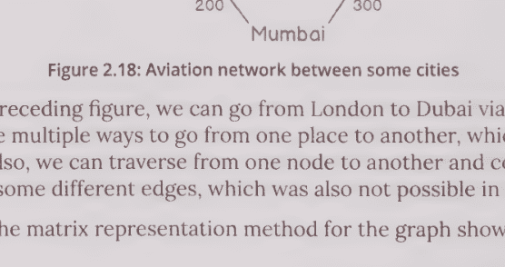

图2.18：部分城市之间的航空网络

如上图所示，我们可以经伊斯坦布尔从伦敦到迪拜，也可以直达。从一个地方到另一个地方有多条路径，这在树中是不存在的。此外，我们可以从一个节点遍历到另一个节点，然后通过不同的边返回到原始节点，这在树中也是不可能的。

接下来，让我们为上图所示的图实现矩阵表示方法。

## 练习11：实现一个图并用邻接矩阵表示它

在本练习中，我们将实现一个表示上图中城市网络的图，并演示如何将其存储为邻接矩阵。让我们开始吧：

- 1. 首先，让我们包含所需的头文件：

```
#include <iostream>
#include <vector>
```

- 2. 现在，让我们添加一个 `enum` 类，以便存储城市的名称：

```
enum class city: int
{
    LONDON,
    MOSCOW,
    ISTANBUL,
    DUBAI,
    MUMBAI,
    SEATTLE,
    SINGAPORE
};
```

- 3. 让我们也为 `city` 枚举添加一个 `<<` 运算符：

```
std::ostream operator<<(std::ostream os, const city c)
{
    switch(c)
    {
        case city::LONDON:
            os << "LONDON";
            return os;
        case city::MOSCOW:
            os << "MOSCOW";
            return os;
        case city::ISTANBUL:
            os << "ISTANBUL";
            return os;
        case city::DUBAI:
            os << "DUBAI";
            return os;
        case city::MUMBAI:
            os << "MUMBAI";
```

```
return os;
case city::SEATTLE:
    os << "SEATTLE";
    return os;
case city::SINGAPORE:
    os << "SINGAPORE";
    return os;
default:
    return os;
}
}
```

- 4. 让我们编写 struct graph 结构体，它将封装我们的数据：

```
struct graph
{
    std::vector<std::vector<int>> data;
```

- 5. 现在，让我们添加一个构造函数，它将创建一个具有给定节点数的空图（没有任何边的图）：

```
graph(int n)
{
    data.reserve(n);
    std::vector<int> row(n);
    std::fill(row.begin(), row.end(), -1);
    for(int i = 0; i < n; i++)
    {
        data.push_back(row);
    }
}
```

- 6. 现在，让我们添加最重要的函数——addEdge。它将接受三个参数——要连接的两个城市以及边的权重（距离）：

```
void addEdge(const city c1, const city c2, int dis)
{
    std::cout << "ADD: " << c1 << "-" << c2 << "=" << dis << std::endl;

    auto n1 = static_cast<int>(c1);
    auto n2 = static_cast<int>(c2);
    data[n1][n2] = dis;
    data[n2][n1] = dis;
}
```

```
ADD: ISTANBUL-SEATTLE=1500
ADD: DUBAI-SINGAPORE=500
ADD: MOSCOW-SEATTLE=1000
ADD: MUMBAI-SINGAPORE=300
ADD: SEATTLE-SINGAPORE=700
ADD: SEATTLE-LONDON=1800
REMOVE: SEATTLE-LONDON
```

正如我们所见，我们将数据存储在一个向量的向量中，两个维度都等于节点数。因此，这种表示所需的总空间与 V² 成正比，其中 V 是节点数。

## 用邻接表表示图

图的矩阵表示的一个主要问题是所需的内存量与节点数的平方成正比。你可以想象，随着节点数量的增加，这会迅速增加。让我们看看如何改进以减少内存使用。

在任何图中，我们会有固定数量的节点，每个节点会有一个固定的最大连接节点数，这个最大数等于总节点数。在矩阵中，我们必须存储所有节点的所有边，即使两个节点并不直接相连。相反，我们只需在每一行中存储节点的 ID，表示哪些节点与当前节点直接相连。这种表示方法也称为邻接表。

让我们看看这个实现与上一个练习有何不同。

## 练习12：实现一个图并用邻接表表示它

在本练习中，我们将实现一个表示图2.18中所示城市网络的图，并演示如何将其存储为邻接表。让我们开始吧：

- 1. 在本练习中，我们将实现邻接表表示。像往常一样，我们先从添加头文件开始：

```
#include <iostream>
#include <vector>
#include <algorithm>
```

- 2. 现在，让我们添加一个 `enum` 类，以便存储城市的名称：

```
enum class city: int
{
    MOSCOW,
    LONDON,
```

```cpp
ISTANBUL,
SEATTLE,
DUBAI,
MUMBAI,
SINGAPORE
};
```

- 3. 让我们也为 city 枚举添加 `<<` 运算符：

```cpp
std::ostream& operator<<(std::ostream& os, const city c)
{
    switch(c)
    {
        case city::MOSCOW:
            os << "MOSCOW";
            return os;
        case city::LONDON:
            os << "LONDON";
            return os;
        case city::ISTANBUL:
            os << "ISTANBUL";
            return os;
        case city::SEATTLE:
            os << "SEATTLE";
            return os;
        case city::DUBAI:
            os << "DUBAI";
            return os;
        case city::MUMBAI:
            os << "MUMBAI";
            return os;
        case city::SINGAPORE:
            os << "SINGAPORE";
            return os;
        default:
            return os;
    }
}
```

- 4. 让我们编写将封装数据的 struct graph：

```cpp
struct graph
{
    std::vector<std::vector<std::pair<int, int>>> data;
```

- 5. 让我们看看构造函数与矩阵表示法有何不同：

```cpp
graph(int n)
{
    data = std::vector<std::vector<std::pair<int, int>>>(n,
    std::vector<std::pair<int, int>>());
}
```

正如我们所见，我们使用二维向量初始化数据，但所有行最初都是空的，因为开始时不存在边。

- 6. 让我们为此实现 addEdge 函数：

```cpp
void addEdge(const city c1, const city c2, int dis)
{
    std::cout << "ADD: " << c1 << "-" << c2 << "=" << dis << std::endl;

    auto n1 = static_cast<int>(c1);
    auto n2 = static_cast<int>(c2);
    data[n1].push_back({n2, dis});
    data[n2].push_back({n1, dis});
}
```

- 7. 现在，让我们编写 removeEdge，以便我们可以从图中移除一条边：

```cpp
void removeEdge(const city c1, const city c2)
{
    std::cout << "REMOVE: " << c1 << "-" << c2 << std::endl;

    auto n1 = static_cast<int>(c1);
    auto n2 = static_cast<int>(c2);
    std::remove_if(data[n1].begin(), data[n1].end(), [n2](const auto& pair)
    {
        return pair.first == n2;
    });
    std::remove_if(data[n2].begin(), data[n2].end(), [n1](const auto& pair)
    {
        return pair.first == n1;
    });
}
```

## 引言

查找就是检查一个元素是否存在于容器中，或者查找容器中某个键对应的值。在前面章节提到的学生数据库系统和医院管理系统的例子中，一个常见操作是从系统中存储的海量数据中获取特定记录。类似的问题也出现在从字典中获取单词含义、根据一组记录（访问控制）检查某人是否被允许进入某个设施，以及许多其他应用中。

对于大多数场景，线性遍历所有元素并匹配值将极其耗时，尤其考虑到存储的海量记录。举个查字典的简单例子：英语词典中大约有17万个单词。最简单的方法之一是线性遍历字典，并将给定单词与字典中的所有单词进行比较，直到找到该单词或到达字典末尾。但这太慢了，时间复杂度为 O(n)，其中 n 是字典中的单词数，这不仅庞大，而且还在日益增加。

因此，我们需要更高效的算法来实现更快速的查找。本章我们将介绍几种高效的结构，即哈希表和布隆过滤器。我们将实现这两种结构并比较它们的优缺点。

## 哈希表

让我们来看一个非常基本的字典搜索问题。牛津英语词典中大约有17万个单词。正如我们在引言中提到的，线性搜索将花费 O(n) 时间，其中 n 是单词数量。一种更好的数据存储方式是将其存储在高度平衡的树中，该树具有与 BST 相似的属性。这使它比线性搜索快得多，因为时间复杂度仅为 O(log n)。但对于需要大量此类查询的应用来说，这仍然不是一个足够好的改进。想想包含数百万或数十亿条记录的数据（例如神经科学数据或遗传数据）所花费的时间。要在这些数据中找到某个东西可能需要数天。对于这些情况，我们需要更快的方案，例如哈希表。

哈希表的核心组成部分之一是哈希。其思想是用一个可能唯一的键来表示每个值，之后根据使用场景，使用同一个键来检查键是否存在或检索对应的值。从给定数据中推导出唯一键的函数称为哈希函数。让我们通过一些示例了解如何存储和检索数据，并了解为什么我们需要这样的函数。

- 4. 让我们添加 **insert** 函数：

```cpp
void insert(uint value)
{
    int n = data.size();
    data[value % n] = value;
    std::cout << "Inserted " << value << std::endl;
}
```

正如我们所见，我们实际上并没有检查是否已经存在具有相同哈希值的值。如果已经存在任何值，我们只是简单地覆盖它。因此，对于给定的哈希值，只会存储最新插入的值。

- 5. 让我们编写一个查找函数，以查看元素是否存在于映射中：

```cpp
bool find(uint value)
{
    int n = data.size();
    return (data[value % n] == value);
}
```

我们只需检查该值是否存在于基于哈希值计算出的索引处。

- 6. 让我们实现一个 **remove** 函数：

```cpp
void erase(uint value)
{
    int n = data.size();
    if(data[value % n] == value)
    {
        data[value % n] = -1;
        std::cout << "Removed " << value << std::endl;
    }
}
```

- 7. 让我们在 **main** 中编写一个小型 lambda 函数来打印查找状态：

```cpp
int main()
{
    hash_map map(7);
    auto print = [&](int value)
    {
        if(map.find(value))
            std::cout << value << " found in the hash map";
        else
            std::cout << value << " NOT found in the hash map";
        std::cout << std::endl;
    };
```

- 8. 让我们在映射上使用 insert 和 erase 函数：

```cpp
    map.insert(2);
    map.insert(25);
    map.insert(290);

    print(25);
    print(100);

    map.insert(100);
    print(100);
    map.erase(25);
}
```

- 9. 以下是程序的输出：

```text
Inserted 2
Inserted 25
Inserted 290
25 found in the hash map
100 NOT found in the hash map
Inserted 100
100 found in the hash map
Removed 25
```

正如我们所见，我们能够找到之前插入的大多数值，正如预期的那样，除了最后一种情况：100 被 0 覆盖，因为它们具有相同的哈希值。这就是我们之前描述的冲突。在接下来的章节中，我们将看到如何避免这类问题，使我们的结果更加准确。

下图演示了上述练习中的不同函数，应该能使这一点更清晰：

图3.2：哈希表中的基本操作

图3.3：哈希表中的基本操作（续）

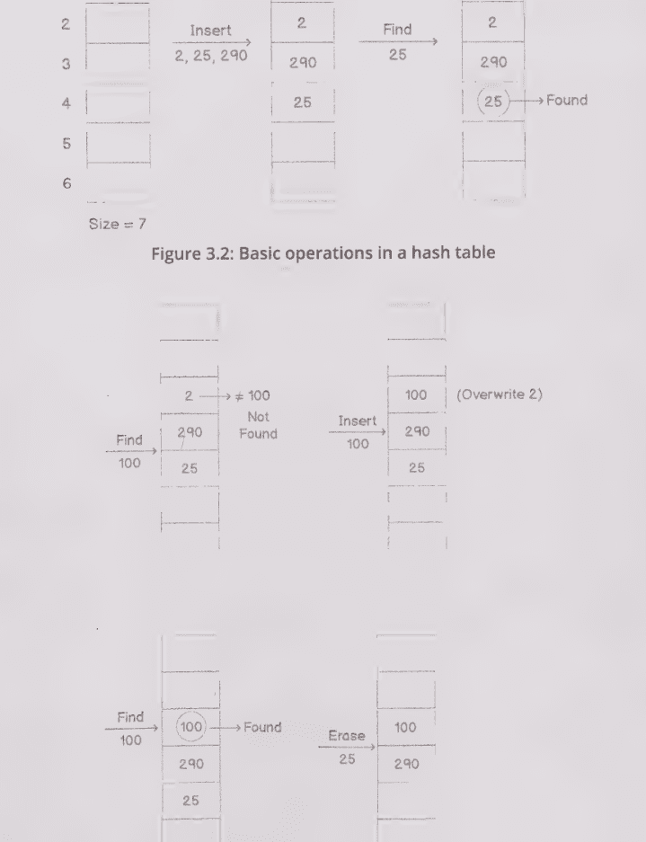

如图3.2和图3.3所示，我们不能插入两个具有相同哈希值的元素；必须丢弃其中一个。

现在，如前所述，哈希表的一个主要用途是查找键对应的值，而不仅仅是检查键是否存在。这可以通过在数据中存储键值对而不是仅存储键来实现。因此，我们的插入、删除和查找函数仍然会基于键计算哈希值，但一旦我们找到数组中的位置，值就会作为键值对的第二个参数存在。

### 哈希表中的冲突

在前面的章节中，我们了解了哈希表如何帮助我们存储大量键，从而轻松查找任何所需的键。然而，我们也遇到了多个键具有相同哈希值的问题，也称为冲突。在练习13“整数基本字典”中，我们通过直接重写键并保留给定哈希值对应的最新键来处理这个问题。但这不允许我们存储所有键。在接下来的子主题中，我们将介绍几种有助于解决此问题并允许我们在哈希表中保留所有键值的方法。

### 封闭寻址——链式法

到目前为止，我们只为任何哈希值存储单个元素。如果某个特定哈希值已经有一个元素，我们别无选择，只能丢弃新值或旧值。链式法是一种可以同时保留两个值的方法。在这种方法中，我们不会在哈希表中仅存储单个键，而是为每个索引存储一个链表。因此，每当遇到冲突时，我们只需将新键插入链表的末尾。这样，本质上我们可以存储任意数量的元素，而不是单个元素。为每个索引选择链表而不是 vector（通过 push_back 添加新元素）的原因是为了能够从任意位置快速删除元素。让我们在以下练习中实现这一点。


## 练习14：使用链地址法的哈希表

在本练习中，我们将实现一个哈希表，并使用链地址法来处理冲突。让我们开始吧：

- 1. 首先，包含所需的头文件：

```cpp
#include <iostream>
#include <vector>
#include <list>
#include <algorithm>
```

- 2. 现在，添加 `hash_map` 类。我们将 `unsigned int` 起个别名，以避免写那么长的名字：

```cpp
using uint = unsigned int;
class hash_map
{
    std::vector<std::list<int>> data;
```

- 3. 现在，为 `hash_map` 添加一个构造函数，它接受数据或哈希表的大小作为参数：

```cpp
public:
hash_map(size_t n)
{
    data.resize(n);
}
```

- 4. 添加一个插入函数：

```cpp
void insert(uint value)
{
    int n = data.size();
    data[value % n].push_back(value);
    std::cout << "Inserted " << value << std::endl;
}
```

可以看到，我们总是将值插入到 `data` 中。另一种做法可以是先查找该值，如果不存在再插入。

- 5. 编写查找函数，检查映射中是否存在某个元素：

```cpp
bool find(uint value)
{
    int n = data.size();
    auto& entries = data[value % n];
    return std::find(entries.begin(), entries.end(), value) != entries.end();
}
```

可以看到，我们的查找看起来比传统方法更快，但不如之前那么快。这是因为现在它还依赖于数据和 `n` 的值。我们将在本练习结束后再回到这一点。

- 6. 实现一个删除元素的函数：

```cpp
void erase(uint value)
{
    int n = data.size();
    auto& entries = data[value % n];
    auto iter = std::find(entries.begin(), entries.end(), value);

    if(iter != entries.end())
    {
    entries.erase(iter);
        std::cout << "Removed " << value << std::endl;
    }
}
};
```

- 7. 编写与上一个练习中相同的 `main` 函数，并观察差异：

```cpp
int main()
{
    hash_map map(7);

    auto print = [&](int value)
    {
        if(map.find(value))
            std::cout << value << " found in the hash map";
        else
            std::cout << value << " NOT found in the hash map";
        std::cout << std::endl;
    };
```

- 8. 对 `map` 使用插入和删除函数：

```cpp
map.insert(2);
map.insert(25);
map.insert(290);

map.insert(100);
map.insert(55);

print(100);
map.erase(2);
}
```

以下是程序的输出：

```
Inserted 2
Inserted 25
Inserted 290
Inserted 100
Inserted 55
100 found in the hash map
Removed 2
```

可以看到，值不会被覆盖，因为列表中可以存储任意数量的值。因此，我们的输出完全准确且可靠。

## 哈希表与布隆过滤器

下面的图片展示了如何在数据集上执行不同的操作：

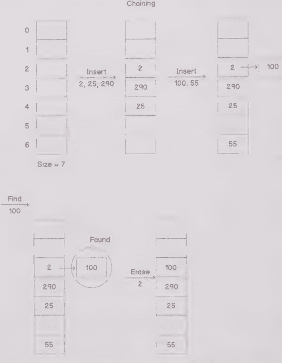

图 3.4：使用链地址法的哈希表的基本操作

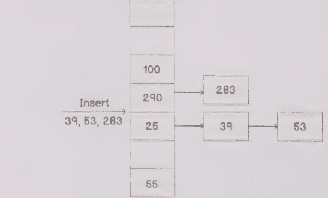

图 3.5：使用链地址法的哈希表的基本操作（续）

可以看到，我们将具有相同哈希值的元素追加到节点中的列表里，而不是只存储单个元素。

现在，让我们考虑这些操作的时间复杂度。如我们所见，插入函数仍然是 O(1)。虽然 `push_back` 可能比直接赋值稍慢一些，但并不会显著变慢。考虑到这种方法所解决的问题，这是很小的代价。但查找和删除可能会显著变慢，具体取决于哈希表的大小和数据集。例如，如果所有键都具有相同的哈希值，那么搜索所需的时间将是 O(n)，因为它会变成链表中的线性搜索。

如果哈希表相对于要存储的键数量来说非常小，那么会发生大量冲突，列表的平均长度也会更长。另一方面，如果我们使用一个非常大的哈希表，可能会导致数据非常稀疏，从而浪费内存。因此，哈希表的大小应根据应用的上下文和场景进行优化。我们也可以用数学方式来定义这些东西。

负载因子表示哈希表中每个列表平均包含的键数量。可以使用以下公式计算：

负载因子 = 键的数量 / 哈希表的大小

图 3.6：负载因子

如果键的数量等于哈希表的大小，负载因子将为 1。这是一个理想的情况；所有操作都将接近 O(1)，并且所有空间都能被合理利用。

如果该值小于 1，意味着我们每个列表平均存储不到一个键（假设我们希望每个索引处都有一个列表），这实际上是在浪费一些空间。

如果该值大于 1，则意味着列表的平均长度大于 1，因此我们的查找和删除函数的平均速度会稍慢一些。

负载因子的值可以在任意时刻以 O(1) 的时间计算出来。一些高级的哈希表实现会利用这个值来修改哈希函数（也称为再哈希），当该值越过 1 的某侧阈值时。哈希函数会被修改，使负载因子更接近 1。然后，可以根据负载因子更新哈希表的大小，并根据更新后的哈希函数重新分布值。再哈希是一种开销较大的操作，因此不应过于频繁地执行。但如果采用合适的策略，我们可以在平均时间复杂度方面取得非常好的效果。

然而，负载因子并不是决定该技术性能的唯一因素。考虑以下场景：我们有一个大小为 7 的哈希表，其中有 7 个元素。但所有元素的哈希值都相同，因此它们全部位于同一个桶中。所以，搜索总是需要 O(n) 时间，而不是 O(1)。然而，负载因子为 1，这绝对是一个理想值。这里真正的问题出在哈希函数上。哈希函数的设计应该使不同的键尽可能均匀地分布到所有可能的索引上。基本上，最小桶大小和最大桶大小之间的差异不应太大（本例中为 7）。如果哈希函数的设计能让所有 7 个元素得到不同的哈希值，那么所有搜索函数调用都将达到 O(1) 的复杂度并获得即时结果。这是因为最小桶大小和最大桶大小的差值将为 0。不过，在哈希表实现中通常不会这样做。这应当由哈希函数本身来保证，因为哈希表并不依赖于哈希函数的实现方式。

### 开放寻址法

解决冲突的另一种方法是开放寻址法。在这种方法中，我们将所有元素都存储在哈希表内部，而不是将元素链接到哈希表上。因此，为了容纳所有元素，哈希表的大小必须大于元素的数量。其思路是，当某个哈希值对应的单元已经被占用时，就进行探测。有多种探测值的方法，我们将在接下来的子主题中看到。

### 线性探测

这是一种简单的探测技术。如果某个哈希值发生冲突，我们可以直接查看后续的哈希值，找到一个空单元，然后插入我们的元素。如果 `hash(x)` 处的单元已满，则需要检查 `hash(x + 1)` 处的单元是否为空。如果也满了，再看 `hash(x + 2)`，依此类推。

下图说明了线性探测的工作原理：

线性探测

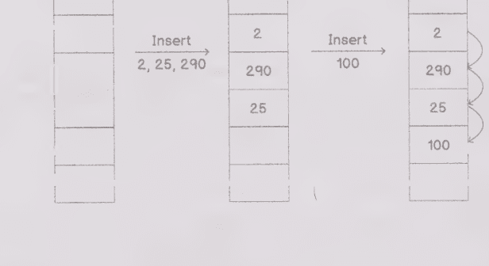

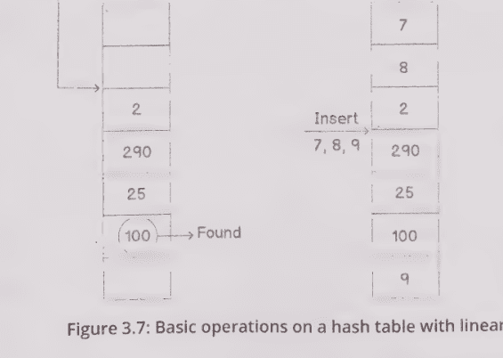

图 3.7：使用线性探测的哈希表的基本操作

插入
20
哈希表已满。
不经再哈希无法继续插入。

图 3.8：哈希表填满后无法插入元素


正如我们所看到的，如果元素哈希值对应的位置已被占用，我们会将其插入到下一个可用的槽位。插入前三个元素后，我们可以看到它们聚集在一起。如果在同一范围内插入更多元素，它们都会连续地排在该簇的末尾，从而使簇不断增长。现在，当我们试图查找一个值，该值并不位于哈希函数首先计算出的位置，而是位于一个大簇的末尾时，我们必须线性地搜索该簇中的所有键。因此，查找会变得非常慢。

因此，如果数据密集聚集，我们就会遇到一个大问题。如果数据的分布呈现出某些区域周围的值频率非常高，我们就可以说数据是密集聚集的。例如，假设在一个大小为100的哈希表中有很多哈希值在3到7之间的键。之后所有键都会被连续探测到某些位置，这将急剧减慢我们的查找速度。

## 二次探测

正如我们所见，线性探测的主要问题是聚集。其原因在于我们在发生冲突时采用了线性方式。使用二次方程而非线性方程可以在很大程度上解决这个问题。这正是二次探测所做到的。

首先，我们尝试将值 x 插入到位置 hash(x)。如果该位置已被占用，我们就转到位置 hash(x) + 1²，然后是 hash(x) + 2²，依此类推。这样，我们以二次方式增加偏移量，从而降低形成小型数据簇的概率。

这两种探测技术还有一个缺点：元素的位置可能会受到哈希值不同的其他元素的影响。所以，基本上，即使只有一个键具有某个哈希值，它也可能发生冲突，因为该位置上存在其他元素，而链式法则不会出现这种情况。例如，在线性探测中，如果有两个哈希值为4的键，其中一个会被插入到位置4，另一个会被插入到位置5。接下来，如果我们需要插入一个哈希值为5的键，它就需要被插入到位置6。这个键虽然与其他任何键的哈希值都不同，但仍然受到了影响。

## 完美哈希——布谷鸟哈希

正如标题所示，布谷鸟哈希是完美哈希技术之一。我们之前提到的方法在最坏情况下无法保证 O(1) 的时间复杂度，但如果实现得当，布谷鸟哈希可以实现这一点。

在布谷鸟哈希中，我们维护两张大小相同的哈希表，每张表都有各自唯一的哈希函数。任何元素都可以出现在任意一张哈希表中，其位置由相应的哈希函数决定。

布谷鸟哈希与我们之前介绍的哈希技术主要有两点不同：

- 任何元素都可以出现在两张哈希表的任意一张中。
- 任何元素在插入之后，将来都可以被移动到另一个位置。

之前的哈希技术在插入后不允许元素移动，除非我们进行完全重新哈希；但布谷鸟哈希并非如此，因为任何元素都有两个可能的位置。我们还可以通过增加任何元素可能的位置数量来提高自由度，从而获得更好的结果并降低重新哈希的频率。不过，在本章中，我们只会讨论具有两个可能位置（两张哈希表）的版本，因为它更容易理解。

对于查找，我们只需要检查两个位置即可确定元素是否存在。因此，查找始终只需要 O(1) 时间。

然而，插入函数可能需要更长的时间。在这种情况下，插入函数首先检查能否将新元素（假设为 A）插入第一张哈希表。如果可以，它就在那里插入该元素，然后完成。但如果该位置已被已有元素（假设为 B）占用，我们仍然会插入 A，并将 B 移动到第二张哈希表。如果第二张哈希表中的这个新位置也被占用（假设被元素 C 占用），我们再将 B 插入该位置，并把 C 移动到第一张表。我们可以一直递归地进行下去，直到为所有元素找到空槽位。这个过程如下图所示：


一个主要问题是，我们可能会陷入循环，递归可能导致无限循环。对于上一段中的例子，假设存在一个元素 D，我们想把 C 插入到 D 的位置，但如果尝试移动 D，它会移到 A 的位置。于是，我们就陷入了一个无限循环。下图可以帮助你直观地理解这一点：

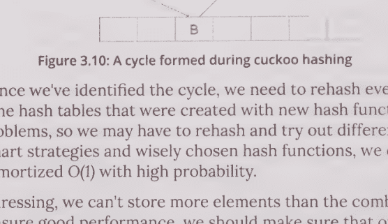

图3.10：布谷鸟哈希过程中形成的循环

为了解决这个问题，一旦我们识别出循环，就需要使用新的哈希函数重新哈希所有内容。使用新哈希函数创建的表可能仍然存在相同的问题，因此我们可能需要重新哈希并尝试不同的哈希函数。不过，借助巧妙的策略和精心选择的哈希函数，我们就有很高概率获得均摊 O(1) 的性能。

与开放寻址一样，我们存储的元素数量不能超过两张哈希表的总大小。为了确保良好的性能，我们应该确保负载因子低于50%，也就是说，元素数量应小于可用容量的一半。

我们将在下面的练习中查看布谷鸟哈希的实现。

### 练习15：布谷鸟哈希

在本练习中，我们将实现布谷鸟哈希来创建一个哈希表，并向其中插入各种元素。我们还将获得操作过程的追踪信息，从而可以了解插入是如何工作的。让我们开始吧：

1. 像往常一样，我们首先包含所需的头文件：

```
#include <iostream>
#include <vector>
```

2. 让我们为哈希映射添加一个类。这次我们还将单独存储 size：

```
class hash_map
{
    std::vector<int> data1;
    std::vector<int> data2;
    int size;
```

3. 现在，让我们添加相应的哈希函数：

```
int hash1(int key) const
{
    return key % size;
}
```

```
int hash2(int key) const
{
    return (key / size) % size;
}
```

这里，我们让这两个函数都保持非常简单的形式，但这些函数可以根据需求进行调整。

4. 现在，让我们添加一个构造函数，以设置我们的初始化数据：

```
public:
hash_map(int n) : size(n)
{
    data1 = std::vector<int>(size, -1);
    data2 = std::vector<int>(size, -1);
}
```

正如我们所见，我们只是将两张数据表初始化为空（用 -1 表示）。

5. 让我们先编写一个查找函数：

```
std::vector<int>::iterator lookup(int key)
{
    auto hash_value1 = hash1(key);
    if(data1[hash_value1] == key)
    {
        std::cout << "Found " << key << " in first table" << std::endl;
        return data1.begin() + hash_value1;
    }

    auto hash_value2 = hash2(key);
    if(data2[hash_value2] == key)
    {
        std::cout << "Found " << key << " in second table" << std::endl;
        return data2.begin() + hash_value2;
    }

    return data2.end();
}
```

我们会尝试在两张表中查找该键，如果找到就返回相应的迭代器。我们并不总是需要迭代器，但在删除函数中使用它会让事情变得更简单。如果元素未找到，我们返回 `data2` 表的 end 迭代器。正如我们所见，查找的时间复杂度为 O(1)，执行速度会非常快。

6. 让我们实现一个删除函数：

```
void erase(int key)
{
    auto position = lookup(key);
    if(position != data2.end())
    {
        *position = -1;
        std::cout << "Removed the element " << key << std::endl;
    }
    else
    {
        std::cout << "Key " << key << " not found." << std::endl;
    }
}
```

正如我们所见，大部分工作通过调用 `lookup` 函数即可完成。我们只需要验证结果并重置该值，即可将其从表中删除。

7. 对于插入，我们将在另一个函数中实现实际逻辑，因为它将是递归的。我们还想避免循环。然而，记录所有被访问过的值可能代价很高。为了避免这种情况，我们只需在函数被调用超过 n 次时停止它。由于 n 的递归深度阈值取决于我们的内存（或哈希表大小），这会带来良好的性能：

```
void insert(int key)
{
    insert_impl(key, 0, 1);
}
```

```cpp
void insert_impl(int key, int cnt, int table)
{
    if(cnt >= size)
    {
        std::cout << "Cycle detected, while inserting " << key << ".
Rehashing required." << std::endl;
        return;
    }

    if(table == 1)
    {
        int hash = hash1(key);
        if(data1[hash] == -1)
        {
            std::cout << "Inserted key " << key << " in table " << table
                      << std::endl;
            data1[hash] = key;
        }
        else
        {
            int old = data1[hash];
            data1[hash] = key;
            std::cout << "Inserted key " << key << " in table " << table
                      << " by replacing " << old << std::endl;
            insert_impl(old, cnt + 1, 2);
        }
    }
    else
    {
        int hash = hash2(key);
        if(data2[hash] == -1)
        {
            std::cout << "Inserted key " << key << " in table " << table
                      << std::endl;
            data2[hash] = key;
        }
        else
        {
            int old = data2[hash];
            data2[hash] = key;
            std::cout << "Inserted key " << key << " in table " << table << " by replacing " << old << std::endl;
            insert_impl(old, cnt + 1, 2);
        }
    }
}
```

正如我们所见，该实现接受三个参数——键、我们希望插入键的哈希表，以及递归调用栈的计数，用于跟踪我们已经改变位置的元素数量。

8. 现在，让我们编写一个实用函数来打印哈希表中的数据。虽然这并不是必需的，也不应该暴露出来，但我们这样做是为了更好地理解插入函数如何在内部管理数据：

```
void print()
{
    std::cout << "Index: ";
    for(int i = 0; i < size; i++)
        std::cout << i << '\t';
    std::cout << std::endl;

    std::cout << "Data1: ";
    for(auto i: data1)
        std::cout << i << '\t';
    std::cout << std::endl;

    std::cout << "Data2: ";
    for(auto i: data2)
        std::cout << i << '\t';
    std::cout << std::endl;
}
};
```

9. 现在，让我们编写主函数以使用这个哈希映射：

```
int main()
{
    hash_map map(7);
    map.print();

    map.insert(10);
```

```
map.insert(20);
map.insert(30);
std::cout << std::endl;

map.insert(104);
map.insert(2);
map.insert(70);
map.insert(9);
map.insert(90);
map.insert(2);
map.insert(7);

std::cout << std::endl;

map.print();

std::cout << std::endl;

map.insert(14);  // This will cause cycle.
}
```

10. 你应该看到以下输出：

```
Index: 0  1  2  3  4  5  6
Data1: -1  -1  -1  -1  -1  -1  -1
Data2: -1  -1  -1  -1  -1  -1  -1
Inserted key 10 in table 1
Inserted key 20 in table 1
Inserted key 30 in table 1

Inserted key 104 in table 1 by replacing 20
Inserted key 20 in table 2
Inserted key 2 in table 1 by replacing 30
Inserted key 30 in table 2
Inserted key 70 in table 1
Inserted key 9 in table 1 by replacing 2
Inserted key 2 in table 2
```

```
Inserted key 90 in table 1 by replacing 104
Inserted key 104 in table 2 by replacing 2
Inserted key 2 in table 1 by replacing 9
Inserted key 9 in table 2
Inserted key 2 in table 1 by replacing 2
Inserted key 2 in table 2 by replacing 104
Inserted key 104 in table 1 by replacing 90
Inserted key 90 in table 2
Inserted key 7 in table 1 by replacing 70
Inserted key 70 in table 2
```

| Index: | 0 | 1 | 2 | 3 | 4 | 5 | 6 |
| Data1: | 7 | -1 | 2 | 10 | -1 | -1 | 104 |
| Data2: | 2 | 9 | 20 | 70 | 30 | 90 | -1 |

```
Inserted key 14 in table 1 by replacing 7
Inserted key 7 in table 2 by replacing 9
Inserted key 9 in table 1 by replacing 2
Inserted key 2 in table 2 by replacing 2
Inserted key 2 in table 1 by replacing 9
Inserted key 9 in table 2 by replacing 7
Inserted key 7 in table 1 by replacing 14
Cycle detected, while inserting 14. Rehashing required.
```

正如我们所看到的，输出显示了两个表在内部是如何维护的完整轨迹。我们打印了内部步骤，因为一些值正在被移动。从轨迹中可以看出，最后一次插入14导致了一个循环。插入深度已经超过了7。同时，我们也可以看到两个表几乎已满。我们在14个位置中填入了11个元素，因此每一步替换值的概率都在增加。我们也在循环发生前打印了表。

此外，这里删除一个元素只需要O(1)时间，因为它只是使用查找函数并在找到时删除元素。因此，唯一代价高昂的函数是插入。所以，如果任何应用中插入次数远低于查找次数，这是一种理想的实现。

让我们使用以下可视化辅助工具来更好地理解这一点：

## 布谷鸟哈希

h1(x) = x%7

h2(x) = x/7(%7)

插入 2, 25, 290

图3.11：在使用布谷鸟哈希的哈希表中插入元素

插入 100

h2(2)=0

插入 11

h2(25)=3

图3.12：使用布谷鸟哈希处理哈希表中的冲突

插入 107

图3.13：使用布谷鸟哈希处理哈希表中的冲突（续）

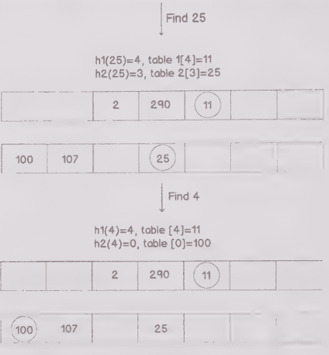

图3.14：在使用布谷鸟哈希的哈希表中查找值


图3.15：在使用布谷鸟哈希的哈希表中删除值

从前面的一系列图中可以看出，首先我们尝试在第一个表中插入元素。如果已经存在另一个元素，我们覆盖它，并将原有元素插入另一个表。我们重复这个过程，直到最后一个元素可以安全插入。

## C++哈希表

正如我们之前提到的，查找操作在大多数应用中非常频繁。然而，我们并不总是遇到很容易哈希的正整数。大多数时候你可能会遇到字符串。考虑我们之前提到的英语词典示例。我们可以使用单词作为键、单词释义作为值来存储字典数据。另一个例子是我们在第1章“列表、栈和队列”中考虑的医院记录数据库，其中患者姓名可以用作键，其他相关信息可以存储为值。

我们之前用来计算整数哈希值的简单取模函数不适用于字符串。一个简单的选项是计算所有字符ASCII值之和的模。然而，字符串中字符的所有排列会非常庞大，这会产生大量冲突。

C++提供了一个名为std::hash<std::string>(std::string)的函数，我们可以用它来生成字符串的哈希值。它内置了处理哈希函数的算法。类似地，C++为所有基本数据类型提供了这样的函数。

现在，看看我们在练习14“带链的哈希表”中实现的哈希表，很明显我们可以简单地基于数据类型对其进行模板化，并制作一个通用解决方案，为任何给定数据类型提供哈希函数。STL为此提供了几个解决方案：std::unordered_set<Key>和std::unordered_map<Key, Value>。无序集合只能存储一组键，而无序映射可以存储键及其值。因此，每个唯一键在容器中都将有一个对应的值。

这两个容器的实现方式相同——都使用带链的哈希表。哈希表中的每一行都是一个向量，存储键（以及映射的值）。这些行称为桶。因此，在计算键的哈希值后，它将被放入其中一个桶中。每个桶也是一个列表以支持链式存储。

默认情况下，这些容器的最大负载因子为1。一旦元素数量超过哈希表的大小，哈希函数将被更改，哈希值将被重新计算（重新哈希），并重建一个更大的哈希表以降低负载因子。我们也可以使用rehash函数手动执行此操作。可以使用max_load_factor(float)函数更改负载因子的默认最大限制1。一旦负载因子超过定义的最大限制，值将被重新哈希。

这些容器提供了常用的有用函数，如find、insert和erase。它们还提供迭代器来遍历所有元素，以及构造函数来使用其他容器（如向量和数组）创建无序集合和映射。无序映射还提供了operator[]，以便返回已知键的值。

我们将在接下来的练习中研究无序集合和映射的实现。


## 练习16：STL提供的哈希表

在本练习中，我们将实现无序集合和无序映射，并在这些容器上应用插入、删除和查找等操作。让我们开始吧：

1. 包含所需的头文件：

```cpp
#include <iostream>
#include <unordered_map>
#include <unordered_set>
```

2. 现在，让我们编写一些简单的打印函数，使主函数更具可读性：

```cpp
void print(const std::unordered_set<int>& container)
{
    for(const auto& element: container)
        std::cout << element << " ";
    std::cout << std::endl;
}

void print(const std::unordered_map<int, int>& container)
{
    for(const auto& element: container)
        std::cout << element.first << ": " << element.second << ", ";
    std::cout << std::endl;
}
```

3. 类似地，为查找函数添加包装器，以保持代码整洁：

```cpp
void find(const std::unordered_set<int>& container, const auto& element)
{
    if(container.find(element) == container.end())
        std::cout << element << " not found" << std::endl;
    else
        std::cout << element << " found" << std::endl;
}

void find(const std::unordered_map<int, int>& container, const auto& element)
{
    auto it = container.find(element);
    if(it == container.end())
        std::cout << element << " not found" << std::endl;
    else
        std::cout << element << " found with value=" << it->second <<
        std::endl;
}
```

4. 现在，编写 **main** 函数，以便我们可以使用 **unordered_set** 和 **unordered_map**，然后对其执行各种操作。我们将查找、插入和删除元素：

```cpp
int main()
{
    std::cout << "Set example: " << std::endl;
    std::unordered_set<int> set1 = {1, 2, 3, 4, 5};
    std::cout << "Initial set1: ";
    print(set1);

    set1.insert(2);
    std::cout << "After inserting 2: ";
    print(set1);

    set1.insert(10);
    set1.insert(351);
    std::cout << "After inserting 10 and 351: ";
    print(set1);

    find(set1, 4);
    find(set1, 100);
    set1.erase(2);
    std::cout << "Erased 2 from set1" << std::endl;
    find(set1, 2);

    std::cout << "Map example: " << std::endl;
    std::unordered_map<int, int> squareMap;

    squareMap.insert({2, 4});
    squareMap[3] = 9;
    std::cout << "After inserting squares of 2 and 3: ";
    print(squareMap);

    squareMap[30] = 900;
    squareMap[20] = 400;
    std::cout << "After inserting squares of 20 and 30: ";
    print(squareMap);

    find(squareMap, 10);
    find(squareMap, 20);
    std::cout << "Value of map[3]=" << squareMap[3] << std::endl;
    std::cout << "Value of map[100]=" << squareMap[100] << std::endl;
}
```

5. 该程序的一种可能输出如下。集合和映射中元素的顺序可能不同，因此被称为无序集合/映射。

```text
Set example:
Initial set1: 5 4 3 2 1
After inserting 2: 5 4 3 2 1
After inserting 10 and 351: 351 10 1 2 3 4 5
4 found
100 not found
Erased 2 from set1
2 not found
Map example:
After inserting squares of 2 and 3: 3: 9, 2: 4,
After inserting squares of 20 and 30: 20: 400, 30: 900, 2: 4, 3: 9,
10 not found
20 found with value=400
Value of map[3]=9
Value of map[100]=0
```

如我们所见，我们可以在两个容器中插入、查找和删除元素。这些操作按预期工作。如果我们将这些操作与其他容器（如 vector、list、array、deque 等）进行基准测试，这里的性能会快得多。

```cpp
struct Car
{
    std::string model;
    std::string brand;
    int buildYear;
};

struct CarHasher
{
    std::size_t operator()(const Car& car) const
    {
        std::size_t seed = 0;
        boost::hash_combine(seed, car.model);
        boost::hash_combine(seed, car.brand);
        return seed;
    }
};

struct CarComparator
{
    bool operator()(const Car& car1, const Car& car2) const
    {
        return (car1.model == car2.model) && (car1.brand == car2.brand);
    }
};

// We can use the hasher as follows:
std::unordered_set<Car, CarHasher, CarComparator> carSet;
std::unordered_map<Car, std::string, CarHasher, CarComparator>
carDescriptionMap;
```

如我们所见，我们定义了一个带有 operator() 的哈希结构体，无序容器将使用它。我们还定义了带有 operator() 的比较器结构体来支持相关函数。我们将这些结构体作为模板参数传递。这也允许我们为不同的对象使用不同类型的比较器和哈希器。

除了取模等简单哈希函数外，还有一些复杂的哈希函数，称为密码学哈希函数，例如 MD5、SHA-1 和 SHA-256。这些算法非常复杂，它们可以将任何类型的数据（甚至文件）作为输入值。密码学函数的一个重要特性是，很难从给定的哈希值确定实际数据（也称为反向哈希），因此它们被用于一些最安全的系统中。例如，比特币区块链使用 SHA-256 算法来存储交易记录真实性的重要证明。区块链中的每个区块都包含其前一个链接区块的 SHA-256 哈希值，并且当前区块的哈希值包含在后续区块中。非法修改任何区块都会使从该区块往后的整个区块链失效，因为修改后的区块的哈希值将与存储在下个区块中的值不匹配。即使使用世界上一些最快的超级计算机，也需要数百年的时间才能破解这一点并伪造交易记录。

## 活动6：将长URL映射为短URL

在本活动中，我们将创建一个程序来实现类似于 https://tinyurl.com/ 的服务。它可以获取一个很长的 URL，并将其映射为一个便于分享的简短 URL。每当我们输入短 URL 时，它都应检索出原始 URL。

我们需要以下功能：

- 高效存储用户提供的原始 URL 和对应的较短 URL
- 如果找到，则根据给定的较短 URL 检索原始 URL；否则，返回错误

以下高层步骤应能帮助你完成此活动：

1. 创建一个包含 unordered_map 作为主要数据成员的类。
2. 添加一个插入值的函数。该函数应接受两个参数：原始 URL 及其较短的版本。
3. 添加一个函数，如果存在，则根据给定的短 URL 查找实际 URL。

> **注意**
> 此活动的解决方案可在第 498 页找到。

## 布隆过滤器

与哈希表相比，布隆过滤器在空间利用上极其高效，但代价是答案的不确定性；也就是说，我们得到的答案并不确定。它只保证不会出现假阴性，但可能会出现假阳性。换句话说，如果命中为阳性，则元素可能存在也可能不存在；但如果结果为阴性，则该元素肯定不存在。

与布谷鸟哈希一样，我们将在这里使用多个哈希函数。不过，我们将使用三个函数，因为两个函数无法获得不错的准确度。基本思想是：我们不存储实际值，而是存储一个布尔数组，用于指示某个值是否（可能）存在。

要插入一个元素，我们计算所有哈希函数的值，并将数组中与三个哈希值对应的所有位设置为 1。对于查找，我们计算所有哈希函数的值，并检查所有相应的位是否都设置为 1。如果是，则返回 true；否则返回 false（表示该元素不存在）。

显而易见的问题是——为什么查找是不确定的？原因是任何位都可能被多个元素设置。因此，对于某个特定值（称为 x），其所有相关位都被设置为 1 的概率相对较高，这是因为之前插入了其他一些元素，尽管 x 根本没有被插入。在这种情况下，查找函数仍将返回 true。因此，我们可以预期一些假阳性。我们插入的元素越多，假阳性的可能性就越高。然而，如果 x 的某个位没有被设置，那么我们可以确信该元素不存在。因此，假阴性不可能发生。

当布尔数组中的所有位都设置为 1 时，数组将达到饱和。因此，查找函数将始终返回 true，而插入函数将完全不起作用，因为所有位都已经设置为 1。


下面的图示让这一点更加清晰：

h1(x) = x%7
h2(x) = (x/7)%7
h3(x) = (x/11)%7

↓ 插入 100

哈希 (100) = {2, 0, 2}

↓ 插入 54

哈希 (54) = {5, 0, 4}

↓ 插入 82

哈希 (82) = {5, 4, 0}

图 3.16：在布隆过滤器中插入元素

↓ 查找 5

哈希 (5) = {5, 0, 0}

1 = 可能存在（误报）

↓ 查找 50

哈希 (50) = {1, 0, 4}

0 = 不存在

图 3.17：在布隆过滤器中查找元素

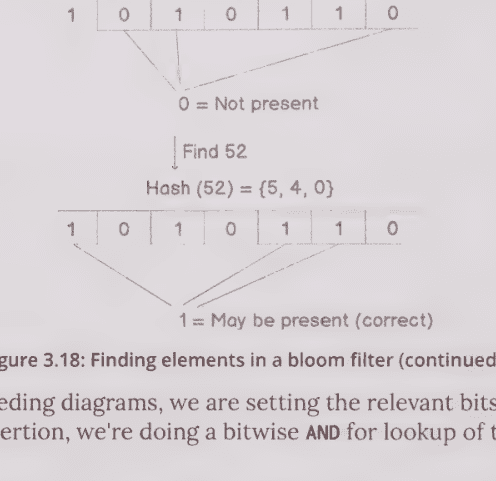

图 3.18：在布隆过滤器中查找元素（续）

如前面的图示所示，我们根据哈希函数设置相应的位，对于插入操作，我们按位进行 AND 操作来查找元素，正如前面所解释的那样。

我们将在下面的练习中用 C++ 实现一个布隆过滤器。

## 练习 17：创建布隆过滤器

在本练习中，我们将创建一个布隆过滤器，并尝试一些基本操作。我们还将测试查找中的误报情况。让我们开始吧：

+   1. 让我们包含所需的头文件：

```
#include <iostream>
#include <vector>
```

+   2. 现在，让我们为布隆过滤器创建一个类，并添加所需的数据成员：

```
class bloom_filter
{
    std::vector<bool> data;
    int nBits;
```

## 3. 现在，让我们添加所需的哈希函数。同样，我们将使用非常基本的哈希函数：

```
int hash(int num, int key)
{
    switch(num)
    {
    case 0:
        return key % nBits;
    case 1:
        return (key / 7) % nBits;
    case 2:
        return (key / 11) % nBits;
    }
    return 0;
}
```

如您所见，我们使用单个函数，通过一个名为 **num** 的参数来决定使用哪个哈希函数，从而避免在其他函数中使用不必要的 **if-else** 块。这种方式也易于扩展；我们只需要为每个哈希函数添加一个 case 即可。

## 4. 让我们为布隆过滤器添加一个构造函数：

```
public:
bloom_filter(int n) : nBits(n)
{
    data = std::vector<bool>(nBits, false);
}
```

## 5. 现在，让我们添加一个 **lookup** 函数。

```
void lookup(int key)
{
    bool result = data[hash(0, key)] & data[hash(1, key)] & data[hash(2,
key)];
    if(result)
    {
        std::cout << key << " may be present. " << std::endl;
    }
    else
    {
        std::cout << key << " is not present. " << std::endl;
    }
}
```

正如我们所看到的，存在一些误报，但没有漏报。

与之前的技术不同，这种结构只需要 11 位来存储这些信息，正如我们从布隆过滤器的构造函数中看到的那样。因此，我们可以轻松地增大过滤器的大小，并相应地更新哈希函数，以获得更好的结果。例如，我们可以将数组的大小增加到 1,000（1,023 经常被使用，因为它是一个质数），并且我们仍然只需要不到 130 字节，这比大多数其他技术要少得多。随着哈希表大小的增加，我们的哈希函数也将变为 %1023 或类似的取模方式，并提供更好的结果和更均匀的数字分布。

这里需要重点注意的一点是，由于我们没有在容器中存储实际数据，因此可以将其用作异构结构；也就是说，只要我们的哈希函数足够好，我们就可以在同一布隆过滤器中同时插入不同类型的数据，例如整数、字符串和浮点数。

这在现实生活中有一些非常好的用例，尤其是当数据量太大，即使使用哈希表也难以搜索，并且一些误报是可以接受的时候。例如，在使用 Gmail 或 Outlook 等电子邮件服务提供商创建新电子邮件地址时，会检查该电子邮件地址是否已存在。数据库中有数十亿个电子邮件地址，对此类基本且频繁的查询进行精确检查将非常昂贵。幸运的是，即使电子邮件地址尚未被占用，有时说它已被占用也是可以的，因为这不会造成任何伤害。用户只需选择其他地址即可。在这种情况下，使用布隆过滤器是一个可行的选择。我们将在活动 7 *电子邮件地址验证器* 中看到它的实际应用。

另一个例子是用于展示新广告的推荐算法，这些广告由诸如 Facebook 广告等服务使用。每次您查看信息流时，它都会向您展示一个新广告。它可以简单地将您看过的广告 ID 存储在布隆过滤器中。然后，在将特定广告展示在您的信息流之前，可以对照布隆过滤器检查该广告的 ID。如果检查结果返回您已经看过某个特定广告，即使您实际上没有看过（误报），它也不会展示该广告。不过，这没关系，因为您不会察觉到这一点，毕竟您反正也没看过那个广告。这样，您每次都能以非常快的查找速度获得新广告。

## 活动 7：电子邮件地址验证器

在本活动中，我们将创建一个电子邮件验证器，类似于许多电子邮件服务提供商（如 Gmail 和 Outlook）在注册时使用的验证器。我们将使用布隆过滤器来检查某个电子邮件地址是否已被其他人占用。

以下高层步骤应能帮助您完成此活动：

+   1. 创建一个 **BloomFilter** 类，该类可以接受多个哈希函数和布隆的大小。
+   
+   2. 对于哈希，使用 OpenSSL 库中的 MD5 算法为给定的电子邮件生成哈希值。MD5 是一种 128 位哈希算法。对于多个哈希函数，我们可以将每个字节用作单独的哈希值。
+   
+   3. 要在布隆过滤器中添加电子邮件，我们需要将步骤 2 中计算的哈希值的每个字节对应的所有位设置为 true。
+   
+   4. 要查找任何电子邮件，我们需要根据步骤 2 中计算的哈希值，检查所有相关位是否都为 true。

> **注意**
> 
> 本活动的解决方案可在第 503 页找到。

## 总结

正如我们在引言中提到的，查找问题在大多数应用中都会以某种方式遇到。我们可以根据需求使用确定性解决方案以及概率性解决方案。在本章中，我们实现并了解了如何使用这两种方案。最后，我们还看了一个 C++ 中用于哈希的内置容器的示例。这些容器在编写应用程序时极其有用，因为我们不需要每次为每种类型都自己实现它们。一个简单的经验法则是：如果我们看到对容器的 find 函数有大量调用，那么我们就应该采用基于查找的解决方案。

到目前为止，我们已经了解了如何在各种类型的数据结构中存储数据，以及如何执行一些基本操作。在接下来的章节中，我们将研究各种算法设计技术，以便优化这些操作，首先从分治法开始。
