## 分治法

### 学习目标

学完本章后，您将能够：

+   - 描述分治设计范式
+   - 实现标准的分治算法，如归并排序、快速排序和线性时间选择
+   - 使用 MapReduce 编程模型解决问题
+   - 学习如何使用多线程 C++ MapReduce 实现

在本章中，我们将研究分治算法设计范式，并学习如何使用它来解决计算问题。

## 引言

在上一章中，我们研究了一些常用的数据结构。数据结构是数据在不同形式下的组织方式，数据结构能够实现并控制对其中存储数据的访问成本。然而，让软件有用的不仅仅是能够以各种格式存储和检索数据，更重要的是能够对数据进行转换以解决计算问题。对于给定的问题，数据转换的精确定义和顺序由一系列称为**算法**的指令决定。

算法接收一组定义问题实例的输入，应用一系列转换，并输出一组结果。如果这些结果是当前计算问题的正确答案，那么我们的算法就是正确的。算法的优劣由其效率决定，即算法为产生正确结果所需执行的指令数量：

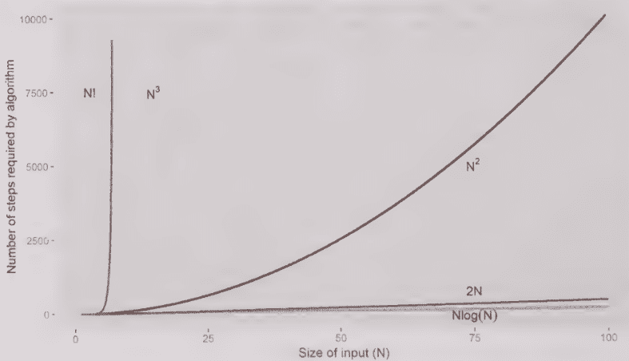

**图 4.1：算法所需步骤数与输入规模的关系**

上图显示了算法所需步骤数随输入规模增长的变化。复杂度越高的算法，其步骤数随输入规模增长得越快，并且当输入足够大时，即使在现代计算机系统上，这些算法也可能变得不可行。例如，假设我们有一台每秒可以执行一百万次操作的计算机。对于大小为 50 的输入，一个需要 N log(N) 步的算法将需要 283 微秒完成；一个需要 N² 步的算法将需要 2.5 毫秒；而一个需要 N!（N 的阶乘）步的算法大约需要 9,637,644,561,599,544,267,027,654,516,581,964,749,586,575,812,734.82 个世纪才能运行完成！


如果对于输入规模 N，算法能在 N 的多项式级步数内解决问题，则称该算法是高效的。

以**多项式时间算法**为解的问题也被认为属于计算复杂性的 P（多项式）类。问题还可以划分为其他几种计算复杂性，这里给出几个例子：

- **NP（非确定性多项式时间）**问题的解可以在多项式时间内验证，但尚无已知的多项式时间解法。
- **EXPTIME（指数时间）**问题的解法运行时间与输入规模呈指数关系。
- **PSPACE（多项式空间）**问题需要多项式级别的空间。

弄清 P 类问题集合是否与 NP 类问题集合完全相同，就是著名的 P = NP 问题。经过数十年的努力，这一问题仍未解决，甚至为能够解决它的人设立了 100 万美元奖金。我们将在第 9 章《动态规划 II》中再次讨论 P 类和 NP 类问题。

几十年来，计算机科学家一直将算法作为数学对象进行研究，并确定了一套设计高效算法的通用方法（或**范式**），可用于解决各种各样的问题。其中应用最广泛的算法设计范式之一称为*分治法*，这也是本章的研究主题。

**分治**类算法将给定问题分解为较小的部分，尝试解决每个部分的问题，最后将每个部分的解合并为整个问题的解。几种广泛使用的算法都属于这一类，例如二分查找、快速排序、归并排序、矩阵乘法、快速傅里叶变换和天际线算法。这些算法几乎出现在当今使用的所有主要应用中，包括数据库、Web 浏览器，甚至 Java 虚拟机和 V8 JavaScript 引擎等语言运行时。

在本章中，我们将向你展示使用分治法解决问题意味着什么，以及如何判断你的问题是否适合采用这种解法。接下来，我们将练习递归思维，并向你展示现代 C++ 标准库提供的工具，以便你可以使用分治法解决问题。在本章最后，我们将探讨 MapReduce，包括讨论它为何以及如何扩展，以及如何利用相同范式通过 CPU 级和机器级并行化来扩展你的程序。

让我们深入了解一种使用分治法的基础算法——二分查找。

## 二分查找

让我们从标准的搜索问题开始：假设给定一个已排序的正整数序列，需要判断某个数 N 是否存在于该序列中。搜索问题在许多场景中自然出现；例如，前台在按客户 ID 排序的文件中查找客户档案，或者教师在学生名册中查找某位学生的成绩。实际上，他们都在解决搜索问题。

现在，我们可以用两种不同的方式来处理这个问题。第一种方法是遍历整个序列，检查每个元素是否等于 N。这称为线性搜索，代码如下所示：

```
bool linear_search(int N, std::vector<int>& sequence)
{
    for (auto i : sequence)
    {
        if (i == N)
            return true;    // Element found!
    }
    return false;
}
```

这种方法的一个优点是它适用于所有数组，无论排序与否。然而，它的效率不高，并且没有利用给定数组已排序的事实。就算法复杂度而言，它是一个 O(N) 算法。

另一种利用序列已排序这一事实的替代解法如下：

1. 从整个序列作为当前范围开始。
2. 将当前范围的中间元素与 N 比较。设该中间元素为 M。
3. 如果 M = N，则说明已在序列中找到 N，搜索停止。
4. 否则，根据两条规则修改范围：
   - 如果 N < M，说明若 N 存在于范围内，则它一定在 M 的左侧，因此我们可以安全地将 M 右侧的所有元素移出范围。
   - 如果 N > M，算法将 M 左侧的所有元素移出范围。
5. 如果范围内剩余元素超过 1 个，则回到步骤 2。
6. 否则，说明 N 不存在于序列中，搜索停止。

为了说明该算法，我们将展示二分查找的工作过程，其中 S 是从 1 到 9 的整数排序序列，N = 2：

1. 算法首先将 S 的所有元素放入范围。此步骤中的中间元素为 5。我们将 N 与 5 比较：

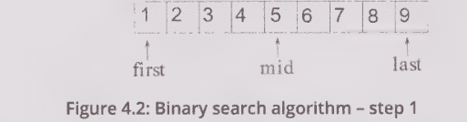

图 4.2：二分查找算法——步骤 1

2. 由于 N < 5，如果 N 存在于序列中，它一定在 5 的左侧。因此，我们可以安全地从搜索范围中丢弃序列中位于 5 右侧的所有元素。现在范围只包含 1 到 5 之间的元素，中间元素现在是 3。我们现在可以将 N 与 3 比较：

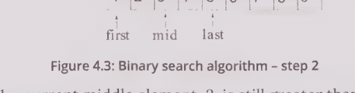

图 4.3：二分查找算法——步骤 2

3. 我们发现当前中间元素 3 仍然大于 N，范围可以进一步缩减为只包含 1 到 3 之间的元素。新的中间元素现在是 2，正好等于 N，搜索终止：

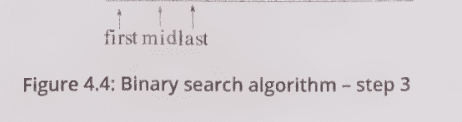

图 4.4：二分查找算法——步骤 3

在下面的练习中，我们将学习二分查找算法的实现。

## 练习 18：二分查找基准测试

在本练习中，我们将编写并对一个二分查找实现进行基准测试。请按照以下步骤完成本练习：

1. 首先添加以下头文件：

```
#include <iostream>
#include <vector>
#include <chrono>
#include <random>
#include <algorithm>
#include <numeric>
```

2. 添加如下线性搜索代码：

```
bool linear_search(int N, std::vector<int>& S)
{
    for (auto i : S)
    {
        if (i == N)
            return true;    // Element found!
    }
    return false;
}
```

3. 添加如下所示的二分查找代码：

```
bool binary_search(int N, std::vector<int>& S)
{
    auto first = S.begin();
    auto last = S.end();
    
    while (true)
    {
        // Get the middle element of current range
        auto range_length = std::distance(first, last);
        auto mid_element_index = first + std::floor(range_length / 2);
        auto mid_element = *(first + mid_element_index);

        // Compare the middle element of current range with N
```

```
```cpp
if (mid_element == N)
    return true;
else if (mid_element > N)
    std::advance(last, -mid_element_index);
if (mid_element < N)
    std::advance(first, mid_element_index);

// If only one element left in the current range
if (range_length == 1)
    return false;
}
}
```

4. 为了评估二分查找的性能，我们将实现两个函数。首先编写小型测试：

```cpp
void run_small_search_test()
{
    auto N = 2;
    std::vector<int> S{ 1, 3, 2, 4, 5, 7, 9, 8, 6 };

    std::sort(S.begin(), S.end());

    if (linear_search(N, S))
        std::cout << "Element found in set by linear search!" << std::endl;
    else
        std::cout << "Element not found." << std::endl;

    if (binary_search(N, S))
        std::cout << "Element found in set by binary search!" << std::endl;
    else
        std::cout << "Element not found." << std::endl;
}
```

5. 现在，添加大型测试函数，如下所示：

```cpp
void run_large_search_test(int size, int N)
{
    std::vector<int> S;
    std::random_device rd;
    std::mt19937 rand(rd());
```


二分查找在这三种情况下所花费的时间大致相同，即使向量大小差异悬殊！

请注意，我们的二分查找实现使用了迭代器以及 C++ 标准库中的函数，如 `std::distance()` 和 `std::advance()`。在现代 C++ 中，这被视为良好实践，因为它有助于我们的代码不依赖底层数据类型，并且避免索引越界错误。

现在，假设我们要在浮点数向量上执行搜索。我们该如何修改上一练习中的函数呢？答案非常简单。我们可以如下修改函数签名：

```
bool linear_search(float N, std::vector<float>& S)
```

```
bool binary_search(float N, std::vector<float>& S)
```

搜索函数内部的其余代码仍然可以保持完全相同，因为它完全独立于底层数据类型，仅取决于容器数据类型的行为。将核心算法逻辑与算法所操作的基础数据类型分离开来，是现代 C++ 编写可重用代码的基石。在本书中，我们会看到多个此类分离的示例，并深入探讨标准库提供的更多函数，这些函数有助于我们编写可重用且健壮的代码。

## 活动 8：疫苗接种

假设现在是流感季节，卫生部门官员计划前往一所学校，以确保所有在册儿童都接种流感疫苗。然而，有一个问题：少数儿童已经接种过流感疫苗，但他们不记得自己是否接种过卫生官员计划为所有学生接种的那种特定类别的流感疫苗。官员们查找了官方记录，找到了一份已经接种过该疫苗的学生名单。以下是该名单的一小部分：

| 名字 | 姓氏 | 是否已接种流感疫苗？ |
|---|---|---|
| 1 | 3 | 是 |
| 2 | 2 | 否 |
| 2 | 3 | 是 |

图 4.7：疫苗接种记录摘录

假设所有姓名都是正整数，并且所给列表已经排序。你的任务是编写一个程序，能够查找某个学生在名单中的疫苗接种状态，并向官员输出该学生是否需要接种疫苗。

在以下两种情况下，学生需要接种疫苗：
- 如果学生不在名单中
- 如果学生在名单中，但尚未接种流感疫苗

由于名单中可能包含大量学生，你的程序应尽可能快速高效。程序的最终输出应如下所示：

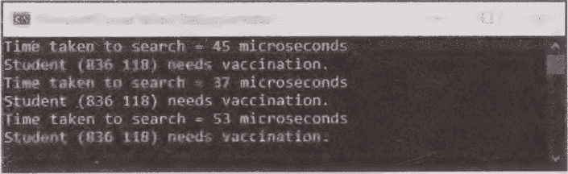

图 4.8：活动 8 的示例输出

## 总体步骤

本活动的解决方案使用了略作修改的二分查找算法。让我们开始吧：

- 1. 将每个学生表示为 **Student** 类的一个对象，该类可定义如下：

```
class Student
{
    std::pair<int, int> name;

    bool vaccinated;
}
```
- 2. 为 **Student** 类重载所需运算符，以便可以使用标准库的 `std::sort()` 函数对学生向量进行排序。
- 3. 使用二分查找来查看学生是否在名单中。
- 4. 如果学生不在名单中，你的函数应返回 true，因为该学生需要接种疫苗。

## 使用分治法排序

现在，我们将探讨如何运用分治法来解决另一个标准问题——排序。高效排序算法的重要性怎么强调都不为过。在 20 世纪 60 年代计算机发展的早期，计算机制造商估计，其机器中 25% 的 CPU 周期都花在了对数组元素进行排序上。尽管多年来计算格局发生了巨大变化，但排序至今仍被广泛研究，并且是多种应用中的基本操作。例如，它是数据库索引背后的关键思想，数据库索引随后可以使用对数时间搜索快速访问存储的数据，这与二分查找类似。

排序算法实现的一般要求如下：

- 实现应能处理任何数据类型。它应能对整数、浮点小数，甚至可以在不同元素之间定义顺序的 C++ 结构或类进行排序。
- 排序算法应能处理大量数据，也就是说，同一算法应能处理大于计算机主内存的数据量。
- 排序算法在渐近意义上和实际应用中都应足够快。

虽然上述三个目标都是可取的，但在实践中很难同时实现第二个和第三个目标。第二个目标需要外部排序，即对不位于计算机主内存中的数据进行排序。外部排序算法在执行过程中的任意时刻，只需在内存中保存整个数据集的一小部分子集即可工作。

在本节中，我们将介绍两种排序算法：归并排序和快速排序。归并排序是一种外部排序算法，因此可以实现我们的第二个目标；而快速排序，顾名思义，是实践中已知最快的排序算法之一，并作为 C++ 标准库 `std::sort()` 函数的一部分出现。

## 归并排序

**归并排序**是已知最古老的排序算法之一，出现在 20 世纪 40 年代末的报告中。当时的计算机只有几百字节的主内存，通常用于复杂的数学分析。因此，排序算法必须能够在无法将所有待操作数据放入主内存的情况下依然工作。归并排序通过一个简单的想法解决了这个问题：对一个大的元素集合排序，等价于先对一个小元素子集排序，再合并排序后的子集，从而保持元素的递增或递减顺序：

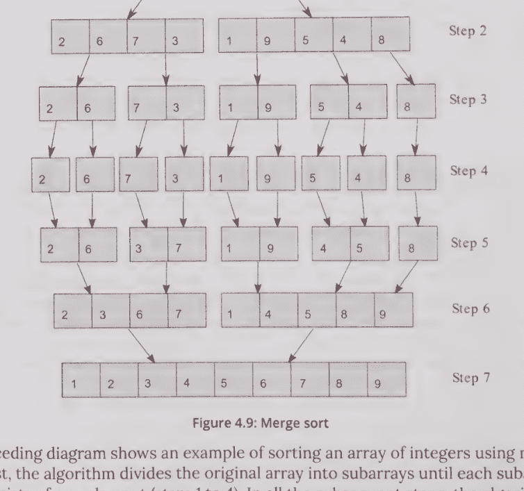

图 4.9：归并排序

上图展示了使用归并排序对整数数组进行排序的示例。首先，算法将原数组划分为子数组，直到每个子数组只包含一个元素（步骤 1 到 4）。在随后的所有步骤中，算法将元素合并成更大的数组，并保持每个子数组中的元素按递增顺序排列。

```cpp
merged.emplace_back(*iter1);
}
else
{
    for (; iter2 != arr2.end(); iter2++)
        merged.emplace_back(*iter2);
}

return merged;
}
```

模板化的 **merge()** 函数接受两个类型为 T 的向量引用，并返回一个新向量，其中包含输入数组中的元素，且这些元素已按递增顺序排序。

- 3. 我们现在可以使用归并操作来编写递归归并排序实现，如下所示：

```cpp
template <typename T>
std::vector<T> merge_sort(std::vector<T> arr)
{
    if (arr.size() > 1)
    {
        auto mid = size_t(arr.size() / 2);
        auto left_half = merge_sort<T>(std::vector<T>(arr.begin(), arr.begin() + mid));
        auto right_half = merge_sort<T>(std::vector<T>(arr.begin() + mid, arr.end()));

        return merge<T>(left_half, right_half);
    }

    return arr;
}
```

4. 添加以下函数来打印向量：

```
template <typename T>
void print_vector(std::vector<T> arr)
{
    for (auto i : arr)
        std::cout << i << " ";
    std::cout << std::endl;
}
```

5. 以下函数使我们能够测试归并排序算法的实现：

```
void run_merge_sort_test()
{
    std::vector<int> S1{ 45, 1, 3, 1, 2, 3, 45, 5, 1, 2, 44, 5, 7 };
    std::vector<float> S2{ 45.6f, 1.0f, 3.8f, 1.01f, 2.2f, 3.9f, 45.3f, 5.5f, 1.0f, 2.0f, 44.0f, 5.0f, 7.0f };
    std::vector<double> S3{ 45.6, 1.0, 3.8, 1.01, 2.2, 3.9, 45.3, 5.5, 1.0, 2.0, 44.0, 5.0, 7.0 };
    std::vector<char> C{ 'b','z','a','e','f','t','q','u','y' };

    std::cout << "Unsorted arrays:" << std::endl;
    print_vector<int>(S1);
    print_vector<float>(S2);
    print_vector<double>(S3);
    print_vector<char>(C);
    std::cout << std::endl;

    auto sorted_S1 = merge_sort<int>(S1);

    auto sorted_S2 = merge_sort<float>(S2);
    auto sorted_S3 = merge_sort<double>(S3);
    auto sorted_C = merge_sort<char>(C);

    std::cout << "Arrays sorted using merge sort:" << std::endl;
    print_vector<int>(sorted_S1);
    print_vector<float>(sorted_S2);
    print_vector<double>(sorted_S3);
    print_vector<char>(sorted_C);
```


```
std::cout << std::endl;
}

int main()
{
    run_merge_sort_test();
    return 0;
}
```

6. 编译并运行程序。输出应如下所示：

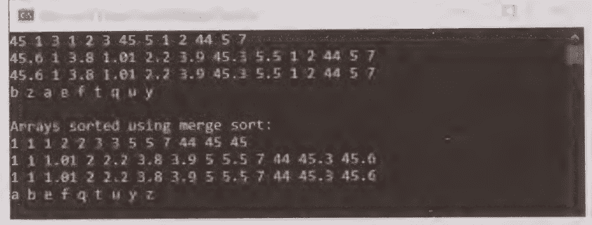

图 4.10：归并排序排序

本练习中我们对归并排序的实现继续了我们的主题，即不将算法的实现与底层数据类型绑定，仅依赖容器所暴露的函数。

## 快速排序

在归并排序的情况下，目标是排序大量数据，而快速排序则试图降低平均情况下的运行时间。快速排序中的底层思想也与归并排序相同——将原始输入数组划分为较小的子数组，对子数组进行排序，然后合并结果以得到排序后的数组。然而，快速排序使用的基本操作是分区而不是合并。

### 分区操作的原理

给定一个数组和数组中的一个枢轴元素 P，分区操作做两件事：

1. 它将原始数组划分为两个子数组 L 和 R，其中 L 包含给定数组中所有小于或等于 P 的元素，而 R 包含给定数组中所有大于 P 的元素。
2. 它按顺序 L, P, R 重新组织数组中的元素。

下图显示了对未排序数组应用分区的结果，其中第一个元素被选为枢轴：

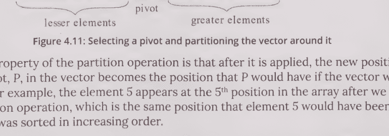

图 4.11：选择枢轴并围绕其对向量进行分区

分区操作的一个有用属性是，应用之后，枢轴 P 在向量中的新位置就成为 P 在向量排序后应有的位置。例如，元素 5 在应用分区操作后出现在数组的第 5 个位置，这与元素 5 在数组按升序排序时应有的位置相同。

前述属性也是快速排序算法的核心思想，其工作方式如下：

1. 如果输入数组 A 中有超过 1 个元素，则对 A 应用分区操作。它会产生子数组 L 和 R。
2. 使用 L 作为步骤 1 的输入。
3. 使用 R 作为步骤 1 的输入。

步骤 2 和 3 是对分区操作生成的数组递归调用分区操作，并将其应用于原始输入数组。这种对分区操作的简单递归应用会导致元素按升序排序。由于快速排序的递归树可能很快变得很深，下图显示了对一个包含六个元素的小数组 {5, 6, 7, 3, 1, 9} 应用快速排序的示例：

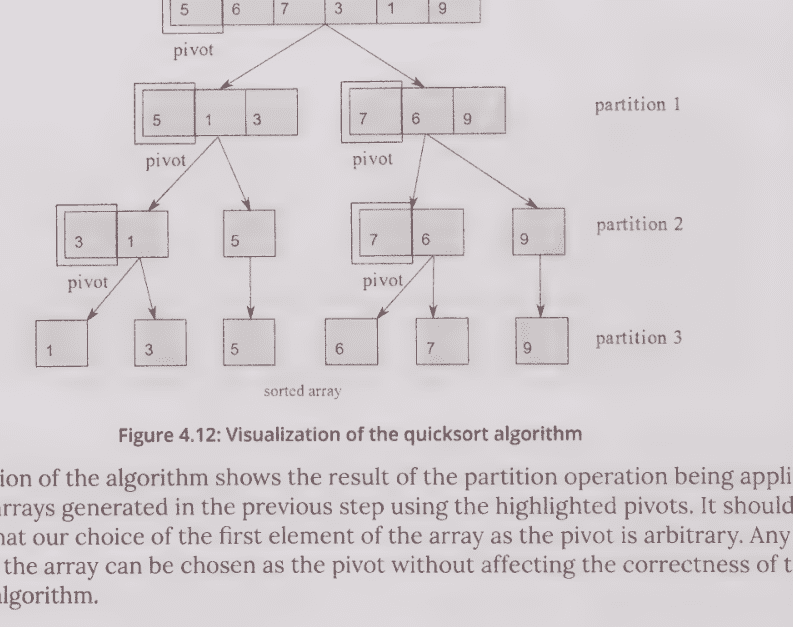

图 4.12：快速排序算法的可视化

每次迭代都显示了使用高亮的枢轴对前一步生成的子数组应用分区操作的结果。应该注意的是，我们选择数组的第一个元素作为枢轴是任意的。数组中的任何元素都可以作为枢轴，而不影响快速排序算法的正确性。

### 练习 20：快速排序

在本练习中，我们将实现并测试我们的快速排序实现。让我们开始：

1. 导入以下头文件：

```
#include <iostream>
#include <vector>
#include <chrono>
#include <random>
#include <algorithm>
#include <numeric>
```

2. 分区操作的 C++ 代码如下。按如下所示编写 partition() 函数：

```
template <typename T>
auto partition(typename std::vector<T>::iterator begin,
                typename std::vector<T>::iterator last)
{
    // Create 3 iterators,
    // one pointing to the pivot, one to the first element and
    // one to the last element of the vector.
    auto pivot_val = *begin;
    auto left_iter = begin+1;
    auto right_iter = last;

    while (true)
    {
        // Starting from the first element of vector, find an element that
        // is greater than pivot.
        while (*left_iter <= pivot_val &&
               std::distance(left_iter, right_iter) > 0)
            left_iter++;
        // Starting from the end of vector moving to the beginning, find an
        // element that is lesser than the pivot.
        while (*right_iter > pivot_val &&
               std::distance(left_iter, right_iter) > 0)
            right_iter--;

        // If left and right iterators meet, there are no elements left to
        // swap. Else, swap the elements pointed to by the left and right iterators
        if (left_iter == right_iter)
            break;
        else
            std::iter_swap(left_iter, right_iter);
    }
    if (pivot_val > *right_iter)
        std::iter_swap(begin, right_iter);

    return right_iter;
}
```

这里显示的实现仅接收底层容器对象的迭代器，并返回另一个指向数组中分区索引的迭代器。这意味着向量的所有元素都大于右分区中的枢轴，而所有小于或等于枢轴的元素都在左分区中。

3. 快速排序算法递归地使用分区操作，如以下代码所示：

```
template <typename T>
void quick_sort(typename std::vector<T>::iterator begin,
    typename std::vector<T>::iterator last)
{
    // If there are more than 1 elements in the vector
    if (std::distance(begin, last) >= 1)
    {
        // Apply the partition operation
        auto partition_iter = partition<T>(begin, last);

        // Recursively sort the vectors created by the partition operation
        quick_sort<T>(begin, partition_iter-1);
        quick_sort<T>(partition_iter, last);
    }
}
```

4. print_vector() 用于将向量打印到控制台，其实现如下：

```
template <typename T>
void print_vector(std::vector<T> arr)
{
    for (auto i : arr)
        std::cout << i << " ";

    std::cout << std::endl;
}
```

5. 按如下方式改编来自 *练习 19. 归并排序* 的驱动代码：

```
void run_quick_sort_test()
{
    std::vector<int> S1{ 45, 1, 3, 1, 2, 3, 45, 5, 1, 2, 44, 5, 7 };
    std::vector<float> S2{ 45.6f, 1.0f, 3.8f, 1.01f, 2.2f, 3.9f, 45.3f,
5.5f, 1.0f, 2.0f, 44.0f, 5.0f, 7.0f };
    std::vector<double> S3{ 45.6, 1.0, 3.8, 1.01, 2.2, 3.9, 45.3, 5.5,
1.0, 2.0, 44.0, 5.0, 7.0 };
    std::vector<char> C{ 'b', 'z', 'a', 'e', 'f', 't', 'q', 'u', 'y' };

    std::cout << "Unsorted arrays:" << std::endl;
    print_vector<int>(S1);
    print_vector<float>(S2);
    print_vector<double>(S3);
    print_vector<char>(C);
    std::cout << std::endl;
    quick_sort<int>(S1.begin(), S1.end() - 1);
    quick_sort<float>(S2.begin(), S2.end() - 1);
    quick_sort<double>(S3.begin(), S3.end() - 1);
    quick_sort<char>(C.begin(), C.end() - 1);

    std::cout << "Arrays sorted using quick sort: " << std::endl;
    print_vector<int>(S1);
    print_vector<float>(S2);
    print_vector<double>(S3);
    print_vector<char>(C);
    std::cout << std::endl;
}
```

6. 编写一个调用 `run_quick_sort_test()` 的 `main()` 函数：

```
int main()
{
    run_quick_sort_test();
    return 0;
}
```

7. 你的最终输出应如下所示：

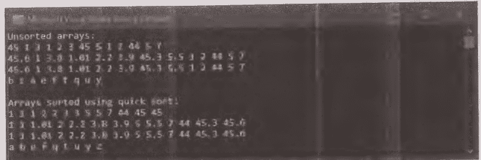

图 4.13：快速排序排序

然而，快速排序的运行时间确实取决于我们枢轴选择的“好坏”。快速排序的最佳情况是每一步的枢轴都是当前数组的中位数元素；在这种情况下，快速排序能够在每一步将元素划分为大小相等的向量，因此递归树的深度恰好为 log(n)。如果未选择中位数作为枢轴，则会导致分区大小不平衡，从而导致更深的递归树和更大的运行时间。

快速排序和归并排序的渐近复杂度如下所示：

| Algorithm | Best case | Average case | Worst case |
|-----------|-----------|--------------|------------|
| Merge sort | O(n log n) | O(n log n) | O(n log n) |
| Quicksort | O(n log n) | O(n log n) | O(n²) |

图 4.14：快速排序和归并排序的渐近复杂度

## 活动 9：部分排序

在最后两个练习中，我们实现了对向量的所有元素进行升序（或降序）排序的总排序算法。然而，在许多问题实例中，这可能是过度操作。例如，想象一下，你被给出一个包含地球上所有人类年龄的向量，并被要求找出人口最老 10% 的中位年龄。

解决此问题的朴素方法是排序年龄向量，从向量中提取最老 10% 人的年龄，然后求提取向量的中位数。然而，这个解决方案是浪费的，因为它做了严格计算解决方案所需之外的更多工作，即它对整个数组进行排序，而最终只使用已排序数组的 10% 来获得所需解决方案。


针对此类问题，可以通过将归并排序和快速排序等全排序算法特化为部分排序算法来获得更好的解决方案。部分排序算法仅对给定向量中指定数量的元素进行排序，其余元素则不排序。

部分快速排序算法描述如下：

- 1. 假设给定一个向量 V，我们需要创建一个包含 k 个元素的有序子向量。
- 2. 对 V 应用分区操作，假设 V 的第一个元素为基准（同样，这个选择完全是任意的）。分区操作的结果是两个向量 L 和 R，其中 L 包含 V 中小于基准的所有元素，R 包含大于基准的所有元素。此外，基准的新位置就是基准在有序数组中的“正确”位置。
- 3. 将 L 作为步骤 1 的输入。
- 4. 如果步骤 2 中基准的新位置小于 k，则将 R 作为步骤 1 的输入。

你在此活动中的任务是实现部分快速排序算法，并使用随机生成的数组来测试算法的输出。当向量大小为 100 且 k = 100 时，最终输出应如下所示：

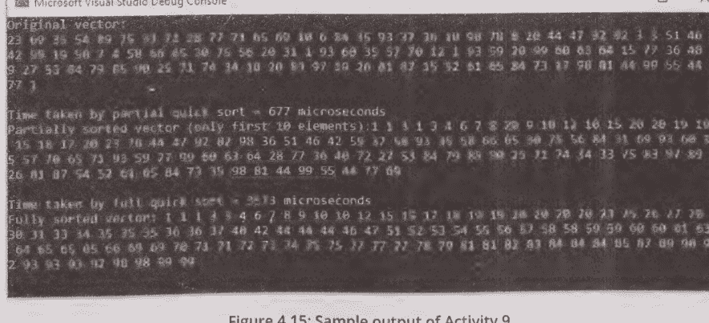

## 注意

本活动的解决方案可在第 510 页找到。

## 线性时间选择

在上一节中，我们了解了一些使用分治范式的简单算法示例，并介绍了分区和合并操作。到目前为止，我们对分治算法的认识仅限于将每个中间步骤递归地分成恰好两个子部分的问题。然而，在某些问题中，将每一步分成更多子部分可以带来显著的好处。在接下来的部分中，我们将研究这样一个问题——线性时间选择。

想象一下，你负责为学校组织一次军乐队游行。为了确保所有乐队成员看起来整齐划一，学生的身高必须相同。此外，所有年级的学生都需要参加。为了解决这些问题，你想出了以下解决方案：每个年级只挑选第 15 矮的学生参加游行。该问题可以形式化如下：给定一个随机排列的元素集合 S，要求找出 S 中第 i 小的元素。一个简单的解决方案是对输入进行排序，然后选择第 i 个元素。然而，该解决方案的算法复杂度为 O(n log n)。在本节中，我们将研究一种 O(n) 的分治解决方案。

我们的解决方案依赖于正确使用分区操作。我们在上一小节中引入的分区操作接收一个向量和一个基准，然后将向量分成两部分，一部分包含所有小于基准的元素，另一部分包含所有大于基准的元素。最终算法如下：

- 1. 假设给定一个输入向量 V，我们需要找到第 i 小的元素。
- 2. 将输入向量 V 划分为向量 V¹、V²、V³、...、Vⁿ/⁵，每个向量包含五个元素（如有必要，最后一个向量可以少于五个元素）。
- 3. 接下来，我们对每个 Vⁱ 进行排序。

4. 对于每个 $V_i$，找到中位数 $m_i$，并将所有中位数收集到集合 $M$ 中，如下所示：

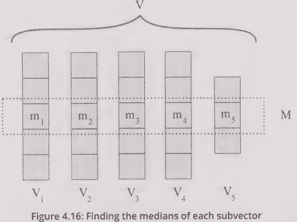

图 4.16：查找每个子向量的中位数

5. 找到 $M$ 的中位数元素 $q$：

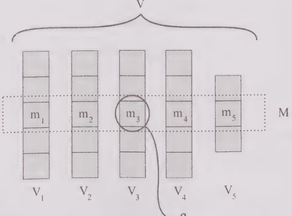

图 4.17：查找一组中位数的中位数

2. 编写如下所示的辅助函数：

```
template<typename T>
auto find_median(typename std::vector<T>::iterator begin, typename std::vector<T>::iterator last)
{
    // Sort the array
    quick_sort<T>(begin, last);

    // Return the middle element, i.e. median
    return begin + (std::distance(begin, last)/2);
}
```

3. 在练习 20（快速排序）中，我们的分区函数假定给定向量中的第一个元素始终是所使用的基准。现在我们需要一种更通用的分区操作形式，可以与任何基准元素一起使用：

```
template <typename T>
auto partition_using_given_pivot(
typename std::vector<T>::iterator begin,
typename std::vector<T>::iterator end,
typename std::vector<T>::iterator pivot)
{
    // Since the pivot is already given,
    // Create two iterators pointing to the first and last element of the vector respectively

    auto left_iter = begin;
    auto right_iter = end;

    while (true)
    {
        // Starting from the first element of vector, find an element that is greater than pivot.
        while (*left_iter < *pivot && left_iter != right_iter)
            left_iter++;

        // Starting from the end of vector moving to the beginning, find an element that is lesser than the pivot.
        while (*right_iter >= *pivot &&
            left_iter != right_iter)
            right_iter--;
```

```
// If left and right iterators meet, there are no elements left to
// swap. Else, swap the elements pointed to by the left and right iterators.
if (left_iter == right_iter)
    break;
else
    std::iter_swap(left_iter, right_iter);
}
if (*pivot > *right_iter)
    std::iter_swap(pivot, right_iter);

return right_iter;
}
```

4. 使用以下代码实现线性时间搜索算法：

```
// Finds ith smallest element in vector V
template<typename T>
typename std::vector<T>::iterator linear_time_select(
    typename std::vector<T>::iterator begin,
    typename std::vector<T>::iterator last, size_t i)
{
    auto size = std::distance(begin, last);

    if (size > 0 && i < size) {

        // Get the number of V_i groups of 5 elements each
        auto num_Vi = (size+4) / 5;
        size_t j = 0;

        // For each V_i, find the median and store in vector M
        std::vector<T> M;
        for (; j < size/5; j++)
        {
            auto b = begin + (j * 5);
            auto l = begin + (j * 5) + 5;

            M.push_back(*find_median<T>(b, l));
        }
        if (j * 5 < size)
        {
            auto b = begin + (j * 5);
            auto l = begin + (j * 5) + (size % 5);
```

```
M.push_back(*find_median<T>(b, l));
}

// Find the middle element ('q' as discussed)
auto median_of_medians = (M.size() == 1)? M.begin():
linear_time_select<T>(M.begin(),
							M.end()-1, M.size() / 2);

// Apply the partition operation and find correct position 'k' of
pivot 'q'.

auto partition_iter = partition_using_given_pivot<T>(begin, last,
median_of_medians);
	auto k = std::distance(begin, partition_iter)+1;

if (i == k)
	return partition_iter;
else if (i < k)
	return linear_time_select<T>(begin, partition_iter - 1, i);
else if (i > k)
	return linear_time_select<T>(partition_iter + 1, last, i-k);
}
else {
	return begin;
}
}
```

5. 添加如下代码所示的归并排序实现。我们将使用该排序算法来演示我们实现的正确性：

```
template <typename T>
std::vector<T> merge(std::vector<T>& arr1, std::vector<T>& arr2)
{
	std::vector<T> merged;

	auto iter1 = arr1.begin();
	auto iter2 = arr2.begin();

	while (iter1 != arr1.end() && iter2 != arr2.end())
	{
		if (*iter1 < *iter2)
		{
```

```
merged.emplace_back(*iter1);
    iter1++;
}
else
{
    merged.emplace_back(*iter2);
    iter2++;
}
}

if (iter1 != arr1.end())
{
    for (; iter1 != arr1.end(); iter1++)
        merged.emplace_back(*iter1);
}
else
{
    for (; iter2 != arr2.end(); iter2++)
        merged.emplace_back(*iter2);
}

return merged;
}

template <typename T>
std::vector<T> merge_sort(std::vector<T> arr)
{
    if (arr.size() > 1)
    {
        auto mid = size_t(arr.size() / 2);
        auto left_half = merge_sort(std::vector<T>(arr.begin(),
            arr.begin() + mid));
        auto right_half = merge_sort(std::vector<T>(arr.begin() + mid,
            arr.end()));

        return merge<T>(left_half, right_half);
    }

    return arr;
}
```


- **6. 最后，添加以下驱动和测试函数：**

```
void run_linear_select_test()
{
    std::vector<int> S1{ 45, 1, 3, 1, 2, 3, 45, 5, 1, 2, 44, 5, 7 };
    std::cout << "Original vector:" << std::endl;
    print_vector<int> (S1);

    std::cout << "Sorted vector:" << std::endl;
    print_vector<int>(merge_sort<int>(S1));

    std::cout << "3rd element: "
              << *linear_time_select<int>(S1.begin(), S1.end() - 1, 3)
              << std::endl;
    std::cout << "5th element: "
              << *linear_time_select<int>(S1.begin(), S1.end() - 1, 5)
              << std::endl;
    std::cout << "11th element: "
              << *linear_time_select<int>(S1.begin(), S1.end() - 1, 11)
              << std::endl;
}
```

```
int main()
{
    run_linear_select_test();
    return 0;
}
```

- **7. 编译并运行代码。最终输出应如下所示：**

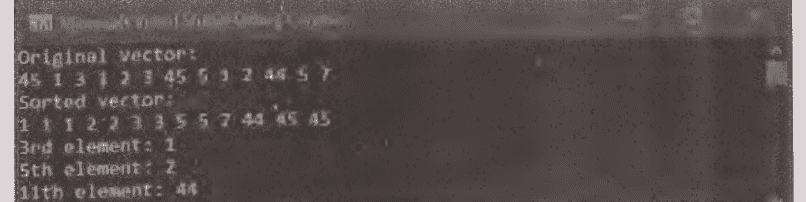

*图 4.19：使用线性时间选择查找第 3、5 和 11 个元素*

虽然对所给算法的详细理论分析超出了本章的范围，但该算法的运行时间值得讨论。上述算法之所以有效的基本思想是，每次用输入 V 调用 `linear_time_select()` 时，都会应用一次分区操作，然后函数仅在其中一个分区上递归调用自身。在每一步递归中，问题的规模至少减少 30%。由于找到五个元素的中位数是常数时间操作，上述算法得到的递推方程可以用归纳法求解，从而看出运行时确实为 O(n)。

> **注意**
>
> 线性时间选择算法的一个有趣性质是，当 V 被划分为每组五个元素的子向量时，其众所周知的渐近复杂度（线性）得以实现。找到能产生更好渐近复杂度的常数大小子向量仍然是一个开放问题。

## C++ 标准库中的分治工具

在上一节中，我们手动实现了分治算法所需的函数。然而，C++ 标准库附带大量预定义函数，在编程时可以为我们节省大量工作。下表提供了在实现使用分治范式的算法时最常用函数的便捷列表。我们简要描述这些函数以供参考，但为了简洁起见，详细的实现不在本章范围内。欢迎进一步探索这些函数；你应该能够根据本章涉及的概念理解它们。

| STL 函数 | 函数说明 |
|---|---|
| `std::binary_search()` | 使用二分搜索在容器中搜索单个元素。 |
| `std::search()` | 在容器中搜索一段连续的元素。 |
| `std::upper_bound()` | 返回容器中第一个大于给定值的元素的迭代器。 |
| `std::lower_bound()` | 返回容器中第一个不小于给定值的元素的迭代器。 |
| `std::partition()` | 应用分区操作，重新排列容器中的元素，使所有小于基准的元素位于基准左侧，所有大于基准的元素位于右侧。 |
| `std::partition_copy()` | 应用分区操作，但返回两个独立的数组作为结果。 |
| `std::is_partitioned()` | 检查给定容器是否已针对给定基准应用了分区操作。 |
| `std::stable_partition()` | 应用分区操作，同时确保分区后元素的顺序由输入谓词控制，即是使输入谓词为真的元素出现在为假的元素之前。 |
| `std::sort()` | 对容器进行排序。内部使用了多种排序技术的组合。 |
| `std::stable_sort()` | 对容器进行排序，同时保持相等元素与输入容器中的顺序相同。 |
| `std::partial_sort()` | 仅对部分而不是整个容器进行排序。 |
| `std::merge()` | 合并两个输入容器，使元素的顺序保持与原始容器中出现的顺序一致。 |
| `std::nth_element()` | 返回容器中第 n 小的元素。 |
| `std::accumulate()` | 计算给定值与给定容器中所有元素的总和。它也接受一个外部归约运算符。 |
| `std::transform()` | 给定一个容器和一个函数，它对容器中的每个元素应用该函数，从而修改其值。 |
| `std::reduce()`（仅适用于 C++17 及以后版本） | 接受一个归约运算符，将其应用于给定范围，并返回结果。 |

图 4.20：一些用于算法的实用 STL 函数

## 更高抽象层次上的分治——MapReduce

到目前为止，在本章中，我们将分治视为一种算法设计技术，并使用预定义的分治-合并步骤来解决我们的问题。在本节中，我们稍微偏离一下，看看将问题划分为更小的部分并分别解决每个部分的相同原理，在我们需要将软件扩展到单台机器的计算能力之外并使用计算机集群来解决问题时，会特别有用。

原始 **MapReduce** 论文开头如下：

> “MapReduce 是一种编程模型，以及一个相关的实现，用于处理和生成大型数据集。用户指定一个 map 函数，该函数处理一个键值对以生成一组中间键值对，以及一个 reduce 函数，该函数合并与同一中间键关联的所有中间值。”

> **注意**
>
> 你可以在此处参考 MapReduce 模型的原始研究论文，该论文由 Jeffrey Dean 和 Sanjay Ghemawat 于 2004 年发表：https://static.googleusercontent.com/media/research.google.com/en/us/archive/mapreduce/osdi04.pdf。

Reduce 是一种通过对容器 C 中的每个元素 x 应用给定函数 f(acc, x)，聚合容器中的值并返回单个值的操作。如下图所示：

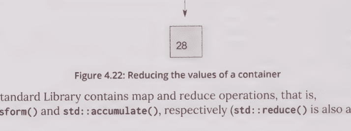

*图 4.22：归约容器的值*

C++ 标准库包含 map 和 reduce 操作，分别为 `std::transform()` 和 `std::accumulate()`（C++17 中还提供了 `std::reduce()`）。

> **注意**
>
> `std::accumulate()` 是归约操作的一种受限形式，仅使用加法函数。较新的编译器还提供 `std::reduce()`，它更通用并且可以并行化。

### 练习 22：C++ 标准库中的 Map 和 Reduce

在本练习中，我们将了解如何使用这些函数来进一步理解 map 和 reduce 操作。让我们开始吧：

- **1. 导入以下头文件：**

```
#include <iostream>
#include <vector>
#include <chrono>
#include <random>
#include <algorithm>
#include <numeric>
```

- **2. 首先创建一个包含随机元素的数组：**

```
void transform_test(size_t size)
{
    std::vector<int> S, Tr;
    std::random_device rd;
    std::mt19937 rand(rd());
    std::uniform_int_distribution<std::mt19937::result_type> uniform_dist(1, size);

    // Insert random elements
    for (auto i = 0; i < size; i++)
        S.push_back(uniform_dist(rand));

    std::cout << "Original array, S: ";
    for (auto i : S)
        std::cout << i << " ";
    std::cout << std::endl;
    std::transform(S.begin(), S.end(), std::back_inserter(Tr),
                   [](int x) { return std::pow(x, 2.0); });

    std::cout << "Transformed array, Tr: ";
    for (auto i : Tr)
        std::cout << i << " ";
    std::cout << std::endl;

    // For_each
    std::for_each(S.begin(), S.end(), [](int &x) { x = std::pow(x, 2.0); });

    std::cout << "After applying for_each to S: ";
    for (auto i : S)
        std::cout << i << " ";
    std::cout << std::endl;
}
```


- 3. **transform_test()** 函数随机生成一个给定大小的向量，并对该向量应用变换 f(x) = x²。

### 注意

**std::transform()** 不会改变原始向量，而是将结果返回到一个单独的向量中，而 **std::for_each()** 会修改输入向量。两者之间的另一个区别是，**std::transform()** 不保证输入函数 f 会从容器的第一个元素应用到最后一个元素；也就是说，函数应用的顺序不一定与元素的顺序一致。从 C++17 开始，**std::transform()** 还通过接受 **ExecutionPolicy** 作为第一个参数来支持原生并行化。

在 C++ 标准库中，归约操作由 **std::accumulate()** 和 **std::reduce()** 实现（后者仅在 C++17 及更高版本中可用）：

```
void reduce_test(size_t size)
{
    std::vector<int> S;
    std::random_device rd;
    std::mt19937 rand(rd());
    std::uniform_int_distribution<std::mt19937::result_type> uniform_dist(1, size);

    // Insert random elements
    for (auto i = 0; i < size; i++)
        S.push_back(uniform_dist(rand));

    std::cout << std::endl << "Reduce test== " << std::endl << "Original array, S: ";
    for (auto i : S)
        std::cout << i << " ";
    std::cout << std::endl;
    // Accumulate
    std::cout<<"std::accumulate() = " << std::accumulate(S.begin(), S.end(), 0, [](int acc, int x) {return acc+x;});

    std::cout << std::endl;
}
```

- 4. 添加以下驱动程序代码：

```
int main()
{
    transform_test(10);
    reduce_test(10);
    return 0;
}
```

- 5. 编译并运行代码。你的输出应如下所示：

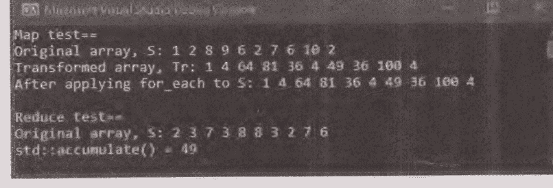

## 整合各部分 – 使用 MapReduce 框架

要使用 MapReduce 模型编写程序，我们必须能够将所需的计算表达为两个阶段的一系列操作：Map（也称为分区）阶段，程序读取输入并创建一组中间 `<key,value>` 对；Reduce 阶段，中间 `<key,value>` 对再按所需方式组合以生成最终结果。下图说明了这一思想：

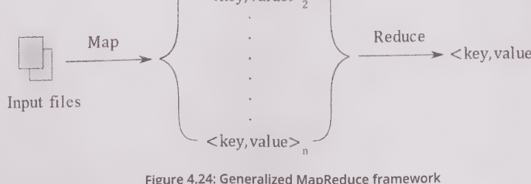

Hadoop 等框架为 MapReduce 编程模型带来的主要价值在于，它们让 map 和 reduce 操作变得分布式且高度可扩展，因此计算可以在机器集群上运行，并且总耗时得以缩短。

我们将在下面的练习中使用 MapReduce 框架来执行一个示例任务。

### 注意

以下练习和活动需要你的系统上安装 Boost C++ 库。请通过以下链接获取 Boost 库：

- Windows: https://www.boost.org/doc/libs/1_71_0/more/getting_started/windows.html
- Linux/macOS: https://www.boost.org/doc/libs/1_71_0/more/getting_started/unix-variants.html

### 练习 23：使用 MapReduce 检查素数

给定一个正整数 N，我们希望找出 1 到 N 之间的素数。在本练习中，我们将了解如何利用 MapReduce 编程模型实现这一点，并使用多个线程来解决该问题。让我们开始吧：

- 1. 首先，我们引入所需的库，并定义一个通过质因数分解来检查给定数字是否为素数的函数：

```
#include <iostream>
#include "mapreduce.hpp"

namespace prime_calculator {

    bool const is_prime(long const number)
    {
        if (number > 2)
        {
            if (number % 2 == 0)
                return false;

            long const n = std::abs(number);
            long const sqrt_number = static_cast<long>(std::sqrt(
                static_cast<double>(n)));

            for (long i = 3; i <= sqrt_number; i += 2)
            {
                if (n % i == 0)
                    return false;
            }
        }
        else if (number == 0 || number == 1)
            return false;

        return true;
    }
}
```

- 2. 下面的类用于生成一个数字范围，其中连续数字之间的差（也称为步长）为给定值：

```
template<typename MapTask>
class number_source : mapreduce::detail::noncopyable
{
public:
    number_source(long first, long last, long step)
        : sequence_(0), first_(first), last_(last), step_(step)
    {
    }

    bool const setup_key(typename MapTask::key_type& key)
    {
        key = sequence_++;
        return (key * step_ <= last_);
    }

    bool const get_data(typename MapTask::key_type const& key,
                        typename MapTask::value_type& value)
    {
        typename MapTask::value_type val;

        val.first = first_ + (key * step_);
        val.second = std::min(val.first + step_ - 1, last_);

        std::swap(val, value);
        return true;
    }

private:
    long sequence_;
    long const step_;
    long const last_;
    long const first_;
};
```

- 3. 下面的函数定义了在 map 阶段要执行的步骤：

```
struct map_task : public mapreduce::map_task<long, std::pair<long, long>>
{
    template<typename Runtime>
    void operator()(Runtime& runtime, key_type const& key, value_type const& value) const
    {
        for (key_type loop = value.first;
             loop <= value.second; loop++)
            runtime.emit_intermediate(is_prime(loop), loop);
    }
};
```

- 4. 现在，让我们实现 reduce 阶段：

```
struct reduce_task : public mapreduce::reduce_task<bool, long>
{
    template<typename Runtime, typename It>
    void operator()(Runtime& runtime, key_type const& key, It it, It ite) const
    {
        if (key)
            std::for_each(it, ite, std::bind(&Runtime::emit, &runtime, true, std::placeholders::_1));
    }
};
```

```
typedef
mapreduce::job<
    prime_calculator::map_task,
    prime_calculator::reduce_task,
    mapreduce::null_combiner,
    prime_calculator::number_source<prime_calculator::map_task>>
job;

} // namespace prime_calculator
```

前面的命名空间具有三个功能：第一，它定义了一个检查给定数字是否为素数的函数；第二，它定义了一个在给定边界内生成数字范围的函数；第三，它定义了 map 和 reduce 任务。如前所述，map 函数会发出 `<k, v>` 对，其中 k 和 v 都是 long 类型；若 v 是素数，则 k 为 1，若 v 不是素数，则 k 为 0。随后，reduce 函数相当于过滤器，仅输出 k = 1 的 `<k, v>` 对。

- 5. 随后，下面的驱动程序代码会设置相关参数并启动 MapReduce 计算：

```
int main()
{
    mapreduce::specification spec;

    int prime_limit = 1000;

    // Set number of threads to be used
    spec.map_tasks = std::max(1U, std::thread::hardware_concurrency());
    spec.reduce_tasks = std::max(1U, std::thread::hardware_concurrency());

    // Set the source of numbers in given range
    prime_calculator::job::datasource_type datasource(0, prime_limit,
        prime_limit / spec.reduce_tasks);

    std::cout << "\nCalculating Prime Numbers in the range 0 .. " <<
              prime_limit << " ..." << std::endl;

    std::cout << std::endl << "Using "
              << std::max(1U, std::thread::hardware_concurrency()) << " CPU cores";

    // Run mapreduce
    prime_calculator::job job(datasource, spec);
```

### 活动 10：在 MapReduce 中实现 WordCount

在本章中，我们已经看到了分治技术背后的思想可以多么强大：它既是一种极其有用的算法设计技术，也为处理大型复杂计算提供了有用的工具。在本活动中，我们将练习使用前面章节介绍的 MapReduce 模型，将一个大问题分解成较小的部分，解决这些较小的部分，然后合并最终结果。

我们的问题定义取自最初的 MapReduce 论文，具体如下：给定一组包含文本的文件，找出每个单词在文件中出现的频率。例如，假设你有两个文件，内容如下：

文件 1：

```
The quick brown fox jumps over a rabbit
```

文件 2：

```
The quick marathon runner won the race
```

根据输入文件，我们的程序应输出以下结果：

| 单词 | 频率 |
| --- | ---: |
| The | 2 |
| quick | 2 |
| a | 1 |
| brown | 1 |
| fox | 1 |
| jumps | 1 |
| marathon | 1 |
| over | 1 |
| rabbit | 1 |
| race | 1 |
| runner | 1 |
| the | 1 |
| won | 1 |

这类问题经常出现在索引工作负载中，即当你拥有一大批文本语料，需要对其内容建立索引，以便后续可以在文本上进行更快的搜索时。Google 和 Bing 等搜索引擎大量使用此类索引。


在本活动中，你需要实现词频统计问题的 map 和 reduce 阶段。由于这涉及大量特定于我们库的代码，样板代码已为你提供在 mapreduce_wordcount_skeleton.cpp 中。

## 活动指南：

+   1. 阅读并理解 mapreduce_wordcount_skeleton.cpp 中的给定代码。你会注意到我们在头文件中需要导入 Boost 库。另一点需要注意的是，给定代码中的 map 阶段创建 < k, v > 对，其中 k 为字符串，v 设为 1。例如，假设你的输入文件集合包含随机组合的单词，w¹, w², w³, ..., wⁿ。如果是这样，map 阶段应输出 < k, 1> 对，其中 k = {w¹, w², w³, ..., wⁿ}，如下图所示：

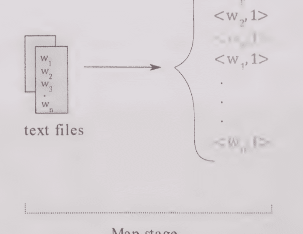

### Map 阶段

图 4.26：映射阶段

+   2. map 阶段的骨架代码如下所示：

```
struct map_task : public mapreduce::map_task<
    std::string,                      // MapKey (filename)
    std::pair<char const*, std::uintmax_t>> // MapValue (memory mapped file
                                            // contents)
{
template<typename Runtime>
```

```
void operator()(Runtime& runtime, key_type const& key,
                value_type& value) const
{
    // Write your code here.
    // Use runtime.emit_intermediate() to emit <k,v> pairs
}
```
```

+   3. 由于该问题的 map 阶段生成了 <k, 1> 对，我们程序的 reduce 任务现在应合并具有匹配 k 值的对，如下所示：

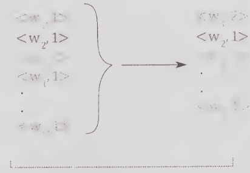

**图 4.27：归约阶段**

+   4. 在给定的代码中，reduce 任务接受两个迭代器，可用于遍历具有相同键的元素，即 *it* 和 *ite* 之间的所有元素都保证具有相同的键。你的 reduce 阶段然后应创建一个新的 <k, v> 对，其中 k 设为输入对的键，v 等于输入对的数量：

```
template<typename KeyType>
struct reduce_task : public mapreduce::reduce_task<KeyType, unsigned>
{
    using typename mapreduce::reduce_task<KeyType, unsigned>::key_type;

    template<typename Runtime, typename It>
    void operator()(Runtime& runtime, key_type const& key, It it, It const ite) const
    {
        // Write your code here.
        // Use runtime.emit() to emit the resulting <k,v> pairs
    }
};
```

5. 你已获得一组测试数据在 **testdata/** 中。编译并运行你的代码。输出应如下所示：

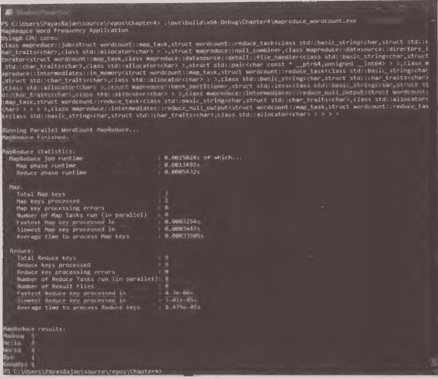

图 4.28：获取给定输入文件中的词频。

> **注意**
> 
> 本活动的解决方案可在第 514 页找到。

## 总结

在本章中，我们以两种不同的方式讨论了分而治之：首先作为算法设计范式，然后是其在设计帮助我们扩展软件的其他工具中的使用。我们涵盖了一些标准分而治之算法（归并排序和快速排序）。我们还看到诸如 **partition** 之类的简单操作如何构成不同问题（如部分排序和线性时间选择）解决方案的基础。

在实践中实现这些算法时需要牢记的一个重要思想是将保存数据的结构与算法本身的实现分离。使用 C++ 模板通常是实现这种分离的好方法。我们看到 C++ 标准库附带了大量可用于实现分而治之算法的原语。

分而治之背后的基本思想的简单性使其成为解决问题的非常有用的工具，并允许创建诸如 MapReduce 之类的并行化框架。我们还看到了使用 MapReduce 编程模型在一个给定范围内查找素数的示例。

在下一章中，我们将介绍贪心算法设计范式，其结果是诸如 Dijkstra 算法之类的解决方案，用于在图中查找最短路径。

# 5
