# 贪心算法

# 学习目标

在本章结束时，你将能够：

+   - 描述算法设计的贪心方法
+   - 识别问题的最优子结构和贪心选择性质
+   - 实现贪心算法，如分数背包和贪心图着色
+   - 使用不相交集数据结构实现 Kruskal 最小生成树算法

在本章中，我们将研究各种“贪心”算法设计方法，并了解它们如何应用于解决现实世界问题。

## 引言

在上一章中，我们讨论了分而治之的算法设计技术，该技术通过将输入划分为较小的子问题、解决每个子问题，然后合并结果来解决给定问题。继续我们的算法设计范式主题，我们现在将研究下一个主题：**贪心方法**。

在每次迭代中，贪心算法会选择“看似最好”的替代方案。换句话说，贪心问题解决方案由一系列局部最优解组成全局最优解。例如，以下屏幕截图显示了一辆汽车从华盛顿特区杜勒斯国际机场到东河谷一栋办公楼的最短路径。自然地，所示路径也是路径上任意两个点（非起点和终点）的最短路径：


图 5.1：从华盛顿特区机场到办公室的路线（来源：project-osrm.org）

因此，我们可以推断出整个最短路径 P，实际上是沿 P 道路网络顶点之间若干最短路径的串联。所以，如果我们被要求设计一个最短路径算法，一个可能的策略如下：从原点顶点开始，绘制一条通往尚未探索的最接近顶点的路径，然后重复直到到达目标顶点。恭喜——你刚刚使用 Dijkstra 算法解决了最短路径问题，该算法也是 Google Maps 和 Bing Maps 等商业软件的驱动力！

可以预见，贪心算法所采用的简单方法使其仅适用于一小部分算法问题。然而，贪心方法的简单性通常使其成为“首攻”的绝佳工具，通过它我们可以理解底层问题的属性和行为，然后可以使用其他更复杂的方法来解决。

在本章中，我们将研究在何种条件下给定问题适合贪心解决方案——最优子结构和贪心选择性质。我们将看到，当一个问题被证明具有这两个性质时，贪心解决方案保证能产生正确的结果。我们还将看到一些现实世界问题的示例，这些问题在实践中会使用贪心解决方案，并将以最小生成树问题的讨论结束，该问题通常出现在电信和供水网络、电力网和电路设计等情况下。但首先，让我们先看看一些可以用贪心算法解决的更简单的问题。

## 基本贪心算法

在本节中，我们将研究两个可使用贪心方法解决的标准问题：最短作业优先调度和分数背包问题。

### 最短作业优先调度

假设你站在银行的队列中。今天很忙，队列中有 N 个人，但银行只有一个柜台开放（今天真是个糟糕的日子！）。让我们假设一个人 p^i 在柜台被服务需要 a^i 的时间。由于队列中的人们都很理性，每个人都同意重新排序他们在队列中的位置，以便队列中每个人的平均等待时间最小化。你需要找到一种重新排序队列中的人员的方法。你将如何解决这个问题？


图 5.2：原始队列


为了进一步剖析这个问题，我们来看一个例子。前面的图显示了一个原始队列的例子，其中Aᵢ表示服务时间，Wᵢ表示第i个人的等待时间。离柜台最近的人可以立即开始接受服务，因此他们的等待时间为0。排在队列第二位的人必须等到第一个人完成，因此他们需要等待a₁ = 8个时间单位才能接受服务。以此类推，第i个人的等待时间等于队列中他们之前所有i−1个人的服务时间之和。

解决这个问题的线索如下：由于我们寻求最小化平均等待时间，所以必须找到一种方法，尽可能多地减少尽可能多的人的等待时间。一种可以减少所有人等待时间的方法是优先处理能最快完成的工作。对队列中的所有人员重复这一想法，我们的解决方案得到如下重新排序的队列：

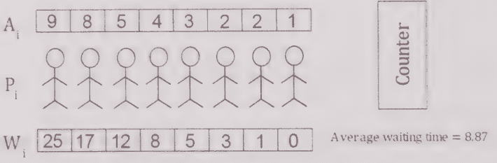

图5.3：具有最小平均等待时间的重新排序队列

请注意，我们重新排序后的队列平均等待时间为8.87个时间单位，而原始排序的平均等待时间为15.25个时间单位，这大约提高了2倍。

## 练习24：最短作业优先调度

在本练习中，我们将通过一个类似于前面图所示的示例，实现最短作业优先调度方案。我们将考虑一个包含10个人的队列，并尝试将所有人的平均等待时间降至最低。让我们开始吧：

- 1. 首先添加所需的头文件，并创建用于计算等待时间和输入/输出的函数：

```cpp
#include <iostream>
#include <algorithm>
#include <vector>
#include <random>
#include <numeric>

// Given a set of service times, computes the waiting times for all users
template<typename T>
auto compute_waiting_times(std::vector<T>& service_times)
{
    std::vector<T> W(service_times.size());
    W[0] = 0;

    for (auto i = 1; i < service_times.size(); i++)
        W[i] = W[i - 1] + service_times[i - 1];

    return W;
}

// Generic function to print a vector
template<typename T>
void print_vector(std::vector<T>& V)
{
    for (auto& i : V)
        std::cout << i << " ";
    std::cout << std::endl;
}

template<typename T>
void compute_and_print_waiting_times(std::vector<T>& service_times)
{
    auto waiting_times = compute_waiting_times<int>(service_times);

    std::cout << "Service times: " << std::endl;
    print_vector<T>(service_times);

    std::cout << "Waiting times: " << std::endl;
    print_vector<T>(waiting_times);

    std::cout << "Average waiting time = "
              << std::accumulate(waiting_times.begin(),
                 waiting_times.end(), 0.0) /
                 waiting_times.size();

    std::cout << std::endl;
}
```

- 2. 添加主求解器和驱动代码，如下所示：

```cpp
void shortest_job_first(size_t size)
{
    std::vector<int> service_times;
    std::random_device rd;
    std::mt19937 rand(rd());
    std::uniform_int_distribution<std::mt19937::result_type> uniform_dist(1, size);

    // Insert random elements as service times
    service_times.reserve(size);
    for (auto i = 0; i < size; i++)
        service_times.push_back(uniform_dist(rand));

    compute_and_print_waiting_times<int>(service_times);

    // Reorder the elements in the queue
    std::sort(service_times.begin(), service_times.end());

    compute_and_print_waiting_times<int>(service_times);
}

int main(int argc, char* argv[])
{
    shortest_job_first(10);
}
```

- 3. 编译并运行代码！你的输出应看起来如下所示：


图5.4：最短作业优先调度程序的输出

## 背包问题

在本节中，我们将讨论标准**背包问题**，也称为0-1背包问题，该问题已知是NP完全的，因此我们无法获得任何多项式时间的解法。接着，我们将把讨论转向背包问题的一个变体，称为**分数背包问题**，它可以使用贪心方法求解。本节的焦点是说明问题定义方式上即使很细微的差异，也会导致求解策略发生巨大的变化。

### 背包问题

假设你有一组物品，O = {O¹, O², ..., Oⁿ}，每个物品都有一定的重量Wⁱ和价值Vⁱ。你还有一个袋子（或背包），它只能承载总重量T单位。现在，假设你的任务是找出应放在包中的一组物品，使得总重量小于或等于T，并且物品的总价值尽可能达到最大。

这个问题的现实世界例子可以通过想象一个在所有交易中赚取固定百分比利润的旅行商人来理解。他们希望携带最大价值的货物以最大化利润，但他们的交通工具（或背包）最多只能承受T单位的重量。商人知道每个物品的确切重量和价值。那么，他们应该携带哪些物品，才能使所携带用于交易的物品总价值达到最大呢？

| | O₁ | O₂ | O₃ | O₄ | O₅ | O₆ | O₇ |
|---|---|---|---|---|---|---|---|
| 重量 | 1 | 2 | 5 | 9 | 2 | 3 | 4 |
| 价值 | 10 | 7 | 15 | 10 | 12 | 11 | 5 |

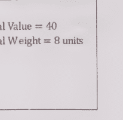

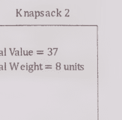

图5.5：背包问题

前面图中展示的问题就是著名的背包问题，已被证明是NP完全的。换句话说，这个问题没有已知的多项式时间解法。因此，我们必须考察物品所有可能的组合，以找到在总重量仅为T单位的情况下具有最大价值的组合。前面的图表展示了容量为8单位的背包可以被填充的两种方式。灰色显示的物品是被选中放入背包的物品。我们可以看到，第一组物品的总价值为40，第二组物品的总价值为37，并且两种情况下的总重量均为8单位。因此，第一组物品比第二组是更好的选择。要找到最佳的一组物品，我们必须列出所有可能的组合，并选择价值最大的那一个。

### 分数背包问题

现在，我们对上一小节中给出的背包问题做一个小改动：假设我们现在被允许将每个物品分成我们需要的任意多份，然后我们可以选择将每个物品的哪个部分放入背包。

就现实世界的类比而言，假设我们之前类比中的商人正在交易油、谷物和面粉等物品。商人可以取任意较小的重量计量。

与标准背包问题的NP完全性相反，分数背包问题有一个简单的解法：按照单位重量的价值（即价值/重量比）对物品进行排序，并“贪婪地”尽可能多地选择比值最大的物品。下图展示了在背包容量设置为8单位时，给定一组物品的最优选择。请注意，被选中的物品是那些单位重量价值最高的物品：

| | O₁ | O₂ | O₃ | O₄ | O₅ | O₆ | O₇ |
|---|---|---|---|---|---|---|---|
| 重量 | 1 | 2 | 5 | 9 | 2 | 3 | 4 |
| 价值 | 10 | 7 | 15 | 10 | 12 | 11 | 5 |
| 价值/重量 | 10 | 3.5 | 3 | 1.1 | 6 | 3.6 | 1.2 |

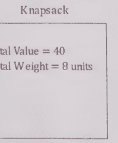

图5.6：分数背包问题

我们将在接下来的练习中实现这一方案。


## 练习 25：分数背包问题

在本练习中，我们将考虑 10 个物品，并尝试最大化背包中的价值，该背包的最大承重为 25 单位。让我们开始吧：

- 1. 首先，我们将添加所需的头文件，并定义一个 Object 结构体，该结构体将表示我们解决方案中的一个对象：

```
#include <iostream>
#include <algorithm>
#include <vector>
#include <random>
#include <numeric>

template <typename weight_type,
    typename value_type,
    typename fractional_type>
struct Object
{
    using Wtype = weight_type;
    using Vtype = value_type;
    using Ftype = fractional_type;

    Wtype weight;
    Vtype value;
    Ftype value_per_unit_weight;

    // NOTE: The following overloads are to be used for std::sort() and I/O
    inline bool operator< (const Object<Wtype,Vtype,Ftype>& obj) const
    {
        // An object is better or worse than another object only on the
        // basis of its value per unit weight
        return this->value_per_unit_weight < obj.value_per_unit_weight;
    }

    inline bool operator== (const Object<Wtype, Vtype, Ftype>& obj) const
    {
        // An object is equivalent to another object only if
        // its value per unit weight is equal
        return this->value_per_unit_weight == obj.value_per_unit_weight;
    }
```
```
```cpp
// Overloads the << operator so an object can be written directly to a
// stream
// e.g. Can be used as std::cout << obj << std::endl;

template <typename Wtype,
          typename Vtype,
          typename Ftype>
friend std::ostream& operator<<(std::ostream& os,
                              const Object<Wtype,Vtype,Ftype>& obj);
};

template <typename Wtype,
          typename Vtype,
          typename Ftype>
std::ostream& operator<<(std::ostream& os, const
Object<Wtype,Vtype,Ftype>& obj)
{
    os << "Value: " << obj.value
       << "\tWeight: " << obj.weight
       << "\tValue/Unit Weight: " << obj.value_per_unit_weight;
    return os;
}
```
```

请注意，我们重载了 `<` 和 `==` 运算符，因为我们将对对象向量使用 **std::sort()**。

2. 分数背包求解器的代码如下：

```
```cpp
template<typename weight_type,
         typename value_type,
         typename fractional_type>
auto fill_knapsack(std::vector<Object<weight_type, value_type, fractional_type>>& objects,
                  weight_type knapsack_capacity)
{
    std::vector<Object<weight_type, value_type, fractional_type>>
    knapsack_contents;
    knapsack_contents.reserve(objects.size());

    // Sort objects in the decreasing order
    std::sort(objects.begin(), objects.end());
```
```
```
std::reverse(objects.begin(), objects.end());

// Add the 'best' objects to the knapsack
auto current_object = objects.begin();
weight_type current_total_weight = 0;
while (current_total_weight <= knapsack_capacity &&
       current_object != objects.end())
{
    knapsack_contents.push_back(*current_object);

    current_total_weight += current_object->weight;
    current_object++;
}

// Since the last object overflows the knapsack, adjust weight
auto weight_of_last_obj_to_remove = current_total_weight - knapsack_capacity;

knapsack_contents.back().weight -= weight_of_last_obj_to_remove;
knapsack_contents.back().value -= knapsack_contents.back().value_per_unit_weight *
                                  weight_of_last_obj_to_remove;

return knapsack_contents;
}
```

上述函数按价值/重量比的降序对对象进行排序，然后挑选所有能装入背包的物品部分，直到背包被装满为止。

- 3. 最后，为了测试我们的实现，请添加以下测试和驱动程序代码：

```
void test_fractional_knapsack(unsigned num_objects, unsigned knapsack_capacity)
{
    using weight_type = unsigned;
    using value_type = double;
    using fractional_type = double;

    // Initialize the Random Number Generator
    std::random_device rd;
    std::mt19937 rand(rd());
    std::uniform_int_distribution<std::mt19937::result_type>
```
```
uniform_dist(1, num_objects);

// Create a vector of objects
std::vector<Object<weight_type, value_type, fractional_type>> objects;
objects.reserve(num_objects);
for (auto i = 0; i < num_objects; i++)
{
    // Every object is initialized with a random weight and value
    auto weight = uniform_dist(rand);
    auto value = uniform_dist(rand);
    auto obj = Object<weight_type, value_type, fractional_type> {
        static_cast<weight_type>(weight),
        static_cast<value_type>(value),
        static_cast<fractional_type>(value) / weight
    };

    objects.push_back(obj);
}

// Display the set of objects
std::cout << "Objects available: " << std::endl;
for (auto& o : objects)
    std::cout << o << std::endl;
std::cout << std::endl;

// Arbitrarily assuming that the total knapsack capacity is 25 units
auto solution = fill_knapsack(objects, knapsack_capacity);

// Display items selected to be in the knapsack
std::cout << "Objects selected to be in the knapsack (max capacity = "
    << knapsack_capacity<< "):" << std::endl;
for (auto& o : solution)
    std::cout << o << std::endl;
std::cout << std::endl;
}

int main(int argc, char* argv[])
{
    test_fractional_knapsack(10, 25);
}
```

上述函数创建对象，并使用 STL 随机数生成器生成的随机数据对它们进行初始化。接下来，它调用我们实现的分数背包求解器，然后显示结果。

4. 编译并运行这段代码！你的输出应如下所示：

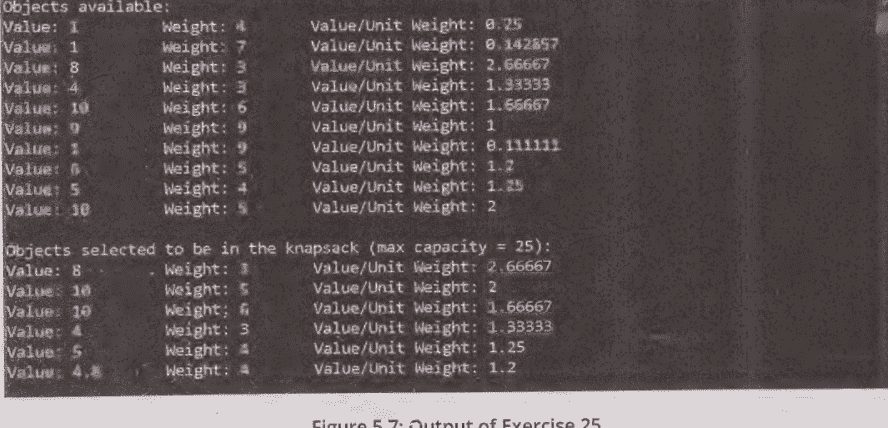

请注意，求解器只取用了物品的一部分——也就是说，最后一个物品按重量计共有 5 个单位，却只取了其中的 4 个单位。这展示了物品在被选择放入背包之前可以被分割，这正是分数背包问题与 0-1（标准）背包问题的区别所在。

## 活动 11：区间调度问题

设想你的待办事项清单上有一系列任务（洗碗、去超市买日用品、从事一个旨在统治世界的秘密项目，以及其他类似的杂务）。每个任务都有一个 ID 标识，并且只能在特定的开始时间和结束时间之间完成。假设你希望完成尽可能多的任务。你应该选择哪个子集、按什么顺序处理这些任务，才能实现目标？假设你在任何时刻都只能处理一个任务。

3. 按如下方式实现调度函数：

- a. 按结束时间递增的顺序对任务列表进行排序。
- b. 贪心地选择完成结束时间最早的任务。
- c. 移除所有与当前所选任务重叠的任务（即在当前任务结束前开始的所有任务）。
- d. 如果列表中还有任务，则转到步骤 b。否则，返回选定的任务向量。

你的最终输出应与以下内容类似：

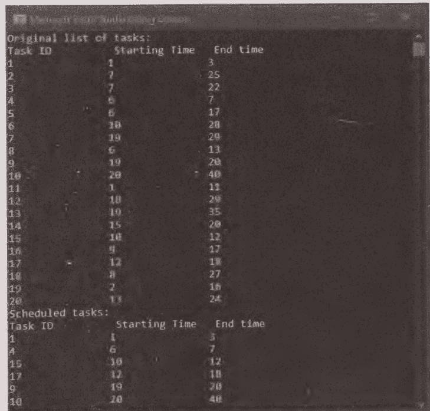

图 5.10：活动 11 的预期输出

## 注意

本活动的解决方案可在第 516 页找到。

## 贪心算法的要求

在上一节中，我们讨论了一些使用贪心方法可以得到最优解的问题示例。然而，一个问题只有在且仅在具有两个性质时，才能使用贪心方法得到最优解：最优子结构性质和贪心选择性质。在本节中，我们将尝试理解这些性质，并向你展示如何判断一个问题是否具备这些性质。

最优子结构：当给定问题 P 的最优解由它的子问题的最优解构成时，则称 P 具有最优子结构。

贪心选择：当给定问题 P 的最优解可以通过在每次迭代中选择局部最优解来获得时，则称 P 具有贪心选择性质。

为了理解最优子结构和贪心选择性质，我们将实现 Kruskal 的最小生成树算法。

## 最小生成树（MST）问题

最小生成树问题可以表述如下：

> “给定一个图 G = < V, E >，其中 V 是顶点集，E 是边集，每条边都有一个边权，请找出一棵生成树 T，它覆盖 V 中的所有顶点，并且总权重最小。”

最小生成树问题的一个现实应用是供水系统和交通网络的设计，因为设计者通常希望最小化所用管道的总长度或所建道路的总长度，同时确保服务覆盖所有指定用户。让我们通过以下示例来剖析这个问题。

假设给你一张地图上 12 个村庄的位置，要求你找到需要修建的道路的最小总长度，使得所有村庄之间都可以相互到达，并且这些道路不形成环。假设每条道路都可以双向通行。在该问题中，用图数据结构来表示村庄是一种自然的做法。假设下图 G 的顶点表示给定的 12 个村庄的位置，G 的边表示各顶点之间的距离：


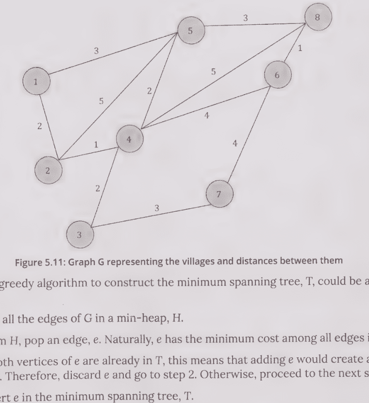

**图 5.11：** 表示村庄及其之间距离的图 G

构造最小生成树 T 的一个简单贪心算法可以如下：

1. 将 G 的所有边添加到最小堆 H 中。
2. 从 H 中弹出一条边 e。自然地，e 在 H 中的所有边中成本最低。
3. 如果 e 的两个顶点已经都在 T 中，这意味着添加 e 会在 T 中形成环。因此，丢弃 e 并转到步骤 2。否则，继续下一步。
4. 将 e 插入最小生成树 T 中。

让我们花点时间思考一下为什么这种策略有效。在步骤 2 和 3 的循环的每次迭代中，我们取成本最低的边并检查它是否会为我们的解添加任何顶点。这存储在最小生成树 T 中。如果会，我们就将边添加到 T；否则，我们丢弃该边并选择另一条最小值的边。我们的算法是贪心的，因为在每次迭代中，它都会选择最小的边权重添加到解中。前述算法于 1956 年发明，称为 Kruskal 最小生成树算法。将此算法应用于图 5.11 所示的图得到以下结果：

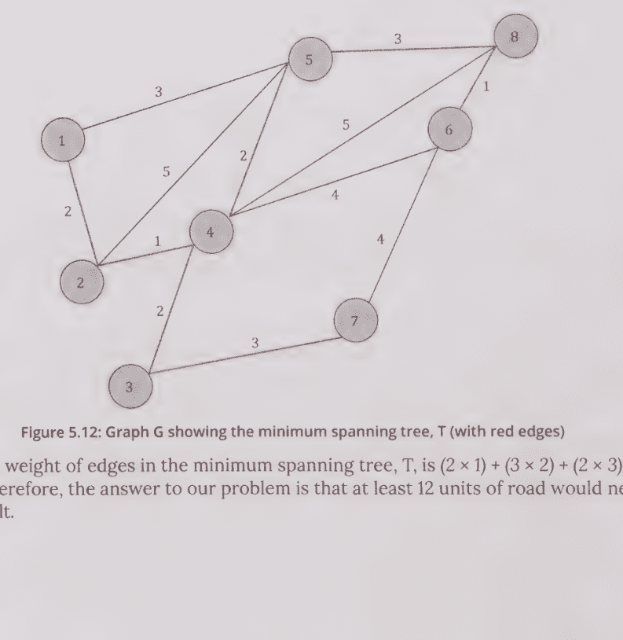

最小生成树 T 中边的总权重为 (2 × 1) + (3 × 2) + (2 × 3) = 14 单位。因此，我们问题的答案是，至少需要修建 14 单位的道路。

我们如何知道我们的算法确实是正确的？我们需要回到最优子结构和贪心选择的定义，并证明 MST 问题表现出这两个性质。虽然对这些性质进行严格的数学证明超出了本书的范围，但以下是证明背后的直观思想：

**最优子结构：** 我们将通过反证法证明。假设 MST 问题不表现出最优子结构；也就是说，最小生成树不是由一组较小的最小生成树组成的：

1. 假设我们有一个图 G 的顶点上的最小生成树 T。让我们从 T 中移除任意一条边 e。移除 e 将 T 分解为较小的树 T1 和 T2。
2. 由于我们假设 MST 问题不表现出最优子结构，必须存在一个在 T1 的顶点上总权重更小的生成树。取该生成树并添加边 e 和 T2。这棵新树将是 T′。
3. 现在，由于 T′ 的总权重小于 T，这与我们最初假设 T 是 MST 的假设相矛盾。因此，MST 问题必须表现出最优子结构性质。

**贪心选择：** 如果 MST 问题表现出贪心选择性质，那么对于顶点 v，将 v 连接到其余图 G 的最小权重边应始终是最小生成树 T 的一部分。我们可以通过反证法证明这一假设，如下所示：

1. 设边 (u, v) 是将 v 连接到 G 中任何其他顶点的最小权重边。假设 (u, v) 不是 T 的一部分。
2. 如果 (u, v) 不是 T 的一部分，则 T 必须包含另一条将 v 连接到其余 G 的边。设该边为 (x, v)。由于 (u, v) 是最小权重边，根据定义，(x, v) 的权重大于 (u, v) 的权重。
3. 如果用 (u, v) 替换 T 中的 (x, v)，则可以得到一棵总权重小于 T 的树。这与我们假设 T 是最小生成树的假设相矛盾。因此，MST 问题必须表现出贪心选择性质。

> **注意**
>
> 正如我们之前提到的，我们也可以采用严格的数学方法来证明 MST 问题表现出最优子结构性质并且适合贪心选择性质。你可以在这里找到它：https://ocw.mit.edu/courses/electrical-engineering-and-computer-science/6-046j-design-and-analysis-of-algorithms-spring-2015/lecture-notes/MIT6_046JS15_lec12.pdf。

- **Find：** 从给定元素 x 开始，find 操作沿着元素的父指针跟随，直到到达树的根。根元素的父元素是其自身。在前一组的示例中，每个元素都是树的根，因此此操作将返回树中唯一的该元素。
- **Union：** 给定两个元素 x 和 y，union 操作找到 x 和 y 的根。如果两个根相同，这意味着 x 和 y 属于同一棵树。因此，它什么也不做。否则，它将具有较高秩的根设为具有较低秩的根的父节点。以下图显示了在 DS 上实现 Union(1, 2) 和 Union(4, 5) 操作的结果：

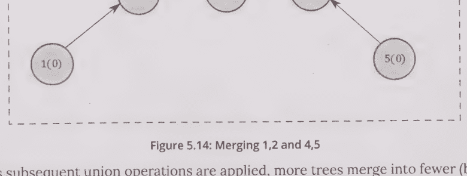

**图 5.14：** 合并 1、2 和 4、5

随着后续 union 操作的执行，更多的树合并成更少但更大的树。以下图显示了在应用 Union(2, 3) 之后 DS 中的树：

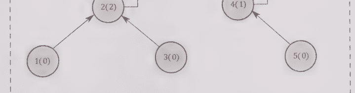

**图 5.15：** 合并 2、3

以下图表显示了在应用 **Union(2, 4)** 之后 DS 中的树：

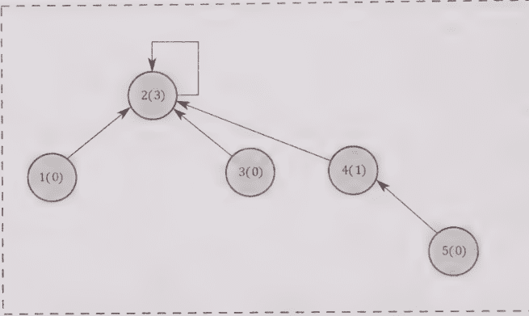

**图 5.16：** 合并 2、4

现在，让我们理解不相交集数据结构如何帮助我们实现 Kruskal 算法。在算法开始时，在步骤 1 之前，我们使用 N 等于图 G 中顶点的数量初始化一个不相交集数据结构。然后，步骤 2 从最小堆中取出一条边，步骤 3 检查所考虑的边是否形成环。请注意，此环检查可以使用应用于该边的两个顶点的 DS 上的 union 操作来实现。如果 union 操作成功合并了两棵树，则该边将被添加到 MST；否则，该边可以安全丢弃，因为它会在 MST 中引入环。以下说明步骤解释了这一逻辑：

1. 首先，我们通过初始化一个包含图中所有给定顶点的不相交集数据结构 DS 开始：

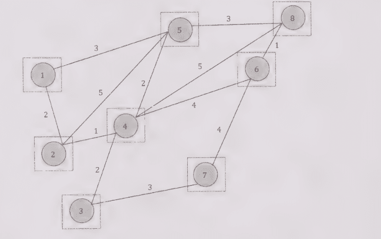

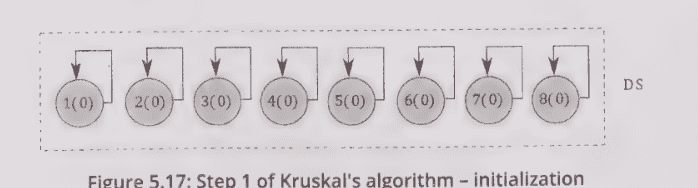

**图 5.17：** Kruskal 算法的步骤 1 - 初始化

2. 让我们继续将权重最低的边添加到我们的 MST。正如以下图所示，当我们添加边 (2, 4) 时，我们也在 DS 中的元素上应用 Union(2, 4)：

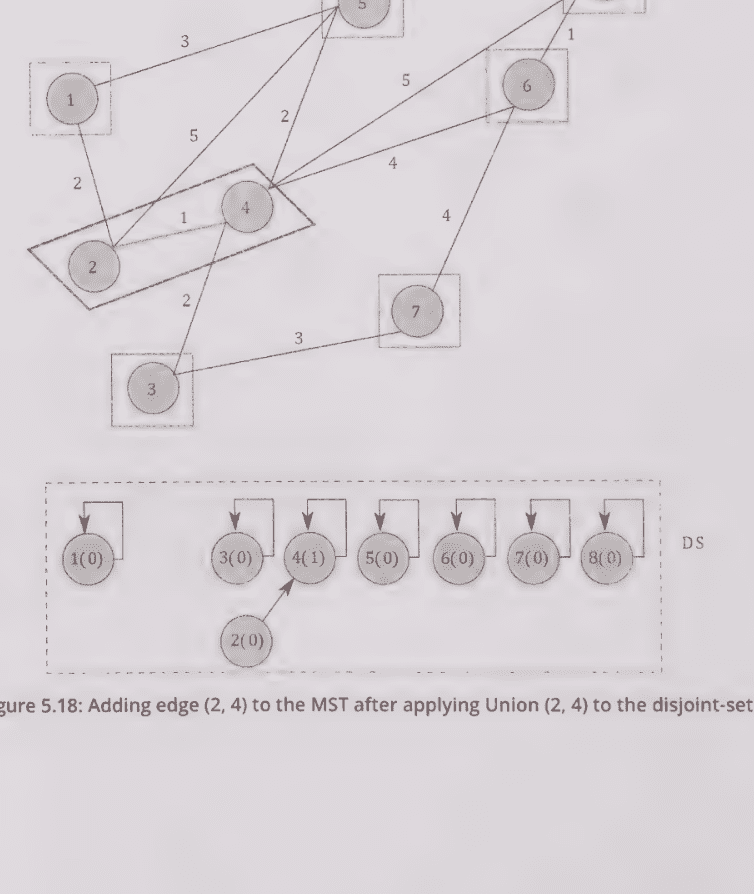

**图 5.18：** 在对不相交集应用 Union (2, 4) 后将边 (2, 4) 添加到 MST

3. 随着我们按照算法继续添加边，我们到达边 (1, 5)。正如你所看到的，在 DS 中，对应的元素在同一棵树中。因此，我们不能添加该边。正如以下图所示，添加它会形成一个环：

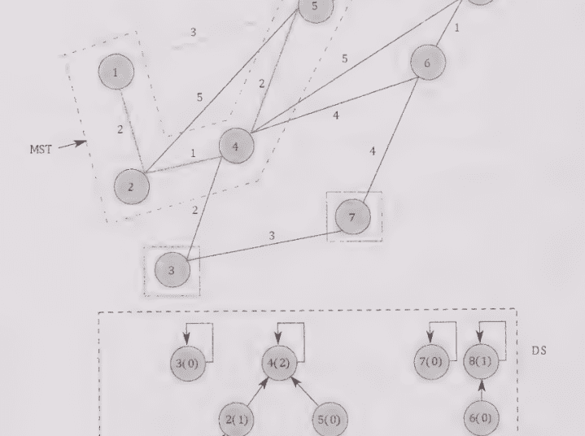

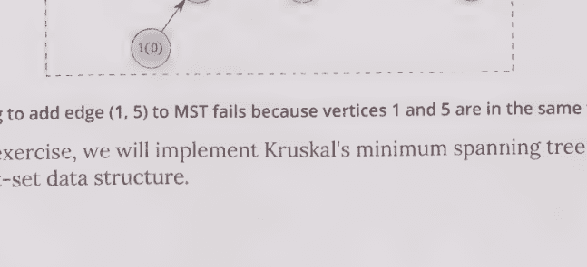

**图 5.19：** 尝试将边 (1, 5) 添加到 MST 失败，因为顶点 1 和 5 在 DS 中属于同一棵树

在以下练习中，我们将使用不相交集数据结构实现 Kruskal 最小生成树算法。

## 练习 26：Kruskal 的 MST 算法

在本练习中，我们将实现不相交集数据结构和 Kruskal 算法以在图中查找 MST。让我们开始：

1. 首先添加以下头文件并声明 Graph 数据结构：

```
#include<iostream>
#include<vector>
#include<algorithm>
#include<queue>
#include<map>
template <typename T> class Graph;
```

2. 首先，我们将实现不相交集：

```
template<typename T>
class SimpleDisjointSet
{
private:
    struct Node
    {
        T data;

        Node(T _data) : data(_data)
        {}

        bool operator!=(const Node& n) const
        {
            return this->data != n.data;
        }
    };

    // Store the forest
    std::vector<Node> nodes;
    std::vector<size_t> parent;
    std::vector<size_t> rank;
```


4. 接下来，我们将在不相交集中的两棵树之间实现 Union 操作，如下所示：

```cpp
// Union the sets X and Y belong to
void union_sets(T x, T y)
{
    auto root_x = find(x);
    auto root_y = find(y);

    // If both X and Y are in the same set, do nothing and return
    if (root_x == root_y)
    {
        return;
    }
    // If X and Y are in different sets, merge the set with lower rank
    // into the set with higher rank
    else if (rank[root_x] > rank[root_y])
    {
        parent[root_y] = parent[root_x];
        rank[root_x]++;
    }
    else
    {
        parent[root_x] = parent[root_y];
        rank[root_y]++;
    }
};
```

5. 现在我们的不相交集实现已经完成，让我们开始实现图。我们将使用边列表表示。Edge 结构体定义如下：

```cpp
template<typename T>
struct Edge
{
    size_t src;
    size_t dest;
    T weight;

    // To compare edges, only compare their weights,
    // and not the source/destination vertices
    inline bool operator< (const Edge<T>& e) const
    {
        return this->weight < e.weight;
    }

    inline bool operator> (const Edge<T>& e) const
    {
        return this->weight > e.weight;
    }
};
```

```cpp
template<typename T>
class Graph
{
public:
    // Initialize the graph with N vertices
    Graph(size_t N) : V(N)
    {}

    // Return number of vertices in the graph
    auto vertices() const
    {
        return V;
    }

    // Return all edges in the graph
    auto& edges() const
    {
        return edge_list;
    }

    void add_edge(Edge<T>&& e)
    {
        // Check if the source and destination vertices are within range
        if (e.src >= 1 && e.src <= V && e.dest >= 1 && e.dest <= V)
            edge_list.emplace_back(e);
        else
            std::cerr << "Vertex out of bounds" << std::endl;
    }

    // Returns all outgoing edges from vertex v
    auto edges(size_t v) const
    {
        std::vector<Edge<T>> edges_from_v;
        for (auto& e : edge_list)
        {
            if (e.src == v)
                edges_from_v.emplace_back(e);
        }
        return edges_from_v;
    }

    // Overloads the << operator so a graph can be written directly to a stream
    // Can be used as std::cout << obj << std::endl;

    template <typename T>
    friend std::ostream& operator<<(std::ostream& os, const Graph<T>& G);

private:
    size_t V;        // Stores number of vertices in graph
    std::vector<Edge<T>> edge_list;
};
```

## Note

我们的图实现在创建后不允许更改图中的顶点数。此外，虽然我们可以添加任意数量的边，但由于本练习中不需要，因此未实现边的删除。

8. 现在，我们可以像这样实现 Kruskal 算法：

```cpp
// Since a tree is also a graph, we can reuse the Graph class
// However, the result graph should have no cycles

template<typename T>
Graph<T> minimum_spanning_tree(const Graph<T>& G)
{
    // Create a min-heap for the edges
    std::priority_queue<Edge<T>,
        std::vector<Edge<T>>,
        std::greater<Edge<T>>> edge_min_heap;

    // Add all edges in the min-heap
    for (auto& e : G.edges())
        edge_min_heap.push(e);

    // First step: add all elements to their own sets
    auto N = G.vertices();
    SimpleDisjointSet<size_t> dset(N);
    for (auto i = 0; i < N; i++)
        dset.add_set(i);

    // Second step: start merging sets
    Graph<T> MST(N);
```

```cpp
G.add_edge(Edge<T>{ i.first, j.first, j.second });

std::cout << "Original Graph" << std::endl;
std::cout << G;

auto MST = minimum_spanning_tree(G);
std::cout << std::endl << "Minimum Spanning Tree" << std::endl;
std::cout << MST;

return 0;
}
```

10. 最后，运行程序！输出应如下所示：

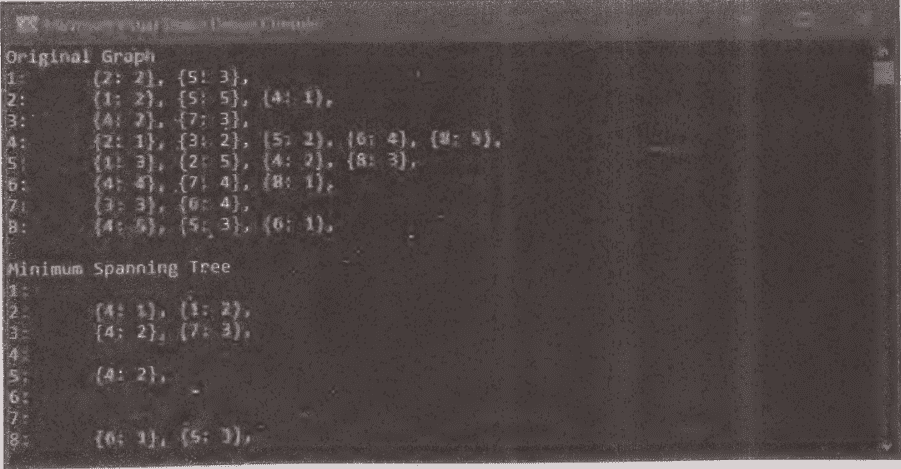

验证我们的算法的输出是否确实是图 5.12 中显示的 MST。

如果不使用不相交集，Kruskal 算法的复杂度为 O(E log E)，其中 E 是图中的边数。然而，使用不相交集时，总复杂度降低到 O(Eα(V))，其中 α(v) 是 Ackermann 函数的逆。因为逆 Ackermann 函数增长速度远慢于对数函数，所以对于顶点数较少的图，两种实现的性能差异很小，但对于更大的图实例，差异可能显著。

图 5.20：从给定图获取 MST

## 顶点着色问题

顶点着色问题可以表述如下：

> “给定一个图 G，为图的每个顶点分配一种颜色，使得没有两个相邻顶点具有相同的颜色。”

例如，下图显示了图 5.11 中所示图的合法着色：

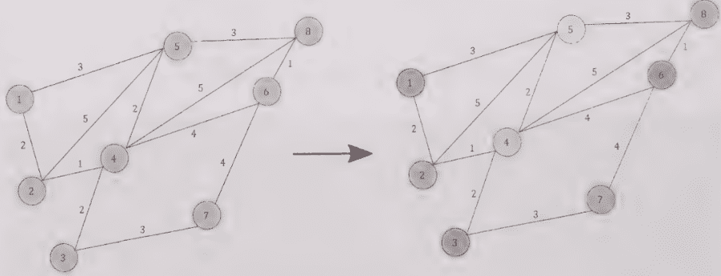

**图 5.21：对未着色的图进行着色**

图着色在解决现实世界中的大量问题时有应用——为出租车制定时间表、解决数独谜题以及为考试创建时间表都可以映射为寻找作为图的模型问题的有效着色。然而，找到产生有效顶点着色所需的最小颜色数（也称为色数）是已知的 NP 完全问题。因此，问题的性质的细微变化可能会对其复杂性产生巨大差异。

作为图着色问题应用的一个例子，让我们考虑数独求解器的情况。数独是一个数字放置谜题，其目标是用 1 到 9 的数字填充 9 × 9 方格，每个行、每列或 3 × 3 块中没有数字重复。数独谜题的示例如下所示：

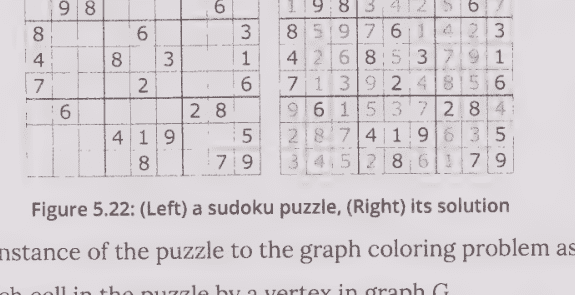

**图 5.22：（左）一个数独谜题，（右）其解**

我们可以将谜题的一个实例建模为图着色问题，如下所示：

- 用图 G 中的一个顶点表示谜题中的每个单元格。
- 在同一列、同一行或同一 3 × 3 块中的顶点之间添加边。
- 对 G 的有效着色就给出了原始数独谜题的解。

我们将在以下练习中查看图着色的实现。

### Exercise 27: Greedy Graph Coloring

在本练习中，我们将实现一个贪心算法，该算法为图 5.21 中的图产生图着色，当可使用的最大颜色数为六时。让我们开始：

1. 首先包含所需头文件并声明 Graph 数据结构，我们将在本练习后面实现它：

```cpp
#include <unordered_map>
#include <set>
#include <map>
#include <string>
#include <vector>
#include <iostream>

template <typename T> class Graph;
```

2. 下面的结构体实现了我们图中的一条边：

```cpp
template<typename T>
struct Edge
{
    size_t src;
    size_t dest;
    T weight;

    // To compare edges, only compare their weights,
    // and not the source/destination vertices
    inline bool operator< (const Edge<T>& e) const
    {
        return this->weight < e.weight;
    }

    inline bool operator> (const Edge<T>& e) const
    {
        return this->weight > e.weight;
    }
};
```

3. 下面的函数允许我们直接将图写入输出流：

```cpp
template <typename T>
std::ostream& operator<<(std::ostream& os, const Graph<T>& G)
{
    for (auto i = 1; i < G.vertices(); i++)
    {
        os << i << ":\t";

        auto edges = G.outgoing_edges(i);
        for (auto& e : edges)
            os << "{" << e.dest << ": " << e.weight << "}, ";

        os << std::endl;
    }

    return os;
}
```

4. 实现图作为边列表，如下所示：

```cpp
template<typename T>
class Graph
{
public:
    // Initialize the graph with N vertices
    Graph(size_t N) : V(N)
    {}

    // Return number of vertices in the graph
    auto vertices() const
    {
        return V;
    }

    // Return all edges in the graph
    auto edges() const
    {
        return edge_list;
    }

    void add_edge(Edge<T>&& e)
    {
        // Check if the source and destination vertices are within range
        if (e.src >= 1 && e.src <= V &&
            e.dest >= 1 && e.dest <= V)
            edge_list.emplace_back(e);
        else
            std::cerr << "Vertex out of bounds" << std::endl;
    }

    // Returns all outgoing edges from vertex v
    auto outgoing_edges(size_t v) const
    {
        std::vector<Edge<T>> edges_from_v;
        for (auto& e : edge_list)
        {
            if (e.src == v)
                edges_from_v.emplace_back(e);
        }
        return edges_from_v;
    }
```


```
// Overloads the << operator so a graph can be written directly to a stream
// Can be used as std::cout << obj << std::endl;
template <typename T>
friend std::ostream& operator<<(std::ostream& os, const Graph<T>& G);

private:
    size_t V;      // Stores number of vertices in graph
    std::vector<Edge<T>> edge_list;
};
```

- 5. 下面的哈希映射存储了我们的着色算法将要使用的颜色列表：

```cpp
// Initialize the colors that will be used to color the vertices
std::unordered_map<size_t, std::string> color_map = {
    {1, "Red"},
    {2, "Blue"},
    {3, "Green"},
    {4, "Yellow"},
    {5, "Black"},
    {6, "White"}
};
```

- 6. 接下来，让我们实现一个辅助函数来打印分配给每个顶点的颜色：

```cpp
void print_colors(std::vector<size_t>& colors)
{
    for (auto i=1; i<colors.size(); i++)
    {
        std::cout << i << ": " << color_map[colors[i]] << std::endl;
    }
}
```

- 7. 下面的函数实现了我们的着色算法：

```cpp
template<typename T>
auto greedy_coloring(const Graph<T>& G)
{
    auto size = G.vertices();
    std::vector<size_t> assigned_colors(size);

    // Let us start coloring with vertex number 1.
    // Note that this choice is arbitrary.
    for (auto i = 1; i < size; i++)
    {
        auto outgoing_edges = G.outgoing_edges(i);
        std::set<size_t> neighbour_colors;

        for (auto e : outgoing_edges)
        {
            auto dest_color = assigned_colors[e.dest];
            neighbour_colors.insert(dest_color);
        }

        // Find the smallest unassigned color
        // that is not currently used by any neighbor
        auto smallest_unassigned_color = 1;
        for (; smallest_unassigned_color <= color_map.size(); smallest_unassigned_color++)
        {
            if (neighbour_colors.find(smallest_unassigned_color) == neighbour_colors.end())
                break;
        }

        assigned_colors[i] = smallest_unassigned_color;
    }

    return assigned_colors;
}
```

- 8. 最后，添加驱动代码，如下所示：

```cpp
int main()
{
    using T = size_t;

    Graph<T> G(9);

    std::map<unsigned, std::vector<std::pair<size_t, T>>> edges;
    edges[1] = { {2, 2}, {5, 3} };
    edges[2] = { {1, 2}, {5, 5}, {4, 1} };
    edges[3] = { {4, 2}, {7, 3} };
    edges[4] = { {2, 1}, {3, 2}, {5, 2}, {6, 4}, {8, 5} };
    edges[5] = { {1, 3}, {2, 5}, {4, 2}, {8, 3} };
    edges[6] = { {4, 4}, {7, 4}, {8, 1} };
    edges[7] = { {3, 3}, {6, 4} };
    edges[8] = { {4, 5}, {5, 3}, {6, 1} };

    for (auto& i : edges)
        for (auto& j : i.second)
            G.add_edge(Edge<T>{ i.first, j.first, j.second });

    std::cout << "Original Graph: " << std::endl;
    std::cout << G << std::endl;

    auto colors = greedy_coloring<T>(G);
    std::cout << "Vertex Colors: " << std::endl;
    print_colors(colors);

    return 0;
}
```

- 9. 运行实现！你的输出应如下所示：

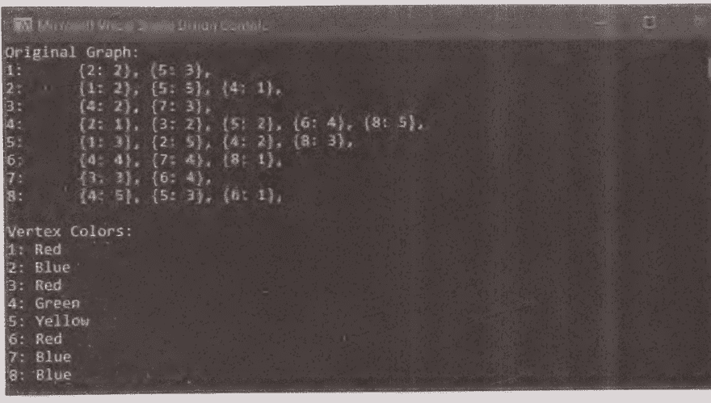

图 5.23：图着色实现的输出

我们的实现总是从顶点 ID 1 开始着色顶点。然而，这个选择是任意的，即使在同一张图上，使用不同的顶点开始贪心着色算法也非常可能导致需要不同数量的颜色的不同图着色。

图着色的质量通常通过其为图着色所使用的颜色数量的多少来衡量。虽然寻找使用最少可能颜色数的最优图着色是 NP-完全的，但贪心图着色通常作为一种有用的近似。例如，在设计编译器时，图着色用于将 CPU 寄存器分配给正在编译的程序的变量。贪心着色算法与一组启发式方法一起使用，以获得问题的“足够好”的解决方案，这在实践中是可取的，因为我们需要编译器足够快才有用。

## Activity 12: The Welsh-Powell Algorithm

对从固定顶点 ID 开始贪心着色的简单方法的改进是按顶点关联边的数量递减顺序着色顶点（或按顶点度递减顺序）。

算法如下：

- 1. 按度递减顺序对所有顶点进行排序并将它们存储在数组中。
- 2. 取排序数组中第一个未着色的顶点，并为其分配尚未分配给其任何邻居的第一个颜色。令此颜色为 C。
- 3. 遍历排序数组，并将颜色 C 分配给每个未着色的顶点，只要该顶点没有邻居已被分配了 C。
- 4. 如果数组中仍有未着色的顶点，则转到步骤 2。否则，结束程序。到目前为止分配给顶点的颜色是最终输出。

下面是算法的四个迭代的图解示例，用于找到图 5.21 所示图的合法着色：

- 1. 这是我们开始的图：

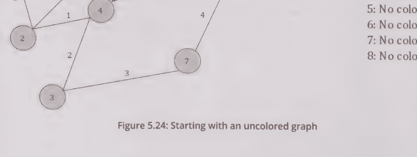

图 5.24：从一个未着色的图开始

- 2. 接下来，我们按顶点度递减顺序排序，并开始着色红色：

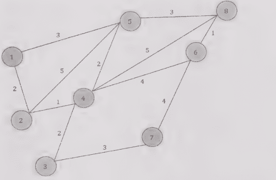

**按度递减顺序的顶点：**  
4, 5, 2, 6, 8, 1, 3, 7

**顶点颜色：**
- 1: 红色
- 2: 不能为红色，与 4 相连
- 3: 不能为红色，与 4 相连
- 4: 红色
- 5: 不能为红色，与 4 相连
- 6: 不能为红色，与 4 相连
- 7: 红色
- 8: 不能为红色，与 4 相连

图 5.25：着色红色

- 3. 在下一轮，我们开始着色蓝色：

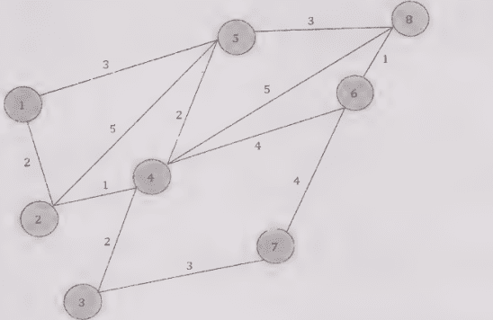

**按度递减顺序的顶点：**  
4, 5, 2, 6, 8, 1, 3, 7

**顶点颜色：**
- 1: 红色
- 2: 不能为蓝色，与 5 相连
- 3: 蓝色
- 4: 红色
- 5: 蓝色
- 6: 蓝色
- 7: 红色
- 8: 不能为蓝色，与 5、6 相连

图 5.26：着色蓝色

你的输出应如下所示：

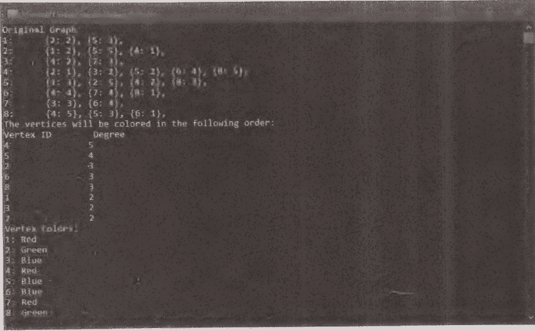

图 5.28：Activity 12 的预期输出

> **Note**
>
> 本活动的解决方案可在第 518 页找到。

## Summary

贪心方法很简单：在算法的每次迭代中，选择所有可能替代方案中看似最好的替代方案。换句话说，贪心问题解决方案适用于在每次迭代中选择局部“最好”的替代方案会导致问题的全局最优解的情况。

在本章中，我们研究了贪心方法最优并能导致给定问题正确解的问题示例；即最短作业优先调度。我们还讨论了 NP-完全问题的略微修改版本，如 0-1 背包和图着色问题，可以具有简单的贪心解。这使得贪心方法成为解决困难问题的重要算法设计工具。对于具有贪心解的问题，它很可能是最简单的方法；即使对于没有贪心解的问题，它也经常可用于解决问题的松弛版本，这在实践中可能“足够好”（例如，贪心图着色用于在编程语言编译器中分配寄存器给变量）。

接下来，我们讨论了贪心选择和最优子结构属性，并研究了一个证明给定问题表现出这些属性的示例。我们以最小生成树问题的两个解作为本章的结尾：Kruskal 算法和 Welsh-Powell 算法。我们对 Kruskal 算法的讨论也介绍了不相交集数据结构。

在下一章中，我们将专注于图算法，从广度优先和深度优先搜索开始，然后转向 Dijkstra 最短路径算法。我们还将研究最小生成树问题的另一种解：Prim 算法。


