## 6 图算法 I

### 学习目标

学完本章后，你将能够：

- 描述图在解决各种现实问题中的用途
- 选择并实现合适的遍历方法，以在图中查找元素
- 使用 Prim 算法解决最小生成树（MST）问题
- 判断在解决 MST 问题时应当使用 Prim 算法还是 Kruskal 算法
- 使用 Dijkstra 算法找到图中两个顶点/节点之间的最短路径

在本章中，我们将学习用于解决可表示为图的问题的基础且最常用的算法；这些算法将在下一章进一步讨论。

### 引言

在前两章中，我们讨论了两种算法设计范式：分治（divide and conquer）和贪心（greedy approach），并由此得到了排序、搜索、寻找图的最小权重生成树等广泛使用且重要的计算问题的著名解决方案。在本章中，我们将讨论一些专门适用于图数据结构的算法。

图被定义为一组顶点和连接成对顶点的边。数学上常写作 G = < V, E >，其中 V 表示顶点集合，E 表示构成图的边集合。从一个节点指向另一个节点的边称为有向边，没有方向的边称为无向边。边也可以带权重或不带权重，正如我们在第 2 章《树、堆和图》中看到的。

**注意**

在讨论图时，“节点”和“顶点”这两个术语可以互换使用。在本章中，我们将统一使用“顶点”。

图是最通用的数据结构之一，以至于树和链表等其他链式数据结构都只是图的特例。图的实用性在于，它们是对象（表示为节点）之间关系（表示为边）的一般表示。图中同一对节点之间可以有多条边，甚至一条边上可以有多个权重，节点也可以有从自身到自身的边（也称为自边）。下图展示了这些特征在一个图中的存在方式。图的变体，称为“超图”（hypergraphs），允许连接多个节点的边；另一类变体称为“混合图”（mixed graphs），允许在同一图中同时存在有向边和无向边：

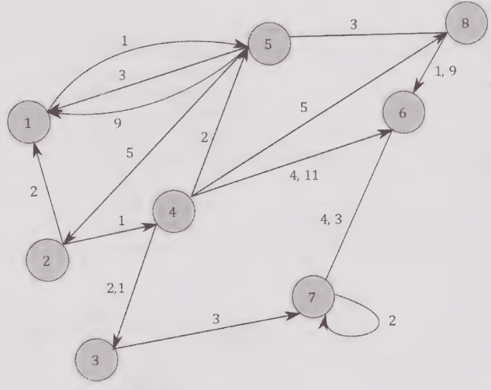

**图 6.1：** 一个具有多个边权重、自边（也称为环）以及有向和无向边的图

由于图具有高度的通用性，它们在多个领域都有应用。理论计算机科学家使用图来建模有限状态机和自动机；人工智能和机器学习专家使用图从不同类型网络的结构随时间变化中提取信息；交通工程师使用图来研究道路网络中的交通流。

在本章中，我们将只研究使用加权有向图的算法，必要时使用正边权。我们首先研究**图遍历问题**，并介绍它的两种解决方案：**广度优先搜索（BFS）**和**深度优先搜索（DFS）**。接下来，我们将回到上一章介绍的最小生成树问题，并给出另一种解决方案——Prim 算法。最后，我们将介绍单源最短路径问题，它为 Google Maps 和 OSRM 路线规划器等导航应用提供了支撑。

让我们从图遍历的基本问题开始。

### 图遍历问题

假设你最近搬到了一个新社区的一间公寓。当你认识新邻居、结交新朋友时，人们经常推荐附近可以去吃饭的餐馆。你想去所有被推荐的餐馆，于是你拿出一张社区地图，在上面标出所有餐馆和你的家，而地图上已经标好了所有的道路。如果我们将每家餐馆和你的家表示为顶点，将连接餐馆的道路表示为图中的边，那么从给定顶点出发访问图中所有顶点的问题就称为图遍历问题。

在下图中，蓝色的数字假定为顶点 ID。顶点 1 是家，餐馆标记为 R1 到 R7。所有边都没有箭头，因为边被假定为双向的，也就是说，你可以沿任一方向在路上行驶：

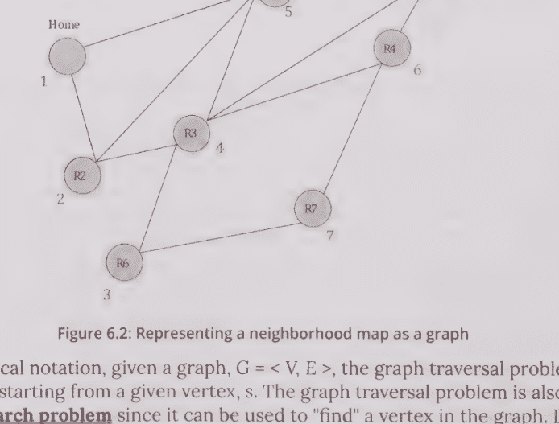

图 6.2：将社区地图表示为图

用数学记号表示，给定一个图 G = < V, E >，图遍历问题就是要从给定顶点 s 出发访问所有 v ∈ V。图遍历问题也被称为图搜索问题，因为它可以用来“查找”图中的顶点。不同的图遍历算法会给出访问图中顶点的不同顺序。

2. 下图显示了在访问 R1 和 R2 之后的 BFS 状态，这两个顶点谁先被访问都可以。与源顶点距离相同的顶点的访问顺序无关紧要；但是，距离源顶点较近的顶点总是先被访问：

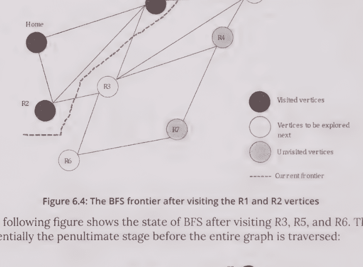

图 6.4：访问 R1 和 R2 顶点后的 BFS 前沿

3. 下图显示了访问 R3、R5 和 R6 之后的 BFS 状态。这基本上是在整张图被遍历之前的倒数第二个阶段：


图 6.5：访问 R3、R5 和 R6 顶点后的 BFS 前沿

BFS 的一个有用特性是，对于每一个被访问的顶点，它的所有子顶点都会在任何孙顶点之前被访问。然而，在实现 BFS 时，前沿通常不会显式地维护在单独的数据结构中。相反，我们使用一个顶点 ID 队列来确保离源顶点较近的顶点总是在较远的顶点之前被访问。在下面的练习中，我们将用 C++ 实现 BFS。

### 练习 28：实现 BFS

在本练习中，我们将使用图的边列表表示来实现广度优先搜索算法。为此，请执行以下步骤：

1. 添加所需的头文件并声明图，如下所示：

```
#include <string>
#include <vector>
#include <iostream>
#include <set>
#include <map>
#include <queue>

template<typename T> class Graph;
```

2. 编写以下结构体，它表示我们的图中的一条边：

```
template<typename T>
struct Edge
{
    size_t src;
    size_t dest;
    T weight;

    // To compare edges, only compare their weights,
    // and not the source/destination vertices
    inline bool operator< (const Edge<T>& e) const
    {
        return this->weight < e.weight;
    }

    inline bool operator> (const Edge<T>& e) const
    {
        return this->weight > e.weight;
    }
};
```

由于我们的边定义使用了模板，因此可以很容易地将边的权重设置为所需的任何数据类型。

3. 接下来，为 **Graph** 数据类型重载 `<<` 运算符，以显示图的内容：

```
template <typename T>
std::ostream& operator<<(std::ostream& os, const Graph<T>& G)
{
    for (auto i = 1; i < G.vertices(); i++)
    {
        os << i << ":\t";

        auto edges = G.outgoing_edges(i);
        for (auto& e : edges)
            os << "{" << e.dest << ": " << e.weight << "}, ";

        os << std::endl;
    }

    return os;
}
```

4. 编写一个类来定义我们的图数据结构，如下所示：

```
template<typename T>
class Graph
{
public:
    // Initialize the graph with N vertices
    Graph(size_t N) : V(N)
    {}

    // Return number of vertices in the graph
    auto vertices() const
    {
        return V;
    }

    // Return all edges in the graph
    auto& edges() const

```
{
    return edge_list;
}

void add_edge(Edge<T>&& e)
{
    // Check if the source and destination vertices are within range
    if (e.src >= 1 && e.src <= V &&
        e.dest >= 1 && e.dest <= V)
        edge_list.emplace_back(e);
    else
        std::cerr << "Vertex out of bounds" << std::endl;
}

// Returns all outgoing edges from vertex v
auto outgoing_edges(size_t v) const
{
    std::vector<Edge<T>> edges_from_v;
    for (auto& e : edge_list)
    {
        if (e.src == v)
            edges_from_v.emplace_back(e);
    }
    return edges_from_v;
}

// Overloads the << operator so a graph be written directly to a stream
// Can be used as std::cout << obj << std::endl;
template <typename T>
friend std::ostream& operator<<(std::ostream& os, const Graph<T>& G);

private:
    size_t V;        // Stores number of vertices in graph
    std::vector<Edge<T>> edge_list;
};
```

5. 在本练习中，我们将在以下图上测试我们的 BFS 实现：

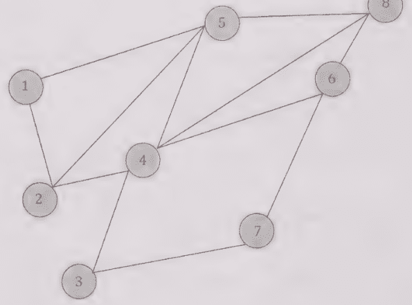

**图 6.6：**练习 28 中用于实现 BFS 遍历的图

我们需要一个函数来创建并返回所要求的图。请注意，虽然图中每条边都分配了边权重，但这并不是必需的，因为 BFS 算法不需要使用边权重。实现该函数，如下所示：

```
```cpp
template <typename T>
auto create_reference_graph()
{
    Graph<T> G(9);

    std::map<unsigned, std::vector<std::pair<size_t, T>>> edges;
    edges[1] = { {2, 2}, {5, 3} };
    edges[2] = { {1, 2}, {5, 5}, {4, 1} };
    edges[3] = { {4, 2}, {7, 3} };
    edges[4] = { {2, 1}, {3, 2}, {5, 2}, {6, 4}, {8, 5} };
    edges[5] = { {1, 3}, {2, 5}, {4, 2}, {8, 3} };
    edges[6] = { {4, 4}, {7, 4}, {8, 1} };
    edges[7] = { {3, 3}, {6, 4} };
```
```

```
edges[8] = { {4, 5}, {5, 3}, {6, 1} };

for (auto& i : edges)
    for (auto& j : i.second)
        G.add_edge(Edge<T>{ i.first, j.first, j.second });

return G;
}
```

6. 按如下方式实现广度优先搜索：

```
template <typename T>
auto breadth_first_search(const Graph<T>& G, size_t dest)
{
    std::queue<size_t> queue;
    std::vector<size_t> visit_order;
    std::set<size_t> visited;
    queue.push(1); // Assume that BFS always starts from vertex ID 1

    while (!queue.empty())
    {
        auto current_vertex = queue.front();
        queue.pop();

        // If the current vertex hasn't been visited in the past
        if (visited.find(current_vertex) == visited.end())
        {
            visited.insert(current_vertex);
            visit_order.push_back(current_vertex);

            for (auto e : G.outgoing_edges(current_vertex))
                queue.push(e.dest);
        }
    }

    return visit_order;
}
```

7. 添加以下测试和驱动程序代码，这些代码创建参考图、从顶点 1 开始运行 BFS，并输出结果：

```
template <typename T>
void test_BFS()
{
    // Create an instance of and print the graph
    auto G = create_reference_graph<unsigned>();
    std::cout << G << std::endl;

    // Run BFS starting from vertex ID 1 and print the order
    // in which vertices are visited.
    std::cout << "BFS Order of vertices: " << std::endl;
    auto bfs_visit_order = breadth_first_search(G, 1);
    for (auto v : bfs_visit_order)
        std::cout << v << std::endl;
}

int main()
{
    using T = unsigned;
    test_BFS<T>();

    return 0;
}
```

8. 运行上述代码。你的输出应如下所示：

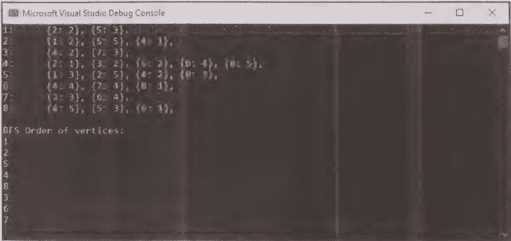

图 6.7：练习 28 的预期输出

下图显示了我们的 BFS 实现访问顶点的顺序。请注意，搜索从顶点 1 开始，然后逐步访问距离源点更远的顶点。在下图中，红色整数表示访问顺序，箭头表示我们的 BFS 实现访问图中顶点的方向：

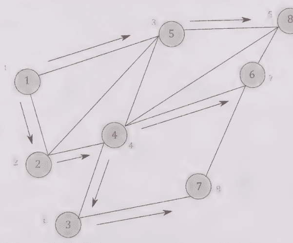

**图 6.8：练习 28 中的 BFS 实现**

BFS 的时间复杂度为 O(V + E)，其中 V 是图中顶点的数量，E 是图中边的数量。

## 深度优先搜索

BFS 从源顶点出发，逐步将搜索向外扩展至更远的顶点；而 DFS 则从源顶点出发，沿着某条路径迭代地访问尽可能远的顶点，然后回溯到较早的顶点，以探索图中另一条路径上的顶点。这种图搜索方法也称为回溯。下面通过图示步骤展示 DFS 的工作过程：

+   1. 很自然，我们从访问 Home 顶点开始遍历，如下图所示：

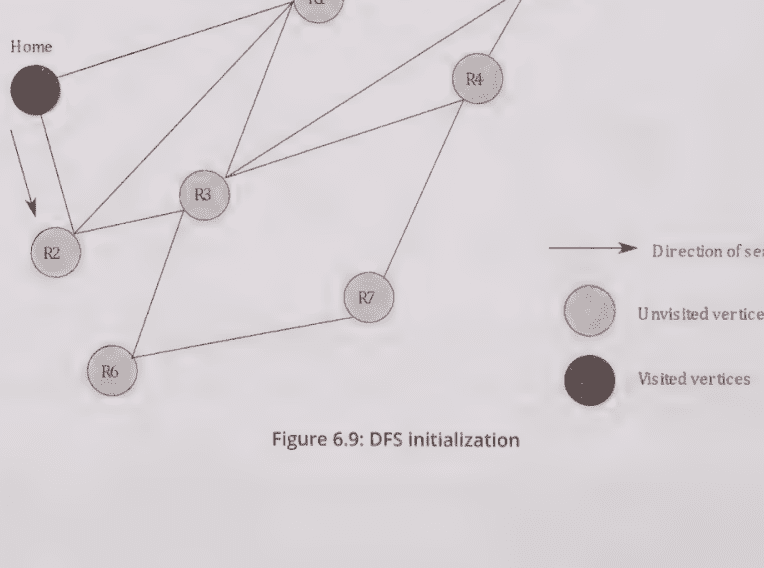

图 6.9：DFS 初始化

+   4. 搜索在每次迭代中继续访问一个任意的未访问邻居顶点。访问 R1 之后，搜索尝试寻找下一个未访问的顶点。由于没有剩余的未访问顶点，搜索终止：

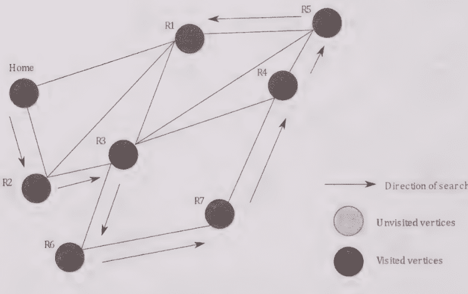

**图 6.12：访问图中所有顶点之后的 DFS**

在实现 BFS 时，我们使用队列来跟踪未访问的顶点。由于队列是一种**先进先出（FIFO）**数据结构，顶点按加入队列的顺序从队列中移除，因此 BFS 算法使用它来确保距离起始顶点较近的顶点先于更远的顶点被访问。实现 DFS 与实现 BFS 非常相似，只有一个区别：不是使用队列作为待访问顶点列表的容器，而是可以使用栈，算法的其余部分保持不变。这种方法之所以有效，是因为在每次迭代中，DFS 都会访问当前顶点的某个未访问邻居，这可以很容易地通过栈（一种**后进先出（LIFO）**数据结构）来跟踪。

## 练习 29：实现 DFS

在本练习中，我们将用 C++ 实现 DFS 算法，并在*图 6.2*所示的图上进行测试。步骤如下：

+   1. 包含所需的头文件，如下所示：

```
```cpp
#include <string>
#include <vector>
#include <iostream>
#include <set>
#include <map>
#include <stack>

template<typename T> class Graph;
```
```

+   2. 编写以下结构体，以实现我们的图中的边：

```
```cpp
template<typename T>
struct Edge
{
    size_t src;
    size_t dest;
    T weight;

    // To compare edges, only compare their weights,
    // and not the source/destination vertices
    inline bool operator< (const Edge<T>& e) const
    {
        return this->weight < e.weight;
    }

    inline bool operator> (const Edge<T>& e) const
    {
        return this->weight > e.weight;
    }
};
```
```

同样，由于我们的实现使用了该结构体的模板化版本，因此可以让我们为边分配所需任意数据类型的权重。不过，就 DFS 而言，我们将使用空值作为边权重的占位符。

```
void add_edge(Edge<T>&& e)
{
    // Check if the source and destination vertices are within range
    if (e.src >= 1 && e.src <= V &&
        e.dest >= 1 && e.dest <= V)
        edge_list.emplace_back(e);
    else
        std::cerr << "Vertex out of bounds" << std::endl;
}

// Returns all outgoing edges from vertex v
auto outgoing_edges(size_t v) const
{
    std::vector<Edge<T>> edges_from_v;
    for (auto& e : edge_list)
    {
        if (e.src == v)
            edges_from_v.emplace_back(e);
    }
    return edges_from_v;
}

// Overloads the << operator so a graph be written directly to a stream
// Can be used as std::cout << obj << std::endl;
template <typename T>
friend std::ostream& operator<<(std::ostream& os, const Graph<T>& G);

private:
    size_t V;        // Stores number of vertices in graph
    std::vector<Edge<T>> edge_list;
};
```


5.  现在，我们需要一个函数来对图执行深度优先搜索。按如下方式实现：

    ```
    template <typename T>
    auto depth_first_search(const Graph<T>& G, size_t dest)
    {
        std::stack<size_t> stack;
        std::vector<size_t> visit_order;
        std::set<size_t> visited;
        stack.push(1); // Assume that DFS always starts from vertex ID 1

        while (!stack.empty())
        {
            auto current_vertex = stack.top();
            stack.pop();

            // If the current vertex hasn't been visited in the past
            if (visited.find(current_vertex) == visited.end())
            {
                visited.insert(current_vertex);
                visit_order.push_back(current_vertex);

                for (auto e : G.outgoing_edges(current_vertex))
                {
                    // If the vertex hasn't been visited, insert it in the stack.
                    if (visited.find(e.dest) == visited.end())
                    {
                        stack.push(e.dest);
                    }
                }
            }
        }

        return visit_order;
    }
    ```

6.  我们将在下图所示的图上测试DFS的实现：

    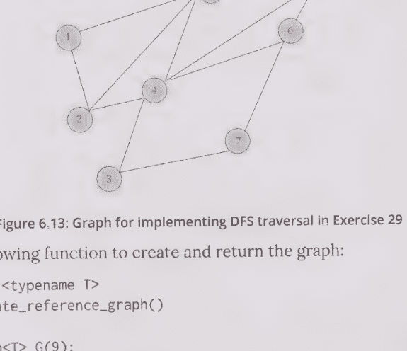

    图6.13：用于在练习29中实现DFS遍历的图

    使用以下函数来创建并返回该图：

    ```
    template <typename T>
    auto create_reference_graph()
    {
        Graph<T> G(9);

        std::map<unsigned, std::vector<std::pair<size_t, T>>> edges;
        edges[1] = { {2, 0}, {5, 0} };
        edges[2] = { {1, 0}, {5, 0}, {4, 0} };
        edges[3] = { {4, 0}, {7, 0} };
        edges[4] = { {2, 0}, {3, 0}, {5, 0}, {6, 0}, {8, 0} };
        edges[5] = { {1, 0}, {2, 0}, {4, 0}, {8, 0} };
        edges[6] = { {4, 0}, {7, 0}, {8, 0} };
        edges[7] = { {3, 0}, {6, 0} };
        edges[8] = { {4, 0}, {5, 0}, {6, 0} };

        for (auto& i : edges)
            for (auto& j : i.second)
                G.add_edge(Edge<T>{ i.first, j.first, j.second });

        return G;
    }
    ```

    注意这里对边权重使用了空值，因为DFS不需要边权重。一个更简单的图实现完全可以省略边权重，这不会影响我们的DFS算法的行为。

7.  最后，添加以下测试和驱动程序代码，它们将运行我们的DFS实现并打印输出：

    ```
    template <typename T>
    void test_DFS()
    {
        // Create an instance of and print the graph
        auto G = create_reference_graph<unsigned>();
        std::cout << G << std::endl;

        // Run DFS starting from vertex ID 1 and print the order
        // in which vertices are visited.
        std::cout << "DFS Order of vertices: " << std::endl;
        auto dfs_visit_order = depth_first_search(G, 1);
        for (auto v : dfs_visit_order)
            std::cout << v << std::endl;
    }

    int main()
    {
        using T = unsigned;
        test_DFS<T>();

        return 0;
    }
    ```

8.  编译并运行上述代码。你的输出应如下所示：

    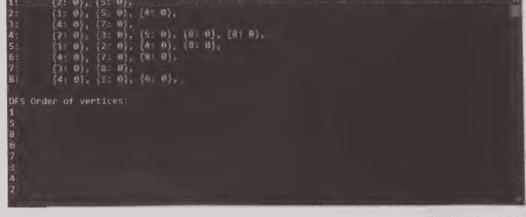

    图6.14：练习29的预期输出

下图展示了我们的DFS实现访问各顶点的顺序：

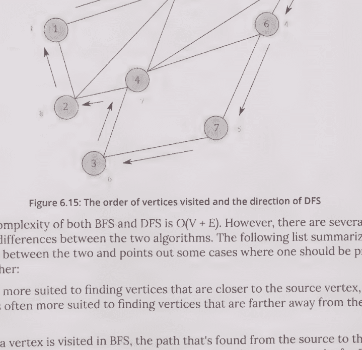

图6.15：顶点访问顺序及DFS的方向

BFS和DFS的时间复杂度均为O(V + E)。然而，这两种算法之间有几个重要的区别。以下列表总结了它们之间的区别，并提出了一些应优先选用其中一种算法的情况：

- BFS更适合查找离源顶点较近的顶点，而DFS通常更适合查找离源较远的顶点。

- 在BFS中，一旦访问了某个顶点，从源顶点到该顶点所找到的路径保证是最短路径，而DFS则没有这样的保证。这就是为什么所有单源和多源最短路径算法都使用某种BFS变体的原因。这将在本章接下来的章节中探讨。

- 由于BFS会访问当前边界上的所有相邻顶点，因此BFS生成的搜索树又矮又宽，需要相对更多的内存；而DFS生成的搜索树又长又窄，需要相对更少的内存。

## 活动13：使用DFS判断图是否为二分图

二分图是这样一种图：其顶点可以被划分为两个集合，使得图中的任意一条边都必须连接一个集合中的顶点与另一个集合中的顶点。

二分图可以用于建模多种不同的实际用例。例如，如果我们有一份学生名单和一份课程名单，学生与课程之间的关系可以被建模为二分图：如果某名学生注册了某门课程，就在该学生与该课程之间建立一条边。正如你所想，学生到学生或课程到课程的边是没有意义的，因此这类边在二分图中是不允许存在的。下图展示了这样一个模型：


图6.16：表示学生注册不同课程的二分图示例

一旦准备好了如上图所示的模型，就可以用它来创建课程时间表，使得同一名学生注册的任何两门课程不会重叠。例如，如果Jolene注册了数学和计算机科学，那么这两门课程就不应该被安排在同一时间，以避免冲突。在时间表中最小化此类冲突可以通过求解图中的最大流问题来实现。已知的最大流问题标准算法有Ford-Fulkerson算法、Dinic算法和推送-重标记算法等。然而，这些算法通常较为复杂，因此超出了本书的范围。

使用二分图建模实体间关系的另一个用例，是大型视频流媒体平台（如Netflix和YouTube）维护的观众与电影列表之间的关系。

二分图的一个有趣性质是：某些操作（如寻找最大匹配和顶点覆盖）在一般图中是NP完全的，但可以在多项式时间内于二分图中求解。因此，判断给定图是否为二分图是很有用的。在本活动中，你需要实现一个C++程序，用于检查给定图G是否为二分图。

二分图检查算法使用略微修改过的DFS版本，其工作方式如下：

1.  假设DFS从顶点1开始。将顶点ID 1添加到栈中。
2.  如果栈上还有未访问的顶点，则从栈中弹出一个顶点并将其设为当前顶点。
3.  如果分配给父顶点的颜色是蓝色，则将当前顶点分配为红色；否则，将当前顶点分配为蓝色。
4.  将当前顶点的所有未访问相邻顶点添加到栈中，并将当前顶点标记为已访问。
5.  重复步骤2、3和4，直到所有顶点都被分配了颜色。如果算法终止时所有顶点都已着色，则给定图是二分图。
6.  如果在执行步骤2时，搜索遇到一个已被访问且已分配颜色的顶点，而该颜色与步骤3中本应分配的颜色（搜索树中其父顶点所分配颜色的相反色）不同，则算法立即终止，并判定给定图不是二分图。

下图说明了上述算法的工作过程：

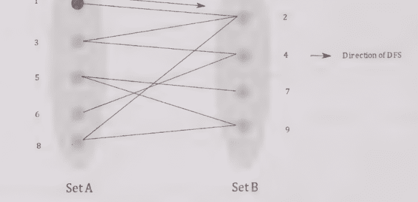

图6.17：初始化

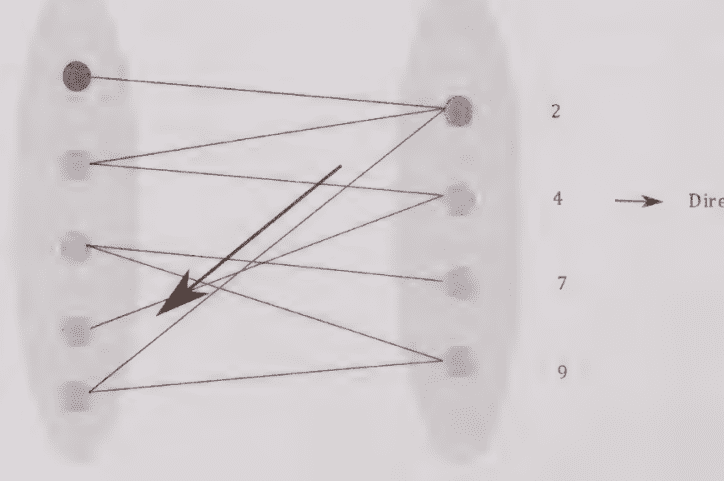

图6.18：由于顶点1被分配为蓝色，我们将顶点2涂为红色

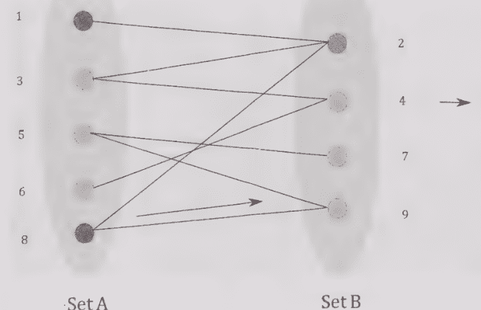

集合A　　　　　　　　　　　　　　集合B

图6.19：由于顶点2被涂为红色，我们将顶点8涂为蓝色。

从前面的这组图可以观察到，算法在图中曲折前进，为每个访问到的顶点交替分配颜色。如果所有顶点都能以这种方式着色，则该图是二分图。如果DFS到达两个已经以该方式着色的顶点，则可以安全地判定该图不是二分图。


使用图 6.17 作为输入，你的最终输出应如下所示：

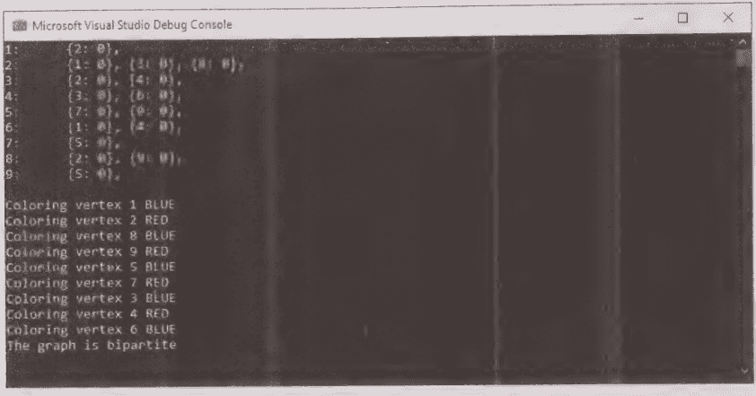

图 6.20：活动 13 的预期输出

## Note

本活动的解决方案可在第 524 页找到。

## Prim's MST Algorithm

MST 问题在第 5 章 贪心算法 中引入，定义如下：

> “给定一个图，G = < V, E >，其中 V 是顶点集合，E 是与边权重相关联的边集合，找到一棵树 T，使其跨越 V 中的所有顶点并且具有最小的总权重。”

在第 5 章 贪心算法 中，我们讨论了 MST 问题的实际应用以及 Kruskal 算法，该算法可在给定图中找到 MST。Kruskal 算法将图的全部边添加到最小堆中，并贪心地将最小成本边添加到 MST 中，在每次添加时检查树中是否形成环。

Prim 算法（也称为 Jarník 算法）的思想与 BFS 类似。该算法首先将起始顶点添加到 frontier 中，frontier 由之前访问过的顶点集合组成，然后迭代地探索当前 frontier 相邻的顶点。然而，在每次迭代中选择要访问的顶点时，会选择从 frontier 出发边成本最低的顶点。

在实现 Prim 算法时，我们为图的每个顶点附加一个标签，该标签存储其与起始顶点的距离。该算法的工作方式如下：

1. 首先，它初始化所有顶点的标签并将所有距离设置为无穷大。由于起始顶点到自身的距离为 0，因此它将起始顶点的标签设置为 0。然后，它将所有标签添加到最小堆 H 中。

在下图中，红色显示的数字代表从起始顶点（假设为顶点 1）估计的距离；黑色显示的数字代表边权重：

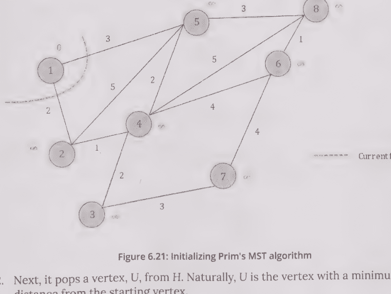

图 6.21：初始化 Prim 的 MST 算法

2. 接下来，它从 H 中弹出一个顶点 U。自然地，U 是从起始顶点距离最小的顶点。

3. 对于与 U 相邻的所有顶点 V，如果 V 的标签 > (U, V) 的边权重，则设置 V 的标签 = (U, V) 的边权重。此步骤称为 settling 或访问顶点 U：

图 6.22：访问顶点 1 后图的状况

4. 当图中仍有未访问的顶点时，返回步骤 2。下图显示了访问顶点 2 后图的状况，其中绿色显示的边是我们迄今为止 MST 中的唯一边：

图 6.23：访问顶点 2 后图的状况

5. 所有顶点都已 settle 后的最终 MST 显示如下：

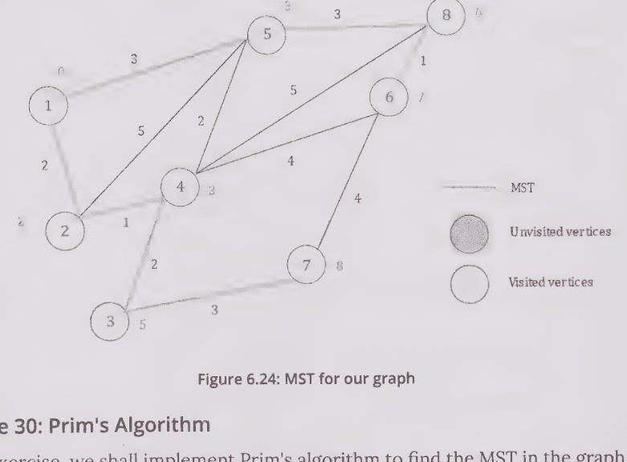

图 6.24：我们图的 MST

### Exercise 30: Prim's Algorithm

在本练习中，我们将实现 Prim 算法以在图 6.22 所示的图中查找 MST。按照以下步骤完成本练习：

1. 添加所需的头文件，如下所示：

```cpp
#include <set>
#include <map>
#include <queue>
#include <limits>
#include <string>
#include <vector>
#include <iostream>
```

2. 使用以下结构体通过使用以下结构体实现图中的边：

```cpp
template<typename T> class Graph;

template<typename T>
struct Edge
{
    size_t src;
    size_t dest;
    T weight;

    // To compare edges, only compare their weights,
    // and not the source/destination vertices
    inline bool operator< (const Edge<T>& e) const
    {
        return this->weight < e.weight;
    }

    inline bool operator> (const Edge<T>& e) const
    {
        return this->weight > e.weight;
    }
};
```

3. 使用以下函数重载 Graph 类的 << 运算符，以便我们可以将图输出到 C++ 流中：

```cpp
template <typename T>
std::ostream& operator<<(std::ostream& os, const Graph<T>& G)
{
    for (auto i = 1; i <= G.vertices(); i++)
    {
        os << i << ":\t";

        auto edges = G.outgoing_edges(i);
        for (auto& e : edges)
            os << "{" << e.dest << ": " << e.weight << "}, ";

        os << std::endl;
    }

    return os;
}
```

4. 添加基于边列表的图实现，如下所示：

```cpp
template<typename T>
class Graph
{
public:
    // Initialize the graph with N vertices
    Graph(size_t N) : V(N)
    {}

    // Return number of vertices in the graph
    auto vertices() const
    {
        return V;
    }

    // Return all edges in the graph
    auto& edges() const
    {
        return edge_list;
    }

    void add_edge(Edge<T>&& e)
    {
        // Check if the source and destination vertices are within range
        if (e.src >= 1 && e.src <= V &&
            e.dest >= 1 && e.dest <= V)
            edge_list.emplace_back(e);
        else
            std::cerr << "Vertex out of bounds" << std::endl;
    }

    // Returns all outgoing edges from vertex v
    auto outgoing_edges(size_t v) const
    {
        std::vector<Edge<T>> edges_from_v;
        for (auto& e : edge_list)
        {
            if (e.src == v)
                edges_from_v.emplace_back(e);
        }
        return edges_from_v;
    }

private:
    size_t V;
    std::vector<Edge<T>> edge_list;
};
```

6. 接下来，我们将实现 **Label** 结构，其实例分配给图中的每个顶点以存储其与 frontier 的距离。使用以下代码执行此操作：

```cpp
template<typename T>
struct Label
{
    size_t vertex_ID;
    T distance_from_frontier;

    Label(size_t _id, T _distance) :
        vertex_ID(_id),
        distance_from_frontier(_distance)
    {}

    // To compare labels, only compare their distances from source
    inline bool operator< (const Label<T>& l) const
    {
        return this->distance_from_frontier < l.distance_from_frontier;
    }

    inline bool operator> (const Label<T>& l) const
    {
        return this->distance_from_frontier > l.distance_from_frontier;
    }

    inline bool operator() (const Label<T>& l) const
    {
        return *this > l;
    }
};
```

7. 编写一个函数来实现 Prim 的 MST 算法，如下所示：

```cpp
template <typename T>
auto prim_MST(const Graph<T>& G, size_t src)
{
    std::priority_queue<Label<T>, std::vector<Label<T>>,
                        std::greater<Label<T>>> heap;
    std::set<int> visited;

    std::vector<T> distance(G.vertices(), std::numeric_limits<T>::max());
    std::vector<size_t> MST;

    heap.emplace(src, 0);

    // Search for the destination vertex in the graph
    while (!heap.empty())
    {
        auto current_vertex = heap.top();
        heap.pop();

        // If the current vertex hasn't been visited in the past
        if (visited.find(current_vertex.vertex_ID) == visited.end())
        {
            std::cout << "Settling vertex ID " << current_vertex.vertex_ID << std::endl;
            MST.push_back(current_vertex.vertex_ID);

            // For each outgoing edge from the current vertex,
            // create a label for the destination vertex and add it to the heap
            for (auto e : G.outgoing_edges(current_vertex.vertex_ID))
            {
                auto neighbor_vertex_ID = e.dest;
                auto new_distance_to_frontier = e.weight;

                // Check if the new path to the vertex is shorter
                // than the previously known best path.
                // If yes, update the distance
                if (new_distance_to_frontier < distance[neighbor_vertex_ID])
                {
                    heap.emplace(neighbor_vertex_ID, new_distance_to_frontier);
                    distance[e.dest] = new_distance_to_frontier;
                }
            }

            visited.insert(current_vertex.vertex_ID);
        }
    }

    return MST;
}
```

8. 最后，添加以下代码，该代码运行我们对 Prim 算法的实现并输出结果：

```cpp
template<typename T>
void test_prim_MST()
{
    auto G = create_reference_graph<T>();
    std::cout << G << std::endl;

    auto MST = prim_MST<T>(G, 1);

    std::cout << "Minimum Spanning Tree:" << std::endl;
    for (auto v : MST)
        std::cout << v << std::endl;
    std::cout << std::endl;
}

int main()
{
    using T = unsigned;
    test_prim_MST<T>();

    return 0;
}
```

9. 运行程序。你的输出应如下所示：

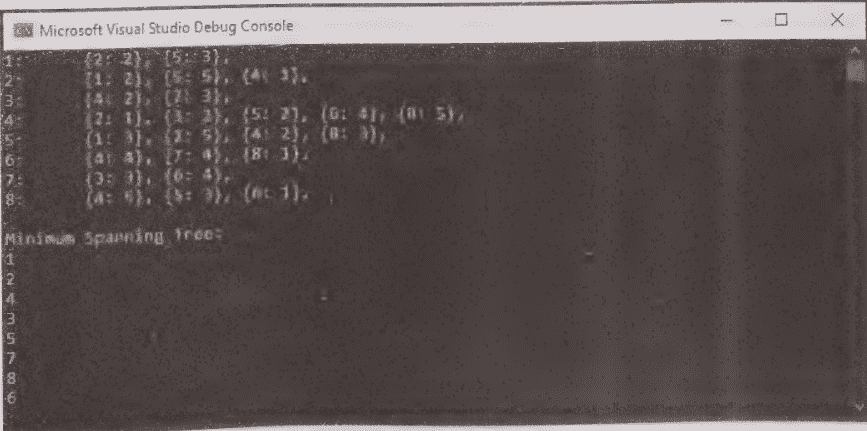

图 6.25：练习 30 的输出


使用二叉最小堆和邻接表存储最小生成树时，Prim算法的时间复杂度为 O(E log V)，而当使用一种称为“斐波那契最小堆”的堆时，可改进至 O(E + V log V)。

虽然Prim算法和Kruskal算法都是贪心算法的例子，但它们在重要方面存在差异，下面列出其中一些：

| Kruskal算法 | Prim算法 |
|---|---|
| 通过将图中代价最小的边加入MST来开始构建MST | 从图中的任意起始顶点开始构建MST |
| 目前最佳时间复杂度为 O(E log V) | 目前最佳时间复杂度为 O(E + V log V) |
| 通常适用于边数较少的稀疏图 | 通常适用于边数较多的稠密图 |

图6.26：Kruskal算法与Prim算法的比较表

## Dijkstra最短路径算法

每当用户在路线规划应用（如Google Maps）或汽车内置导航软件中请求路线时，图上的单源最短路径问题就被求解一次。该问题定义如下：

> “给定一个有向图 G = < V, E >，其中 V 是顶点集合，E 是边集合，每条边关联一个边权重、一个源顶点和一个目标顶点，找出从源到目标的一条最小代价路径。”

Dijkstra算法适用于具有非负边权的图，它只是对Prim最小生成树算法稍作修改，主要有两处变化：

- 与在每个顶点上设置等于边界最小距离的标签不同，Dijkstra算法在每个顶点上设置的距离等于该顶点到源点的总距离。
- 如果目标顶点从堆中弹出，Dijkstra算法即终止；而Prim算法只有在堆上不再有需要处理的顶点时才终止。

该算法的运行过程通过以下步骤说明：

- 1. 首先，它初始化所有顶点上的标签，并将所有距离设为无穷大。由于起始顶点到自身的距离为0，它将起始顶点的标签设为0。然后，将所有标签加入一个最小堆 H。

在下图中，红色数字表示从源点（顶点2）到目标点（顶点6）的当前已知最短距离：

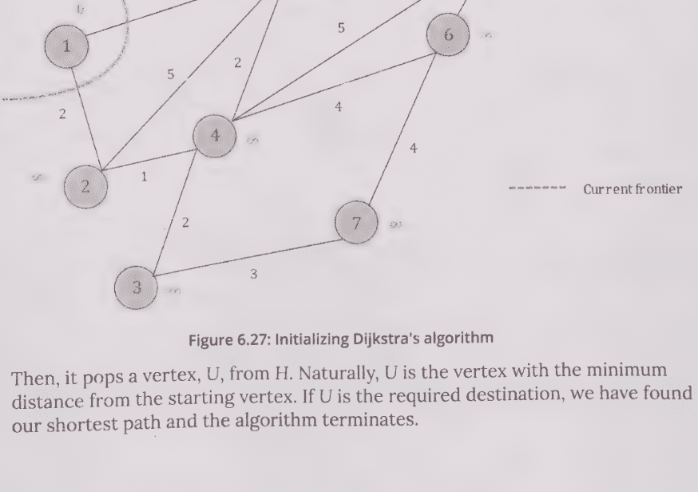

图6.27：初始化Dijkstra算法

- 2. 然后，从 H 中弹出一个顶点 U。自然地，U 是距离起始顶点最近的顶点。如果 U 就是所需的目标顶点，则我们已找到最短路径，算法终止。

- 2. 编写以下 struct 来实现图实现中的一条边：

```cpp
template<typename T>
struct Edge
{
    size_t src;
    size_t dest;
    T weight;

    // To compare edges, only compare their weights,
    // and not the source/destination vertices
    inline bool operator< (const Edge<T>& e) const
    {
        return this->weight < e.weight;
    }

    inline bool operator> (const Edge<T>& e) const
    {
        return this->weight > e.weight;
    }
};
```

- 3. 重载 Graph 类的 << 运算符，使其可以通过流输出，如下所示：

```cpp
template <typename T>
std::ostream& operator<<(std::ostream& os, const Graph<T>& G)
{
    for (auto i = 1; i < G.vertices(); i++)
    {
        os << i << ":\t";

        auto edges = G.outgoing_edges(i);
        for (auto& e : edges)
            os << "{" << e.dest << ": " << e.weight << "}, ";

        os << std::endl;
    }

    return os;
}
```

- 4. 实现图，如下所示：

```cpp
template<typename T>
class Graph
{
public:
    // Initialize the graph with N vertices
    Graph(size_t N) : V(N)
    {}

    // Return number of vertices in the graph
    auto vertices() const
    {
        return V;
    }

    // Return all edges in the graph
    auto& edges() const
    {
        return edge_list;
    }

    void add_edge(Edge<T>&& e)
    {
        // Check if the source and destination vertices are within range
        if (e.src >= 1 && e.src <= V &&
            e.dest >= 1 && e.dest <= V)
            edge_list.emplace_back(e);
        else
            std::cerr << "Vertex out of bounds" << std::endl;
    }

    // Returns all outgoing edges from vertex v
    auto outgoing_edges(size_t v) const
    {
        std::vector<Edge<T>> edges_from_v;
        for (auto& e : edge_list)
        {
            if (e.src == v)
                edges_from_v.emplace_back(e);
        }
        return edges_from_v;
    }

    // Overloads the << operator so a graph can be written directly to a
    // stream
    // Can be used as std::cout << obj << std::endl;
    template <typename T>
    friend std::ostream& operator<< <>(std::ostream& os, const Graph<T>& G);

private:
    size_t V;              // Stores number of vertices in graph
    std::vector<Edge<T>> edge_list;
};
```

- 5. 编写一个函数，使用**Graph**类创建*图6.28*所示的参考图，如下所示：

```cpp
template <typename T>
auto create_reference_graph()
{
    Graph<T> G(9);

    std::map<unsigned, std::vector<std::pair<size_t, T>>> edges;
    edges[1] = { {2, 2}, {5, 3} };
    edges[2] = { {1, 2}, {5, 5}, {4, 1} };
    edges[3] = { {4, 2}, {7, 3} };
    edges[4] = { {2, 1}, {3, 2}, {5, 2}, {6, 4}, {8, 5} };
    edges[5] = { {1, 3}, {2, 5}, {4, 2}, {8, 3} };
    edges[6] = { {4, 4}, {7, 4}, {8, 1} };
    edges[7] = { {3, 3}, {6, 4} };
    edges[8] = { {4, 5}, {5, 3}, {6, 1} };

    for (auto& i : edges)
        for (auto& j : i.second)
            G.add_edge(Edge<T>{ i.first, j.first, j.second });

    return G;
}
```

- 6. 实现Dijkstra算法，如下所示：

```cpp
template <typename T>
auto dijkstra_shortest_path(const Graph<T>& G, size_t src, size_t dest)
{
    std::priority_queue<Label<T>, std::vector<Label<T>>,
    std::greater<Label<T>>> heap;
    std::set<int> visited;
    std::vector<size_t> parent(G.vertices());
    std::vector<T> distance(G.vertices(), std::numeric_limits<T>::max());
    std::vector<size_t> shortest_path;

    heap.emplace(src, 0);
    parent[src] = src;

    // Search for the destination vertex in the graph
    while (!heap.empty()) {
        auto current_vertex = heap.top();
        heap.pop();

        // If the search has reached the destination vertex
        if (current_vertex.vertex_ID == dest) {
            std::cout << "Destination " <<
            current_vertex.vertex_ID << " reached." << std::endl;
            break;
        }
        if (visited.find(current_vertex.vertex_ID) == visited.end()) {
            std::cout << "Settling vertex " <<
            current_vertex.vertex_ID << std::endl;
            // For each outgoing edge from the current vertex,
            // create a label for the destination vertex and add it to the heap
            for (auto e : G.outgoing_edges(current_vertex.vertex_ID)) {
                auto neighbor_vertex_ID = e.dest;
                auto new_distance_to_dest = current_vertex.distance_from_source
                + e.weight;

                // Check if the new path to the destination vertex
                // has a lower cost than any previous paths found to it, if yes, then
                // this path should be preferred
                if (new_distance_to_dest < distance[neighbor_vertex_ID]) {
                    heap.emplace(neighbor_vertex_ID, new_distance_to_dest);

                    parent[e.dest] = current_vertex.vertex_ID;
                    distance[e.dest] = new_distance_to_dest;
                }
            }
            visited.insert(current_vertex.vertex_ID);
        }
    }
    // Construct the path from source to the destination by backtracking
    // using the parent indexes
    auto current_vertex = dest;
    while (current_vertex != src) {
        shortest_path.push_back(current_vertex);
        current_vertex = parent[current_vertex];
    }
    shortest_path.push_back(src);
    std::reverse(shortest_path.begin(), shortest_path.end());
    return shortest_path;
}
```

我们的实现分两个阶段工作——它从源点开始搜索目标顶点，并使用回溯阶段，通过从目标点沿父指针回到源点来找到最短路径。

- 7. 最后，添加以下代码，通过查找图中顶点1和6之间的最短路径来测试我们Dijkstra算法的实现：

```cpp
template<typename T>
void test_dijkstra()
{

auto G = create_reference_graph<T>();
std::cout << "Reference graph:" << std::endl;
std::cout << G << std::endl;

auto shortest_path = dijkstra_shortest_path<T>(G, 1, 6);

std::cout << "The shortest path between 1 and 6 is:" << std::endl;
for (auto v : shortest_path)
    std::cout << v << " ";
```


```
std::cout << std::endl;
}

int main()
{
    using T = unsigned;
    test_dijkstra<T>();

    return 0;
}
```

8. 运行程序。你的输出应如下所示：

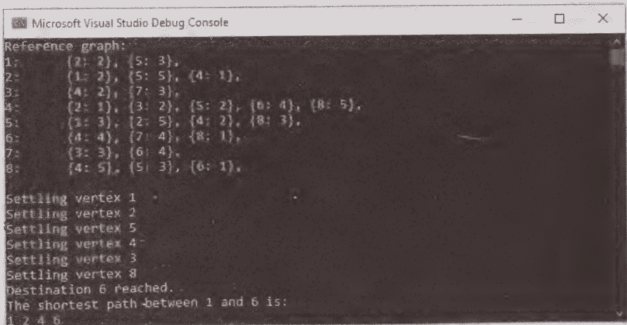

图6.31：练习31的输出

正如你在上述输出中所见，我们的程序追踪了顶点1和6之间最短路径上的各个顶点。当使用斐波那契最小堆时，迪杰斯特拉算法目前已知的最佳运行时间为 O(E + V log V)。

## 活动14：纽约最短路径

在此活动中，你需要在C++中实现迪杰斯特拉算法，以便将其用于在给定的纽约道路网络中找到最短路径。我们的道路图包含264,326个顶点和733,846条有向边，边的权重是顶点之间的欧几里得距离。此活动的步骤如下：

+   1. 从以下链接下载道路图文件：https://raw.githubusercontent.com/TrainingByPackt/CPP-Data-Structures-and-Algorithm-Design-Principles/master/Lesson6/Activity14/USA_road_d.NY.gr.

> **注意**

> 如果文件没有自动下载，而是在浏览器中打开，请右键单击任意空白区域并选择**“另存为...”**下载它。

+   2. 如果你运行的是Windows，请将下载的文件移动到`<project directory>/out/x86-Debug/Chapter6`。
+   
+   如果你运行的是Linux，请将下载的文件移动到`<project directory>/build/Chapter6`。

> **注意**

> 目录结构可能因你的IDE而异。该文件需要放置在与编译后的二进制文件相同的目录中。或者，你可以调整实现，使其接受文件的路径。

+   3. 道路图是一个文本文件，包含三种不同类型的行：

| 行的示例 | 描述 |
|---|---|
| `c` | 注释行。应忽略。 |
| `p sp N M.` | 问题行。Sp 指最短路径问题。N 是图中顶点的数量，M 是边的数量。 |
| `a U V W` | 图中从顶点 U 到 V 的一条边，权重为 W。 |

图6.32：描述纽约道路图文件的表格

+   4. 实现一个加权边图。可以假设一旦图创建完成，就不能向图中添加或删除任何顶点。
+   
+   5. 实现一个函数来解析道路图文件并填充图。
+   
+   6. 实现迪杰斯特拉算法，并通过找到顶点913和542之间的最短路径来测试你的实现。你的输出应如下所示：

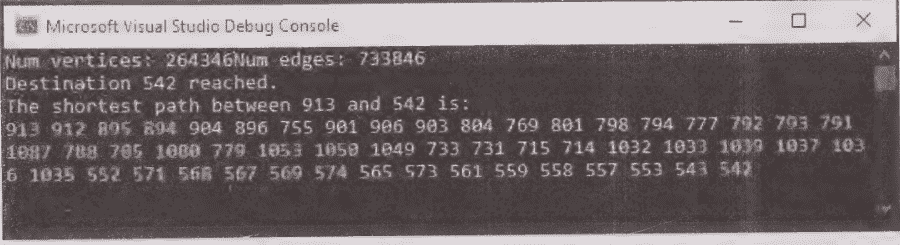

图6.33：活动14的预期输出

> **注意**

> 此活动的解决方案可在第530页找到。

## 总结

本章我们讨论了三个主要的图问题：首先，图遍历问题，为此介绍了两种解决方案：广度优先搜索（BFS）和深度优先搜索（DFS）。其次，我们重新审视了最小生成树（MST）问题，并使用普里姆算法解决了它。我们还将它与克鲁斯卡尔算法进行了比较，并讨论了在哪些条件下应优先选择其中一种。最后，我们介绍了单源最短路径问题，该问题在图中寻找最小代价的最短路径，并涵盖了迪杰斯特拉最短路径算法。

然而，迪杰斯特拉算法仅适用于具有正边权重的图。在下一章中，我们将尝试放宽这一约束，并介绍一种能够处理负边权重的最短路径算法。我们还将推广最短路径问题，以找到图中所有顶点对之间的最短路径。
