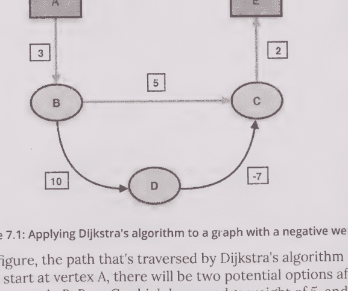
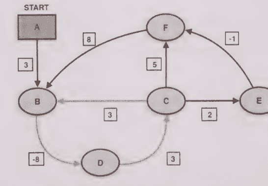
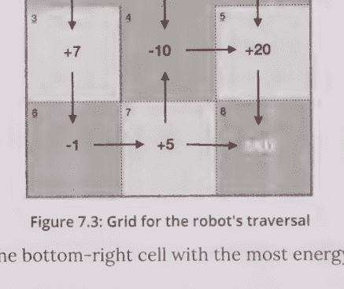
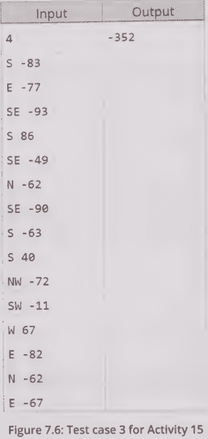
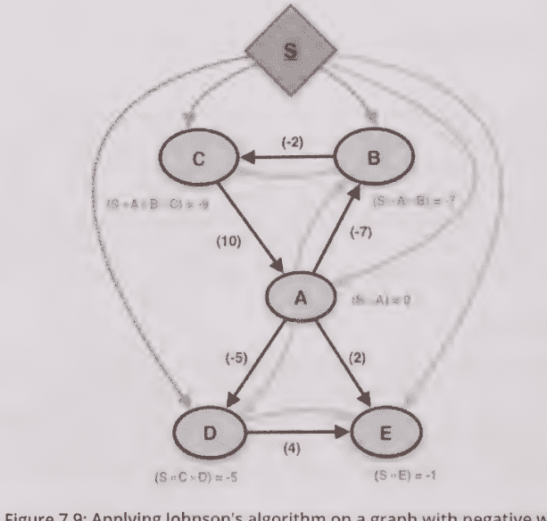
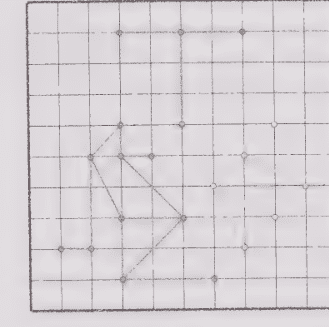
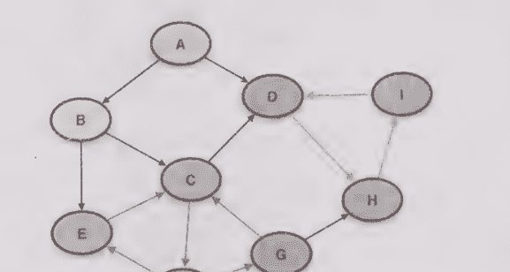
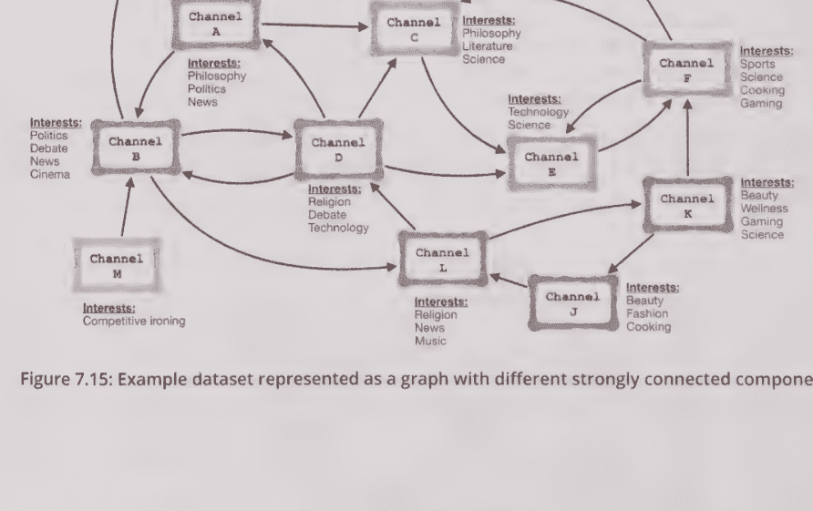
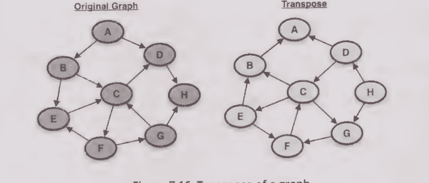
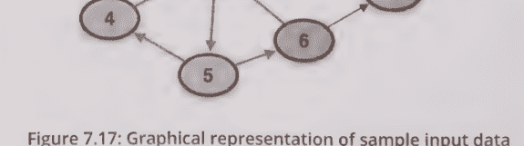

## 图算法 II

## 学习目标

学完本章后，你将能够：

+   - 描述迪杰斯特拉算法固有的问题，并演示如何修改它和/或将其与其他算法结合以规避这些问题
+   - 使用贝尔曼-福特算法和约翰逊算法在图中找到最短路径
+   - 描述图中强连通分量的重要性
+   - 使用科萨拉茹算法在图中查找强连通分量
+   - 描述有向图和无向图中连通性的区别
+   - 为复杂问题实现深度优先搜索
+   - 评估图中的负权重环

本章在前一章的基础上，介绍了一些更高级的图算法。你还将学习如何处理负权重以及应对负权重环的异常情况。

## 引言

到目前为止，我们已经探索了各种常见的编程结构和范式。现在，我们将深入研究一些扩展之前讨论主题的技术，首先从一系列高级图问题开始，然后将焦点转向动态规划这一广阔主题。

在本章中，我们将讨论三种著名的算法，即贝尔曼-福特算法、约翰逊算法和科萨拉茹算法。这些算法与我们书中已经介绍过的算法有明显的相似之处，但以各种方式扩展和组合它们，以便以比次优实现允许的更高效率解决潜在的复杂问题。除了学习这些特定技术外，本章还应提高你对基本图相关技术使用的总体熟悉程度，并更深入地了解这些基础知识如何应用于各种各样的不同问题。

## 重新审视最短路径问题

我们之前讨论了在图中找到两个节点之间最短路径的几种方法。我们首先探讨了图遍历的最标准形式，即深度优先搜索和广度优先搜索，最终讨论了如何处理包含加权边的更棘手情况。我们演示了迪杰斯特拉算法如何通过贪婪地根据当前可用最佳选项确定遍历中每一步的优先级，从而高效地找到加权图中的最短距离。然而，尽管迪杰斯特拉算法带来了性能提升，但它并不适用于所有情况。

考虑一个通过网络广播的Wi-Fi信号；当它传输到原始发射点之外时，其强度可能会受到许多因素的影响，例如传输距离以及必须穿过的墙壁和其他障碍物的数量。如果你想确定信号到达每个目的地时能使其衰减最小化的路径，你可以创建一个加权图，网络中的每个点用一个节点表示，任意两点之间的信号损失程度用加权边表示。然后你可以使用迪杰斯特拉算法计算图中的最短距离，以确定网络中成本最低的路径。

现在，假设在网络中安装了一个中继器/增强器来增加某一点的信号强度——这一新增在图中应如何表示？最明显的方法是将增强器节点的出边权重设置为负值（相当于它增加信号强度的程度），这将减少任何经过该节点的路径的总距离/衰减。如果我们在网络图上使用迪杰斯特拉算法，这会对我们的结果产生什么影响？

正如我们在前一章讨论的，迪杰斯特拉算法在选择遍历中的每个顶点时采用了贪婪方法。每一步，它都会找到最近未访问的顶点并将其添加到已访问集合中，将其排除在进一步考虑之外。迪杰斯特拉算法所做的假设是，到目前为止已考虑的每个顶点的最短路径已经找到，因此寻找更好的替代方案毫无意义。然而，在包含负边权重的图中，如果某些可能性在遍历早期产生了更高的总和，这种方法就不会探索那些通向最优解的可能性。

考虑一个包含负边权重的图，如下图所示：



图7.1：将迪杰斯特拉算法应用于带负权重的图

在上图中，迪杰斯特拉算法遍历的路径用红色表示。假设我们从顶点A开始，从节点A到节点B的第一次移动后会有两个可能的选项：B -> C（边权重为5）和B -> D（边权重为10）。由于迪杰斯特拉的贪婪方法，C将被选为最短路径中的下一个节点，但我们可以清楚地看到，另一个选项（B -> D -> C = 10 + -7 = 3）实际上是最优选择。

当面对负边权重时，迪杰斯特拉算法中使其高效率运行的内在优化最终导致了它的失败。幸运的是，对于此类图，我们可以采用一种与迪杰斯特拉算法非常相似且可以说更容易实现的替代方法。


## 贝尔曼-福特算法

我们可以使用贝尔曼-福特算法来处理带有负权重的图。它用另一种方法替代了 Dijkstra 算法的贪心选择：遍历图中的每条边 V - 1 次（其中 V 等于顶点总数），并在每次迭代中从源节点逐步找到最优距离值。自然，这使得它的渐近复杂度高于 Dijkstra 算法，但同时也使它能对 Dijkstra 算法会错误解读的图产生正确结果。下面的练习展示了如何实现贝尔曼-福特算法。

### 练习 32：实现贝尔曼-福特算法（第一部分）

在本练习中，我们将使用基本的贝尔曼-福特算法来找出带有负权重的图中的最短距离。让我们开始吧：

- 1. 首先，通过包含必要的库（以及为了使用方便而引入的 `namespace std`）来设置代码：

```
#include <iostream>
#include <vector>
#include <climits>

using namespace std;
```

- 2. 让我们开始定义图中边的表示方式，这需要三个变量：源节点的索引、目标节点的索引，以及在它们之间遍历的代价：

```
struct Edge
{
    int start;   // The starting vertex
    int end;     // The destination vertex
    int weight;  // The edge weight

    // Constructor
    Edge(int s, int e, int w) : start(s), end(e), weight(w) {}
};
```

- 3. 要实现贝尔曼-福特算法，我们需要对图进行某种表示。为简单起见，我们假设图可以用一个整数 `V`（图中顶点的总数）和一个向量 `edges`（一组指向 ‘edge’ 对象的指针，用于定义图的邻接关系）来表示。我们还要定义一个整数常量 `UNKNOWN`，它可以设置为某个任意的高值，该值始终大于图中任意边权重子集的和（`climits` 中定义的 `INT_MAX` 常量很适合这个用途）：

```
const int UNKNOWN = INT_MAX;

vector<Edge*> edges;   // Collection of edge pointers
int V;                 // Total number of vertices in the graph
int E;                 // Total number of edges in the graph
```

- 4. 让我们也编写一些代码，用于从用户输入中收集图的数据：

```
int main()
{
    cin >> V >> E;

    for(int i = 0; i < E; i++)
    {
        int node_a, node_b, weight;
        cin >> node_a >> node_b >> weight;

        // Add a new edge using the defined constructor
        edges.push_back(new Edge(node_a, node_b, weight));
    }

    // Choose a starting node

    int start;
    cin >> start;

    // Run the Bellman-Ford algorithm on the graph for
    // the chosen starting vertex

    BellmanFord(start);

    return 0;
}
```

- 5. 现在，我们可以开始实现贝尔曼-福特算法本身。为此，让我们创建一个名为 `BellmanFord()` 的函数，它接受一个参数——`start`（我们希望从图中该起始节点找到最短路径）——并返回 `void`。然后，我们将定义一个大小为 `V` 的距离数组，每个元素都初始化为 `UNKNOWN`，除了起始节点，其索引初始化为 `0`：

```
void BellmanFord(int start)
{
    vector<int> distance(V, UNKNOWN);

    distance[start] = 0;
```

- 6. 大部分工作将在下一步中完成，我们定义一个循环，该循环持续 V - 1 次迭代，并且每次重复都遍历整组边。对于每条边，我们检查其源节点的当前距离值是否不等于 `UNKNOWN`（在第一次迭代中，仅起始节点满足此条件）。如果条件成立，我们再将目标节点的当前距离值与源节点距离加上边的权重之和进行比较。如果将边的权重加到当前节点距离上的结果小于目标节点存储的距离，我们就用新的和替换距离数组中该目标节点的值：

```
// Perform V - 1 iterations
for(int i = 0; i < V; i++)
{
    // Iterate over entire set of edges
    for(auto edge : edges)
    {
        int u = edge->start;
        int v = edge->end;
        int w = edge->weight;

        // Skip nodes which have not yet been considered
        if(distance[u] == UNKNOWN)
        {
            continue;
        }

        // If the current distance value for the destination
        // node is greater than the sum of the source node's
        // distance and the edge's weight, change its distance
        // to the lesser value.

        if(distance[u] + w < distance[v])
        {
            distance[v] = distance[u] + w;
        }
    }
}
```

- 7. 在函数末尾，我们现在可以遍历距离数组，并输出从源节点到图中每个其他节点的最短距离：

```
cout << "DISTANCE FROM VERTEX " << start << ":\n";

for(int i = 0; i < V; i++)
{
    cout << "\t" << i << ": ";

    if(distance[i] == UNKNOWN)
    {
        cout << "Unvisited" << endl;

        continue;
    }

    cout << distance[i] << endl;
}
```

- 8. 现在，我们可以回到 `main()` 方法，并调用我们新实现的 `BellmanFord()` 函数。让我们在图 7.1 的示例图上测试实现。为此，我们应该运行代码并输入以下内容：

```
5 5
0 1 3
1 2 5
1 3 10
3 2 -7
2 4 2
0
```

- 9. 我们的程序应输出以下内容：

```
DISTANCE FROM VERTEX 0:
    0: 0
    1: 3
    2: 6
    3: 13
    4: 8
```

正如我们所见，贝尔曼-福特算法避开了那个会导致 Dijkstra 算法错误评估最短路径的陷阱。然而，还有另一个重要问题需要处理，我们将在下一节讨论。

### 贝尔曼-福特算法（第二部分）——负权重环

考虑下图所示的图：



图 7.2：带有负权重环的图

红色高亮显示的边表示负权重环，即图中一个组合边权重产生负和的环。在这种情况下，这个环会被反复考虑，最终结果将出现偏差。

为了便于比较，考虑一个只含正边权重的图。在这样的图中，环永远不会被纳入求解过程，因为到环中第一个节点的最短距离已经找到了。为了说明这一点，假设上图中节点 B 和 D 之间的边权重为正。从节点 A 开始，第一次遍历边会确定到节点 B 的最短距离等于 3。再经过两次迭代，我们也会知道从 A 到 C 的最短距离（A → B → D → C），等于 14（3 + 8 + 3）。

显然，任何正数加到 14 上，都无法得到小于 3 的和。由于在每次节点只访问一次的图遍历中，最多有 | V − 1 | 步，我们可以确定，遍历图的边 | V − 1 | 次足以计算出所有可能的最短距离。进一步来说，我们可以得出这样的结论：在 | V − 1 | 次迭代之后，如果仍然存在更短的路径，那么唯一可能是某个节点被重新访问，并且到达它的边权重为负。因此，贝尔曼-福特算法的最后一步是再遍历一次边，以检查是否存在这样的环。

我们可以使用与查找最短路径相同的逻辑来完成这一步：检查每条边的权重与其源节点距离值之和是否小于当前存储的到其目标节点的距离。如果在这一步中找到了更短的路径，我们就终止算法并报告存在负权重环。

我们将在下面的练习中探讨该算法的这种实现。

### 练习 33：实现贝尔曼-福特算法（第二部分）

在本练习中，我们将修改练习 32“实现贝尔曼-福特算法（第一部分）”中的实现，来处理带有负权重环的图。让我们开始吧：

- 1. 我们基本上可以逐字复制上一步中的代码。但这一次，我们将把判断是否找到更短路径的条件下的代码替换为某种输出，指出该图包含负权重环，从而使其无效：

```
// Iterate through edges one last time
for(auto edge : edges)
{
    int u = edge->start;
    int v = edge->end;
    int w = edge->weight;

    if(distance[u] == UNKNOWN)
    {
        continue;
    }
}
```


```
distance[v] = distance[u] + w;
}
}
}
for(auto edge : edges)
{
    int u = edge->start;
    int v = edge->end;
    int w = edge->weight;

    if(distance[u] == UNKNOWN)
    {
        continue;
    }

    if(distance[u] + w < distance[v])
    {
        cout << "NEGATIVE CYCLE FOUND" << endl;
        return;
    }
}

cout << "DISTANCE FROM VERTEX " << start << ":\n";

for(int i = 0; i < V; i++)
{
    cout << "\t" << i << " : ";

    if(distance[i] == UNKNOWN)
    {
        cout << "Unvisited" << endl;
        continue;
    }
    cout << distance[i] << endl;
}
}
```

4. 为了测试我们新增的逻辑，让我们在以下输入上运行该算法：

   ```
   6 8
   0 1 3
   1 3 -8
   2 1 3
   2 5 5
   3 2 3
   2 4 2
   4 5 -1
   5 1 8
   0
   ```

5. 我们的程序应输出以下内容：

   ```
   NEGATIVE CYCLE FOUND
   ```

## 活动 15：贪心机器人

你正在开发一个寻路机器人，它必须找到穿过障碍场地的最有效路径。为了测试，你设计了若干个场地，每个场地都是正方形网格。你的机器人能够穿过它遇到的任何障碍，但这也会消耗更多能量。假设你的机器人从网格左上角出发，可以向四个基本方向（北、南、东、西）移动，你必须实现一个算法，计算机器人完成场地时能拥有的最大能量。

由于完成这种穿越所需的能量可能很高，你在网格中分散放置了充电站，机器人可以利用它们为自己充电。不幸的是，你的机器人在能量消耗方面似乎相当贪婪——如果它能在不回溯的情况下多次到达同一个充电站，它就会不断返回同一位置，直到最终过充爆炸！因此，你需要预测机器人最终是否会重新访问充电站，并在灾难发生前中止穿越尝试。

### 输入

- 第一行包含一个整数 N，即场地的高度和宽度。
- 接下来的 N² - 1 行每行包含一个方向字符串 directions 和一个名为 power 的整数。每 N 行对应一行网格，从网格顶部开始，每个单元格的数据从左到右定义（例如，在 3 x 3 网格中，0 -> [0, 0]，1 -> [0, 1]，2 -> [0, 2]，3 -> [1, 0]，4 -> [1, 1]，依此类推）。
- directions 包含来自集合 { 'N', 'S', 'E', 'W' } 的 0-3 个字符，表示机器人从每个点可以访问的单元格。因此，如果 directions 字符串是 SW，则机器人可以从该点向南或向西移动。power 表示穿过该单元格所需的能量消耗。power 为正值表示该单元格内设有充电站。

### 输出

- 如果穿越场地会导致机器人爆炸，请打印一行 — TRAVERSAL ABORTED。
- 否则，打印机器人到达场地右下角单元格时所能拥有的最大能量，相对于它开始时的能量。例如，如果机器人完成迷宫时比开始时多 10 个单位的能量，则打印 10；如果完成迷宫时比开始时少 10 个单位的能量，则打印 -10。

### 示例

假设我们有以下输入：

```
3
SE -10
SE -8
S -6
S 7
E -10
S 20
E -1
NE 5
```

网格布局如下：



图 7.3：机器人穿越的网格

以最多能量到达右下角单元格的路径如下：

- 0 -> 3 (-10)
- 3 -> 6 (+7)
- 6 -> 7 (-1)
- 7 -> 4 (+5)
- 4 -> 5 (-10)
- 5 -> 8 (+20)

```
(-10) + 7 + (-1) + 5 + (-10) + 20
= 11 more units of energy
```

因此，你的程序应输出 11。

### 测试用例

以下测试用例应能帮助你更好地理解这个问题：

| 输入 | 输出 |
|------|------|
| 3<br>SE -10<br>SE -8<br>S -6<br>S 7<br>E -10<br>S 20<br>E -1<br>NE 5 | 11 |

图 7.4：活动 15 的测试用例 1

| 输入 | 输出 |
|------|------|
| 3<br>E -1<br>E -5<br>S 6<br>S -2<br>W 15<br>W -10<br>E -5<br>NE 5 | TRAVERSAL ABORTED |

图 7.5：活动 15 的测试用例 2

| 输入 | 输出 |
|------|------|
| 4<br>S -83<br>E -77<br>SE -93<br>S 86<br>SE -49<br>N -62<br>SE -90<br>S -63<br>S 40<br>NW -72<br>SW -31<br>W 67<br>E -82<br>N -62<br>E -67 | -352 |



| 输入 | 输出 |
|------|------|
| 5<br>SE -83<br>SE -77<br>E -93<br>S 86<br>W -49<br>E -62<br>SE -90<br>N -63<br>SEW 40<br>NS -72<br>S -11<br>W 67<br>NW -82<br>W -62<br>SW -67<br>S 29<br>W 22<br>SW 69<br>W -93<br>SW -11<br>E 29<br>E -21<br>E -84<br>E -98 | TRAVERSAL ABORTED |

图 7.7：活动 15 的测试用例 4

| 输入 | 输出 |
|------|------|
| 5<br>S 8<br>E -2<br>SEW -15<br>SE 4<br>S 25<br>S -26<br>NEW 19<br>NS 7<br>SEW -56<br>S 11<br>E 25<br>N -86<br>SEW 11<br>NE 26<br>S -78<br>NS -11<br>NSW -76<br>SW 33<br>NSW 4<br>SW -40<br>E 8<br>E 11<br>E 36<br>E -2 | 25 |

图 7.8：活动 15 的测试用例 5

### 活动指南

- 不需要使用超出练习 33“实现贝尔曼-福特算法（第二部分）”所涵盖范围之外的算法。
- 你可能需要重新解释部分输入，使其与你试图解决的实际问题相对应。
- 不需要将网格表示为二维结构。

> **注意**  
> 本活动的解决方案可在第 537 页找到。

我们现在已经确定，贝尔曼-福特算法比迪杰斯特拉算法更具通用性，因为在迪杰斯特拉算法会产生错误结果的情况下，贝尔曼-福特算法仍能给出正确解。但是，如果所考虑的图不包含任何负边权重，那么在这两者中，迪杰斯特拉算法显然是首选，因为其贪心方法可能带来显著的效率优势。现在，我们将探讨如何将贝尔曼-福特算法与迪杰斯特拉算法结合使用，使其能够用于带负权重的图。

## 约翰逊算法

在比较了贝尔曼-福特算法和迪杰斯特拉算法的相对优缺点之后，我们现在将讨论一种结合两者来获取图中每一对顶点之间最短路径的算法。约翰逊算法的优势在于，它既能利用迪杰斯特拉算法的效率，又能对具有负边权重的图产生正确结果。

约翰逊算法背后的概念相当新颖——为了应对迪杰斯特拉算法处理负权重时的局限性，约翰逊算法直接对图中的边重新加权，使它们统一为非负。这是通过创造性地使用贝尔曼-福特算法，并结合一些特别优雅的数学逻辑来实现的。

约翰逊算法的第一步是向图中添加一个新的“虚拟”顶点，然后通过零权重边将该顶点连接到其他每个顶点。然后使用贝尔曼-福特算法求新顶点到其余各点的最短路径，并将距离存储起来供后续使用。

考虑添加这个新顶点的影响：因为有一条 0 权重边将它连接到图中的每个其他节点，所以它的任何最短路径距离都不会为正。此外，它与图中每个节点的连通性保证了其距离值在所有潜在遍历路径上保持恒定关系，这会使这些值与其对应边权重相加所得的总和产生“telescoping（逐项相消）”效应，换句话说，序列中的后续项相互抵消，使总和等于首项与末项之差。请看下图：



图 7.9：在带负权重的图上应用约翰逊算法

在上图中，标记为 S 的菱形节点表示虚拟顶点，黑色括号内的数字表示边权重，红色文本表示从 S 到每个节点的最短路径，橙色箭头表示从 S 出发经过的最优路径，蓝色箭头表示从 S 分支出的 0 权重边，它们不包含在 S 的任何最短路径中。


让我们取新的距离值，并按照它们在这段图的遍历——A --> B --> C --> A --> D --> E——中的出现顺序排列成一个序列：

| A | B | C | A | D | E |
|---|---|---|---|---|---|
| 0 | -7 | -9 | 0 | -5 | -1 |

图 7.10：每个节点的遍历距离

如果我们把原始边权重插入到它们所连接节点的距离值之间，序列将如下所示：

| A | B | C | A | D | E |
|---|---|---|---|---|---|
| 0 | (-7) -7 | (-2) -9 | (10) 0 | (-5) -5 | (4) -1 |
| AB | BC | CA | AD | DE |

图 7.11：计算已遍历的距离

现在，我们对边值应用以下公式：

```
w(uv) = w(uv) + d[s, u] - d[s, v]
```

在这里，w(uv) 表示节点 u 和 v 之间的原始边权重，d[s, u] 和 d[s, v] 表示 s 到 u/v 的最短路径距离，而 w(uv) 表示变换后的边权重值。应用该公式将得到以下结果：

```
AB --> (-7) + 0 - (-7) = 0
BC --> (-2) + (-7) - (-9) = 0
CA --> 10 + (-9) - 0 = 1
AD --> (-5) + 0 - (-5) = 0
DE --> 4 + (-5) - (-1) = 0
```

注意，表达式中的第三项总是会被后续迭代中的中间项抵消；这体现了该公式的“逐项相消（telescoping）”性质。由于这一性质，下面两个表示节点 A 和 E 之间距离的表达式是等价的：

```
(w(AB) + d[s, A] - d[s, B]) + (w(BC) + d[s, B] - d[s, C]) + ... + (w(DE) + d[s, D] - d[s, E])
```

```
(w(AB) + w(BC) + w(CA) + w(AD) + w(DE)) + d[s, A] - d[s, E]
```

这意味着，图中任意路径被添加的权重总量，等于其各子路径被添加的权重总量之和。我们知道，将这些值相加的结果始终是非负的，因为 Bellman-Ford 返回的距离数组保证了对于任意节点对 $u,v$，都有 $d[s, u] + \text{weight}(u, v) >= d[s, v]$。因此，$w(u, v) + d[s, u] - d[s, v]$ 的值永远不可能小于 0。

作为所应用变换的结果，图中任何最短路径上将要遍历的每条边都会被重新加权为 0，这使我们得到一组非负权重值，而值得注意的是，这些权重值仍然保持了原有的最短路径顺序！现在，我们可以使用这些新的权重值在图上执行 Dijkstra 算法，从而高效地获取每一对节点之间的最短路径。

我们将在下面的练习中探索 Johnson 算法的实现。

## 练习 34：实现 Johnson 算法

在本练习中，我们将实现 Johnson 算法，以在带负权重的图中找出从每个节点到其他所有节点的最短距离。让我们开始吧：

- 1. 我们可以复用之前练习中的大部分代码，包括 **Edge** 结构体、**UNKNOWN** 常量和图数据：

```
```cpp
#include <iostream>
#include <vector>
#include <climits>

using namespace std;

struct Edge
{
    int start;
    int end;
    int weight;

    Edge(int s, int e, int w) : start(s), end(e), weight(w) {}
};

const int UNKNOWN = INT_MAX;

vector<Edge*> edges;
int V;
int E;
```
```

- 2. 我们应该修改 Bellman-Ford 的函数声明，使其接受两个参数（一个整数 V 和一个 Edge 指针向量 edges）并返回一个整数向量。我们还可以移除 start 参数：

```
vector<int> BellmanFord(int V, vector<Edge*> edges)
```

- 3. 我们首先将虚拟顶点 S 添加到图中。因为 S 本质上对图的其余部分没有影响，所以这只需将距离数组的大小增加到 |V + 1|，并在 S 与每个其他节点之间添加一条边即可：

```
vector<int> distance(V + 1, UNKNOWN);

int s = V;

for(int i = 0; i < V; i++)
{
    edges.push_back(new Edge(s, i, 0));
}

distance[s] = 0;
```

- 4. 接下来，我们将标准的 Bellman-Ford 实现应用到修改后的图上，并以 S 作为源节点：

```
for(int i = 1; i < V; i++)
{
    for(auto edge : edges)
    {
        int u = edge->start;
        int v = edge->end;
        int w = edge->weight;

        if(distance[u] == UNKNOWN)
        {
            continue;
        }
        if(distance[u] + w < distance[v])
        {
            distance[v] = distance[u] + w;
        }
    }
}
```

- 5. 这一次，我们把负环的最终检查放到一个单独的函数中：

```
bool HasNegativeCycle(vector<int> distance, vector<Edge*> edges)
{
    for(auto edge : edges)
    {
        int u = edge->start;
        int v = edge->end;
        int w = edge->weight;

        if(distance[u] == UNKNOWN) continue;

        if(distance[u] + w < distance[v])
        {
            return true;
        }
    }
    return false;
}
```

- 6. 现在，我们可以在原函数的末尾调用它；如果发现负环，则返回一个空数组：

```
if(HasNegativeCycle(distance, edges))
{
    cout << "NEGATIVE CYCLE FOUND" << endl;

    return {};
}
```

- 7. 在确保图中没有负环之后，我们可以将得到的距离值集合返回给调用函数，并将重新加权公式应用于图中的每条边。但首先，让我们实现 Dijkstra 算法：

```
vector<int> Dijkstra(int V, int start, vector<Edge*> edges)
```

- 8. 现在，让我们声明一个整数向量 distance 和一个布尔向量 visited。像通常一样，distance 的每个索引都将初始化为 UNKNOWN（起始顶点除外），visited 的每个索引都将初始化为 false：

```
vector<int> distance(V, UNKNOWN);
vector<bool> visited(V, false);

distance[start] = 0;
```

- 9. 我们的 Dijkstra 算法实现将采用使用 for 循环的简单迭代方法。你可能还记得前面章节中的内容，Dijkstra 算法在遍历的每一步都需要找到距离值最小的节点。虽然这一步通常借助优先队列来完成，但我们将通过编写另一个简短的函数 GetMinDistance() 来实现，该函数将 distance 和 visited 数组作为参数，并返回具有最短路径值的节点索引：

```
// Find vertex with shortest distance from current position and
// return its index

int GetMinDistance(vector<int> &distance, vector<bool> &visited)
{
    int minDistance = UNKNOWN;
    int result;

    for(int v = 0; v < distance.size(); v++)
    {
        if(!visited[v] && distance[v] <= minDistance)
        {
            minDistance = distance[v];
            result = v;
        }
    }
    return result;
}
```

- 10. 我们现在可以完成 Dijkstra 算法的实现：

```
for(int i = 0; i < V - 1; i++)
{
    // Find index of unvisited node with shortest distance
    int curr = GetMinDistance(distance, visited);
```

```
visited[curr] = true;

// Iterate through edges
for(auto edge : edges)
{
    // Only consider neighboring nodes
    if(edge->start != curr) continue;

    // Disregard if already visited
    if(visited[edge->end]) continue;

    if(distance[curr] != UNKNOWN && distance[curr] + edge->weight < distance[edge->end])
    {
        distance[edge->end] = distance[curr] + edge->weight;
    }
}

return distance;
```

- 11. 我们现在已经具备执行 Johnson 算法所需的一切。让我们声明一个新函数 Johnson()，它也接受 V 和 edges 作为参数：

```
void Johnson(int V, vector<Edge*> edges)
```

- 12. 我们首先创建一个整数向量 h，并将其设置为 BellmanFord() 的输出：

```
// Get distance array from modified graph
vector<int> h = BellmanFord(V, edges);
```

- 13. 我们检查 h 是否为空。如果为空，则终止函数：

```
if(h.empty()) return;
```

- 14. 否则，我们应用重新加权公式：

```
for(int i = 0; i < edges.size(); i++)
{
    edges[i]->weight += (h[edges[i]->start] - h[edges[i]->end]);
}
```

- 15. 为了存储每一对节点之间的最短路径距离，我们初始化一个有 V 行的矩阵（因此每一个二维索引对 [i, j] 表示顶点 i 和顶点 j 之间的最短路径）。然后，我们对 Dijkstra 算法执行 V 次调用，它会为每个起始节点返回相应的距离数组：

```
```cpp
// Create a matrix for storing distance values
vector<vector<int>> shortest(V);

// Retrieve shortest distances for each vertex
for(int i = 0; i < V; i++)
{
    shortest[i] = Dijkstra(V, i, edges);
}
```
```

- 16. 不出所料，我们在这一步累积的结果是非常不准确的。由于我们的重新加权操作，每个距离值现在都是正的。不过，只需对每个结果反向应用同一个公式，就可以很轻松地纠正这一点：

```
```cpp
// Reweight again in reverse to get original values
for(int i = 0; i < V; i++)
{
    cout << i << ":\n";

    for(int j = 0; j < V; j++)
    {
        if(shortest[i][j] != UNKNOWN)
        {
            shortest[i][j] += h[j] - h[i];

            cout << "\t" << j << ": " << shortest[i][j] << endl;
        }
    }
}
```
```

- 17. 现在，让我们回到 **main()** 函数，并实现处理输入的代码。在收集完输入图的边之后，我们只需对 **Johnson()** 做一次调用，就大功告成了：

```
```cpp
int main()
{
    int V, E;
    cin >> V >> E;
```


```
vector<Edge*> edges;

for(int i = 0; i < E; i++)
{
    int node_a, node_b, weight;
    cin >> node_a >> node_b >> weight;

    edges.push_back(new Edge(node_a, node_b, weight));
}

Johnson(V, edges);

return 0;
}
```

18. 让我们用以下输入来测试我们的算法：

```
7 9
0 1 3
1 2 5
1 3 10
1 5 -4
2 4 2
3 2 -7
4 1 -3
5 6 -8
6 0 12
```

19. 输出应如下所示：

```
0:
    0: 0
    1: 3
    2: 6
    3: 13
    4: 8
    5: -1
    6: -9

1:
    0: 0
    1: 0
    2: 3
    3: 10
    4: 5
```
```
5: -4
6: -12
2:
  0: -1
  1: -1
  2: 0
  3: 9
  4: 2
  5: -5
  6: -13
4:
  0: -3
  1: -3
  2: 0
  3: 7
  4: 0
  5: -7
  6: -15
5:
  0: 4
  1: 7
  2: 10
  3: 17
  4: 12
  5: 0
  6: -8
6:
  0: 12
  1: 15
  2: 18
  3: 25
  4: 20
  5: 11
  6: 0
```

从前面的输出可以看出，我们成功打印出了从每个节点到其他所有节点的最短距离。

该工具应能通过调用`std::rand()`来处理每条边的生成。在生成过程中，如果尝试在同一对节点之间创建第二条边，则应当继续生成新边，直到找到有效的一对为止。

图的生成应按如下方式进行：

+   1. 接收输入（seed、iterations、V 和 E）
+   2. 设置随机数生成器的种子值
+   3. 对于每次迭代，执行以下操作：
+      - 设置 i = 0
+      - 尝试通过依次调用三次`rand()`来创建一条边，以生成源节点、目标节点和边权重的值（按此顺序）。
+      - 检查`rand()`生成的下一个值是否能够被 3 整除；如果是，则将边权重设为负数。
+      - 如果源节点和目标节点之间已经存在一条边，则重新尝试：
+        - 将`edge(source, destination, weight)`添加到边集合中，并将 i 递增。
+        - 如果创建完 E 条边后仍有节点不属于任何边，则该图被视为无效。

如果生成的图有效，你应该找出图中每对节点之间的最短路径，就像我们在面试中预期要做的那样。对于图中的每个节点，你需要找出它在所有路径上的平均最短距离（即距离值之和除以可达节点的数量）。图的平均距离定义为这些值的平均值。

你还会对哪些参数组合往往能产生最多“有趣”的图感兴趣。当图的平均距离小于最高边权重值的一半时，你认为该图是有趣的。因此，你的算法应该输出有趣图的数量与有效图总数之比，以百分比形式表示（四舍五入到两位小数）。注意，在这个特定用途中，你认为带有负权环的连通图是有效的，但不认为它有趣。

# 输入格式

一行包含四个整数，即 seed、iterations、V 和 E。

# 输出格式

两行：第一行包含字符串`INVALID:`，后跟无效图的数量；第二行包含字符串`PERCENT INTERESTING:`，后跟有趣图与有效图之比，以百分比形式显示，四舍五入到两位小数。

# 活动指南

调用`std::rand()`在不同环境中不一定会产生相同的值。为了确保一致性，你可以将以下代码复制/粘贴到你的程序中（取自 C 标准）：

```
static unsigned long int randNext = 1;

int rand(void) // RAND_MAX assumed to be 32767
{
    randNext = randNext * 1103515245 + 12345;
    return (unsigned int)(randNext/65536) % 32768
}

void srand(unsigned int seed)
{
    randNext = seed;
}
```

在实现图生成工具时，请确保严格按照问题描述中所述的顺序执行各个步骤。

# 测试用例

以下是一些示例输入和输出，应该能帮助你更好地理解问题：

| 输入 | 输出 |
| --- | --- |
| 42 1000 15 10 | INVALID: 996
PERCENT INTERESTING: 0.00% |
| 11111 400 5 5 | INVALID: 55
PERCENT INTERESTING: 0.58% |
| 1125 100 10 20 | INVALID: 1
PERCENT INTERESTING: 3.03% |
| 0 300 15 30 | INVALID: 29
PERCENT INTERESTING: 1.11% |
| 51 1000 5 10 | INVALID: 0
PERCENT INTERESTING: 14.10% |
| 100000007 200 10 20 | INVALID: 7
PERCENT INTERESTING: 5.07% |
| 100000000 500 8 20 | INVALID: 0
PERCENT INTERESTING: 4.80% |

图 7.12：活动 16 的测试用例

# 注意

本活动的解答可参见第 541 页。

# 强连通分量

在前面的章节中，我们讨论了图的好几种分类。描述图的特征最常用的方式之一是说明它是有向图还是无向图。后者定义的是边默认为双向的图（如果节点 A 有一条连接到节点 B 的边，那么节点 B 也有一条连接到节点 A 的边），而前者描述的是边朝向特定“方向”的图。



图 7.13：具有不同连通分量的图

这三个带颜色的子图分别代表一个独立的连通分量。正如我们之前所说，它们的连通性是由以下事实定义的：每个顶点都有一条路径将其与同一组内的其他顶点连接起来。此外，来自一个分量的任何顶点都没有路径连接到不同的分量。从前面的图中可以看出，无向图的连通分量被划分为明显分离的组，任何分量的节点集和边集都与其他分量完全隔离。

相比之下，强连通分量不需要与图中的其他分量完全隔离——也就是说，分量之间可以存在重叠的路径：



图 7.14：具有不同强连通分量的图

在上图中，我们可以看到有四个强连通分量：A、B、CEFG 和 DHI。注意，节点 A 和 B 是它们各自集合中唯一的成员。进一步研究节点 A，我们可以看到，虽然 A 有一条到达 DHI 集合中每个节点的路径，但 DHI 集合中的任何节点都没有任何通向节点 A 的路径。

回到我们的视频托管网站示例，我们可以将网络图的强连通分量定义为这样的组：在同一组内，通过与其他用户频道关联的“订阅”路径，可以找到每一个频道。以这种方式分解可能庞大的数据量，可能有助于从那些没有明显相似性的图关系中隔离出相关的集合：



图 7.15：表示为具有不同强连通分量的图的示例数据集

# Kosaraju 算法

在寻找图的强连通分量时，最容易理解且最常用的方法之一是 Kosaraju 算法。Kosaraju 算法通过执行两组独立的 DFS 遍历来工作，首先以原始形式探索图，然后对其转置图进行同样的操作。

> 注意
> 尽管 DFS 是 Kosaraju 算法中通常使用的遍历类型，但 BFS 也是一种可行的选择。然而，对于本章中包含的解释和练习，我们将坚持使用传统的基于 DFS 的方法。

图的转置本质上与原始图相同，只是每条边中的源/目标顶点被交换了（也就是说，如果在原始图中有一条从节点 A 到节点 B 的边，那么转置图将有一条从节点 B 到节点 A 的边）：



图 7.16：图的转置

该算法的第一步（在初始化之后）是遍历图的顶点，并从每个尚未在先前遍历中被访问过的节点开始执行 DFS 遍历。在 DFS 的每个起始点，当前节点被标记为已访问，然后探索其所有未被访问的邻居。在调查完每个当前节点的邻接关系后，在当前递归子树终止之前，将该节点添加到栈顶。


在遍历完原图中的每个顶点后，对其转置图执行同样的操作，从栈顶弹出的每个未访问节点开始。此时，在每次以唯一起始点进行的后续 DFS 遍历中所遇到的节点集合，就代表图中的一个强连通分量。

Kosaraju 算法非常有效，因为它能直观地将潜在复杂的问题简化成相当直接易实现的形式。此外，假设输入图采用邻接表表示，该算法也非常高效，因为其渐近复杂度为线性的 O(V + E)。

## 注意

不建议将该算法与邻接矩阵配合使用，因为在遍历过程中查找每个顶点的邻居需要大量额外的迭代。

我们将在下面的练习中查看 Kosaraju 算法的实现。

## 练习 35：实现 Kosaraju 算法

在本练习中，我们将使用 Kosaraju 算法找出图中的强连通分量。让我们开始吧：

- 1. 为了实现 Kosaraju 算法，我们需要包含以下头文件：

```
#include <iostream>
#include <vector>
#include <stack>
```

- 2. 让我们定义一个名为 Kosaraju() 的函数，它接受两个参数——整数 V（顶点数）和整数向量的向量 adj（图的邻接表表示）——并返回一个整数向量的向量，表示输入图中每个强连通分量内的节点索引集合：

```
vector<vector<int>> Kosaraju(int V, vector<vector<int>> adj)
```

3. 第一步是声明栈容器和 visited 数组（每个索引都初始化为 false）。然后我们遍历图中的每个节点，在每个尚未被标记为已访问的索引处开始 DFS 遍历：

```
vector<bool> visited(V, false);
stack<int> stack;

for(int i = 0; i < V; i++)
{
    if(!visited[i])
    {
        FillStack(i, visited, adj, stack);
    }
}
```

4. 我们的第一个 DFS 函数 FillStack() 接受四个参数：整数 node（当前遍历点处顶点的索引）、布尔向量 visited（先前遍历过的节点集合）、两个整数向量 adj（图的邻接表）和 stack（已访问节点索引的列表，按它们被探索的先后顺序排列）。后三个参数将由调用函数以引用方式传递。该 DFS 以标准方式实现，唯一不同的是，在每次函数调用结束时，会将当前节点的索引压入栈中：

```
void FillStack(int node, vector<bool> &visited,
vector<vector<int>> &adj, stack<int> &stack)
{
    visited[node] = true;

    for(auto next : adj[node])
    {
        if(!visited[next])
        {
            FillStack(next, visited, adj, stack);
        }
    }
    stack.push(node);
}
```

5. 现在，让我们定义另一个函数 Transpose()，该函数将原图的参数作为参数，并返回其转置图的邻接表：

```
vector<vector<int>> Transpose(int V, vector<vector<int>> adj)
{
    vector<vector<int>> transpose(V);

    for(int i = 0; i < V; i++)
    {
        for(auto next : adj[i])
        {
            transpose[next].push_back(i);
        }
    }
    return transpose;
}
```

6. 为准备下一轮遍历，我们声明邻接表 transpose（初始化为 Transpose() 函数的输出），并将 visited 数组重新初始化为 false：

```
vector<vector<int>> transpose = Transpose(V, adj);

fill(visited.begin(), visited.end(), false);
```

7. 对于算法的后半部分，我们需要定义第二个 DFS 函数 CollectConnectedComponents()，它接受与 FillStack() 相同的参数，只是第四个参数现在替换为对整数向量 component 的引用。这个 component 向量用于存储图中每个强连通分量的节点索引。遍历的实现也几乎与 FillStack() 函数相同，只是我们删除了将节点压入栈的那一行。取而代之的是，我们在函数开头加入一行，将遍历到的节点收集到 component 向量中：

```
void CollectConnectedComponents(int node, vector<bool> &visited,
vector<vector<int>> &adj, vector<int> &component)
{
    visited[node] = true;
    component.push_back(node);

    for(auto next : adj[node])
    {
        if(!visited[next])
```

8. 现在，我们可以在 main() 函数中，通过将每个向量的值分别打印到单独一行，来输出每个强连通分量的结果：

```
int main()
{
    int V;
    vector<vector<int>> adj;

    auto connectedComponents = Kosaraju(V, adj);

    cout << "Graph contains " << connectedComponents.size() << " strongly connected components." << endl;

    for(auto component : connectedComponents)
    {
        cout << "\t";

        for(auto node : component)
        {
            cout << node << " ";
        }
        cout << endl;
    }
}
```

9. 为了测试我们新实现算法的功能，让我们基于下图创建邻接表表示：



图 7.17：示例输入数据的图形表示

10. 在 `main()` 中，V 和 adj 的定义如下：

```
int V = 9;

vector<vector<int>> adj =
{
    { 1, 3 },
    { 2, 4 },
    { 3, 5 },
    { 7 },
    { 2 },
    { 4, 6 },
    { 7, 2 },
    { 8 },
    { 3 }
};
```

11. 执行我们的程序后，应显示以下输出：

```
Graph contains 4 strongly connected components.
0
1
2 4 5 6
3 8 7
```

## 活动 17：迷宫传送游戏

你正在设计一款游戏，多名玩家会被随机放置在由多个房间组成的迷宫中。每个房间包含一个或多个传送装置，玩家可以利用它们在迷宫的不同区域之间移动。每个传送器都有一个关联的分值，任何使用它的玩家都会将该分值加到自己的分数中。玩家轮流穿越迷宫，直到每个房间至少被访问一次，此时该轮结束，得分最低的玩家获胜。

你已经实现了一个在每局游戏开始时以程序化方式生成新迷宫的系統。遗憾的是，你最近发现一些生成的迷宫中存在环路，玩家可以利用这些环路无限降低自己的分数。你还注意到，根据玩家起始房间的不同，玩家经常拥有不公平的优势。最糟糕的是，传送器的分布方式有时会导致玩家在该轮游戏期间与迷宫其余部分隔绝。

你想要实现一个测试流程，以确保生成的迷宫公平且平衡得当。你的测试应首先确定迷宫中是否存在可用于无限降低玩家分数的路径。如果存在，应输出 INVALID MAZE。如果迷宫有效，则应找出从每个起点可获得的最低分数并报告出来（如果房间没有传送器，则报告 DEAD END）。

此外，你希望防止出现玩家被困在迷宫某个特定区域的可能性，因此测试还应输出任何一组无法让玩家进入迷宫其他部分的房间。

## 预期输入

每次测试应接收以下输入：

- 迷宫中的房间数量
- 迷宫中的传送器数量
- 每个传送器的源房间、目标房间及关联分数

## 预期输出

对于每次测试，程序应首先确定迷宫中是否存在可用于无限降低玩家分数的路径。如果存在，应打印单独一行：INVALID MAZE。

如果迷宫有效，程序应输出从每个房间开始可获得的最低分数（如果该房间没有传送器，则输出 DEAD END），前提是至少进行一次移动，并且整个迷宫只能被遍历一次。最后，程序应列出玩家可能“被困”的房间组（即完全无法访问迷宫其他部分的房间组）；对于每个这样的组，程序应在单独一行中打印该组内所有房间的索引。


## 示例输入与输出

以下是一些示例输入，应能帮助你更好地理解该问题：

| 输入 | 输出 |
| --- | --- |
| 7 9<br>0 1 50<br>1 0 -10<br>1 2 -50<br>2 0 0<br>3 0 3<br>3 4 0<br>4 5 1<br>5 3 -2<br>6 0 -25 | INVALID MAZE |

图7.18：活动17的测试用例1

| 输入 | 输出 |
| --- | --- |
| 8 16<br>0 3 54<br>1 0 -5<br>1 3 6<br>2 0 -44<br>2 3 -38<br>2 1 -17<br>3 1 96<br>4 0 -44<br>4 3 15<br>5 2 11<br>5 0 44<br>5 3 91<br>6 1 53<br>6 2 62<br>6 0 77<br>7 3 68 | 0: 54<br>1: -5<br>2: -44<br>3: 91<br>4: -44<br>5: -33<br>6: 18<br>7: 68<br>0 1 3 |

图7.19：活动17的测试用例2

| 输入 | 输出 |
| --- | --- |
| 15 26<br>0 4 -40<br>1 6 92<br>2 3 77<br>3 1 61<br>3 6 7<br>3 2 81<br>4 2 93<br>5 2 48<br>6 0 -27<br>6 4 -77<br>7 5 -1<br>8 3 -49<br>8 6 52<br>8 1 70<br>9 6 20<br>9 0 95<br>9 3 1<br>10 5 -17<br>11 1 75<br>11 0 -57<br>12 1 -62<br>12 4 -5<br>13 3 -19<br>13 6 17<br>13 4 94<br>14 1 63 | 0: -40<br>1: 15<br>2: 7<br>3: -70<br>4: 93<br>5: 48<br>6: -77<br>7: -1<br>8: -119<br>9: -69<br>10: -17<br>11: -97<br>12: -62<br>13: -89<br>14: 63<br>0 6 1 3 2 4 |

图7.21：活动17的测试用例4

| 输入 | 输出 |
| --- | --- |
| 18 18<br>0 4 1<br>1 7 1<br>2 0 1<br>2 4 1<br>2 5 1<br>3 5 1<br>3 8 1<br>3 13 1<br>3 14 1<br>3 16 1<br>4 2 1<br>5 4 1<br>5 6 1<br>6 0 1<br>6 4 1<br>7 1 1<br>8 11 1<br>9 5 1 | 0: 1<br>1: 1<br>2: 1<br>3: 1<br>4: 1<br>5: 1<br>6: 1<br>7: 1<br>8: 1<br>9: 1<br>10: 1<br>11: 1<br>12: 1<br>13: 1<br>14: 1<br>15: 1<br>16: DEAD END<br>17: 1<br>16 |

| 输入 | 输出 |
| --- | --- |
| 13 24<br>0 2 37<br>0 5 -96<br>0 9 72<br>1 5 33<br>2 9 -36<br>3 2 15<br>3 4 -11<br>4 2 46<br>4 7 -20<br>4 10 26<br>5 1 14<br>6 2 -1<br>6 3 83<br>6 10 -45<br>7 8 70<br>7 12 -47<br>8 7 81<br>8 11 -41<br>9 0 -1<br>10 3 23<br>10 6 61<br>10 7 32<br>12 8 40<br>12 11 -64 | 0: -96<br>1: 33<br>2: -133<br>3: -142<br>4: -131<br>5: 14<br>6: -164<br>7: -111<br>8: -41<br>9: -97<br>10: -119<br>11: DEAD END<br>12: -64<br>11<br>5 1 |

图7.24：活动17的测试用例7

## 活动指南

- 不要被无关信息分心。问自己具体需要完成什么。
- 问题的第一个条件（判断迷宫是否包含一条可以无限降低我们分数的路径）也可以这样表述：如果迷宫被表示为一个加权图，那么是否存在一个环位于某条路径上且产生负总和？显然，这是一个我们完全有能力处理的问题！你可能也意识到，第二个条件（求从给定起点出发的玩家能获得的最低分数）与第一个条件密切相关。
- 最后一个条件更具挑战性。想一想，根据本章讨论的图术语，你会如何重新定义在迷宫某个部分“被困住”。具有这种性质的迷宫可能是什么样子？
- 考虑在纸上画出一个或多个输入图。玩家可能被困在其中的房间组有什么特征？

> **注意**
> 
> 本活动的解答可以在第550页找到。

## 选择合适的方法

到目前为止，这一点可能已经很明显：实现图结构时很少有一种“完美”的方法。我们所表示数据的特征，加上我们试图解决问题的细节，可能会使某些方法变得异常低效，尽管它们在不同的条件下可能是完全可以接受的。

每当你需要决定使用邻接表还是矩阵、类/结构体还是简单数组、Bellman-Ford还是Johnson算法、BFS还是DFS等时，最终决定应主要取决于数据的细节以及你打算如何使用它。例如，如果你想找出图中每一对节点之间的最短距离，Johnson算法将是一个极好的选择。然而，如果你只是偶尔需要找出单个起始节点的最短距离，Johnson算法会执行不少不必要的工作，而调用一次Bellman-Ford就足够了。

尝试使用不同形式的图表示来编写本章讨论的每种算法，是一个有益的练习。例如，Bellman-Ford可以很容易地实现，只需将我们在第一个练习中使用的Edge指针向量替换为邻接表和边权重的二维矩阵。在某些情况下，一种实现所提供的效率优势可能只比另一种略好；在其他情况下，差异可能相当显著。而且，有时某种方法的价值更多在于简洁性和可读性，而不是任何可衡量的性能基准。比较不同算法在不同数据集和场景下的性能扩展方式，可以提供很多信息，并且通常是实际开发中必不可少的实践。

在你努力加深对图论及其实现的理解时，我们提供以下建议：

- 抵制使用“复制粘贴”方式实现新算法的冲动。如果你不理解算法背后运作的基本原理，你很有可能会错误地使用它。此外，即使它的功能符合你的期望，也必须记住图实现具有很强的上下文特异性。盲目使用任何算法意味着你将缺乏必要的理解，无法在不同参数集之间扩展解决方案的功能。
- 在将新概念付诸实践时，避免完全依赖抽象的、脱离上下文的实现。在只对纯理论数据使用某个算法后，尝试修改它以适配某种实际数据模型（即使该数据本身是假设的）。想象你能使用新获得的算法知识的真实场景，这会增加你在工作中知道何时以及如何使用它的概率。

在真正考虑以下问题之前，避免实现你的图：

- 它的基本用途以及实现该用途所需的基本功能（即它描述的数据、需要执行的查询类型、需要有多动态等）
- 它表示问题相关信息所需的最基本组件

未能评估这些关键想法可能导致代码杂乱冗长，塞满对实际解决方案毫无价值的不必要数据和函数。在编写任何代码之前规划好图的必要组件，可能会为你省去相当多的困惑和繁琐的重构。

最终，全面理解图编程是一项远远超出单纯学习所有正确算法范围的技能。对任何非平凡的图问题进行简单的网络搜索，都会带来大量深度分析的研究文章、不同方法的比较评估，以及尚未发现合理实现的推测性解决方案。一如既往，持续练习是掌握任何编程技能的最佳方法；而图论作为一个广阔且动态的研究课题，当然也不例外！

## 总结

到目前为止，我们已经相当全面详尽地介绍了图。你现在应该对图论在软件开发中的一些基本用途有了坚实的理解，并且能够理解基于图的解决方案如何封装复杂数据，使我们能够相对轻松地查询和操作这些数据。在第6章“图算法I”中学习了图结构和遍历的基础知识，进而在本章中扩展它们来解决更高级的问题之后，你现在应该有能力在未来探索更深入的图实现，因为这些基本概念是所有图实现的核心。

虽然本章并没有完全结束本书对图算法的讨论，但我们现在要暂时告别图，去探索现代开发者技能库中最强大、最具挑战性的编程技术之一。与图算法一样，我们接下来要介绍的主题非常宽泛且概念抽象，将跨越两个独立章节。然而，由于它的实用性（以及难度），它是许多软件公司在技术面试中的最爱。


