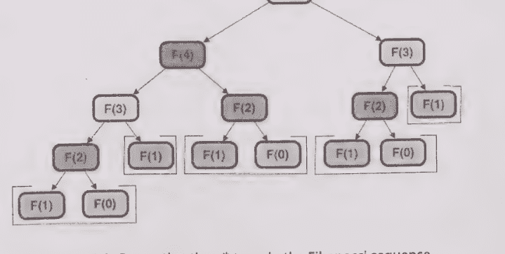
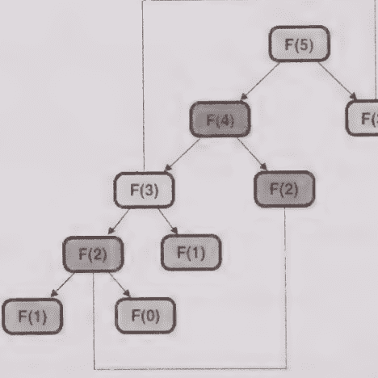
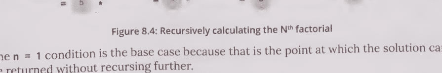
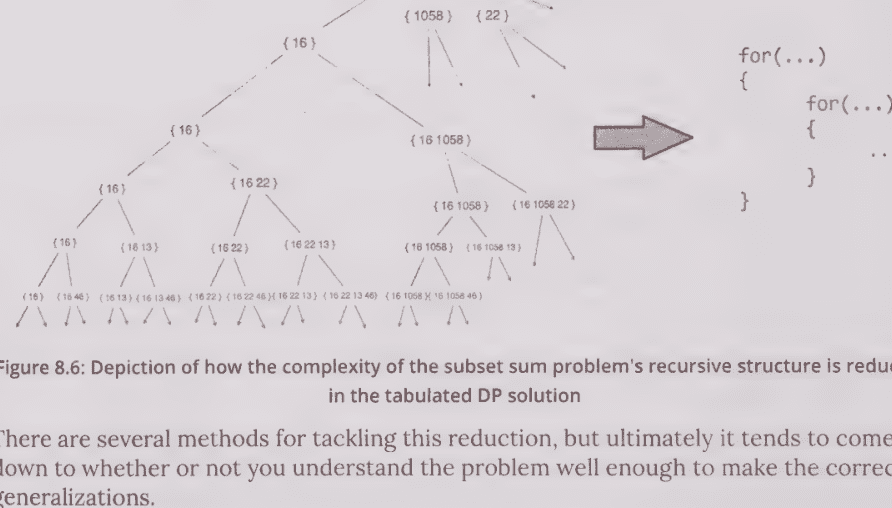
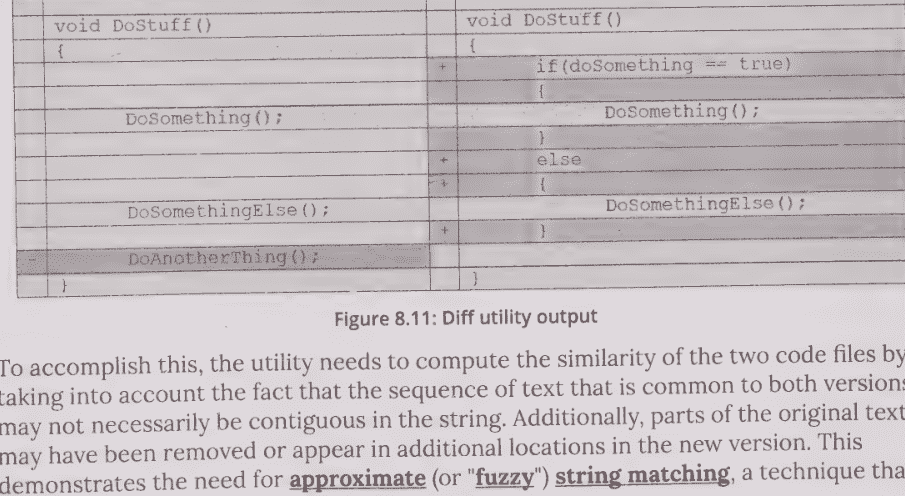
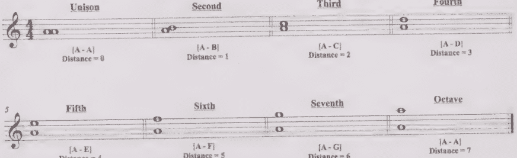
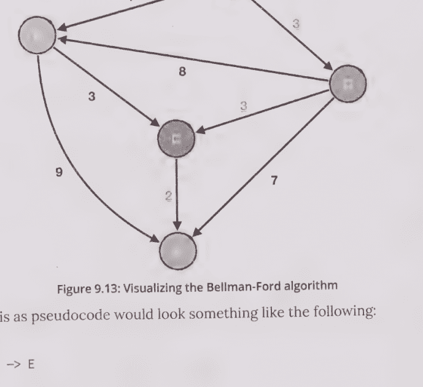
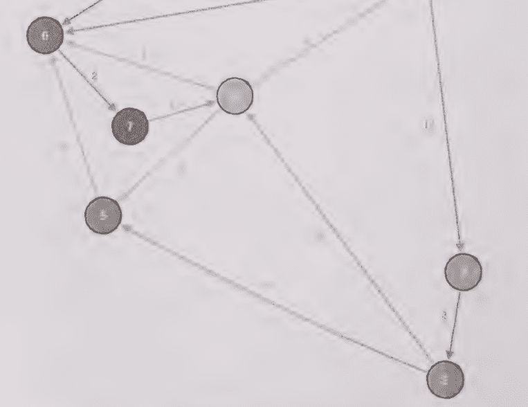

# 8
# 动态规划 I
# 学习目标

学完本章后，你将能够：

- 分析动态规划方法是否可以应用于给定问题
- 在记忆化与填表法之间进行比较并选择正确的方法
- 使用记忆化选择合适的缓存方案
- 使用朴素的暴力方法分析问题
- 通过实现逐步优化的算法来开发动态规划解决方案

在本章中，你将了解动态规划方法。本章将指导你实现这一方法，以解决计算机科学中的一些著名问题。

## 引言

许多程序员对**动态规划（DP）**既爱又怕，它是分治范式的一种概念性扩展，适用于特定类别的问题。动态规划问题所涉及的困难是多方面的，通常需要创造力、耐心以及将抽象概念可视化的能力。然而，这些问题带来的挑战往往有优雅且出奇简单的解决方案，能让程序员获得远超当前任务范围的洞察力。

在上一章中，我们讨论了几种技术，例如分治法和贪心法。这些方法虽然在适当的情况下非常有效，但在某些情况下不会产生最优结果。例如，在上一章中，我们讨论了 Dijkstra 算法在具有负权边的图上不会产生最优结果，而 Bellman-Ford 算法则可以。对于那些可以递归求解但无法使用上述技术求解的问题，动态规划解决方案通常是最好的方法。

动态规划问题也出现在各种各样的场景中。这里仅举几个大类示例：

- 组合数学（计算满足特定条件的序列的组合数/排列数）
- 字符串/数组（编辑距离、最长公共子序列、最长递增子序列等）
- 图（最短路径问题）
- 机器学习（语音/人脸识别）

让我们从理解动态规划的基本思想开始。

## 什么是动态规划？

回答这个问题的最佳方式是通过示例。为了说明动态规划的用途，让我们来看斐波那契数列：

```
{ 0, 1, 1, 2, 3, 5, 8, 13, 21, 34, 55, ... }
```

观察上述序列可以看出，从第三个元素开始，每一项等于前两项之和。这可以用以下公式简单表达：

```
F(0) = 0
F(1) = 1
...
F(n) = F(n-1) + F(n-2)
```

我们可以清楚地看到，该数列的各项之间存在递归关系——当前项 F(n) 基于前两项 F(n-1) 和 F(n-2) 的结果，因此前面的等式，即 F(n) = F(n-1) + F(n-2)，被称为该数列的递推关系。初始项 F(0) 和 F(1) 被称为基准情形，即在不需要进一步递归的情况下就能得到解的情形。这些操作如下图所示：



图 8.1：计算斐波那契数列的第 n 项

用英文描述上图可能如下所示：

```
F5 is equal to:
    F4 + F3, where F4 is equal to:
.       F3 + F2, where F3 is equal to:
.       .       F2 + F1, where F2 is equal to:
.       .       .       F1 + F0, where F1 = 1 and F0 = 0.
```

要使用动态规划解决问题，问题必须具有这两个性质。由于重叠子问题的性质，这些问题的复杂度往往会随输入规模的增大而呈指数增长；但是，利用最优子结构的性质，可以显著降低复杂度。因此，动态规划的本质是设计一种缓存先前解的方法，以避免重复计算已经求解过的子问题。

# 记忆化——自顶向下方法

不，这不是“memorization”（记忆），尽管这个词也能相当准确地描述这种技术。通过记忆化，我们可以重新表述前面描述的自顶向下解决方案，以利用斐波那契数列体现的最优子结构性质。我们的程序逻辑本质上与之前相同，只是现在每得出一个解，就把它缓存到数组中，并按当前 n 的值建立索引（在这个问题中，n 表示定义当前递归分支的状态或参数集）。在每次函数调用开始时，我们都会检查缓存中是否有状态 F(n) 的解。如果有，就直接返回缓存的值：

```
const int UNKNOWN = -1;

const int MAX_SIZE = 100000;

vector<int> memo(MAX_SIZE, UNKNOWN);
```

```
int Fibonacci(int n)
{
    if(n < 2)
    {
        return n;
    }
    if(memo[n] != UNKNOWN)
    {
        return memo[n];
    }
}
```

```
int result = Fibonacci(n - 1) + Fibonacci(n - 2);
memo[n] = result;

return result;
}
```

现在递归树如下所示：



图 8.2：使用缓存解计算斐波那契数列的第 n 项

通过这样做，我们消除了相当多的冗余工作。这种以自顶向下方式递归缓存解的技术被称为**记忆化**，并且基本上可用于任何动态规划问题，只要满足以下条件：

+ 1. 你能设计一种缓存方案，在保持不同状态唯一性的同时利用它们之间的相似性。
+ 2. 你能在超出可用栈空间之前，累积所需子问题的解。

第一点意味着，对结果建立索引以便后续使用的方法必须既有效又有用。缓存方案要有效，它就只能被当作与解源自同一系列子问题的状态相匹配；缓存方案要有用，它就不能过于针对特定状态，以至于无法有效使用（例如，如果每个子问题在缓存中都有唯一索引，那么条件 "if(memo[KEY] != UNKNOWN)" 将永远不会为真）。

第二点指的是栈溢出错误的可能性：如果递归调用次数可能非常多，这是任何自顶向下方法的基本局限。当程序超过调用栈上可用的分配内存量时，就会发生栈溢出。根据具体问题的性质，所需的递归深度可能会使记忆化无法成为一种可行选择；一如既往，在选定方法之前评估手头任务的潜在复杂度是很有益处的。

对于动态规划问题，记忆化常常是一种不错的优化方法。但在许多情况下，还有更好的选择，我们将在下一节中介绍。

# 填表法——自底向上方法

动态规划的核心是填表法，它与记忆化是相反的方法。实际上，虽然“动态规划”一词有时同时用于记忆化和填表法，但通常认为它特指填表法。

填表法的标准实现是：先存储基准情形的解，然后以迭代方式为每个子问题填充一个表格，之后可以复用这些解来求其他子问题的解。与记忆化解相比，填表法的解通常被认为更难概念化，因为每个子问题的状态必须用一种可迭代表达的方式来表示。

使用填表法计算斐波那契数列的解决方案如下所示：

```
int Fibonacci(int n)
{
    vector<int> DP(n + 1, 0);
    
    DP[1] = 1;
    
    for(int i = 2; i <= n; i++)
    {
```


9枚25美分硬币、5枚5美分硬币 -> 2.25美元 + 0.25美元

8枚25美分硬币、4枚10美分硬币、2枚5美分硬币 -> 2.00美元 + 0.40美元 + 0.10美元

8枚25美分硬币、3枚10美分硬币、4枚5美分硬币 -> 2.00美元 + 0.30美元 + 0.20美元

8枚25美分硬币、2枚10美分硬币、6枚5美分硬币 -> 2.00美元 + 0.20美元 + 0.30美元

在这些参数下，问题相当直接，只需尝试所有可用的货币组合，直到找到总和为2.50美元的组合即可解决。但如果需要找零的金额是337.81美元，而收银机里有100张纸币/硬币，面额分别为20.00美元、10.00美元、5.00美元、1.00美元、0.25美元、0.10美元、0.05美元和0.01美元，那该怎么办？我们可以清楚地看到，随着复杂度的增加，尝试每一种可能的求和变得相当不切实际。这是一个经典问题——子集和问题——的示例。

在最基本的形式中，子集和问题提出以下问题：给定一组非负整数S和一个整数x，S中是否存在某个子集，其元素之和等于x？请看以下示例：

S = { 13, 79, 45, 29 }

x = 42 -> 真（13 + 29）

x = 25 -> 假

以上面的集合为例，我们可以找到以下16个子集：

{ }

{ 13 }

{ 79 }

{ 45 }

{ 29 }

{ 13, 79 }

{ 13, 45 }

{ 13, 29 }

{ 79, 45 }

{ 79, 29 }

{ 45, 29 }

{ 13, 79, 45 }
{ 13, 79, 29 }
{ 13, 45, 29 }
{ 79, 45, 29 }

{ 13, 79, 45, 29 }

通过列出不同大小集合所能产生的子集总数，我们得到以下数字：

0: 1
1: 2
2: 4
3: 8
4: 16
5: 32
6: 64
7: 128
...

从这个列表中，我们可以推断出，大小为n的集合所能形成的子集总数等于2ⁿ，这表明需要考虑的子集数量随着n的增大而呈指数级增长。假设S中元素的数量很小，比如10个或更少，那么用暴力破解法可以很快找到解决方案；但如果我们重新考虑收银机中有100张不同纸币/硬币的例子，S的大小将等于100，那就需要探索1,267,650,600,228,229,401,496,703,205,376个子集！

## 解决子集和问题——步骤1：评估是否需要动态规划

面对这样的问题，我们的第一步是确定它是否能够（和/或应该）用动态规划来解决。重申一下，一个问题如果具有以下性质，就可以用动态规划解决：

- **重叠子问题：** 与标准的分治方法类似，最终解决方案可以通过以某种方式组合较小子问题的解决方案来得出；但与分治不同的是，某些子问题会被多次遇到。
- **最优子结构：** 给定问题的最优解可以由其子问题的最优解产生。

让我们根据是否具备这些特征来分析前面的示例：

大小 = 0
{ }

大小 = 1
{ 13 } → {} ∪ { 13 }
{ 79 } → {} ∪ { 79 }
{ 45 } → {} ∪ { 45 }
{ 29 } → {} ∪ { 29 }

大小 = 2
{ 13 79 } = { 13 } ∪ { 79 }
{ 13 45 } = { 13 } ∪ { 45 }
{ 13 29 } = { 13 } ∪ { 29 }
{ 79 45 } = { 79 } ∪ { 45 }
{ 79 29 } = { 79 } ∪ { 29 }
{ 45 29 } = { 45 } ∪ { 29 }

大小 = 3
{ 13 79 45 } = { 13 79 } ∪ { 45 }
{ 13 79 29 } = { 13 79 } ∪ { 29 }
{ 13 45 29 } = { 13 45 } ∪ { 29 }
{ 79 45 29 } = { 79 45 } ∪ { 29 }

大小 = 4
{ 13 79 45 29 } = { 13 79 45 } ∪ { 29 }

图8.3：最优子结构和重叠子问题

重新整理子集的集合可以清楚地看到，每个大小为n的新子集都是通过在大小为n - 1的子集上附加一个新元素而形成的。这是构造新子集的最优方法，并且对于每个大小大于0的子集都成立。因此，子集和问题具有最优子结构。我们还可以看到，一些子集源自同一个“子子集”（例如，{ 13 79 45 }和{ 13 79 29 }都基于{ 13 79 }）。因此，该问题也具有重叠子问题。

两个标准都已满足，我们可以得出结论：这个问题可以用动态规划解决。

## 步骤2 – 定义状态和基本情况

在确定这是一个动态规划问题之后，我们现在必须确定在此问题的语境中什么构成一个状态。换句话说，就我们试图回答的问题而言，什么使得一个可能的解决方案与另一个不同？

虽然通常建议在过程早期考虑这些方面，但在不清楚最终结果是如何形成的情况下，往往很难定义动态规划问题的状态，因此，从最容易实现的方式入手实现解决方案通常很有帮助。因此，我们将通过两种更易于实现的方式来解决子集和问题，从而逐步理解其基本情况和状态。

在探索动态规划的过程中，我们将针对每个问题总共考虑四种不同的方法：暴力破解、回溯、记忆化和填表。与任何动态规划问题一样，所有这些方法都能产生正确的结果，但随着输入规模的增大，前三种方法很快就会暴露出自身的局限性。尽管如此，在解决任何动态规划问题时，以这种方式逐步实现优化方案可以发挥巨大作用。

### 步骤2.a：暴力破解

尽管效率低下，但暴力破解解决方案对于加深对当前问题的理解非常有帮助。实现暴力破解方法可能是形成动态规划解决方案过程中的关键步骤，原因如下：

- **简单性：** 在不考虑任何效率的情况下编写解决方案，这种简单性是培养对问题基本方面理解的好方法；它还能让人洞察问题的本质，而如果缺乏足够的背景，在试图理解其复杂性时可能会错过这些洞察。
- **解决方案正确性的确定性：** 通常情况下，一个特别复杂的动态规划解决方案在问题被更好地理解后，需要进行相当多的重新设计。因此，必须有一种方法可以将解决方案的输出与正确答案进行比较。
- **可视化子问题的能力：** 暴力破解解决方案会生成所有可能的解决方案，然后选择满足问题条件的那些方案。这为可视化正确解决方案的形成提供了有效手段，之后可以检查其中可用于后续方法的关键模式。

以下练习演示了暴力破解方法的实现。

## 练习36：使用暴力破解方法解决子集和问题

在本练习中，我们将使用暴力破解方法为子集和问题找到一个解决方案。让我们开始吧：

1. 首先包含以下头文件（为了方便，也包含std命名空间）：
```
#include <iostream>
#include <vector>
#include <algorithm>

using namespace std;
```

2. 此外，让我们定义一个名为DEBUG的预处理器常量和一个名为PRINT的宏，该宏仅在DEBUG不为零时向stderr打印信息：
```
#define DEBUG 0

#if DEBUG
#define PRINT(x) cerr << x
#else
#define PRINT(x)
#endif
```

3. 现在我们将声明一个新函数`SubsetSum_BruteForce()`，它接受两个参数——一个整数数组`set`和一个整数`sum`——并返回一个布尔值：
```
bool SubsetSum_BruteForce(vector<int> set, int sum)
{
    ....
}
```

4. 现在，让我们声明另一个函数`GetAllSubsets()`，它接受四个参数——两个整数向量`set`和`subset`；一个整数`index`；以及一个三维整数向量`allSubsets`（通过引用传递）。我们将使用此函数递归地生成S的所有子集：
```
void GetAllSubsets(vector<int> set, vector<int> subset, int index,
vector<vector<vector<int>>> &allSubsets)
{
    // 如果到达集合末尾则终止
    if(index == set.size())
```

```cpp
{
    // Add the accumulated subset to the results, indexed by size
    allSubsets[subset.size()].push_back(subset);

    return;
}

// Continue without adding element to subset
GetAllSubsets(set, subset, index + 1, allSubsets);

// Add element to subset
subset.push_back(set[index]);
GetAllSubsets(set, subset, index + 1, allSubsets);
}
```

- 5. 回到我们的 **SubsetSum_BruteForce()** 函数，现在我们可以声明 allSubsets 并调用该函数：

```cpp
bool SubsetSum_BruteForce(vector<int> set, int target)
{
    vector<vector<vector<int>>> allSubsets(set.size() + 1);

    GetAllSubsets(set, {}, 0, allSubsets);

    ......
```

- 6. 现在，我们可以遍历每个子集，将其总和与 **target** 比较，如果找到匹配则返回 **true**：

```cpp
for(int size = 0; size <= set.size(); size++)
{
    PRINT("SIZE = " << size << endl);

    for(auto subset : allSubsets[size])
    {
        int sum = 0;

        PRINT("\t{ ");

        for(auto number : subset)
        {
            PRINT(number << " ");

            sum += number;
        }
        PRINT("} = " << sum << endl);

        if(sum == target) return true;
    }
}
```

- 7. 如果在检查完所有子集后仍未找到匹配的总和，则返回 `false`：

```cpp
.....

return false;
}
```

- 8. 现在，在 `main()` 函数中，让我们按如下方式定义集合和目标值：

```cpp
int main()
{
    vector<int> set = { 13, 79, 45, 29 };
    int target = 58;

    .....
}
```

- 9. 我们现在可以像这样使用这些输入调用 `SubsetSum_BruteForce()`：

```cpp
bool found = SubsetSum_BruteForce(set, target);

if(found)
{
    cout << "Subset with sum " << target << " was found in the set." << endl;
}
else
{
    cout << "Subset with sum " << target << " was not found in the set."
         << endl;
}
```

- 10. 运行上述代码后，你应该会看到以下输出：

```text
Subset with sum 58 was found in the set.
```

- 11. 现在，让我们将 `target` 设置为一个在集合中不存在的总和：

```cpp
int target = 1000000;
```

- 12. 再次运行程序，应产生以下输出：

```
Subset with sum 1000000 was not found in the set.
```

- 13. 最后，让我们将 DEBUG 常量重新定义为 1：

```
#define DEBUG 1
```

- 14. 现在运行程序将产生以下输出：

```
SIZE = 0
    { } = 0
SIZE = 1
    { 29 } = 29
    { 45 } = 45
    { 79 } = 79
    { 13 } = 13
SIZE = 2
    { 45 29 } = 74
    { 79 29 } = 108
    { 79 45 } = 124
    { 13 29 } = 42
    { 13 45 } = 58
    { 13 79 } = 92
SIZE = 3
    { 79 45 29 } = 153
    { 13 45 29 } = 87
    { 13 79 29 } = 121
    { 13 79 45 } = 137
SIZE = 4
    { 13 79 45 29 } = 166
Subset with sum 1000000 was not found in the set.
```

因此，我们能够使用暴力方法找到所需的子集。请注意，我们基本上是在尝试每一种可能性以求找到解。在下一节中，我们将在此基础上应用一层优化。

## 步骤 2.b：优化我们的方法——回溯法

显然，暴力方法还有许多不尽如人意之处。在性能方面，它几乎可以说是最低效的。通过不加区分地检查每一个可能的子集，我们在早已能够确定某些选项永远不会通向解之后，仍然继续考虑它们（例如，总和超过目标的子集）。为了改进我们的算法，我们可以利用回溯来排除所有保证无效的子问题分支。

在尝试使用动态规划（DP）之前实现回溯解的主要优点是，它要求我们确定问题的基本情况（base case）和中间递归状态。正如我们本章前面所定义的，基本情况是递归函数中的一个条件，它不依赖进一步的递归来产生答案。为了进一步说明，考虑计算一个数的阶乘的问题（数 n 的阶乘等于 n * (n-1) * (n-2) * (n-3) ... * 1）。我们可以编写一个 C++ 函数来实现这一点，如下所示：

```cpp
int Factorial(int n)
{
    // Base case - stop recursing
    if(n == 1)
    {
        return 1;
    }

    // Recurse until base case is reached
    return n * Factorial(n - 1);
}
```

这个递归函数的结构可以这样说明：



图 8.4：递归计算第 N 个阶乘

n = 1 的条件就是基本情况，因为此时可以在不进一步递归的情况下返回解。

在子集和问题中，定义基本情况的一种方式如下：

```
如果给定子集的总和等于 target：TRUE
```

否则：

- 如果总和大于 target：FALSE
- 如果到达集合末尾：FALSE

既然我们已经确定了基本情况，就需要定义中间状态。以暴力算法的输出作为参考，我们可以分析每个大小组中的子集是如何形成的，从而规划出我们的状态转换：

```
Base case -> { } [SUM = 0]

{ } -> { 13 } [0 + 13 = 13]
      { 79 } [0 + 79 = 79]
      { 45 } [0 + 45 = 45]
      { 29 } [0 + 29 = 29]
```

当然，大小为 0 和大小为 1 的状态是最容易理解的。我们从一个空集开始，可以向其中添加任何元素，从而创建所有大小为 1 的子集。

```
{ 13 } -> { 13 79 } [13 + 79 = 92]
         { 13 45 } [13 + 45 = 58]
         { 13 29 } [13 + 29 = 42]

{ 79 } -> { 79 45 } [79 + 45 = 124]
         { 79 29 } [79 + 29 = 108]

{ 45 } -> { 45 29 } [45 + 29 = 74]
```

对于大小为 2 的子集，我们可以遵循同样的逻辑。只需取每个大小为 1 的子集，并追加所有索引大于该子集中已有元素最大索引的元素。这基本上就是我们暴力实现中所采用的方法；不过，这次我们将在处理每个子集时考虑其总和，并在当前总和超过目标时终止它们：

```
TARGET = 58

SIZE = 2

{ 13 } -> +13 79+ (92)
    { 13 45 } (58) [*]
    { 13 29 } (42)

{ 79 } -> +79 45+ (124)
          +79 29+ (108)

{ 45 } -> +45 29+ (74)

SIZE = 3
    { 13 79 } -> +13 79 45+ (137)
                  +13 79 29+ (121)

    { 13 45 } -> +13 45 29+ (87)

    { 79 45 } -> +79 45 29+ (153)

SIZE = 4

{ 13 79 45 } -> +13 79 45 29+ (166)
```

图 8.5：消除超过目标值的项

当目标值等于 58 时，我们可以看到任何大小为 3 或 4 的子集都不需要考虑。因此，我们可以将中间状态转换描述如下：

```
对于索引为 i 的集合元素及子集 ss：
```

```
如果 ss 与 set[i] 的总和小于或等于 target：
```

- 1) 将 set[i] 追加到 ss
- 2) i 增加 1

```
下一状态 -> (i = i + 1, ss = ss U set[i])
```

```
无论如何：
```

- 1) 不将 set[i] 追加到 ss
- 2) i 增加 1

```
下一状态 -> (i = i + 1, ss = ss)
```

现在，我们应该提出以下问题：

- 表示这个状态所需的最少数据量是多少？
- 我们如何重新组织上述逻辑以去除不必要的信息？

考虑我们要解决的具体问题：在集合中查找是否存在一个元素子集，其总和等于目标值。根据问题描述，我们的任务并不要求我们生成实际的子集，而只需要它们的总和。因此，我们的伪代码可以更简洁地表达如下：

```
对于索引为 i 的集合元素及其总和 sum：
```

```
如果 sum 加上 set[i] 小于或等于 target：
```

- 1) 将 set[i] 的值加到 sum 上
- 2) i 增加 1

```
下一状态 -> (i = i + 1, sum = sum + set[i])
```

```
无论如何：
```

- 1) 不将 set[i] 的值加到 sum 上
- 2) i 增加 1

```
下一状态 -> (i = i + 1, sum = sum)
```

使用这种新方法，我们基本上可以用两个整数 sum 和 i 来表示每个状态转换，从而消除了在最坏情况下存储 2ⁿ 个子集数组的需要。此外，我们可以通过反转问题（即从 target 开始，在每一步减去 set[i]）来去除跟踪目标值的需要。作为最后的优化，我们可以在调用函数之前对集合进行排序，这使得一旦总和超过目标值，我们就能确定不再有其他有效的可能性。我们将在下面的练习中用 C++ 实现这一点。

### 练习 37：使用回溯法解决子集和问题

在本练习中，我们将解决一个与练习 36（使用暴力方法解决子集和问题）所演示的问题类似的问题，但使用回溯法以及更复杂的输入来突出两者的差异。让我们开始吧：

- 1. 为了实现子集和问题的回溯解法，我们定义一个名为 SubsetSum_Backtracking() 的函数，如下所示：

```cpp
bool SubsetSum_Backtracking(vector<int> &set, int sum, int i)
{
    ....
}
```

- 2. 正如递归函数中常见的情况一样，我们在最开始定义基本情况：

```
// 已找到总和
if(sum == 0)
{
    return true;
}
```

```
// 到达集合末尾，或超过此点后总和将超出范围
if(i == set.size() || set[i] > sum)
```


7. 现在，我们将编写另一个函数 **GetTime()**，它接受一个名为 `timer` 的 `clock_t` 对象的引用和一个 `string type`，然后返回 void：

```cpp
void GetTime(clock_t &timer, string type)
{
    // Subtract timer value from current time to get time elapsed
    timer = clock() - timer;

    // Display seconds elapsed
    cout << "TIME TAKEN USING " << type << ": " << fixed << setprecision(5)
         << (float)timer / CLOCKS_PER_SEC << endl;

    timer = clock(); // Reset timer
}
```

8. 现在，让我们重写 `main()` 函数，以便依次执行每个函数调用，并比较每种方法所花费的时间：

```cpp
int main()
{
    vector<int> set = { 13, 79, 45, 29 };
    int target = 58;
    int tests = 2;

    clock_t timer = clock();

    sort(set.begin(), set.end());

    for(int i = 0; i < tests; i++)
    {
        bool found;

        switch(i)
        {
            case 0: found = SubsetSum_BruteForce(set, target); break;
            case 1: found = SubsetSum_Backtracking(set, target, 0); break;
        }

        if(found)
        {
            cout << "Subset with sum " << target << " was found in the set." << endl;
        }
        else
        {
            cout << "Subset with sum " << target << " was not found in the set." << endl;
        }

        GetTime(timer, types[i]);
        cout << endl;
    }

    return 0;
}
```

9. 最后，让我们重新定义输入，以突出两种方法在效率上的差异：

```cpp
vector<int> set = { 16, 1058, 22, 13, 46, 55, 3, 92, 47, 7, 98, 367, 807, 106, 333, 85, 577, 9, 3059 };

int target = 6076;
```

10. 你的输出结果将大致如下所示：

```
Subset with sum 6076 was found in the set.
TIME TAKEN USING BRUTE FORCE: 0.89987

Subset with sum 6076 was found in the set.
TIME TAKEN USING BACKTRACKING: 0.00078
```

> **注意**
>
> 实际耗时值会因系统而异，请注意这些数值之间的差异。

如你所见，在这个特定案例中，使用回溯方法找到答案的速度提高了 1,000 多倍。在下一节中，我们将通过使用缓存进一步优化此解决方案。

## 第 3 步：记忆化

尽管回溯解决方案明显优于暴力法，但它仍然远非理想。考虑一种情况：目标总和很大且不在集合中——如果目标大于或等于集合中所有元素的总和，我们可以通过预先计算总和并检查目标是否在有效范围内来轻松确定结果。但是，如果目标总和仅略低于该值，我们的算法仍然会在完成之前被迫探索几乎所有的可能性。

为了演示这一差异，请尝试运行上一练习中的代码，使用 6799 作为目标值（恰好比集合中所有元素的总和少 1）。在作者的机器上，回溯解决方案平均耗时约 0.268 秒才得出结果——比练习中使用的目标值所花费的平均时间长约 350 倍。

幸运的是，我们已经拥有了所需的所有信息，可以在利用记忆化的同时设计出自顶向下的解决方案。更棒的是，我们几乎不需要修改之前的方法就可以实现它！

### 设计缓存方案

使用记忆化最重要的方面是定义缓存方案。缓存记忆化解决方案的结果可以通过多种方式完成，但最常见的方式如下：

- 简单数组，状态用数字索引表示
- 哈希表/映射，状态用描述性字符串表示，并使用内置语言特性进行哈希
- 哈希表/映射，状态用通过自定义哈希公式创建的哈希值表示

这里的选择很大程度上取决于具体情况，但以下是一些通用指导原则：

- 通过数字索引访问的数组/向量通常比映射快得多，因为映射必须先在映射中定位给定键，以确定它是否已被缓存。
- 即使状态可以用整数表示，如果缓存键相当大，那么足以容纳它们的数组的内存需求可能不合理。在这种情况下，映射是更好的选择。
- 哈希表（例如 `std::unordered_map`）在定位和检索键方面通常比标准映射/字典结构快得多（但仍比数组慢）。
- 在哪些数据类型可以用作键方面，`std::map` 比 `std::unordered_map` 通用得多。尽管 `std::unordered_map` 在技术上可以提供相同的功能，但它要求程序员为其默认无法作为键存储的数据类型创建自己的哈希函数。

你可能还记得本章引言中的内容，缓存方案应满足以下要求：

- 有效：缓存键的表示方式必须避免不同状态之间的冲突，这些状态不用于解决同一组子问题。
- 值得/有用：如果你的缓存方案过于具体，以至于从未实际产生任何“命中”，那么它本质上什么也实现不了。

在子集和问题中，我们可能会错误地认为，从具有给定和值的状态出发未能找到目标，意味着从任何其他具有相同和的状态也不可能得到真正结果。因此，我们可能会决定仅根据 `sum` 的值来缓存每个解决方案（即 `if(memo[sum] != UNKNOWN) return memo[sum];`）。这是一个无效缓存方案的例子，因为它没有考虑到在同一集合中可能有多种方式达到相同的和，如下所示：

```
{ 1 5 6 2 3 9 }
```

```
Sum of { 1 5 } = 6
Sum of { 6 } = 6
Sum of { 1 2 3 } = 6
```

假设前面示例中的目标值是 8。如果首先遇到第三种情况，memo[6] 将被设置为 false，这显然是不正确的，因为通过包含第 4 个元素 (2)，可以从另外两种情况到达目标。

一个无用的记忆化方案的例子是，键等于子集的索引，因为每个可能的状态都包含一个完全独特的键；因此，由同一组子问题形成的状态不会触发缓存命中。

如果你不确定缓存方案的有效性，可以存储一个计数器，在每次缓存命中时递增。如果该计数器的最终值等于 0，或者相对于你必须考虑的状态数量而言非常低，那么你可以得出结论：你的缓存方案需要修改。

我们将探讨使用向量进行缓存的记忆化实现。

### 练习 38：使用记忆化解决子集和问题

在本练习中，我们将尝试实现在*练习 37：使用回溯解决子集和问题*中实现的相同解决方案，但添加了记忆化。让我们开始吧：

1. 我们现在将创建另一个名为 `SubsetSum_Memoization()` 的函数。该函数的定义将与 `SubsetSum_Backtracking()` 完全相同，只是它将包含一个名为 `memo` 的二维整数向量的引用：

```cpp
bool SubsetSum_Memoization(vector<int> &set, int sum, int i,
vector<vector<int>> &memo)
{
    ......
}
```

2. 我们这个函数的大部分代码看起来与回溯方法非常相似。例如，我们的基本情况将与之前完全一样：

```cpp
if(sum == 0)
{
    return true;
}

if(i == set.size() || set[i] > sum)
{
    return false;
}
```

3. 现在，关键的区别在于，在基本情况之后，我们不会立即探索接下来的两个状态，而是检查 memo 表是否有缓存结果：

```cpp
// Is this state's solution cached?
if(memo[i][sum] == UNKNOWN)
{
    // If not, find the solution for this state and cache it

    bool append = SubsetSum_Memoization(set, sum - set[i], i + 1, memo);
    bool ignore = SubsetSum_Memoization(set, sum, i + 1, memo);

    memo[i][sum] = append || ignore;
}
// Return cached value
return memo[i][sum];
```

4. 现在，我们应该在 `main()` 函数中插入对 `SubsetSum_Memoization()` 的调用：

```cpp
int tests = 3;

for(int i = 0; i < tests; i++)
{
    bool found;

    switch(i)
    {
        case 0: found = SubsetSum_BruteForce(set, target); break;

        case 1: found = SubsetSum_Backtracking(set, target, 0); break;

        case 2:
        {
            // Initialize memoization table
            vector<vector<int>> memo(set.size(), vector<int>(7000, UNKNOWN));

            found = SubsetSum_Memoization(set, target, 0, memo);
            break;
        }
    }

    if(found)
    {
```


## Step 4: Tabulation

到目前为止，我们已经实现了三种不同的子集和问题的算法方法，每一种都比前一种有了显著的改进。然而，假设我们想要一个给定集合中每一个可能的子集和的列表。我们就必须对从 1 到整个集合的总和的每个和重复运行算法多次。对于这种情况，列表化通常是唯一高效的选择。

为这类问题实现迭代的列表化解决方案通常很难概念化。而问题的递归表述非常适合多维状态和分支条件，列表化解决方案必须以某种方式将复杂性的层级压缩成使用标准 for/while 循环的简单迭代集：



图 8.6：子集和问题递归结构的复杂性在列表化 DP 解决方案中是如何被降低的

有几种方法可以处理这种简化，但最终往往取决于你是否足够理解问题以做出正确的概括。

与记忆化类似，在定义了基例和问题的状态之后，首要目标是为不同状态的解制定存储方案。通常，列表化方法使用简单的数组/向量来实现这一目的。我们已经看过斐波那契数列计算中一个非常简单的 DP 表的例子：

```
F[n] = F[n - 1] + F[n - 2];
```

本章前面，我们还讨论了如何递归地计算阶乘。对于该问题的自底向上填充表格的方法看起来像这样：

```
factorial[n] = factorial[n - 1] * n;
```

这些例子非常简单，因为它们只包含一个维度且没有条件逻辑。每个状态从头到尾都有一个一致、可预测的公式。

这些例子与子集和问题的主要区别在于，后者以最小的方式唯一表示每个状态需要两个维度——集合中的索引和当前和。

让我们更深入地考虑我们对这个问题的一些见解：

- 每个大小为 k 的可能子集都可以通过取新元素并将其附加到每个大小为 k - 1 的子集上来形成。
- 如果在索引 i 处找到和值为 x 的解，那么任何最终导致相同条件集的状态转换序列都会产生相同的结果：

set = { 2 5 6 3 7 20 }
target = 28

| i | 0 | 1 | 2 | 3 | 4 | 5 |
|---|---|---|---|---|---|---|
| Sum | 2 {2} | {2} | {2 6} | {2 6} | {2 6} | {2 6 20} TRUE |
| Sum | - | 5 {5} | {5} | {5 3} | {5 3} | {5 3 20} TRUE |

图 8.7：同一索引值上具有相同和值的多条路径

这两个递归路径在标红的状态下，和值都等于 8，索引值都等于 3，这由于子集和问题的最优子结构意味着该状态的解只需要找到一次——无论之前发生了什么，只要到达这些条件，结果都相同。

有了这些事实，我们本质上可以反转自顶向下的方法来开发自底向上的方法。

### Top-down logic:

1. 从目标和和集合的第一个索引开始。
2. 遍历集合：
   - 如果和减少到零，结果为 TRUE。
   - 如果到达集合末尾或目标被超过，结果为 FALSE。
   - 否则，你可以从和中减去当前值或忽略它。
3. 如果目标可以从状态 S 找到，其中和等于 x 且索引等于 i，那么目标也可以从最终导致状态 S 的任何更早状态找到。

### Bottom-up logic:

1. 从和值和索引值等于 0 开始。
2. 遍历集合：
   - 如果在索引 0 到 i 之间可以找到等于 x 的和，那么在索引 0 到 i+1 之间也可以找到等于 x 的和。
   - 如果在索引 0 到 i 之间可以找到等于 x 的和，那么在索引 0 到 i+1 之间也可以找到等于 x + set[i] 的和。

就表格如何被填充而言，自顶向下的方法可以描述如下：

如果在状态 S1 中和等于 x 且索引等于 i，memo(i, x) 的值为 true，如果出现以下任一情况：

- 目标可以从状态 S2 找到（其中和等于 x - set[i] 且索引等于 i + 1），或...
- 目标可以从状态 S3 找到（其中和等于 x 且索引等于 i + 1）
- 否则，memo(i, x) = false。

该逻辑的自底向上版本如下：

如果和等于 x 且索引等于 i，DP(i, x) 的值为 true，如果出现以下任一情况：

- x 小于 set[i] 的值且 DP(i-1, x) = true
- x 大于或等于 set[i] 的值且 DP(i-1, x) = true 或 DP(i-1, x - set[i]) = true
- 否则，DP(i, x) = false。

换句话说，如果我们已经确定和 x 可以在索引 0 到 i（包含）之间形成，那么显然，和等于 x 和 x + set[i] 都可以在索引 0 到 i + 1 之间形成。我们将在以下练习中查看其实现。

```
cout << "Subset with sum " << target << " was found in the set." << endl;
}
else
{
    cout << "Subset with sum " << target << " was not found in the set." << endl;
}
GetTime(timer, types[i]);
cout << endl;
}
```

5. 现在，让我们将 target 定义为 6799 并运行我们的代码。你应该会看到类似这样的输出：

```
Subset with sum 6799 was not found in the set.
TIME TAKEN USING BRUTE FORCE: 1.00100

Subset with sum 6799 was not found in the set.
TIME TAKEN USING BACKTRACKING: 0.26454

Subset with sum 6799 was not found in the set.
TIME TAKEN USING MEMOIZATION: 0.00127
```

## Note

实际的时间值会根据你的系统而有所不同。请注意这些值之间的差异。

我们可以看到从输出中，缓存已将我们的问题优化了指数级因子。

```
sort(set.begin(), set.end());

for(int i = 0; i < tests; i++)
{
    bool found;

    switch(i)
    {
        .....
        case 3:
        {
            vector<vector<bool>> DP = SubsetSum_Tabulation(set);
            found = DP[set.size()][target];
            break;
        }
    }
}
.....
```

6. 你应该会看到与此处所示类似的输出：

```
Subset with sum 6076 was found in the set.
TIME TAKEN USING BRUTE FORCE: 0.95602

Subset with sum 6076 was found in the set.
TIME TAKEN USING BACKTRACKING: 0.00082

Subset with sum 6076 was found in the set.
TIME TAKEN USING MEMOIZATION: 0.00058

Subset with sum 6076 was found in the set.
TIME TAKEN USING TABULATION: 0.00605
```

## Note

实际的时间值会根据你的系统而有所不同。请注意这些值之间的差异。

7. 正如我们所见，列表化解决方案所花费的时间比记忆化和回溯解决方案更长。然而，使用 SubsetSum_Tabulation() 返回的 DP 表，我们可以使用以下代码找到每一个可能的子集和：

```
int total = 0;

for(auto num : set)
{
    total += num;
}

vector<vector<bool>> DP = SubsetSum_Tabulation(set);

vector<int> subsetSums;

for(int sum = 1; sum <= total; sum++)
{
    if(DP[set.size()][sum])
    {
        subsetSums.push_back(sum);
    }
}
cout << "The set contains the following " << subsetSums.size() << " subset sums: ";

for(auto sum : subsetSums)
{
    cout << sum << " ";
}
cout << endl;
```

8. 其输出应开始和结束如下：

```
The set contains the following 6760 subset sums: 3 7 9 10 12 13 16 19 20 22 ..... 6790 6791 6793 6797 6800
```

因此，我们优化了解决方案，同时也获得了所有状态的和值。


在本章中，我们探索了多种解决子集和问题的方法，而这反过来又证明了动态规划方法的明显优越性；然而，尽管 DP 解决方案相比替代方案具有比较优势，我们也演示了天真且相对低效的方法如何帮助我们更好地理解问题，这极大地简化了使用 DP 设计解决方案的过程。

动态规划解决方案所需的一些逻辑最初看起来可能相当复杂且难以理解。强烈建议你在继续之前完全理解本节中讨论的每种解决方案方法，因为这个过程可以通过使用不同的输入参数并比较结果来加速。此外，绘制不同解决方案如何从给定输入形成的过程图可能特别有帮助。

## Activity 18: Travel Itinerary

你正在为一家旅行社设计一个网络应用程序，该旅行社希望帮助客户规划他们的假期行程。该软件的一个主要方面是路线规划，允许用户指定他们想要访问的多个地点，然后查看前往最终目的地的途中需要经过的城市列表。

你的旅行社与每个主要城市中的特定交通公司签订了合同，而每家交通公司都对他们可以行驶的距离设定了限制。虽然飞机或火车可以穿越多个城市甚至整个国家，但公交车或出租车服务可能只愿意在其初始位置之外行驶一两个城市。当你的软件生成可能的中间停靠点列表时，它还会显示该位置的交通公司愿意行驶的最大城市数量，以便客户据此规划路线。

你最近意识到你的应用程序需要一种方法来允许客户过滤向他们展示的选项数量，因为许多热门旅游景点之间隔着密集的城镇群。为了做到这一点，你希望确定从给定起始位置到达最终目的地的总可能方式数，以便在信息变得过多时减少显示的信息量。

你的应用程序已经具备计算从出发点到目的地理想路线上位置列表的能力。从中，你得出了以下数据：

- `N`：表示源与目的地之间城市数量的整数
- `distance`：表示每个位置的交通公司愿意行驶的最大城市数量的整数数组

你的任务是实现一个算法，计算通过一系列中间位置到达目的地总共有多少种可能的方式。

### Input

第一行包含一个整数 `N`，表示起始点和目的地之间的城市数量。

第二行包含 `N` 个以空格分隔的整数，其中每个整数 `d_i` 表示从索引 `i` 处的城市开始可以行驶的最大距离。

### Output

你的程序应输出一个整数：从索引 0 开始并以索引 N 结束遍历城市的总方式数。由于随着 N 的增大值会变得很大，请将每个结果对 1000000007 取模输出。

### Example

假设你被给出以下输入：

```
6
1 2 3 2 2 1
```

这意味着源和目标位置之间总共有六个城市。从索引 `i` 处的给定城市出发，你可以选择前往 `i + 1` 到 `i + distance[i]` 范围内的任何其他城市（包含）。如果我们将城市序列视为图，前述示例的邻接关系如下：

```
[0]: { 1 }
[1]: { 2, 3 }
[2]: { 3, 4, 5 }
[3]: { 4, 5 }
[4]: { 5, 6 }
[5]: { 6 }
```

### Extra Credit

假设你已经找到一种方法在合理的时间限制内通过前述测试用例，你可以用一个最终测试用例真正测试算法的效率，N 等于 1000000。由于值的数量打印起来会占用太多空间，你可以使用以下代码以编程方式生成数组值：

```cpp
vector<int> Generate(int n)
{
    vector<int> A(n);
    ULL val = 1;
    for(int i = 0; i < n; i++)
    {
        val = (val * 1103515245 + 12345) / 65536;
        val %= 32768;
        A[i] = ((val % 10000) % (n - i)) + 1;
    }
    return A;
}
```

你的程序应将此测试用例的结果打印为 318948158。一个最优算法应在不到一秒的时间内找到结果。

### Activity Guidelines

- 最优方法将在 O(n) 时间内运行并需要恰好 n 次迭代。
- 如果你完全不确定如何制定 DP 解决方案，请使用本章中描述的增量方法，即先使用暴力方法，然后逐步优化解决方案。
- 为了深入了解问题的状态是如何形成的，请考虑斐波那契数列所表现出的递推关系。

### Note

该活动的解决方案可在第 556 页找到。

```cpp
else
{
    DoSomethingElse();
}
}
```

差异实用程序然后会显示类似以下内容：



要实现这一点，该实用程序需要通过考虑到两个版本共有的文本序列可能并不一定在字符串中连续这一事实来计算两个代码文件的相似度。此外，原文本的一部分可能已被删除或在新版本中出现在额外的位置。这证明了近似（或“模糊”）字符串匹配的必要性，这是一种经常使用动态规划的技术。

## The Longest Common Subsequence Problem

最长公共子序列问题（通常缩写为 LCS）是动态规划最著名的经典示例之一。它回答了以下问题：给定两个数据序列，它们共同的最长子序列是什么？

例如，考虑两个字符串 A 和 B：

```
A = "ALBOCNDGZEYSXTW"
B = "12L45078N90GE9876S5432T"
```

图 8.12：用于查找最长公共子序列的两个给定字符串

```
A = "ABCXY"
B = "ACYX"
LCS = 3
```

图 8.15：最长子序列问题的子问题树

在前面的图中，重叠的子问题已被颜色编码。这个问题的最优子结构仍然不是很清楚，但我们可以仍然做出一些基本概括：

- 我们只需要比较等长子集。
- 从给定状态，下一个状态的可能性可以通过递增 i、j 或两者来探索。
- 我们的搜索总是在到达任一字符串的末尾时结束。

希望，我们初步的暴力实现可以提供额外的见解。让我们在以下练习中立即开始。

3. `A` 和 `B` 当然是我们比较的字符串，`i` 和 `j` 分别表示我们在 `A` 和 `B` 中的当前位置，而 `subsequence` 是形成每个公共子序列的索引对集合，将被收集在 `found` 中以供输出。

由于我们已经有伪代码可供使用，我们可以通过简单地将每行伪代码插入我们的函数作为注释并在下方将其翻译成 C++ 代码来相对轻松地实现我们的函数：

```cpp
// If i exceeds length of A, or j exceeds length of B:
if(i >= A.size() || j >= B.size())
{
    found.push_back(subsequence);

    // Terminate recursion and return length of subsequence
    return subsequence.size();
}

// if A[i] == B[j]:
if(A[i] == B[j])
{
    // Increase length of subsequence by 1
    subsequence.push_back({ i, j });

    // Increment both i and j by 1
    return LCS_BruteForce(A, B, i + 1, j + 1, subsequence);
}
/*
    Option 1) Explore further possibilities with i + 1, and j
    Option 2) Explore further possibilities with i, and j + 1

    LCS from this state is equal to maximum value of Option 1 and Option 2
*/

return max(LCS_BruteForce(A, B, i + 1, j, subsequence),
           LCS_BruteForce(A, B, i, j + 1, subsequence));
```


4. 在`main()`函数中，我们将以两个字符串的形式接收输入，然后调用我们的函数：

```
int main()
{
    string A, B;
    cin >> A >> B;

    int LCS = LCS_BruteForce(A, B, 0, 0, {});

    cout << "Length of the longest common subsequence of " << A << " and " << B << " is: " << LCS << endl;

    ...
}
```

5. 和上一章一样，如果`DEBUG`未设置为0，我们还会将找到的子序列输出到标准错误输出（stderr）。不过，由于这个问题的复杂性更高，我们将这部分输出放在一个单独的函数`PrintSubsequences()`中：

```
void PrintSubsequences(string A, string B)
{
    // Lambda function for custom sorting logic
    sort(found.begin(), found.end(), [](auto a, auto b)
    {
        // First sort subsequences by length
        if(a.size() != b.size())
        {
            return a.size() < b.size();
        }

        // Sort subsequences of same size by lexicographical order of index
        return a < b;
    });

    // Remove duplicates
    found.erase(unique(found.begin(), found.end()), found.end());

    int previousSize = 0;
```

7. 将`DEBUG`设置为1，并使用`ABCX`和`ACYXB`作为输入，应该会得到如下输出：

```
Length of the longest common subsequence of ABCX and ACYXB is: 3
SIZE = 1
    A__  A___
SIZE = 2
    AB__ A___B
    A_C_ AC___
    A__X A__X_
SIZE = 3
    A_CX AC_X_
```

这个输出向我们展示了子序列对的所有可能组合。接下来，让我们在下一节中分析这个输出，并着手优化我们的解决方案。

## 迈向优化的第一步——寻找最优子结构

让我们重新审视之前方法的逻辑，看看如何对其进行优化。使用上一练习中的输入字符串`ABCX`和`ACYXB`，如果当前状态是`i = 0`且`j = 0`，我们就能清楚地看到，下一个状态的唯一可能性如下：

```
LCS(A, B, 0, 0) = 1 + LCS(A, B, 1, 1)
```

你可能还记得，我们最初的见解之一是：如果两个字符串中有一个或两个为空，则LCS等于0。我们还可以归纳出：给定A的前缀和B的前缀的LCS，等于A减少一个字符后的前缀与B的LCS，以及B减少一个字符后的前缀与A的LCS，这两者中的最大值：

```
A = "ABC"
B = "AXB"

LCS of "ABC", "AXB"
= max(LCS of "AB" and "AXB", LCS of "ABC" and "AX")
= LCS of "AB" and "AXB"
= "AB"
```

## 测试用例

以下测试用例应该能帮助你更好地理解这个问题：

| 输入： | 输出： |
|---|---|
| 123456<br>QWERTY | 0 |

| 输入： | 输出： |
|---|---|
| ACBEBC<br>ABCBC | 4 |

| 输入： | 输出： |
|---|---|
| AZYBYXCXW<br>ZZAYYBXXXCWW | 6 |

| 输入： | 输出： |
|---|---|
| ABCABDBEFBA<br>ABCBEFBEAB | 8 |

| 输入： | 输出： |
|---|---|
| ABZCYDABAZADAEA<br>YABAZADBBEAAECYACAZ | 10 |

图8.16：活动19的测试用例

### 活动指南：

- 你可以用二维来表示状态，第一个维度受A的长度约束，第二个维度受B的长度约束。
- 将暴力算法转换为带备忘的算法几乎不需要改动。
- 确保你的方法能够区分已经缓存过的子问题和尚未缓存的子问题。

### 注意

本活动的解答可在第563页找到。

## 活动20：使用表格法寻找最长公共子序列

在本活动中，你的任务是使用表格法实现最长公共子序列问题的自底向上解决方案。

### 输入

两个字符串，分别为A和B。

### 输出

A和B的最长公共子序列的长度。

### 额外加分

除了LCS的长度外，还要输出它包含的实际字符。

### 测试用例

以下测试用例应该能帮助你更好地理解这个问题：

| 输入： | 输出： |
|---|---|
| A1B2C3D4E<br>ABCDE | 5<br>额外加分：ABCDE |

| 输入： | 输出： |
|---|---|
| ABZCYDABAZADAEA<br>YABAZADBBEEAECYACAZ | 10<br>额外加分：YABAZADAEA |

| 输入： | 输出： |
|---|---|
| QWJEHFBEMVJEIIFJEEVFBEHFJXAJXBE<br>BVBQHEJEJCHEEHXBNEBCHHEHHFEHSBE | 14<br>额外加分：QHEJEJEEBEHFBE |

| 输入： | 输出： |
|---|---|
| AAA12AAA3AA4AA56AA7AAA8<br>AA1AA2AAA3A4A5A6AA7A89AAA | 19<br>额外加分：AA12AAA3AA4A56AA7AAA |

图8.18：活动20的测试用例

### 活动指南

- 与子集和问题类似，表格化解决方案需要遍历两个嵌套的`for`循环。
- 对于给定状态`LCS(i, j)`，需要处理三种可能性——要么字符串的前缀为空，要么A和B前缀的最后一个字符相等，要么A和B前缀的最后一个字符不相等。
- 可以通过回溯DP表来找到LCS的字符。

### 注意

本活动的解答可在第568页找到。

## 活动21：旋律排列

### 注意

本活动基于传统的西方八音平均律音阶，但学生不需要了解任何音乐理论即可完成本活动。这里提供了所有必要的音乐方面信息。

音乐集合理论是一种根据音符之间的音程关系对音乐和声与旋律进行分类的形式。在音乐术语中，音程可以定义为两个音符在乐谱中相对位置之间的距离：


图8.19：音乐记谱法

下图展示了以音乐记谱法表示的不同音符之间的距离：

### 音程



你是一位音乐理论家，好奇特定音符集的某个排列在各作曲家旋律中出现了多少次。给定一段完整旋律的音符和一个音符集，计算该音符集的任意排列在旋律中出现的次数。对于任何有效的排列，音符可以重复任意次数，并且可以以任意顺序出现：

```
        0     1     2     3     4     5     6

Melody:    { "A", "B", "C", "C", "E", "C", "A" }
Note set:  { "A", "C", "E" }
```

子集：

- `{ 0, 2, 4 }` → `{ "A", "C", "E" }`
- `{ 0, 3, 4 }` → `{ "A", "C", "E" }`
- `{ 0, 4, 5 }` → `{ "A", "E", "C" }`
- `{ 2, 4, 6 }` → `{ "C", "E", "A" }`
- `{ 3, 4, 6 }` → `{ "C", "E", "A" }`
- `{ 4, 5, 6 }` → `{ "E", "C", "A" }`
- `{ 0, 2, 3, 4 }` → `{ "A", "C", "C", "E" }`

- `{ 0, 2, 4, 5 }` → `{ "A", "C", "E", "C" }`
- `{ 0, 2, 4, 6 }` → `{ "A", "C", "E", "A" }`
- `{ 0, 3, 4, 5 }` → `{ "A", "C", "E", "C" }`
- `{ 0, 3, 4, 6 }` → `{ "A", "C", "E", "A" }`
- `{ 0, 4, 5, 6 }` → `{ "A", "E", "C", "A" }`
- `{ 2, 3, 4, 6 }` → `{ "C", "C", "E", "A" }`
- `{ 2, 4, 5, 6 }` → `{ "C", "E", "C", "A" }`
- `{ 3, 4, 5, 6 }` → `{ "C", "E", "C", "A" }`

- `{ 0, 2, 3, 4, 5 }` → `{ "A", "C", "C", "E", "C" }`
- `{ 0, 2, 3, 4, 6 }` → `{ "A", "C", "C", "E", "A" }`
- `{ 0, 2, 4, 5, 6 }` → `{ "A", "C", "E", "C", "A" }`
- `{ 0, 3, 4, 5, 6 }` → `{ "A", "C", "E", "C", "A" }`
- `{ 2, 3, 4, 5, 6 }` → `{ "C", "C", "E", "C", "A" }`

- `{ 0, 2, 3, 4, 5, 6 }` → `{ "A", "C", "C", "E", "C", "A" }`

总排列数 = 21

以下音符被描述为等音等价，应视为相同：

- C - B#（B#读作“B升”）
- C# - Db（Db读作“D降”）
- D# - Eb
- E - Fb
- E# - F
- F# - Gb
- G# - Ab
- A# - Bb
- B - Cb

输出：27

输入：

旋律：{ "Bb", "Db", "Ab", "G", "Fb", "Eb", "G", "G", "Ab", "A", "Bb", "Cb", "Gb", "G", "E", "A", "G#" }

音符集：{ "Ab", "E", "G" }

输出：315

输入：

旋律：{ "C", "C#", "D", "Bb", "E#", "F#", "D", "C#", "A#", "B#", "C#", "Eb", "Gb", "A", "A#", "Db", "B", "D#" }

音符集：{ "Bb", "C#", "D#", "B#" }

输出：945

输入：

旋律：{ "A#", "B", "D#", "F#", "Bb", "A", "C", "C#", "Db", "Fb", "G#", "D", "Gb", "B", "Ab", "G", "C", "Ab", "F", "F#", "E#", "G", "Db" }

音符集：{ "A", "Db", "Gb", "A#", "B", "F#", "E#" }

输出：1323

本活动的指南如下：

- 除了描述中解释的内容，你并不需要真正了解任何音乐理论来解决这个问题。
- 有没有更好的方式来表示这些音符？能否将它们转换成更适合表格化DP解决方案的格式？
- `n`个元素的总子集数是多少？这个信息对解决这个问题有用吗？

### 注意

本活动的解答可在第574页找到。


## 引言

通过上一章的学习，你应该已经对动态规划有了基本的了解，并且掌握了一套有效的策略，能够为陌生问题寻找动态规划（DP）解法。在本章中，我们将通过探索问题之间的关系来进一步加深这一理解，特别是如何修改一个问题的基本 DP 逻辑来找到另一个问题的求解思路。我们还将讨论状态空间缩减的概念，它允许我们利用问题的某些特征，通过减少求解结果所需的维度数和/或运算数，来进一步优化一个可行的 DP 解决方案。最后，我们将重新回到图这一主题，演示如何将 DP 方法应用于最短路径问题。

## P 与 NP 概述

在第 8 章“动态规划 I”中，我们展示了动态规划相比其他方法在效率上的显著提升，但可能还不太清楚差异究竟有多大。了解某些问题的复杂度会随着输入规模的增大而如何增长非常重要，因为这样我们就能理解在哪些情况下 DP 不仅更可取，而且是必不可少的。

考虑下面的问题：

> “给定一个布尔公式的项和运算符，判断它的计算结果是否为真。”

请看下面的例子：

- (0 或 1) -> 真
- (1 与 0) -> 假
- (1 非 1) -> 假
- (1 非 0) 与 (0 非 1) -> 真

然而，想象一下，问题如果换一种表述方式：

> “给定一个布尔公式的变量和运算符，判断是否存在对每个变量的真/假赋值，使得公式的计算结果为真。”

请看下面的例子：

```
(a1 OR a2) -> TRUE
```

```
(0 ∨ 0) = FALSE
(0 ∨ 1) = TRUE
(1 ∨ 0) = TRUE
(1 ∨ 1) = TRUE
```

```
(a1 AND a2) -> TRUE
```

```
(0 ∧ 0) = FALSE
(0 ∧ 1) = FALSE
(1 ∧ 0) = FALSE
(1 ∧ 1) = TRUE
```

```
(a1 NOT a1) -> FALSE
```

```
(0 ¬ 0) = FALSE
(1 ¬ 1) = FALSE
```

```
(a1 NOT a2) AND (a1 AND a2) -> FALSE
```

```
(0 ¬ 0) ∧ (0 ∧ 0) = FALSE
(0 ¬ 1) ∧ (0 ∧ 1) = FALSE
(1 ¬ 0) ∧ (1 ∧ 0) = FALSE
(1 ¬ 1) ∧ (1 ∧ 1) = FALSE
```

注意：如果你不熟悉逻辑符号，¬ 表示“非”，因此 (1 ¬ 1) = 假，(1 ¬ 0) = 真。另外，∧ 表示“与”，而 ∨ 表示“或”。

寻找解决方案的复杂度无疑是呈指数级的。然而，这个问题并不满足 NP 完全性的标准，因为验证某一步骤是否最优这一基本行为本身也需要同样的复杂度。

将此示例与求解数独谜题的问题进行比较：

|   |   |   |   |   |   |   |   |   |
|---|---|---|---|---|---|---|---|---|
| 1 | 5 | 6 | 8 | 2 | 3 | 9 | 7 | 4 |
| 9 | 7 | 8 | 6 | 4 | 1 | 2 | 5 | 3 |
| 2 | 4 | 3 | 7 | 5 | 9 | 6 | 1 | 8 |
| 3 | 2 | 5 | 1 | 7 | 4 | 8 | 9 | 6 |
| 7 | 6 | 4 | 3 | 9 | 8 | 1 | 2 | 5 |
| 8 | 1 | 9 | 5 | 6 | 2 | 4 | 3 | 7 |
| 5 | 3 | 2 | 9 | 8 | 6 | 7 | 4 | 1 |
| 4 | 8 | 7 | 2 | 1 | 5 | 3 | 6 | 9 |
| 6 | 9 | 1 | 4 | 3 | 7 | 5 | 8 | 2 |

图 9.1：一个已解出的数独谜题

验证需要对矩阵的每一行和每一列进行扫描，并确定每个标出的 3 x 3 方块中是否都包含 1 到 9 的每个数字，且任何行或列都不能出现重复数字。一个直接的实现可以使用三组集合，每组包含九个集合，每个集合为 { 1, 2, 3, 4, 5, 6, 7, 8, 9 }，其中第一组集合表示每行中的数字，第二组表示每列中的数字，第三组表示每个 3 x 3 方块中的数字。扫描每个单元格时，我们要检查其中的数字是否包含在对应单元格的每个集合中；如果是，则将其从集合中移除；否则结果为假。当所有单元格都处理完毕后，如果每个集合都为空，则结果等于真。由于这种方法只需要对矩阵迭代一次，我们可以得出结论：该问题可以在多项式时间内解决。然而，如果所提供的谜题是不完整的，并且任务是确定是否存在解，我们就必须递归地考虑每个单元格的数字的每种组合，直到找到有效解，这会导致最坏情况复杂度为 O(9ⁿ)，其中 n 等于原始网格中空格的数量；因此，我们可以得出结论：解数独谜题属于 NP。

## 重新审视子集和问题

在上一章中，我们讨论了子集和问题，我们了解到该问题在最坏情况下具有指数级复杂度。让我们考虑这个问题的两种表述方式：寻找解决方案的难度和验证解决方案有效性的难度。

让我们考虑验证解决方案有效性的问题：

```
Set -> { 2 6 4 15 3 9 }
Target -> 24

Subset -> { 2 6 4 }
Sum = 2 + 6 + 4 = 12
FALSE

Subset -> { 2 6 15 3 }
Sum = 2 + 6 + 15 + 3 = 24
TRUE

Subset -> { 15 9 }
Sum = 15 + 9 = 24
TRUE

Subset -> { 6 4 3 9 }
Sum = 6 + 4 + 3 + 9 = 22
FALSE
```

毫无疑问，验证的复杂度与每个子集的长度成线性关系——将所有数字相加并与目标值进行比较——这使其完全属于 P 类。我们发现了一些看似有效的方法来处理寻找解决方案的复杂度，我们可能假设其具有 O(N × M) 的多项式时间复杂度，其中 N 是集合的大小，M 是目标总和。这似乎会使这个问题失去成为 NP 完全的资格。但事实并非如此，因为 M 不是输入的大小，而是输入的数量级。请记住，计算机以二进制表示整数，需要更多位数来表示的整数也会需要更多时间来处理。因此，每当 M 的最大值翻倍时，计算所需的时间基本上也会翻倍。

所以，遗憾的是，我们的 DP 解决方案并不具备多项式复杂度。因此，我们将此问题的求解方法定义为在伪多项式时间内运行，并且可以得出结论：子集和问题实际上属于 NP 完全问题。

## 背包问题

现在，让我们重新审视我们在第 5 章“贪心算法”中看到的背包问题，我们可以将其描述为子集和问题的“老大哥”。它提出了以下问题：

> “给定一个容量有限的背包和一组具有不同价值的加权物品，在不超过背包容量的情况下，将哪些物品装入背包可以产生最大的总价值？”

这个问题也是 NP 完全性的一个典型例子，因此它与这一类问题中的其他问题有许多密切联系。

考虑下面的例子：

```
Capacity -> 10
Number of items -> 5
Weights -> { 2, 3, 1, 4, 6 }
Values -> { 4, 2, 7, 3, 9 }
```

换句话说，对于由某个物品子集（涵盖前 *i* 个物品）组成且总重量为 *w* 的情况，所能达到的最大价值总和，要么等于前 *i − 1* 个物品中对应于重量 *w* 的最大总和，要么等于将当前物品的价值加到先前找到的子集的总价值上所得的总和。

在伪代码中，我们针对子集和问题表达了如下填表方案：

```
for sum (1 <= sum <= max_sum) found at index i of the set:

    if sum < set[i-1]:
        DP(i, sum) = DP(i-1, sum)

    if sum >= set[i-1]:
        DP(i, sum) = DP(i-1, sum) OR DP(i-1, sum - set[i-1])
```

0–1 背包问题的等价逻辑如下：

```
for total_weight (1 <= total_weight <= max_capacity) found at index i of the set:

    if total_weight < weight[i]:
        maximum_value(i, total_weight) = maximum_value(i-1, total_weight)

    if total_weight >= weight[i]:
        maximum_value(i, total_weight) = maximum of:
            1) maximum_value(i-1, total_weight)
            2) maximum_value(i-1, total_weight - weight[i]) + value[i]
```

在这里，我们可以看到，算法的一般概念实际上是相同的：我们遍历一个二维搜索空间，该空间由集合的大小和集合元素的最大总和限定，并确定是否能够找到新的子集和。不同之处在于，我们不仅仅记录某个子集和是否存在，而是收集与每个物品子集相关的最大价值总和，并根据它们各自的总重量进行组织。我们将在下面的练习中看看它的实现。


## Exercise 41: 0-1 背包问题

我们现在将使用表格化自底向上的方法实现前述逻辑。让我们开始：

- 1. 我们将首先包含以下头文件：

```cpp
#include <iostream>
#include <vector>
#include <algorithm>

using namespace std;
```

- 2. 我们的第一步将是处理输入。我们需要声明两个整数，items 和 capacity，它们分别表示可供选择的物品总数和背包的重量限制。我们还需要两个数组，value 和 weight，在其中存储每个物品对应的数据：

```cpp
int main()
{
    int items, capacity;

    cin >> items >> capacity;

    vector<int> values(items), weight(items);

    for(auto &v : values) cin >> v;
    for(auto &w : weight) cin >> w;

    ....
}
```

- 3. 现在，我们将定义函数 Knapsack_01()，它具有对应于输入的参数并返回一个整数：

```cpp
int Knapsack_01(int items, int capacity, vector<int> value, vector<int> weight)
{
    ....
}
```

- 4. 我们的 DP 表将是二维的，并且与我们在子集和问题中使用的表非常接近。在子集和表中，第一维的大小初始化为集合长度加一，而第二维的大小初始化为集合中所有元素最大和加一。这里，我们的第一维大小将等效地初始化为 items + 1；同样，第二维的大小将初始化为 capacity + 1：

```cpp
vector<vector<int>> DP(items + 1, vector<int>(capacity + 1, 0));
```

- 5. 我们需要从 1 开始遍历两个维度的长度。在外层循环的每次迭代开始时，我们将定义两个变量 currentWeight 和 currentValue，它们分别对应 weight[i-1] 和 values[i-1] 中的元素：

```cpp
for(int i = 1; i <= items; i++)
{
    int currentWeight = weight[i-1];
    int currentValue = values[i-1];

    for(int totalWeight = 1; totalWeight <= capacity; totalWeight++)
    {
        ....
    }
}
```

- 6. 现在，我们将实现我们的表格化方案：

```cpp
if(totalWeight < currentWeight)
{
    DP[i][totalWeight] = DP[i-1][totalWeight];
}
else
{
    DP[i][totalWeight] = max(DP[i-1][totalWeight], DP[i-1][totalWeight - currentWeight] + currentValue);
}
```

- 7. 在函数末尾，我们返回表的最后一个元素：

```cpp
return DP[items][capacity];
```

- 8. 现在，我们在 main() 中添加调用并打印输出：

```cpp
int result = Knapsack_01(items, capacity, values, weight);

cout << "The highest-valued subset of items that can fit in the knapsack is: " << result << endl;

return 0;
```

- 9. 让我们使用以下输入运行我们的程序：

```text
8 66
20 4 89 12 5 50 8 13
5 23 9 72 16 14 32 4
```

输出应如下所示：

```text
The highest-valued subset of items that can fit in the knapsack is: 180
```

正如我们所见，背包问题的相对高效的 DP 解决方案不过是对我们用于解决子集和问题时所用算法的轻微修改。

## 无界背包

我们关于背包问题的实现所探索的是最传统的版本，但正如我们在本章前面提到的，实际上存在许多种类的这个问题，可以应用于不同的场景。我们现在将考虑每种物品数量无限的情况。

让我们考虑一个通过暴力求解找到解的例子：

```text
Capacity = 25

Values -> { 5, 13, 4, 3, 8 }
Weight -> { 9, 12, 3, 7, 19 }

{ 0 } -> Weight = 9, Value = 5
{ 1 } -> Weight = 12, Value = 13
{ 2 } -> Weight = 3, Value = 4
{ 3 } -> Weight = 7, Value = 3
{ 4 } -> Weight = 19, Value = 8

{ 0, 0 } -> Weight = 18, Value = 10
{ 0, 1 } -> Weight = 21, Value = 18
{ 0, 2 } -> Weight = 12, Value = 9
{ 0, 3 } -> Weight = 16, Value = 8
{ 0, 4 } -> Weight = 28, Value = 13
{ 1, 1 } -> Weight = 24, Value = 26
{ 1, 2 } -> Weight = 15, Value = 17
{ 1, 3 } -> Weight = 19, Value = 16
{ 1, 4 } -> Weight = 31, Value = 21
{ 2, 2 } -> Weight = 6, Value = 8
{ 2, 3 } -> Weight = 10, Value = 7
{ 2, 4 } -> Weight = 22, Value = 12
{ 3, 3 } -> Weight = 14, Value = 6
{ 3, 4 } -> Weight = 26, Value = 11
{ 4, 4 } -> Weight = 38, Value = 16

{ 0, 0, 0 } -> Weight = 27, Value = 15
{ 0, 0, 1 } -> Weight = 30, Value = 26
{ 0, 0, 2 } -> Weight = 21, Value = 14
{ 0, 0, 3 } -> Weight = 25, Value = 13
{ 0, 0, 4 } -> Weight = 37, Value = 18
{ 0, 1, 1 } -> Weight = 33, Value = 31
.....
```

从暴力角度来看，这个问题似乎复杂得多。让我们重新陈述我们从 0-1 背包实现中得到的伪代码逻辑，以处理这个额外的限制。

```cpp
int current_weight = weight[i - 1];
int value = values[i - 1];

for(int total_weight = 0; total_weight <= capacity; total_weight++)
{
    if(total_weight < current_weight)
    {
        DP[i][total_weight] = DP[i - 1][total_weight];
    }
    else
    {
        DP[i][total_weight] = max
        (
            DP[i - 1][total_weight],
            DP[i - 1][total_weight - current_weight] + value,
            DP[i][total_weight - current_weight] + value
        );
    }
}
```

逻辑上，这种方法可行，但事实证明这并不是最有效的实现。让我们在下一节中了解其局限性以及如何克服它们。

## 状态空间缩减

使用 DP 有效地使用的一个相当棘手方面是状态空间缩减的概念，即重新制定一个可行的 DP 算法以使用表示状态所需的最小空间。这通常归结为利用问题固有的某些模式或对称性。

正如我们所见，这个算法在内存使用和冗余计算方面都相当浪费。最明显的问题是表的列数为 N + 1，尽管事实上只有一行包含那么多值。我们可以很容易地通过按需初始化每一行，按其所需元素大小调整，从而减少空间复杂度，将表的空间需求从 N² 减少到 N × (N + 1) / 2。让我们按如下方式修改我们的实现：

```cpp
vector<vector<int>> DP(N + 1);

DP[1] = { 0, 1 };

for(int row = 2; row <= N; row++)
{
    DP[row].resize(row + 1);
    for(int col = 1; col <= row; col++)
    {
        int a = DP[row-1][col-1];
        int b = DP[row-1][min(col, DP[row-1].size()-1)];
        DP[row][col] = a + b;
    }
}
```

我们可能进一步观察到每一行的第一半和第二半之间存在对称关系，这意味着我们实际上只需要计算前 (n/2) 列的值。因此，我们有以下内容：

```text
DP(7, 7) ≡ DP(7, 1)
DP(7, 6) ≡ DP(7, 2)
DP(7, 5) ≡ DP(7, 3)
```

我们可以以一般化的方式表述如下：

```text
DP(N, M) ≡ DP(N, N - M + 1)
```

考虑到这一点，我们可以按如下方式修改我们的实现：

```cpp
vector<vector<int>> DP(N + 1);

DP[0] = { 0, 1 };

for(int row = 1; row <= N; row++)
{
    int width = (row / 2) + (row % 2);

    DP[row].resize(width + 2);

    for(int col = 1; col <= width; col++)
    {
        DP[row][col] = DP[row-1][col-1] + DP[row-1][col];
    }

    if(row % 2 == 0)
    {
        DP[row][width+1] = DP[row][width];
    }
}
```

---

```cpp
for(int i = 0; i < queries; i++)
{
    int N, M;
    cin >> N >> M;

    if(M * 2 > N)
    {
        M = N - M + 1;
    }
    cout << DP[N][M] << endl;
}
```

最后，假设我们能够提前接收输入查询并预先计算结果，我们可以完全放弃存储完整的表，因为只有上一行才需要来为当前行生成结果。因此，我们可以进一步按如下方式修改我们的实现：

```cpp
map<pair<int, int>, int> results;
vector<pair<int, int>> queries;

int q;
cin >> q;

int maxRow = 0;

for(int i = 0; i < q; i++)
{
    int N, M;
    cin >> N >> M;
    queries.push_back({N, M});

    if(M * 2 > N) M = N - M + 1;

    results[{N, M}] = -1;
    maxRow = max(maxRow, N);
}

vector<int> prev = { 0, 1 };
```


```cpp
for(int row = 1; row <= maxRow; row++)
{
    int width = (row / 2) + (row % 2);

    vector<int> curr(width + 2);

    for(int col = 1; col <= width; col++)
    {
        curr[col] = prev[col-1] + prev[col];

        if(results.find({row, col}) != results.end())
        {
            queries[{row, col}] = curr[col];
        }
    }
    if(row % 2 == 0)
    {
        curr[width + 1] = curr[width];
    }
    prev = move(curr);
}
for(auto query : queries)
{
    int N = query.first, M = query.second;

    if(M * 2 > N) M = N - M + 1;

    cout << results[{N, M}] << endl;
}
```

在下表中，每一行表示一个从0到最大容量的重量 **w**，每一列表示一个物品的索引 **i**。每个单元格中的数字表示考虑索引为 **i** 的物品后，每个重量对应的最大价值总和：

| 重量 \ 索引 | 0 | 1 | 2 | 3 | 4 |
|---:|---:|---:|---:|---:|---:|
| 0 | 0 | 0 | 0 | 0 | 0 |
| 1 | 0 | 0 | 0 | 0 | 0 |
| 2 | 0 | 1 | 1 | 1 | 4 |
| 3 | 5 | 5 | 5 | 5 | 5 |
| 4 | 5 | 5 | 6 | 6 | 8 |
| 5 | 9 | 9 | 9 | 9 | 9 |
| 6 | 10 | 10 | 10 | 10 | 12 |
| 7 | 13 | 13 | 13 | 13 | 13 |
| 8 | 14 | 14 | 14 | 14 | 16 |
| 9 | 17 | 17 | 17 | 17 | 17 |
| 10 | 18 | 18 | 18 | 18 | 20 |
| 11 | 19 | 19 | 19 | 19 | 21 |
| 12 | 22 | 22 | 22 | 22 | 24 |

图9.7：每个重量-索引对的子问题结果

如前表所示，允许重复意味着，只要加入某个物品后不超过最大容量，就不需要排除任何物品。因此，无论在该集合的索引0还是索引1,000处是否已存在这个重量和，都无关紧要，因为我们绝不会保持之前找到的子集和不变，除非向其中添加物品会超出背包的既定界限。这意味着，维护物品索引的记录没有任何优势，这使我们能够将子问题缓存在单一维度上——即所遇到的任意数量物品的组合重量。我们将在下面的练习中查看其实现。

## 练习42：无界背包

在本练习中，我们将通过一维表示DP表，将状态空间缩减的概念应用于无界背包问题。让我们开始吧：

+   1. 让我们使用与前一练习相同的头文件和输入：

```
#include <iostream>
#include <vector>
#include <algorithm>
using namespace std;

.....

int main()
{
    int items, capacity;

    cin >> items >> capacity;

    vector<int> values(items), weight(items);

    for(auto &v : values) cin >> v;
    for(auto &w : weight) cin >> w;

    .....
}
```

+   2. 现在，我们将实现一个名为 UnboundedKnapsack() 的函数，它返回一个整数。其参数将与输入相同：

```
int UnboundedKnapsack(int items, int capacity, vector<int> values,
vector<int> weight)
{
    ....
}
```

+   3. 我们的DP表将表示为一个大小为 capacity + 1 的整数向量，每个索引初始化为0：

```
vector<int> DP(capacity + 1, 0);
```

+   4. 与0-1背包问题类似，我们的状态逻辑将包含在两个嵌套循环中；不过，在这个问题变体中，我们将颠倒循环的嵌套，使外层循环从0到capacity（含）迭代，内层循环遍历物品索引：

```
for(int w = 0; w <= capacity; w++)
{
    for(int i = 0; i < items; i++)
    {
        ....
    }
}
```

+   5. 现在，我们必须决定如何缓存状态。我们唯一关心的是所选物品的重量不超过容量。由于我们的表大小仅足以表示从0到capacity的重量值，我们只需确保 w 与 weight[i] 之差非负。因此，所有赋值逻辑都可以包含在单个 if 语句中：

```
for(int w = 0; w <= capacity; w++)
{
    for(int i = 0; i < items; i++)
    {
        if(weight[i] <= w)
        {
            DP[w] = max(DP[w], DP[w - weight[i]] + values[i]);
```

```
return DP[capacity];
```

+   6. 现在，让我们回到 **main()**，添加对 **UnboundedKnapsack()** 的调用，并输出结果：

```
int main()
{
    ...

    int result = UnboundedKnapsack(items, capacity, values, weight);

    cout << "Maximum value of items that can be contained in the knapsack: " << result << endl;

    return 0;
}
```

+   7. 尝试使用以下输入运行你的程序：

```
30 335
91 81 86 64 24 61 13 57 60 25 94 54 39 62 5 34 95 12 53 33 53 3 42 75 56 1
84 38 46 62
40 13 4 17 16 35 5 33 35 16 25 29 6 28 12 37 26 27 32 27 7 24 5 28 39 15
38 37 15 40
```

你的输出应如下所示：

```
Maximum value of items that can be contained in the knapsack: 7138
```

如前面实现所示，在DP算法中，考虑成本较低的缓存解决方案往往是值得的。那些看似需要复杂状态表示的问题，在仔细检查后往往可以显著简化。

## 活动22：最大化利润

你在一家大型连锁百货公司工作。与任何零售业务一样，你的公司从批发分销商那里大量采购商品，然后以更高的价格出售以获取利润。你的商店中销售的某些类型产品可以从多个不同的分销商处购买，但产品的质量和价格可能相差很大，这自然会影响其相应的零售价值。一旦考虑到汇率和公众需求等因素，某些分销商的产品通常可以以远低于最终销售价的单价购入。你的任务是设计一个系统，计算在给定预算下可以获得的最大利润。

你得到了一份类似产品的目录。每个列出的产品都有以下信息：

+   - 产品的批发价格
+   - 加价销售同一产品所能获得的利润额
+   - 分销商每单位销售的产品数量

鉴于分销商仅以指定数量销售产品，你的任务是确定通过购买所列产品中的某些子集所能获得的最大金额。为确保商店提供多样化的选择，每个列出的物品只能购买一次。

由于你的仓库空间有限，并且不想过度库存某一特定类型的物品，你还会受到可购买最大单件数量的限制。因此，你的程序还应确保购买的产品总数不超过此限制。

## 示例

假设目录中列出了五种物品，信息如下：

| 产品 | A | B | C | D | E |
| 数量 | 10 | 5 | 12 | 3 | 4 |
| 价格 | 20 | 10 | 15 | 50 | 40 |
| 价值 | 50 | 20 | 20 | 60 | 80 |

图9.8：利润优化的示例值

## 测试用例

以下一组测试用例应有助于你更好地理解这个问题：

| 输入 | 输出 |
|---|---|
| 5 5 5<br>1 1 1<br>1 1 1<br>1 1 1<br>1 1 1<br>1 1 1 | 5 |

图9.9：活动22测试用例1

| 输入 | 输出 |
|---|---|
| 5 30 25<br>6 11 56<br>13 34 36<br>11 27 31<br>9 31 55<br>11 17 46 | 102 |

图9.10：活动22测试用例2

| 输入 | 输出 |
|---|---|
| 10 450 50<br>2 66 149<br>19 52 279<br>7 82 474<br>5 96 298<br>7 72 89<br>20 51 573<br>2 36 795<br>7 30 820<br>17 52 155<br>3 81 391 | 3500 |

图9.11：活动22测试用例3

然而，图论中有一个问题特别适合DP方法，幸运的是，这个问题我们已经非常熟悉：最短路径问题。事实上，在第7章 *图算法II* 中，我们实际上讨论了一种通常被归类为DP范畴的算法，尽管我们从未如此称呼它。

## 重新审视贝尔曼-福特算法

在探索贝尔曼-福特算法时，我们是从之前对迪杰斯特拉算法的讨论角度来审视它的，两者确实有一些相似之处。但现在我们已经扎实掌握了动态规划范式背后的概念，让我们根据新的理解重新审视贝尔曼-福特算法。

简而言之，贝尔曼-福特所用的方法可以描述如下：

给定一个称为 **起点** 的源节点、图的顶点数 **V** 和边 **E**，请执行以下操作：

+   1. 将从0到 **V − 1**（含）的每个节点的距离标记为**未知**，除了 **起点** 为0。

+   
+   2. 从1到 **V − 1**（含）迭代。

+   
+   3. 在每次迭代中，考虑 **E** 中的每条边，并检查源节点对应的距离值是否为**未知**。如果不是，则将相邻节点当前存储的距离与源节点距离加上它们之间边权重的和进行比较。

+   
+   4. 如果源节点距离与边权重的和小于目标节点的距离，则将目标节点的距离更新为较小的值。

+   
+   5. 经过 **V − 1** 次迭代后，要么已经找到最短路径，要么图中存在负权环，这可以通过对边进行一次额外的迭代来确定。


该算法的成功显然依赖于问题具有最优子结构这一事实。我们可以如下说明这一概念背后的递归逻辑：



图9.13：贝尔曼-福特算法的可视化

用伪代码表示，大致如下：

```
Source -> A
Destination -> E
```

从 A 到 E 的最短路径等于：
...从 A 到 B 的边权重（4），加...
...从 B 到 E 的最短路径，即：
...从 B 到 C 的边权重（3），加：
...从 C 到 E 的边权重（2）。
...或者从 B 到 E 的边权重（9）。
...或者从 A 到 D 的边权重（3），加：
...从 D 到 E 的最短路径，即：
...从 D 到 B 的边权重（8），加：
...从 B 到 E 的最短路径（9），即：

## 将最短路径问题作为动态规划问题来处理

要更好地理解贝尔曼-福特算法背后的逻辑，一种方法是将它转换为自顶向下的解法。为此，我们先从基础情况开始考虑。

贝尔曼-福特算法通常通过 for 循环对图的边执行 V - 1 次迭代。由于我们之前的实现是从 1 迭代到 V - 1（包含两端），现在就让我们自顶向下的解法从 V - 1 开始，递减到 0。就递推结构而言，我们可以说每个状态都可以描述如下：

```
ShortestPath(node, depth)
```

```
node -> the node being considered
depth -> the current iteration in the traversal
```

因此，我们的第一个基础情况可以定义如下：

```
if depth = 0:
```

```
ShortestPath(node, depth) -> UNKNOWN
```

换句话说，如果 depth 已经递减到 0，我们可以得出结论：不存在任何路径，因此终止搜索。

我们需要处理的第二个基础情况，显然是在找到从源点到目标点的路径时。在这种情况下，搜索深度无关紧要；目标点到其自身的最短距离始终为 0：

```
if node = target:
```

```
ShortestPath(node, depth) -> 0
```

现在，我们来定义中间状态。先回顾一下贝尔曼-福特算法所用的迭代方法是什么样子：

```
for i = 1 to V - 1:
```

```
for each edge in graph:
```

```
edge -> u, v, weight
```

```
if distance(u) is not UNKNOWN and distance(u) + weight < distance(v):
    distance(v) = distance(u) + weight
```

用递归遍历的方式来看，可以重述如下：

```
for each edge adjacent to node:
    edge -> neighbor, weight
```

```
if ShortestPath(neighbor, depth - 1) + weight < ShortestPath(node, depth):
    ShortestPath(node, depth) = ShortestPath(neighbor, depth - 1) + weight
```

由于每个状态都可以根据这两个维度唯一描述，并且环可能存在意味着我们很可能会多次遇到相同的状态，因此可以得出结论：按照“节点-深度”对进行缓存，对于记忆化而言既合理又有用：

```
Depth = 7:
    SP(0, 7): 0
    SP(1, 7): 6
    SP(2, 7): UNKNOWN
    SP(3, 7): 12
    SP(4, 7): UNKNOWN
    SP(5, 7): UNKNOWN
    SP(6, 7): 13
    SP(7, 7): UNKNOWN
```

```
Depth = 6:
    SP(0, 6): 0
    SP(1, 6): 6
    SP(2, 6): 14
    SP(3, 6): 12
```

SP(4, 6): UNKNOWN
SP(5, 6): UNKNOWN
SP(6, 6): 12
SP(7, 6): 15

Depth = 5:
SP(0, 5): 0
SP(1, 5): 6
SP(2, 5): 14

下图展示了这些状态：



图9.17：最短路径问题的所有状态

我们将在下面的练习中看到这种方法的实现。

## 练习43：单源最短路径（记忆化）

在本练习中，我们将采用自顶向下的动态规划方法来解决单源最短路径问题。让我们开始吧：

- 1. 首先，包含以下头文件和 std 命名空间，并定义一个 UNKNOWN 常量：
+   ```
+   #include <iostream>
+   #include <vector>
+   #include <utility>
+   #include <map>
+   using namespace std;
+   
+   const int UNKNOWN = 1e9;
+   ```

- 2. 我们还要声明 V 和 E（分别是顶点数和边数），以及两个二维整数向量：adj（我们图的邻接表）和 weight（边权值矩阵）。最后，我们将定义一个名为 memo 的记忆化表。这次我们将使用 std::map，以简化区分缓存中某个键是否存在与它的值是否未知：
+   ```
+   int V, E;
+   
+   vector<vector<int>> adj;
+   vector<vector<int>> weight;
+   
+   map<pair<int, int>, int> memo;
+   ```

- 3. 在 main() 函数中，我们应当处理输入，以便接收到我们要应用该算法的图。输入的第一行包含 V 和 E，接下来的 E 行每行包含三个整数：u、v 和 w（分别是每条边的源点、终点和权重）：
+   ```
+   int main()
+   {
+       int V, E;
+       cin >> V >> E;
+   
+       weight.resize(V, vector<int>(V, UNKNOWN));
+       adj.resize(V);
+   
+       for(int i = 0; i < E; i++)
+       {
+   ```

```
int u, v, w;
cin >> u >> v >> w;

adj[u].push_back(v);
weight[u][v] = w;
}
...
}
```

4. 现在，我们定义一个名为 SingleSourceShortestPaths() 的函数，它接受一个参数——source，即源顶点的索引——并返回一个整数向量：

```
vector<int> SingleSourceShortestPaths(int source)
{
    ....
}
```

5. 现在，我们需要对图做一些初步修改。我们不是从源节点遍历到图中的所有其他节点，而是从其他节点开始每次遍历，反向计算从源点出发的最短路径。由于我们的图是有向图，因此需要使用它的转置来实现这一点：

// Clear table

vector<vector<int>> adj_t(V);
vector<vector<int>> weight_t(V, vector<int>(V, UNKNOWN));

for(int i = 0; i < V; i++)
{
    // Create transpose of graph
    for(auto j : adj[i])
    {
        adj_t[j].push_back(i);
        weight_t[j][i] = weight[i][j];
    }

    // Base case - shortest distance from source to itself is zero at any depth
    memo[{source, i}] = 0;
```

```
int w = weight[node][next];
int dist = ShortestPath_Memoization(depth - 1, next, adj, weight) + w;

memo[{node, depth}] = min(memo[{node, depth}], dist);
}

return memo[{node, depth}];
```

8. 回到 SingleSourceShortestPaths() 函数中，我们将定义一个名为 distance 的整数向量，大小为 V，并通过依次调用 ShortestPath_Memoization() 来填充它：

```
vector<int> distance;

for(int i = 0; i < V; i++)
{
    distance[i] = ShortestPath_Memoization(V - 1, i, adj_t, weight_t);
}

return distance;
```

9. 回到 main() 中，我们将定义一个名为 paths 的二维整数矩阵，它存储从 SingleSourceShortestPaths() 返回的、从 0 到 V 的每个节点索引的距离：

```
vector<vector<int>> paths(V);

for(int i = 0; i < V; i++)
{
    paths[i] = SingleSourceShortestPaths(i);
}
```

10. 现在我们使用 paths 表来打印图中每一对节点之间的距离值：

```
cout << "The shortest distances between each pair of vertices are:" << endl;

for(int i = 0; i < V; i++)
{
    for(int j = 0; j < V; j++)
    {
        cout << "\t" << j << ": ";
```

```
(paths[i][j] == UNKNOWN) ? cout << "- ";
: cout << paths[i][j] << " ";

}
cout << endl;
}
```

11. 现在，使用以下输入运行代码：

```
8 20
0 1 387
0 3 38
0 5 471
1 0 183
1 4 796
2 5 715
3 0 902
3 1 712
3 2 154
3 6 425
4 3 834
4 6 214
5 0 537
5 3 926
5 4 125
5 6 297
6 1 863
6 7 248
7 0 73
7 3 874
```

输出应如下所示：

```
The shortest distances between each pair of vertices are:
0: 0 387 192 38 596 471 463 711
1: 183 0 375 221 779 654 646 894
2: 1252 1639 0 1290 840 715 1012 1260
3: 746 712 154 0 994 869 425 673
4: 535 922 727 573 0 1006 214 462
5: 537 924 729 575 125 0 297 545
6: 321 708 513 359 917 792 0 248
7: 73 460 265 111 669 544 536 0
```


不出所料，这并不是处理这个特定问题的首选方法，但与之前的练习一样，通过实现像这样递归的解决方案，我们可以学到很多关于最优子结构是如何形成的知识。有了这些见解，我们现在就具备了完全理解如何同时找到每对节点之间最短距离的制表方法的条件。

# 所有节点对最短路径

我们上一练习中的程序确实会打印出每对顶点的最短路径，但其效率大致相当于对 Bellman-Ford 执行 V 次调用，并且还伴随着与递归算法相关的额外内存劣势。

幸运的是，对于这个问题存在一种非常有用的自底向上算法，它能够在 O(V³) 时间和 O(V²) 空间内处理其他算法所能处理的一切。它也相当直观，尤其是在本章中实现过其他最短路径算法之后。

# Floyd-Warshall 算法

到目前为止，我们应该对 Bellman-Ford 算法如何利用最短路径问题中表现出的最优子结构有了相当清晰的把握。关键的收获是，图两个顶点之间的任何最短路径都将是源点开始的某个其他最短路径与连接路径终点到目标顶点的边组合而成。

**Floyd-Warshall 算法**利用了同样的概念，通过做出更广泛的概括而发挥了极大的作用：

> > “如果节点 A 和节点 B 之间的最短距离是 AB，且节点 B 和节点 C 之间的最短距离是 BC，那么节点 A 和节点 C 之间的最短距离就是 AB + BC。”

这种逻辑本身并不算开创性；然而，结合 Bellman-Ford 所展示的见解——即对图的边进行 V 次迭代足以确定从源节点到图中每个其他节点的最短路径——我们就可以利用这个想法，依次生成以节点 A 为源的节点对之间的最短路径，然后利用这些结果为节点 B、C、D 等生成潜在的最短路径。

# 练习 44：实现 Floyd-Warshall 算法

在本练习中，我们将使用 Floyd-Warshall 算法找到每对顶点之间的最短距离。让我们开始吧：

+   1. 我们将通过包含以下头文件并定义一个 UNKNOWN 常量开始：

```
#include <iostream>
#include <vector>
using namespace std;

const int UNKNOWN = 1e9;
```

+   2. 让我们几乎像上一练习那样处理输入。这次，我们不需要图的邻接表表示：

```
int main()
{
    int V, E;
    cin >> V >> E;

    vector<vector<int>> weight(V, vector<int>(V, UNKNOWN));

    for(int i = 0; i < E; i++)
    {
        int u, v, w;
        cin >> u >> v >> w;

        weight[u][v] = w;
    }
    ....

    return 0;
}
```

+   3. 我们的 FloydWarshall() 函数将接受两个参数——V 和 weight——并返回一个二维整数向量，表示最短路径距离：

```
vector<vector<int>> FloydWarshall(int V, vector<vector<int>> weight)
{
    ....
}
```

```
cout << i << endl;

for(int j = 0; j < V; j++)
{
    cout << "\t" << j << ": ";

    (distance[i][j] == UNKNOWN)
        ? cout << "_" << endl
        : cout << distance[i][j] << endl;
}
}
return 0;
}
```

8. 让我们在以下输入集上运行我们的程序：

Input:

```
7 9
0 1 3
1 2 5
1 3 10
1 5 -4
2 4 2
3 2 -7
4 1 -3
5 6 -8
6 0 12
```

Output:

```
0:
    0: 0
    1: 3
    2: 6
    3: 13
    4: 8
    5: -1
    6: -9
```

```
5: 0
6: -8
```

```
6:
0: 12
1: 15
2: 18
3: 25
4: 20
5: 11
6: 0
```

9. 现在，让我们再试一组输入：

Input:

```
6 8
0 1 3
1 3 -8
2 1 3
2 4 2
2 5 5
3 2 3
4 5 -1
5 1 8
```

Output:

```
NEGATIVE CYCLE FOUND
```

正如你所见，Floyd-Warshall 是一个非常有用的算法，不仅有效，而且实现起来相当容易。就效率而言，选择 Floyd-Warshall 还是 Johnson 算法完全取决于图的构造。但就实现简易性而言，Floyd-Warshall 明显胜出。

一旦房屋和道路的位置确定，你应该根据以下图例生成原始地图的新版本：

+   - 房屋应使用大写字母标记，对应于它们在输入中给出的顺序（即 0 = A，1 = B，2 = C 等）。
+   - 道路应使用字符 |、-、\ 和 / 表示，具体取决于其方向。如果两个方向不同的道路相交，则应使用 + 字符表示。
+   - 地图上其他所有内容应按原输入中给出的那样显示。

# 输入格式

程序应采用以下格式的输入：

+   - 第一行包含两个以空格分隔的整数，H 和 W，表示地图的高度和宽度。
+   - 第二行包含一个整数 N，即要建造的房屋数量。
+   - 接下来的 H 行每行包含一个长度为 W 的字符串，表示网格上的行。道路可建造的有效位置将用 “.” 字符标记。
+   - 接下来的 N 行包含两个整数 x 和 y，即房屋的坐标。最后一个索引（即 N - 1）始终代表社区的入口点。

# 输出格式

程序应输出输入中给出的相同地图，并做以下补充：

+   - 每个房屋的位置应使用大写字母标记，对应于其相对于 N 的零基索引，坐标原点在左上角（即 0 = A，1 = B，2 = C，等等）。
+   - 连接每对房屋的道路应按如下方式表示：
+     - 如果道路的方向是水平的
+     | 如果道路的方向是垂直的
+     / 或 \ 如果道路的方向是对角的
+     + 如果任意数量方向不同的道路在同一点相交

# 提示/指南

+   - 为了生成最终结果，需要多个不同的步骤。建议你在实现之前先概述必要的步骤。
+   - 为每个程序的各个部分设计调试和生成测试输出的方案可能会非常有帮助。早期过程中的一个错误很可能导致后续步骤失败。
+   - 如果你对需要做什么感到困惑，请研究更简单的输入和输出示例。
+   - 首先实现你知道会需要的算法，特别是我们在上一章讨论过的那些。完成此任务的每个部分可能有多种方式——发挥创意！

# 测试用例

这些测试用例应该能帮助你理解需要如何进行。让我们从一个简单的例子开始：

Input:
5 5
5
.....
.....
.....
.....
.....
0 42 68 35 0
1 70 25 79 59
63 65 0 6 46
82 28 62 92 96
0 43 28 37 0
0 0
4 0
4 4
2 2
0 4

Output:
A...B
.\./.
..D..
./...
E---C

Input:
5 5
5
..#..
.###.
.....
..#..
..##.
0 42 0 35 0
1 0 0 0 59
63 65 0 6 46
82 28 0 92 96
0 43 0 0 0
0 0
4 0
4 4
2 2
0 4

Output:
A.#.B
|###|
|.D.|
|/\| 
E.##C

Figure 9.18: Activity 23, test cases 1 (left) and 2 (right)

请注意，不同的符号用于表示不同类型的障碍。虽然任何障碍的效果都相同，但我们不能在那里建造道路。最后，让我们在以下示例中提高复杂性：

# Input:

```
19 25
26
000000000000000000000000000000
0#....................####00
0..&%&. ............####00
0..0##&.##............####0
&&&..&&.&.#.......####.0
##..##.&.#........#0.00
#...#0... ....000.###
##........0000.####
#.........#0##
........000....#000
...................0
...............###.0
..............####000....
..............######......

.0
000..........
0000
0 0 0 0 0 0 0 0 0 0 0 0 0 0 0 0 0 0 0 0 0 0 0 0 0 0
0 0 8 0 50 74 0 59 31 73 45 0 79 24 10 41 66 93 43 0 0 0 0 0 0
0 88 4 0 0 0 28 0 30 41 13 4 70 10 58 61 34 100 79 0 0 0 0 0 0
0 0 0 0 0 0 17 0 0 0 36 98 27 0 13 68 11 34 00 0 0 0 0 0 0
0 0 0 0 0 0 80 0 50 0 80 22 68 73 94 37 86 46 29 0 0 0 0 0
0 0 92 95 0 0 58 0 2 54 0 0 9 45 69 0 91 25 97 0 0 0 31 0 0
0 4 23 67 0 0 50 25 2 54 78 9 29 34 99 82 36 14 0 0 0 66 0 0
0 0 15 64 37 26 0 70 16 95 30 2 18 0 0 96 0 0 0 0 0 0 0 0
0 0 5 52 99 89 24 6 83 53 67 17 38 39 0 0 0 0 45 0 0 0 0
2 98 72 29 38 59 0 78 0 98 95 5 10 0 32 46 76 36 0 0 0 0 0
99 43 100 69 13 61 58 95 9 96 69 14 0 0 0 31 7 63 43 66 0 0 0 0
83 53 68 22 96 13 72 2 91 32 39 58 17 0 91 41 80 36 7 73 99 96 20 0 0
55 24 90 61 6 27 0 24 0 7 14 71 0 0 0 39 0 95 21 45 67 35 27 95 64
```

# Output:

```
000000000000000000000000000000
0#./A--B...C......####00
0../%#&.../....####00
0D0##&...#E...F....####0
666#G&...#\/...####0
##/..&...&.../....#3/00
#/...#|...\/...000/000
#K----L------M0000/####
#F----\_....0000/####
......N.O---P---Q#000
....../....000...####
...../../...R------S0
.../..T.U...###.0.../
..../....####0000
.../....######.../
Z--------V......W
.0........\.....I.....
000........\.....
0000.......X----Y.....
```

# Figure 9.20: Activity 23, test case 5

# Note

该活动的解决方案可在第 585 页找到。


