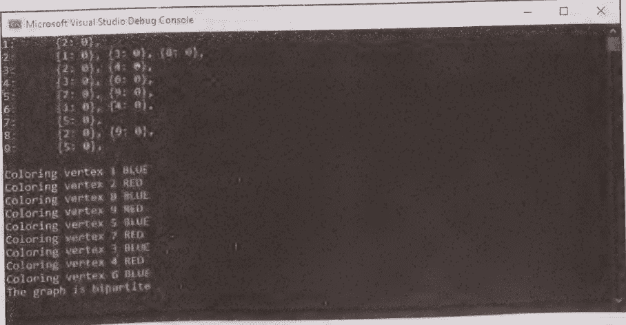

## 第6章：图算法 I

### 活动13：使用 DFS 判断图是否为二分图

在本活动中，我们将使用深度优先搜索遍历来检查图是否为二分图。按照以下步骤完成本活动：

- 1. 添加所需的头文件，并声明将要使用的图：

```cpp
#include <string>
#include <vector>
#include <iostream>
#include <set>
#include <map>
#include <stack>

template<typename T> class Graph;
```

- 2. 编写以下结构体来定义图中的边：

```cpp
template<typename T>
struct Edge
{
    size_t src;
    size_t dest;
    T weight;

    // To compare edges, only compare their weights,
    // and not the source/destination vertices
    inline bool operator< (const Edge<T>& e) const
    {
        return this->weight < e.weight;
    }

    inline bool operator> (const Edge<T>& e) const
    {
        return this->weight > e.weight;
    }
};
```

- 3. 使用以下函数为图重载 << 运算符，以便将图写入标准输出：

```cpp
template <typename T>
std::ostream& operator<<(std::ostream& os, const Graph<T>& G)
{
    for (auto i = 1; i < G.vertices(); i++)
    {
        os << i << "\t";

        auto edges = G.outgoing_edges(i);
        for (auto& e : edges)
            os << "{" << e.dest << ": " << e.weight << "}, ";

        os << std::endl;
    }

    return os;
}
```

- 4. 实现边列表图，如下所示：

```cpp
template<typename T>
class Graph
{
public:
    // Initialize the graph with N vertices
    Graph(size_t N) : V(N)
    {}

    // Return number of vertices in the graph
    auto vertices() const
    {
        return V;
    }
};
```


```cpp
while (!stack.empty())
{
    auto current_vertex = stack.top();
    stack.pop();

    // If the current vertex hasn't been visited in the past
    if (visited.find(current_vertex) == visited.end())
    {
        visited.insert(current_vertex);
        vertex_colors[current_vertex] = current_color;
        if (current_color == colors::RED)
        {
            std::cout << "Coloring vertex "
                      << current_vertex << " RED" << std::endl;
            current_color = colors::BLUE;
        }
        else
        {
            std::cout << "Coloring vertex "
                      << current_vertex << " BLUE" << std::endl;
            current_color = colors::RED;
        }

        // Add unvisited adjacent vertices to the stack.
        for (auto e : G.outgoing_edges(current_vertex))
            if (visited.find(e.dest) == visited.end())
                stack.push(e.dest);
    }
    // If the found vertex is already colored and
    // has a color same as its parent's color, the graph is not
    // bipartite
    else if (visited.find(current_vertex) != visited.end() &&
             ((vertex_colors[current_vertex] == colors::BLUE &&
               current_color == colors::BLUE) ||
              (vertex_colors[current_vertex] == colors::RED &&
               current_color == colors::RED)))
        return false;
}

// If all vertices have been colored, the graph is bipartite
return true;
}
```

7. 使用以下函数来实现测试和驱动程序代码，以测试我们的二分图检查算法的实现：

``` 
template <typename T>
void test_bipartite()
{
    // Create an instance of and print the graph
    auto BG = create_bipartite_reference_graph<T>();
    std::cout << BG << std::endl;

    if (bipartite_check<T>(BG))
        std::cout << "The graph is bipartite" << std::endl;
    else
        std::cout << "The graph is not bipartite" << std::endl;
}

int main()
{
    using T = unsigned;
    test_bipartite<T>();

    return 0;
}
```

8. 运行程序。您应该会看到以下输出：



图6.34：活动13的输出

3. 为**Graph**类重载<<运算符，使其能够输出到C++流中：

```cpp
template <typename T>
std::ostream& operator<<(std::ostream& os, const Graph<T>& G)
{
    for (auto i = 1; i < G.vertices(); i++)
    {
        os << i << "\t";

        auto edges = G.outgoing_edges(i);
        for (auto& e : edges)
            os << "{" << e.dest << ": " << e.weight << "}, ";

        os << std::endl;
    }

    return os;
}
```

4. 实现一个边列表图，如下所示：

```cpp
template<typename T>
class Graph
{
public:
    // Initialize the graph with N vertices
    Graph(size_t N) : V(N)
    {}

    // Return number of vertices in the graph
    auto vertices() const
    {
        return V;
    }

    // Return all edges in the graph
    auto& edges() const
    {
        return edge_list;
    }

    void add_edge(edge<T>&& e)
```

```cpp
{
    // Check if the source and destination vertices are within range
    if (e.src >= 1 && e.src <= V &&
        e.dest >= 1 && e.dest <= V)
        edge_list.emplace_back(e);
    else
        std::cerr << "Vertex out of bounds" << std::endl;
}

// Returns all outgoing edges from vertex v
auto outgoing_edges(size_t v) const
{
    std::vector<Edge<T>> edges_from_v;
    for (auto& e : edge_list)
    {
        if (e.src == v)
            edges_from_v.emplace_back(e);
    }
    return edges_from_v;
}

// Overloads the << operator so a graph be written directly to a
// stream
// Can be used as std::cout << obj << std::endl;
template <typename T>
friend std::ostream& operator<< (std::ostream& os, const Graph<T>& G);

private:
    size_t V;             // Stores number of vertices in graph
    std::vector<Edge<T>> edge_list;
};
```

+   5. 编写以下函数，以便你可以解析图文件并准备图：

```cpp
template <typename T>
auto read_graph_from_file()
{
    std::ifstream infile("USA-road-d.NY.gr");
    size_t num_vertices, num_edges;
```

6. 现在，我们需要一个结构体，它实现一个**Label**结构体，该结构体将在Dijkstra算法运行时分配给每个顶点。实现如下：

```cpp
template<typename T>
struct Label
{
    size_t vertex_ID;
    T distance_from_source;

    Label(size_t _id, T _distance) :
        vertex_ID(_id),
        distance_from_source(_distance)
    {}

    // To compare labels, only compare their distances from source
    inline bool operator < (const Label<T>& l) const
    {
        return this->distance_from_source < l.distance_from_source;
    }

    inline bool operator > (const Label<T>& l) const
    {
        return this->distance_from_source > l.distance_from_source;
    }

    inline bool operator() (const Label<T>& l) const
    {
        return this > l;
    }
};
```

7. Dijkstra算法可以如下实现：

```cpp
template <typename T>
auto dijkstra_shortest_path(const Graph<T>& G, size_t src, size_t dest)
{
    std::priority_queue<Label<T>, std::vector<Label<T>>,
    std::greater<Label<T>>> heap;
    std::set<int> visited;
    std::vector<size_t> parent(G.vertices());
    std::vector<T> distance(G.vertices(), std::numeric_limits<T>::max());
    std::vector<size_t> shortest_path;
```
